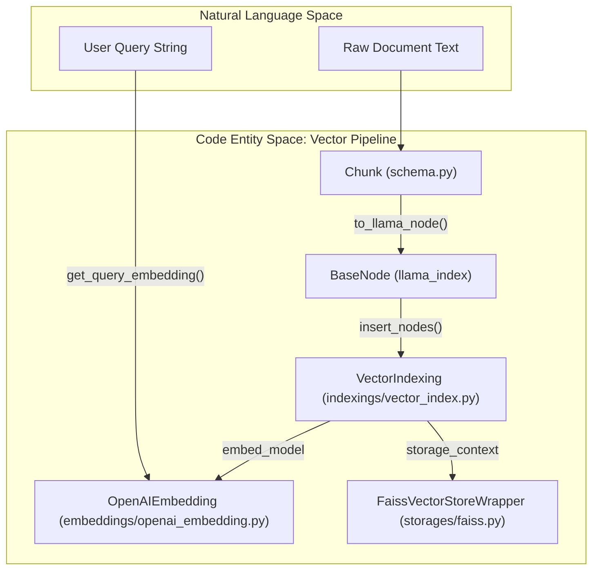
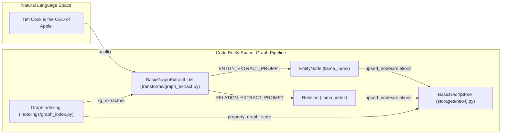

<!-- source: DeepWiki mcp.deepwiki.com · repo EvoAgentX/EvoAgentX · page 8.3 Embeddings and Indexing · fetched 2026-10-26 -->

# Embeddings and Indexing

Relevant source files

The following files were used as context for generating this wiki page:

- [evoagentx/prompts/rag/graph_extract.py](evoagentx/prompts/rag/graph_extract.py)
- [evoagentx/prompts/rag/graph_synonym.py](evoagentx/prompts/rag/graph_synonym.py)
- [evoagentx/prompts/rag/hyde.py](evoagentx/prompts/rag/hyde.py)
- [evoagentx/rag/embeddings/huggingface_embedding.py](evoagentx/rag/embeddings/huggingface_embedding.py)
- [evoagentx/rag/embeddings/ollama_embedding.py](evoagentx/rag/embeddings/ollama_embedding.py)
- [evoagentx/rag/embeddings/openai_embedding.py](evoagentx/rag/embeddings/openai_embedding.py)
- [evoagentx/rag/indexings/__init__.py](evoagentx/rag/indexings/__init__.py)
- [evoagentx/rag/indexings/base.py](evoagentx/rag/indexings/base.py)
- [evoagentx/rag/indexings/graph_index.py](evoagentx/rag/indexings/graph_index.py)
- [evoagentx/rag/indexings/summary_index.py](evoagentx/rag/indexings/summary_index.py)
- [evoagentx/rag/indexings/tree_index.py](evoagentx/rag/indexings/tree_index.py)
- [evoagentx/rag/indexings/vector_index.py](evoagentx/rag/indexings/vector_index.py)
- [evoagentx/rag/retrievers/base.py](evoagentx/rag/retrievers/base.py)
- [evoagentx/rag/retrievers/graph_retriever.py](evoagentx/rag/retrievers/graph_retriever.py)
- [evoagentx/rag/transforms/graph_extract.py](evoagentx/rag/transforms/graph_extract.py)
- [evoagentx/rag/transforms/query/HyDE.py](evoagentx/rag/transforms/query/HyDE.py)
- [evoagentx/rag/transforms/query/base.py](evoagentx/rag/transforms/query/base.py)
- [evoagentx/storages/graph_stores/neo4j.py](evoagentx/storages/graph_stores/neo4j.py)
- [evoagentx/storages/vectore_stores/faiss.py](evoagentx/storages/vectore_stores/faiss.py)

## Purpose and Scope

This document covers the embedding generation and indexing components of the RAG system in EvoAgentX. It explains how text and image chunks are converted to vector and graph representations, how different embedding providers (OpenAI, HuggingFace, Ollama, etc.) are configured, and how these representations are indexed using LlamaIndex integration for efficient retrieval.

For information about the overall RAG pipeline architecture, see [RAG Architecture](#8.1). For document chunking strategies that prepare text for embedding, see [Document Processing](#8.2). For how indices are queried during retrieval, see [Retrieval and Reranking](#8.4).

---

## System Overview

The embedding and indexing system transforms document chunks into searchable vector and property graph representations. The system supports multiple embedding providers and integrates with LlamaIndex for index management and storage operations.

### Natural Language to Code Entity Space: Vector Indexing
The following diagram bridges the conceptual "Vector Search" space to the specific implementation classes and data structures used in the EvoAgentX codebase.

**Sources:** [evoagentx/rag/indexings/vector_index.py:14-39](), [evoagentx/rag/embeddings/openai_embedding.py:21-38](), [evoagentx/storages/vectore_stores/faiss.py:11-19](), [evoagentx/rag/schema.py:260-305]()

---

## Embedding Providers

The system supports multiple embedding providers through the `BaseEmbeddingWrapper` interface. Each implementation wraps a LlamaIndex-compatible `BaseEmbedding` model.

### Supported Providers and Models

| Provider | Wrapper Class | Default Model | Key Files |
|----------|---------------|---------------|-----------|
| **OpenAI** | `OpenAIEmbeddingWrapper` | `text-embedding-3-small` | [embeddings/openai_embedding.py]() |
| **HuggingFace** | `HuggingFaceEmbeddingWrapper` | `all-MiniLM-L6-v2` | [embeddings/huggingface_embedding.py]() |
| **Ollama** | `OllamaEmbeddingWrapper` | `nomic-embed-text` | [embeddings/ollama_embedding.py]() |

### OpenAI Embedding
The `OpenAIEmbedding` class supports custom dimensions for `text-embedding-3` models (e.g., 1536 for small, 3072 for large) [evoagentx/rag/embeddings/openai_embedding.py:13-17](). It handles both synchronous `_get_text_embedding` and asynchronous `_aget_query_embedding` calls [evoagentx/rag/embeddings/openai_embedding.py:77-110]().

### HuggingFace Embedding
Uses the `sentence-transformers` library to run models locally [evoagentx/rag/embeddings/huggingface_embedding.py:3-10](). It automatically detects the embedding dimension from the loaded model [evoagentx/rag/embeddings/huggingface_embedding.py:42-43]().

### Ollama Embedding
Integrates with local Ollama instances. It includes a self-healing mechanism that attempts to pull the specified model if it is not found locally [evoagentx/rag/embeddings/ollama_embedding.py:63-72]().

**Sources:** [evoagentx/rag/embeddings/openai_embedding.py:127-168](), [evoagentx/rag/embeddings/huggingface_embedding.py:94-130](), [evoagentx/rag/embeddings/ollama_embedding.py:115-151]()

---

## Indexing Strategies

EvoAgentX provides specialized wrappers for LlamaIndex indices, primarily focusing on `VectorStoreIndex` and `PropertyGraphIndex`.

### Vector Indexing
The `VectorIndexing` class manages the lifecycle of vector embeddings within a `VectorStoreIndex` [evoagentx/rag/indexings/vector_index.py:14-24]().
- **Insertion**: Chunks are converted to LlamaIndex nodes and cached in `id_to_node` for quick access [evoagentx/rag/indexings/vector_index.py:69-86]().
- **Deduplication**: If a node ID already exists, the old node is deleted before the new one is inserted [evoagentx/rag/indexings/vector_index.py:72-75]().

### Graph Indexing
The `GraphIndexing` class implements a property graph using `PropertyGraphIndex` [evoagentx/rag/indexings/graph_index.py:25-36]().
- **Hybrid Search**: If a vector store is initialized in the `StorageHandler`, the graph index supports hybrid vector-graph queries [evoagentx/rag/indexings/graph_index.py:54-65]().
- **Knowledge Extraction**: Uses `BasicGraphExtractLLM` to identify entities and relations from text chunks [evoagentx/rag/indexings/graph_index.py:47-50]().

### Natural Language to Code Entity Space: Graph Pipeline
This diagram illustrates the transformation from text to a structured graph in the codebase.

**Sources:** [evoagentx/rag/indexings/graph_index.py:47-65](), [evoagentx/rag/transforms/graph_extract.py:18-45](), [evoagentx/storages/graph_stores/neo4j.py:21-105](), [evoagentx/prompts/rag/graph_extract.py:1-51]()

---

## Knowledge Graph Extraction

The `BasicGraphExtractLLM` class is a `TransformComponent` that performs two-stage extraction using an LLM:

1.  **Entity Extraction**: Uses `ENTITY_EXTRACT_PROMPT` to identify named objects (Person, Company, etc.) [evoagentx/rag/transforms/graph_extract.py:89-101]().
2.  **Relation Extraction**: Uses `RELATION_EXTRACT_PROMPT` to identify directed connections between those entities [evoagentx/rag/transforms/graph_extract.py:103-113]().

Extracted data is stored in the node's metadata under `KG_NODES_KEY` and `KG_RELATIONS_KEY` [evoagentx/rag/transforms/graph_extract.py:153-155]().

**Sources:** [evoagentx/rag/transforms/graph_extract.py:18-157](), [evoagentx/prompts/rag/graph_extract.py:1-51]()

---

## Retrieval Mechanisms

Retrieval is handled by specialized wrappers that bridge LlamaIndex retrievers with EvoAgentX's `RagResult` schema.

### Graph Retrieval
The `GraphRetriever` uses a multi-pronged approach:
- **Synonym Expansion**: `BasicLLMSynonymRetriever` uses an LLM to generate synonyms for query keywords to increase graph hit rates [evoagentx/rag/retrievers/graph_retriever.py:20-47]().
- **Vector Context**: If an embedding model is provided, it uses `VectorContextRetriever` to find relevant graph clusters via vector similarity [evoagentx/rag/retrievers/graph_retriever.py:130-141]().

### Vector Retrieval
The `VectorRetriever` performs standard top-k similarity searches. It dynamically updates the `similarity_top_k` parameter based on the `Query` object provided at runtime [evoagentx/rag/retrievers/vector_retriever.py:52-54]().

**Sources:** [evoagentx/rag/retrievers/graph_retriever.py:113-182](), [evoagentx/rag/retrievers/vector_retriever.py:11-84]()

---

## Storage Integration

Indices are backed by specific storage implementations defined in the `storages` module.

- **FAISS**: The `FaissVectorStoreWrapper` uses `FaissMapVectorStore` for local vector storage, supporting `flat_l2` and `ivf_flat` metrics [evoagentx/storages/vectore_stores/faiss.py:11-28]().
- **Neo4j**: The `Neo4jGraphStoreWrapper` provides a property graph backend. It includes a `BasicNeo4jStore` class that fixes common bugs in entity insertion and handles batch upserts of nodes and relations [evoagentx/storages/graph_stores/neo4j.py:21-105]().

**Sources:** [evoagentx/storages/vectore_stores/faiss.py:11-31](), [evoagentx/storages/graph_stores/neo4j.py:106-136]()

---

