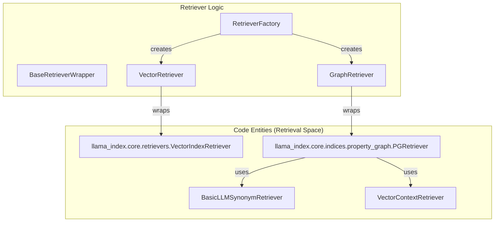
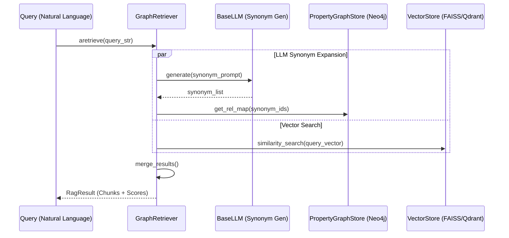

<!-- source: DeepWiki mcp.deepwiki.com · repo EvoAgentX/EvoAgentX · page 8.4 Retrieval and Reranking · fetched 2026-10-26 -->

# Retrieval and Reranking

Relevant source files

The following files were used as context for generating this wiki page:

- [evoagentx/prompts/rag/graph_extract.py](evoagentx/prompts/rag/graph_extract.py)
- [evoagentx/prompts/rag/graph_synonym.py](evoagentx/prompts/rag/graph_synonym.py)
- [evoagentx/prompts/rag/hyde.py](evoagentx/prompts/rag/hyde.py)
- [evoagentx/rag/chunkers/__init__.py](evoagentx/rag/chunkers/__init__.py)
- [evoagentx/rag/embeddings/__init__.py](evoagentx/rag/embeddings/__init__.py)
- [evoagentx/rag/embeddings/base.py](evoagentx/rag/embeddings/base.py)
- [evoagentx/rag/indexings/__init__.py](evoagentx/rag/indexings/__init__.py)
- [evoagentx/rag/indexings/base.py](evoagentx/rag/indexings/base.py)
- [evoagentx/rag/indexings/graph_index.py](evoagentx/rag/indexings/graph_index.py)
- [evoagentx/rag/indexings/vector_index.py](evoagentx/rag/indexings/vector_index.py)
- [evoagentx/rag/postprocessors/__init__.py](evoagentx/rag/postprocessors/__init__.py)
- [evoagentx/rag/postprocessors/base.py](evoagentx/rag/postprocessors/base.py)
- [evoagentx/rag/postprocessors/simple_reranker.py](evoagentx/rag/postprocessors/simple_reranker.py)
- [evoagentx/rag/rag_config.py](evoagentx/rag/rag_config.py)
- [evoagentx/rag/retrievers/__init__.py](evoagentx/rag/retrievers/__init__.py)
- [evoagentx/rag/retrievers/graph_retriever.py](evoagentx/rag/retrievers/graph_retriever.py)
- [evoagentx/rag/retrievers/vector_retriever.py](evoagentx/rag/retrievers/vector_retriever.py)
- [evoagentx/rag/transforms/graph_extract.py](evoagentx/rag/transforms/graph_extract.py)
- [evoagentx/rag/transforms/query/HyDE.py](evoagentx/rag/transforms/query/HyDE.py)
- [evoagentx/rag/transforms/query/base.py](evoagentx/rag/transforms/query/base.py)
- [evoagentx/storages/graph_stores/neo4j.py](evoagentx/storages/graph_stores/neo4j.py)
- [evoagentx/storages/vectore_stores/faiss.py](evoagentx/storages/vectore_stores/faiss.py)

This document details the retrieval and reranking mechanisms within the EvoAgentX RAG system. It covers the implementation of `VectorRetriever` and `GraphRetriever`, the query parameters governing search, and the post-processing pipeline featuring the `SimpleReranker`.

## Retrieval Architecture

The retrieval system transforms natural language queries into relevant document chunks by interfacing with the indexing layer. It supports semantic vector search and complex graph-based relationship traversal.

### Retrieval Component Hierarchy

Sources: [evoagentx/rag/retrievers/__init__.py:18-52](), [evoagentx/rag/retrievers/vector_retriever.py:8-19](), [evoagentx/rag/retrievers/graph_retriever.py:113-145]()

## Vector Retrieval

The `VectorRetriever` class handles semantic similarity searches. It leverages the `VectorStoreIndex` created during the indexing phase to find chunks whose embeddings are closest to the query vector.

### Implementation Details
- **Dynamic Top-K**: The `top_k` parameter can be adjusted per query via the `Query` object [evoagentx/rag/retrievers/vector_retriever.py:24-25]().
- **Result Mapping**: It converts LlamaIndex `NodeWithScore` objects back into EvoAgentX `Chunk` objects, preserving similarity scores in the metadata [evoagentx/rag/retrievers/vector_retriever.py:33-39]().

Sources: [evoagentx/rag/retrievers/vector_retriever.py:8-84]()

## Graph Retrieval

`GraphRetriever` provides a hybrid retrieval strategy that combines knowledge graph traversal with vector search. It orchestrates multiple "sub-retrievers" to gather context.

### Sub-Retriever Components
1. **BasicLLMSynonymRetriever**: Uses an LLM to expand the query into synonyms. It then matches these synonyms against entity IDs in the `PropertyGraphStore` [evoagentx/rag/retrievers/graph_retriever.py:20-111]().
2. **VectorContextRetriever**: If a vector store is available, this component performs standard semantic search to provide additional context [evoagentx/rag/retrievers/graph_retriever.py:130-141]().

### Graph Data Flow

Sources: [evoagentx/rag/retrievers/graph_retriever.py:84-111](), [evoagentx/rag/retrievers/graph_retriever.py:147-179]()

## Query Parameters and Configuration

Retrieval behavior is governed by the `RetrievalConfig` and the `Query` schema.

### RetrievalConfig Parameters
| Parameter | Type | Default | Description |
|-----------|------|---------|-------------|
| `retrivel_type` | `str` | `VECTOR` | Type of retriever to use (`VECTOR` or `GRAPH`) |
| `postprocessor_type`| `str` | `SIMPLE` | Type of reranker/post-processor |
| `top_k` | `int` | `5` | Number of chunks to retrieve |
| `similarity_cutoff` | `float`| `0.7` | Threshold for filtering low-confidence results |

Sources: [evoagentx/rag/rag_config.py:50-58]()

## Post-Processing and Reranking

After initial retrieval, results can be refined using post-processors. The primary implementation is the `SimpleReranker`.

### SimpleReranker
The `SimpleReranker` acts as a refinement step to improve precision. It typically utilizes a cross-encoder or a stronger LLM to re-evaluate the relevance of the retrieved `top_k` chunks against the original query.

### Post-Processing Pipeline
1. **Retrieve**: Get initial `top_k` candidates from `VectorRetriever` or `GraphRetriever`.
2. **Filter**: Apply `similarity_cutoff` and `metadata_filters` defined in `RetrievalConfig` [evoagentx/rag/rag_config.py:56-58]().
3. **Rerank**: Use `SimpleReranker` to re-order the candidates based on deeper semantic understanding.
4. **Final Selection**: Return the final sorted `RagResult`.

Sources: [evoagentx/rag/postprocessors/simple_reranker.py:1-20](), [evoagentx/rag/rag_config.py:54-55]()

## Summary Table: Retrieval vs. Code Entities

| System Concept | Code Entity | File Path |
|----------------|-------------|-----------|
| Vector Search | `VectorRetriever` | [evoagentx/rag/retrievers/vector_retriever.py:8-9]() |
| Graph Search | `GraphRetriever` | [evoagentx/rag/retrievers/graph_retriever.py:113-114]() |
| LLM Synonyms | `BasicLLMSynonymRetriever` | [evoagentx/rag/retrievers/graph_retriever.py:20-21]() |
| Hybrid Retrieval| `PGRetriever` | [evoagentx/rag/retrievers/graph_retriever.py:143-145]() |
| Reranking | `SimpleReranker` | [evoagentx/rag/postprocessors/simple_reranker.py:1-10]() |

Sources: [evoagentx/rag/retrievers/vector_retriever.py](), [evoagentx/rag/retrievers/graph_retriever.py](), [evoagentx/rag/postprocessors/simple_reranker.py]()

---

