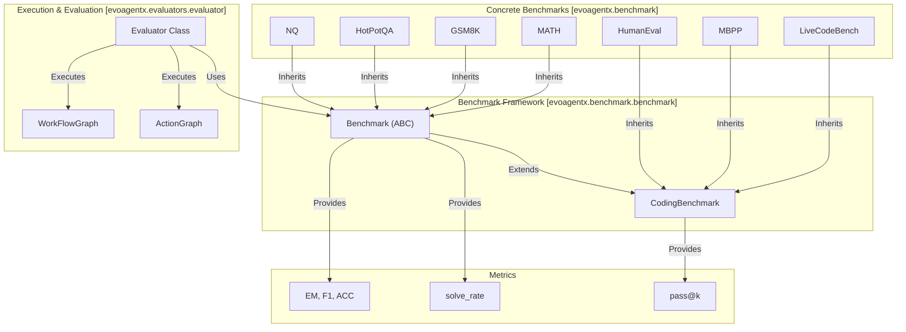
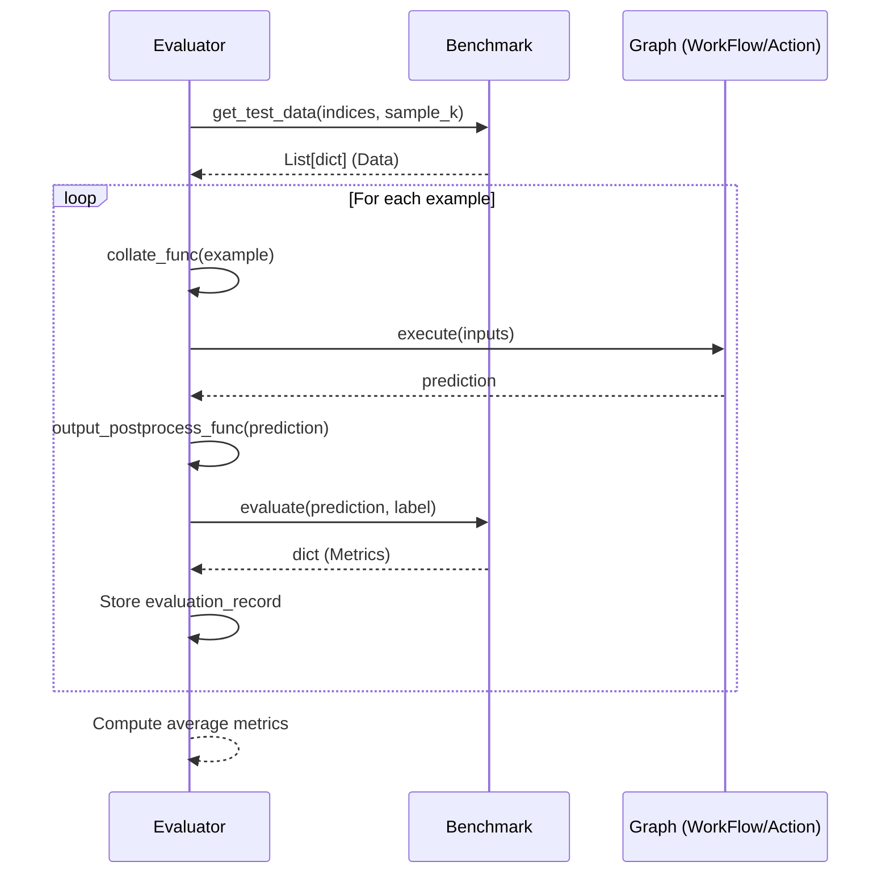

<!-- source: DeepWiki mcp.deepwiki.com · repo EvoAgentX/EvoAgentX · page 9 Benchmarking and Evaluation · fetched 2026-10-26 -->

# Benchmarking and Evaluation

Relevant source files

The following files were used as context for generating this wiki page:

- [evoagentx/benchmark/README.md](evoagentx/benchmark/README.md)
- [evoagentx/benchmark/__init__.py](evoagentx/benchmark/__init__.py)
- [evoagentx/benchmark/benchmark.py](evoagentx/benchmark/benchmark.py)
- [evoagentx/benchmark/humaneval.py](evoagentx/benchmark/humaneval.py)
- [evoagentx/benchmark/mbpp.py](evoagentx/benchmark/mbpp.py)
- [evoagentx/core/callbacks.py](evoagentx/core/callbacks.py)
- [evoagentx/core/logging.py](evoagentx/core/logging.py)
- [evoagentx/core/parser.py](evoagentx/core/parser.py)
- [evoagentx/evaluators/evaluator.py](evoagentx/evaluators/evaluator.py)
- [evoagentx/optimizers/optimizer.py](evoagentx/optimizers/optimizer.py)
- [tests/src/evaluator/test_evaluator.py](tests/src/evaluator/test_evaluator.py)

This document covers the comprehensive benchmarking and evaluation system in EvoAgentX, which provides standardized performance assessment capabilities for agentic workflows. The system includes multiple benchmark datasets, evaluation frameworks, and integration with optimization algorithms for continuous improvement.

For information about optimization algorithms that use these benchmarks, see [Optimization and Evolution](#10).

## Benchmark Framework Architecture

The EvoAgentX benchmarking system is built around the `Benchmark` abstract base class, which defines standardized interfaces for loading data, retrieving examples, and performing evaluation across three splits: `train`, `dev`, and `test`.

**Sources:** [evoagentx/benchmark/benchmark.py:13-111](), [evoagentx/evaluators/evaluator.py:20-51](), [evoagentx/benchmark/__init__.py:1-21]()

## Available Benchmarks

The framework supports seven core benchmark datasets across three task categories. For details, see [Available Benchmarks](#9.2).

### Benchmark Dataset Overview

| Task Category | Dataset | Train Examples | Dev Examples | Test Examples | Metrics |
|---------------|---------|----------------|--------------|---------------|---------|
| QA | NQ | 79,168 | 8,757 | 3,610 | EM, F1, ACC |
| Multi-Hop QA | HotPotQA | 90,447 | 7,405 | - | EM, F1, ACC |
| Math | GSM8K | 7,473 | - | 1,319 | solve_rate |
| Math | MATH | 7,500 | - | 5,000 | solve_rate |
| Code Generation | HumanEval | - | - | 164 | pass@k |
| Code Generation | MBPP | - | - | 427 | pass@k |
| Code Generation | LiveCodeBench | - | - | 400-880 | pass@k |

**Sources:** [evoagentx/benchmark/README.md:8-18](), [evoagentx/benchmark/README.md:34-179]()

### Specialized AFlow Variants
The framework includes specialized variants (e.g., `AFlowHumanEval`, `AFlowMBPP`) that utilize specific data splits and testing logic optimized for the AFlow optimization workflow.

**Sources:** [evoagentx/benchmark/humaneval.py:159-168](), [evoagentx/benchmark/mbpp.py:176-183]()

## Evaluation System

The `Evaluator` class is the central component for measuring performance. It supports parallel evaluation using a `ThreadPoolExecutor` and handles the execution of both `WorkFlowGraph` and `ActionGraph` instances. For details, see [Evaluation System](#9.3).

**Sources:** [evoagentx/evaluators/evaluator.py:74-111](), [evoagentx/evaluators/evaluator.py:146-175](), [tests/src/evaluator/test_evaluator.py:41-56]()

### Key Evaluator Features
- **Concurrency:** Uses `num_workers` to parallelize evaluations across multiple threads [evoagentx/evaluators/evaluator.py:39]().
- **Custom Processing:** Supports `collate_func` for input preparation and `output_postprocess_func` for result cleaning [evoagentx/evaluators/evaluator.py:41-49]().
- **Record Keeping:** Maintains an `_evaluation_records` dictionary containing predictions, labels, metrics, and execution trajectories [evoagentx/evaluators/evaluator.py:59-60]().

## Performance Metrics

The framework calculates various standard metrics depending on the benchmark type. For details, see [Performance Metrics](#9.4).

- **QA Metrics:** Exact Match (EM), F1 Score, and Accuracy (ACC) [evoagentx/benchmark/README.md:38]().
- **Math Metrics:** Solve rate (ratio of correctly solved problems) [evoagentx/benchmark/README.md:82]().
- **Code Metrics:** Pass@k (probability that at least one of $k$ generated solutions passes unit tests) [evoagentx/benchmark/README.md:124]().

### Timeout Management
Evaluation logic often includes safety mechanisms like `TimeoutContext` to prevent long-running code execution or LLM hangs from stalling the evaluation pipeline.

**Sources:** [evoagentx/core/callbacks.py:142-171](), [evoagentx/benchmark/benchmark.py:8]()

## Integration with Optimization

The evaluation system provides the feedback loop for the `Optimizer` classes. The `evaluate` method of an `Optimizer` typically calls an `Evaluator` instance to determine if a mutation or prompt adjustment has improved the agent's performance.

**Sources:** [evoagentx/optimizers/optimizer.py:15-20](), [evoagentx/optimizers/optimizer.py:35-39]()

---

