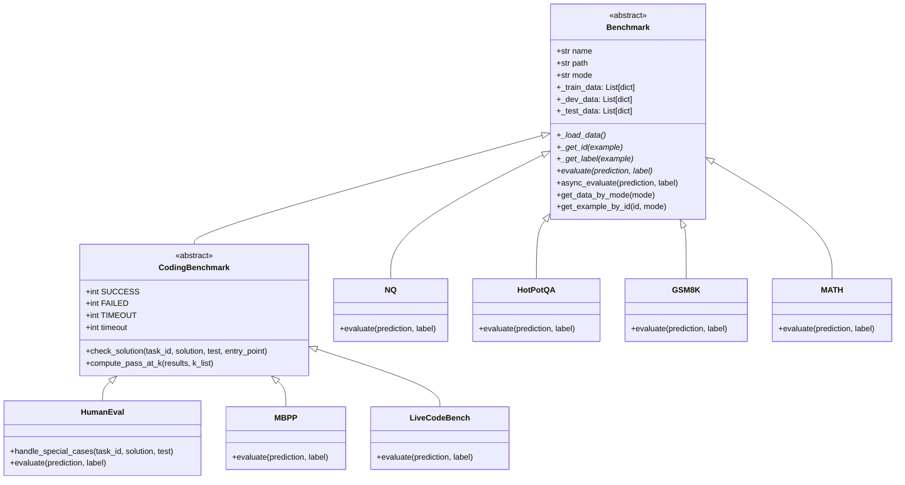
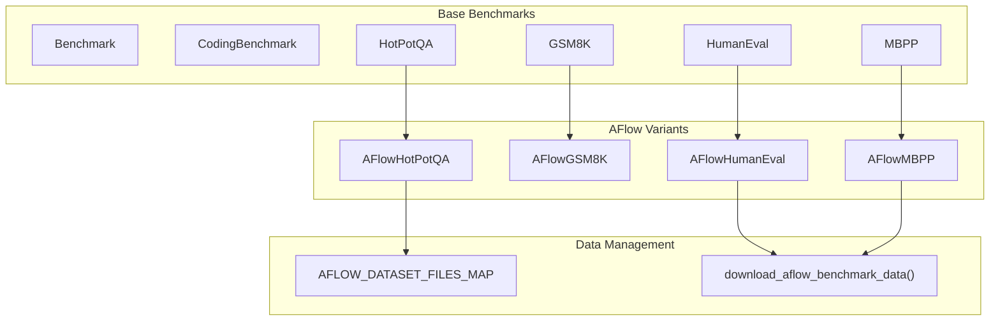
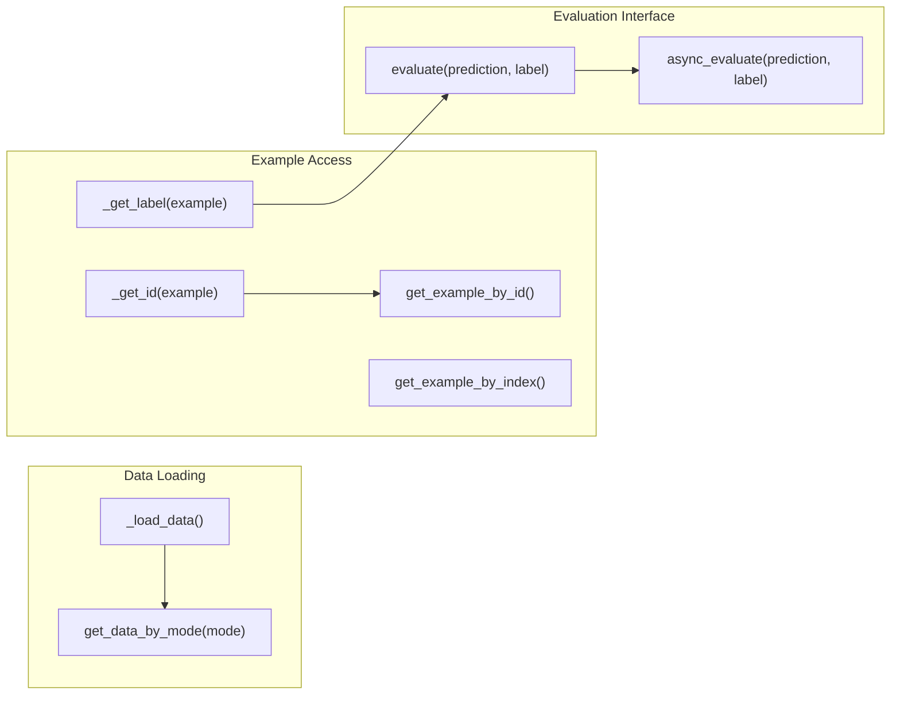
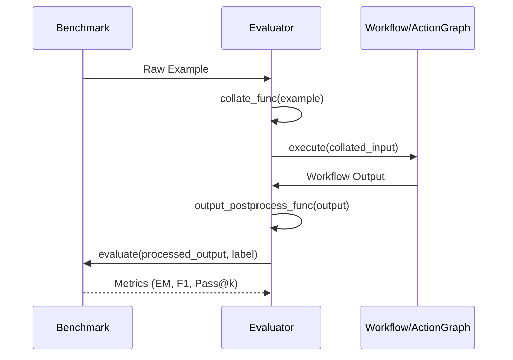

<!-- source: DeepWiki mcp.deepwiki.com · repo EvoAgentX/EvoAgentX · page 9.1 Benchmark Framework · fetched 2026-10-26 -->

# Benchmark Framework

<details>
<summary>Relevant source files</summary>

The following files were used as context for generating this wiki page:

- [.github/workflows/style.yaml](.github/workflows/style.yaml)
- [.github/workflows/test.yaml](.github/workflows/test.yaml)
- [docs/modules/benchmark.md](docs/modules/benchmark.md)
- [docs/modules/evaluator.md](docs/modules/evaluator.md)
- [docs/tutorial/benchmark_and_evaluation.md](docs/tutorial/benchmark_and_evaluation.md)
- [evoagentx/benchmark/README.md](evoagentx/benchmark/README.md)
- [evoagentx/benchmark/__init__.py](evoagentx/benchmark/__init__.py)
- [evoagentx/benchmark/benchmark.py](evoagentx/benchmark/benchmark.py)
- [evoagentx/benchmark/humaneval.py](evoagentx/benchmark/humaneval.py)
- [evoagentx/benchmark/mbpp.py](evoagentx/benchmark/mbpp.py)
- [evoagentx/evaluators/__init__.py](evoagentx/evaluators/__init__.py)
- [examples/benchmark_and_evaluation.py](examples/benchmark_and_evaluation.py)

</details>


The benchmark framework provides a standardized interface for evaluating AI agent performance across diverse tasks including question answering, mathematical reasoning, and code generation. It defines abstract base classes that concrete benchmark implementations extend, handles dataset loading and management, and integrates with the evaluation and optimization systems.

For information about using benchmarks within evaluation workflows, see [Evaluation System](9.3). For details on available benchmark datasets, see [Available Benchmarks](9.2).

## Architecture Overview

The benchmark framework is built around a hierarchical class structure with abstract base classes defining common interfaces and concrete implementations for specific datasets.

### Core Class Hierarchy



Sources: `[evoagentx/benchmark/benchmark.py:13-111]()`, `[evoagentx/benchmark/__init__.py:1-21]()`

### AFlow Integration Architecture

The framework includes specialized AFlow variants that support asynchronous evaluation and workflow integration. These classes typically inherit from the base benchmark (e.g., `AFlowMBPP` inherits from `MBPP`) and utilize specific data utilities for downloading optimized splits.



Sources: `[evoagentx/benchmark/humaneval.py:159-175]()`, `[evoagentx/benchmark/mbpp.py:176-185]()`, `[evoagentx/benchmark/hotpotqa.py:2-2]()`

## Core Interfaces

### Abstract Base Class: Benchmark

The `Benchmark` class defines the standard interface that all benchmarks must implement. It provides the foundation for data split management (`train`, `dev`, `test`) and the evaluation lifecycle.



Key abstract methods that must be implemented:
- `_load_data()`: Load dataset from `self.path` into internal variables `_train_data`, `_dev_data`, or `_test_data` `[evoagentx/benchmark/benchmark.py:47-51]()`.
- `_get_id(example)`: Return the unique identifier for a given example `[evoagentx/benchmark/benchmark.py:54-58]()`.
- `_get_label(example)`: Return the ground-truth label for an example `[evoagentx/benchmark/benchmark.py:61-71]()`.
- `evaluate(prediction, label)`: Synchronous method to evaluate a prediction against a label `[evoagentx/benchmark/benchmark.py:74-85]()`.

Sources: `[evoagentx/benchmark/benchmark.py:13-112]()`

### Specialized Base Class: CodingBenchmark

For code generation tasks, `CodingBenchmark` extends `Benchmark` with code execution and testing capabilities. It introduces the `check_solution` method which handles the actual execution of generated code against unit tests.

| Method | Purpose | Return Type |
|--------|---------|-------------|
| `check_solution()` | Execute solution against test cases | `Tuple[int, str]` |
| `compute_pass_at_k()` | Calculate pass@k metrics | `Dict[str, float]` |
| `handle_special_cases()` | Handle dataset-specific edge cases | `Tuple[str, str]` |

The `check_solution()` method returns status codes:
- `SUCCESS = 0`: Solution passes all tests `[evoagentx/benchmark/benchmark.py:230-230]()`.
- `FAILED = 1`: Solution fails tests `[evoagentx/benchmark/benchmark.py:231-231]()`.
- `TIMEOUT = 2`: Execution exceeds time limit `[evoagentx/benchmark/benchmark.py:232-232]()`.

Sources: `[evoagentx/benchmark/benchmark.py:227-313]()`

## Data Loading and Management

### Data Structure Organization

Benchmarks organize data into three splits with consistent internal representation. The `mode` parameter in the constructor (`"train"`, `"dev"`, `"test"`, or `"all"`) determines which split is active `[evoagentx/benchmark/benchmark.py:20-35]()`.

| Split | Internal Variable | Description |
|-------|-------------------|-------------|
| Train | `_train_data` | Used for few-shot prompting or optimization training `[evoagentx/benchmark/benchmark.py:39-39]()`. |
| Dev | `_dev_data` | Used for validation during evolution `[evoagentx/benchmark/benchmark.py:40-40]()`. |
| Test | `_test_data` | Used for final performance evaluation `[evoagentx/benchmark/benchmark.py:41-41]()`. |

Data is retrieved using `get_data_by_mode(mode)`, which checks if the requested data split has been loaded and returns it as a list of dictionaries `[evoagentx/benchmark/benchmark.py:112-132]()`.

Sources: `[evoagentx/benchmark/benchmark.py:20-132]()`

### Example Data Formats

The following table summarizes common data formats for supported benchmarks:

| Benchmark | ID Field | Key Data Fields | Source |
|-----------|----------|-----------------|--------|
| **NQ** | `id` | `question`, `answers` | `[evoagentx/benchmark/README.md:50-56]()` |
| **HotPotQA** | `_id` | `question`, `answer`, `context`, `supporting_facts` | `[evoagentx/benchmark/README.md:70-77]()` |
| **GSM8K** | `id` | `question`, `answer` | `[evoagentx/benchmark/README.md:95-100]()` |
| **HumanEval**| `task_id`| `prompt`, `entry_point`, `test`, `canonical_solution` | `[evoagentx/benchmark/humaneval.py:42-48]()` |
| **MBPP** | `task_id`| `prompt`, `code`, `test_list` | `[evoagentx/benchmark/mbpp.py:94-100]()` |

Sources: `[evoagentx/benchmark/README.md:36-150]()`, `[evoagentx/benchmark/humaneval.py:32-52]()`, `[evoagentx/benchmark/mbpp.py:81-104]()`

## Evaluation Mechanisms

### Synchronous vs Asynchronous Evaluation

The base `Benchmark` class provides an `async_evaluate` method that wraps the synchronous `evaluate` implementation using `asyncio.to_thread`. This allows benchmarks to be integrated into asynchronous evaluation pipelines without blocking the event loop.

```python
async def async_evaluate(self, prediction: Any, label: Any) -> dict:
    return await asyncio.to_thread(self.evaluate, prediction, label)
```
Sources: `[evoagentx/benchmark/benchmark.py:87-98]()`

### Evaluator Integration

The `Evaluator` class serves as the primary engine for running benchmarks. It bridges the gap between raw benchmark data and the agent workflows through two key mapping functions:

1.  **`collate_func`**: Transforms a raw benchmark example into the dictionary format expected by a `WorkFlowGraph` or `ActionGraph` `[docs/modules/evaluator.md:102-107]()`.
2.  **`output_postprocess_func`**: Extracts the final answer from the workflow output to match the format required by the benchmark's `evaluate` method `[docs/modules/evaluator.md:109-114]()`.



Sources: `[docs/modules/evaluator.md:36-45]()`, `[examples/benchmark_and_evaluation.py:25-53]()`

### Code Execution and Testing

For `CodingBenchmark` implementations like `HumanEval` and `MBPP`, the `evaluate` method performs functional testing. It executes the generated code within a sandbox-like environment (often involving `sanitize` and `timeout` decorators) to determine correctness.

In `HumanEval`, the `evaluate` method:
1.  Retrieves the original prompt for the `task_id`.
2.  Concatenates the prompt with the predicted solution.
3.  Calls `check_solution` to run the code against unit tests provided in the `label` `[evoagentx/benchmark/humaneval.py:112-128]()`.
4.  Computes `pass@k` based on the success/failure of the execution `[evoagentx/benchmark/humaneval.py:130-133]()`.

Sources: `[evoagentx/benchmark/humaneval.py:98-134]()`, `[evoagentx/benchmark/benchmark.py:254-313]()`

---

