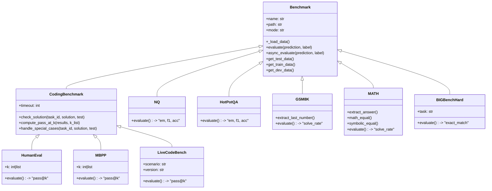
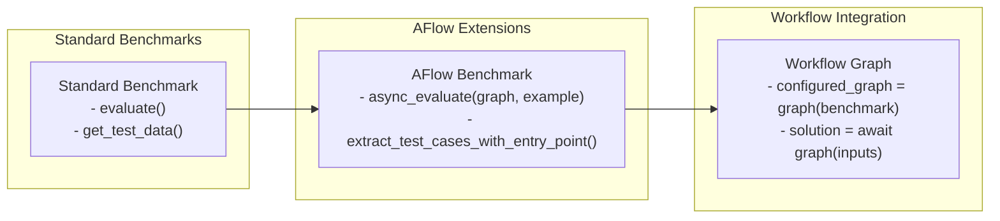

<!-- source: DeepWiki mcp.deepwiki.com · repo EvoAgentX/EvoAgentX · page 9.2 Available Benchmarks · fetched 2026-10-26 -->

# Available Benchmarks

<details>
<summary>Relevant source files</summary>

The following files were used as context for generating this wiki page:

- [docs/tutorial/evoprompt_optimizer.md](docs/tutorial/evoprompt_optimizer.md)
- [docs/zh/tutorial/evoprompt_optimizer_zh.md](docs/zh/tutorial/evoprompt_optimizer_zh.md)
- [evoagentx/benchmark/README.md](evoagentx/benchmark/README.md)
- [evoagentx/benchmark/__init__.py](evoagentx/benchmark/__init__.py)
- [evoagentx/benchmark/benchmark.py](evoagentx/benchmark/benchmark.py)
- [evoagentx/benchmark/bigbenchhard.py](evoagentx/benchmark/bigbenchhard.py)
- [evoagentx/benchmark/gsm8k.py](evoagentx/benchmark/gsm8k.py)
- [evoagentx/benchmark/hotpotqa.py](evoagentx/benchmark/hotpotqa.py)
- [evoagentx/benchmark/humaneval.py](evoagentx/benchmark/humaneval.py)
- [evoagentx/benchmark/lcb_utils/code_generation.py](evoagentx/benchmark/lcb_utils/code_generation.py)
- [evoagentx/benchmark/lcb_utils/evaluation.py](evoagentx/benchmark/lcb_utils/evaluation.py)
- [evoagentx/benchmark/livecodebench.py](evoagentx/benchmark/livecodebench.py)
- [evoagentx/benchmark/mbpp.py](evoagentx/benchmark/mbpp.py)
- [evoagentx/benchmark/measures.py](evoagentx/benchmark/measures.py)
- [evoagentx/benchmark/nq.py](evoagentx/benchmark/nq.py)
- [evoagentx/evaluators/aflow_evaluator.py](evoagentx/evaluators/aflow_evaluator.py)
- [evoagentx/optimizers/aflow_optimizer.py](evoagentx/optimizers/aflow_optimizer.py)
- [evoagentx/optimizers/evoprompt_optimizer.py](evoagentx/optimizers/evoprompt_optimizer.py)
- [evoagentx/workflow/action_graph.py](evoagentx/workflow/action_graph.py)
- [evoagentx/workflow/operators.py](evoagentx/workflow/operators.py)
- [examples/optimization/evoprompt/evoprompt_bestconfig_json.py](examples/optimization/evoprompt/evoprompt_bestconfig_json.py)
- [examples/optimization/evoprompt/evoprompt_save_load_json_min.py](examples/optimization/evoprompt/evoprompt_save_load_json_min.py)
- [examples/optimization/evoprompt/evoprompt_workflow.py](examples/optimization/evoprompt/evoprompt_workflow.py)
- [tests/src/benchmark/lcb_solutions.py](tests/src/benchmark/lcb_solutions.py)
- [tests/src/benchmark/test_gsm8k.py](tests/src/benchmark/test_gsm8k.py)
- [tests/src/benchmark/test_hotpotqa.py](tests/src/benchmark/test_hotpotqa.py)
- [tests/src/benchmark/test_livecodebench.py](tests/src/benchmark/test_livecodebench.py)
- [tests/src/benchmark/test_nq.py](tests/src/benchmark/test_nq.py)
- [tests/src/workflow/test_action_graph.py](tests/src/workflow/test_action_graph.py)

</details>


This page documents the comprehensive benchmark suite available in EvoAgentX for evaluating agent and workflow performance across diverse tasks. The benchmarks cover question answering, mathematical reasoning, and code generation domains, with both standard implementations and AFlow-optimized variants.

For information about the evaluation framework and metrics, see [Evaluation System](#9.3). For details on optimization using these benchmarks, see [Optimization Framework](#10.1).

## Benchmark Architecture

EvoAgentX provides a unified benchmark architecture built around base classes that define common interfaces for data loading, evaluation, and metric computation.

### Base Class Hierarchy



Sources: [evoagentx/benchmark/benchmark.py:13-313](), [evoagentx/benchmark/__init__.py:1-22](), [evoagentx/benchmark/bigbenchhard.py:66-178]()

### Benchmark Ecosystem Overview

```mermaid
graph TB
    subgraph "Question Answering"
        NQ["NQ<br/>Natural Questions<br/>79k train, 3.6k test"]
        HotPotQA["HotPotQA<br/>Multi-hop QA<br/>90k train, 7.4k dev"]
    end
    
    subgraph "Mathematical Reasoning" 
        GSM8K["GSM8K<br/>Grade School Math<br/>7.5k train, 1.3k test"]
        MATH["MATH<br/>Competition Math<br/>7.5k train, 5k test"]
    end
    
    subgraph "Code Generation"
        HumanEval["HumanEval<br/>Python Functions<br/>164 problems"]
        MBPP["MBPP<br/>Basic Python<br/>427 problems"]
        LiveCodeBench["LiveCodeBench<br/>Live Problems<br/>300+ problems"]
    end

    subgraph "Reasoning Tasks"
        BBH["BIGBenchHard<br/>23 Challenging Tasks<br/>Logic, Arithmetic, etc."]
    end
    
    subgraph "AFlow Variants"
        AFlowHotPotQA["AFlowHotPotQA"]
        AFlowGSM8K["AFlowGSM8K"] 
        AFlowHumanEval["AFlowHumanEval"]
        AFlowMBPP["AFlowMBPP"]
    end
    
    subgraph "Evaluation Metrics"
        QAMetrics["Exact Match<br/>F1 Score<br/>Accuracy"]
        MathMetrics["Solve Rate"]
        CodeMetrics["Pass@k"]
        BBHMetrics["Exact Match"]
    end
    
    NQ --> QAMetrics
    HotPotQA --> QAMetrics
    GSM8K --> MathMetrics
    MATH --> MathMetrics
    HumanEval --> CodeMetrics
    MBPP --> CodeMetrics
    LiveCodeBench --> CodeMetrics
    BBH --> BBHMetrics
    
    HotPotQA -.-> AFlowHotPotQA
    GSM8K -.-> AFlowGSM8K
    HumanEval -.-> AFlowHumanEval
    MBPP -.-> AFlowMBPP
```



Sources: [evoagentx/benchmark/README.md:8-19](), [evoagentx/benchmark/__init__.py:9-21](), [evoagentx/benchmark/bigbenchhard.py:22-35]()

## Question Answering Benchmarks

### NQ (Natural Questions)

The `NQ` class implements the Natural Questions benchmark for single-hop question answering using real Google search queries.

**Dataset Structure:**
```json
{
    "id": "test-1", 
    "question": "the question", 
    "answers": ["possible answers"]
}
```

**Key Features:**
- 79,168 training examples, 8,757 dev, 3,610 test
- Evaluates using exact match, F1 score, and accuracy
- Based on DPR dataset splits

Sources: [evoagentx/benchmark/README.md:40-56]()

### HotPotQA (Multi-hop Question Answering)

The `HotPotQA` class handles multi-hop reasoning questions requiring information synthesis across multiple context paragraphs.

**Dataset Structure:**
```json
{
    "_id": "example_id", 
    "question": "the question", 
    "answer": "the answer", 
    "context": [["context_title", ["sentences"]]],
    "supporting_facts": [["supporting_title", sentence_index]]
}
```

**Key Features:**
- 90,447 training examples, 7,405 dev examples
- Distractor setting with supporting and irrelevant context
- Evaluates multi-step reasoning capabilities via `evaluate()` which computes `f1`, `em`, and `acc` [evoagentx/benchmark/hotpotqa.py:68-72]().

Sources: [evoagentx/benchmark/hotpotqa.py:23-73](), [evoagentx/benchmark/README.md:59-77]()

## Mathematical Reasoning Benchmarks

### GSM8K (Grade School Math)

The `GSM8K` class implements evaluation for grade school level math word problems requiring multi-step reasoning.

**Dataset Structure:**
```json
{
    "id": "test-1", 
    "question": "the question", 
    "answer": "the answer"
}
```

**Key Methods:**
- `extract_last_number()`: Extracts final numerical answer using regex.
- `evaluate()`: Compares numerical values with tolerance for floating point precision.

Sources: [evoagentx/benchmark/gsm8k.py:39-108](), [evoagentx/benchmark/README.md:84-100]()

### MATH (Competition Mathematics)

The `MATH` class handles advanced mathematics problems from competitions like AMC, AIME.

**Dataset Structure:**
```json
{
    "id": "test-1", 
    "problem": "the problem", 
    "solution": "step-by-step solution",
    "level": "Level 1-5",
    "type": "Algebra|Geometry|..."
}
```

**Key Methods:**
- `extract_answer()`: Parses mathematical expressions from solutions.
- `math_equal()`: Compares mathematical expressions for equivalence.
- `symbolic_equal()`: Uses SymPy for symbolic mathematical comparison.

Sources: [evoagentx/benchmark/README.md:102-121](), [evoagentx/benchmark/math_benchmark.py:5-15]()

## Code Generation Benchmarks

### HumanEval

The `HumanEval` class evaluates Python function generation from natural language descriptions.

**Dataset Structure:**
```json
{
    "task_id": "HumanEval/0", 
    "prompt": "function signature with docstring", 
    "entry_point": "function_name",
    "canonical_solution": "reference implementation", 
    "test": "unit test cases"
}
```

**Evaluation Process:**
1. Sanitizes generated code using `sanitize()` function.
2. Executes solution with unit tests in isolated environment via `check_solution()` [evoagentx/benchmark/humaneval.py:119-124]().
3. Computes `pass@k` metrics across multiple attempts using `compute_pass_at_k()` [evoagentx/benchmark/humaneval.py:131]().

Sources: [evoagentx/benchmark/humaneval.py:32-134](), [evoagentx/benchmark/README.md:126-144]()

### MBPP (Mostly Basic Python Problems)

The `MBPP` class handles entry-level Python programming problems converted to HumanEval format.

**Data Transformation:**
- Converts original MBPP format to standardized HumanEval structure in `load_mbpp_data()` [evoagentx/benchmark/mbpp.py:17-78]().
- Extracts function headers and creates unit test wrappers.
- Handles special cases like task ID 56 with function name conflicts [evoagentx/benchmark/mbpp.py:61-65]().

**Key Methods:**
- `extract_func_name()`: Parses function names from code headers.
- `extract_func_header()`: Builds complete function signatures.
- Inherits code execution and `pass@k` computation from `CodingBenchmark`.

Sources: [evoagentx/benchmark/mbpp.py:81-173](), [evoagentx/benchmark/README.md:146-165]()

### LiveCodeBench

The `LiveCodeBench` class provides contamination-free evaluation with recent programming problems.

**Scenarios:**
- `code_generation`: Generate complete solutions.
- `test_output_prediction`: Predict test case outputs.
- `code_execution`: Execute and debug code.

**Versions:** Supports multiple data releases with 400-880 problems each [evoagentx/benchmark/README.md:16]().

Sources: [evoagentx/benchmark/README.md:168-177](), [evoagentx/benchmark/livecodebench.py:1-20]()

## Reasoning and General Benchmarks

### BIGBenchHard (BBH)

The `BIGBenchHard` class implements a subset of 23 challenging tasks from the BIG-bench evaluation suite, specifically focusing on tasks where LLMs previously struggled.

**Task Categories:**
- **Multiple Choice Tasks**: e.g., `temporal_sequences`, `logical_deduction_seven_objects`, `movie_recommendation` [evoagentx/benchmark/bigbenchhard.py:22-27]().
- **Free Form Tasks**: e.g., `multistep_arithmetic_two`, `word_sorting`, `object_counting` [evoagentx/benchmark/bigbenchhard.py:29-32]().

**Evaluation:**
- Uses `exact_match_score` to compare the model's target string against the ground truth [evoagentx/benchmark/bigbenchhard.py:177]().
- Supports random sampling for dev sets via `dev_sample_num` [evoagentx/benchmark/bigbenchhard.py:156-162]().

Sources: [evoagentx/benchmark/bigbenchhard.py:1-178]()

### WorfBench

WorfBench is supported as part of the broader benchmark suite for evaluating complex workflow reasoning, often utilized in conjunction with the optimization framework to refine agent behavior.

## AFlow Integration

AFlow variants of benchmarks extend base implementations with workflow-specific features for the AFlow optimization framework.

### AFlow Benchmark Features



**Key Differences:**
- `async_evaluate()`: Takes workflow graphs as input instead of raw predictions [evoagentx/benchmark/hotpotqa.py:98-108]().
- Custom data loading from AFlow-formatted files via `_load_data_from_file()` using `AFLOW_DATASET_FILES_MAP` [evoagentx/benchmark/hotpotqa.py:81-88]().
- Integration with `AFlowEvaluator` for optimization workflows [evoagentx/evaluators/aflow_evaluator.py:14-25]().

Sources: [evoagentx/benchmark/hotpotqa.py:75-109](), [evoagentx/evaluators/aflow_evaluator.py:30-97]()

## Benchmark Usage Patterns

### Basic Usage

```python
# Load benchmark
from evoagentx.benchmark import HumanEval
benchmark = HumanEval(path="~/.evoagentx/data/humaneval")

# Get test data
test_data = benchmark.get_test_data(sample_k=10, seed=42)

# Evaluate prediction
example = test_data[0]
label = benchmark.get_label(example)
metrics = benchmark.evaluate(prediction="def solution():\n    return 42", label=label)
```

### Workflow Evaluation

```python
# AFlow benchmark usage
from evoagentx.benchmark import AFlowHumanEval
from evoagentx.evaluators import AFlowEvaluator

benchmark = AFlowHumanEval()
evaluator = AFlowEvaluator(llm=my_llm)

# Evaluate workflow graph
avg_score, avg_cost, total_cost, failed = await evaluator.graph_evaluate_async(
    benchmark=benchmark, 
    graph=my_workflow_graph,
    is_test=True,
    max_concurrent_tasks=20
)
```

Sources: [evoagentx/benchmark/benchmark.py:112-225](), [evoagentx/evaluators/aflow_evaluator.py:30-97]()

## Integration with Optimization

Benchmarks integrate seamlessly with the optimization system through standardized evaluation interfaces:

- **Evoprompt Optimization**: Uses benchmarks like `BIGBenchHard` to calculate fitness scores for prompt populations [evoagentx/optimizers/evoprompt_optimizer.py:31, 125]().
- **AFlow Optimization**: Employs AFlow benchmark variants for workflow structure optimization, tracking scores across rounds [evoagentx/optimizers/aflow_optimizer.py:96-117]().

Sources: [evoagentx/optimizers/evoprompt_optimizer.py:38-124](), [evoagentx/optimizers/aflow_optimizer.py:30-66]()

---

