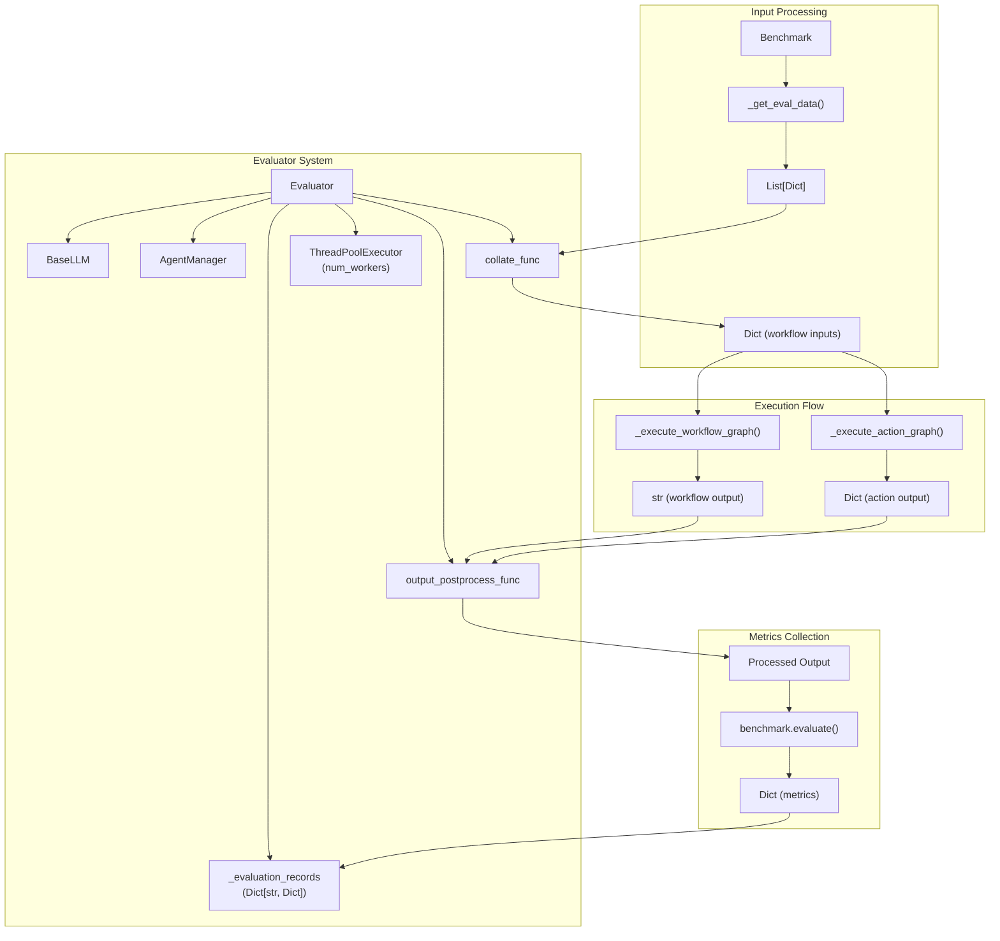
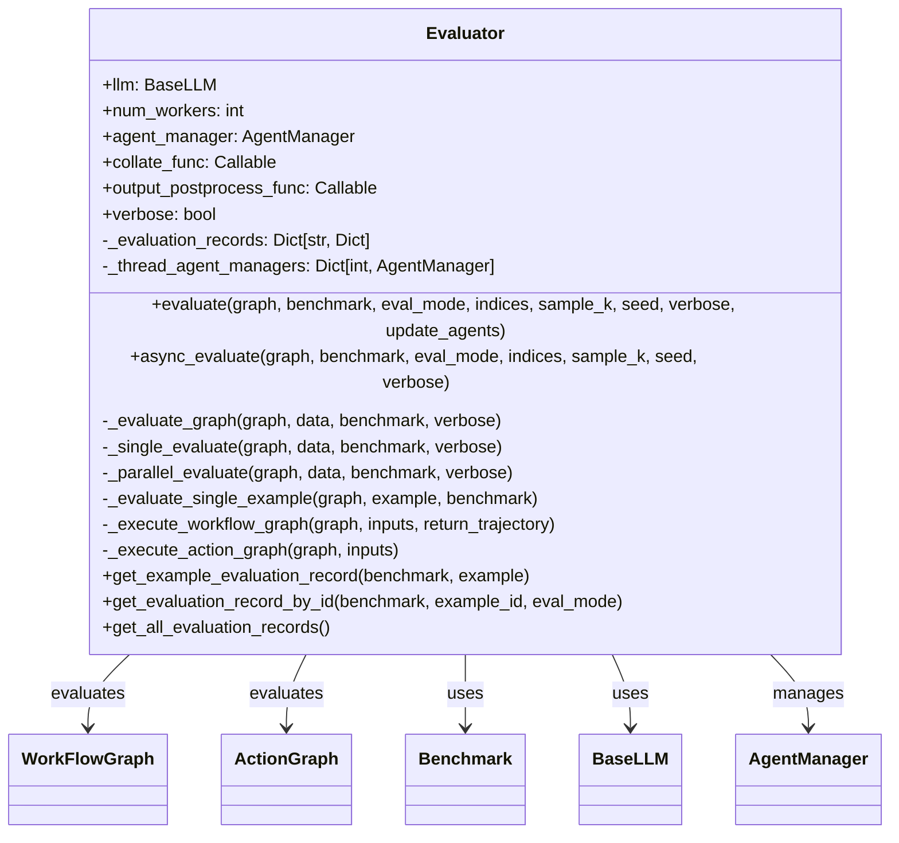
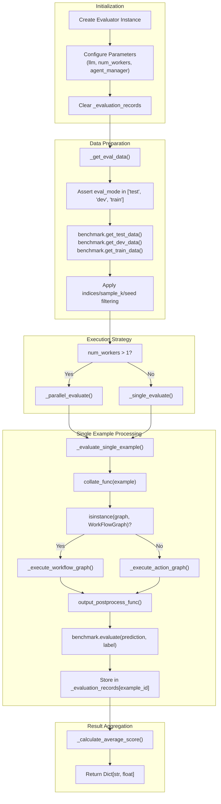
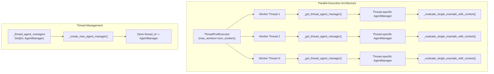
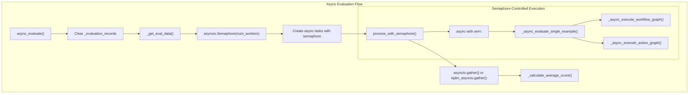
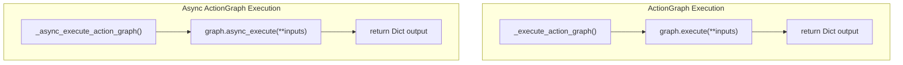
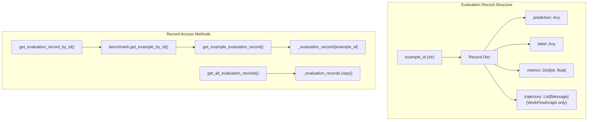
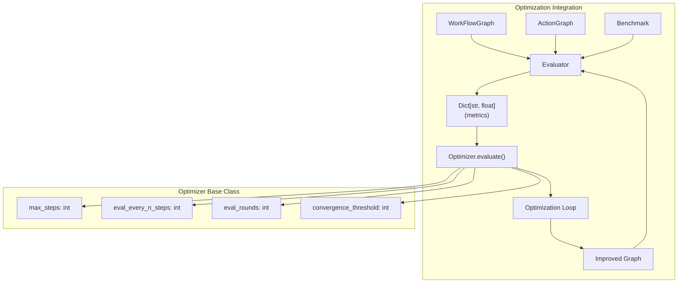

<!-- source: DeepWiki mcp.deepwiki.com · repo EvoAgentX/EvoAgentX · page 9.3 Evaluation System · fetched 2026-10-26 -->

# Evaluation System

<details>
<summary>Relevant source files</summary>

The following files were used as context for generating this wiki page:

- [.github/workflows/style.yaml](.github/workflows/style.yaml)
- [.github/workflows/test.yaml](.github/workflows/test.yaml)
- [docs/modules/benchmark.md](docs/modules/benchmark.md)
- [docs/modules/evaluator.md](docs/modules/evaluator.md)
- [docs/tutorial/benchmark_and_evaluation.md](docs/tutorial/benchmark_and_evaluation.md)
- [evoagentx/core/callbacks.py](evoagentx/core/callbacks.py)
- [evoagentx/core/logging.py](evoagentx/core/logging.py)
- [evoagentx/core/parser.py](evoagentx/core/parser.py)
- [evoagentx/evaluators/__init__.py](evoagentx/evaluators/__init__.py)
- [evoagentx/evaluators/evaluator.py](evoagentx/evaluators/evaluator.py)
- [evoagentx/optimizers/optimizer.py](evoagentx/optimizers/optimizer.py)
- [examples/benchmark_and_evaluation.py](examples/benchmark_and_evaluation.py)
- [tests/src/evaluator/test_evaluator.py](tests/src/evaluator/test_evaluator.py)

</details>


This document provides comprehensive documentation of the `Evaluator` framework in EvoAgentX, which is responsible for performance assessment and metrics collection. The `Evaluator` class executes workflows against benchmark datasets and calculates performance metrics, enabling objective comparison between workflow versions and facilitating automated optimization.

For information about available benchmarks, see [Available Benchmarks](9.2). For optimization techniques that use evaluation results, see [Optimization](10).

## Evaluator Architecture

The `Evaluator` class serves as the central orchestrator for workflow performance assessment. It coordinates workflow execution, manages parallel processing, and collects detailed evaluation metrics.

### Core Evaluator Components



Sources: [evoagentx/evaluators/evaluator.py:20-62](), [evoagentx/evaluators/evaluator.py:152-200]()

## Evaluator Class Structure

The `Evaluator` class provides comprehensive workflow assessment capabilities with support for both synchronous and asynchronous evaluation modes.

### Class Definition and Configuration



The `Evaluator` constructor accepts several key parameters:

| Parameter | Type | Description |
|-----------|------|-------------|
| `llm` | `BaseLLM` | Language model for workflow execution [evoagentx/evaluators/evaluator.py:38-38]() |
| `num_workers` | `int` | Number of parallel evaluation workers [evoagentx/evaluators/evaluator.py:39-39]() |
| `agent_manager` | `AgentManager` | Manages agents for `WorkFlowGraph` evaluation [evoagentx/evaluators/evaluator.py:40-40]() |
| `collate_func` | `Callable` | Transforms benchmark examples to workflow inputs [evoagentx/evaluators/evaluator.py:41-45]() |
| `output_postprocess_func` | `Callable` | Processes workflow outputs before evaluation [evoagentx/evaluators/evaluator.py:46-49]() |
| `verbose` | `bool` | Controls progress bar display [evoagentx/evaluators/evaluator.py:50-50]() |

Sources: [evoagentx/evaluators/evaluator.py:24-61]()

## Evaluation Process Flow

The evaluation process orchestrates workflow execution across benchmark datasets with support for both single-threaded and parallel execution modes.

### Core Evaluation Workflow



Sources: [evoagentx/evaluators/evaluator.py:74-111](), [evoagentx/evaluators/evaluator.py:152-200](), [evoagentx/evaluators/evaluator.py:324-348]()

### Thread-Safe Parallel Execution

The evaluator implements thread-safe parallel execution with dedicated agent managers per thread:



Sources: [evoagentx/evaluators/evaluator.py:234-250](), [evoagentx/evaluators/evaluator.py:252-267](), [evoagentx/evaluators/evaluator.py:268-296]()

## Synchronous and Asynchronous Evaluation

The `Evaluator` class supports both synchronous and asynchronous evaluation modes to accommodate different execution environments and performance requirements.

### Synchronous Evaluation

The primary `evaluate()` method provides synchronous workflow evaluation with configurable parallelism:

| Parameter | Type | Default | Description |
|-----------|------|---------|-------------|
| `graph` | `Union[WorkFlowGraph, ActionGraph]` | - | Workflow to evaluate [evoagentx/evaluators/evaluator.py:90-90]() |
| `benchmark` | `Benchmark` | - | Benchmark dataset [evoagentx/evaluators/evaluator.py:91-91]() |
| `eval_mode` | `str` | `"test"` | Data split: `"test"`, `"dev"`, or `"train"` [evoagentx/evaluators/evaluator.py:92-92]() |
| `indices` | `Optional[List[int]]` | `None` | Specific example indices [evoagentx/evaluators/evaluator.py:93-93]() |
| `sample_k` | `Optional[int]` | `None` | Random sample size [evoagentx/evaluators/evaluator.py:94-94]() |
| `seed` | `Optional[int]` | `None` | Random seed for sampling [evoagentx/evaluators/evaluator.py:81-81]() |
| `verbose` | `Optional[bool]` | `None` | Override verbosity [evoagentx/evaluators/evaluator.py:95-95]() |
| `update_agents` | `Optional[bool]` | `False` | Update agents from workflow [evoagentx/evaluators/evaluator.py:96-96]() |

The method returns a `Dict[str, float]` containing aggregated metrics across all evaluated examples [evoagentx/evaluators/evaluator.py:98-98]().

Sources: [evoagentx/evaluators/evaluator.py:74-111]()

### Asynchronous Evaluation

The `async_evaluate()` method provides non-blocking evaluation using asyncio concurrency control:



The async implementation uses `asyncio.Semaphore` to limit concurrent executions and prevent resource exhaustion [evoagentx/evaluators/evaluator.py:384-384]().

Sources: [evoagentx/evaluators/evaluator.py:370-434](), [evoagentx/evaluators/evaluator.py:436-480]()

## Workflow Execution Modes

The evaluator handles two distinct workflow types with specialized execution methods.

### WorkFlowGraph Execution

For `WorkFlowGraph` instances, the evaluator creates isolated `WorkFlow` instances with graph state management:

```mermaid
flowchart TD
    subgraph "WorkFlowGraph Execution"
        ExecWFGraph["_execute_workflow_graph()"] --> CheckAM["agent_manager is None?"]
        CheckAM -->|Yes| RaiseError["raise ValueError"]
        CheckAM -->|No| CopyGraph["WorkFlowGraph(goal=graph.goal, graph=graph)"]
        CopyGraph --> ResetGraph["graph_copy.reset_graph()"]
        ResetGraph --> CreateWorkflow["WorkFlow(llm, graph_copy, agent_manager)"]
        CreateWorkflow --> Execute["workflow.execute(inputs)"]
        Execute --> CheckTrajectory["return_trajectory?"]
        CheckTrajectory -->|Yes| ReturnWithTraj["return (output, trajectory)"]
        CheckTrajectory -->|No| ReturnOutput["return output"]
    end
    
    subgraph "Async WorkFlowGraph Execution"
        AsyncExecWF["_async_execute_workflow_graph()"] --> CreateLocalAM["Create local AgentManager copy"]
        CreateLocalAM --> AsyncWorkflow["WorkFlow(llm, graph_copy, local_agent_manager)"]
        AsyncWorkflow --> AsyncExecute["workflow.async_execute(inputs)"]
    end
```



Sources: [evoagentx/evaluators/evaluator.py:113-135](), [evoagentx/evaluators/evaluator.py:488-515]()

### ActionGraph Execution

For `ActionGraph` instances, the evaluator directly invokes the graph's execution methods:



Sources: [evoagentx/evaluators/evaluator.py:137-150](), [evoagentx/evaluators/evaluator.py:482-486]()

## Evaluation Records Management

The evaluator maintains detailed records for each evaluated example, enabling post-evaluation analysis and debugging.

### Record Structure

Each evaluation record contains:



Sources: [evoagentx/evaluators/evaluator.py:188-195](), [evoagentx/evaluators/evaluator.py:350-368]()

### Usage Examples

The evaluation system provides comprehensive workflow assessment capabilities:

| Method | Purpose | Return Type |
|--------|---------|-------------|
| `evaluate()` | Synchronous evaluation with parallel support | `Dict[str, float]` |
| `async_evaluate()` | Asynchronous evaluation with semaphore control | `Dict[str, float]` |
| `get_example_evaluation_record()` | Retrieve single example results | `Optional[Dict]` |
| `get_evaluation_record_by_id()` | Retrieve results by example ID | `Optional[Dict]` |
| `get_all_evaluation_records()` | Retrieve complete evaluation history | `Dict[str, Dict]` |

Common evaluation patterns include:

```python
# Configure evaluator with custom processing functions
evaluator = Evaluator(
    llm=llm,
    num_workers=4,
    agent_manager=agent_manager,
    collate_func=lambda x: {"processed_" + k: v for k, v in x.items()},
    output_postprocess_func=lambda x: x.upper() if isinstance(x, str) else x,
    verbose=True
)

# Evaluate with specific data sampling
results = evaluator.evaluate(
    graph=workflow_graph,
    benchmark=benchmark,
    eval_mode="dev",
    sample_k=100,
    seed=42
)
```

Sources: [tests/src/evaluator/test_evaluator.py:114-133](), [tests/src/evaluator/test_evaluator.py:134-154]()

## Integration with Optimization

The evaluation system integrates with optimization components to enable iterative improvement of workflows:



Sources: [evoagentx/optimizers/optimizer.py:12-45]()

The base `Optimizer` class uses evaluation results through the `evaluate()` method to:

1. Measure current workflow performance against benchmarks [evoagentx/optimizers/optimizer.py:35-39]()
2. Provide feedback for optimization algorithms [evoagentx/optimizers/optimizer.py:23-27]()
3. Support convergence checking based on performance improvements [evoagentx/optimizers/optimizer.py:41-45]()
4. Enable automated workflow refinement cycles [evoagentx/optimizers/optimizer.py:29-33]()

## Best Practices for Evaluation

1. **Choose appropriate benchmarks** for your task type (QA, code generation, math, etc.) as detailed in [docs/modules/benchmark.md:8-18]().
2. **Use a sufficient sample size** to get statistically significant results via the `sample_k` parameter [evoagentx/evaluators/evaluator.py:94-94]().
3. **Maintain separate validation and test sets** by using the `eval_mode` argument [evoagentx/evaluators/evaluator.py:92-92]().
4. **Parallelize evaluation** using `num_workers` to speed up the process [evoagentx/evaluators/evaluator.py:39-39]().
5. **Suppress unnecessary logs** during evaluation using `suppress_logger_info` to maintain clean output [evoagentx/core/callbacks.py:102-137]().

## Conclusion

The EvoAgentX evaluation system provides a robust framework for assessing workflow performance across different task types. By standardizing the evaluation process, it enables objective comparison between different workflow designs and facilitates automated optimization.

---

