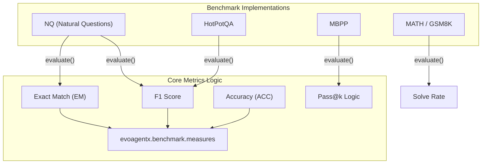
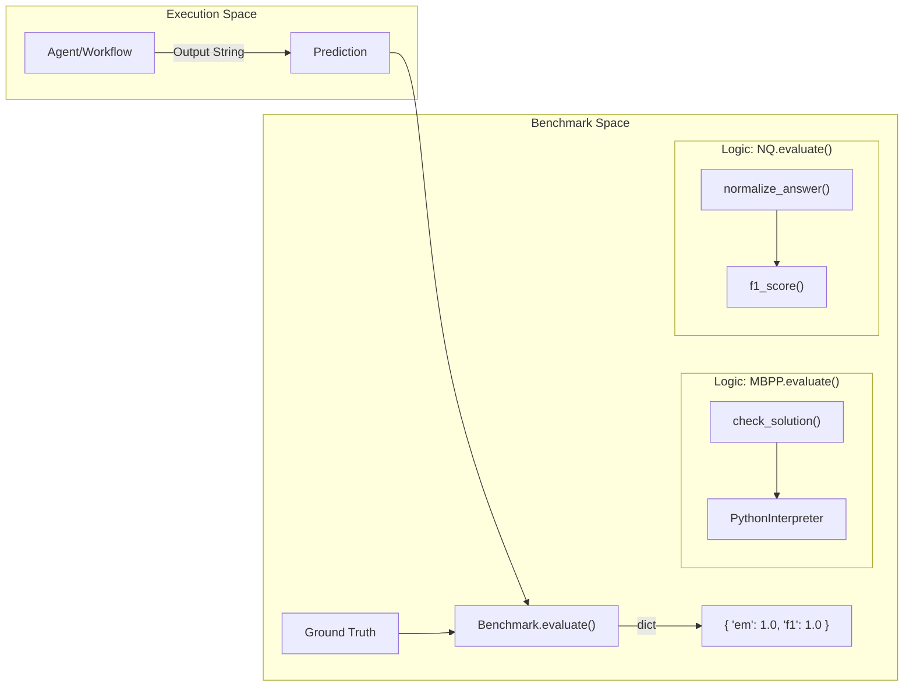

<!-- source: DeepWiki mcp.deepwiki.com · repo EvoAgentX/EvoAgentX · page 9.4 Performance Metrics · fetched 2026-10-26 -->

# Performance Metrics

<details>
<summary>Relevant source files</summary>

The following files were used as context for generating this wiki page:

- [evoagentx/benchmark/README.md](evoagentx/benchmark/README.md)
- [evoagentx/benchmark/__init__.py](evoagentx/benchmark/__init__.py)
- [evoagentx/benchmark/benchmark.py](evoagentx/benchmark/benchmark.py)
- [evoagentx/benchmark/humaneval.py](evoagentx/benchmark/humaneval.py)
- [evoagentx/benchmark/mbpp.py](evoagentx/benchmark/mbpp.py)
- [evoagentx/benchmark/measures.py](evoagentx/benchmark/measures.py)
- [evoagentx/benchmark/nq.py](evoagentx/benchmark/nq.py)
- [tests/src/benchmark/test_gsm8k.py](tests/src/benchmark/test_gsm8k.py)
- [tests/src/benchmark/test_hotpotqa.py](tests/src/benchmark/test_hotpotqa.py)
- [tests/src/benchmark/test_nq.py](tests/src/benchmark/test_nq.py)

</details>


This document explains the standard performance metrics used in EvoAgentX benchmarks: F1 score, Pass@1, solve rate, exact match, and accuracy. These metrics quantify workflow and agent performance across different task types, enabling systematic evaluation and optimization.

For information about the benchmark framework, see [9.1 Benchmark Framework](). For details about the evaluation system that computes these metrics, see [9.3 Evaluation System]().

## Overview

EvoAgentX uses task-specific performance metrics to evaluate workflow quality. Each benchmark implements its own `evaluate()` method that returns a metrics dictionary, allowing for domain-appropriate scoring [evoagentx/benchmark/benchmark.py:74-85](). The primary metrics are:

- **F1 Score**: For retrieval and question-answering tasks (NQ, HotPotQA).
- **Pass@k**: For code generation tasks (HumanEval, MBPP).
- **Solve Rate**: For mathematical reasoning tasks (MATH, GSM8K).
- **Exact Match (EM) & Accuracy (ACC)**: For standard QA and classification.

**Metrics System Architecture**


Sources: [evoagentx/benchmark/benchmark.py:74-85](), [evoagentx/benchmark/nq.py:84-88](), [evoagentx/benchmark/measures.py:1-100]()

## Standard Metrics

### Exact Match (EM) and Accuracy (ACC)

**Definition**: 
- **Exact Match (EM)**: Requires the predicted answer to be exactly the same as the ground truth after normalization [evoagentx/benchmark/README.md:38-38]().
- **Accuracy (ACC)**: In the context of EvoAgentX QA, ACC typically requires that the predicted answer *contains* the ground-truth answer [evoagentx/benchmark/README.md:38-38]().

**Implementation**:
Normalization is performed via `normalize_answer`, which removes articles, fixes whitespace, and removes punctuation [evoagentx/benchmark/measures.py:14-22]().

**Used By**: NQ, HotPotQA.

Sources: [evoagentx/benchmark/measures.py:14-30](), [evoagentx/benchmark/README.md:38-38]()

### F1 Score

**Definition**: The harmonic mean of precision and recall. It measures the token overlap between the prediction and the ground truth [evoagentx/benchmark/measures.py:33-52]().

**Formula**:
```
Precision = Number of shared tokens / Number of tokens in prediction
Recall = Number of shared tokens / Number of tokens in ground truth
F1 = 2 * (Precision * Recall) / (Precision + Recall)
```

**Interpretation**:
- **1.0**: Perfect token overlap.
- **0.0**: No shared tokens (or if the prediction is 'yes'/'no' and doesn't match the label) [evoagentx/benchmark/measures.py:38-41]().

**Used By**: NQ, HotPotQA [evoagentx/benchmark/nq.py:84-88]().

Sources: [evoagentx/benchmark/measures.py:33-52](), [evoagentx/benchmark/nq.py:84-88]()

### Pass@k

**Definition**: The probability that at least one of the $k$ generated samples passes the unit tests [evoagentx/benchmark/README.md:124-124]().

**Technical Details**:
For $k=1$, it is simply the ratio of problems where the first generated solution passes all tests [evoagentx/benchmark/humaneval.py:111-128](). Solutions are verified using a `check_solution` method which executes code in a sandbox [evoagentx/benchmark/mbpp.py:158-163]().

**Used By**: HumanEval, MBPP, LiveCodeBench.

Sources: [evoagentx/benchmark/humaneval.py:111-133](), [evoagentx/benchmark/mbpp.py:150-172](), [evoagentx/benchmark/README.md:124-124]()

### Solve Rate

**Definition**: The ratio of the number of examples solved correctly to the total number of examples [evoagentx/benchmark/README.md:82-82]().

**Technical Details**:
For math problems (GSM8K), this involves extracting the final numerical answer (often following `####`) and comparing it to the ground truth [tests/src/benchmark/test_gsm8k.py:60-73]().

**Used By**: GSM8K, MATH.

Sources: [evoagentx/benchmark/README.md:82-82](), [tests/src/benchmark/test_gsm8k.py:80-90]()

## Benchmark-Metric Mapping

| Task Category | Benchmark | Primary Metrics | Evaluation Method |
| :--- | :--- | :--- | :--- |
| **QA** | NQ | EM, F1, ACC | `ems()`, `f1_score()`, `acc_score()` [evoagentx/benchmark/nq.py:84-88]() |
| **Multi-Hop QA** | HotPotQA | EM, F1, ACC | Token-level overlap & normalization [evoagentx/benchmark/README.md:38-38]() |
| **Math** | GSM8K, MATH | Solve Rate | Last number extraction & comparison [tests/src/benchmark/test_gsm8k.py:80-90]() |
| **Code Gen** | HumanEval, MBPP | Pass@k | Unit test execution [evoagentx/benchmark/mbpp.py:158-163]() |

Sources: [evoagentx/benchmark/README.md:8-18](), [evoagentx/benchmark/__init__.py:1-21]()

## Technical Implementation and Data Flow

The `Benchmark` abstract class defines the interface for evaluation [evoagentx/benchmark/benchmark.py:13-18](). Subclasses implement `evaluate(prediction, label)` to return a dictionary of results [evoagentx/benchmark/benchmark.py:74-85]().

**Data Flow: From Prediction to Metric**


Sources: [evoagentx/benchmark/benchmark.py:74-85](), [evoagentx/benchmark/mbpp.py:150-172](), [evoagentx/benchmark/nq.py:84-88]()

### Interpreting Results

Metrics are typically interpreted as percentages or decimals in the range $[0, 1]$.
- **F1/EM/ACC**: Higher values indicate better alignment with human-annotated answers [evoagentx/benchmark/measures.py:24-30]().
- **Pass@1**: A value of 1.0 means the code is functionally correct according to the provided test suite [evoagentx/benchmark/humaneval.py:128-128]().
- **Solve Rate**: Reflects the reasoning capability of the agent in reaching the correct final numerical result [tests/src/benchmark/test_gsm8k.py:81-86]().

### Asynchronous Evaluation
The framework supports `async_evaluate`, which wraps the synchronous evaluation in a thread to prevent blocking the event loop during heavy metric computations (like code execution) [evoagentx/benchmark/benchmark.py:87-98]().

Sources: [evoagentx/benchmark/benchmark.py:87-98](), [evoagentx/benchmark/mbpp.py:137-147]()

---

