# Page: Overview

# Overview

<details>
<summary>Relevant source files</summary>

The following files were used as context for generating this wiki page:

- [README-zh.md](README-zh.md)
- [README.md](README.md)
- [assets/EAXLoGo.svg](assets/EAXLoGo.svg)
- [docs/assets/logo.svg](docs/assets/logo.svg)
- [docs/index.md](docs/index.md)
- [docs/overrides/main.html](docs/overrides/main.html)
- [docs/stylesheets/extra.css](docs/stylesheets/extra.css)
- [docs/zh/index.md](docs/zh/index.md)
- [evoagentx/agents/__init__.py](evoagentx/agents/__init__.py)
- [evoagentx/agents/action_agent.py](evoagentx/agents/action_agent.py)
- [evoagentx/core/registry.py](evoagentx/core/registry.py)
- [evoagentx/workflow/__init__.py](evoagentx/workflow/__init__.py)
- [examples/action_agent.py](examples/action_agent.py)
- [mkdocs.yml](mkdocs.yml)

</details>


## Purpose and Scope

This document provides an introduction to the EvoAgentX framework, its core purpose as a framework for building, evaluating, and evolving LLM-based agentic workflows, and a high-level architecture overview. EvoAgentX is an automated ecosystem that enables developers and researchers to move beyond static prompt chaining or manual workflow orchestration by introducing self-evolving capabilities.

For detailed installation instructions, see [Installation and Setup](#1.1). For fundamental concepts and terminology, see [Key Concepts](#1.2).

## What is EvoAgentX

EvoAgentX is an open-source framework designed to automate the complete lifecycle of agentic workflows. The system transforms natural language goals into executable multi-agent workflows, evaluates their performance, and iteratively optimizes them using various evolution algorithms—much like how software is continuously tested and improved.

### Core Design Philosophy

EvoAgentX enables users to go from a vague idea to a fully functional agentic system with minimal engineering. The framework is built on several pillars:

1.  **Workflow Autoconstruction**: Building structured, multi-agent workflows tailored to a task from a single prompt via `WorkFlowGenerator` [evoagentx/workflow/workflow_generator.py:7-7]().
2.  **Built-in Evaluation**: Integrating automatic evaluators to score agent behavior using task-specific criteria.
3.  **Self-Evolution Engine**: Improving workflows using optimization strategies like textual gradients, mutation, and guided search.
4.  **Human-in-the-Loop (HITL)**: Supporting interactive workflows where humans review, correct, and guide agent behavior via the `HITLManager` [evoagentx/hitl/__init__.py]().

**Sources:** [README.md:38-40](), [README.md:41-70](), [docs/index.md:12-46]()

## Core Architecture

EvoAgentX follows a modular, layered architecture that bridges high-level natural language goals with low-level code execution and tool interaction.

### System Architecture Diagram

This diagram illustrates how high-level system components map to specific code entities within the framework.

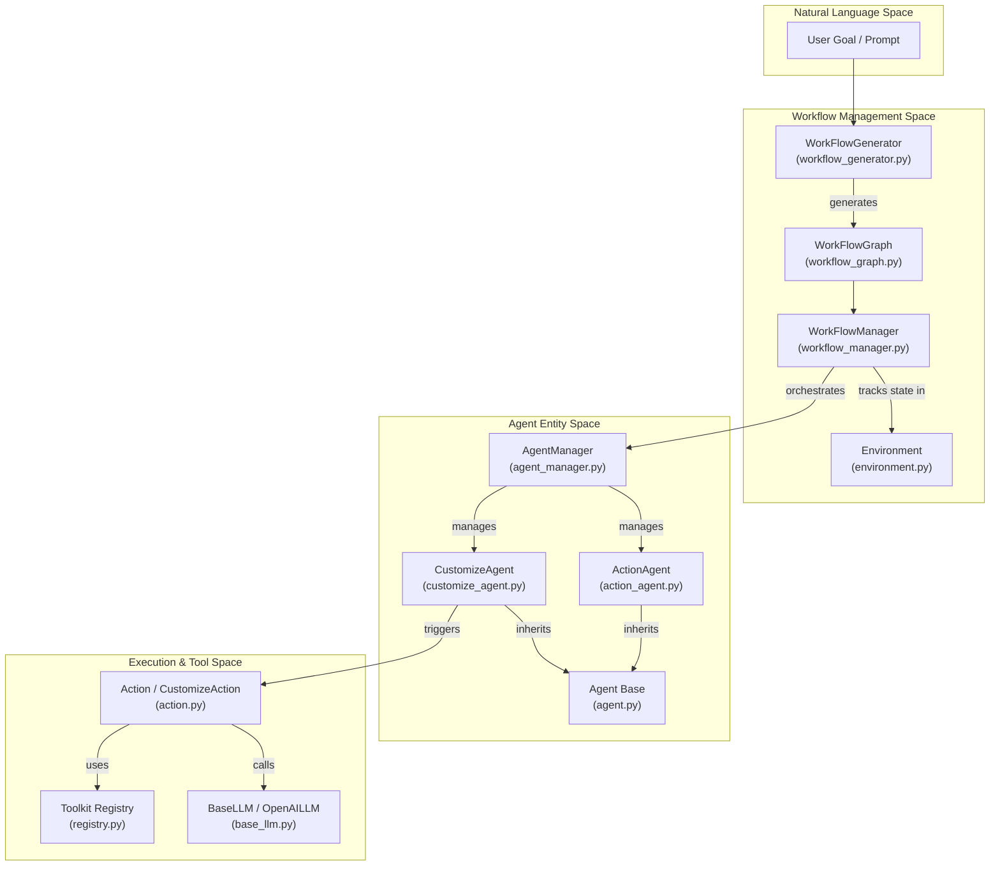

**Sources:** [evoagentx/workflow/__init__.py:7-10](), [evoagentx/agents/__init__.py:1-4](), [evoagentx/core/registry.py:3-21](), [evoagentx/agents/action_agent.py:15-15]()

## Workflow Execution Process

The execution process in EvoAgentX involves a dual-level scheduling mechanism that handles both high-level task transitions and low-level agent actions.

### Execution Flow and Entity Mapping

The following diagram bridges the execution logic with the specific classes responsible for each phase.

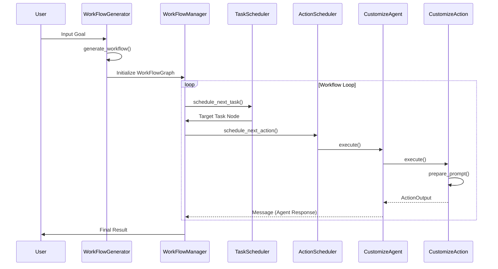

### Key Execution Components

| Component | Code Entity | Role |
| :--- | :--- | :--- |
| **Workflow Orchestrator** | `WorkFlow` [evoagentx/workflow/workflow.py:9-9]() | The main execution loop that drives the graph. |
| **Task Decision Maker** | `TaskScheduler` [evoagentx/workflow/workflow_manager.py]() | Determines the next high-level node in the `WorkFlowGraph`. |
| **Action Decision Maker** | `ActionScheduler` [evoagentx/workflow/workflow_manager.py]() | Determines which specific `Action` an agent should perform. |
| **Dynamic Agent** | `CustomizeAgent` [evoagentx/agents/customize_agent.py:2-2]() | An LLM-powered agent with configurable prompts and tools. |
| **Functional Agent** | `ActionAgent` [evoagentx/agents/action_agent.py:15-15]() | A specialized agent that executes code/functions directly without an LLM. |

**Sources:** [evoagentx/workflow/workflow.py:9-10](), [evoagentx/agents/action_agent.py:15-17](), [README.md:253-276]()

## Core Capabilities Overview

EvoAgentX is distinguished by its ability to not just run agents, but to evolve them.

*   **Self-Evolution Engine**: Includes optimizers like `TextGradOptimizer`, `MiproOptimizer`, and `AFlowOptimizer` to refine prompts and graph structures based on performance data [README.md:51-53]().
*   **Comprehensive Tooling**: Built-in support for Python interpreters, Docker, web search, Gmail, and the Model Context Protocol (MCP) [README.md:58-60]().
*   **Memory System**: Supports both `ShortTermMemory` for session context and `LongTermMemory` for persistent knowledge [README.md:62-64]().
*   **Benchmarking**: Integrated evaluation against standard datasets like HotPotQA, MBPP, and MATH [README.md:47-49]().

For a deep dive into these components, see [Key Concepts](#1.2).

**Sources:** [README.md:41-70](), [docs/index.md:17-46](), [evoagentx/workflow/__init__.py:7-10]()

---

# Page: Installation and Setup

# Installation and Setup

<details>
<summary>Relevant source files</summary>

The following files were used as context for generating this wiki page:

- [.env.example](.env.example)
- [docs/installation.md](docs/installation.md)
- [docs/quickstart.md](docs/quickstart.md)
- [docs/zh/installation.md](docs/zh/installation.md)
- [docs/zh/quickstart.md](docs/zh/quickstart.md)
- [evoagentx/app/.env.example](evoagentx/app/.env.example)
- [evoagentx/fastapi_docs.md](evoagentx/fastapi_docs.md)
- [evoagentx/rag/embeddings/azure_openai_embedding.py](evoagentx/rag/embeddings/azure_openai_embedding.py)
- [evoagentx/rag/rag.py](evoagentx/rag/rag.py)
- [evoagentx/tools/search_exa.py](evoagentx/tools/search_exa.py)
- [examples/rag/multimodal_rag.py](examples/rag/multimodal_rag.py)
- [examples/rag/rag.py](examples/rag/rag.py)
- [pyproject.toml](pyproject.toml)
- [pytest.ini](pytest.ini)
- [requirements.txt](requirements.txt)

</details>


This document provides comprehensive instructions for installing EvoAgentX and configuring the framework for first use. It covers multiple installation methods, dependency management, LLM provider configuration, and initial verification steps.

For information about building your first agent after installation, see [Quick Start Guide](#2.1). For detailed LLM model configuration options, see [Model Configuration](#6.2).

---

## Installation Methods

EvoAgentX supports three primary installation methods, each suited to different use cases.

### Standard Installation via pip (Recommended)

The recommended installation method for most users is via `pip` directly from the repository:

```bash
pip install git+https://github.com/EvoAgentX/EvoAgentX.git
```

You can also install specific feature sets using extras:

```bash
pip install "evoagentx[rag]"
pip install "evoagentx[tools]"
pip install "evoagentx[server]"
pip install "evoagentx[multimodal]"
pip install "evoagentx[optimizers]"
pip install "evoagentx[benchmarks]"
pip install "evoagentx[viz]"
pip install "evoagentx[all]"
```

**Sources:** [docs/installation.md:18-37](), [docs/quickstart.md:9-12]()

### Local Development Setup

For contributors and developers who need to modify the framework:

```bash
# Clone the repository
git clone https://github.com/EvoAgentX/EvoAgentX.git
cd EvoAgentX

# Create and activate a conda environment
conda create -n evoagentx python=3.11
conda activate evoagentx

# Install in development mode (editable)
pip install -e .
# Or with dev and specific features
pip install -e ".[dev,rag,tools,server]"
```

Development mode (`-e` flag) allows code changes to take effect immediately without reinstalling.

**Sources:** [docs/installation.md:39-71](), [pyproject.toml:1-159]()

---

## Installation Flow Diagram

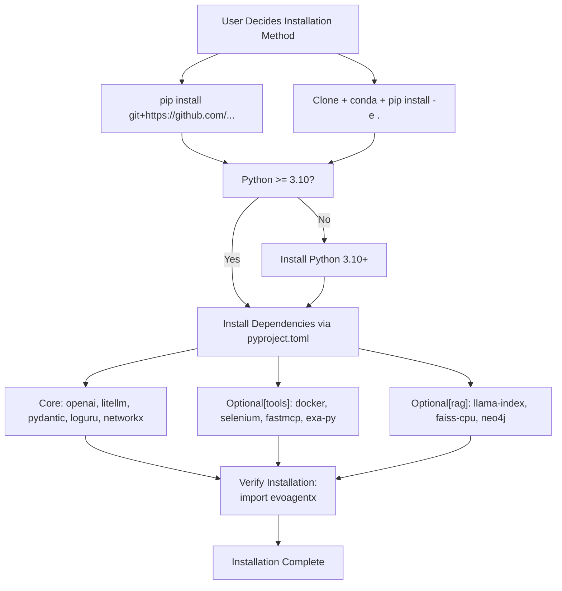

**Sources:** [pyproject.toml:10-150](), [docs/installation.md:14-71]()

---

## Python Version Requirements

EvoAgentX requires **Python 3.10 or higher**.

Check your Python version:
```bash
python --version
```

**Sources:** [pyproject.toml:10](), [docs/installation.md:9]()

---

## Core Dependencies

The framework relies on several key dependency categories defined in `pyproject.toml`:

| Category | Key Packages | Purpose |
|----------|--------------|---------|
| **LLM Integration** | `openai>=1.55.3`, `litellm>=1.55.6`, `dashscope>=1.23.4` | Interface with multiple LLM providers |
| **Data Validation** | `pydantic>=2.9.0` | Type-safe configuration and data models |
| **Logging** | `loguru>=0.7.3` | Structured logging across the framework |
| **Graph Processing** | `networkx>=3.3` | Workflow graph construction and traversal |
| **Optimization** | `textgrad>=0.1.8`, `dspy` | Self-evolution algorithms (via `[optimizers]`) |
| **RAG System** | `llama-index`, `faiss-cpu==1.8.0.post1`, `neo4j` | Document retrieval and indexing (via `[rag]`) |
| **Server** | `fastapi`, `uvicorn`, `motor`, `redis` | REST API and task queue (via `[server]`) |

**Sources:** [pyproject.toml:19-150](), [requirements.txt:1-104]()

---

## Tool Dependencies

EvoAgentX ships with a comprehensive toolkit requiring additional dependencies (included in the `[tools]` extra):

- `docker>=6.1.2` - For isolated code execution.
- `googlesearch-python`, `wikipedia`, `exa-py>=2.0.0` - Search integration. [evoagentx/tools/search_exa.py:77]()
- `selenium`, `html2text`, `browser-use` - Browser automation.
- `fastmcp>=2.2.0`, `mcp` - Model Context Protocol support.
- `PyPDF2`, `docx2txt`, `python-pptx`, `Pillow` - Document and image processing.

**Sources:** [pyproject.toml:72-86](), [requirements.txt:73-92]()

---

## API Key Configuration

### Method 1: Environment Variables

Set API keys as environment variables in your terminal:

**Linux/macOS:**
```bash
export OPENAI_API_KEY=<your-openai-api-key>
```

**Windows PowerShell:**
```powershell
$env:OPENAI_API_KEY="<your-openai-api-key>"
```

**Sources:** [docs/quickstart.md:19-43]()

### Method 2: .env File (Recommended)

Create a `.env` file in your project root. An example is provided in `.env.example`:

```bash
OPENAI_API_KEY=<your-openai-api-key>
ANTHROPIC_API_KEY=<your-anthropic-api-key>
VOYAGE_API_KEY=<your-voyage-api-key>
EXA_API_KEY=<your-exa-api-key>
AZURE_EMBED_API_KEY=<your-azure-embed-api-key>
```

Load in your application:
```python
from dotenv import load_dotenv
import os

load_dotenv()
```

**Sources:** [.env.example:1-8](), [docs/quickstart.md:44-61]()

---

## LLM Configuration and Initialization

EvoAgentX uses configuration classes to initialize models.

### OpenAI Configuration Example

```python
from evoagentx.models import OpenAILLMConfig, OpenAILLM
import os

# Define LLM configuration
openai_config = OpenAILLMConfig(
    model="gpt-4o-mini",       
    openai_key=os.getenv("OPENAI_API_KEY"), 
    stream=True,               
    output_response=True       
)

# Initialize the language model
llm = OpenAILLM(config=openai_config)
```

**Sources:** [docs/quickstart.md:63-85]()

### Azure OpenAI Embedding Example

For RAG workflows, embedding models are configured similarly.

```python
from evoagentx.rag.rag_config import EmbeddingConfig
import os

embedding = EmbeddingConfig(
    provider="azure_openai",
    model_name=os.environ["AZURE_EMBED_DEPLOYMENT"],
    api_key=os.environ["AZURE_EMBED_API_KEY"],
    azure_endpoint=os.environ["AZURE_EMBED_ENDPOINT"],
    api_version=os.environ["AZURE_EMBED_API_VERSION"],
)
```

**Sources:** [examples/rag/rag.py:91-99](), [evoagentx/rag/embeddings/azure_openai_embedding.py:24-46]()

---

## RAG Engine Setup

The `RAGEngine` bridges storage, embeddings, and document processing.

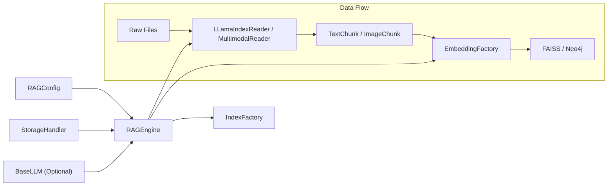

**Sources:** [evoagentx/rag/rag.py:25-93](), [examples/rag/rag.py:102-146]()

---

## Verification Steps

After installation, verify your setup:

### 1. Version Check
```python
import evoagentx
print(evoagentx.__version__)
```

### 2. LLM Connection Test
```python
from evoagentx.models import OpenAILLM, OpenAILLMConfig
import os

config = OpenAILLMConfig(model="gpt-4o-mini", openai_key=os.getenv("OPENAI_API_KEY"))
llm = OpenAILLM(config=config)
print(llm.generate(prompt="Hello!"))
```

### 3. API Server Setup (Optional)
If you installed the `[server]` extra, you can start the FastAPI server:
```bash
python -m evoagentx.app.main
```
The API will be available at `http://localhost:8000`.

**Sources:** [docs/installation.md:73-85](), [evoagentx/fastapi_docs.md:19-39]()

---

## Common Installation Issues

- **Python Version**: Ensure you are using Python 3.10+. [pyproject.toml:10]()
- **FAISS**: The CPU version `faiss-cpu==1.8.0.post1` is the default. For GPU support, manual installation of `faiss-gpu` is required. [requirements.txt:37-38]()
- **Pydantic**: Framework requires `pydantic>=2.9.0`. [requirements.txt:25]()
- **Exa Search**: Requires `EXA_API_KEY` to be set for the `SearchExa` tool to function. [evoagentx/tools/search_exa.py:60-61]()

**Sources:** [requirements.txt:1-104](), [pyproject.toml:1-159]()

---

# Page: Key Concepts

# Key Concepts

<details>
<summary>Relevant source files</summary>

The following files were used as context for generating this wiki page:

- [README-zh.md](README-zh.md)
- [README.md](README.md)
- [assets/EAXLoGo.svg](assets/EAXLoGo.svg)
- [docs/assets/logo.svg](docs/assets/logo.svg)
- [docs/index.md](docs/index.md)
- [docs/overrides/main.html](docs/overrides/main.html)
- [docs/stylesheets/extra.css](docs/stylesheets/extra.css)
- [docs/zh/index.md](docs/zh/index.md)
- [evoagentx/actions/action.py](evoagentx/actions/action.py)
- [evoagentx/agents/agent.py](evoagentx/agents/agent.py)
- [evoagentx/core/message.py](evoagentx/core/message.py)
- [evoagentx/core/module.py](evoagentx/core/module.py)
- [evoagentx/core/module_utils.py](evoagentx/core/module_utils.py)
- [evoagentx/models/base_model.py](evoagentx/models/base_model.py)
- [mkdocs.yml](mkdocs.yml)

</details>


This page introduces the fundamental concepts that form the foundation of the EvoAgentX framework. It covers the core abstractions, their relationships, and how they work together to enable the creation and execution of self-evolving agentic workflows.

## Core Architecture Overview

EvoAgentX is built around several interconnected concepts that work together to create intelligent, self-evolving multi-agent workflows. The framework follows a modular design where each concept has specific responsibilities and well-defined interfaces. All major components inherit from `BaseModule` for consistent serialization and lifecycle management [evoagentx/core/module.py:51-51]().

### System Components

The following diagram shows the key components and their relationships, associating high-level concepts with their specific implementation classes.

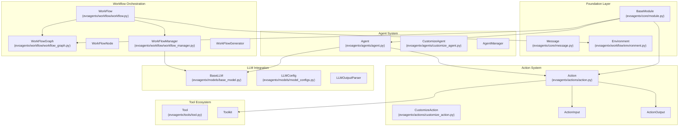

Sources: [evoagentx/core/module.py:51-51](), [evoagentx/agents/agent.py:20-20](), [evoagentx/actions/action.py:108-108](), [evoagentx/workflow/workflow.py:22-22](), [evoagentx/models/base_model.py:338-338]()

## BaseModule Foundation

All major components in EvoAgentX inherit from `BaseModule`, which provides serialization, deserialization, and lifecycle management capabilities [evoagentx/core/module.py:51-51]().

| Property | Description | Code Location |
|----------|-------------|---------------|
| **MetaModule** | Metaclass for automatic registration in `MODULE_REGISTRY` | [evoagentx/core/module.py:24-48]() |
| **Serialization** | Methods like `to_dict` and `to_json` for exporting state | [evoagentx/core/module.py:385-418]() |
| **Deserialization** | Methods like `from_dict` and `from_json` for instantiation | [evoagentx/core/module.py:182-251]() |
| **Validation** | Uses Pydantic for attribute validation during `__init__` | [evoagentx/core/module.py:83-118]() |

Sources: [evoagentx/core/module.py:24-418]()

## Agents

Agents are autonomous execution units that perform actions using LLMs. The base `Agent` class manages identity, LLM configuration, and memory [evoagentx/agents/agent.py:20-52]().

### Agent Architecture

The `Agent` class serves as the base for specialized agents like `CustomizeAgent` and the tool-heavy `Alita` agent.

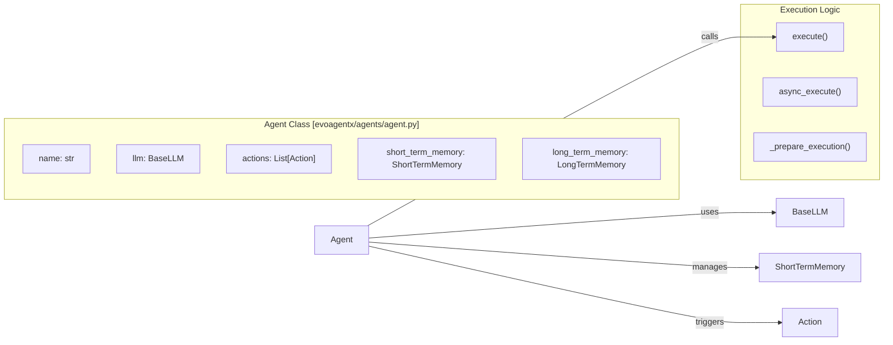

Sources: [evoagentx/agents/agent.py:20-127]()

### Key Agent Properties

| Property | Type | Description |
|----------|------|-------------|
| `agent_id` | `str` | Unique ID, auto-generated using `uuid4` [evoagentx/agents/agent.py:42-42]() |
| `system_prompt` | `str` | High-level instructions defining the agent's persona [evoagentx/agents/agent.py:43-43]() |
| `short_term_memory` | `ShortTermMemory` | Stores messages for the current workflow session [evoagentx/agents/agent.py:44-44]() |
| `actions` | `List[Action]` | The set of capabilities the agent can perform [evoagentx/agents/agent.py:49-49]() |

Sources: [evoagentx/agents/agent.py:38-52]()

## Actions and Tools

Actions represent discrete operations. While a standard `Action` defines a fixed operation, `CustomizeAction` integrates with `Toolkit` to provide dynamic tool-calling capabilities [evoagentx/actions/action.py:108-122](), [evoagentx/actions/customize_action.py:19-30]().

### Tool Ecosystem
EvoAgentX ships with a comprehensive suite of built-in tools [README.md:128-135]():
*   **Code Interpreters**: Python and Docker based execution.
*   **Search**: Google, Wikipedia, ArXiv, and Exa.
*   **Databases**: PostgreSQL, MongoDB, and FAISS.
*   **Communication**: Comprehensive Gmail integration.
*   **Browser**: Selenium-based and natural language browser control.

Sources: [README.md:128-135](), [evoagentx/actions/action.py:119-122]()

## Workflow System

Workflows coordinate multiple agents to accomplish complex goals through graph-based task decomposition.

### WorkFlowGraph
A `WorkFlowGraph` consists of `WorkFlowNode` (tasks) and `WorkFlowEdge` (dependencies) [evoagentx/workflow/workflow_graph.py:24-38]().
*   **WorkFlowNode**: Defines a specific task, its required inputs/outputs, and the agents assigned to it [evoagentx/workflow/workflow_graph.py:40-58]().
*   **WorkFlowEdge**: Defines the sequence and priority of task execution [evoagentx/workflow/workflow_graph.py:226-234]().

### WorkFlowManager and Schedulers
The `WorkFlowManager` uses two specialized schedulers to drive execution [evoagentx/workflow/workflow_manager.py:21-44]():
1.  **TaskScheduler**: Decides which node in the `WorkFlowGraph` should run next based on the `Environment` state.
2.  **ActionScheduler**: For a specific task, decides which agent and action to trigger.

Sources: [evoagentx/workflow/workflow_graph.py:24-234](), [evoagentx/workflow/workflow_manager.py:21-44]()

## Self-Evolution

The **Self-Evolution Engine** is a core differentiator of EvoAgentX. It allows the framework to move beyond static workflows by iteratively optimizing them [README.md:51-53]().

| Concept | Implementation | Description |
|----------|----------------|-------------|
| **Optimization** | `BaseOptimizer` | Base class for evolution algorithms like TextGrad, AFlow, and SEW. |
| **Evaluation** | `Evaluator` | Automatically scores agent behavior against task-specific criteria [README.md:47-49](). |
| **Feedback Loop** | Iterative Loop | The engine uses evaluator scores to mutate prompts or workflow structures. |

Sources: [README.md:38-53]()

## Human-in-the-Loop (HITL)

EvoAgentX supports interactive workflows where humans can review, correct, or guide agent behavior [README.md:66-68]().
*   **HITLManager**: Controls the activation of oversight.
*   **HITLInterceptorAgent**: Acts as a gatekeeper for actions, requiring approval for sensitive operations.
*   **Workflow Editor**: Allows LLM-assisted modification of the workflow graph during execution.

Sources: [README.md:66-68]()

---

# Page: Getting Started

# Getting Started

<details>
<summary>Relevant source files</summary>

The following files were used as context for generating this wiki page:

- [docs/installation.md](docs/installation.md)
- [docs/overrides/partials/scripts.html](docs/overrides/partials/scripts.html)
- [docs/quickstart.md](docs/quickstart.md)
- [docs/tutorial/first_agent.md](docs/tutorial/first_agent.md)
- [docs/zh/installation.md](docs/zh/installation.md)
- [docs/zh/quickstart.md](docs/zh/quickstart.md)
- [docs/zh/tutorial/aflow_optimizer.md](docs/zh/tutorial/aflow_optimizer.md)
- [docs/zh/tutorial/first_agent.md](docs/zh/tutorial/first_agent.md)
- [docs/zh/tutorial/sew_optimizer.md](docs/zh/tutorial/sew_optimizer.md)
- [evoagentx/app/.env.example](evoagentx/app/.env.example)
- [evoagentx/fastapi_docs.md](evoagentx/fastapi_docs.md)
- [examples/agent_with_multiple_actions.py](examples/agent_with_multiple_actions.py)
- [pytest.ini](pytest.ini)

</details>


This page provides an overview of the essential steps and concepts needed to begin using EvoAgentX. It covers the basic workflow pattern, core components, and typical usage scenarios to help you quickly start building and executing agentic workflows.

For detailed installation instructions, see [Installation and Setup](#1.1). For in-depth explanations of fundamental concepts, see [Key Concepts](#1.2). For hands-on tutorials, proceed to [Quick Start Guide](#2.1) and [Basic Examples](#2.2).

## Prerequisites

Before working with EvoAgentX, ensure you have:

1.  **Python 3.11+** installed on your system [docs/installation.md:9]()
2.  **EvoAgentX package** installed via pip or from source [docs/installation.md:18-52]()
3.  **API keys** configured for your chosen LLM provider (OpenAI, LiteLLM, etc.) [docs/quickstart.md:15-61]()

See [Installation and Setup](#1.1) for complete installation instructions and API key configuration methods.

## Core Components Overview

EvoAgentX is built around several key components that work together to create self-evolving agentic workflows:

| Component | Code Class | Purpose |
| :--- | :--- | :--- |
| **Workflow Graph** | `WorkFlowGraph` | Defines the structure of multi-agent workflows with nodes (tasks) and edges (dependencies) [evoagentx/workflow/workflow_graph.py:287-308]() |
| **Agent Manager** | `AgentManager` | Creates and manages agent instances, tracking their states and lifecycle [evoagentx/agents/agent_manager.py:20-33]() |
| **Agents** | `Agent`, `CustomizeAgent` | Execute actions to complete tasks, with configurable prompts and tools [evoagentx/agents/customize_agent.py:21-62]() |
| **Workflow Executor** | `WorkFlow` | Orchestrates the execution of workflows, managing task scheduling and state [evoagentx/workflow/workflow.py:22-34]() |
| **LLM Configuration** | `LLMConfig`, `OpenAILLMConfig` | Configures language model providers and parameters [docs/quickstart.md:72-78]() |
| **Actions** | `Action` | Atomic tasks defined by `ActionInput` and `ActionOutput` that agents can perform [docs/tutorial/first_agent.md:118-140]() |

Sources: [docs/quickstart.md:97-99](), [docs/tutorial/first_agent.md:21-22](), [docs/tutorial/first_agent.md:111-116]()

## Getting Started Flow

The following diagram illustrates the typical progression from installation to workflow execution:

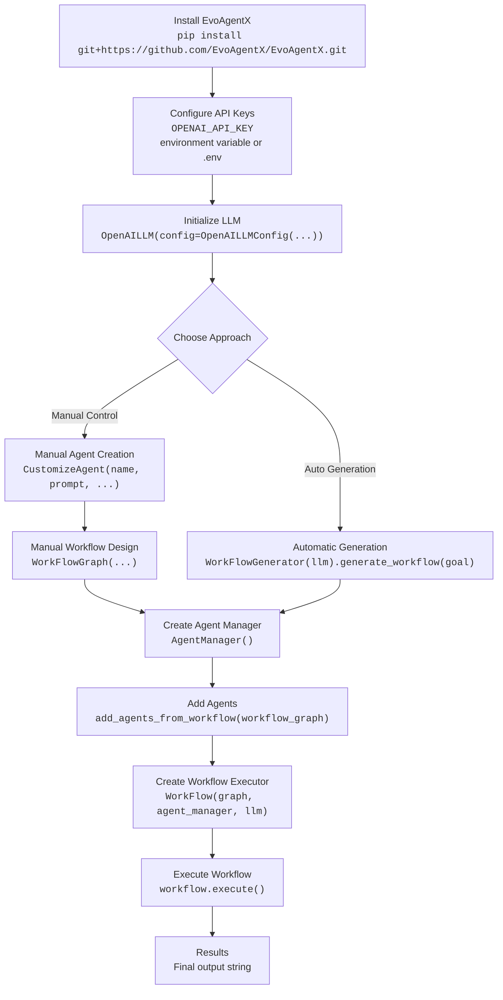

Sources: [docs/quickstart.md:10-136](), [docs/tutorial/first_agent.md:35-48]()

## Core Component Architecture

This diagram maps natural language concepts to their corresponding code entities in EvoAgentX:

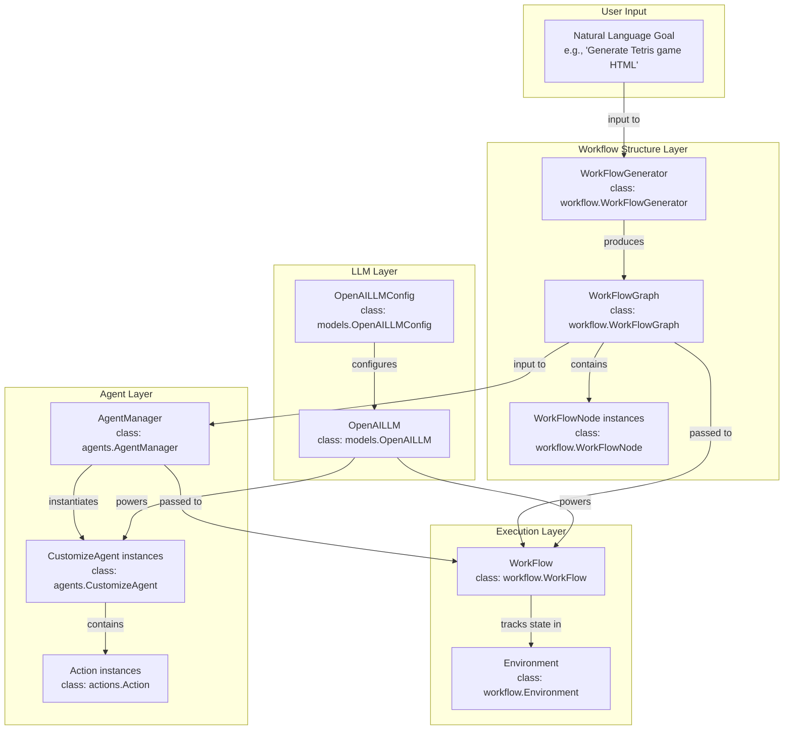

Sources: [docs/quickstart.md:95-135](), [docs/tutorial/first_agent.md:20-21](), [docs/tutorial/first_agent.md:119-140]()

## Basic Usage Patterns

EvoAgentX supports two primary usage patterns:

### Pattern 1: Automatic Workflow Generation
The quickest way to start is using `WorkFlowGenerator` to automatically create workflows from natural language goals [docs/quickstart.md:101-107]().

**Workflow Pattern:**
1.  Initialize LLM with `OpenAILLM(config=OpenAILLMConfig(...))` [docs/quickstart.md:72-81]()
2.  Generate workflow with `WorkFlowGenerator(llm).generate_workflow(goal)` [docs/quickstart.md:105-106]()
3.  Create `AgentManager()` and add agents with `add_agents_from_workflow(workflow_graph, llm_config)` [docs/quickstart.md:127-128]()
4.  Execute with `WorkFlow(graph, agent_manager, llm).execute()` [docs/quickstart.md:134-135]()

### Pattern 2: Manual Agent and Action Definition
For fine-grained control, manually define agents using `CustomizeAgent` or create complex agents with multiple `Action` classes [docs/tutorial/first_agent.md:11-98]().

**Workflow Pattern:**
1.  Define `ActionInput` and `ActionOutput` schemas using Pydantic [docs/tutorial/first_agent.md:111-116]()
2.  Implement `Action.execute()` to define the logic [docs/tutorial/first_agent.md:141-153]()
3.  Create an `Agent` with a list of these actions [docs/tutorial/first_agent.md:194-200]()
4.  Execute specific actions via the agent: `agent(action_name="...", inputs=...)` [docs/tutorial/first_agent.md:214-222]()

Sources: [docs/quickstart.md:90-140](), [docs/tutorial/first_agent.md:3-10]()

## Optimization and Evolution

EvoAgentX includes specialized optimizers like **AFlow** and **SEW** to improve workflow performance over time:

*   **AFlow Optimizer**: Uses MCTS-based workflow structure evolution and prompt optimization [docs/zh/tutorial/aflow_optimizer.md:5-12]().
*   **SEW Optimizer**: Focuses on self-evolving workflows by optimizing both prompts and graph structures across different representation schemes like Python or YAML [docs/zh/tutorial/sew_optimizer.md:7-11]().

Sources: [docs/zh/tutorial/aflow_optimizer.md:142-161](), [docs/zh/tutorial/sew_optimizer.md:98-116]()

## Next Steps

Now that you understand the basic structure and components:

1.  **Start with a simple example**: See [Quick Start Guide](#2.1) for a step-by-step walkthrough.
2.  **Explore code examples**: Review [Basic Examples](#2.2) for common usage patterns like multi-action agents.
3.  **Learn about agents**: Read [Agent System](#3) for detailed agent architecture.
4.  **Understand workflows**: Study [Workflow System](#4) for automatic generation and orchestration.
5.  **Optimize performance**: See [Optimization and Evolution](#10) for details on AFlow and SEW optimizers.

Sources: [docs/quickstart.md:3-7](), [docs/tutorial/first_agent.md:3-9]()

---

# Page: Quick Start Guide

# Quick Start Guide

<details>
<summary>Relevant source files</summary>

The following files were used as context for generating this wiki page:

- [docs/installation.md](docs/installation.md)
- [docs/overrides/partials/scripts.html](docs/overrides/partials/scripts.html)
- [docs/quickstart.md](docs/quickstart.md)
- [docs/tutorial/first_agent.md](docs/tutorial/first_agent.md)
- [docs/zh/installation.md](docs/zh/installation.md)
- [docs/zh/quickstart.md](docs/zh/quickstart.md)
- [docs/zh/tutorial/aflow_optimizer.md](docs/zh/tutorial/aflow_optimizer.md)
- [docs/zh/tutorial/first_agent.md](docs/zh/tutorial/first_agent.md)
- [docs/zh/tutorial/sew_optimizer.md](docs/zh/tutorial/sew_optimizer.md)
- [evoagentx/app/.env.example](evoagentx/app/.env.example)
- [evoagentx/fastapi_docs.md](evoagentx/fastapi_docs.md)
- [examples/agent_with_multiple_actions.py](examples/agent_with_multiple_actions.py)
- [pytest.ini](pytest.ini)

</details>


This guide provides a step-by-step walkthrough for creating your first workflow in EvoAgentX, from specifying a natural language goal to executing the complete workflow with agents. You'll learn the core workflow creation and execution patterns that form the foundation of the EvoAgentX framework.

For installation and environment setup, see [Installation and Setup](#1.1). For deeper understanding of core concepts like agents and workflows, see [Key Concepts](#1.2). For additional examples beyond this basic walkthrough, see [Basic Examples](#2.2).

## Overview: From Goal to Execution

EvoAgentX transforms natural language goals into executable multi-agent workflows through a structured pipeline. The process involves three main phases: workflow generation, agent instantiation, and execution.

### Core Workflow Creation Pipeline

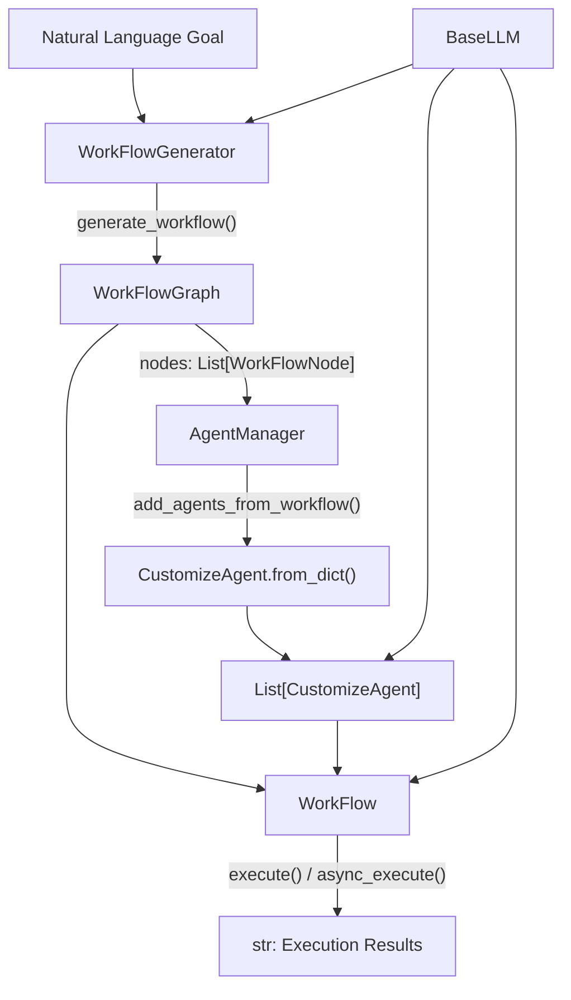

**Sources**: [docs/quickstart.md:92-108](), [docs/quickstart.md:123-129](), [docs/quickstart.md:131-137](), [docs/tutorial/first_agent.md:52-64]()

## Step 1: LLM Configuration

Before creating workflows, configure your language model provider. EvoAgentX supports multiple LLM providers through a unified interface. You can set your `OPENAI_API_KEY` via environment variables or a `.env` file [docs/quickstart.md:15-61]().

### Basic OpenAI Configuration

```python
from evoagentx.models import OpenAILLMConfig, OpenAILLM
import os

# Configure OpenAI LLM
openai_config = OpenAILLMConfig(
    model="gpt-4o-mini",
    openai_key=os.getenv("OPENAI_API_KEY"),
    stream=True,
    output_response=True
)

llm = OpenAILLM(config=openai_config)
```

### LLM Configuration Architecture

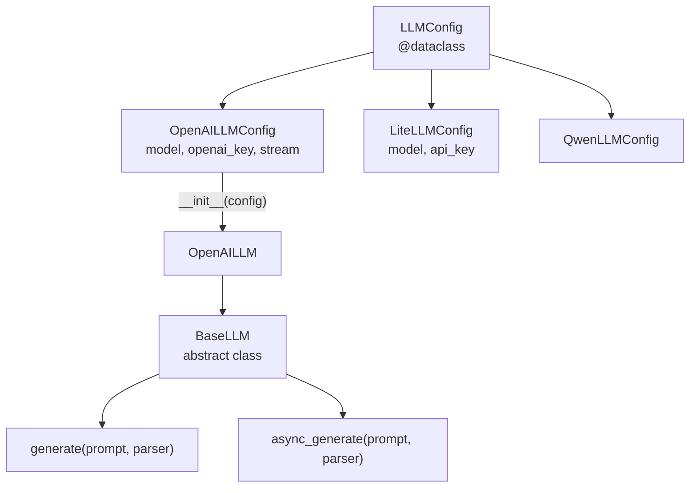

**Sources**: [docs/quickstart.md:63-85](), [docs/tutorial/first_agent.md:15-33](), [docs/zh/tutorial/first_agent.md:15-32]()

## Step 2: Workflow Generation

Use `WorkFlowGenerator` to automatically create a workflow structure from a natural language goal. The `WorkFlowGraph` acts as a data structure storing the plan and task relationships [docs/quickstart.md:101-108]().

### Basic Workflow Generation

```python
from evoagentx.workflow import WorkFlowGenerator, WorkFlowGraph

# Define your goal
goal = "Generate HTML code for a Tetris game playable in browser"

# Generate workflow
wf_generator = WorkFlowGenerator(llm=llm)
workflow_graph: WorkFlowGraph = wf_generator.generate_workflow(goal=goal)
```

### Workflow Graph Structure

The `WorkFlowGraph` contains nodes and edges representing the task execution plan. It can be visualized or saved to JSON for persistence [docs/quickstart.md:110-121]().

**Workflow Graph Data Model**

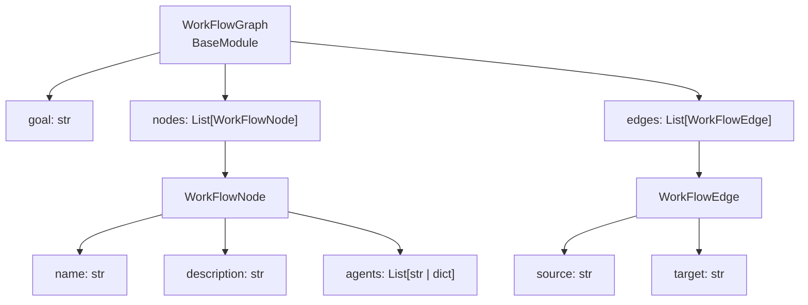

**Sources**: [docs/quickstart.md:101-121](), [docs/zh/quickstart.md:99-119]()

## Step 3: Agent Management

Create and manage agents that will execute the workflow tasks using `AgentManager`. This component instantiates agents based on the workflow graph definitions [docs/quickstart.md:123-129]().

### Agent Instantiation from Workflow

```python
from evoagentx.agents import AgentManager

# Create agent manager
agent_manager = AgentManager()

# Generate agents from workflow graph
agent_manager.add_agents_from_workflow(
    workflow_graph, 
    llm_config=openai_config
)
```

### Agent Architecture Mapping

**Agent Creation and Management Flow**

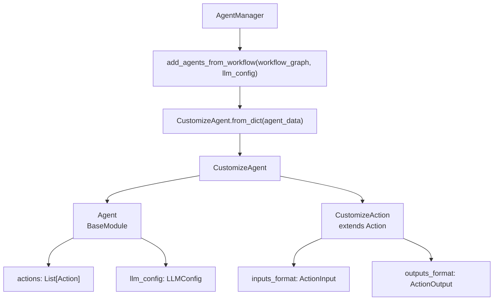

**Sources**: [docs/quickstart.md:123-129](), [docs/tutorial/first_agent.md:35-64](), [docs/tutorial/first_agent.md:185-200](), [examples/agent_with_multiple_actions.py:7-14]()

## Step 4: Workflow Execution

Execute the complete workflow using the `WorkFlow` class, which orchestrates task scheduling and agent coordination [docs/quickstart.md:131-137]().

### Basic Execution

```python
from evoagentx.workflow import WorkFlow

# Create workflow instance
workflow = WorkFlow(
    graph=workflow_graph,
    agent_manager=agent_manager,
    llm=llm
)

# Execute workflow
output = workflow.execute()
print(output)
```

### Execution Architecture

**WorkFlow Execution Components**

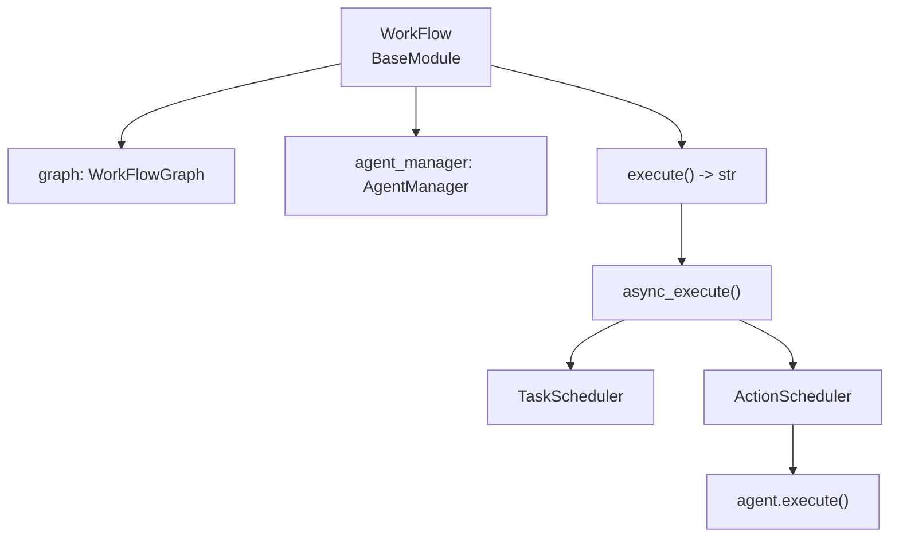

**Sources**: [docs/quickstart.md:131-137](), [docs/zh/quickstart.md:129-135]()

## Complete Example

Here's a complete working example that demonstrates the entire workflow creation and execution pipeline [docs/quickstart.md:139-140]():

```python
import os
from evoagentx.models import OpenAILLMConfig, OpenAILLM
from evoagentx.workflow import WorkFlowGenerator, WorkFlow
from evoagentx.agents import AgentManager

# Step 1: Configure LLM
openai_config = OpenAILLMConfig(
    model="gpt-4o-mini",
    openai_key=os.getenv("OPENAI_API_KEY"),
    stream=True,
    output_response=True
)
llm = OpenAILLM(config=openai_config)

# Step 2: Generate workflow
goal = "Create a simple calculator with basic arithmetic operations"
wf_generator = WorkFlowGenerator(llm=llm)
workflow_graph = wf_generator.generate_workflow(goal=goal)

# Optional: Visualize the workflow structure
workflow_graph.display()

# Step 3: Create agents
agent_manager = AgentManager()
agent_manager.add_agents_from_workflow(workflow_graph, llm_config=openai_config)

# Step 4: Execute workflow
workflow = WorkFlow(
    graph=workflow_graph,
    agent_manager=agent_manager,
    llm=llm
)
result = workflow.execute()
print(f"Workflow completed with result: {result}")
```

### Key Components Mapping Table

| Component | Class | Key Methods | Purpose |
|-----------|-------|-------------|---------|
| **Workflow Generator** | `WorkFlowGenerator` | `generate_workflow(goal)` | Converts natural language goal to `WorkFlowGraph` |
| **Workflow Graph** | `WorkFlowGraph` | `display()`, `save_module()`, `from_file()` | Manages workflow structure and persistence |
| **Agent Manager** | `AgentManager` | `add_agents_from_workflow()` | Creates and manages agent instances |
| **Workflow Executor** | `WorkFlow` | `execute()` | Orchestrates workflow execution |
| **Custom Agent** | `CustomizeAgent` | `from_dict()`, `__call__()` | Dynamic agent creation with custom prompts |

**Sources**: [docs/quickstart.md:90-137](), [docs/tutorial/first_agent.md:11-64](), [docs/zh/quickstart.md:88-135]()

## Optional: Workflow Persistence

You can save and reload workflows for reuse [docs/quickstart.md:110-121]():

```python
# Save workflow graph
workflow_graph.save_module("/path/to/save/workflow_demo.json")

# Reload workflow graph
from evoagentx.workflow import WorkFlowGraph
loaded_graph = WorkFlowGraph.from_file("/path/to/save/workflow_demo.json")
```

**Sources**: [docs/quickstart.md:110-121](), [docs/zh/quickstart.md:108-119]()

---

# Page: Basic Examples

# Basic Examples

<details>
<summary>Relevant source files</summary>

The following files were used as context for generating this wiki page:

- [docs/modules/action_graph.md](docs/modules/action_graph.md)
- [docs/modules/workflow_graph.md](docs/modules/workflow_graph.md)
- [docs/tutorial/first_workflow.md](docs/tutorial/first_workflow.md)
- [evoagentx/agents/__init__.py](evoagentx/agents/__init__.py)
- [evoagentx/agents/action_agent.py](evoagentx/agents/action_agent.py)
- [evoagentx/core/registry.py](evoagentx/core/registry.py)
- [evoagentx/prompts/context_extraction.py](evoagentx/prompts/context_extraction.py)
- [evoagentx/prompts/workflow/sew_workflow.py](evoagentx/prompts/workflow/sew_workflow.py)
- [evoagentx/workflow/__init__.py](evoagentx/workflow/__init__.py)
- [examples/action_agent.py](examples/action_agent.py)
- [examples/workflow/invest/catl_data_functions.py](examples/workflow/invest/catl_data_functions.py)
- [examples/workflow/invest/generate_report.py](examples/workflow/invest/generate_report.py)
- [examples/workflow/invest/html_report_generator.py](examples/workflow/invest/html_report_generator.py)
- [examples/workflow/invest/invest_demo_4o_mini.json](examples/workflow/invest/invest_demo_4o_mini.json)
- [examples/workflow/invest/stock_analysis.py](examples/workflow/invest/stock_analysis.py)
- [examples/workflow/invest/stock_chart_tools.py](examples/workflow/invest/stock_chart_tools.py)
- [examples/workflow/workflow_demo.py](examples/workflow/workflow_demo.py)
- [examples/workflow/workflow_direction.py](examples/workflow/workflow_direction.py)

</details>


This document provides annotated code examples for common use cases in the EvoAgentX framework, including simple agents, tool usage, and structured workflows. These examples demonstrate how to bridge natural language goals into executable code entities.

## Overview of Core Examples

EvoAgentX supports multiple operational patterns, from purely functional agents to complex multi-step investment analysis workflows.

| Pattern Category | Purpose | Key Classes | Primary Source |
|------------------|---------|-------------|---------------|
| **Action Agents** | Execute Python functions directly without LLM reasoning | `ActionAgent` | [examples/action_agent.py:91-111]() |
| **Sequential Workflows** | Linear task execution where outputs feed into next inputs | `SequentialWorkFlowGraph` | [docs/tutorial/first_workflow.md:87-91]() |
| **Tool-Enabled Workflows** | Agents using external tools (CMD, Storage) to achieve goals | `WorkFlowGenerator`, `AgentManager` | [examples/workflow/invest/stock_analysis.py:155-161]() |
| **Structured Task Graphs** | Fine-grained operation sequences within a single task | `ActionGraph` | [docs/modules/action_graph.md:64-88]() |

## Action Agents: Functional Integration

The `ActionAgent` is a specialized class that wraps standard Python functions, allowing them to participate in agentic workflows without requiring an LLM for execution [evoagentx/agents/action_agent.py:15-18]().

### Basic Function Wrapper
This pattern is ideal for deterministic tasks like mathematical calculations or data validation.

**ActionAgent Mapping: Code to Logic**
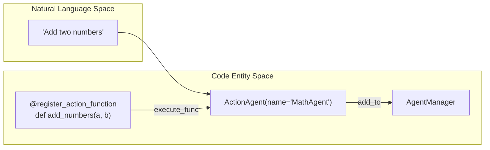

Example from [examples/action_agent.py:96-111]():
```python
from evoagentx.agents import ActionAgent
from evoagentx.core.registry import register_action_function

@register_action_function
def add_numbers(a: int, b: int) -> int:
    return a + b

math_agent = ActionAgent(
    name="MathAgent",
    description="Performs mathematical operations",
    inputs=[
        {"name": "a", "type": "int", "description": "First number"},
        {"name": "b", "type": "int", "description": "Second number"}
    ],
    outputs=[
        {"name": "result", "type": "int", "description": "Sum"}
    ],
    execute_func=add_numbers
)

result = math_agent(inputs={"a": 5, "b": 3})
```

**Sources:** [evoagentx/agents/action_agent.py:15-83](), [examples/action_agent.py:19-22](), [examples/action_agent.py:96-111]()

## Sequential Workflow Pattern

A `SequentialWorkFlowGraph` automatically infers dependencies between tasks based on their input/output requirements, creating a linear execution path [docs/modules/workflow_graph.md:63-67]().

### Planning and Coding Workflow
This example shows a two-step process where a "Planning" task generates a strategy used by a "Coding" task.

**Data Flow in Sequential Workflows**
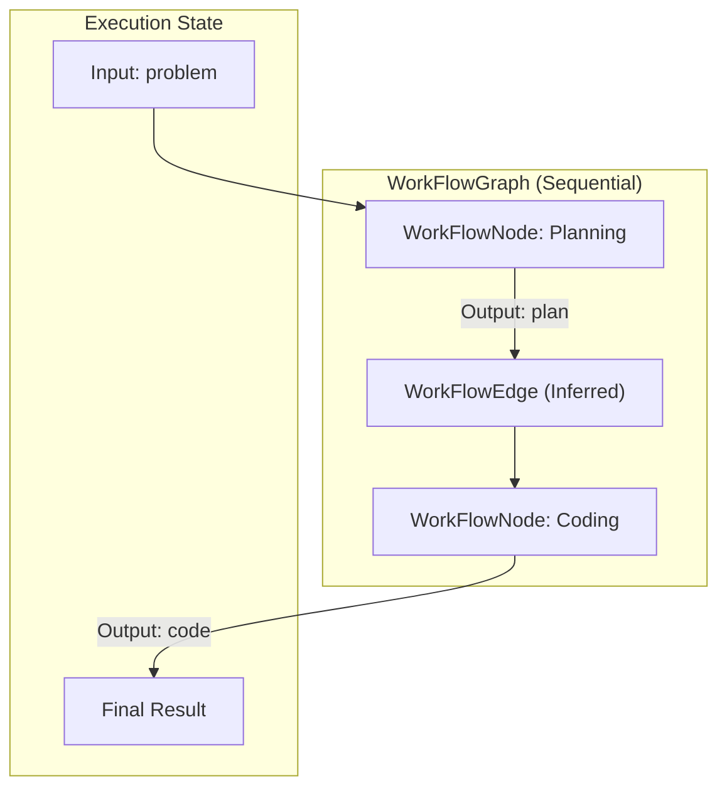

Example from [docs/tutorial/first_workflow.md:56-91]():
```python
tasks = [
    {
        "name": "Planning",
        "description": "Create a detailed plan",
        "inputs": [{"name": "problem", "type": "str"}],
        "outputs": [{"name": "plan", "type": "str"}],
        "prompt": "Create a plan for: {problem}",
        "parse_mode": "str"
    },
    {
        "name": "Coding",
        "description": "Implement the code",
        "inputs": [
            {"name": "problem", "type": "str"},
            {"name": "plan", "type": "str"}
        ],
        "outputs": [{"name": "code", "type": "str"}],
        "prompt": "Implement code using plan: {plan}",
        "parse_mode": "custom",
        "parse_func": custom_parse_func
    }
]

graph = SequentialWorkFlowGraph(goal="Generate code", tasks=tasks)
```

**Sources:** [docs/modules/workflow_graph.md:63-98](), [docs/tutorial/first_workflow.md:56-91]()

## Advanced Use Case: Stock Analysis Workflow

The framework excels at complex, tool-heavy workflows like the Investment Analysis demo. This workflow uses `StorageToolkit` and `CMDToolkit` to process real market data [examples/workflow/invest/stock_analysis.py:43-46]().

### Automated Workflow Generation
Instead of manual definition, the `WorkFlowGenerator` can create the graph from a high-level goal [examples/workflow/invest/stock_analysis.py:155-161]().

**Investment Workflow Architecture**
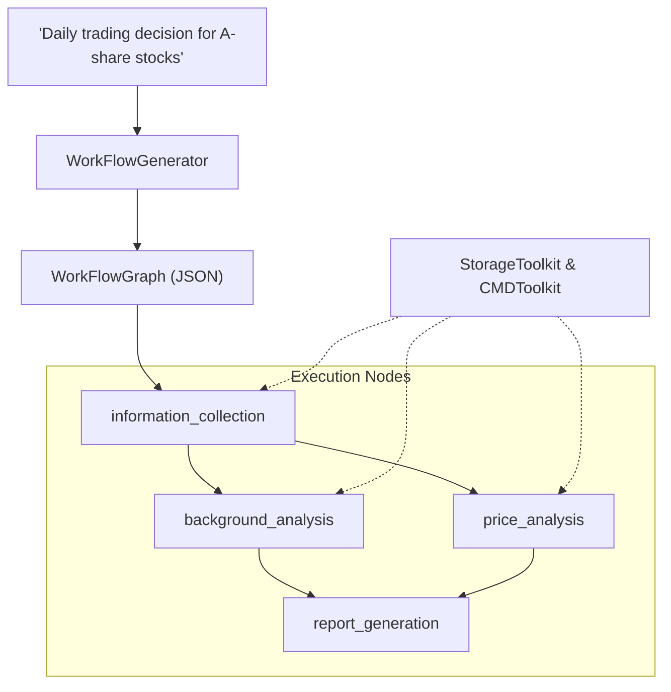

Key implementation details from [examples/workflow/invest/stock_analysis.py:164-184]():
1. **Graph Loading**: `WorkFlowGraph.from_file(module_save_path)` [line 168]()
2. **Agent Setup**: `agent_manager.add_agents_from_workflow(workflow_graph)` [line 170]()
3. **Execution**: `workflow.execute(inputs={"goal": goal_string})` [line 184]()

The workflow configuration in [examples/workflow/invest/invest_demo_4o_mini.json]() defines specific agents like `information_collection` and `price_analysis` with mandatory tool usage for reading CSV data [lines 7-23]().

**Sources:** [examples/workflow/invest/stock_analysis.py:42-184](), [examples/workflow/invest/invest_demo_4o_mini.json:1-30]()

## Comparison of Graph Types

EvoAgentX provides different graph abstractions depending on the required granularity.

| Feature | `ActionGraph` | `WorkFlowGraph` |
|---------|---------------|-----------------|
| **Scope** | Detailed steps within a single task [docs/modules/action_graph.md:44]() | Multi-task orchestration [docs/modules/action_graph.md:44]() |
| **Execution** | Fixed sequence defined in Python `execute()` [docs/modules/action_graph.md:47]() | Dynamic based on dependencies/edges [docs/modules/action_graph.md:47]() |
| **Primary Class** | `ActionGraph` [docs/modules/action_graph.md:64]() | `WorkFlowGraph` [docs/modules/workflow_graph.md:105]() |

**Sources:** [docs/modules/action_graph.md:42-50](), [docs/modules/workflow_graph.md:5-9]()

---

# Page: Agent System

# Agent System

<details>
<summary>Relevant source files</summary>

The following files were used as context for generating this wiki page:

- [evoagentx/actions/action.py](evoagentx/actions/action.py)
- [evoagentx/agents/agent.py](evoagentx/agents/agent.py)
- [evoagentx/agents/agent_manager.py](evoagentx/agents/agent_manager.py)
- [evoagentx/agents/customize_agent.py](evoagentx/agents/customize_agent.py)
- [evoagentx/core/message.py](evoagentx/core/message.py)
- [evoagentx/core/module.py](evoagentx/core/module.py)
- [evoagentx/core/module_utils.py](evoagentx/core/module_utils.py)
- [evoagentx/models/base_model.py](evoagentx/models/base_model.py)
- [evoagentx/workflow/workflow_graph.py](evoagentx/workflow/workflow_graph.py)

</details>


The Agent System provides the core architecture for creating, managing, and executing autonomous agents within EvoAgentX. This system defines the fundamental building blocks for agents that can perform actions, manage memory, interact with language models, and communicate through structured messages. For workflow orchestration and multi-agent coordination, see [Workflow System](#4). For tool integration and external service access, see [Tool System](#7).

## Agent Architecture Overview

The agent system is built on a modular architecture where agents are composed of actions, memory components, and LLM integrations. The core relationship flows from `BaseModule` through `Agent` to various specialized components.

Title: Agent Component Relationships
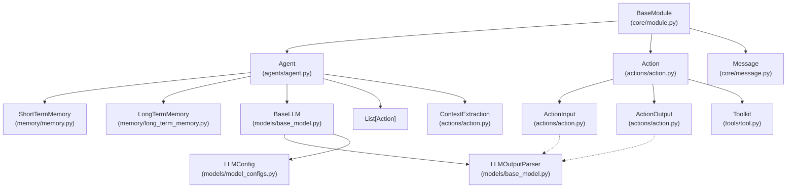
Sources: [evoagentx/agents/agent.py:20-52](), [evoagentx/actions/action.py:108-131](), [evoagentx/models/base_model.py:22-33](), [evoagentx/core/module.py:51-70](), [evoagentx/core/message.py:19-50]()

## Core Agent Classes

### Agent Base Class

The `Agent` class [evoagentx/agents/agent.py:20]() serves as the foundation for all agent implementations. It inherits from `BaseModule` [evoagentx/core/module.py:51]() to provide serialization capabilities and integrates multiple subsystems.

| Attribute | Type | Purpose |
|-----------|------|---------|
| `name` | `str` | Unique identifier for the agent |
| `description` | `str` | Human-readable description of agent purpose |
| `agent_id` | `str` | Auto-generated unique ID via `generate_id` |
| `system_prompt` | `str` | System-level instructions for the agent |
| `actions` | `List[Action]` | Available actions the agent can execute |
| `llm_config` | `LLMConfig` | Language model configuration |
| `llm` | `BaseLLM` | Language model instance |
| `short_term_memory` | `ShortTermMemory` | Context for current workflow |
| `is_human` | `bool` | Whether agent represents human user |
| `version` | `int` | Agent version number |

The agent initialization process [evoagentx/agents/agent.py:54-63]() includes LLM setup, memory initialization, and action registration.

Title: Agent Initialization Lifecycle
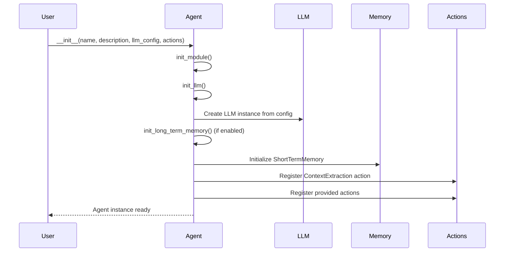
Sources: [evoagentx/agents/agent.py:38-63](), [evoagentx/agents/agent.py:54-63]()

For details on the base class implementation and patterns, see [Agent Base Classes](#3.1).

### CustomizeAgent

`CustomizeAgent` [evoagentx/agents/customize_agent.py:21]() provides a flexible framework for creating specialized agents without writing custom code. It enables the creation of agents with well-defined `inputs` and `outputs`, custom prompt templates, and configurable parsing strategies via `parse_mode` [evoagentx/agents/customize_agent.py:48]().

For details on dynamic agent creation, see [CustomizeAgent](#3.2).

## Agent Management and Lifecycle

### Agent Manager

The `AgentManager` class [evoagentx/agents/agent_manager.py:20]() is responsible for the lifecycle and state management of agents. It tracks agent states (e.g., `AVAILABLE`, `RUNNING`) [evoagentx/agents/agent_manager.py:15]() and handles loading agents from storage using a `StorageHandler` [evoagentx/agents/agent_manager.py:113]().

Title: Agent State and Storage Management
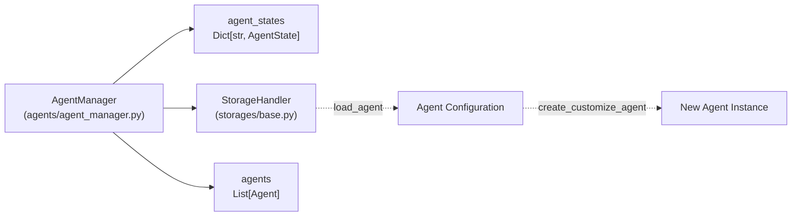
Sources: [evoagentx/agents/agent_manager.py:20-33](), [evoagentx/agents/agent_manager.py:101-117]()

For details on lifecycle management and multi-agent coordination, see [Agent Manager](#3.3).

## Memory System

Agents maintain both short-term and long-term memory systems for context management. `ShortTermMemory` [evoagentx/agents/agent.py:44]() stores messages for a single workflow, while `LongTermMemory` [evoagentx/agents/agent.py:47]() provides persistent storage across sessions.

| Memory Type | Class | Purpose | Storage |
|-------------|-------|---------|---------|
| Short-term | `ShortTermMemory` | Current workflow context | In-memory |
| Long-term | `LongTermMemory` | Persistent knowledge | `StorageHandler` |

For details on context extraction and message handling, see [Memory System](#3.4).

## Specialized Agents

### Alita Agent

The `Alita` agent is a specialized implementation combining web search, file storage, and code execution. It features dynamic tool creation at runtime to solve complex tasks.

For details on this specialized implementation, see [Alita Agent](#3.5).

## Action System Architecture

### Action and Parser Integration

The action system defines discrete operations through the `Action` class [evoagentx/actions/action.py:108](). Actions utilize `ActionInput` and `ActionOutput` which inherit from `LLMOutputParser` [evoagentx/models/base_model.py:22]() to handle structured data.

Title: Action Execution Data Flow
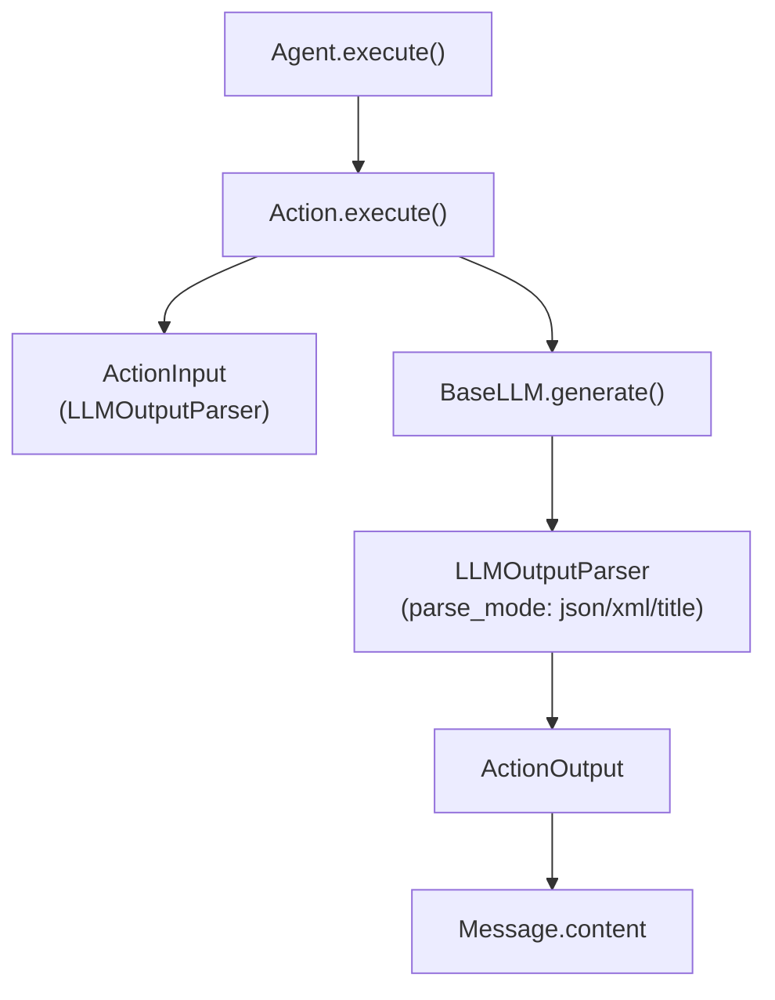
Sources: [evoagentx/actions/action.py:108-131](), [evoagentx/models/base_model.py:75-132](), [evoagentx/agents/agent.py:129-151]()

### Context Extraction

Agents use a built-in `ContextExtraction` mechanism [evoagentx/agents/agent.py:62]() to automatically map conversation history to the `inputs_format` [evoagentx/actions/action.py:129]() required by an action.

## Message System

The `Message` class [evoagentx/core/message.py:19]() is the primary data structure for communication. It tracks the sender (`agent`), the triggering `action`, and the execution `prompt` [evoagentx/core/message.py:39-42]().

Title: Message Entity Mapping
```mermaid
classDiagram
    class Message {
        +content: Any
        +agent: str
        +action: str
        +msg_type: MessageType
        +wf_task: str
        +timestamp: str
    }
    class MessageType {
        <<enumeration>>
        REQUEST
        RESPONSE
        INPUT
        ERROR
    }
    Message --> MessageType
```
Sources: [evoagentx/core/message.py:19-50](), [evoagentx/core/message.py:9-17]()

## Agent Execution Patterns

Agents support both synchronous and asynchronous execution. The `__call__` method [evoagentx/agents/agent.py:72]() automatically detects the running environment to route requests to `execute()` [evoagentx/agents/agent.py:231]() or `async_execute()` [evoagentx/agents/agent.py:168]().

- **Synchronous**: `execute(action_name, msgs, ...)`
- **Asynchronous**: `async_execute(action_name, msgs, ...)`

Sources: [evoagentx/agents/agent.py:72-81](), [evoagentx/agents/agent.py:168-281]()

---

# Page: Agent Base Classes

# Agent Base Classes

<details>
<summary>Relevant source files</summary>

The following files were used as context for generating this wiki page:

- [evoagentx/actions/action.py](evoagentx/actions/action.py)
- [evoagentx/agents/agent.py](evoagentx/agents/agent.py)
- [evoagentx/core/message.py](evoagentx/core/message.py)
- [evoagentx/core/module.py](evoagentx/core/module.py)
- [evoagentx/core/module_utils.py](evoagentx/core/module_utils.py)
- [evoagentx/models/base_model.py](evoagentx/models/base_model.py)
- [tests/src/agents/test_agent.py](tests/src/agents/test_agent.py)
- [tests/src/agents/test_agent_manager.py](tests/src/agents/test_agent_manager.py)
- [tests/src/core/test_base_config.py](tests/src/core/test_base_config.py)
- [tests/src/core/test_message.py](tests/src/core/test_message.py)
- [tests/src/core/test_module.py](tests/src/core/test_module.py)
- [tests/src/models/mock_response.py](tests/src/models/mock_response.py)
- [tests/src/models/test_openai_model.py](tests/src/models/test_openai_model.py)

</details>


This document covers the foundational base classes that form the core of the EvoAgentX agent system: `Agent`, `Action`, `ActionInput`, `ActionOutput`, and their supporting classes. These classes define the fundamental interfaces and behaviors for creating and executing agents and their actions.

## Foundation Classes

All agent system components inherit from `BaseModule`, which provides serialization, deserialization, and registry capabilities. The `BaseModule` class serves as the foundation for all modules in the EvoAgentX framework [evoagentx/core/module.py:51-61]().

### BaseModule Architecture

The `BaseModule` uses `MetaModule` to automatically register subclasses into a global registry, enabling dynamic instantiation from dictionaries or JSON files [evoagentx/core/module.py:24-48]().

```mermaid
classDiagram
    class BaseModule {
        <<abstract>>
        +class_name: str
        +init_module()
        +to_dict() dict
        +from_dict(data) BaseModule
        +save_module(path) str
        +load_module(path) dict
        +deepcopy() BaseModule
    }
    
    class MetaModule {
        <<metaclass>>
        +__new__(mcs, name, bases, namespace)
    }
    
    class Agent {
        +name: str
        +description: str
        +agent_id: str
        +system_prompt: str
        +actions: List[Action]
        +execute(action_name) Message
        +async_execute(action_name) Message
    }
    
    class Action {
        +name: str
        +description: str
        +prompt: str
        +inputs_format: Type[ActionInput]
        +outputs_format: Type[Parser]
        +execute(llm, inputs) Parser
        +async_execute(llm, inputs) Parser
    }
    
    class ActionInput {
        +get_input_specification() str
        +get_required_input_names() List[str]
    }
    
    class ActionOutput {
        +to_str() str
        +get_structured_data() dict
    }
    
    MetaModule --> BaseModule : "registers classes via register_module()"
    BaseModule <|-- Agent
    BaseModule <|-- Action
    BaseModule <|-- ActionInput
    BaseModule <|-- ActionOutput
```

Sources: [evoagentx/core/module.py:24-48](), [evoagentx/core/module.py:51-82](), [evoagentx/agents/agent.py:20-52](), [evoagentx/actions/action.py:108-131]()

## Agent Base Class

The `Agent` class is the fundamental building block. It manages a language model instance, maintains short-term memory for conversation context, and executes specific actions [evoagentx/agents/agent.py:20-52]().

### Core Agent Structure

| Attribute | Type | Purpose |
|-----------|------|---------|
| `name` | `str` | Unique identifier for the agent [evoagentx/agents/agent.py:38]() |
| `description` | `str` | Human-readable description of agent's purpose [evoagentx/agents/agent.py:39]() |
| `agent_id` | `str` | Auto-generated unique ID via `generate_id` [evoagentx/agents/agent.py:42]() |
| `system_prompt` | `str` | System-level instructions for the agent [evoagentx/agents/agent.py:43]() |
| `actions` | `List[Action]` | Available actions the agent can perform [evoagentx/agents/agent.py:49]() |
| `llm_config` | `LLMConfig` | Configuration for the language model [evoagentx/agents/agent.py:40]() |
| `short_term_memory` | `ShortTermMemory` | Context storage for the current workflow [evoagentx/agents/agent.py:44]() |
| `is_human` | `bool` | Flag indicating if agent represents a human [evoagentx/agents/agent.py:51]() |

### Agent Execution Flow

Agents are callable. When called, they automatically detect the environment (sync vs async) and route to `execute()` or `async_execute()` [evoagentx/agents/agent.py:72-80]().

```mermaid
flowchart TD
    Start["Agent.__call__()"] --> CheckAsync["Check asyncio.get_running_loop()"]
    CheckAsync -->|Async context| AsyncExec["async_execute()"]
    CheckAsync -->|Sync context| SyncExec["execute()"]
    
    AsyncExec --> PrepareExec["_prepare_execution()"]
    SyncExec --> PrepareExec
    
    PrepareExec --> UpdateMem["Update short_term_memory"]
    UpdateMem --> GetInputs["get_action_inputs()"]
    GetInputs --> ExecAction["action.execute()"]
    
    ExecAction --> CreateMsg["_create_output_message()"]
    CreateMsg --> UpdateMemOut["Update memory with results"]
    UpdateMemOut --> ReturnMsg["Return Message"]
    
    subgraph "Memory System"
        STM["ShortTermMemory"]
        LTM["LongTermMemory"]
    end
    
    UpdateMem -.-> STM
    UpdateMemOut -.-> STM
```

Sources: [evoagentx/agents/agent.py:72-80](), [evoagentx/agents/agent.py:82-127](), [evoagentx/agents/agent.py:231-281]()

## Action Base Classes

Actions represent discrete operations. The system consists of `Action`, `ActionInput` (input specification), and `ActionOutput` (structured results) [evoagentx/actions/action.py:18-131]().

### Action Class Hierarchy

Both `ActionInput` and `ActionOutput` inherit from `LLMOutputParser`, which allows them to parse raw LLM strings into structured Pydantic models [evoagentx/actions/action.py:18-106]().

```mermaid
classDiagram
    class LLMOutputParser {
        +content: str
        +get_content_data(content, parse_mode) dict
        +get_attrs() List[str]
    }
    
    class ActionInput {
        +get_input_specification() str
        +get_required_input_names() List[str]
    }
    
    class ActionOutput {
        +to_str() str
    }
    
    class Action {
        +name: str
        +description: str
        +prompt: str
        +inputs_format: Type[ActionInput]
        +outputs_format: Type[Parser]
        +execute(llm, inputs) Parser
    }
    
    LLMOutputParser <|-- ActionInput
    LLMOutputParser <|-- ActionOutput
    BaseModule <|-- Action
```

Sources: [evoagentx/actions/action.py:18-30](), [evoagentx/actions/action.py:91-97](), [evoagentx/actions/action.py:108-131](), [evoagentx/models/base_model.py:22-32]()

### Action Input Specification

`ActionInput` subclasses use Pydantic `Field` descriptions to generate JSON schemas. These schemas are injected into LLM prompts so the model knows exactly what parameters to provide [evoagentx/actions/action.py:33-70]().

```mermaid
flowchart LR
    ActionDef["Action Definition"] --> InputFormat["ActionInput subclass"]
    InputFormat --> FieldSpec["Pydantic Field definitions"]
    FieldSpec --> GenSpec["get_input_specification()"]
    GenSpec --> JSONSpec["JSON string (types, desc, required)"]
    
    subgraph "Context Extraction"
        Context["ShortTermMemory Messages"] --> ContextExt["ContextExtraction.execute()"]
        JSONSpec --> ContextExt
        ContextExt --> LLMParse["LLM extracts values"]
        LLMParse --> StructInput["Structured input dict"]
    end
    
    StructInput --> ActionExec["Action.execute()"]
```

Sources: [evoagentx/actions/action.py:33-70](), [evoagentx/agents/agent.py:371-386]()

## LLM Integration and Parsing

The `LLMOutputParser` is the bridge between raw LLM text and structured data. It supports several `parse_mode` options [evoagentx/models/base_model.py:75-132]().

| Parse Mode | Implementation | Behavior |
|------------|----------------|----------|
| `"json"` | `_parse_json_content` | Extracts first valid JSON block from text using `parse_json_from_text` [evoagentx/models/base_model.py:150-184]() |
| `"xml"` | `_parse_xml_content` | Parses content wrapped in XML-style tags [evoagentx/models/base_model.py:186-204]() |
| `"str"` | `_parse_str_content` | Maps the entire raw string to all defined parser attributes [evoagentx/models/base_model.py:135-147]() |
| `"title"` | `_parse_title_content`| Parses Markdown headings as keys [evoagentx/models/base_model.py:206-235]() |

Sources: [evoagentx/models/base_model.py:75-132](), [evoagentx/core/module_utils.py:197-201]()

## Message System

Messages are the primary data structure for communication. Every agent execution results in a `Message` object [evoagentx/core/message.py:19-50]().

| Attribute | Description |
|-----------|-------------|
| `content` | The actual data (str, dict, or object) [evoagentx/core/message.py:38]() |
| `agent` | Name of the agent that sent the message [evoagentx/core/message.py:39]() |
| `action` | Name of the action that generated the message [evoagentx/core/message.py:41]() |
| `msg_type`| Enum: `REQUEST`, `RESPONSE`, `INPUT`, `ERROR`, etc. [evoagentx/core/message.py:9-17]() |
| `wf_task` | The specific workflow node/task name this belongs to [evoagentx/core/message.py:46]() |

Sources: [evoagentx/core/message.py:9-17](), [evoagentx/core/message.py:19-50]()

## Serialization Patterns

`BaseModule` provides robust serialization. When a module contains other modules (e.g., an `Agent` containing `Action` objects), the `to_dict` and `from_dict` methods handle recursive processing [evoagentx/core/module.py:145-180]().

1.  **Saving**: `save_module()` calls `to_dict()`, which includes the `class_name` to allow later reconstruction [evoagentx/core/module.py:221-240]().
2.  **Loading**: `from_dict()` looks up the `class_name` in the `MODULE_REGISTRY` and uses `_create_instance()` to recursively build the object tree [evoagentx/core/module.py:182-219]().

Sources: [evoagentx/core/module.py:145-180](), [evoagentx/core/module.py:182-240](), [evoagentx/core/registry.py:21-21]()

---

# Page: CustomizeAgent

# CustomizeAgent

<details>
<summary>Relevant source files</summary>

The following files were used as context for generating this wiki page:

- [assets/demo_result_1.png](assets/demo_result_1.png)
- [assets/demo_result_2.png](assets/demo_result_2.png)
- [docs/modules/agent.md](docs/modules/agent.md)
- [docs/modules/customize_agent.md](docs/modules/customize_agent.md)
- [docs/modules/llm.md](docs/modules/llm.md)
- [docs/tutorial/colab_notebooks.md](docs/tutorial/colab_notebooks.md)
- [evoagentx/actions/customize_action.py](evoagentx/actions/customize_action.py)
- [evoagentx/agents/agent_manager.py](evoagentx/agents/agent_manager.py)
- [evoagentx/agents/customize_agent.py](evoagentx/agents/customize_agent.py)
- [evoagentx/prompts/tool_calling.py](evoagentx/prompts/tool_calling.py)
- [evoagentx/tools/browser_tool.py](evoagentx/tools/browser_tool.py)
- [evoagentx/tools/file_tool.py](evoagentx/tools/file_tool.py)
- [evoagentx/workflow/workflow_graph.py](evoagentx/workflow/workflow_graph.py)
- [examples/customize_agent.py](examples/customize_agent.py)
- [examples/output/jobs/jobs_demo_4o_mini.json](examples/output/jobs/jobs_demo_4o_mini.json)
- [examples/output/jobs/mcp_jobs.config](examples/output/jobs/mcp_jobs.config)
- [examples/output/jobs/test_pdf.pdf](examples/output/jobs/test_pdf.pdf)

</details>


## Purpose and Scope

`CustomizeAgent` is a flexible framework for creating specialized LLM-powered agents without writing custom code. It enables declarative agent definition through configuration of inputs, outputs, prompts, and tools. `CustomizeAgent` dynamically generates actions with well-defined schemas and integrates seamlessly with the workflow system.

For information about the base `Agent` class and its methods, see [Agent Base Classes](#3.1). For details on the actions created by `CustomizeAgent`, see [CustomizeAction](#5.2). For agent lifecycle management, see [Agent Manager](#3.3).

---

## Class Architecture

### Inheritance and Dependencies

The following diagram illustrates how `CustomizeAgent` relates to the core module system and how it bridges the gap between natural language configurations and executable code entities like `CustomizeAction`.

```mermaid
graph TD
    BaseModule["BaseModule<br/>(evoagentx.core.module)"]
    Agent["Agent<br/>(evoagentx.agents.agent)"]
    CustomizeAgent["CustomizeAgent<br/>(evoagentx.agents.customize_agent)"]
    CustomizeAction["CustomizeAction<br/>(evoagentx.actions.customize_action)"]
    ActionInput["ActionInput<br/>(evoagentx.actions.action)"]
    ActionOutput["ActionOutput<br/>(evoagentx.actions.action)"]
    PromptTemplate["PromptTemplate<br/>(evoagentx.prompts.template)"]
    LLMConfig["LLMConfig<br/>(evoagentx.models.model_configs)"]
    Toolkit["Toolkit<br/>(evoagentx.tools.tool)"]
    
    BaseModule --> Agent
    Agent --> CustomizeAgent
    CustomizeAgent -- "instantiates" --> CustomizeAction
    CustomizeAgent -- "configures" --> PromptTemplate
    CustomizeAgent -- "configures" --> LLMConfig
    CustomizeAgent -- "uses" --> Toolkit
    
    CustomizeAction -- "generates pydantic models" --> ActionInput
    CustomizeAction -- "generates pydantic models" --> ActionOutput
    
    style CustomizeAgent fill:#ffffff,stroke:#333,stroke-width:2px
    style CustomizeAction fill:#ffffff,stroke:#333,stroke-width:2px
```

**Sources:** [evoagentx/agents/customize_agent.py:21-62](), [evoagentx/actions/customize_action.py:20-31]()

---

## Core Components

### CustomizeAgent Attributes

| Attribute | Type | Description |
|-----------|------|-------------|
| `name` | `str` | Unique identifier for the agent [evoagentx/agents/customize_agent.py:29](). |
| `description` | `str` | Purpose and capabilities description [evoagentx/agents/customize_agent.py:30](). |
| `prompt` | `Optional[str]` | Prompt template string with placeholders in `{input_name}` format [evoagentx/agents/customize_agent.py:32-33](). |
| `prompt_template` | `Optional[PromptTemplate]` | Structured prompt template object (takes precedence over `prompt`) [evoagentx/agents/customize_agent.py:31](). |
| `llm_config` | `Optional[LLMConfig]` | Language model configuration [evoagentx/agents/customize_agent.py:34](). |
| `inputs` | `List[dict]` | Input parameter specifications (name, type, description, required) [evoagentx/agents/customize_agent.py:35-39](). |
| `outputs` | `List[dict]` | Output field specifications (name, type, description, required) [evoagentx/agents/customize_agent.py:40-44](). |
| `system_prompt` | `Optional[str]` | System-level prompt for LLM (defaults to `DEFAULT_SYSTEM_PROMPT`) [evoagentx/agents/customize_agent.py:45](). |
| `output_parser` | `Optional[Type[ActionOutput]]` | Custom class for parsing LLM output [evoagentx/agents/customize_agent.py:46-47](). |
| `parse_mode` | `Optional[str]` | Parsing strategy ("title", "json", "xml", "str", "custom") [evoagentx/agents/customize_agent.py:48-53](). |
| `parse_func` | `Optional[Callable]` | Custom parsing function used when `parse_mode` is "custom" [evoagentx/agents/customize_agent.py:54-55](). |
| `tools` | `Optional[List[Union[Toolkit, Tool]]]` | Tools available to the agent [evoagentx/agents/customize_agent.py:58](). |
| `max_tool_calls` | `Optional[int]` | Maximum tool call iterations (default: 5) [evoagentx/agents/customize_agent.py:59](). |

**Sources:** [evoagentx/agents/customize_agent.py:28-62]()

---

## Creating a CustomizeAgent

### Initialization Flow

The initialization process transforms high-level configurations into a functional agent by dynamically generating a `CustomizeAction`.

```mermaid
sequenceDiagram
    participant User
    participant CA as CustomizeAgent
    participant V as validate_data()
    participant CR as create_customize_action()
    participant P as Pydantic create_model()
    participant Act as CustomizeAction

    User->>CA: __init__(config)
    CA->>V: Check prompt/inputs/outputs
    V-->>CA: Validated
    CA->>CR: Create Action instance
    CR->>P: Generate ActionInput class
    CR->>P: Generate ActionOutput class
    CR->>Act: Instantiate with dynamic types
    Act-->>CA: customize_action
    CA->>CA: super().__init__(actions=[customize_action])
```

**Sources:** [evoagentx/agents/customize_agent.py:108-141](), [evoagentx/agents/customize_agent.py:244-349]()

### Basic Example

```python
from evoagentx.agents import CustomizeAgent
from evoagentx.models import OpenAILLMConfig

agent = CustomizeAgent(
    name="CodeWriter",
    description="Writes Python code based on requirements",
    prompt="Write Python code for: {requirement}",
    llm_config=OpenAILLMConfig(model="gpt-4o-mini"),
    inputs=[
        {"name": "requirement", "type": "string", "description": "The coding requirement"}
    ],
    outputs=[
        {"name": "code", "type": "string", "description": "The generated Python code"}
    ],
    parse_mode="str"
)
```

**Sources:** [examples/customize_agent.py:58-72]()

---

## Output Parsing Modes

`CustomizeAgent` provides several built-in modes to extract structured data from LLM responses.

| Mode | Behavior | Implementation Details |
|------|----------|------------------------|
| `title` | Parses output by section titles | Uses `title_format` (default: `"## {title}"`) [evoagentx/agents/customize_agent.py:104-105](). |
| `json` | Parses as a JSON object | Looks for JSON blocks in the response [evoagentx/agents/customize_agent.py:51](). |
| `xml` | Parses XML tags | Extracts content between `<tag>` and `</tag>` [evoagentx/agents/customize_agent.py:52](). |
| `str` | Returns plain text | Maps the entire output to the specified output fields [evoagentx/agents/customize_agent.py:50](). |
| `custom` | User-defined function | Executes `parse_func` which must return a `dict` [evoagentx/agents/customize_agent.py:54-55](). |

**Sources:** [evoagentx/agents/customize_agent.py:48-57](), [evoagentx/actions/customize_action.py:22-24]()

---

## Tool Integration

Tools are integrated via `Toolkit` or individual `Tool` objects. `CustomizeAgent` automatically wraps single tools into toolkits during initialization.

```python
if tools is not None:
    raw_tool_map = {tool.name: tool for tool in tools}
    tools = [tool if isinstance(tool, Toolkit) else Toolkit(name=tool.name, tools=[tool]) for tool in tools]
```

The agent uses `max_tool_calls` to limit the number of recursive tool-calling iterations performed by the underlying `CustomizeAction`.

**Sources:** [evoagentx/agents/customize_agent.py:85-87](), [evoagentx/agents/customize_agent.py:148]()

---

## Serialization and Persistence

`CustomizeAgent` supports full serialization, allowing agents to be saved to and loaded from JSON files.

### Saving an Agent
The `save_module` method extracts all configuration parameters (including input/output schemas and prompt templates) and writes them to a file.

```python
# From evoagentx/agents/customize_agent.py:469-490
agent.save_module("path/to/agent.json")
```

### Loading an Agent
The `load_module` class method reconstructs the agent. Note that `llm_config` and `tools` are typically provided at load time as they often contain sensitive keys or environment-specific objects.

```python
# From evoagentx/agents/customize_agent.py:444-467
loaded_agent = CustomizeAgent.load_module(
    path="path/to/agent.json",
    llm_config=model_config,
    tools=[FileToolkit()]
)
```

**Sources:** [evoagentx/agents/customize_agent.py:400-490]()

---

## Usage in Workflows

In a `WorkFlowGraph`, agents are often defined as dictionaries within a `WorkFlowNode`. The `AgentManager` is responsible for resolving these dictionaries into `CustomizeAgent` instances.

```mermaid
graph LR
    WFN["WorkFlowNode<br/>(workflow_graph.py)"]
    AM["AgentManager<br/>(agent_manager.py)"]
    CA["CustomizeAgent<br/>(customize_agent.py)"]
    
    WFN -- "agent_config (dict)" --> AM
    AM -- "create_customize_agent()" --> CA
    CA -- "instantiate" --> AgentInstance["Agent Instance"]
```

**Sources:** [evoagentx/workflow/workflow_graph.py:68-84](), [evoagentx/agents/agent_manager.py:203-237]()

---

## Key Functions Summary

| Function | File | Description |
|----------|------|-------------|
| `create_customize_action` | [evoagentx/agents/customize_agent.py:244]() | Dynamically creates `ActionInput` and `ActionOutput` Pydantic models and instantiates `CustomizeAction`. |
| `validate_data` | [evoagentx/agents/customize_agent.py:197]() | Ensures prompts contain necessary placeholders and that parse modes are valid. |
| `get_customize_agent_info` | [evoagentx/agents/customize_agent.py:400]() | Serializes the agent's configuration into a dictionary for storage. |
| `_store_inputs_outputs_info` | [evoagentx/agents/customize_agent.py:371]() | Stores metadata about inputs and outputs for runtime retrieval. |

**Sources:** [evoagentx/agents/customize_agent.py:197-442]()

---

# Page: Agent Manager

# Agent Manager

<details>
<summary>Relevant source files</summary>

The following files were used as context for generating this wiki page:

- [evoagentx/agents/agent_manager.py](evoagentx/agents/agent_manager.py)
- [evoagentx/agents/customize_agent.py](evoagentx/agents/customize_agent.py)
- [evoagentx/workflow/workflow_graph.py](evoagentx/workflow/workflow_graph.py)
- [tests/src/agents/test_agent.py](tests/src/agents/test_agent.py)
- [tests/src/agents/test_agent_manager.py](tests/src/agents/test_agent_manager.py)
- [tests/src/core/test_base_config.py](tests/src/core/test_base_config.py)
- [tests/src/core/test_message.py](tests/src/core/test_message.py)
- [tests/src/core/test_module.py](tests/src/core/test_module.py)
- [tests/src/models/mock_response.py](tests/src/models/mock_response.py)
- [tests/src/models/test_openai_model.py](tests/src/models/test_openai_model.py)

</details>


The Agent Manager is the central component responsible for managing the lifecycle, state, and coordination of all agents within EvoAgentX workflows. It provides thread-safe operations for agent creation, storage integration, state tracking, and multi-agent coordination.

## Core Architecture

The `AgentManager` class, defined in `evoagentx/agents/agent_manager.py`, serves as the primary interface for all agent management operations. It inherits from `BaseModule` [evoagentx/agents/agent_manager.py:20](), maintaining collections of agents and their states while providing thread-safe coordination mechanisms through Python's `threading` library.

### Agent Manager Components

```mermaid
classDiagram
    class AgentManager {
        +List~Agent~ agents
        +Dict~str,AgentState~ agent_states
        +StorageHandler storage_handler
        +List~Tool~ tools
        +threading.Lock _lock
        +Dict _state_conditions
        +add_agent(agent, llm_config)
        +remove_agent(agent_name)
        +get_agent(agent_name)
        +create_customize_agent(agent_data)
        +set_agent_state(agent_name, state)
        +wait_for_agent_available(agent_name)
    }
    
    class AgentState {
        <<enumeration>>
        AVAILABLE
        RUNNING
    }
    
    class CustomizeAgent {
        +name: str
        +description: str
        +prompt: str
        +tools: List~Tool~
        +llm_config: LLMConfig
    }
    
    class StorageHandler {
        +load_agent(agent_name)
        +save_agent(agent)
    }
    
    class WorkFlowGraph {
        +nodes: List~WorkFlowNode~
    }
    
    AgentManager --> AgentState : "tracks states"
    AgentManager --> CustomizeAgent : "manages instances"
    AgentManager --> StorageHandler : "persistence"
    AgentManager --> WorkFlowGraph : "extracts agents from"
```

The `AgentManager` maintains several key collections and provides atomic operations through the `@atomic_method` decorator [evoagentx/agents/agent_manager.py:11]() for thread safety.

Sources: [evoagentx/agents/agent_manager.py:15-42](), [evoagentx/agents/customize_agent.py:21-62]()

## Agent Lifecycle Management

### Agent Creation and Registration

The `AgentManager` supports multiple ways to create and register agents:

| Method | Input Type | Description |
|--------|------------|-------------|
| `add_agent()` | `str`, `dict`, or `Agent` | Adds agent from name, specification, or instance [evoagentx/agents/agent_manager.py:283-313]() |
| `create_agent()` | `str`, `dict`, or `Agent` | Creates agent instance without adding to manager [evoagentx/agents/agent_manager.py:262-281]() |
| `create_customize_agent()` | `dict` | Creates `CustomizeAgent` from specification dictionary [evoagentx/agents/agent_manager.py:239-260]() |

### Agent Lifecycle Flow

```mermaid
flowchart TD
    A["Agent Input"] --> B{"Input Type?"}
    B -->|str| C["load_agent()"]
    B -->|dict| D["create_customize_agent()"]
    B -->|Agent| E["Direct Use"]
    
    C --> F["StorageHandler"]
    F --> G["Agent Instance"]
    
    D --> H["Tool Resolution"]
    H --> I["update_tools()"]
    I --> J["CustomizeAgent.from_dict()"]
    J --> G
    
    E --> G
    G --> K["add_agent()"]
    K --> L["Agent Registry"]
    L --> M["State Tracking"]
    M --> N["Thread Conditions"]
```

The agent creation process includes tool resolution through the `update_tools()` method [evoagentx/agents/agent_manager.py:130-194](), which handles scenarios for tool assignment based on `tool_names` and existing `tools` fields.

Sources: [evoagentx/agents/agent_manager.py:101-117](), [evoagentx/agents/agent_manager.py:130-194](), [evoagentx/agents/agent_manager.py:239-313]()

## State Management and Threading

### Agent States

The `AgentState` enum [evoagentx/agents/agent_manager.py:15-17]() defines two primary states:
- `AVAILABLE`: Agent is ready for task assignment.
- `RUNNING`: Agent is currently executing a task.

### Thread-Safe Operations

The `AgentManager` implements thread-safe state management using per-agent condition variables.

| Component | Purpose |
|-----------|---------|
| `_lock` | Main threading lock for atomic operations [evoagentx/agents/agent_manager.py:36]() |
| `_state_conditions` | Per-agent condition variables for state waiting [evoagentx/agents/agent_manager.py:37]() |
| `wait_for_agent_available()` | Blocks until agent becomes available [evoagentx/agents/agent_manager.py:481-499]() |

### State Coordination Flow

```mermaid
sequenceDiagram
    participant WF as WorkFlow
    participant AM as AgentManager
    participant Agent as Agent
    participant Cond as threading.Condition
    
    WF->>AM: set_agent_state(name, RUNNING)
    AM->>Cond: acquire condition lock
    AM->>AM: update agent_states[name]
    AM->>Cond: notify_all()
    AM->>Cond: release lock
    
    WF->>Agent: execute task
    Agent->>WF: task complete
    
    WF->>AM: set_agent_state(name, AVAILABLE)
    AM->>Cond: acquire condition lock
    AM->>AM: update agent_states[name]
    AM->>Cond: notify_all()
    AM->>Cond: release lock
```

Sources: [evoagentx/agents/agent_manager.py:15-18](), [evoagentx/agents/agent_manager.py:35-43](), [evoagentx/agents/agent_manager.py:422-452](), [evoagentx/agents/agent_manager.py:481-499]()

## Workflow Integration

### WorkFlowGraph Integration

The `AgentManager` provides specialized methods for extracting and managing agents from workflow graphs. It iterates through `WorkFlowNode` objects [evoagentx/workflow/workflow_graph.py:40]() to identify required agents.

```python
def add_agents_from_workflow(self, workflow_graph, llm_config: Optional[LLMConfig]=None, **kwargs):
    """Initialize agents from the nodes of a given WorkFlowGraph"""
    for node in workflow_graph.nodes:
        if node.agents:
            for agent in node.agents:
                self.add_agent(agent=agent, llm_config=llm_config, **kwargs)
```

### Workflow Agent Management Flow

```mermaid
flowchart LR
    WFG["WorkFlowGraph"] --> Nodes["WorkFlowNode"]
    Nodes --> AgentSpecs["Agent Specifications"]
    AgentSpecs --> AM["AgentManager"]
    
    AM --> CAF["create_agent()"]
    CAF --> CCA["create_customize_agent()"]
    CCA --> UT["update_tools()"]
    UT --> CA["CustomizeAgent"]
    
    CA --> Registry["Agent Registry"]
    Registry --> States["Agent States"]
    States --> Conditions["Thread Conditions"]
```

Sources: [evoagentx/agents/agent_manager.py:322-361](), [evoagentx/workflow/workflow_graph.py:40-66]()

## Tool Management

### Tool Resolution System

The `update_tools()` method [evoagentx/agents/agent_manager.py:130]() handles four scenarios for agent tool assignment:
1. **Neither tool_names nor tools exist**: No action taken.
2. **Only tool_names exists**: Resolves `tool_names` to `Toolkit` or `Tool` objects from `self.tools` and sets the `tools` field.
3. **Only tools exists**: No action needed.
4. **Both exist**: Merges `tool_names` into existing `tools` (skipping duplicates).

### Tool Resolution Process

```mermaid
flowchart TD
    AD["agent_data"] --> TN{"tool_names exists?"}
    TN -->|No| ET{"tools exists?"}
    TN -->|Yes| VT["Validate Tools Available"]
    
    ET -->|No| Return["Return - No Action"]
    ET -->|Yes| Return
    
    VT --> TM["Create Tool Mapping"]
    TM --> RT["Resolve tool_names"]
    RT --> MT{"Missing Tools?"}
    
    MT -->|Yes| Error["Raise ValueError"]
    MT -->|No| ETX{"Existing tools?"}
    
    ETX -->|No| ST["Set tools field"]
    ETX -->|Yes| Merge["Merge with existing"]
    
    ST --> Complete["Complete"]
    Merge --> Complete
```

Sources: [evoagentx/agents/agent_manager.py:130-194]()

## Key API Methods

### Core Management Methods

| Method | Parameters | Return Type | Description |
|--------|------------|-------------|-------------|
| `add_agent()` | `agent`, `llm_config` | `None` | Adds agent to manager (thread-safe) [evoagentx/agents/agent_manager.py:283]() |
| `remove_agent()` | `agent_name`, `remove_from_storage` | `None` | Removes agent (thread-safe) [evoagentx/agents/agent_manager.py:362]() |
| `get_agent()` | `agent_name` | `Agent` | Retrieves agent by name [evoagentx/agents/agent_manager.py:315]() |
| `has_agent()` | `agent_name` | `bool` | Checks if agent exists [evoagentx/agents/agent_manager.py:82]() |
| `list_agents()` | None | `List[str]` | Returns all agent names [evoagentx/agents/agent_manager.py:79]() |

### State Management Methods

| Method | Parameters | Return Type | Description |
|--------|------------|-------------|-------------|
| `set_agent_state()` | `agent_name`, `new_state` | `bool` | Updates agent state (thread-safe) [evoagentx/agents/agent_manager.py:422]() |
| `get_agent_state()` | `agent_name` | `AgentState` | Gets current agent state [evoagentx/agents/agent_manager.py:410]() |
| `wait_for_agent_available()` | `agent_name`, `timeout` | `bool` | Waits for agent availability [evoagentx/agents/agent_manager.py:481]() |

Sources: [evoagentx/agents/agent_manager.py:79-117](), [evoagentx/agents/agent_manager.py:283-499]()

---

# Page: Memory System

# Memory System

<details>
<summary>Relevant source files</summary>

The following files were used as context for generating this wiki page:

- [evoagentx/agents/long_term_memory_agent.py](evoagentx/agents/long_term_memory_agent.py)
- [evoagentx/memory/long_term_memory.py](evoagentx/memory/long_term_memory.py)
- [evoagentx/memory/memory.py](evoagentx/memory/memory.py)
- [evoagentx/memory/memory_manager.py](evoagentx/memory/memory_manager.py)
- [evoagentx/prompts/memory/manager.py](evoagentx/prompts/memory/manager.py)
- [evoagentx/workflow/controller.py](evoagentx/workflow/controller.py)
- [evoagentx/workflow/environment.py](evoagentx/workflow/environment.py)
- [examples/agent_with_memory_action.py](examples/agent_with_memory_action.py)
- [examples/memory/example_interactive_chat.py](examples/memory/example_interactive_chat.py)
- [examples/memory/example_short_term_memory.py](examples/memory/example_short_term_memory.py)

</details>


The Memory System provides context management capabilities for agents in EvoAgentX. It consists of two primary architectures: **Short-term Memory** (STM) for managing conversation context and execution trajectories within a single workflow, and **Long-term Memory** (LTM) for persistent knowledge storage across multiple sessions, integrated with RAG (Retrieval-Augmented Generation) capabilities.

## Architecture Overview

The memory system bridges the gap between raw execution logs and structured agent context. It is implemented through several specialized classes that handle message indexing, persistence, and LLM-based management.

### Memory Hierarchy and Code Entities

The following diagram maps the Natural Language concepts to the specific Code Entities used in the implementation:

```mermaid
graph TB
    subgraph "Natural Language Space"
        STM_Desc["Volatile Conversation Context"]
        LTM_Desc["Persistent Knowledge Base"]
        Msg_Desc["Individual Interaction Units"]
        Env_Desc["Execution Trajectory Tracking"]
    end

    subgraph "Code Entity Space"
        BaseMemory["BaseMemory<br/>[memory.py:11]"]
        LongTermMemory["LongTermMemory<br/>[long_term_memory.py:16]"]
        MemoryManager["MemoryManager<br/>[memory_manager.py:17]"]
        Environment["Environment<br/>[environment.py:24]"]
        Message["Message<br/>[message.py:19]"]
    end

    STM_Desc --- BaseMemory
    LTM_Desc --- LongTermMemory
    Msg_Desc --- Message
    Env_Desc --- Environment

    BaseMemory -->|"Inherited by"| LongTermMemory
    MemoryManager -->|"Orchestrates"| LongTermMemory
    Environment -->|"Contains"| Message
    LongTermMemory -->|"Indexes"| Message
```
**Sources:** [evoagentx/memory/memory.py:11-23](), [evoagentx/memory/long_term_memory.py:16-25](), [evoagentx/memory/memory_manager.py:17-30](), [evoagentx/workflow/environment.py:24-32]()

## Short-term Memory and Environment

Short-term memory is primarily managed through the `BaseMemory` class and the `Environment` class. While `BaseMemory` provides indexing for messages, `Environment` tracks the "Trajectory" of an agent's execution.

### BaseMemory
`BaseMemory` maintains a chronological list of messages while providing efficient retrieval via dictionaries:
- `_by_action`: Indexing messages by the action that triggered them [evoagentx/memory/memory.py:35]().
- `_by_wf_goal`: Indexing messages by the specific workflow goal [evoagentx/memory/memory.py:36]().

### Environment
The `Environment` class acts as the live workspace for a workflow execution. It stores a list of `TrajectoryStep` objects [evoagentx/workflow/environment.py:29]().
- **TrajectoryState**: Tracks if a step is `COMPLETED` or `FAILED` [evoagentx/workflow/environment.py:9-14]().
- **Execution Data**: Extracts structured data from `LLMOutputParser` results and stores them in a shared `execution_data` dictionary for cross-task parameter passing [evoagentx/workflow/environment.py:53-60]().

**Sources:** [evoagentx/memory/memory.py:30-37](), [evoagentx/workflow/environment.py:9-65]()

## Long-term Memory System

Long-term memory extends the base memory capabilities by adding persistence via `StorageHandler` and semantic search via `RAGEngine`.

### Data Flow: Message to Vector Index
The transition from a `Message` object to a searchable persistent entity involves a conversion to a `Chunk` for the RAG system.

```mermaid
sequenceDiagram
    participant Agent as MemoryAgent [long_term_memory_agent.py]
    participant Mgr as MemoryManager [memory_manager.py]
    participant LTM as LongTermMemory [long_term_memory.py]
    participant RAG as RAGEngine [rag/engine.py]
    participant DB as StorageHandler [storages/base.py]

    Agent->>Mgr: handle_memory(action="add", data=Message)
    Mgr->>Mgr: _prompt_llm_for_memory_operation()
    Note right of Mgr: Uses MANAGER_PROMPT to decide<br/>if duplicate or new.
    Mgr->>LTM: add(messages)
    LTM->>LTM: _create_memory_chunk(message)
    Note right of LTM: Maps Message fields to<br/>ChunkMetadata [LTM.py:38]
    LTM->>RAG: add(index_type, nodes=Corpus)
    RAG->>DB: save(table="memory")
    LTM-->>Mgr: List[memory_id]
    Mgr-->>Agent: memory_ids
```
**Sources:** [evoagentx/memory/long_term_memory.py:36-60](), [evoagentx/memory/long_term_memory.py:77-131](), [evoagentx/memory/memory_manager.py:58-117](), [evoagentx/agents/long_term_memory_agent.py:104-115]()

### Memory Manager
The `MemoryManager` introduces an LLM-based decision layer. It uses the `MANAGER_PROMPT` to determine whether incoming information should be added as a new memory, used to update an existing one, or deleted [evoagentx/prompts/memory/manager.py:1-54]().
- **Deduplication**: Before adding, it checks for content similarity using hashes [evoagentx/memory/long_term_memory.py:89-105]().
- **Context Creation**: The `create_conversation_message` method retrieves relevant historical context using semantic search and formats it for the LLM prompt [evoagentx/memory/memory_manager.py:157-184]().

**Sources:** [evoagentx/memory/memory_manager.py:35-57](), [evoagentx/memory/long_term_memory.py:88-115]()

## Memory Actions and Agents

Specialized agents and actions are provided to interact with the long-term memory system programmatically.

### MemoryAgent
A specialized agent class `MemoryAgent` [evoagentx/agents/long_term_memory_agent.py:127]() is pre-configured with:
- A `LongTermMemory` instance.
- A `MemoryManager`.
- A `MemoryAction` that automatically retrieves context before generating responses.

### MemoryAction
The `MemoryAction` [evoagentx/agents/long_term_memory_agent.py:32]() encapsulates the retrieval-generation loop:
1. **Input**: Takes a `user_prompt` and optional `conversation_id` [evoagentx/agents/long_term_memory_agent.py:21-25]().
2. **Retrieve**: Calls `memory_manager.create_conversation_message` to fetch `top_k` relevant memories [evoagentx/agents/long_term_memory_agent.py:84-89]().
3. **Execute**: Generates a response using the LLM, passing the retrieved context into the prompt [evoagentx/agents/long_term_memory_agent.py:94-102]().
4. **Store**: Automatically saves the new response back into long-term memory [evoagentx/agents/long_term_memory_agent.py:111-114]().

**Sources:** [evoagentx/agents/long_term_memory_agent.py:21-125](), [evoagentx/agents/long_term_memory_agent.py:162-171]()

## Key Functions Reference

| Function | Class | Description |
|:---|:---|:---|
| `add_message` | `BaseMemory` | Adds a message and updates action/goal indices [memory.py:76](). |
| `get_by_action` | `BaseMemory` | Retrieves messages filtered by specific action names [memory.py:147](). |
| `update_execution_data` | `Environment` | Merges structured action outputs into the shared state [environment.py:53](). |
| `search_async` | `LongTermMemory` | Performs semantic search across persistent memories [long_term_memory.py:176](). |
| `handle_memory` | `MemoryManager` | Unified entry point for add/search/get/update/delete [memory_manager.py:58](). |

**Sources:** [evoagentx/memory/memory.py:76-93](), [evoagentx/memory/memory.py:147-166](), [evoagentx/workflow/environment.py:53-60](), [evoagentx/memory/long_term_memory.py:176-191](), [evoagentx/memory/memory_manager.py:58-82]()

---

# Page: Alita Agent

# Alita Agent

<details>
<summary>Relevant source files</summary>

The following files were used as context for generating this wiki page:

- [docs/tutorial/alita_agent.md](docs/tutorial/alita_agent.md)
- [docs/zh/tutorial/alita_agent.md](docs/zh/tutorial/alita_agent.md)
- [evoagentx/actions/customize_action.py](evoagentx/actions/customize_action.py)
- [evoagentx/prompts/tool_calling.py](evoagentx/prompts/tool_calling.py)
- [evoagentx/tools/alita_agent.py](evoagentx/tools/alita_agent.py)
- [evoagentx/tools/browser_tool.py](evoagentx/tools/browser_tool.py)
- [evoagentx/tools/file_tool.py](evoagentx/tools/file_tool.py)
- [examples/alita_agent_example.py](examples/alita_agent_example.py)
- [examples/customize_agent.py](examples/customize_agent.py)
- [examples/output/jobs/jobs_demo_4o_mini.json](examples/output/jobs/jobs_demo_4o_mini.json)
- [examples/output/jobs/mcp_jobs.config](examples/output/jobs/mcp_jobs.config)
- [examples/output/jobs/test_pdf.pdf](examples/output/jobs/test_pdf.pdf)

</details>


The Alita Agent is a specialized, single-agent implementation designed to handle complex workflows requiring web search, persistent file storage, sandboxed code execution, and the ability to dynamically create and manage new tools at runtime. It serves as a high-capability template for agents that need to bridge the gap between natural language instructions and executable software logic.

### Purpose and Scope
Alita integrates multiple core EvoAgentX toolkits into a unified interface. Its primary distinction is the **Dynamic Tool Creation** capability, which allows the agent to write its own Python tools, persist them to disk, and invoke them in subsequent steps to solve specialized sub-problems without manual developer intervention.

## Architecture and Tool Integration

Alita is built by orchestrating several specialized toolkits. It uses a tiered code execution strategy and a strict storage policy to ensure safety and data persistence.

| Component | Toolkit / Implementation | Role |
| :--- | :--- | :--- |
| **Search** | `SerpAPIToolkit` | Provides real-time web search capabilities via SerpAPI. |
| **Storage** | `StorageToolkit` | Manages file I/O within a restricted directory (`./workplace/alita_storage`). |
| **Execution** | `DockerInterpreterToolkit` | Preferred environment for running generated code in isolated containers. |
| **Fallback** | `PythonInterpreterToolkit` | Local execution environment used if Docker is unavailable. |
| **Dynamic** | `AlitaDynamicToolkit` | Manages the lifecycle of LLM-generated tools. |

**Sources:**
- `evoagentx/tools/alita_agent.py:10-14`()
- `docs/tutorial/alita_agent.md:10-29`()

## Data Flow: Natural Language to Code Entity Space

The following diagrams illustrate how Alita translates high-level natural language instructions into concrete code execution and tool management.

### Dynamic Tool Creation Flow
This diagram shows how the `AlitaDynamicToolkit` facilitates the transition from an LLM's intent to a registered `GeneratedCodeTool`.

```mermaid
graph TD
    subgraph "Natural Language Space"
        Instruction["'Create a tool to calculate Fibonacci'"]
    end

    subgraph "Code Entity Space"
        Agent["Alita Agent (CustomizeAgent)"]
        CreateTool["CreateGeneratedTool (Tool)"]
        Registry["AlitaDynamicToolkit._dynamic_tools (Dict)"]
        GenTool["GeneratedCodeTool (Tool)"]
        Interpreter["DockerInterpreterToolkit / PythonInterpreterToolkit"]
    end

    Instruction -->|inputs| Agent
    Agent -->|calls| CreateTool
    CreateTool -->|instantiates| GenTool
    GenTool -->|stored in| Registry
    GenTool -->|executes via| Interpreter
```
**Sources:**
- `evoagentx/tools/alita_agent.py:16-29`()
- `evoagentx/tools/alita_agent.py:119-126`()
- `evoagentx/tools/alita_agent.py:207-220`()

### Execution and Storage Flow
This diagram maps the interaction between the agent's internal tool calls and the underlying file system/search infrastructure.

```mermaid
graph LR
    subgraph "Agent Logic"
        Alita["create_alita_agent()"]
        Prompt["instruction: 'Summarize repo and save'"]
    end

    subgraph "Action/Tool Space"
        Search["SerpAPIToolkit (web_search)"]
        Storage["StorageToolkit (write_file)"]
    end

    subgraph "External/OS Space"
        SerpAPI["SerpAPI Service"]
        FileSystem["./workplace/alita_storage/"]
    end

    Prompt --> Alita
    Alita --> Search
    Search --> SerpAPI
    Alita --> Storage
    Storage --> FileSystem
```
**Sources:**
- `evoagentx/tools/alita_agent.py:344-360`()
- `examples/alita_agent_example.py:41-52`()

## Key Functions and Classes

### AlitaDynamicToolkit
This toolkit manages the "meta-tools" that allow Alita to evolve its own capabilities. Unlike standard toolkits that expose static functions, `AlitaDynamicToolkit` exposes tools that modify the agent's own available toolset.

*   **`create_generated_tool`**: Receives code and a name from the LLM to create a `GeneratedCodeTool` [evoagentx/tools/alita_agent.py:207-220]().
*   **`call_generated_tool`**: Executes a previously created tool by passing a `payload` dictionary [evoagentx/tools/alita_agent.py:245-258]().
*   **`persist_dynamic_tools`**: Saves tool definitions to a JSON file (default: `./workplace/alita/dynamic_tools.json`) for persistence across sessions [evoagentx/tools/alita_agent.py:149-154]().

### GeneratedCodeTool
A wrapper class that encapsulates LLM-generated source code.
*   **Payload Handling**: It injects a `payload` variable into the code environment [evoagentx/tools/alita_agent.py:80-86]().
*   **Result Extraction**: It expects the generated code to assign its output to a `result` variable, which is then serialized to JSON [evoagentx/tools/alita_agent.py:84-85]().

### `create_alita_agent`
A factory function that simplifies the instantiation of an Alita agent with pre-configured toolkits.
*   **Code Interpreter Selection**: It attempts to initialize `DockerInterpreterToolkit` first, falling back to `PythonInterpreterToolkit` if the Docker daemon is not found [evoagentx/tools/alita_agent.py:321-340]().
*   **Storage Scoping**: Automatically restricts file operations to a specific sub-directory to prevent arbitrary file system access [evoagentx/tools/alita_agent.py:314-319]().

**Sources:**
- `evoagentx/tools/alita_agent.py:16-60`()
- `evoagentx/tools/alita_agent.py:302-360`()

## Implementation Details

### Tool Calling Mechanism
Alita uses a "meta-tool" pattern. Instead of the agent's `tools` list growing indefinitely, the agent interacts with a fixed set of management tools:

| Tool Name | Purpose |
| :--- | :--- |
| `create_generated_tool` | Registers a new snippet of Python code as a named tool. |
| `call_generated_tool` | Executes a named snippet with a provided JSON payload. |
| `list_generated_tools` | Returns names and descriptions of all dynamic tools. |
| `remove_generated_tool` | Deletes a dynamic tool from the registry. |

This keeps the LLM's context window clean, as it only needs to know how to use these four tools to manage hundreds of custom-generated functions.

**Sources:**
- `evoagentx/tools/alita_agent.py:139-145`()
- `docs/tutorial/alita_agent.md:73-85`()

### Example Configuration
Creating an Alita agent involves defining the LLM configuration and specifying persistence settings.

```python
from evoagentx.tools.alita_agent import create_alita_agent

agent = create_alita_agent(
    llm_config=llm_config,
    persist_dynamic_tools=True,
    load_existing_dynamic_tools=True,
    dynamic_tools_path="./workplace/alita/dynamic_tools.json",
    use_docker=True
)
```
**Sources:**
- `examples/alita_agent_example.py:32-39`()
- `docs/tutorial/alita_agent.md:33-53`()

---

# Page: Workflow System

# Workflow System

<details>
<summary>Relevant source files</summary>

The following files were used as context for generating this wiki page:

- [evoagentx/agents/agent_manager.py](evoagentx/agents/agent_manager.py)
- [evoagentx/agents/customize_agent.py](evoagentx/agents/customize_agent.py)
- [evoagentx/prompts/workflow/workflow_manager.py](evoagentx/prompts/workflow/workflow_manager.py)
- [evoagentx/workflow/workflow.py](evoagentx/workflow/workflow.py)
- [evoagentx/workflow/workflow_graph.py](evoagentx/workflow/workflow_graph.py)
- [evoagentx/workflow/workflow_manager.py](evoagentx/workflow/workflow_manager.py)

</details>


The Workflow System is EvoAgentX's core orchestration framework for creating, managing, and executing multi-agent workflows. This system represents complex tasks as directed graphs where nodes represent subtasks and edges represent dependencies and data flow relationships. The system handles automatic task scheduling, agent coordination, and execution state management.

For information about the underlying graph structure and node management, see [WorkFlowGraph](#4.1). For details on workflow execution orchestration, see [Workflow Execution](#4.2). For details on scheduling and action selection, see [WorkFlowManager and Schedulers](#4.3).

## Core Components

The workflow system consists of several key components that work together to enable sophisticated multi-agent task execution:

```mermaid
graph TB
    subgraph "Graph Structure"
        WFG["WorkFlowGraph"]
        WFN["WorkFlowNode"]
        WFE["WorkFlowEdge"]
        WFG --> WFN
        WFG --> WFE
    end
    
    subgraph "Execution Engine" 
        WF["WorkFlow"]
        WFM["WorkFlowManager"]
        TS["TaskScheduler"]
        AS["ActionScheduler"]
        WF --> WFM
        WFM --> TS
        WFM --> AS
    end
    
    subgraph "Predefined Logic"
        AG["ActionGraph"]
        AG --> OP["Operators"]
    end
    
    subgraph "External Systems"
        AM["AgentManager"]
        ENV["Environment"]
        LLM["BaseLLM"]
    end
    
    WF --> WFG
    WF --> AM
    WF --> ENV
    WFM --> LLM
    WFN --> AG
    AS --> AM
```

**Workflow Structure Components**

Sources: [evoagentx/workflow/workflow_graph.py:40-67](), [evoagentx/workflow/workflow.py:22-34](), [evoagentx/workflow/workflow_manager.py:23-50]()

### WorkFlowGraph
The central data structure representing a workflow as a directed graph. It manages nodes (tasks) and edges (dependencies), providing methods for graph traversal, validation, and state management.
For details, see [WorkFlowGraph](#4.1).

### WorkFlowNode
Represents individual tasks within a workflow. It contains input/output parameters, agent assignments, execution status, and optional predefined action graphs.
Sources: [evoagentx/workflow/workflow_graph.py:40-67]()

### WorkFlowManager  
Handles scheduling and decision-making during workflow execution. It utilizes a `TaskScheduler` for determining next tasks and an `ActionScheduler` for selecting actions within tasks.
Sources: [evoagentx/workflow/workflow_manager.py:414-425]()

## Workflow Execution Architecture

The execution architecture coordinates between graph structure, agent management, and LLM-based decision making to transform a natural language goal into a completed task.

```mermaid
flowchart TD
    Goal["Natural Language Goal"] --> WFGen["WorkFlowGenerator"]
    WFGen --> WFG["WorkFlowGraph.nodes<br/>WorkFlowGraph.edges"]
    
    WFG --> WF["WorkFlow.execute()"]
    WF --> WFM["WorkFlowManager"]
    
    WFM --> TS["TaskScheduler.execute()"]
    TS --> TSO["TaskSchedulerOutput.task_name"]
    TSO --> WFNode["WorkFlowNode"]
    
    WFNode --> AS["ActionScheduler.execute()"] 
    AS --> NA["NextAction.agent<br/>NextAction.action"]
    
    NA --> Agent["Agent.execute()"]
    NA --> ActionG["ActionGraph.execute()"]
    
    Agent --> Result["Execution Result"]
    ActionG --> Result
    Result --> Env["Environment.update()"]
    
    Env --> Complete{"is_complete?"}
    Complete -->|No| TS
    Complete -->|Yes| Output["Final Output"]
    
    subgraph "LLM Decision Points"
        TS
        AS  
    end
    
    subgraph "Code Entities"
        WFG
        WF
        WFM
        WFNode
        Agent
        ActionG
        Env
    end
```

**Execution Flow Components**

Sources: [evoagentx/workflow/workflow.py:87-109](), [evoagentx/workflow/workflow_manager.py:431-445](), [evoagentx/workflow/workflow_manager.py:461-483]()

### WorkFlow
The main execution engine that orchestrates workflow execution through `execute()` and `async_execute()` methods. It manages the overall execution loop and coordinates between the graph, environment, and managers.
For details, see [Workflow Execution](#4.2).

### Environment
Tracks execution state, maintains message history, and provides context for scheduling decisions through trajectory management and data persistence.
Sources: [evoagentx/workflow/workflow.py:28](), [evoagentx/workflow/workflow.py:83-84]()

## Task and Action Scheduling

The system uses LLM-based scheduling to make intelligent decisions about workflow execution, allowing for dynamic path selection and error recovery.

```mermaid
stateDiagram-v2
    [*] --> PendingTasks: "WorkFlowGraph.next()"
    
    PendingTasks --> TaskScheduling: "Multiple candidates"
    PendingTasks --> SingleTask: "One candidate"
    
    TaskScheduling --> TaskSchedulerLLM: "TaskScheduler.execute()"
    TaskSchedulerLLM --> TaskScheduled: "TaskSchedulerOutput"
    SingleTask --> TaskScheduled: "Direct selection"
    
    TaskScheduled --> ActionGraphCheck: "WorkFlowNode.action_graph"
    
    ActionGraphCheck --> ActionGraphExec: "action_graph exists"
    ActionGraphCheck --> AgentScheduling: "action_graph is None"
    
    ActionGraphExec --> ActionComplete: "ActionGraph.execute()"
    
    AgentScheduling --> ActionSchedulerLLM: "ActionScheduler.execute()"
    ActionSchedulerLLM --> AgentAction: "NextAction"
    AgentAction --> ActionComplete: "Agent.execute()"
    
    ActionComplete --> TaskComplete: "Task outputs satisfied"
    TaskComplete --> [*]: "WorkFlowGraph.is_complete"
    TaskComplete --> PendingTasks: "More tasks pending"
```

**Scheduling Components**

Sources: [evoagentx/workflow/workflow_manager.py:46-189](), [evoagentx/workflow/workflow_manager.py:207-413]()

### TaskScheduler
Determines which workflow node to execute next based on graph state, execution history, and candidate availability. It can decide to `forward`, `re-execute`, or `iterate` on tasks.
Sources: [evoagentx/workflow/workflow_manager.py:46-56](), [evoagentx/workflow/workflow_manager.py:122-154]()

### ActionScheduler
Selects specific agent actions within a task. It analyzes the subtask information and available agents to determine the next logical step.
Sources: [evoagentx/workflow/workflow_manager.py:207-217]()

For details, see [WorkFlowManager and Schedulers](#4.3).

## Node State Management

Workflow nodes progress through defined states during execution to ensure the graph engine knows which tasks are ready for scheduling.

| State | Description |
|-------|-------------|
| `PENDING` | The node is waiting to be executed. |
| `RUNNING` | The node is currently being executed. |
| `COMPLETED` | The node has been successfully executed. |
| `FAILED` | The node execution has failed. |

**State Management**

Sources: [evoagentx/workflow/workflow_graph.py:24-37](), [evoagentx/workflow/workflow_graph.py:653-684]()

The `WorkFlowGraph` provides methods like `step()` to move from PENDING to RUNNING, and `completed()` or `failed()` for final state transitions.

## Integration with Agent System

The workflow system integrates closely with the `AgentManager` to dispatch tasks to the appropriate LLM-powered entities.

| Component | Role | Key Methods |
|-----------|------|-------------|
| `AgentManager` | Manages agent lifecycle and state | `list_agents()`, `has_agent()` |
| `Agent` | Base class for execution entities | `execute()`, `async_execute()` |
| `CustomizeAgent` | Dynamic agent with specific I/O | `create_customize_action()` |

**Integration Points**

Sources: [evoagentx/agents/agent_manager.py:20-33](), [evoagentx/agents/customize_agent.py:21-62](), [evoagentx/workflow/workflow.py:144-149]()

The `ActionScheduler` selects an agent by name from the `AgentManager`, which then provides the `Agent` instance to perform the selected action.

## Action Graph Integration

Action graphs provide predefined execution logic that can be embedded within a workflow node to perform deterministic sequences of operations.

```mermaid
graph LR
    WFN["WorkFlowNode"]
    AG["ActionGraph"]
    EX["execute(**params)"]
    AEX["async_execute(**params)"]
    
    WFN --> AG: "action_graph field"
    AG --> EX
    AG --> AEX
    
    EX --> Result["dict output"]
    AEX --> Result
```

**Action Graph Components**

Sources: [evoagentx/workflow/workflow_graph.py:65](), [evoagentx/workflow/workflow.py:150-151](), [evoagentx/workflow/workflow.py:156-199]()

When a `WorkFlowNode` contains an `ActionGraph`, the `WorkFlow` executor prioritizes the action graph's internal logic over the dynamic `ActionScheduler`.

## Data Flow and Parameter Mapping

The system manages data flow between workflow nodes through `Parameter` mapping and `Environment` state tracking.

Sources: [evoagentx/workflow/workflow_graph.py:58-67](), [evoagentx/workflow/workflow.py:108-109]()

Each `WorkFlowNode` defines `inputs` and `outputs`. After a task completes, its results are stored in the `Environment`. When the next task is scheduled, the `WorkFlowManager` extracts the necessary outputs from the environment to satisfy the next task's input requirements.

Sources: [evoagentx/workflow/workflow_graph.py:1-162](), [evoagentx/workflow/workflow.py:1-165](), [evoagentx/workflow/workflow_manager.py:1-217](), [evoagentx/agents/agent_manager.py:1-100](), [evoagentx/agents/customize_agent.py:1-150]()

---

# Page: WorkFlowGraph

# WorkFlowGraph

<details>
<summary>Relevant source files</summary>

The following files were used as context for generating this wiki page:

- [docs/modules/action_graph.md](docs/modules/action_graph.md)
- [docs/modules/workflow_graph.md](docs/modules/workflow_graph.md)
- [docs/tutorial/first_workflow.md](docs/tutorial/first_workflow.md)
- [evoagentx/agents/agent_manager.py](evoagentx/agents/agent_manager.py)
- [evoagentx/agents/customize_agent.py](evoagentx/agents/customize_agent.py)
- [evoagentx/prompts/context_extraction.py](evoagentx/prompts/context_extraction.py)
- [evoagentx/prompts/workflow/sew_workflow.py](evoagentx/prompts/workflow/sew_workflow.py)
- [evoagentx/workflow/workflow_graph.py](evoagentx/workflow/workflow_graph.py)

</details>


## Purpose and Scope

This document describes the **WorkFlowGraph** system, which represents multi-agent workflows as directed graphs. A WorkFlowGraph models tasks (nodes) and their dependencies (edges), providing the core data structure for workflow definition, validation, and state tracking during execution. It allows for complex execution patterns including sequential flows, parallel branches, and loops.

For information about workflow execution, see [Workflow Execution](#4.2). For task and action scheduling mechanisms, see [WorkFlowManager and Schedulers](#4.3). For agent management, see [Agent Manager](#3.3).

---

## Core Data Structures

### WorkFlowGraph Class

`WorkFlowGraph` is the main container representing a complete workflow as a directed graph. It maintains nodes (tasks), edges (dependencies), and execution state. It inherits from `BaseModule`, enabling seamless serialization and integration with the registry system [evoagentx/workflow/workflow_graph.py:287-308]().

**Key Attributes:**

| Attribute | Type | Description |
|-----------|------|-------------|
| `goal` | `str` | High-level objective of the workflow |
| `nodes` | `List[WorkFlowNode]` | Tasks in the workflow |
| `edges` | `List[WorkFlowEdge]` | Dependencies between tasks |
| `graph` | `MultiDiGraph` | Internal NetworkX graph representation |

Sources: [evoagentx/workflow/workflow_graph.py:287-308]()

### WorkFlowNode Class

`WorkFlowNode` represents a single task in the workflow with its inputs, outputs, and execution metadata. It can be executed either by a set of agents or a predefined `ActionGraph` [evoagentx/workflow/workflow_graph.py:40-67]().

**Key Attributes:**

| Attribute | Type | Description |
|-----------|------|-------------|
| `name` | `str` | Unique task identifier |
| `description` | `str` | Detailed task description |
| `inputs` | `List[Parameter]` | Required input parameters |
| `outputs` | `List[Parameter]` | Expected output parameters |
| `agents` | `List[Union[str, dict]]` | Agents capable of executing this task |
| `action_graph` | `Optional[ActionGraph]` | Predefined action graph for execution |
| `status` | `WorkFlowNodeState` | Current execution state |

Sources: [evoagentx/workflow/workflow_graph.py:40-67]()

### WorkFlowEdge Class

`WorkFlowEdge` represents a directed dependency between two tasks, influencing the data flow and execution order [evoagentx/workflow/workflow_graph.py:226-243]().

**Key Attributes:**

| Attribute | Type | Description |
|-----------|------|-------------|
| `source` | `str` | Source node name |
| `target` | `str` | Target node name |
| `priority` | `int` | Edge priority (default: 0) |

Sources: [evoagentx/workflow/workflow_graph.py:226-243]()

### WorkFlowNodeState Enum

`WorkFlowNodeState` defines the lifecycle states for workflow nodes [evoagentx/workflow/workflow_graph.py:24-37]():

- `PENDING`: Task is waiting to be executed
- `RUNNING`: Task is currently executing
- `COMPLETED`: Task has finished successfully
- `FAILED`: Task execution failed

Sources: [evoagentx/workflow/workflow_graph.py:24-37]()

---

## Graph Structure and Components

The following diagram shows the relationship between the core components and how they map to code entities:

```mermaid
classDiagram
    class WorkFlowGraph {
        +str goal
        +List~WorkFlowNode~ nodes
        +List~WorkFlowEdge~ edges
        +MultiDiGraph graph
        +add_node(node)
        +add_edge(edge)
        +get_node(node_name)
        +find_initial_nodes()
        +find_end_nodes()
        +next() List~WorkFlowNode~
        +step(source_node, target_node)
    }
    
    class WorkFlowNode {
        +str name
        +str description
        +List~Parameter~ inputs
        +List~Parameter~ outputs
        +List agents
        +ActionGraph action_graph
        +WorkFlowNodeState status
        +get_task_info() str
        +get_input_names() List~str~
        +get_output_names() List~str~
    }
    
    class WorkFlowEdge {
        +str source
        +str target
        +int priority
    }
    
    class WorkFlowNodeState {
        <<enumeration>>
        PENDING
        RUNNING
        COMPLETED
        FAILED
    }
    
    class Parameter {
        +str name
        +str type
        +str description
        +bool required
    }
    
    class ActionGraph {
        +str name
        +execute()
        +async_execute()
    }
    
    WorkFlowGraph "1" *-- "n" WorkFlowNode : contains
    WorkFlowGraph "1" *-- "n" WorkFlowEdge : contains
    WorkFlowNode "1" *-- "n" Parameter : inputs/outputs
    WorkFlowNode "1" o-- "1" WorkFlowNodeState : status
    WorkFlowNode "1" o-- "0..1" ActionGraph : optional
    WorkFlowEdge "1" --> "1" WorkFlowNode : source
    WorkFlowEdge "1" --> "1" WorkFlowNode : target
```

Sources: [evoagentx/workflow/workflow_graph.py:24-285]()

---

## Graph Construction

### Initialization Methods

`WorkFlowGraph` supports three initialization patterns to accommodate programmatic construction or restoration from saved states [evoagentx/workflow/workflow_graph.py:310-321](), [evoagentx/workflow/workflow_graph.py:327-356]().

```mermaid
graph TD
    WFG["WorkFlowGraph(...)"]
    
    M1["From Nodes and Edges<br/>_init_from_nodes_and_edges()"]
    M2["From MultiDiGraph<br/>_init_from_multidigraph()"]
    M3["From WorkFlowGraph<br/>_init_from_workflowgraph()"]
    
    Validate["_validate_workflow_structure()"]
    UpdateGraph["update_graph()"]
    Ready["Ready for Execution"]
    
    WFG --> M1
    WFG --> M2
    WFG --> M3
    
    M1 --> Validate
    M2 --> Validate
    M3 --> Validate
    
    Validate --> UpdateGraph
    UpdateGraph --> Ready
```

Sources: [evoagentx/workflow/workflow_graph.py:310-321](), [evoagentx/workflow/workflow_graph.py:327-356]()

### Creating from Nodes and Edges

The most common construction pattern involves defining `WorkFlowNode` and `WorkFlowEdge` objects manually [evoagentx/workflow/workflow_graph.py:327-340]().

```python
from evoagentx.workflow.workflow_graph import WorkFlowGraph, WorkFlowNode, WorkFlowEdge
from evoagentx.core.base_config import Parameter

# Define nodes
node1 = WorkFlowNode(
    name="data_collection",
    description="Collect data from sources",
    inputs=[Parameter(name="goal", type="str", description="Task goal")],
    outputs=[Parameter(name="data", type="str", description="Collected data")],
    agents=["data_agent"]
)

node2 = WorkFlowNode(
    name="data_analysis",
    description="Analyze collected data",
    inputs=[Parameter(name="data", type="str", description="Data to analyze")],
    outputs=[Parameter(name="result", type="str", description="Analysis result")],
    agents=["analyst_agent"]
)

# Define edge
edge = WorkFlowEdge(source="data_collection", target="data_analysis", priority=0)

# Create graph
graph = WorkFlowGraph(
    goal="Complete data analysis pipeline",
    nodes=[node1, node2],
    edges=[edge]
)
```

Sources: [evoagentx/workflow/workflow_graph.py:327-340]()

### Specialized Implementations

#### SequentialWorkFlowGraph
`SequentialWorkFlowGraph` is a specialized subclass designed for simpler linear workflows. It accepts a list of task dictionaries and automatically infers edges based on task order and input/output matching [docs/modules/workflow_graph.md:63-98]().

```python
from evoagentx.workflow import SequentialWorkFlowGraph

tasks = [
    {
        "name": "Planning",
        "description": "Create a plan",
        "inputs": [{"name": "problem", "type": "str"}],
        "outputs": [{"name": "plan", "type": "str"}],
        "prompt": "Create a plan for {problem}"
    },
    {
        "name": "Coding",
        "description": "Implement code",
        "inputs": [{"name": "plan", "type": "str"}],
        "outputs": [{"name": "code", "type": "str"}],
        "prompt": "Implement code based on {plan}"
    }
]

graph = SequentialWorkFlowGraph(goal="Generate code", tasks=tasks)
```

Sources: [docs/tutorial/first_workflow.md:56-91](), [docs/modules/workflow_graph.md:63-98]()

---

## Node and Edge Management

### Adding Nodes and Edges

Nodes and edges can be added dynamically after initialization. The system performs checks for uniqueness and connectivity [evoagentx/workflow/workflow_graph.py:460-518]().

```mermaid
graph LR
    AddNode["add_node(node)"]
    AddEdge["add_edge(edge)"]
    
    CheckDup1["Check for<br/>duplicate name"]
    CheckDup2["Check nodes exist"]
    CheckIO["Check input/output<br/>matching"]
    
    AppendNode["Append to nodes list<br/>Add to graph"]
    AppendEdge["Append to edges list<br/>Add to graph"]
    
    Update["update_graph()"]
    
    AddNode --> CheckDup1
    CheckDup1 --> AppendNode
    AppendNode --> Update
    
    AddEdge --> CheckDup2
    CheckDup2 --> CheckIO
    CheckIO --> AppendEdge
    AppendEdge --> Update
```

**Node Management:**

| Method | Description |
|--------|-------------|
| `add_node(node, update_graph=True)` | Add a single node |
| `add_nodes(*nodes, update_graph=True)` | Add multiple nodes |
| `get_node(node_name)` | Retrieve node by name |
| `list_nodes()` | Get all node names |

**Edge Management:**

| Method | Description |
|--------|-------------|
| `add_edge(edge, update_graph=True)` | Add a single edge |
| `add_edges(*edges, update_graph=True)` | Add multiple edges |

Sources: [evoagentx/workflow/workflow_graph.py:460-518](), [evoagentx/workflow/workflow_graph.py:519-569]()

### Input/Output Validation

When adding an edge, the system validates that the source node's outputs and target node's inputs have at least one matching parameter to ensure data flow continuity [evoagentx/workflow/workflow_graph.py:482-488]().

```python
# From add_edge method
source_node = self.get_node(edge.source)
target_node = self.get_node(edge.target)
source_output_names = set(param.name for param in source_node.outputs)
target_input_names = set(param.name for param in target_node.inputs)
if len(source_output_names & target_input_names) == 0:
    logger.warning(f"The edge ({edge.source}, {edge.target}) has no matching inputs and outputs!")
```

Sources: [evoagentx/workflow/workflow_graph.py:482-488]()

---

## Graph Traversal and State Management

### Finding Initial and End Nodes

The graph structure determines the entry and exit points of the workflow based on node in-degree and out-degree [evoagentx/workflow/workflow_graph.py:374-380](), [evoagentx/workflow/workflow_graph.py:686-698]().

```mermaid
graph TB
    subgraph "Graph Topology"
        Init["Initial Nodes<br/>find_initial_nodes()"]
        End["End Nodes<br/>find_end_nodes()"]
        
        Init --> |"in_degree == 0"| InitList["List of start tasks"]
        End --> |"out_degree == 0"| EndList["List of terminal tasks"]
    end
    
    subgraph "Execution Flow"
        InitList --> Exec["Workflow Execution"]
        Exec --> EndList
    end
```

**Methods:**

| Method | Returns | Description |
|--------|---------|-------------|
| `find_initial_nodes()` | `List[str]` | Nodes with no predecessors (in-degree = 0) |
| `find_end_nodes()` | `List[str]` | Nodes with no successors (out-degree = 0) |
| `get_node_children(node)` | `List[str]` | Direct successor nodes |
| `get_node_predecessors(node)` | `List[str]` | Direct predecessor nodes |

Sources: [evoagentx/workflow/workflow_graph.py:374-380](), [evoagentx/workflow/workflow_graph.py:686-698]()

### Node State Transitions

The lifecycle of a node is tracked through status updates, which are used by the scheduler to determine eligibility [evoagentx/workflow/workflow_graph.py:630-684]().

```mermaid
stateDiagram-v2
    [*] --> PENDING : Node created
    PENDING --> RUNNING : running(node)
    RUNNING --> COMPLETED : completed(node)
    RUNNING --> FAILED : failed(node)
    COMPLETED --> PENDING : reset_graph()
    FAILED --> PENDING : reset_graph()
    
    note right of PENDING
        set_node_status(node, WorkFlowNodeState.PENDING)
    end note
    
    note right of COMPLETED
        is_complete property checks
        all end nodes are completed
    end note
```

Sources: [evoagentx/workflow/workflow_graph.py:630-684]()

---

## Determining Next Tasks

The `next()` method is the core logic for the execution engine, identifying which tasks can be run next based on current completions [evoagentx/workflow/workflow_graph.py:835-858]().

```mermaid
graph TD
    Start["next()"]
    
    CheckComplete{"Graph<br/>is_complete?"}
    GetUncomplete["get_uncomplete_initial_nodes()"]
    
    CheckUncomplete{"Has uncomplete<br/>initial nodes?"}
    ReturnUncomplete["Return uncomplete<br/>initial nodes"]
    
    FindCompleted["find_completed_leaf_nodes_<br/>start_from_initial_nodes()"]
    GetChildren["get_all_children_nodes(<br/>completed_leaf_nodes)"]
    
    CheckLoop{"Has loops?"}
    GetCandidates["get_candidate_children_nodes(<br/>completed_leaf_nodes)"]
    FilterCompleted["filter_completed_nodes(<br/>candidate_children)"]
    
    ReturnCandidates["Return candidate tasks"]
    ReturnEmpty["Return []"]
    
    Start --> CheckComplete
    CheckComplete -->|Yes| ReturnEmpty
    CheckComplete -->|No| GetUncomplete
    GetUncomplete --> CheckUncomplete
    CheckUncomplete -->|Yes| ReturnUncomplete
    CheckUncomplete -->|No| FindCompleted
    FindCompleted --> CheckLoop
    CheckLoop -->|No| GetChildren
    CheckLoop -->|Yes| GetCandidates
    GetChildren --> FilterCompleted
    GetCandidates --> FilterCompleted
    FilterCompleted --> ReturnCandidates
```

Sources: [evoagentx/workflow/workflow_graph.py:835-858]()

---

## Loop Detection and Handling

`WorkFlowGraph` provides sophisticated loop detection and iteration tracking, allowing agents to revisit tasks until a condition is met [evoagentx/workflow/workflow_graph.py:382-458]().

### Loop Detection Algorithm

```mermaid
graph TD
    Start["_find_all_loops()"]
    
    GetInitial["Get initial nodes"]
    
    ForEachInit["For each initial node"]
    DFS["DFS from node<br/>_find_loops(start_node)"]
    
    DetectLoop["Detect if current<br/>node in path"]
    RecordLoop["Record loop path"]
    
    MergeLoops["Merge loops from<br/>different starts"]
    NormalizeLoops["Normalize and rank<br/>loop start nodes"]
    
    StoreLoops["Store in self._loops"]
    
    Start --> GetInitial
    GetInitial --> ForEachInit
    ForEachInit --> DFS
    DFS --> DetectLoop
    DetectLoop -->|Yes| RecordLoop
    DetectLoop -->|No| DFS
    RecordLoop --> MergeLoops
    MergeLoops --> NormalizeLoops
    NormalizeLoops --> StoreLoops
```

Sources: [evoagentx/workflow/workflow_graph.py:382-458](), [evoagentx/workflow/workflow_graph.py:571-597]()

### Loop Iteration Tracking

The `step()` method increments loop counters, which can be used to prevent infinite cycles via `max_num_turns` [evoagentx/workflow/workflow_graph.py:885-896]().

```python
# From step() method
if loops:
    loop = loops[0]
    key = tuple(loop)
    with self._lock:
        self._loop_num_turns[key] = self._loop_num_turns.get(key, 0) + 1
```

Sources: [evoagentx/workflow/workflow_graph.py:860-903]()

---

## ActionGraph Integration

### Using ActionGraph for Node Execution

Nodes can optionally bypass agent scheduling by providing an `action_graph` for fixed execution logic [docs/modules/action_graph.md:7-10]().

```mermaid
graph TD
    Node["WorkFlowNode"]
    
    CheckAG{"Has<br/>action_graph?"}
    
    ExecAG["Execute action_graph.execute()<br/>or action_graph.async_execute()"]
    ScheduleAction["Schedule agent actions<br/>via ActionScheduler"]
    
    Node --> CheckAG
    CheckAG -->|Yes| ExecAG
    CheckAG -->|No| ScheduleAction
    
    ExecAG --> Result["Task Result"]
    ScheduleAction --> Result
```

Sources: [docs/modules/workflow_graph.md:27-33](), [evoagentx/workflow/workflow_graph.py:86-161]()

### Validation of ActionGraph

The system validates that the `ActionGraph.execute` method signature matches the `WorkFlowNode` input parameters at runtime [evoagentx/workflow/workflow_graph.py:86-158]().

```python
@model_validator(mode="after")
def check_action_graph(self) -> "WorkFlowNode":
    if self.action_graph is None:
        return self
    
    # Validates method signature against input parameters
    # Monkey-patches execute to check returns match outputs at runtime
    ...
```

Sources: [evoagentx/workflow/workflow_graph.py:86-161]()

---

## Serialization and Persistence

As a `BaseModule`, `WorkFlowGraph` supports full serialization to JSON, including task configurations and agent metadata [evoagentx/workflow/workflow_graph.py:163-170]().

### Saving and Loading

```python
# Save graph
graph.save_module("workflow_graph.json")

# Load graph
loaded_graph = WorkFlowGraph.load_module("workflow_graph.json")
```

### LLM Representation

The `get_workflow_description()` method provides a text-based view of the graph used in LLM prompts for task scheduling [evoagentx/workflow/workflow_graph.py:905-942]().

```python
def get_workflow_description(self) -> str:
    """
    Returns a textual description:
    Workflow Goal: ...
    Nodes: [List of node descriptions]
    Edges: [Source -> Target]
    """
    ...
```

Sources: [evoagentx/workflow/workflow_graph.py:905-942]()

---

## Summary of Key Methods

| Category | Method | Description |
|----------|--------|-------------|
| **Construction** | `__init__` | Initialize with goal, nodes, and edges |
| | `update_graph` | Rebuild internal NetworkX graph and detect loops |
| **Traversal** | `next` | Get all executable nodes (those whose dependencies are met) |
| | `find_initial_nodes` | Get nodes with no dependencies |
| | `find_end_nodes` | Get terminal nodes |
| **State** | `completed` | Mark a node as successfully finished |
| | `failed` | Mark a node as failed |
| | `is_complete` | Property: True if all end nodes are COMPLETED |
| **Loops** | `is_loop_start` | Check if a node initiates a cycle |
| | `step` | Record transition between nodes and track loop turns |
| **Output** | `to_dict` | Serialize graph structure to dictionary |
| | `get_workflow_description` | Human/LLM readable text of the graph |

Sources: [evoagentx/workflow/workflow_graph.py:287-942]()

---

# Page: Workflow Execution

# Workflow Execution

<details>
<summary>Relevant source files</summary>

The following files were used as context for generating this wiki page:

- [evoagentx/agents/long_term_memory_agent.py](evoagentx/agents/long_term_memory_agent.py)
- [evoagentx/memory/long_term_memory.py](evoagentx/memory/long_term_memory.py)
- [evoagentx/memory/memory.py](evoagentx/memory/memory.py)
- [evoagentx/memory/memory_manager.py](evoagentx/memory/memory_manager.py)
- [evoagentx/prompts/memory/manager.py](evoagentx/prompts/memory/manager.py)
- [evoagentx/prompts/workflow/workflow_manager.py](evoagentx/prompts/workflow/workflow_manager.py)
- [evoagentx/workflow/controller.py](evoagentx/workflow/controller.py)
- [evoagentx/workflow/environment.py](evoagentx/workflow/environment.py)
- [evoagentx/workflow/workflow.py](evoagentx/workflow/workflow.py)
- [evoagentx/workflow/workflow_manager.py](evoagentx/workflow/workflow_manager.py)
- [examples/agent_with_memory_action.py](examples/agent_with_memory_action.py)

</details>


This page documents the workflow execution engine, including task orchestration, scheduling mechanisms, and execution coordination within EvoAgentX. It covers how workflows are executed from start to completion, including the scheduling of tasks and actions, state management, and coordination between multiple agents.

## Overview

Workflow execution in EvoAgentX is orchestrated by the `WorkFlow` class [evoagentx/workflow/workflow.py:22-22](), which coordinates task scheduling, agent management, and execution tracking. The system supports both synchronous and asynchronous execution modes, with built-in support for loops, dependencies, and multi-step task execution.

The execution architecture consists of four core components:

| Component | Class | Primary Responsibility |
|-----------|-------|------------------------|
| Workflow Orchestrator | `WorkFlow` | Main execution coordinator [evoagentx/workflow/workflow.py:22-22]() |
| Task/Action Scheduling | `WorkFlowManager` | Determines next task and action [evoagentx/workflow/workflow_manager.py:416-416]() |
| Agent Coordination | `AgentManager` | Manages agent lifecycle and state [evoagentx/agents/agent_manager.py:12-12]() |
| Execution Tracking | `Environment` | Tracks execution data and messages [evoagentx/workflow/environment.py:24-24]() |

```mermaid
graph TD
    WorkFlow["WorkFlow<br/>(workflow.py:22)"] --> workflow_manager["workflow_manager<br/>WorkFlowManager"]
    WorkFlow --> agent_manager["agent_manager<br/>AgentManager"]
    WorkFlow --> environment["environment<br/>Environment"]
    WorkFlow --> graph["graph<br/>WorkFlowGraph"]
    
    workflow_manager --> task_scheduler["task_scheduler<br/>TaskScheduler"]
    workflow_manager --> action_scheduler["action_scheduler<br/>ActionScheduler"]
    
    WorkFlow --> execute_method["execute()"]
    WorkFlow --> async_execute_method["async_execute()"]
    
    execute_method --> async_execute_method
    async_execute_method --> get_next_task["get_next_task()"]
    async_execute_method --> execute_task["execute_task()"]
    
    get_next_task --> schedule_next_task["WorkFlowManager.<br/>schedule_next_task()"]
    execute_task --> schedule_next_action["WorkFlowManager.<br/>schedule_next_action()"]
    
    schedule_next_task --> task_scheduler
    schedule_next_action --> action_scheduler
```

**Workflow Execution Architecture with Code Symbols**

Sources: [evoagentx/workflow/workflow.py:22-42](), [evoagentx/workflow/workflow_manager.py:416-429]()

## Execution Entry Points

The `WorkFlow` class provides two main execution methods:

### Synchronous Execution

The `execute()` method [evoagentx/workflow/workflow.py:43-60]() provides a synchronous wrapper around the asynchronous execution engine by creating a new event loop.

### Asynchronous Execution Flow

The `async_execute()` method [evoagentx/workflow/workflow.py:61-109]() implements the core execution logic:

```mermaid
flowchart TD
    Start["async_execute(inputs)"] --> PrepInputs["_prepare_inputs()<br/>(workflow.py:111)"]
    PrepInputs --> PrepHITL["_prepare_hitl()"]
    PrepHITL --> ValidateStruct["_validate_workflow_structure()"]
    ValidateStruct --> InitEnv["environment.update()<br/>with MessageType.INPUT"]
    
    InitEnv --> CheckComplete{"graph.is_complete"}
    CheckComplete -->|No| GetTask["get_next_task()<br/>(workflow.py:126)"]
    CheckComplete -->|Yes| ExtractOutput["workflow_manager.<br/>extract_output()"]
    
    GetTask --> ExecuteTask["execute_task()<br/>(workflow.py:135)"]
    ExecuteTask --> CheckComplete
    
    ExtractOutput --> Return["Return final output"]
```

**Asynchronous Execution Flow with Method References**

The execution loop continues until `graph.is_complete` returns `True`.

Sources: [evoagentx/workflow/workflow.py:61-109](), [evoagentx/workflow/workflow.py:111-124](), [evoagentx/workflow/workflow.py:126-154]()

## Task Scheduling System

The task scheduling system determines which workflow nodes to execute next based on dependencies and completion states.

### TaskScheduler Implementation

The `TaskScheduler` class [evoagentx/workflow/workflow_manager.py:46-46]() implements task selection using LLM-based decision making when multiple candidates exist. It returns a `TaskSchedulerOutput` [evoagentx/workflow/workflow_manager.py:36-36]() containing the decision, task name, and reason.

The scheduler handles edge cases via `_handle_edge_cases()` [evoagentx/workflow/workflow_manager.py:67-89](). If only one candidate task is available, it returns a "forward" decision immediately without invoking the LLM.

### Scheduling Decisions

The scheduler uses `DEFAULT_TASK_SCHEDULER` configuration [evoagentx/prompts/workflow/workflow_manager.py:54-59](), which allows three types of decisions:

| Decision Type | When Used | Description |
|---------------|-----------|-------------|
| `re-execute` | Error correction | Re-run a previous task with corrected inputs [evoagentx/prompts/workflow/workflow_manager.py:6-6]() |
| `iterate` | Loop execution | Execute a task again in a loop context [evoagentx/prompts/workflow/workflow_manager.py:7-7]() |
| `forward` | Normal progression | Select next task to advance workflow [evoagentx/prompts/workflow/workflow_manager.py:8-8]() |

Sources: [evoagentx/workflow/workflow_manager.py:46-189](), [evoagentx/prompts/workflow/workflow_manager.py:1-59]()

## Action Scheduling System

Once a task is selected, the `ActionScheduler` [evoagentx/workflow/workflow_manager.py:207-207]() determines which agent and action should execute the task.

### ActionScheduler Decision Logic

The `ActionScheduler` returns a `NextAction` object [evoagentx/workflow/workflow_manager.py:191-191](). It first checks if the task has a predefined `ActionGraph` [evoagentx/workflow/workflow_manager.py:259-259](). If not, it filters available agents and actions.

```mermaid
graph TD
    AS["ActionScheduler.<br/>async_execute()"] --> CheckActionGraph{"task.action_graph<br/>is not None?"}
    CheckActionGraph -->|"Yes"| ReturnActionGraph["NextAction(<br/>action_graph=task.action_graph)"]
    CheckActionGraph -->|"No"| GetAgents["task.get_agents()"]
    
    GetAgents --> CheckPredefined{"message.next_actions<br/>specified?"}
    CheckPredefined -->|"Yes"| FilterPredefined["Filter to predefined actions"]
    CheckPredefined -->|"No"| AllActions["Use all agent actions"]
    
    FilterPredefined --> CheckSingle{"Single<br/>agent+action?"}
    AllActions --> CheckSingle
    
    CheckSingle -->|"Yes"| DirectAction["NextAction(<br/>agent, action, reason)"]
    CheckSingle -->|"No"| LLMDecision["llm.async_generate()"]
```

**Action Scheduling Decision Tree**

Sources: [evoagentx/workflow/workflow_manager.py:207-414](), [evoagentx/prompts/workflow/workflow_manager.py:62-123]()

## Execution Environment and State Tracking

The `Environment` class [evoagentx/workflow/environment.py:24-24]() is responsible for storing and managing intermediate states of execution.

### Trajectory and History

The environment tracks the workflow's progress through several structures:
- `trajectory`: A list of `TrajectoryStep` objects containing the `Message`, `TrajectoryState`, and optional error [evoagentx/workflow/environment.py:29-29]().
- `task_execution_history`: A chronological list of executed task names [evoagentx/workflow/environment.py:30-30]().
- `execution_data`: A dictionary storing structured data extracted from LLM outputs or message content [evoagentx/workflow/environment.py:31-31]().

### Trajectory States

The system uses `TrajectoryState` [evoagentx/workflow/environment.py:9-15]() to mark the status of execution steps:
- `COMPLETED`: Step finished successfully.
- `FAILED`: Step encountered an error.

### Data Management

The `Environment` provides methods to update and retrieve state:
- `update()`: Adds a message to the trajectory and updates history/data [evoagentx/workflow/environment.py:33-45]().
- `get_task_messages()`: Retrieves all messages related to specified tasks [evoagentx/workflow/environment.py:66-83]().
- `get_execution_data()`: Retrieves specific parameters from the structured data store [evoagentx/workflow/environment.py:102-110]().

Sources: [evoagentx/workflow/environment.py:9-111]()

## Long-Term Memory Integration

During execution, agents can interact with long-term memory through the `MemoryManager` [evoagentx/memory/memory_manager.py:17-17]() and `LongTermMemory` [evoagentx/memory/long_term_memory.py:16-16]().

### Memory Operations

The `MemoryManager.handle_memory()` method [evoagentx/memory/memory_manager.py:58-78]() supports various operations:
- `add`: Stores new messages after optional LLM-based deduplication and decision making [evoagentx/memory/memory_manager.py:83-116]().
- `search`: Performs asynchronous vector search via `LongTermMemory.search_async()` [evoagentx/memory/memory_manager.py:118-124]().
- `update`/`delete`: Modifies or removes existing memory chunks [evoagentx/memory/memory_manager.py:132-148]().

### Memory Chunks

`LongTermMemory` converts `Message` objects into `Chunk` objects for indexing [evoagentx/memory/long_term_memory.py:36-59](). It uses hash-based deduplication [evoagentx/memory/long_term_memory.py:88-114]() to ensure the same content is not indexed multiple times.

Sources: [evoagentx/memory/memory_manager.py:17-150](), [evoagentx/memory/long_term_memory.py:16-131]()

## Error Handling and Limits

The workflow includes safeguards to prevent infinite loops:
- `max_execution_steps`: The maximum number of steps to complete a subtask node (default is 5) [evoagentx/workflow/workflow.py:32-32]().
- `max_num_turns`: Used by `TaskScheduler` to limit re-executions or iterations of a specific task (default is 3) [evoagentx/prompts/workflow/workflow_manager.py:58-58]().

If an exception occurs during task execution, the `WorkFlow` catches it, creates a `MessageType.ERROR` message, and updates the environment with `TrajectoryState.FAILED` [evoagentx/workflow/workflow.py:94-101]().

Sources: [evoagentx/workflow/workflow.py:32-101](), [evoagentx/prompts/workflow/workflow_manager.py:58-58]()

---

# Page: WorkFlowManager and Schedulers

# WorkFlowManager and Schedulers

<details>
<summary>Relevant source files</summary>

The following files were used as context for generating this wiki page:

- [evoagentx/benchmark/gsm8k.py](evoagentx/benchmark/gsm8k.py)
- [evoagentx/benchmark/hotpotqa.py](evoagentx/benchmark/hotpotqa.py)
- [evoagentx/evaluators/aflow_evaluator.py](evoagentx/evaluators/aflow_evaluator.py)
- [evoagentx/optimizers/aflow_optimizer.py](evoagentx/optimizers/aflow_optimizer.py)
- [evoagentx/prompts/workflow/workflow_manager.py](evoagentx/prompts/workflow/workflow_manager.py)
- [evoagentx/workflow/action_graph.py](evoagentx/workflow/action_graph.py)
- [evoagentx/workflow/operators.py](evoagentx/workflow/operators.py)
- [evoagentx/workflow/workflow.py](evoagentx/workflow/workflow.py)
- [evoagentx/workflow/workflow_manager.py](evoagentx/workflow/workflow_manager.py)
- [tests/src/workflow/test_action_graph.py](tests/src/workflow/test_action_graph.py)

</details>


The `WorkFlowManager` orchestrates workflow execution through two LLM-powered schedulers: `TaskScheduler` determines which workflow node (task) to execute next, and `ActionScheduler` determines which agent and action should execute to complete that task. This two-level scheduling architecture enables intelligent, dynamic workflow execution based on execution context and history.

For information about the workflow execution system that uses these schedulers, see [Workflow Execution](#4.2). For details on the workflow graph structure, see [WorkFlowGraph](#4.1).

## Architecture Overview

The `WorkFlowManager` class coordinates workflow execution through two specialized scheduler components that make LLM-powered decisions at different levels of granularity.

**WorkFlowManager Component Architecture**

```mermaid
graph TB
    subgraph "WorkFlowManager Class [evoagentx/workflow/workflow_manager.py]"
        WFM["WorkFlowManager"] --> LLM["llm: BaseLLM"]
        WFM --> TS["task_scheduler: TaskScheduler"]
        WFM --> AS["action_scheduler: ActionScheduler"]
    end
    
    subgraph "Scheduler Hierarchy [evoagentx/workflow/workflow_manager.py]"
        TS --> TSExecute["async_execute(llm, graph, env)"]
        TS --> TSOutput["TaskSchedulerOutput"]
        AS --> ASExecute["async_execute(llm, task, agent_manager, env)"]
        AS --> ASOutput["NextAction"]
    end
    
    subgraph "Output Types"
        TSOutput --> TSFields["decision, task_name, reason"]
        ASOutput --> ASFields["agent, action, reason, action_graph"]
    end
    
    subgraph "Decision Inputs"
        TSExecute --> GraphState["WorkFlowGraph.next()"]
        TSExecute --> History["Environment.task_execution_history"]
        ASExecute --> TaskInfo["WorkFlowNode.get_task_info()"]
        ASExecute --> Agents["AgentManager.get_agent()"]
    end
```

**Two-Level Scheduling Process**

```mermaid
sequenceDiagram
    participant WF as "WorkFlow"
    participant WFM as "WorkFlowManager"
    participant TS as "TaskScheduler"
    participant AS as "ActionScheduler"
    participant Graph as "WorkFlowGraph"
    participant Env as "Environment"
    
    WF->>WFM: schedule_next_task(graph, env)
    WFM->>TS: async_execute(llm, graph, env)
    TS->>Graph: graph.next() - get candidates
    TS->>Env: get execution history
    TS->>TS: LLM decides next task
    TS-->>WFM: TaskSchedulerOutput(task_name, reason)
    WFM->>Graph: get_node(task_name)
    WFM-->>WF: return WorkFlowNode
    
    WF->>WFM: schedule_next_action(goal, task, agent_manager, env)
    WFM->>AS: async_execute(llm, task, agent_manager, env)
    AS->>AS: check task.action_graph
    alt action_graph exists
        AS-->>WFM: NextAction(action_graph=graph)
    else agents exist
        AS->>AS: get available agents/actions
        AS->>AS: LLM decides next action
        AS-->>WFM: NextAction(agent, action, reason)
    end
    WFM-->>WF: return NextAction
```

Sources: [evoagentx/workflow/workflow_manager.py:416-427](), [evoagentx/workflow/workflow_manager.py:431-460]()

## WorkFlowManager Class

The `WorkFlowManager` class serves as the central orchestrator for workflow execution, managing both task-level and action-level scheduling decisions through its embedded schedulers.

### Class Structure

```python
# From evoagentx/workflow/workflow_manager.py:416-427
class WorkFlowManager(BaseModule):
    llm: BaseLLM
    action_scheduler: ActionScheduler = Field(default_factory=ActionScheduler)
    task_scheduler: TaskScheduler = Field(default_factory=TaskScheduler)
```

### Key Methods

| Method | Purpose | Parameters | Returns |
|--------|---------|------------|---------|
| `schedule_next_task()` | Determine next task to execute | `graph: WorkFlowGraph, env: Environment` | `WorkFlowNode` |
| `schedule_next_action()` | Determine next action for task | `goal: str, task: WorkFlowNode, agent_manager: AgentManager, env: Environment` | `NextAction` |
| `extract_output()` | Extract final workflow output | `graph: WorkFlowGraph, env: Environment` | `str` |

### Task Scheduling Method

The `schedule_next_task()` method delegates to the `TaskScheduler` and updates the environment with the scheduling decision [evoagentx/workflow/workflow_manager.py:431-445]().

### Action Scheduling Method

The `schedule_next_action()` method delegates to the `ActionScheduler` and logs the decision [evoagentx/workflow/workflow_manager.py:447-460]().

Sources: [evoagentx/workflow/workflow_manager.py:416-460]()

## TaskScheduler

The `TaskScheduler` determines which workflow node (task) should be executed next based on the current workflow state, execution history, and candidate tasks. It supports three decision types: `re-execute`, `iterate`, or `forward` [evoagentx/prompts/workflow/workflow_manager.py:6-8]().

### Class Structure and Output

```python
# From evoagentx/workflow/workflow_manager.py:36-40
class TaskSchedulerOutput(LLMOutputParser):
    decision: str = Field(description="The decision made by the scheduler, whether to re-execute, iterate or forward a certain task.")
    task_name: str = Field(description="The name of the scheduled task.")
    reason: str = Field(description="The rationale behind the scheduling decision, explaining why the task was scheduled.")
```

### Decision Logic

**TaskScheduler Decision Flow**

```mermaid
flowchart TD
    Start["async_execute(llm, graph, env)"] --> GetCandidates["graph.next() - Get candidate tasks"]
    GetCandidates --> CheckEmpty{Candidates empty?}
    CheckEmpty -->|Yes| ReturnNone["return None"]
    CheckEmpty -->|No| CheckCount{Only 1 candidate?}
    
    CheckCount -->|Yes| DirectReturn["TaskSchedulerOutput(decision='forward', task_name, reason)"]
    CheckCount -->|No| PreparePrompt["_prepare_execution()"]
    
    PreparePrompt --> GetGraph["graph.get_workflow_description()"]
    PreparePrompt --> GetHistory["env.task_execution_history"]
    PreparePrompt --> GetOutputs["env.get_task_messages(predecessors)"]
    PreparePrompt --> GetCandidateInfo["task.get_task_info() for candidates"]
    
    GetCandidateInfo --> FormatPrompt["Format DEFAULT_TASK_SCHEDULER_PROMPT"]
    FormatPrompt --> LLMCall["llm.async_generate(prompt, parser=TaskSchedulerOutput)"]
    LLMCall --> Result["TaskSchedulerOutput"]
```

### Prompt Structure

The default task scheduler prompt guides the LLM to make one of three decisions:
1. **re-execute**: Re-run a previous subtask to correct errors or gather missing information.
2. **iterate**: Select a subtask for iterative execution if there is a loop context.
3. **forward**: Select a new subtask from the candidates to move the workflow forward.

Sources: [evoagentx/workflow/workflow_manager.py:46-188](), [evoagentx/prompts/workflow/workflow_manager.py:1-59]()

## ActionScheduler

The `ActionScheduler` determines which agent and action should execute to progress a specific task. It analyzes task requirements, available agents, and execution history to make intelligent action selection decisions [evoagentx/prompts/workflow/workflow_manager.py:62-63]().

### Class Structure and Output

```python
# From evoagentx/workflow/workflow_manager.py:191-196
class NextAction(LLMOutputParser):
    agent: Optional[str] = Field(default=None, description="The name of the selected agent, should be EXACTLY the same as the provided agent name")
    action: Optional[str] = Field(default=None, description="The name of the action, should be EXACTLY the same as the provided action name")
    reason: Optional[str] = Field(default=None, description="The reasoning for selecting this agent and action")
    action_graph: Optional[ActionGraph] = Field(default=None, description="The predefined action graph for this subtask")
```

### Action Selection Strategy

The `ActionScheduler` employs a cascading strategy to minimize unnecessary LLM calls:
1. **Action Graph**: If `task.action_graph` exists, it is returned immediately [evoagentx/workflow/workflow_manager.py:348-349]().
2. **Deterministic Next Actions**: If the previous execution message explicitly specifies a `next_actions` list with a single valid pair, it is selected [evoagentx/workflow/workflow_manager.py:358-372]().
3. **Single Agent/Action**: If the task only has one possible agent and action, it is selected without LLM intervention [evoagentx/workflow/workflow_manager.py:378-384]().
4. **LLM Decision**: If multiple options exist, the LLM selects the best agent and action based on `DEFAULT_ACTION_SCHEDULER_PROMPT` [evoagentx/workflow/workflow_manager.py:390-405]().

Sources: [evoagentx/workflow/workflow_manager.py:207-413](), [evoagentx/prompts/workflow/workflow_manager.py:62-123]()

## Action Graphs and Operators

An `ActionGraph` is a specialized workflow component used to execute a single task through a set of fine-grained `Operator` nodes rather than high-level agents [evoagentx/workflow/action_graph.py:12-16]().

### Operators

`Operator` is the base class for functional nodes within an `ActionGraph`. Examples include:
* **AnswerGenerate**: Generates a step-by-step thinking process and a final answer [evoagentx/workflow/operators.py:121-128]().
* **QAScEnsemble**: Uses self-consistency to select the best answer from multiple solutions [evoagentx/workflow/operators.py:148-155]().

### QAActionGraph Example

The `QAActionGraph` implements a self-consistency pattern: it generates three candidate solutions using `AnswerGenerate` and then ensembles them using `QAScEnsemble` [evoagentx/workflow/action_graph.py:110-140]().

```mermaid
graph TD
    subgraph "QAActionGraph.execute() [evoagentx/workflow/action_graph.py]"
        Start["Input: Problem"] --> AG1["answer_generate(problem)"]
        Start --> AG2["answer_generate(problem)"]
        Start --> AG3["answer_generate(problem)"]
        AG1 --> Ensemble["sc_ensemble([ans1, ans2, ans3])"]
        AG2 --> Ensemble
        AG3 --> Ensemble
        Ensemble --> End["Output: Best Answer"]
    end
```

Sources: [evoagentx/workflow/action_graph.py:12-141](), [evoagentx/workflow/operators.py:34-155]()

## Configuration and Persistence

Action Graphs support structured serialization and can be reconstructed from configuration dictionaries or files.

### Configuration and Save/Load

| Operation | Method | Description |
|-----------|--------|-------------|
| **Export** | `get_config()` | Returns a dictionary containing the graph structure and operator prompts [evoagentx/workflow/action_graph.py:98-108](). |
| **Save** | `save_module()` | Serializes the graph configuration to a JSON file [evoagentx/workflow/action_graph.py:85-96](). |
| **Load** | `from_dict()` | Reconstructs an `ActionGraph` instance from a dictionary, including operator state [evoagentx/workflow/action_graph.py:70-83](). |

Sources: [evoagentx/workflow/action_graph.py:59-109]()

---

# Page: Automatic Workflow Generation

# Automatic Workflow Generation

<details>
<summary>Relevant source files</summary>

The following files were used as context for generating this wiki page:

- [README-zh.md](README-zh.md)
- [README.md](README.md)
- [assets/EAXLoGo.svg](assets/EAXLoGo.svg)
- [docs/assets/logo.svg](docs/assets/logo.svg)
- [docs/index.md](docs/index.md)
- [docs/overrides/main.html](docs/overrides/main.html)
- [docs/stylesheets/extra.css](docs/stylesheets/extra.css)
- [docs/zh/index.md](docs/zh/index.md)
- [evoagentx/actions/agent_generation.py](evoagentx/actions/agent_generation.py)
- [evoagentx/actions/task_planning.py](evoagentx/actions/task_planning.py)
- [evoagentx/agents/agent_generator.py](evoagentx/agents/agent_generator.py)
- [evoagentx/agents/task_planner.py](evoagentx/agents/task_planner.py)
- [evoagentx/agents/workflow_reviewer.py](evoagentx/agents/workflow_reviewer.py)
- [evoagentx/prompts/agent_generator.py](evoagentx/prompts/agent_generator.py)
- [evoagentx/prompts/code_extraction.py](evoagentx/prompts/code_extraction.py)
- [evoagentx/prompts/code_verification.py](evoagentx/prompts/code_verification.py)
- [evoagentx/prompts/task_planner.py](evoagentx/prompts/task_planner.py)
- [evoagentx/workflow/workflow_generator.py](evoagentx/workflow/workflow_generator.py)
- [mkdocs.yml](mkdocs.yml)

</details>


## Purpose and Scope

This page documents the automatic workflow generation system in EvoAgentX, which converts natural language goals into structured, executable multi-agent workflows. The system leverages specialized agents—the `TaskPlanner` and `AgentGenerator`—to analyze task requirements and construct a `WorkFlowGraph` with appropriate nodes, edges, and agent specifications.

For information about executing generated workflows, see [Workflow Execution](#4.2). For details on agent creation and management, see [Agent Manager](#3.3). For workflow optimization after generation, see [Optimization Framework](#10.1).

---

## Overview

The automatic workflow generation system transforms a natural language goal into a complete workflow specification. The process is managed by the `WorkFlowGenerator` class [evoagentx/workflow/workflow_generator.py:20-35]().

1.  **Task Planning**: The `TaskPlanner` breaks down the high-level goal into manageable `WorkFlowNode` subtasks [evoagentx/workflow/workflow_generator.py:37]().
2.  **Graph Construction**: Creating a `WorkFlowGraph` with dependencies established through input/output mapping [evoagentx/workflow/workflow_generator.py:120-126]().
3.  **Agent Generation**: The `AgentGenerator` assigns or creates specialized agents for each subtask, including prompt engineering and tool allocation [evoagentx/workflow/workflow_generator.py:38]().
4.  **Validation**: The system ensures the graph structure is logical and every node has assigned agents [evoagentx/workflow/workflow_generator.py:129-152]().

Sources: [evoagentx/workflow/workflow_generator.py:20-41](), [README.md:253-283]()

---

## System Architecture

```mermaid
graph TB
    User["User: Natural Language Goal"]
    WFG["WorkFlowGenerator<br/>(evoagentx/workflow/workflow_generator.py)"]
    TP["TaskPlanner<br/>(evoagentx/agents/task_planner.py)"]
    AG["AgentGenerator<br/>(evoagentx/agents/agent_generator.py)"]
    WFGraph["WorkFlowGraph<br/>(evoagentx/workflow/workflow_graph.py)"]
    
    User -->|"goal: str"| WFG
    WFG -->|"calls"| TP
    TP -->|"TaskPlanningOutput"| WFG
    WFG -->|"calls"| AG
    AG -->|"AgentGenerationOutput"| WFG
    WFG -->|"builds"| WFGraph
    
    subgraph "Internal Actions"
        Action1["TaskPlanning Action<br/>(evoagentx/actions/task_planning.py)"]
        Action2["AgentGeneration Action<br/>(evoagentx/actions/agent_generation.py)"]
    end
    
    TP -.->|"executes"| Action1
    AG -.->|"executes"| Action2
    
    subgraph "Output Components"
        Nodes["WorkFlowNode[]"]
        Edges["WorkFlowEdge[]"]
        GenAgents["GeneratedAgent[]"]
    end
    
    WFGraph -.->|"contains"| Nodes
    WFGraph -.->|"contains"| Edges
    Nodes -.->|"references"| GenAgents
```

**Natural Language to Code Entity Mapping**

This diagram shows how the `WorkFlowGenerator` orchestrates specialized agents and actions to produce the final `WorkFlowGraph`.

Sources: [evoagentx/workflow/workflow_generator.py:20-41](), [evoagentx/actions/task_planning.py:27-30](), [evoagentx/actions/agent_generation.py:126-133]()

---

## Core Generation Process

The generation process follows a strict sequence to ensure data consistency between tasks and agents.

```mermaid
sequenceDiagram
    participant U as User
    participant WFG as WorkFlowGenerator
    participant TP as TaskPlanner
    participant AG as AgentGenerator
    participant Graph as WorkFlowGraph

    U->>WFG: generate_workflow(goal, tools)
    WFG->>TP: generate_plan(goal)
    Note over TP: Uses TaskPlanning Action
    TP-->>WFG: TaskPlanningOutput (List[WorkFlowNode])
    
    WFG->>WFG: build_workflow_from_plan()
    WFG->>Graph: create WorkFlowGraph
    
    WFG->>AG: generate_agents(goal, workflow, tools)
    Note over AG: Uses AgentGeneration Action
    AG-->>WFG: List[GeneratedAgent]
    
    WFG->>Graph: _validate_workflow_structure()
    WFG-->>U: Final WorkFlowGraph
```

**Workflow Generation Sequence**

Sources: [evoagentx/workflow/workflow_generator.py:100-153](), [evoagentx/actions/task_planning.py:43-75](), [evoagentx/actions/agent_generation.py:145-160]()

---

## WorkFlowGenerator Implementation

The `WorkFlowGenerator` is a `BaseModule` that coordinates the planning and generation lifecycle [evoagentx/workflow/workflow_generator.py:20]().

### Key Methods

| Method | Description |
| :--- | :--- |
| `generate_workflow` | The main entry point that executes planning, building, and agent generation with retry logic [evoagentx/workflow/workflow_generator.py:100-153](). |
| `generate_plan` | Invokes the `TaskPlanner` to decompose the goal into sub-tasks [evoagentx/workflow/workflow_generator.py:155-163](). |
| `generate_agents` | Iterates through sub-tasks to create or assign agents using `AgentGenerator` [evoagentx/workflow/workflow_generator.py:186-210](). |
| `_execute_with_retry` | Helper that handles transient LLM failures during generation [evoagentx/workflow/workflow_generator.py:70-98](). |

### Task Planning Logic
The `TaskPlanner` uses the `TaskPlanning` action to produce a list of `WorkFlowNode` objects [evoagentx/actions/task_planning.py:20-24](). It adheres to principles of simplicity, modularity, and consistency [evoagentx/prompts/task_planner.py:25-30]().

### Agent Generation Logic
The `AgentGenerator` uses the `AgentGeneration` action to define `GeneratedAgent` specifications [evoagentx/actions/agent_generation.py:29-40](). This includes:
*   **Prompt Validation**: Ensuring input placeholders (e.g., `{{input_name}}`) in the generated prompt match the defined inputs [evoagentx/actions/agent_generation.py:74-92]().
*   **Output Format Mapping**: Matching the LLM-generated output sections to the `outputs` parameter list [evoagentx/actions/agent_generation.py:94-115]().

Sources: [evoagentx/workflow/workflow_generator.py:20-41](), [evoagentx/actions/task_planning.py:27-30](), [evoagentx/actions/agent_generation.py:126-133](), [evoagentx/actions/agent_generation.py:52-117]()

---

## Tool Integration during Generation

When toolkits are provided to the `WorkFlowGenerator`, they are passed to the `AgentGenerator` [evoagentx/workflow/workflow_generator.py:52](). The generation prompt instructs the LLM to identify required capabilities and select tools from the "### Tools" section [evoagentx/prompts/agent_generator.py:49-51]().

```mermaid
graph LR
    subgraph "Input Space"
        Tools["Toolkit List<br/>(evoagentx/tools/tool.py)"]
        Goal["Natural Language Goal"]
    end

    subgraph "Generation Space"
        AG_Action["AgentGeneration Action<br/>(evoagentx/actions/agent_generation.py)"]
        Prompt["AGENT_GENERATION_TOOLS_PROMPT<br/>(evoagentx/prompts/tool_calling.py)"]
    end

    subgraph "Output Space"
        GenAgent["GeneratedAgent<br/>(tool_names: List[str])"]
    end

    Tools --> AG_Action
    Goal --> AG_Action
    Prompt --> AG_Action
    AG_Action --> GenAgent
```

**Tool Selection Logic**

Sources: [evoagentx/workflow/workflow_generator.py:52-68](), [evoagentx/actions/agent_generation.py:26](), [evoagentx/prompts/agent_generator.py:79]()

---

## Best Practices for Generation

### 1. Goal Description
The `generate_workflow` method validates that the goal is at least 10 characters and descriptive [evoagentx/workflow/workflow_generator.py:102-103](). 
*   **Good**: "Search for the latest 5 papers on 'Self-Evolving Agents' from ArXiv, summarize their main contributions, and save the summary to a markdown file."
*   **Bad**: "Get papers."

### 2. Tool Awareness
Provide specific toolkits to the generator so it can tailor agent prompts to use those tools. For example, if you provide an `ArxivToolkit`, the `AgentGenerator` will create agents that specifically reference the `search_arxiv` tool in their instructions [evoagentx/prompts/agent_generator.py:87-91]().

### 3. Iterative Refinement
The `WorkFlowGenerator` supports a `num_turns` parameter for refinement iterations (though the `WorkFlowReviewer` component is currently a placeholder) [evoagentx/workflow/workflow_generator.py:39-40](), [evoagentx/agents/workflow_reviewer.py:6-14]().

### 4. Handling Generated Agents
The `GeneratedAgent` class includes a `model_validator` that automatically fixes common prompt formatting errors, such as missing braces for input variables or mismatched output keys [evoagentx/actions/agent_generation.py:52-117]().

Sources: [evoagentx/workflow/workflow_generator.py:101-103](), [evoagentx/actions/agent_generation.py:52-117](), [evoagentx/prompts/agent_generator.py:82-104]()

---

# Page: Multi-Agent Orchestration

# Multi-Agent Orchestration

<details>
<summary>Relevant source files</summary>

The following files were used as context for generating this wiki page:

- [docs/modules/multi_agent_debate.md](docs/modules/multi_agent_debate.md)
- [docs/tutorial/multi_agent_debate.md](docs/tutorial/multi_agent_debate.md)
- [evoagentx/actions/agent_generation.py](evoagentx/actions/agent_generation.py)
- [evoagentx/actions/task_planning.py](evoagentx/actions/task_planning.py)
- [evoagentx/agents/agent_generator.py](evoagentx/agents/agent_generator.py)
- [evoagentx/agents/task_planner.py](evoagentx/agents/task_planner.py)
- [evoagentx/agents/workflow_reviewer.py](evoagentx/agents/workflow_reviewer.py)
- [evoagentx/frameworks/multi_agent_debate/debate.py](evoagentx/frameworks/multi_agent_debate/debate.py)
- [evoagentx/frameworks/multi_agent_debate/pruning.py](evoagentx/frameworks/multi_agent_debate/pruning.py)
- [evoagentx/frameworks/multi_agent_debate/utils.py](evoagentx/frameworks/multi_agent_debate/utils.py)
- [evoagentx/prompts/agent_generator.py](evoagentx/prompts/agent_generator.py)
- [evoagentx/prompts/code_extraction.py](evoagentx/prompts/code_extraction.py)
- [evoagentx/prompts/code_verification.py](evoagentx/prompts/code_verification.py)
- [evoagentx/prompts/task_planner.py](evoagentx/prompts/task_planner.py)
- [evoagentx/prompts/workflow/multi_agent_debate.py](evoagentx/prompts/workflow/multi_agent_debate.py)
- [evoagentx/workflow/workflow_generator.py](evoagentx/workflow/workflow_generator.py)
- [examples/multi_agent_debate/config_methods_example.py](examples/multi_agent_debate/config_methods_example.py)
- [examples/multi_agent_debate/multi_agent_debate.py](examples/multi_agent_debate/multi_agent_debate.py)
- [examples/multi_agent_debate/multi_agent_debate_advanced.py](examples/multi_agent_debate/multi_agent_debate_advanced.py)
- [examples/multi_agent_debate/multi_agent_debate_group.py](examples/multi_agent_debate/multi_agent_debate_group.py)

</details>


Multi-agent orchestration in EvoAgentX enables coordinated execution of complex workflows where multiple agents collaborate to achieve shared goals. This system provides sophisticated scheduling, dependency management, and state coordination mechanisms for managing agent interactions across interconnected tasks, including specialized frameworks like Multi-Agent Debate.

## Core Orchestration Architecture

The multi-agent orchestration system is built around several key components that work together to coordinate agent execution:

### Orchestration Components

```mermaid
graph TB
    subgraph "Orchestration Control Layer"
        WF["WorkFlow<br/>execute()<br/>async_execute()"] --> WFM["WorkFlowManager<br/>schedule_next_task()<br/>schedule_next_action()"]
        WFM --> TS["TaskScheduler<br/>execute()<br/>async_execute()"] 
        WFM --> AS["ActionScheduler<br/>execute()<br/>async_execute()"]
    end
    
    subgraph "Workflow Structure Layer"
        WFG["WorkFlowGraph<br/>graph: MultiDiGraph<br/>next()<br/>step()"] --> WFN["WorkFlowNode<br/>name: str<br/>agents: List<br/>status: WorkFlowNodeState"]
        WFG --> WFE["WorkFlowEdge<br/>source: str<br/>target: str<br/>priority: int"]
        WFN --> AG["ActionGraph<br/>execute()<br/>async_execute()"]
    end
    
    subgraph "Agent Management Layer"
        AM["AgentManager<br/>agents: List[Agent]<br/>agent_states: Dict"] --> Agents["Agent/CustomizeAgent<br/>actions: List[Action]"]
        Agents --> Actions["Action/CustomizeAction<br/>execute()"]
    end
    
    subgraph "Execution Environment"
        ENV["Environment<br/>messages: List[Message]<br/>execution_data: dict"] --> TS_STATE["TrajectoryState<br/>PENDING/RUNNING/<br/>COMPLETED/FAILED"]
        ENV --> Messages["Message<br/>msg_type: MessageType<br/>content: Any"]
        ENV --> ExecData["execution_data<br/>task outputs"]
    end
    
    subgraph "Human-in-the-Loop"
        HITL["HITLManager<br/>hitl_input_output_mapping"] --> HITLAgent["HITLInterceptorAgent<br/>HITLUserInputCollectorAgent"]
    end
    
    WF --> WFG
    WF --> AM
    WF --> ENV
    WF --> HITL
    
    TS --> WFG
    TS --> ENV
    AS --> WFN
    AS --> AM
    AS --> ENV
    
    TS --> TaskOut["TaskSchedulerOutput<br/>task_name: str<br/>decision: str"]
    AS --> NextAct["NextAction<br/>agent: str<br/>action: str<br/>action_graph: ActionGraph"]
```

Sources: `evoagentx/workflow/workflow_generator.py:17-18`(), `evoagentx/actions/task_planning.py:8-24`(), `evoagentx/frameworks/multi_agent_debate/debate.py:43-61]()

## Multi-Agent Debate (MAD) Framework

The Multi-Agent Debate framework is a specialized orchestration pattern where multiple agents (debaters) iteratively argue and rebut on a problem until a consensus or judgment is reached.

### Debate Orchestration Logic

The `MultiAgentDebateActionGraph` manages the lifecycle of a debate, including persona assignment, round execution, and final judging.

```mermaid
sequenceDiagram
    participant MAD as "MultiAgentDebateActionGraph"
    participant AG as "AgentGenerator"
    participant DA as "DebaterAgent (CustomizeAgent)"
    participant JA as "JudgeAgent (CustomizeAgent)"
    participant PP as "PruningPipeline"

    MAD->>MAD: init_module()
    MAD->>MAD: execute(problem, num_agents, num_rounds)
    
    loop For each Round (1 to num_rounds)
        loop For each Agent (1 to num_agents)
            MAD->>DA: execute(problem, transcript, role, round_index)
            DA-->>MAD: DebateAgentOutput(thought, argument, answer)
        end
        Note over MAD: Update transcript_text
        opt enable_pruning
            MAD->>PP: prune(candidates)
        end
    end

    alt judge_mode == "llm_judge"
        MAD->>JA: execute(problem, full_transcript)
        JA-->>MAD: DebateJudgeOutput(rationale, winning_agent_id, final_answer)
    else judge_mode == "self_consistency"
        MAD->>MAD: _sc_ensemble.ensemble(answers)
    end
    MAD-->>MAD: Return final_answer and winner
```

Sources: `evoagentx/frameworks/multi_agent_debate/debate.py:43-131`(), `evoagentx/frameworks/multi_agent_debate/debate.py:132-144`(), `docs/tutorial/multi_agent_debate.md:54-71]()

### Key Debate Components

| Class | Description | Source |
| :--- | :--- | :--- |
| `MultiAgentDebateActionGraph` | Orchestrates the debate process, managing rounds and judge selection. | `evoagentx/frameworks/multi_agent_debate/debate.py:43-61`() |
| `DebateAgentOutput` | Pydantic model for individual debater responses (thought, argument, answer). | `evoagentx/frameworks/multi_agent_debate/debate.py:27-32`() |
| `DebateJudgeOutput` | Pydantic model for final judgment (rationale, winner, final answer). | `evoagentx/frameworks/multi_agent_debate/debate.py:35-40`() |
| `PruningPipeline` | Optional component to remove low-quality or redundant arguments. | `evoagentx/frameworks/multi_agent_debate/debate.py:23-23`() |

## Automated Workflow Orchestration

EvoAgentX provides a `WorkFlowGenerator` that automates the creation and orchestration of multi-agent teams based on high-level goals.

### Workflow Generation and Refinement

```mermaid
graph TD
    Goal["User Goal (str)"] --> WFG["WorkFlowGenerator.generate_workflow()"]
    WFG --> TP["TaskPlanner.generate_plan()"]
    TP --> Plan["TaskPlanningOutput (sub_tasks)"]
    Plan --> BW["build_workflow_from_plan()"]
    BW --> Graph["WorkFlowGraph (nodes/edges)"]
    Graph --> AG["AgentGenerator.generate_agents()"]
    AG --> FinalGraph["WorkFlowGraph with Assigned Agents"]

    subgraph "Agent Generation Space"
        AG --> AGA["AgentGeneration (Action)"]
        AGA --> GA["GeneratedAgent (Pydantic)"]
        GA --> CA["CustomizeAgent"]
    end
```

Sources: `evoagentx/workflow/workflow_generator.py:20-41`(), `evoagentx/workflow/workflow_generator.py:100-153`(), `evoagentx/actions/agent_generation.py:126-134]()

### Core Generators

*   **`TaskPlanner`**: Uses `TaskPlanning` action to decompose a goal into `WorkFlowNode` objects with defined inputs and outputs.
    *   Sources: `evoagentx/agents/task_planner.py:6-18`(), `evoagentx/actions/task_planning.py:27-31`()
*   **`AgentGenerator`**: Uses `AgentGeneration` action to analyze sub-tasks and create or assign `CustomizeAgent` instances.
    *   Sources: `evoagentx/agents/agent_generator.py:6-18`(), `evoagentx/actions/agent_generation.py:126-134`()
*   **`WorkFlowReviewer`**: (Placeholder) Responsible for iterative refinement of the generated plan.
    *   Sources: `evoagentx/agents/workflow_reviewer.py:6-14`()

## Agent-Model Mapping Strategies

Orchestration often requires matching specific roles to the most capable models. EvoAgentX supports dynamic mapping to optimize performance and cost.

### Role-Model Configuration Example

In complex multi-agent setups, users can map personas to specific `LLMConfig` instances to ensure analytical roles use stronger models (e.g., GPT-4o) while general roles use cost-effective models.

```python
# Example of orchestration mapping from docs
role_model_mapping = {
    "Innovator": ("gpt4o", 0.3),      # High temperature for creativity
    "Analyst": ("llama", -0.1),       # Low temperature for precision
    "Generalist": ("gpt4o_mini", 0.0) # Balanced model
}
```

Sources: `docs/tutorial/multi_agent_debate.md:182-192`(), `examples/multi_agent_debate/multi_agent_debate_advanced.py:114-130]()

## Implementation Details: Agent Generation

The `AgentGeneration` action ensures that generated agents are technically valid for the orchestration engine.

### GeneratedAgent Validation
The `GeneratedAgent` class includes a `validate_prompt` method that ensures:
1.  All defined `inputs` are present in the `prompt` template using `<input>{name}</input>` format.
2.  Output sections in the prompt match the defined `outputs` parameters.
3.  Automatic fixing of minor naming mismatches between the prompt and the metadata.

Sources: `evoagentx/actions/agent_generation.py:29-52`(), `evoagentx/actions/agent_generation.py:53-117]()

### Execution with Retry
The `WorkFlowGenerator` utilizes an `_execute_with_retry` helper to manage the brittle nature of LLM-based planning, ensuring that workflow structures are valid before execution begins.

Sources: `evoagentx/workflow/workflow_generator.py:70-98`(), `evoagentx/workflow/workflow_generator.py:108-127]()

---

# Page: Workflow Corpus

# Workflow Corpus

<details>
<summary>Relevant source files</summary>

The following files were used as context for generating this wiki page:

- [Wonderful_workflow_corpus/Fengshui_analysis/tools.json](Wonderful_workflow_corpus/Fengshui_analysis/tools.json)
- [Wonderful_workflow_corpus/Fengshui_analysis/workflow.json](Wonderful_workflow_corpus/Fengshui_analysis/workflow.json)
- [Wonderful_workflow_corpus/README.md](Wonderful_workflow_corpus/README.md)
- [Wonderful_workflow_corpus/arxiv_daily_digest/tools.json](Wonderful_workflow_corpus/arxiv_daily_digest/tools.json)
- [Wonderful_workflow_corpus/arxiv_daily_digest/workflow.json](Wonderful_workflow_corpus/arxiv_daily_digest/workflow.json)
- [Wonderful_workflow_corpus/execute_workflow.py](Wonderful_workflow_corpus/execute_workflow.py)
- [Wonderful_workflow_corpus/invest/catl_data_functions.py](Wonderful_workflow_corpus/invest/catl_data_functions.py)
- [Wonderful_workflow_corpus/invest/csv_to_llm_converter.py](Wonderful_workflow_corpus/invest/csv_to_llm_converter.py)
- [Wonderful_workflow_corpus/invest/example_goal.txt](Wonderful_workflow_corpus/invest/example_goal.txt)
- [Wonderful_workflow_corpus/invest/html_report_generator.py](Wonderful_workflow_corpus/invest/html_report_generator.py)
- [Wonderful_workflow_corpus/invest/stock_analysis.py](Wonderful_workflow_corpus/invest/stock_analysis.py)
- [Wonderful_workflow_corpus/invest/stock_chart_tools.py](Wonderful_workflow_corpus/invest/stock_chart_tools.py)
- [Wonderful_workflow_corpus/invest/workflow.json](Wonderful_workflow_corpus/invest/workflow.json)
- [Wonderful_workflow_corpus/travel_recommendation/tools.json](Wonderful_workflow_corpus/travel_recommendation/tools.json)
- [Wonderful_workflow_corpus/travel_recommendation/workflow.json](Wonderful_workflow_corpus/travel_recommendation/workflow.json)
- [evoagentx/optimizers/textgrad_optimizer.py](evoagentx/optimizers/textgrad_optimizer.py)
- [evoagentx/prompts/optimizers/textgrad_optimizer.py](evoagentx/prompts/optimizers/textgrad_optimizer.py)
- [examples/workflow/invest/catl_data_functions.py](examples/workflow/invest/catl_data_functions.py)
- [examples/workflow/invest/generate_report.py](examples/workflow/invest/generate_report.py)
- [examples/workflow/invest/html_report_generator.py](examples/workflow/invest/html_report_generator.py)
- [examples/workflow/invest/invest_demo_4o_mini.json](examples/workflow/invest/invest_demo_4o_mini.json)
- [examples/workflow/invest/stock_analysis.py](examples/workflow/invest/stock_analysis.py)
- [examples/workflow/invest/stock_chart_tools.py](examples/workflow/invest/stock_chart_tools.py)
- [examples/workflow/workflow_demo.py](examples/workflow/workflow_demo.py)
- [examples/workflow/workflow_direction.py](examples/workflow/workflow_direction.py)

</details>


## Purpose and Scope

The Workflow Corpus (`Wonderful_workflow_corpus/`) is a collection of pre-built, reusable workflows that demonstrate EvoAgentX capabilities and provide starting points for common use cases. Each workflow consists of a `workflow.json` file (serialized `WorkFlowGraph`) and a `tools.json` file (tool configurations) that can be executed through a universal launcher script. This page documents the corpus structure, available workflows, file formats, and execution mechanisms.

For information about dynamically generating workflows from natural language, see [Automatic Workflow Generation (Section 4.4)](). For patterns on coordinating multiple agents, see [Multi-Agent Orchestration (Section 4.5)]().

---

## Corpus Architecture

### Directory Structure

Each workflow in the corpus is organized as a self-contained subdirectory with standardized files:

```
Wonderful_workflow_corpus/
├── execute_workflow.py          # Universal workflow executor
├── README.md                     # Corpus documentation
├── arxiv_daily_digest/
│   ├── workflow.json            # WorkFlowGraph serialization
│   └── tools.json               # Tool definitions
├── recipe_meal_plan/
│   ├── workflow.json
│   └── tools.json
├── travel_recommendation/
│   ├── workflow.json
│   └── tools.json
├── Fengshui_analysis/
│   ├── workflow.json
│   └── tools.json
├── tetris_game/
│   ├── workflow.json
│   └── tools.json
└── invest/
    ├── workflow.json
    ├── workflow_windows.json    # OS-specific variant
    ├── tools.json
    ├── stock_analysis.py        # Custom executor
    └── html_report_generator.py # Specialized output formatter
```

**Diagram: Corpus Execution Flow**

```mermaid
graph TB
    User["User"] -->|"--goal"| ExecScript["execute_workflow.py"]
    ExecScript -->|loads| WorkflowJSON["workflow.json"]
    ExecScript -->|loads| ToolsJSON["tools.json"]
    
    WorkflowJSON -->|"WorkFlowGraph.from_file()"| WFG["WorkFlowGraph instance"]
    ToolsJSON -->|"import & instantiate"| ToolkitRegistry["Toolkit instances"]
    
    WFG --> Nodes["WorkFlowNode[]<br/>agents, inputs, outputs"]
    
    ExecScript -->|"workflow.execute()"| Execution["Workflow Execution Engine"]
    Execution --> AgentManager["AgentManager<br/>adds agents from workflow"]
    
    ToolkitRegistry --> CustomizeAction["CustomizeAction<br/>tool_names"]
    
    CustomizeAction --> LLMCall["BaseLLM.generate()"]
    LLMCall --> Output["Final output"]
    
    Output -->|"--output"| ResultFile["result.md / result.html"]
```

**Sources:** [Wonderful_workflow_corpus/README.md:1-141](), [examples/workflow/invest/stock_analysis.py:164-173]()

---

## Workflow File Format

### workflow.json Structure

A `workflow.json` file is a serialized `WorkFlowGraph` containing nodes, edges, and goal definition. The structure maps directly to EvoAgentX core classes:

| JSON Key | Python Class | Description |
|----------|--------------|-------------|
| `class_name` | `"WorkFlowGraph"` | Top-level workflow container |
| `goal` | `str` | Natural language workflow objective |
| `nodes` | `List[WorkFlowNode]` | Agent-based task execution units |
| `edges` | `List[WorkFlowEdge]` | Node dependencies and execution order |

**Diagram: workflow.json to Code Class Mapping**

```mermaid
graph LR
    subgraph JSON["workflow.json Structure"]
        WFG_JSON["WorkFlowGraph<br/>{class_name, goal, nodes, edges}"]
        Node_JSON["WorkFlowNode<br/>{name, description, inputs, outputs, agents}"]
        Agent_JSON["CustomizeAgent dict<br/>{name, prompt, inputs, outputs}"]
        Edge_JSON["WorkFlowEdge<br/>{source, target, priority}"]
        Param_JSON["Parameter<br/>{name, type, description, required}"]
        
        WFG_JSON --> Node_JSON
        Node_JSON --> Agent_JSON
        Node_JSON --> Param_JSON
        WFG_JSON --> Edge_JSON
    end
    
    subgraph Code["Python Classes"]
        WFG_Class["WorkFlowGraph<br/>evoagentx.workflow.workflow_graph"]
        Node_Class["WorkFlowNode<br/>evoagentx.workflow.workflow_graph"]
        Agent_Class["CustomizeAgent<br/>evoagentx.agents.customize_agent"]
        Edge_Class["WorkFlowEdge<br/>evoagentx.workflow.workflow_graph"]
        Param_Class["Parameter<br/>evoagentx.core.module"]
        
        WFG_Class --> Node_Class
        Node_Class --> Agent_Class
        Node_Class --> Param_Class
        WFG_Class --> Edge_Class
    end
    
    WFG_JSON -.->|"from_file()"| WFG_Class
    Node_JSON -.-> Node_Class
    Agent_JSON -.-> Agent_Class
    Edge_JSON -.-> Edge_Class
    Param_JSON -.-> Param_Class
```

**Sources:** [Wonderful_workflow_corpus/Fengshui_analysis/workflow.json:1-10](), [Wonderful_workflow_corpus/travel_recommendation/workflow.json:1-10](), [evoagentx/optimizers/textgrad_optimizer.py:32-43]()

### WorkFlowNode Agent Configuration

Each `WorkFlowNode` contains an `agents` list with agent definitions. Agents are stored as dictionaries following the `CustomizeAgent` schema:

```json
{
  "name": "user_input_analysis_agent",
  "description": "Analyzes user input...",
  "inputs": [
    {"name": "goal", "type": "string", "description": "...", "required": true}
  ],
  "outputs": [
    {"name": "user_input_analysis", "type": "string", "description": "...", "required": true}
  ],
  "prompt": "### Objective\n...\n### Instructions\n...\n### Output Format\n...",
  "tool_names": ["ArxivToolkit"]
}
```

| Field | Type | Required | Description |
|-------|------|----------|-------------|
| `name` | `str` | Yes | Unique agent identifier |
| `description` | `str` | Yes | Agent purpose and capabilities |
| `inputs` | `List[dict]` | Yes | Input parameters with types |
| `outputs` | `List[dict]` | Yes | Output parameters with types |
| `prompt` | `str` | Yes | Instruction prompt for the agent's action |
| `tool_names` | `List[str]` | No | Tool class names to provide to agent |

**Sources:** [Wonderful_workflow_corpus/Fengshui_analysis/workflow.json:28-50](), [Wonderful_workflow_corpus/arxiv_daily_digest/workflow.json:28-53]()

---

## Executing Workflows

### Universal Executor: execute_workflow.py

The corpus provides a universal launcher script that loads and executes any workflow:

```bash
python Wonderful_workflow_corpus/execute_workflow.py \
  --workflow <path-to-workflow.json> \
  --goal "<natural-language-goal>" \
  --output <output-file>
```

**Execution Flow:**

1. Load `workflow.json` via `WorkFlowGraph.from_file()`
2. Load `tools.json` and instantiate toolkits
3. Initialize `AgentManager` and `WorkFlow`
4. Call `workflow.execute()` with user's goal
5. Write output to specified file

**Sources:** [Wonderful_workflow_corpus/README.md:19-25](), [examples/workflow/invest/stock_analysis.py:164-188]()

### Custom Advanced Executor: Stock Analysis

The Stock Analysis workflow (`Wonderful_workflow_corpus/invest/`) requires a multi-stage execution handled by `stock_analysis.py`.

**Execution Logic:**
- **Data Acquisition:** Uses `catl_data_functions.py` to fetch CSV data (CPI, GDP, News, etc.) [examples/workflow/invest/stock_analysis.py:15-16]().
- **Visualization:** Uses `stock_chart_tools.py` to generate technical and candlestick charts [examples/workflow/invest/stock_analysis.py:16]().
- **Workflow Selection:** Automatically selects `workflow_windows.json` or `workflow.json` based on the operating system to handle OS-specific file discovery commands (e.g., `dir` vs `find`) [Wonderful_workflow_corpus/README.md:124-129]().
- **Reporting:** Combines Markdown output with charts into a neomorphism-style HTML report via `html_report_generator.py` [examples/workflow/invest/html_report_generator.py:1-5]().

**Sources:** [examples/workflow/invest/stock_analysis.py:100-195](), [Wonderful_workflow_corpus/README.md:106-129]()

---

## Available Workflows

### Simple Workflows

| Workflow | Directory | Key Features |
|----------|-----------|--------------|
| **Arxiv Daily Digest** | `arxiv_daily_digest/` | Uses `ArxivToolkit` to search, summarize, and format papers [Wonderful_workflow_corpus/arxiv_daily_digest/workflow.json:1-120](). |
| **Recipe Generator** | `recipe_meal_plan/` | Generates healthy meal plans based on available ingredients [Wonderful_workflow_corpus/README.md:46-56](). |
| **Tetris Game** | `tetris_game/` | Code generation for HTML/CSS/JS playable games [Wonderful_workflow_corpus/README.md:60-71](). |

### Advanced Workflows

| Workflow | Directory | Key Features |
|----------|-----------|--------------|
| **Travel Recommendation** | `travel_recommendation/` | Multi-agent planning using `GoogleMapsToolkit` and `SerpAPIToolkit` [Wonderful_workflow_corpus/travel_recommendation/tools.json:1-6](). |
| **Feng Shui Advisor** | `Fengshui_analysis/` | Cultural analysis pipeline: input analysis → issue identification → explanation → remedies [Wonderful_workflow_corpus/Fengshui_analysis/workflow.json:1-343](). |
| **Stock Analysis (Invest)** | `invest/` | Parallel background and price analysis; integration with local CSV data and PNG charts [examples/workflow/invest/invest_demo_4o_mini.json:1-100](). |

---

## Optimization of the Corpus

Workflows in the corpus are designed to be optimized using the `TextGradOptimizer`. This optimizer treats the `system_prompt` and instruction `prompt` as variables to be improved via LLM feedback.

**Diagram: TextGrad Optimization on Corpus Agents**

```mermaid
graph TD
    subgraph AgentSpace["Code Entity: TextGradAgent"]
        TGA["TextGradAgent"]
        SysVar["Variable: system_prompt"]
        InstVar["Variable: instruction"]
    end
    
    subgraph OptimizationLoop["Code Entity: TextGradOptimizer"]
        Loss["TextLoss / MultiFieldEvaluation"]
        Grad["TextualGradientDescent"]
        Update["Optimizer.step()"]
    end
    
    TGA -->|"execution"| Loss
    Loss -->|"feedback"| Grad
    Grad -->|"textual gradients"| Update
    Update -->|"refined text"| SysVar
    Update -->|"refined text"| InstVar
```

**Optimization Logic:**
- **Variable Mapping:** The `TextGradAgent` class wraps a standard `Agent`, converting its prompts into `textgrad.Variable` objects [evoagentx/optimizers/textgrad_optimizer.py:108-141]().
- **Forward Pass:** The `CustomAgentCall` executes the agent with variable inputs and captures outputs for backpropagation [evoagentx/optimizers/textgrad_optimizer.py:75-106]().
- **Loss Functions:** Uses specialized prompts like `CODE_LOSS_PROMPT` or `GENERAL_LOSS_PROMPT` to evaluate agent performance [evoagentx/prompts/optimizers/textgrad_optimizer.py:3-24]().

**Sources:** [evoagentx/optimizers/textgrad_optimizer.py:108-161](), [evoagentx/prompts/optimizers/textgrad_optimizer.py:41-62]()

---

## Example: Feng Shui Advisor Workflow

### Workflow DAG

The Feng Shui workflow demonstrates a multi-stage analysis pipeline:

**Diagram: Fengshui Workflow Dependency Graph**

```mermaid
graph TB
    Start["User Goal:<br/>Home description"]
    
    Node1["input_analysis<br/>(user_input_analysis_agent)"]
    Node2["feng_shui_issue_identification<br/>(feng_shui_issue_identifier)"]
    Node3["explanation_of_issues<br/>(feng_shui_issues_explanation_agent)"]
    Node4["remedy_suggestions<br/>(feng_shui_remedy_suggester)"]
    Node5["summary_generation<br/>(summary_generation_agent)"]
    
    Start --> Node1
    Node1 -->|"user_input_analysis"| Node2
    Node2 -->|"feng_shui_issues"| Node3
    Node2 -->|"feng_shui_issues"| Node4
    Node3 -->|"issue_explanations"| Node4
    Node4 -->|"feng_shui_remedies"| Node5
    Node1 --> Node5
    Node2 --> Node5
```

**Sources:** [Wonderful_workflow_corpus/Fengshui_analysis/workflow.json:5-341]()

### Prompt Engineering Pattern

The workflow utilizes a strict language-aware prompt pattern:
- **Language Detection:** Detects user language (Chinese/English) and responds accordingly [Wonderful_workflow_corpus/Fengshui_analysis/workflow.json:48]().
- **Input Placeholders:** Uses `<input>{variable}</input>` syntax for context injection [Wonderful_workflow_corpus/Fengshui_analysis/workflow.json:48]().
- **Structured Output:** Forces a `## Thought` section followed by the specific output parameter name [Wonderful_workflow_corpus/Fengshui_analysis/workflow.json:48]().

**Sources:** [Wonderful_workflow_corpus/Fengshui_analysis/workflow.json:48-49](), [Wonderful_workflow_corpus/Fengshui_analysis/workflow.json:109-112]()

---

# Page: Action System

# Action System

<details>
<summary>Relevant source files</summary>

The following files were used as context for generating this wiki page:

- [evoagentx/actions/action.py](evoagentx/actions/action.py)
- [evoagentx/actions/customize_action.py](evoagentx/actions/customize_action.py)
- [evoagentx/agents/agent.py](evoagentx/agents/agent.py)
- [evoagentx/core/message.py](evoagentx/core/message.py)
- [evoagentx/core/module.py](evoagentx/core/module.py)
- [evoagentx/core/module_utils.py](evoagentx/core/module_utils.py)
- [evoagentx/models/base_model.py](evoagentx/models/base_model.py)
- [evoagentx/prompts/tool_calling.py](evoagentx/prompts/tool_calling.py)
- [evoagentx/tools/browser_tool.py](evoagentx/tools/browser_tool.py)
- [evoagentx/tools/file_tool.py](evoagentx/tools/file_tool.py)
- [examples/customize_agent.py](examples/customize_agent.py)
- [examples/output/jobs/jobs_demo_4o_mini.json](examples/output/jobs/jobs_demo_4o_mini.json)
- [examples/output/jobs/mcp_jobs.config](examples/output/jobs/mcp_jobs.config)
- [examples/output/jobs/test_pdf.pdf](examples/output/jobs/test_pdf.pdf)

</details>


The Action System defines the core execution units that agents use to accomplish tasks. This page documents the `Action` and `CustomizeAction` classes, their execution lifecycle, tool integration mechanisms, and output parsing strategies. For information about how agents orchestrate actions, see [Agent System](#3). For details on tool implementations, see [Tool System](#7).

Sources: [evoagentx/actions/customize_action.py:1-559]()

## Architecture Overview

The Action System provides the fundamental abstraction for executable tasks in EvoAgentX. Actions encapsulate a specific capability (e.g., web search, code generation, data analysis) with well-defined inputs, outputs, and execution logic. The `CustomizeAction` class extends this with dynamic prompt construction, tool calling, and flexible output parsing.

### Action System Components

```mermaid
graph TB
    subgraph "Agent Layer"
        Agent["Agent"]
        CustomizeAgent["CustomizeAgent"]
    end
    
    subgraph "Action Layer"
        Action["Action<br/>(Base Class)"]
        CustomizeAction["CustomizeAction<br/>extends Action"]
        
        subgraph "Action Components"
            ActionInput["ActionInput<br/>(inputs_format)"]
            Parser["Parser<br/>(outputs_format)"]
            PromptTemplate["prompt_template<br/>StringTemplate/ChatTemplate"]
            ParseMode["parse_mode<br/>str/json/xml/title/custom"]
            ParseFunc["parse_func<br/>Callable"]
        end
    end
    
    subgraph "Tool Integration"
        Toolkits["tools: List[Toolkit]"]
        ToolsCaller["tools_caller: Dict[str, Callable]"]
    end
    
    subgraph "LLM Integration"
        BaseLLM["BaseLLM"]
        LLMOutput["LLMOutputParser"]
    end
    
    subgraph "Execution Methods"
        Execute["execute()"]
        AsyncExecute["async_execute()"]
    end
    
    Agent --> CustomizeAction
    CustomizeAgent --> CustomizeAction
    
    Action --> CustomizeAction
    
    CustomizeAction --> ActionInput
    CustomizeAction --> Parser
    CustomizeAction --> PromptTemplate
    CustomizeAction --> ParseMode
    CustomizeAction --> ParseFunc
    
    CustomizeAction --> Toolkits
    Toolkits --> ToolsCaller
    
    CustomizeAction --> Execute
    CustomizeAction --> AsyncExecute
    
    Execute --> BaseLLM
    AsyncExecute --> BaseLLM
    
    BaseLLM --> LLMOutput
    LLMOutput --> Parser
    
    Execute --> ToolsCaller
    AsyncExecute --> ToolsCaller
```

**Key Classes and Their Roles:**

| Class | File Location | Purpose |
|-------|--------------|---------|
| `Action` | [evoagentx/actions/action.py:108-164]() | Base class defining action interface and serialization |
| `CustomizeAction` | [evoagentx/actions/customize_action.py:20-31]() | Dynamic action with tool calling and flexible parsing |
| `ActionInput` | [evoagentx/actions/action.py:18-30]() | Defines input requirements for actions using Pydantic Fields |
| `ActionOutput` | [evoagentx/actions/action.py:91-97]() | Handles structured output of actions |
| `LLMOutputParser` | [evoagentx/models/base_model.py:22-32]() | Base parser for extracting data from LLM-generated content |

Sources: [evoagentx/actions/customize_action.py:20-48](), [evoagentx/actions/action.py:18-164](), [evoagentx/models/base_model.py:22-132]()

## Action Execution Lifecycle

The execution lifecycle of a `CustomizeAction` involves prompt preparation, optional tool calling, LLM generation, and output parsing. This process may iterate multiple times if tools are used.

### Execution Flow Diagram

```mermaid
flowchart TD
    Start["execute() or async_execute()"]
    
    ValidateInputs["Validate inputs<br/>Check ActionInput requirements"]
    
    PreparePrompt["prepare_action_prompt()<br/>Format inputs into prompt"]
    
    BuildConversation["Build conversation<br/>StringTemplate or ChatTemplate"]
    
    LLMGenerate["llm.generate() or<br/>llm.async_generate()"]
    
    ExtractToolCalls["_extract_tool_calls()<br/>Parse XML/JSON blocks"]
    
    CheckToolCalls{"Tool calls<br/>present?"}
    
    CallTools["_calling_tools() or<br/>_async_calling_tools()"]
    
    AppendHistory["Append tool results<br/>to conversation"]
    
    CheckTimeout{"iteration ><br/>max_tool_try?"}
    
    ExtractOutput["_extract_output() or<br/>_async_extract_output()"]
    
    ParseOutput["outputs_format.get_content_data()<br/>Using parse_mode"]
    
    FallbackExtraction{"Parse<br/>failed?"}
    
    LLMExtraction["LLM-based extraction<br/>OUTPUT_EXTRACTION_PROMPT"]
    
    ReturnOutput["Return ActionOutput"]
    
    Start --> ValidateInputs
    ValidateInputs --> PreparePrompt
    PreparePrompt --> BuildConversation
    BuildConversation --> LLMGenerate
    LLMGenerate --> ExtractToolCalls
    ExtractToolCalls --> CheckToolCalls
    
    CheckToolCalls -->|"Yes"| CheckTimeout
    CheckTimeout -->|"Yes"| ExtractOutput
    CheckTimeout -->|"No"| CallTools
    CallTools --> AppendHistory
    AppendHistory --> LLMGenerate
    
    CheckToolCalls -->|"No"| ExtractOutput
    
    ExtractOutput --> ParseOutput
    ParseOutput --> FallbackExtraction
    
    FallbackExtraction -->|"Yes"| LLMExtraction
    FallbackExtraction -->|"No"| ReturnOutput
    
    LLMExtraction --> ReturnOutput
```

**Execution Parameters:**

| Parameter | Type | Description | Location |
|-----------|------|-------------|----------|
| `llm` | `BaseLLM` | Language model for generation | [evoagentx/actions/customize_action.py:416]() |
| `inputs` | `dict` | Input values matching `inputs_format` | [evoagentx/actions/customize_action.py:416]() |
| `sys_msg` | `str` | System message override | [evoagentx/actions/customize_action.py:416]() |
| `return_prompt` | `bool` | Whether to return the prepared prompt | [evoagentx/actions/customize_action.py:416]() |
| `time_out` | `int` | Current iteration count (internal) | [evoagentx/actions/customize_action.py:416]() |

Sources: [evoagentx/actions/customize_action.py:416-485](), [evoagentx/actions/customize_action.py:488-559]()

## Input and Output Format System

Actions define typed inputs and outputs using the `ActionInput` and `Parser` classes, which provide schema validation and automatic documentation generation for prompts.

### Input/Output Definition

```python
# Example from customize_agent.py
CustomizeAgent(
    name="CodeWriter",
    inputs=[
        {"name": "requirement", "type": "string", "description": "The coding requirement"}
    ],
    outputs=[
        {"name": "code", "type": "string", "description": "The generated Python code"}
    ]
)
```

**Input Processing Flow:**

The `prepare_action_prompt()` method transforms the input dictionary into formatted prompt text, handling string serialization for complex types like `dict` or `list`.

```mermaid
flowchart LR
    InputDict["inputs: dict<br/>{requirement: '...'}"]
    
    GetAttrs["inputs_format.get_attrs()<br/>Extract parameter names"]
    
    ProcessValues["Convert values<br/>str → str<br/>dict/list → json.dumps()"]
    
    FormatPrompt["Format into prompt<br/>Using template or string"]
    
    AddTools["Append tool schemas<br/>TOOL_CALLING_TEMPLATE"]
    
    FinalPrompt["Final prompt:<br/>str or List[dict]"]
    
    InputDict --> GetAttrs
    GetAttrs --> ProcessValues
    ProcessValues --> FormatPrompt
    FormatPrompt --> AddTools
    AddTools --> FinalPrompt
```

**Code Implementation:**

The input processing logic handles multiple data types and automatically serializes complex objects:

[evoagentx/actions/customize_action.py:71-105]()

Sources: [evoagentx/actions/customize_action.py:49-105](), [evoagentx/actions/action.py:18-90](), [examples/customize_agent.py:41-79]()

## Prompt Preparation

`CustomizeAction` supports two prompting modes: simple string prompts and structured templates. Templates provide better control over prompt structure and enable few-shot learning.

### Prompt Template Priority

When both `prompt` and `prompt_template` are provided, the system prioritizes `prompt_template` and logs a warning:

[evoagentx/actions/customize_action.py:40-44]()

**Template Examples:**

```python
# Example 1: Simple prompt (examples/customize_agent.py:46)
simple_agent = CustomizeAgent(
    prompt="Answer the following question: {question}"
)

# Example 2: StringTemplate (examples/customize_agent.py:140-151)
code_writer = CustomizeAgent(
    prompt_template=StringTemplate(
        instruction="Write Python code that implements the provided `requirement`"
    )
)
```

Sources: [evoagentx/actions/customize_action.py:49-105](), [examples/customize_agent.py:105-169]()

## Tool Calling Mechanism

`CustomizeAction` integrates with the Tool System to enable actions to call external tools. Tools are executed in parallel when multiple tool invocations are detected.

### Tool Call Format

Tools are called using a structured XML-wrapped JSON format defined in `TOOL_CALLING_TEMPLATE`:

```xml
<ToolCalling>
[
    {
        "function_name": "read_file",
        "function_args": {
            "file_path": "examples/test.py"
        }
    }
]
</ToolCalling>
```

**Tool Calling Template Structure:**

[evoagentx/prompts/tool_calling.py:50-113]()

### Tool Execution Flow

**Synchronous Tool Calling:**

[evoagentx/actions/customize_action.py:362-377]()

1. Parse tool call arguments from LLM output.
2. Submit all tool calls to `ThreadPoolExecutor` for parallel execution.
3. Call `_call_single_tool()` for each invocation.
4. Collect results and return a combined dictionary.

**Asynchronous Tool Calling:**

[evoagentx/actions/customize_action.py:406-414]()

1. Create async tasks for each tool call.
2. Use `asyncio.gather()` for concurrent execution.
3. Handle both sync and async tool functions with `inspect.iscoroutinefunction()`.

Sources: [evoagentx/actions/customize_action.py:341-414](), [evoagentx/prompts/tool_calling.py:50-121]()

## Output Parsing System

The Action System provides five parsing modes to extract structured data from LLM outputs via the `LLMOutputParser`.

### Parse Modes

| Mode | Description | Use Case |
|------|-------------|----------|
| `str` | Raw LLM output assigned to all fields | Simple text responses |
| `json` | Extracts first valid JSON object | Structured data extraction |
| `xml` | Parses content using XML tags | Resilient structured format |
| `title` | Parses content with Markdown headings | Long-form report parsing |
| `custom` | Uses user-provided `parse_func` | Domain-specific extraction |

### Fallback Extraction

When parsing fails, the system uses LLM-based extraction via `OUTPUT_EXTRACTION_PROMPT`:

[evoagentx/actions/customize_action.py:282-294]()

1. Generate `OUTPUT_EXTRACTION_PROMPT` with field descriptions.
2. Send prompt to LLM requesting a JSON object.
3. Construct `ActionOutput` from the resulting JSON.

Sources: [evoagentx/actions/customize_action.py:251-339](), [evoagentx/models/base_model.py:75-132](), [evoagentx/prompts/tool_calling.py:1-26]()

## Execution Modes

`CustomizeAction` supports both synchronous and asynchronous execution.

### Synchronous Execution

[evoagentx/actions/customize_action.py:416-485]()

- Uses `llm.generate()` for synchronous LLM calls.
- Tool execution via `ThreadPoolExecutor`.
- Iterates until no more tool calls or `max_tool_try` exceeded.

### Asynchronous Execution

[evoagentx/actions/customize_action.py:488-559]()

- Uses `await llm.async_generate()` for non-blocking calls.
- Tool execution via `asyncio.gather()`.
- Handles sync tools using `loop.run_in_executor()` to avoid blocking the event loop.

Sources: [evoagentx/actions/customize_action.py:416-559]()

## Child Pages

For more detailed technical documentation, see the following child pages:

- [Action Base Classes](#5.1) — Deep dive into `Action`, `ActionInput`, `ActionOutput` and the core execution loop.
- [CustomizeAction](#5.2) — Detailed configuration of `CustomizeAction` for dynamic agent tasks.
- [Tool Calling in Actions](#5.3) — Advanced patterns for tool integration and parallel execution.

---

# Page: Action Base Classes

# Action Base Classes

<details>
<summary>Relevant source files</summary>

The following files were used as context for generating this wiki page:

- [evoagentx/actions/action.py](evoagentx/actions/action.py)
- [evoagentx/actions/code_extraction.py](evoagentx/actions/code_extraction.py)
- [evoagentx/agents/agent.py](evoagentx/agents/agent.py)
- [evoagentx/core/message.py](evoagentx/core/message.py)
- [evoagentx/core/module.py](evoagentx/core/module.py)
- [evoagentx/core/module_utils.py](evoagentx/core/module_utils.py)
- [evoagentx/models/base_model.py](evoagentx/models/base_model.py)

</details>


This page documents the base action architecture in EvoAgentX, including the `Action`, `ActionInput`, and `ActionOutput` classes, and the action execution lifecycle. Actions are the fundamental execution units that agents use to perform tasks.

## Overview

Actions in EvoAgentX represent discrete operations that agents can perform. Every action defines its inputs, outputs, and execution logic. They serve as the bridge between high-level agent goals and low-level LLM or tool calls, encapsulating prompt engineering, output parsing, and tool integration into reusable components.

The framework utilizes Pydantic-based models to ensure type safety and structured data flow between agents and their environment.

**Sources:** [evoagentx/actions/action.py:108-122](), [evoagentx/core/module.py:51-61]()

## Action Class Hierarchy

The action system is built on top of the `BaseModule`, providing serialization and registration capabilities.

```mermaid
graph TB
    BaseModule["BaseModule<br/>(core.module)"]
    Action["Action<br/>(actions.action)"]
    ActionInput["ActionInput<br/>(actions.action)"]
    ActionOutput["ActionOutput<br/>(actions.action)"]
    LLMOutputParser["LLMOutputParser<br/>(models.base_model)"]
    Parser["Parser<br/>(core.parser)"]
    
    BaseModule --> Action
    Parser --> LLMOutputParser
    LLMOutputParser --> ActionInput
    LLMOutputParser --> ActionOutput
    
    Action -.uses.-> ActionInput
    Action -.uses.-> ActionOutput
    
    Action --> execute["execute(llm, inputs, ...)"]
    Action --> aexecute["aexecute(llm, inputs, ...)"]
```

| Class | Purpose | Location |
|-------|---------|----------|
| `Action` | Abstract base class defining the action interface and execution lifecycle. | [evoagentx/actions/action.py:108-131]() |
| `ActionInput` | Schema definition for action parameters, inheriting from `LLMOutputParser`. | [evoagentx/actions/action.py:18-30]() |
| `ActionOutput` | Schema for structured results produced by an action. | [evoagentx/actions/action.py:91-97]() |

**Sources:** [evoagentx/actions/action.py:18-131](), [evoagentx/models/base_model.py:22-32]()

## Input and Output System

Actions use structured schemas to define their requirements and results. This allows the framework to generate specifications for LLMs and validate data at runtime.

### ActionInput
`ActionInput` inherits from `LLMOutputParser` and is used to specify what parameters an action needs. It can generate a JSON specification of these requirements to be included in LLM prompts.

- **`get_input_specification()`**: Generates a JSON string describing parameter names, types, descriptions, and whether they are required. [evoagentx/actions/action.py:33-70]()
- **`get_required_input_names()`**: Returns a list of parameters that lack default values. [evoagentx/actions/action.py:73-88]()

### ActionOutput
`ActionOutput` defines the structure of the data returned by the action. It provides a `to_str()` method to convert structured data into formatted JSON for logging or message passing. [evoagentx/actions/action.py:99-105]()

**Sources:** [evoagentx/actions/action.py:18-105]()

## Action Execution Lifecycle

The execution lifecycle transforms inputs into structured outputs through LLM interaction and optional tool usage.

```mermaid
sequenceDiagram
    participant Agent
    participant Action
    participant LLM
    
    Agent->>Action: execute(llm, inputs)
    
    Note over Action: Phase 1: Initialization
    Action->>Action: init_module()
    
    Note over Action: Phase 2: Prompt Preparation
    Action->>Action: Prepare prompt (template + inputs)
    
    Note over Action: Phase 3: LLM Generation
    Action->>LLM: generate(prompt)
    LLM-->>Action: raw_content
    
    Note over Action: Phase 4: Output Parsing
    Action->>Action: outputs_format.get_content_data(raw_content)
    
    Note over Action: Phase 5: Result Formulation
    Action-->>Agent: ActionOutput / Parser object
```

### 1. Execution Entry Points
Actions support both synchronous and asynchronous execution:
- **`execute()`**: Standard synchronous execution. [evoagentx/actions/action.py:164-180]()
- **`aexecute()`**: Asynchronous execution using `async/await`. [evoagentx/actions/action.py:182-198]()

### 2. Context Extraction
Before an action is executed, the `Agent` often needs to extract relevant information from memory to satisfy the `ActionInput` requirements. This is handled by the `ContextExtraction` action (a specialized subclass).

- **`Agent.get_action_inputs()`**: Uses a context extractor to pull data from short-term memory based on the action's input specification. [evoagentx/agents/agent.py:125-127]()

### 3. Data Flow and Messages
The result of an action is encapsulated in a `Message` object.
- **`MessageType.INPUT`**: Used when feeding data into an action. [evoagentx/core/message.py:16]()
- **`MessageType.RESPONSE`**: Used for the result of an action execution. [evoagentx/core/message.py:12]()

**Sources:** [evoagentx/actions/action.py:164-198](), [evoagentx/agents/agent.py:82-127](), [evoagentx/core/message.py:9-17]()

## Implementation Example: CodeExtraction

The `CodeExtraction` action demonstrates the use of base classes to create specialized behavior, such as extracting code blocks from text and saving them to disk.

```mermaid
graph LR
    subgraph "Input Space"
        Input["CodeExtractionInput"]
        Input --> code_string["code_string: str"]
        Input --> target_dir["target_directory: str"]
    end
    
    subgraph "Logic Space"
        CE["CodeExtraction Action"]
        CE --> identify["identify_main_file()"]
        CE --> save["save_code_blocks()"]
    end
    
    subgraph "Output Space"
        Output["CodeExtractionOutput"]
        Output --> files["extracted_files: Dict"]
        Output --> main["main_file: str"]
    end
    
    Input -.provides.-> CE
    CE -.produces.-> Output
```

- **`CodeExtractionInput`**: Defines `code_string` and `target_directory` as required fields using Pydantic `Field`. [evoagentx/actions/code_extraction.py:10-16]()
- **`CodeExtractionOutput`**: Defines `extracted_files` and `main_file` as the structured result. [evoagentx/actions/code_extraction.py:19-25]()
- **Internal Heuristics**: The class implements logic like `identify_main_file` to determine entry points (e.g., `main.py` or `index.html`) from the extracted content. [evoagentx/actions/code_extraction.py:71-153]()

**Sources:** [evoagentx/actions/code_extraction.py:10-153]()

## Key Functions and Methods

### LLM Output Parsing
The `LLMOutputParser` (base for `ActionInput` and `ActionOutput`) is critical for the lifecycle. It supports multiple modes:
- **`json`**: Extracts the first valid JSON block from text. [evoagentx/models/base_model.py:104-105]()
- **`xml`**: Parses content wrapped in XML tags. [evoagentx/models/base_model.py:106-107]()
- **`title`**: Parses Markdown-style headers. [evoagentx/models/base_model.py:108-109]()
- **`str`**: Returns the raw string. [evoagentx/models/base_model.py:102-103]()

### Serialization
Since `Action` inherits from `BaseModule`, it supports `to_dict()` and `from_dict()`.
- **`to_dict()`**: Specifically handles the serialization of `inputs_format` and `outputs_format` class names so they can be reconstructed via the `MODULE_REGISTRY`. [evoagentx/actions/action.py:140-150]()
- **`validate_data()`**: A Pydantic validator that resolves class name strings back into class objects during deserialization. [evoagentx/actions/action.py:152-162]()

**Sources:** [evoagentx/models/base_model.py:75-132](), [evoagentx/actions/action.py:140-162]()

---

# Page: CustomizeAction

# CustomizeAction

<details>
<summary>Relevant source files</summary>

The following files were used as context for generating this wiki page:

- [evoagentx/actions/customize_action.py](evoagentx/actions/customize_action.py)
- [evoagentx/prompts/tool_calling.py](evoagentx/prompts/tool_calling.py)
- [evoagentx/tools/browser_tool.py](evoagentx/tools/browser_tool.py)
- [evoagentx/tools/file_tool.py](evoagentx/tools/file_tool.py)
- [examples/customize_agent.py](examples/customize_agent.py)
- [examples/output/jobs/jobs_demo_4o_mini.json](examples/output/jobs/jobs_demo_4o_mini.json)
- [examples/output/jobs/mcp_jobs.config](examples/output/jobs/mcp_jobs.config)
- [examples/output/jobs/test_pdf.pdf](examples/output/jobs/test_pdf.pdf)

</details>


CustomizeAction is a dynamic action class that enables the creation of flexible, configurable actions with tool calling capabilities, multiple output parsing strategies, and LLM-based execution. It is the primary mechanism for implementing agent behaviors in EvoAgentX.

For information about the base Action class and action lifecycle, see [Action Base Classes](5.1). For details on how actions integrate with tools, see [Tool Calling in Actions](5.3).

---

## Purpose and Scope

CustomizeAction provides a declarative interface for defining agent actions without writing custom code. It handles:

- **Prompt Construction**: Building prompts from templates or raw strings with input parameter substitution.
- **Tool Integration**: Automatic tool calling with parallel execution support.
- **Output Parsing**: Multiple parsing strategies (JSON, XML, title-based, custom) for structured data extraction.
- **LLM Communication**: Synchronous and asynchronous LLM invocation with conversation management.
- **Error Handling**: Fallback extraction when parsing fails, and retry logic for tool calls.

This document covers the implementation, configuration, and usage patterns of CustomizeAction.

---

## Architecture Overview

CustomizeAction extends the base `Action` class and orchestrates several subsystems to execute dynamic agent behaviors. The following diagram shows how CustomizeAction fits into the broader action system:

### Action System Component Diagram
```mermaid
graph TB
    subgraph "Action Hierarchy"
        BaseAction["Action<br/>(evoagentx/actions/action.py)"]
        CustomizeAction["CustomizeAction<br/>(evoagentx/actions/customize_action.py)"]
    end
    
    subgraph "Configuration"
        InputsFormat["inputs_format<br/>(Parameter definitions)"]
        OutputsFormat["outputs_format<br/>(Parameter definitions)"]
        ParseMode["parse_mode<br/>(str/json/xml/title/custom)"]
        PromptTemplate["prompt_template<br/>(StringTemplate/ChatTemplate)"]
        RawPrompt["prompt<br/>(string)"]
    end
    
    subgraph "Tool System"
        Toolkit["Toolkit<br/>(evoagentx/tools/tool.py)"]
        ToolsCaller["tools_caller<br/>(dict of callable tools)"]
        ToolCallingTemplate["TOOL_CALLING_TEMPLATE<br/>(evoagentx/prompts/tool_calling.py)"]
    end
    
    subgraph "LLM Integration"
        BaseLLM["BaseLLM<br/>(evoagentx/models/base_model.py)"]
        LLMOutputParser["LLMOutputParser<br/>(evoagentx/models/base_model.py)"]
        OutputExtraction["OUTPUT_EXTRACTION_PROMPT<br/>(evoagentx/prompts/tool_calling.py)"]
    end
    
    subgraph "Execution Methods"
        Execute["execute()<br/>(sync)"]
        AsyncExecute["async_execute()<br/>(async)"]
    end
    
    BaseAction --> CustomizeAction
    
    CustomizeAction --> InputsFormat
    CustomizeAction --> OutputsFormat
    CustomizeAction --> ParseMode
    CustomizeAction --> PromptTemplate
    CustomizeAction --> RawPrompt
    
    CustomizeAction --> Toolkit
    Toolkit --> ToolsCaller
    
    CustomizeAction --> BaseLLM
    BaseLLM --> LLMOutputParser
    
    CustomizeAction --> Execute
    CustomizeAction --> AsyncExecute
    
    Execute --> ToolCallingTemplate
    Execute --> OutputExtraction
```

**Sources**: [evoagentx/actions/customize_action.py:20-31](), [evoagentx/actions/customize_action.py:322-559](), [evoagentx/prompts/tool_calling.py:1-121]()

---

## Core Components

### Class Definition

The `CustomizeAction` class is defined with the following key attributes:

| Attribute | Type | Default | Description |
|-----------|------|---------|-------------|
| `parse_mode` | `Optional[str]` | `"title"` | Parsing strategy: `'title'`, `'str'`, `'json'`, `'xml'`, `'custom'` [evoagentx/actions/customize_action.py:22]() |
| `parse_func` | `Optional[Callable]` | `None` | Custom parsing function for `parse_mode='custom'` [evoagentx/actions/customize_action.py:23]() |
| `title_format` | `Optional[str]` | `"## {title}"` | Title format for `parse_mode='title'` [evoagentx/actions/customize_action.py:24]() |
| `custom_output_format` | `Optional[str]` | `None` | Custom output format instructions [evoagentx/actions/customize_action.py:25]() |
| `tools` | `Optional[List[Toolkit]]` | `None` | List of toolkits available to the action [evoagentx/actions/customize_action.py:27]() |
| `conversation` | `Optional[Message]` | `None` | Current conversation state [evoagentx/actions/customize_action.py:28]() |
| `max_tool_try` | `int` | `2` | Maximum tool calling iterations [evoagentx/actions/customize_action.py:30]() |

### Initialization Requirements

CustomizeAction requires either a `prompt` or `prompt_template` parameter. If both are provided, `prompt_template` takes precedence [evoagentx/actions/customize_action.py:40-44]().

```python
# Example Initialization
action = CustomizeAction(
    name="MyAction",
    prompt="Answer the question: {question}",
    inputs=[{"name": "question", "type": "string", "description": "The question"}]
)
```

**Sources**: [evoagentx/actions/customize_action.py:32-47](), [examples/customize_agent.py:23-169]()

---

## Prompt Preparation

The prompt preparation system transforms input parameters into formatted prompts for LLM consumption.

### Method: `prepare_action_prompt()`

This method handles parameter substitution and tool schema injection:

1. **Parameter Processing**: Converts input values to strings or JSON representations [evoagentx/actions/customize_action.py:72-84]().
2. **Prompt Mode Selection**: 
   - If `self.prompt` exists: Formats the string with parameters [evoagentx/actions/customize_action.py:86-91]().
   - If `self.prompt_template` exists: Uses the template's `format()` method [evoagentx/actions/customize_action.py:92-105]().
3. **Tool Schema Injection**: Appends tool descriptions using `TOOL_CALLING_TEMPLATE` if tools are present [evoagentx/actions/customize_action.py:88-90]().

**Sources**: [evoagentx/actions/customize_action.py:49-105](), [evoagentx/prompts/tool_calling.py:50-113]()

---

## Output Parsing Modes

CustomizeAction supports five parsing strategies for extracting structured data from LLM outputs.

### Parsing Flow Diagram
```mermaid
graph TB
    LLMOutput["LLM Output<br/>(content string)"]
    ExtractOutput["_extract_output()<br/>(evoagentx/actions/customize_action.py)"]
    
    subgraph "Parse Mode Selection"
        CheckOutputs{"outputs_format<br/>has attributes?"}
        NoAttrs["Return simple<br/>content output"]
        HasAttrs["Apply parse_mode"]
    end
    
    subgraph "Parsing Strategies"
        StrMode["str mode<br/>(raw content)"]
        JsonMode["json mode<br/>(parse_json_from_llm_output)"]
        XmlMode["xml mode<br/>(extract_xml_tags)"]
        TitleMode["title mode<br/>(parse_by_titles)"]
        CustomMode["custom mode<br/>(use parse_func)"]
    end
    
    subgraph "Fallback Mechanism"
        ParseError{"Parsing<br/>failed?"}
        ExtractionPrompt["prepare_extraction_prompt()"]
        LLMExtract["llm.generate()<br/>with OUTPUT_EXTRACTION_PROMPT"]
    end
    
    Output["Parsed Output<br/>(outputs_format object)"]
    
    LLMOutput --> ExtractOutput
    ExtractOutput --> CheckOutputs
    
    CheckOutputs -->|No| NoAttrs
    CheckOutputs -->|Yes| HasAttrs
    
    HasAttrs --> StrMode
    HasAttrs --> JsonMode
    HasAttrs --> XmlMode
    HasAttrs --> TitleMode
    HasAttrs --> CustomMode
    
    StrMode --> ParseError
    JsonMode --> ParseError
    XmlMode --> ParseError
    TitleMode --> ParseError
    CustomMode --> ParseError
    
    ParseError -->|No| Output
    ParseError -->|Yes| ExtractionPrompt
    
    ExtractionPrompt --> LLMExtract
    LLMExtract --> Output
    
    NoAttrs --> Output
```

### Fallback Extraction
When standard parsing fails, `CustomizeAction` uses an LLM-based extraction fallback via `prepare_extraction_prompt()` [evoagentx/actions/customize_action.py:107-122](). This utilizes the `OUTPUT_EXTRACTION_PROMPT` to request a valid JSON object matching the `outputs_format` [evoagentx/prompts/tool_calling.py:1-26]().

**Sources**: [evoagentx/actions/customize_action.py:251-339](), [evoagentx/prompts/tool_calling.py:1-26]()

---

## Tool Integration

CustomizeAction supports dynamic tool calling with automatic parallel execution.

### Tool Management Architecture
1. **Registration**: `add_tools()` validates and registers `Toolkit` instances [evoagentx/actions/customize_action.py:140-199]().
2. **Extraction**: `_extract_tool_calls()` uses regex to find `<ToolCalling>` blocks and `parse_json_from_text()` to extract arguments [evoagentx/actions/customize_action.py:201-249]().
3. **Execution**: 
   - `_calling_tools()` uses `ThreadPoolExecutor` for parallel sync execution [evoagentx/actions/customize_action.py:362-377]().
   - `_async_calling_tools()` uses `asyncio.gather()` for async execution [evoagentx/actions/customize_action.py:406-414]().

### Tool Calling Format
The system expects the LLM to output tool calls within `<ToolCalling>` tags as a JSON array [evoagentx/prompts/tool_calling.py:69-80]().

**Sources**: [evoagentx/actions/customize_action.py:140-249](), [evoagentx/actions/customize_action.py:341-414](), [evoagentx/prompts/tool_calling.py:50-113]()

---

## Execution Flow

The `execute()` and `async_execute()` methods orchestrate the iterative tool calling loop.

### Iterative Loop Logic
1. **Generate**: LLM generates a response based on the conversation history [evoagentx/actions/customize_action.py:453-455]().
2. **Extract**: The system checks for tool calls in the response [evoagentx/actions/customize_action.py:461-462]().
3. **Execute**: If calls are found, tools are executed and results are appended to the history using `TOOL_CALLING_HISTORY_PROMPT` [evoagentx/actions/customize_action.py:466-477]().
4. **Repeat**: The loop continues until no tool calls are found or `max_tool_try` is reached [evoagentx/actions/customize_action.py:444-451]().

**Sources**: [evoagentx/actions/customize_action.py:416-559](), [evoagentx/prompts/tool_calling.py:29-36]()

---

## Implementation Details

### Key Files
- `evoagentx/actions/customize_action.py`: Main implementation of the dynamic action [evoagentx/actions/customize_action.py:1-559]().
- `evoagentx/prompts/tool_calling.py`: Contains prompt templates for tool invocation and fallback extraction [evoagentx/prompts/tool_calling.py:1-121]().
- `examples/customize_agent.py`: Demonstrates usage patterns including custom parsing and tool integration [examples/customize_agent.py:1-524]().

### Dependencies
CustomizeAction relies on `BaseLLM` for model interaction [evoagentx/models/base_model.py:1-20](), `Toolkit` for tool management [evoagentx/tools/tool.py:1-10](), and `MODULE_REGISTRY` for component serialization [evoagentx/core/registry.py:1-20]().

**Sources**: [evoagentx/actions/customize_action.py:1-18]()

---

# Page: Tool Calling in Actions

# Tool Calling in Actions

<details>
<summary>Relevant source files</summary>

The following files were used as context for generating this wiki page:

- [docs/tutorial/mcp.md](docs/tutorial/mcp.md)
- [docs/tutorial/tools.md](docs/tutorial/tools.md)
- [docs/zh/tutorial/tools.md](docs/zh/tutorial/tools.md)
- [evoagentx/actions/customize_action.py](evoagentx/actions/customize_action.py)
- [evoagentx/prompts/tool_calling.py](evoagentx/prompts/tool_calling.py)
- [evoagentx/tools/__init__.py](evoagentx/tools/__init__.py)
- [evoagentx/tools/browser_tool.py](evoagentx/tools/browser_tool.py)
- [evoagentx/tools/file_tool.py](evoagentx/tools/file_tool.py)
- [evoagentx/tools/mcp.py](evoagentx/tools/mcp.py)
- [examples/customize_agent.py](examples/customize_agent.py)
- [examples/mcp_agent.py](examples/mcp_agent.py)
- [examples/output/jobs/jobs_demo_4o_mini.json](examples/output/jobs/jobs_demo_4o_mini.json)
- [examples/output/jobs/mcp_jobs.config](examples/output/jobs/mcp_jobs.config)
- [examples/output/jobs/test_pdf.pdf](examples/output/jobs/test_pdf.pdf)
- [examples/sequential_workflow.py](examples/sequential_workflow.py)

</details>


## Purpose and Scope

This page documents how actions integrate with tools through the tool calling mechanism in `CustomizeAction`. It covers tool registration, the iterative tool calling loop, parallel tool execution, and result handling. For information about creating custom tools, see section [7.1](). For the base `CustomizeAction` class and its configuration, see [5.2]().

---

## Tool Calling Architecture

Tool calling in actions follows an iterative LLM-in-the-loop pattern where the language model can make multiple tool calls to accomplish complex tasks. The system automatically manages tool execution, result aggregation, and conversation history.

### Action to Code Entity Mapping
The following diagram illustrates how natural language action concepts map to specific classes and functions in the EvoAgentX codebase.

| Natural Language Concept | Code Entity | File Path |
| :--- | :--- | :--- |
| Action Logic | `CustomizeAction` | [evoagentx/actions/customize_action.py:20]() |
| Tool Set | `Toolkit` | [evoagentx/tools/tool.py:1]() |
| Call Registry | `tools_caller` | [evoagentx/actions/customize_action.py:46]() |
| Parallel Runner | `ThreadPoolExecutor` | [evoagentx/actions/customize_action.py:367]() |

### Tool Execution Flow
This diagram shows the execution lifecycle from prompt preparation to iterative tool resolution.

```mermaid
flowchart TB
    subgraph "Action Execution Context"
        Agent["CustomizeAgent"]
        Action["CustomizeAction<br/>tools: List[Toolkit]<br/>tools_caller: Dict[str, Callable]<br/>max_tool_try: int"]
    end
    
    subgraph "Tool Registration"
        AddTools["add_tools()<br/>line 140-199"]
        ToolkitList["List of Toolkit instances"]
        ToolsCaller["tools_caller dict<br/>{tool_name: callable}"]
    end
    
    subgraph "Prompt Preparation"
        PrepPrompt["prepare_action_prompt()<br/>line 49-105"]
        ToolSchemas["Tool Schemas<br/>OpenAI function format"]
        ToolCallingTemplate["TOOL_CALLING_TEMPLATE<br/>Instructions + Examples"]
    end
    
    subgraph "Execution Loop"
        Execute["execute() / async_execute()<br/>line 416-559"]
        LLMCall["LLM.generate()<br/>with conversation history"]
        ExtractCalls["_extract_tool_calls()<br/>line 201-249"]
        CheckTools{"Tool calls<br/>extracted?"}
        CallTools["_calling_tools()<br/>Parallel execution<br/>line 362-377"]
        UpdateHistory["Append to conversation<br/>TOOL_CALLING_HISTORY_PROMPT"]
        CheckTimeout{"time_out ><br/>max_tool_try?"}
        ExtractOutput["_extract_output()<br/>Parse final response"]
    end
    
    Agent --> Action
    Action --> AddTools
    ToolkitList --> AddTools
    AddTools --> ToolsCaller
    
    Action --> PrepPrompt
    ToolsCaller --> ToolSchemas
    ToolSchemas --> PrepPrompt
    PrepPrompt --> ToolCallingTemplate
    
    Action --> Execute
    Execute --> LLMCall
    LLMCall --> ExtractCalls
    ExtractCalls --> CheckTools
    CheckTools -->|"Yes"| CallTools
    CallTools --> UpdateHistory
    UpdateHistory --> CheckTimeout
    CheckTimeout -->|"No"| LLMCall
    CheckTimeout -->|"Yes"| ExtractOutput
    CheckTools -->|"No"| ExtractOutput
    ExtractOutput --> Agent
```

**Sources**: [evoagentx/actions/customize_action.py:1-559]()

---

## Tool Registration and Management

### Adding Tools to Actions

Tools are added to actions through the `tools` parameter at initialization or dynamically via `add_tools()`. Each `Toolkit` contains one or more callable tools that are registered in the `tools_caller` dictionary [evoagentx/actions/customize_action.py:140-199]().

```mermaid
flowchart LR
    subgraph "Tool Initialization"
        Toolkit1["FileToolkit"]
        Toolkit2["PythonInterpreterToolkit"]
        Toolkit3["BrowserToolkit"]
    end
    
    subgraph "add_tools() Method"
        ValidateType["Validate Toolkit type<br/>line 145-146"]
        GetTools["toolkit.get_tools()<br/>Returns list of callables<br/>line 159"]
        ValidateCallable["Validate each tool:<br/>- has name attribute<br/>- is callable<br/>line 168-171"]
        RegisterTool["tools_caller[name] = callable<br/>line 188"]
        AppendToolkit["tools.append(toolkit)<br/>line 193"]
    end
    
    subgraph "tools_caller Dictionary"
        ToolMap["{'read_file': <callable>,<br/>'write_file': <callable>,<br/>'python_execute': <callable>,<br/>'browser_navigate': <callable>}"]
    end
    
    Toolkit1 --> ValidateType
    Toolkit2 --> ValidateType
    Toolkit3 --> ValidateType
    ValidateType --> GetTools
    GetTools --> ValidateCallable
    ValidateCallable --> RegisterTool
    RegisterTool --> ToolMap
    ValidateCallable --> AppendToolkit
```

### Tool Registration Logic

The `add_tools()` method performs validation and deduplication to ensure the action has a clean registry of available functions.

| Validation Step | Purpose | Lines |
|----------------|---------|-------|
| Type check | Ensure `tools` is `Toolkit` or list of `Toolkit` | [evoagentx/actions/customize_action.py:143-146]() |
| Get tool callables | Extract callable functions from toolkit | [evoagentx/actions/customize_action.py:159]() |
| Validate callables | Check each tool has `name` attribute and is callable | [evoagentx/actions/customize_action.py:168-171]() |
| Duplicate detection | Warn and overwrite if tool name already exists | [evoagentx/actions/customize_action.py:172-173]() |
| Skip empty toolkits | Ignore toolkits with no valid tools | [evoagentx/actions/customize_action.py:179-181]() |
| Skip duplicate toolkits | Ignore if all tools from toolkit already added | [evoagentx/actions/customize_action.py:183-185]() |

**Sources**: [evoagentx/actions/customize_action.py:140-199]()

---

## Tool Call Format and Extraction

### LLM Tool Call Format

The LLM is instructed to output tool calls in a specific XML-wrapped JSON format. This format is defined in `TOOL_CALLING_TEMPLATE` [evoagentx/prompts/tool_calling.py:50-113]() and parsed by `_extract_tool_calls()`.

**Expected Format**:
```xml
<ToolCalling>
[
    {
        "function_name": "tool_name",
        "function_args": {
            "param1": "value1",
            "param2": "value2"
        }
    }
]
</ToolCalling>
```

### Tool Call Extraction Process

The extraction process uses regular expressions to isolate the `<ToolCalling>` block and then parses the internal JSON.

```mermaid
flowchart TB
    LLMOutput["LLM Output<br/>(string)"]
    Regex["Regex Pattern<br/>'&lt;ToolCalling&gt;\\s*.*?\\s*&lt;/ToolCalling&gt;'<br/>line 202"]
    FindMatches["re.findall()<br/>Extract all ToolCalling blocks<br/>line 206"]
    CheckMatches{"Matches<br/>found?"}
    
    subgraph "Parse Each Block"
        StripContent["Strip whitespace<br/>line 214"]
        ParseJSON["parse_json_from_text()<br/>Extract JSON strings<br/>line 215"]
        LoadJSON["json.loads()<br/>line 220"]
        ValidateFormat{"Valid dict<br/>or list?"}
        AppendCalls["Append to parsed_tool_calls<br/>line 222,224"]
    end
    
    subgraph "Error Handling"
        CatchError["JSONDecodeError<br/>IndexError<br/>line 228"]
        CheckLLM{"llm provided?"}
        RetryPrompt["TOOL_CALLING_RETRY_PROMPT<br/>llm.generate()<br/>line 231-234"]
        FixedParse["Parse fixed output<br/>line 236-242"]
        LogError["logger.error()<br/>line 244"]
    end
    
    ReturnEmpty["Return []"]
    ReturnCalls["Return parsed_tool_calls"]
    
    LLMOutput --> Regex
    Regex --> FindMatches
    FindMatches --> CheckMatches
    CheckMatches -->|"No"| ReturnEmpty
    CheckMatches -->|"Yes"| StripContent
    StripContent --> ParseJSON
    ParseJSON --> LoadJSON
    LoadJSON --> ValidateFormat
    ValidateFormat -->|"Yes"| AppendCalls
    ValidateFormat -->|"No"| CatchError
    LoadJSON --> CatchError
    CatchError --> CheckLLM
    CheckLLM -->|"Yes"| RetryPrompt
    RetryPrompt --> FixedParse
    FixedParse --> AppendCalls
    CheckLLM -->|"No"| LogError
    LogError --> StripContent
    AppendCalls --> StripContent
    StripContent --> ReturnCalls
```

**Sources**: [evoagentx/actions/customize_action.py:201-249]()

---

## Parallel Tool Execution

### Synchronous Execution

The `_calling_tools()` method executes multiple tools in parallel using `ThreadPoolExecutor`. Each tool call is executed by `_call_single_tool()` in a separate thread [evoagentx/actions/customize_action.py:341-377]().

| Component | Behavior | Lines |
|-----------|----------|-------|
| `ThreadPoolExecutor` | Creates thread pool for parallel execution | [evoagentx/actions/customize_action.py:367]() |
| `executor.submit()` | Submits each tool call as separate task | [evoagentx/actions/customize_action.py:368]() |
| `as_completed()` | Waits for all tasks to complete | [evoagentx/actions/customize_action.py:370]() |
| Error handling | Catches exceptions per tool, continues execution | [evoagentx/actions/customize_action.py:358-360]() |
| Result aggregation | Separates successful results from errors | [evoagentx/actions/customize_action.py:371-375]() |

### Asynchronous Execution

For async execution, `_async_calling_tools()` uses `asyncio.gather()` to execute tools concurrently. It supports both async and sync tool functions by wrapping sync calls in `run_in_executor` [evoagentx/actions/customize_action.py:379-414]().

```mermaid
flowchart TB
    AsyncToolCallArgs["tool_call_args: List[dict]"]
    
    subgraph "Async Execution"
        CreateTasks["tasks = [_async_call_single_tool(param)<br/>for param in tool_call_args]<br/>line 408"]
        GatherAll["await asyncio.gather(*tasks)<br/>line 409"]
        
        subgraph "_async_call_single_tool"
            ExtractParams["Extract function_name<br/>and function_args<br/>line 381-382"]
            GetCallable["callable_fn = tools_caller.get(name)<br/>line 387"]
            CheckAsync{"iscoroutinefunction?<br/>line 394"}
            AwaitAsync["result = await callable_fn(**args)<br/>line 395"]
            RunInExecutor["loop.run_in_executor(None, callable_fn)<br/>line 397-398"]
            ReturnResult["return (result, None)<br/>or (None, error_msg)"]
        end
    end
    
    ProcessResults["results = [res for res, err if err is None]<br/>errors = [err for _, err if err is not None]<br/>line 411-412"]
    ReturnDict["return {'result': results, 'error': errors}<br/>line 414"]
    
    AsyncToolCallArgs --> CreateTasks
    CreateTasks --> GatherAll
    GatherAll --> ExtractParams
    ExtractParams --> GetCallable
    GetCallable --> CheckAsync
    CheckAsync -->|"Yes"| AwaitAsync
    CheckAsync -->|"No"| RunInExecutor
    AwaitAsync --> ReturnResult
    RunInExecutor --> ReturnResult
    ReturnResult --> ProcessResults
    ProcessResults --> ReturnDict
```

**Sources**: [evoagentx/actions/customize_action.py:341-414]()

---

## Iterative Tool Calling Loop

The `execute()` and `async_execute()` methods implement an iterative loop where the LLM can make multiple tool calls until either no more calls are needed or the `max_tool_try` limit is reached [evoagentx/actions/customize_action.py:416-485]().

### Conversation History Management

Each tool calling iteration appends structured information to the conversation history using `TOOL_CALLING_HISTORY_PROMPT` [evoagentx/prompts/tool_calling.py:29-36]():

```python
# From evoagentx/prompts/tool_calling.py:29-36
TOOL_CALLING_HISTORY_PROMPT = """
Iteration {iteration_number}:
Executed tool calls:
{tool_call_args}
Results:
{results}

"""
```

This format allows the LLM to track which tools were called and use their results for subsequent reasoning steps [evoagentx/actions/customize_action.py:473-477]().

---

## Tool Calling Configuration

### Action Parameters

The tool calling behavior is configured through `CustomizeAction` parameters:

| Parameter | Type | Default | Purpose | Lines |
|-----------|------|---------|---------|-------|
| `tools` | `List[Toolkit]` | `None` | List of toolkits available to action | [evoagentx/actions/customize_action.py:27]() |
| `max_tool_try` | `int` | `2` | Maximum iterations before forcing output | [evoagentx/actions/customize_action.py:30]() |
| `prompt` | `str` | `None` | Simple prompt with tool schemas appended | [evoagentx/actions/customize_action.py:86-91]() |
| `prompt_template` | `Template` | `None` | Structured template with tool integration | [evoagentx/actions/customize_action.py:93-105]() |

### Tool Schema Integration

When tools are provided, the action automatically includes tool schemas in the prompt. If a `prompt_template` is used, the schemas are injected via `self.prompt_template.set_tools(self.tools)` [evoagentx/actions/customize_action.py:95]().

**Sources**: [evoagentx/actions/customize_action.py:20-105]()

---

## Error Handling and Recovery

### Tool Execution Recovery

The system employs several strategies to handle tool failures:

1.  **Per-Tool Isolation**: Errors in one tool do not block others in a parallel batch [evoagentx/actions/customize_action.py:371-375]().
2.  **LLM Feedback**: Errors are caught and formatted into the conversation history so the LLM can see the error message and attempt to fix its parameters [evoagentx/actions/customize_action.py:473-477]().
3.  **Parse Retries**: If the LLM generates an invalid tool call JSON, the system can use a specific `TOOL_CALLING_RETRY_PROMPT` to ask the LLM to fix the formatting [evoagentx/actions/customize_action.py:230-244]().

```mermaid
flowchart TB
    CallTool["callable_fn(**function_args)"]
    TryCatch{"Exception<br/>raised?"}
    
    subgraph "Error Handling"
        LogError["logger.error()<br/>line 359"]
        ReturnError["return (None, error_message)<br/>line 360"]
    end
    
    ReturnSuccess["return (result, None)<br/>line 356"]
    
    subgraph "Result Aggregation"
        CheckError{"error is<br/>not None?"}
        AppendError["errors.append(error)<br/>line 373"]
        AppendResult["results.append(result)<br/>line 375"]
    end
    
    ReturnDict["return {'result': results, 'error': errors}"]
    
    CallTool --> TryCatch
    TryCatch -->|"Yes"| LogError
    LogError --> ReturnError
    TryCatch -->|"No"| ReturnSuccess
    ReturnError --> CheckError
    ReturnSuccess --> CheckError
    CheckError -->|"Yes"| AppendError
    CheckError -->|"No"| AppendResult
    AppendError --> ReturnDict
    AppendResult --> ReturnDict
```

**Sources**: [evoagentx/actions/customize_action.py:230-477](), [evoagentx/prompts/tool_calling.py:115-121]()

---

# Page: Language Model Integration

# Language Model Integration

<details>
<summary>Relevant source files</summary>

The following files were used as context for generating this wiki page:

- [evoagentx/actions/action.py](evoagentx/actions/action.py)
- [evoagentx/agents/agent.py](evoagentx/agents/agent.py)
- [evoagentx/core/base_config.py](evoagentx/core/base_config.py)
- [evoagentx/core/message.py](evoagentx/core/message.py)
- [evoagentx/core/module.py](evoagentx/core/module.py)
- [evoagentx/core/module_utils.py](evoagentx/core/module_utils.py)
- [evoagentx/models/__init__.py](evoagentx/models/__init__.py)
- [evoagentx/models/base_model.py](evoagentx/models/base_model.py)
- [evoagentx/models/litellm_model.py](evoagentx/models/litellm_model.py)
- [evoagentx/models/model_configs.py](evoagentx/models/model_configs.py)
- [evoagentx/models/model_utils.py](evoagentx/models/model_utils.py)
- [evoagentx/models/openai_model.py](evoagentx/models/openai_model.py)
- [evoagentx/models/openrouter_model.py](evoagentx/models/openrouter_model.py)

</details>


The Language Model Integration system provides a comprehensive framework for integrating, configuring, and managing Large Language Models (LLMs) throughout the EvoAgentX ecosystem. This system defines the core abstractions for LLM interactions, handles structured output parsing, and manages the lifecycle of LLM instances within agents and actions.

For information about specific LLM provider implementations, see [Provider Integration](#6.3). For details on configuring LLM parameters, see [Model Configuration](#6.2). For advanced output parsing strategies, see [Output Parsing](#6.4).

## Architecture Overview

The LLM integration system follows a layered architecture that separates abstract interfaces from concrete implementations, enabling support for multiple LLM providers while maintaining consistent interaction patterns.

**LLM Integration Architecture**

```mermaid
graph TB
    subgraph "Application Layer"
        Agent["Agent"]
        Action["Action"]
        WorkFlow["WorkFlow"]
    end
    
    subgraph "LLM Integration Core"
        BaseLLM["BaseLLM"]
        LLMOutputParser["LLMOutputParser"]
        LLMConfig["LLMConfig"]
    end
    
    subgraph "Provider Implementations"
        OpenAI["OpenAILLM"]
        LiteLLM["LiteLLM"]
        OpenRouter["OpenRouterLLM"]
    end
    
    subgraph "Parsing System"
        JsonParser["_parse_json_content"]
        XmlParser["_parse_xml_content"] 
        TitleParser["_parse_title_content"]
        CustomParser["parse_func"]
    end
    
    subgraph "Registry System"
        ModelRegistry["MODEL_REGISTRY"]
    end
    
    Agent --> BaseLLM
    Action --> BaseLLM
    
    BaseLLM --> LLMConfig
    BaseLLM --> LLMOutputParser
    
    ModelRegistry --> OpenAI
    ModelRegistry --> LiteLLM
    ModelRegistry --> OpenRouter
    
    LLMOutputParser --> JsonParser
    LLMOutputParser --> XmlParser
    LLMOutputParser --> TitleParser
    LLMOutputParser --> CustomParser
    
    BaseLLM -.-> OpenAI
    BaseLLM -.-> LiteLLM
    BaseLLM -.-> OpenRouter
```

Sources: [evoagentx/models/base_model.py:338-614](), [evoagentx/agents/agent.py:20-53](), [evoagentx/actions/action.py:108-130](), [evoagentx/core/registry.py:1-25]()

## Core LLM Classes

### BaseLLM Abstract Interface

The `BaseLLM` class defines the standard interface that all LLM implementations must follow, providing both synchronous and asynchronous generation methods. It manages model-specific logic like message formulation and cost tracking.

**BaseLLM Interface Structure**

```mermaid
classDiagram
    class BaseLLM {
        <<abstract>>
        +config: LLMConfig
        +kwargs: dict
        +init_model()* 
        +formulate_messages(prompts, system_messages)*
        +single_generate(messages, **kwargs)*
        +batch_generate(batch_messages, **kwargs)*
        +single_generate_async(messages, **kwargs)
        +generate(prompt, system_message, messages, parser, parse_mode, **kwargs)
        +async_generate(prompt, system_message, messages, parser, parse_mode, **kwargs)
        +_update_cost(cost)
    }
    
    class LLMConfig {
        +llm_type: str
        +model: str
        +output_response: bool
    }
    
    class LLMOutputParser {
        +content: str
        +get_content_data(content, parse_mode, parse_func, **kwargs)$
        +get_attrs(return_type)
    }
    
    BaseLLM --> LLMConfig
    BaseLLM --> LLMOutputParser
```

| Method | Purpose | Required Implementation |
|--------|---------|------------------------|
| `init_model()` | Initialize the underlying LLM client | Yes (abstract) [evoagentx/models/base_model.py:365-367]() |
| `formulate_messages()` | Convert prompts to provider-specific chat format | Yes (abstract) [evoagentx/models/base_model.py:369-371]() |
| `single_generate()` | Generate a single completion synchronously | Yes (abstract) [evoagentx/models/base_model.py:373-375]() |
| `batch_generate()` | Generate multiple completions in parallel/sequence | Yes (abstract) [evoagentx/models/base_model.py:377-379]() |
| `generate()` | High-level method combining generation and parsing | No (implemented) [evoagentx/models/base_model.py:417-458]() |

Sources: [evoagentx/models/base_model.py:338-612](), [evoagentx/models/model_configs.py:11-17]()

### LLM Lifecycle Management

The LLM lifecycle is managed through the `Agent` initialization process. If an `llm_config` is provided, the agent uses the `MODEL_REGISTRY` to instantiate the appropriate model class.

**LLM Initialization Flow**

```mermaid
sequenceDiagram
    participant Agent
    participant MODEL_REGISTRY
    participant LLMConfig
    participant BaseLLM
    
    Agent->>Agent: init_module()
    Agent->>Agent: init_llm()
    
    alt LLMConfig Provided
        Agent->>MODEL_REGISTRY: get_module(llm_config.llm_type)
        MODEL_REGISTRY->>Agent: llm_cls
        Agent->>BaseLLM: llm_cls(config=llm_config)
        BaseLLM->>BaseLLM: init_model()
        BaseLLM->>Agent: llm instance
    else Existing LLM Instance Provided
        Agent->>Agent: use self.llm
    end
```

Sources: [evoagentx/agents/agent.py:54-56](), [evoagentx/agents/agent.py:283-296](), [evoagentx/core/registry.py:1-25]()

## Output Parsing System

The `LLMOutputParser` (inheriting from `Parser`) provides flexible parsing of LLM outputs into structured data using multiple strategies.

### Parse Modes

| Parse Mode | Implementation | Description |
|------------|----------------|-------------|
| `json` | `_parse_json_content` | Extracts JSON blocks using regex and `yaml.safe_load`. |
| `xml` | `_parse_xml_content` | Parses content using `<tag>` markers. |
| `str` | `_parse_str_content` | Assigns the raw text content to all attributes. |
| `title` | `_parse_title_content` | Parses content with Markdown-style headings. |
| `custom` | `parse_func` | Uses a user-provided parsing function. |

Sources: [evoagentx/models/base_model.py:20-132](), [evoagentx/core/module_utils.py:204-219]()

### Parsing Implementation Details

The parsing system handles various edge cases, such as extracting JSON from conversational text or converting XML strings to typed data.

```python
# JSON parsing with extraction from text [evoagentx/models/base_model.py:150-176]
def _parse_json_content(cls, content: str, **kwargs) -> dict:
    extracted_json_list = parse_json_from_text(content)
    if len(extracted_json_list) > 0:
        json_str = extracted_json_list[0]
        data = yaml.safe_load(json_str)
        # ... validation logic ...
```

Sources: [evoagentx/models/base_model.py:147-217](), [evoagentx/core/module_utils.py:204-225]()

## Integration with Agents and Actions

### Agent-LLM Integration

Agents integrate LLMs through the `init_llm` method. During execution, the agent passes its `llm` instance to the `Action` being performed.

**Agent LLM Execution Pattern**

```mermaid
graph TB
    subgraph "Agent Execution"
        Execute["Agent.execute()"]
        Prep["_prepare_execution()"]
    end
    
    subgraph "Action Interaction"
        ActionExec["Action.execute(llm=self.llm)"]
        LLMGen["llm.generate(parser=outputs_format)"]
    end
    
    Execute --> Prep
    Prep --> ActionExec
    ActionExec --> LLMGen
```

Sources: [evoagentx/agents/agent.py:231-251](), [evoagentx/actions/action.py:164-182]()

### Action Input/Output Specifications

Actions use `ActionInput` and `ActionOutput` (subclasses of `LLMOutputParser`) to define their interface for the LLM.

*   **ActionInput**: Generates a JSON specification of required parameters using `get_input_specification()` to guide the LLM. [evoagentx/actions/action.py:18-30]()
*   **ActionOutput**: Defines the structured schema the LLM must return. [evoagentx/actions/action.py:91-97]()

Sources: [evoagentx/actions/action.py:18-106]()

## Message Flow and Context Handling

The LLM integration system manages conversational context through the `Message` system, enabling context-aware generation.

**Message Flow in LLM Operations**

```mermaid
sequenceDiagram
    participant Agent
    participant ShortTermMemory  
    participant Action
    participant BaseLLM
    
    Agent->>ShortTermMemory: add_messages(msgs)
    Agent->>Action: execute(llm, inputs)
    Action->>BaseLLM: generate(prompt, parser)
    BaseLLM->>BaseLLM: formulate_messages()
    BaseLLM->>BaseLLM: single_generate()
    BaseLLM->>Action: parsed_result
    Action->>Agent: action_output
    Agent->>ShortTermMemory: add_message(output_message)
```

Sources: [evoagentx/agents/agent.py:108-127](), [evoagentx/models/base_model.py:417-458](), [evoagentx/core/message.py:19-49]()

## Cost Tracking

The system tracks token usage and financial costs through a `CostManager`. Every `BaseLLM` implementation calls `_update_cost()` after a successful generation to log input/output tokens and estimated costs based on the model's pricing.

For details, see [Cost Tracking](#6.5).

Sources: [evoagentx/models/base_model.py:405-415](), [evoagentx/models/openai_model.py:132-133]()

---

# Page: BaseLLM and Implementations

# BaseLLM and Implementations

<details>
<summary>Relevant source files</summary>

The following files were used as context for generating this wiki page:

- [evoagentx/actions/action.py](evoagentx/actions/action.py)
- [evoagentx/agents/agent.py](evoagentx/agents/agent.py)
- [evoagentx/core/base_config.py](evoagentx/core/base_config.py)
- [evoagentx/core/message.py](evoagentx/core/message.py)
- [evoagentx/core/module.py](evoagentx/core/module.py)
- [evoagentx/core/module_utils.py](evoagentx/core/module_utils.py)
- [evoagentx/models/__init__.py](evoagentx/models/__init__.py)
- [evoagentx/models/base_model.py](evoagentx/models/base_model.py)
- [evoagentx/models/litellm_model.py](evoagentx/models/litellm_model.py)
- [evoagentx/models/model_configs.py](evoagentx/models/model_configs.py)
- [evoagentx/models/model_utils.py](evoagentx/models/model_utils.py)
- [evoagentx/models/openai_model.py](evoagentx/models/openai_model.py)
- [evoagentx/models/openrouter_model.py](evoagentx/models/openrouter_model.py)

</details>


## Purpose and Scope

This document describes the abstract base class `BaseLLM` and the `LLMOutputParser` system that form the foundation of EvoAgentX's language model integration layer. The `BaseLLM` class defines the interface that all LLM provider implementations must follow, providing methods for text generation, message formatting, and output parsing. The `LLMOutputParser` handles structured data extraction from LLM-generated text.

For information about configuring specific LLM providers, see [Model Configuration](#6.2). For details on integrating different providers (OpenAI, LiteLLM, etc.), see [Provider Integration](#6.3). For cost tracking functionality, see [Cost Tracking](#6.5).

**Sources:** [evoagentx/models/base_model.py:1-21](), [evoagentx/models/base_model.py:431-440]()

---

## Core Components Overview

The LLM integration layer consists of two primary components that work together to provide a unified interface for language model interactions. Both `BaseLLM` and `LLMOutputParser` inherit from `BaseModule`, providing consistent serialization and registry-based instantiation [evoagentx/core/module.py:51-63]().

### Component Relationships

```mermaid
graph TB
    subgraph "Core Classes (Code Entity Space)"
        BaseLLM["BaseLLM<br/>(evoagentx/models/base_model.py)"]
        LLMOutputParser["LLMOutputParser<br/>(evoagentx/models/base_model.py)"]
        LLMConfig["LLMConfig<br/>(evoagentx/models/model_configs.py)"]
        BaseModule["BaseModule<br/>(evoagentx/core/module.py)"]
    end
    
    subgraph "Concrete Implementations"
        OpenAILLM["OpenAILLM"]
        LiteLLM["LiteLLM"]
        OpenRouterLLM["OpenRouterLLM"]
    end
    
    subgraph "Usage Context"
        Action["Action"]
        Agent["Agent"]
    end
    
    subgraph "Data Structures"
        Message["Message<br/>(evoagentx/core/message.py)"]
        Cost["Cost<br/>(evoagentx/models/model_utils.py)"]
    end
    
    BaseModule -->|"parent of"| BaseLLM
    BaseModule -->|"parent of"| LLMOutputParser
    LLMConfig -->|"configures"| BaseLLM
    BaseLLM -->|"subclassed by"| OpenAILLM
    BaseLLM -->|"subclassed by"| LiteLLM
    BaseLLM -->|"subclassed by"| OpenRouterLLM
    
    Agent -->|"calls execute()"| Action
    Action -->|"calls generate()"| BaseLLM
    BaseLLM -->|"updates"| Cost
    BaseLLM -->|"returns"| LLMOutputParser
```

**Sources:** [evoagentx/models/base_model.py:22-32](), [evoagentx/models/base_model.py:431-440](), [evoagentx/agents/agent.py:20-52](), [evoagentx/actions/action.py:108-130]()

---

## LLMOutputParser

The `LLMOutputParser` class provides a flexible system for extracting structured data from LLM-generated text. It stores the raw generated text in the `.content` attribute [evoagentx/models/base_model.py:32-32]().

### Parsing Modes

The parser supports five distinct parsing modes [evoagentx/models/base_model.py:20-20]():

| Mode | Description | Implementation |
|------|-------------|----------------|
| `json` | Extracts and parses JSON objects | `_parse_json_content` [evoagentx/models/base_model.py:150-184]() |
| `xml` | Extracts values enclosed in XML tags | `_parse_xml_content` [evoagentx/models/base_model.py:186-215]() |
| `title` | Parses sections divided by Markdown headings | `_parse_title_content` [evoagentx/models/base_model.py:217-236]() |
| `str` | Assigns raw text to all attributes | `_parse_str_content` [evoagentx/models/base_model.py:135-148]() |
| `custom` | Uses a user-provided parsing function | `get_content_data` logic [evoagentx/models/base_model.py:110-128]() |

### Parser Architecture

```mermaid
graph TB
    subgraph "LLMOutputParser Methods"
        get_attrs["get_attrs()"]
        get_content_data["get_content_data()"]
        parse["parse()"]
    end
    
    subgraph "Utility Functions (evoagentx/core/module_utils.py)"
        parse_json_from_text["parse_json_from_text()"]
        parse_xml_from_text["parse_xml_from_text()"]
        fix_json["fix_json()"]
    end
    
    parse -->|"1. Extract data"| get_content_data
    get_content_data -->|"calls"| _parse_json_content
    _parse_json_content -->|"calls"| parse_json_from_text
    parse_json_from_text -->|"cleans"| fix_json
    parse -->|"2. Validate"| model_validate["Pydantic model_validate()"]
```

**Sources:** [evoagentx/models/base_model.py:75-132](), [evoagentx/core/module_utils.py:197-201](), [evoagentx/core/module_utils.py:204-206]()

### Defining Custom Output Schemas

To create a custom parser, subclass `LLMOutputParser` and define Pydantic fields. The framework uses `get_attrs()` to identify fields to populate, excluding `class_name` and `content` [evoagentx/models/base_model.py:35-57]().

```python
class MyParser(LLMOutputParser):
    reasoning: str = Field(description="The reasoning process")
    answer: int = Field(description="The numerical answer")
```

**Sources:** [evoagentx/models/base_model.py:32-73]()

---

## BaseLLM Interface

The `BaseLLM` abstract base class defines the contract for LLM implementations. It handles cost tracking via `_update_cost` and integrates with `cost_manager` [evoagentx/models/base_model.py:477-486]().

### Abstract Methods

All implementations must provide the following:

| Method | Role |
|--------|------|
| `init_model()` | Initialize the provider client [evoagentx/models/base_model.py:488-490]() |
| `formulate_messages()` | Convert prompts to message dictionaries [evoagentx/models/base_model.py:492-501]() |
| `single_generate()` | Generate output for one message set [evoagentx/models/base_model.py:503-508]() |
| `batch_generate()` | Generate outputs for multiple message sets [evoagentx/models/base_model.py:510-514]() |

### Async Generation Support

`BaseLLM` provides default async wrappers using `run_in_executor` [evoagentx/models/base_model.py:516-531](). Concrete implementations like `OpenAILLM` often override these for native async support [evoagentx/models/openai_model.py:142-179]().

```mermaid
graph LR
    subgraph "BaseLLM (Abstract)"
        single_generate["single_generate()"]
        single_generate_async["single_generate_async()"]
    end
    
    subgraph "OpenAILLM (Concrete)"
        OpenAI_single["single_generate()"]
        OpenAI_async["single_generate_async()"]
    end
    
    single_generate_async -->|"default"| run_in_executor["asyncio.run_in_executor()"]
    run_in_executor --> single_generate
    OpenAI_async -->|"overrides"| OpenAI_client["isolated_client.chat.completions.create"]
```

**Sources:** [evoagentx/models/base_model.py:516-549](), [evoagentx/models/openai_model.py:142-162]()

---

## Generation Methods

The `generate()` method is the primary high-level entry point. It orchestrates message preparation, model execution, and output parsing [evoagentx/models/base_model.py:685-725]().

### Preparation and Multimodal Handling

The framework automatically detects multimodal content (images/text) using `_is_multimodal_content` [evoagentx/models/base_model.py:339-352](). If detected, `_process_messages_for_multimodal` converts chunks into the appropriate model-specific dictionary format (e.g., `image_url` for OpenAI) [evoagentx/models/base_model.py:644-683]().

### Image Processing Pipeline

When `ImageChunk` objects are provided, `BaseLLM` converts them to Base64 data URLs:

1. **Load**: Retrieves the PIL image via `image_chunk.get_image()` [evoagentx/models/base_model.py:406-406]().
2. **Encode**: Converts image to Base64 string [evoagentx/models/base_model.py:417-418]().
3. **Format**: Constructs a data URL (e.g., `data:image/png;base64,...`) [evoagentx/models/base_model.py:421-421]().

**Sources:** [evoagentx/models/base_model.py:402-428](), [evoagentx/models/base_model.py:644-683]()

---

## Implementations

### OpenAILLM
Uses the official `openai` Python client. It handles both standard completions and streaming responses [evoagentx/models/openai_model.py:67-116](). It also implements token-based cost calculation via `_completion_cost` and `_stream_cost` [evoagentx/models/openai_model.py:181-193]().

### LiteLLM
Inherits from `OpenAILLM` but adds multi-provider support by setting environment variables for different companies (Anthropic, DeepSeek, Gemini, etc.) based on the model name [evoagentx/models/litellm_model.py:16-83](). It supports local models via `api_base` [evoagentx/models/litellm_model.py:33-38]().

### OpenRouterLLM
Specialized implementation for the OpenRouter aggregator, initializing the `OpenAI` client with a custom `base_url` [evoagentx/models/openrouter_model.py:26-31]().

**Sources:** [evoagentx/models/openai_model.py:18-34](), [evoagentx/models/litellm_model.py:15-16](), [evoagentx/models/openrouter_model.py:18-31]()

---

## Usage Patterns

### Structured Generation
To generate structured output, pass a `parser` class and `parse_mode` to `generate()`:

```python
# Assuming AnalysisParser is defined as an LLMOutputParser
result = llm.generate(
    prompt="Analyze the text...",
    parser=AnalysisParser,
    parse_mode="json"
)
# result is an instance of AnalysisParser
```

**Sources:** [evoagentx/models/base_model.py:685-715]()

### Batch Generation
Providing a list of prompts triggers batch generation, returning a list of parser instances [evoagentx/models/base_model.py:722-725]().

```python
prompts = ["Tell a joke", "Write a poem"]
results = llm.generate(prompt=prompts, parse_mode="str")
# results is List[LLMOutputParser]
```

**Sources:** [evoagentx/models/base_model.py:582-642]()

---

# Page: Model Configuration

# Model Configuration

<details>
<summary>Relevant source files</summary>

The following files were used as context for generating this wiki page:

- [evoagentx/core/base_config.py](evoagentx/core/base_config.py)
- [evoagentx/models/__init__.py](evoagentx/models/__init__.py)
- [evoagentx/models/litellm_model.py](evoagentx/models/litellm_model.py)
- [evoagentx/models/model_configs.py](evoagentx/models/model_configs.py)
- [evoagentx/models/model_utils.py](evoagentx/models/model_utils.py)
- [evoagentx/models/openai_model.py](evoagentx/models/openai_model.py)
- [evoagentx/models/openrouter_model.py](evoagentx/models/openrouter_model.py)

</details>


This document covers the model configuration system in EvoAgentX, which provides a structured approach to configuring different LLM providers and their parameters. The configuration classes define connection settings, generation parameters, and provider-specific options for various language model services.

For information about LLM base classes and interfaces, see [BaseLLM and Implementations](6.1). For provider integration details, see [Provider Integration](6.3).

## Configuration Architecture

EvoAgentX uses a hierarchical configuration system built on Pydantic models to manage LLM settings across different providers. All LLM configurations inherit from `LLMConfig`, which provides common fields and validation.

### Configuration Class Hierarchy

```mermaid
classDiagram
    BaseModule <|-- BaseConfig
    BaseConfig <|-- LLMConfig
    LLMConfig <|-- OpenAILLMConfig
    LLMConfig <|-- AzureOpenAIConfig
    LLMConfig <|-- LiteLLMConfig
    LLMConfig <|-- SiliconFlowConfig
    LLMConfig <|-- OpenRouterConfig
    LLMConfig <|-- AliyunLLMConfig
    
    class BaseConfig {
        +save(path: str) str
        +get_config_params() List[str]
        +get_set_params(ignore: List[str]) dict
    }
    
    class LLMConfig {
        +llm_type: str
        +model: str
        +output_response: bool
    }
    
    class OpenAILLMConfig {
        +llm_type: "OpenAILLM"
        +openai_key: Optional[str]
        +temperature: Optional[float]
        +max_tokens: Optional[int]
        +tools: Optional[List]
        +response_format: Optional[Union[BaseModel, dict]]
    }
    
    class LiteLLMConfig {
        +llm_type: "LiteLLM"
        +api_base: Optional[str]
        +is_local: Optional[bool]
        +openai_key: Optional[str]
        +anthropic_key: Optional[str]
        +deepseek_key: Optional[str]
    }
    
    class OpenRouterConfig {
        +llm_type: "OpenRouterLLM"
        +openrouter_key: Optional[str]
        +openrouter_base: Optional[str]
        +temperature: Optional[float]
        +top_p: Optional[float]
    }
```

Sources: [evoagentx/models/model_configs.py:11-211](), [evoagentx/core/base_config.py:5-51]()

## Base Configuration System

### LLMConfig Base Class

The `LLMConfig` class serves as the foundation for all language model configurations. It inherits from `BaseConfig` and defines essential fields required by all LLM implementations. [evoagentx/models/model_configs.py:11-16]()

| Field | Type | Description |
|-------|------|-------------|
| `llm_type` | `str` | Identifies the specific LLM implementation (e.g., "OpenAILLM", "LiteLLM") |
| `model` | `str` | Model name or identifier used by the provider |
| `output_response` | `bool` | Whether to output LLM responses to stdout (default: False) |

### Configuration Management Methods

The `BaseConfig` class provides utility methods for parameter management used by model implementations to prepare API payloads. [evoagentx/core/base_config.py:5-51]()

- `get_config_params()`: Returns a list of all configuration parameter names defined in the model fields, excluding internal fields like `class_name`. [evoagentx/core/base_config.py:26-34]()
- `get_set_params(ignore)`: Returns a dictionary of parameters that have been explicitly set by the user. This is crucial for avoiding sending `None` values to LLM APIs that might reject them. [evoagentx/core/base_config.py:36-51]()
- `save(path)`: Persists the configuration to a specified file path by calling `save_module`. [evoagentx/core/base_config.py:13-24]()

Sources: [evoagentx/models/model_configs.py:11-16](), [evoagentx/core/base_config.py:26-51]()

## Provider-Specific Configurations

### OpenAI Configuration

`OpenAILLMConfig` provides comprehensive configuration for OpenAI models with support for advanced features like tool calling, structured outputs, and reasoning parameters. [evoagentx/models/model_configs.py:18-51]()

#### Key Configuration Categories

| Category | Fields | Description |
|----------|--------|-------------|
| **Authentication** | `openai_key` | API key for OpenAI requests. [evoagentx/models/model_configs.py:21]() |
| **Generation** | `temperature`, `max_tokens`, `max_completion_tokens`, `top_p`, `n` | Control generation behavior and token limits. [evoagentx/models/model_configs.py:24-28]() |
| **Streaming** | `stream`, `stream_options`, `timeout` | Configure response streaming and request timeouts. [evoagentx/models/model_configs.py:29-31]() |
| **Tools** | `tools`, `tool_choice`, `parallel_tool_calls` | Function calling configuration. [evoagentx/models/model_configs.py:34-36]() |
| **Reasoning** | `reasoning_effort` | Effort level for reasoning models (low, medium, high). [evoagentx/models/model_configs.py:39]() |
| **Output Format** | `response_format`, `modalities` | Structured output configuration and output types. [evoagentx/models/model_configs.py:49-50]() |

#### Advanced Features

The configuration supports OpenAI's latest features including:
- **Reasoning Models**: `reasoning_effort` parameter for controlling computation in o1-series models. [evoagentx/models/model_configs.py:39]()
- **Predicted Outputs**: `prediction` parameter for improving response times when large parts of the response are known. [evoagentx/models/model_configs.py:46]()
- **Token Probabilities**: `logprobs` and `top_logprobs` for analyzing model confidence. [evoagentx/models/model_configs.py:42-43]()

Sources: [evoagentx/models/model_configs.py:18-51]()

### LiteLLM Configuration

`LiteLLMConfig` enables integration with multiple LLM providers through the LiteLLM library, supporting both cloud and local models (e.g., Ollama). [evoagentx/models/model_configs.py:62-109]()

#### Multi-Provider Support

```mermaid
graph TD
    "LiteLLMConfig" --> "OpenAIProvider"["OpenAI Provider"]
    "LiteLLMConfig" --> "AnthropicProvider"["Anthropic Provider"]
    "LiteLLMConfig" --> "DeepSeekProvider"["DeepSeek Provider"]
    "LiteLLMConfig" --> "GeminiProvider"["Gemini Provider"]
    "LiteLLMConfig" --> "AzureProvider"["Azure OpenAI Provider"]
    "LiteLLMConfig" --> "LocalProvider"["Local Provider"]
    
    "OpenAIProvider" --> "openai_key"["openai_key"]
    "AnthropicProvider" --> "anthropic_key"["anthropic_key"]
    "DeepSeekProvider" --> "deepseek_key"["deepseek_key"]
    "GeminiProvider" --> "gemini_key"["gemini_key"]
    "AzureProvider" --> "azure_config"["azure_endpoint, azure_key, api_version"]
    "LocalProvider" --> "local_config"["api_base, is_local"]
```

Sources: [evoagentx/models/model_configs.py:62-109](), [evoagentx/models/litellm_model.py:41-82]()

#### Provider Authentication Fields

| Provider | Authentication Fields |
|----------|----------------------|
| OpenAI | `openai_key` |
| Anthropic | `anthropic_key` |
| DeepSeek | `deepseek_key` |
| Gemini | `gemini_key` |
| Meta Llama | `meta_llama_key` |
| OpenRouter | `openrouter_key`, `openrouter_base` |
| Perplexity | `perplexity_key` |
| Groq | `groq_key` |
| Azure OpenAI | `azure_endpoint`, `azure_key`, `api_version` |
| Local | `api_base`, `is_local`, `api_key` |

Sources: [evoagentx/models/model_configs.py:65-83]()

### Azure OpenAI Configuration

`AzureOpenAIConfig` provides specialized configuration for Azure OpenAI services with endpoint and deployment management. [evoagentx/models/model_configs.py:53-60]()

| Field | Type | Description |
|-------|------|-------------|
| `azure_endpoint` | `str` | Azure OpenAI service endpoint URL |
| `azure_key` | `str` | Azure OpenAI API key |
| `api_version` | `str` | API version (default: "2024-12-01-preview") |
| `model` | `str` | Deployment name in Azure (inherited from `LLMConfig`) |

Sources: [evoagentx/models/model_configs.py:53-60]()

### OpenRouter Configuration

`OpenRouterConfig` supports OpenRouter's extensive model marketplace with detailed parameter control. [evoagentx/models/model_configs.py:146-176]()

#### Advanced Generation Parameters

| Parameter | Type | Range | Description |
|-----------|------|-------|-------------|
| `frequency_penalty` | `float` | -2.0 to 2.0 | Reduces repetition based on frequency |
| `presence_penalty` | `float` | -2.0 to 2.0 | Reduces repetition of specific tokens |
| `repetition_penalty` | `float` | 0.0 to 2.0 | General repetition control |
| `min_p` | `float` | 0.0 to 1.0 | Minimum probability threshold |
| `top_a` | `float` | 0.0 to 1.0 | Adaptive top-k sampling |
| `seed` | `int` | - | Deterministic sampling seed |

Sources: [evoagentx/models/model_configs.py:146-176]()

## Configuration Usage Patterns

### Configuration Initialization and Validation

The model implementations use configuration validation to ensure proper setup. For instance, `OpenAILLM` checks if the model exists in the cost registry during initialization. [evoagentx/models/openai_model.py:28-29]()

```mermaid
sequenceDiagram
    participant "User"
    participant "LLMConfig"
    participant "LLMImplementation"
    participant "MODEL_REGISTRY"
    
    "User"->>"LLMConfig": Create instance (e.g., OpenAILLMConfig)
    "User"->>"MODEL_REGISTRY": get_model(config.llm_type)
    "MODEL_REGISTRY"->>"LLMImplementation": Return Class (e.g., OpenAILLM)
    "User"->>"LLMImplementation": Instantiate with config
    "LLMImplementation"->>"LLMImplementation": init_model()
    Note over "LLMImplementation": Set API keys, clients, and ignore_fields
```

Sources: [evoagentx/models/model_utils.py:139-143](), [evoagentx/models/openai_model.py:20-33](), [evoagentx/models/litellm_model.py:18-88]()

### Parameter Processing

The configuration system provides methods for extracting and processing parameters to be sent to model APIs:

1. **Parameter Filtering**: `get_set_params()` extracts only explicitly set parameters to avoid sending defaults. [evoagentx/core/base_config.py:36-51]()
2. **Ignore Lists**: Each implementation defines `_default_ignore_fields` (e.g., `llm_type`, `openai_key`) to exclude framework-specific fields from the final API call. [evoagentx/models/openai_model.py:23-27](), [evoagentx/models/litellm_model.py:84-88]()
3. **Parameter Merging**: `update_completion_params()` combines configuration and runtime parameters provided during `single_generate`. [evoagentx/models/openai_model.py:52-60]()

### Configuration Persistence

Configurations can be saved and loaded using the inherited `BaseConfig` functionality:

- `save(path)`: Serializes configuration to a file. [evoagentx/core/base_config.py:13-24]()
- Configuration loading is typically handled through the standard module loading mechanisms of `BaseModule`.

Sources: [evoagentx/models/openai_model.py:62-65](), [evoagentx/core/base_config.py:13-24]()

---

# Page: Provider Integration

# Provider Integration

<details>
<summary>Relevant source files</summary>

The following files were used as context for generating this wiki page:

- [evoagentx/core/base_config.py](evoagentx/core/base_config.py)
- [evoagentx/models/__init__.py](evoagentx/models/__init__.py)
- [evoagentx/models/aliyun_model.py](evoagentx/models/aliyun_model.py)
- [evoagentx/models/litellm_model.py](evoagentx/models/litellm_model.py)
- [evoagentx/models/model_configs.py](evoagentx/models/model_configs.py)
- [evoagentx/models/model_utils.py](evoagentx/models/model_utils.py)
- [evoagentx/models/openai_model.py](evoagentx/models/openai_model.py)
- [evoagentx/models/openrouter_model.py](evoagentx/models/openrouter_model.py)
- [evoagentx/models/siliconflow_model.py](evoagentx/models/siliconflow_model.py)
- [evoagentx/models/siliconflow_model_cost.py](evoagentx/models/siliconflow_model_cost.py)
- [evoagentx/optimizers/__init__.py](evoagentx/optimizers/__init__.py)
- [evoagentx/optimizers/map_elites_optimizer.py](evoagentx/optimizers/map_elites_optimizer.py)
- [examples/models/lite_azure_model_test.py](examples/models/lite_azure_model_test.py)
- [examples/models/workflow_demo_lite_azure.py](examples/models/workflow_demo_lite_azure.py)
- [examples/optimization/map_elites_demo.py](examples/optimization/map_elites_demo.py)
- [tests/src/optimizers/test_optimizer_package_imports.py](tests/src/optimizers/test_optimizer_package_imports.py)

</details>


## Purpose and Scope

This page explains how to configure and use different Language Model (LLM) providers in EvoAgentX. The framework supports multiple LLM providers through a unified abstraction layer, enabling seamless switching between OpenAI, Anthropic, local models, and other providers without modifying agent code.

For information about the base LLM interface and implementation details, see [BaseLLM and Implementations](#6.1). For general configuration patterns, see [Model Configuration](#6.2). For cost tracking across providers, see [Cost Tracking](#6.5).

---

## Provider Architecture Overview

EvoAgentX provides a flexible provider integration system that separates configuration from implementation. Each provider is accessed through a configuration class and corresponding implementation class.

```mermaid
graph TB
    subgraph "Application Layer"
        Agent["Agent/CustomizeAgent"]
        Action["CustomizeAction"]
    end
    
    subgraph "Configuration Layer"
        OpenAIConfig["OpenAILLMConfig"]
        LiteLLMConfig["LiteLLMConfig"]
        OpenRouterConfig["OpenRouterConfig"]
        AliyunConfig["AliyunLLMConfig"]
        AzureConfig["AzureOpenAIConfig"]
        SiliconConfig["SiliconFlowConfig"]
    end
    
    subgraph "Implementation Layer"
        BaseLLM["BaseLLM<br/>Abstract Interface"]
        OpenAILLM["OpenAILLM"]
        LiteLLM["LiteLLM"]
        OpenRouterLLM["OpenRouterLLM"]
        AliyunLLM["AliyunLLM"]
        AzureOpenAILLM["AzureOpenAILLM"]
        SiliconFlowLLM["SiliconFlowLLM"]
    end
    
    subgraph "Provider APIs"
        OpenAIAPI["OpenAI API<br/>gpt-4o, gpt-4o-mini"]
        AnthropicAPI["Anthropic API<br/>claude-3.5-sonnet"]
        DeepSeekAPI["DeepSeek API"]
        GeminiAPI["Gemini API"]
        QwenAPI["Qwen/Aliyun API<br/>qwen-max, qwen-turbo"]
        GroqAPI["Groq API"]
        PerplexityAPI["Perplexity API"]
        LocalAPI["Local Models<br/>Ollama, LM Studio"]
        OpenRouterAPI["OpenRouter API<br/>Multi-provider gateway"]
        AzureAPI["Azure OpenAI Service"]
        SiliconFlowAPI["SiliconFlow API"]
    end
    
    subgraph "Registry System"
        MODEL_REGISTRY["MODEL_REGISTRY"]
        RegisterDecorator["@register_model"]
    end
    
    Agent --> BaseLLM
    Action --> BaseLLM
    
    OpenAIConfig --> OpenAILLM
    LiteLLMConfig --> LiteLLM
    OpenRouterConfig --> OpenRouterLLM
    AliyunConfig --> AliyunLLM
    AzureConfig --> AzureOpenAILLM
    SiliconConfig --> SiliconFlowLLM
    
    OpenAILLM --> BaseLLM
    LiteLLM --> BaseLLM
    OpenRouterLLM --> BaseLLM
    AliyunLLM --> BaseLLM
    AzureOpenAILLM --> BaseLLM
    SiliconFlowLLM --> BaseLLM
    
    OpenAILLM --> OpenAIAPI
    LiteLLM --> OpenAIAPI
    LiteLLM --> AnthropicAPI
    LiteLLM --> DeepSeekAPI
    LiteLLM --> GeminiAPI
    LiteLLM --> GroqAPI
    LiteLLM --> PerplexityAPI
    LiteLLM --> LocalAPI
    LiteLLM --> AzureAPI
    OpenRouterLLM --> OpenRouterAPI
    AliyunLLM --> QwenAPI
    AzureOpenAILLM --> AzureAPI
    SiliconFlowLLM --> SiliconFlowAPI
    
    RegisterDecorator -.->|registers| MODEL_REGISTRY
    OpenAILLM -.->|registered via| RegisterDecorator
    LiteLLM -.->|registered via| RegisterDecorator
    OpenRouterLLM -.->|registered via| RegisterDecorator
```

**Sources:** [evoagentx/models/model_configs.py:10-211](), [evoagentx/models/openai_model.py:17-33](), [evoagentx/models/litellm_model.py:15-88](), [evoagentx/models/openrouter_model.py:18-31](), [evoagentx/core/registry.py:1-20]()

---

## Supported Providers

The following table summarizes all supported providers and their configuration classes:

| Provider | Config Class | Implementation Class | Model Examples | Key Features |
|----------|-------------|---------------------|----------------|--------------|
| **OpenAI** | `OpenAILLMConfig` | `OpenAILLM` | `gpt-4o`, `gpt-4o-mini`, `o1-preview` | Direct OpenAI API, structured outputs, reasoning models |
| **LiteLLM** | `LiteLLMConfig` | `LiteLLM` | Any LiteLLM-supported model | Multi-provider wrapper, local model support |
| **OpenRouter** | `OpenRouterConfig` | `OpenRouterLLM` | `anthropic/claude-3.5-sonnet` | Gateway to 100+ models, dynamic pricing |
| **Aliyun/Qwen** | `AliyunLLMConfig` | `AliyunLLM` | `qwen-max`, `qwen-turbo` | Chinese language optimization, web search augmentation |
| **Azure OpenAI** | `AzureOpenAIConfig` | `AzureOpenAILLM` | Enterprise deployments | Enterprise compliance, private endpoints |
| **SiliconFlow** | `SiliconFlowConfig` | `SiliconFlowLLM` | SiliconFlow models | Cost-effective inference |
| **Local Models** | `LiteLLMConfig` | `LiteLLM` | `ollama/llama3`, `local/model` | Privacy, no API costs, offline operation |

**Sources:** [evoagentx/models/model_configs.py:10-211](), [evoagentx/models/__init__.py:1-10]()

---

## OpenAI Integration

The `OpenAILLM` class provides direct integration with OpenAI's API, supporting all OpenAI models including GPT-4o, o1-preview, and multimodal models.

### Configuration

The `OpenAILLMConfig` class defines OpenAI-specific configuration parameters:

```mermaid
graph LR
    subgraph "OpenAILLMConfig Fields"
        llm_type["llm_type: 'OpenAILLM'"]
        model["model: str<br/>e.g. 'gpt-4o'"]
        openai_key["openai_key: Optional[str]<br/>API authentication"]
        
        subgraph "Generation Parameters"
            temperature["temperature: Optional[float]"]
            max_tokens["max_tokens: Optional[int]"]
            max_completion["max_completion_tokens: Optional[int]<br/>for o1 series"]
            top_p["top_p: Optional[float]"]
            n["n: Optional[int]"]
            stream["stream: Optional[bool]"]
        end
        
        subgraph "Tool Calling"
            tools["tools: Optional[List]"]
            tool_choice["tool_choice: Optional[str]"]
            parallel_calls["parallel_tool_calls: Optional[bool]"]
        end
        
        subgraph "Reasoning Models"
            reasoning_effort["reasoning_effort: Optional[str]<br/>'low', 'medium', 'high'"]
        end
        
        subgraph "Output Format"
            modalities["modalities: Optional[List]<br/>['text'] or ['text', 'audio']"]
            response_format["response_format: Optional[Union[BaseModel, dict]]<br/>Structured outputs"]
        end
    end
```

**Sources:** [evoagentx/models/model_configs.py:18-51]()

### Implementation Details

The `OpenAILLM` class initializes the OpenAI client and handles API communication:

**Initialization:** [evoagentx/models/openai_model.py:20-33]()
- Validates model name against supported OpenAI models using `get_openai_model_cost()`.
- Creates OpenAI client with API key via `_init_client`.
- Defines `_default_ignore_fields` to strip non-API parameters from requests.

**Generation Methods:**
- `single_generate()`: Synchronous single completion [evoagentx/models/openai_model.py:119-137]().
- `batch_generate()`: Multiple completions [evoagentx/models/openai_model.py:139-140]().
- `single_generate_async()`: Asynchronous completion using `run_in_executor` for the synchronous client [evoagentx/models/openai_model.py:142-178]().

**Cost Tracking:** [evoagentx/models/openai_model.py:180-202]()
- Extracts token usage from API responses via `_completion_cost`.
- Computes costs using LiteLLM's `cost_per_token()` and `token_counter`.
- Updates global `cost_manager` for tracking.

**Sources:** [evoagentx/models/openai_model.py:1-203](), [evoagentx/models/model_configs.py:18-51](), [evoagentx/models/model_utils.py:12-20]()

---

## LiteLLM Multi-Provider Integration

The `LiteLLM` class is the most flexible provider integration, supporting multiple LLM providers through the LiteLLM library. This enables access to OpenAI, Anthropic, DeepSeek, Gemini, Groq, Perplexity, Azure OpenAI, and local models through a single interface.

### Architecture

```mermaid
graph TB
    subgraph "LiteLLM Configuration"
        LiteLLMConfig["LiteLLMConfig"]
        model_field["model: str<br/>Provider prefix format"]
        api_base["api_base: Optional[str]<br/>For local models"]
        is_local["is_local: Optional[bool]"]
    end
    
    subgraph "Provider-Specific Keys"
        openai_key["openai_key: Optional[str]"]
        anthropic_key["anthropic_key: Optional[str]"]
        deepseek_key["deepseek_key: Optional[str]"]
        gemini_key["gemini_key: Optional[str]"]
        groq_key["groq_key: Optional[str]"]
        perplexity_key["perplexity_key: Optional[str]"]
        openrouter_key["openrouter_key: Optional[str]"]
        azure_key["azure_key + azure_endpoint"]
    end
    
    subgraph "LiteLLM.init_model()"
        infer_company["infer_litellm_company_from_model()<br/>Extract provider from model name"]
        set_env["Set environment variables<br/>OPENAI_API_KEY, etc."]
        set_api_base["Set litellm.api_base<br/>For local models"]
    end
    
    subgraph "Provider APIs"
        OpenAI["OpenAI"]
        Anthropic["Anthropic"]
        DeepSeek["DeepSeek"]
        Gemini["Gemini"]
        Groq["Groq"]
        Local["Local Models<br/>Ollama, LM Studio"]
        Azure["Azure OpenAI"]
    end
    
    LiteLLMConfig --> model_field
    LiteLLMConfig --> api_base
    LiteLLMConfig --> openai_key
    LiteLLMConfig --> anthropic_key
    LiteLLMConfig --> deepseek_key
    LiteLLMConfig --> gemini_key
    LiteLLMConfig --> groq_key
    LiteLLMConfig --> azure_key
    
    model_field --> infer_company
    infer_company --> set_env
    api_base --> set_api_base
    
    set_env --> OpenAI
    set_env --> Anthropic
    set_env --> DeepSeek
    set_env --> Gemini
    set_env --> Groq
    set_env --> Azure
    set_api_base --> Local
```

**Sources:** [evoagentx/models/litellm_model.py:18-89](), [evoagentx/models/model_configs.py:62-109]()

### Provider Detection

The `infer_litellm_company_from_model()` function determines the provider from the model name:

**Detection Logic:** [evoagentx/models/model_utils.py:22-39]()
- Model names with `/` prefix: Extract provider from prefix (e.g., `"anthropic/claude-3.5-sonnet"`).
- Model names with keywords: Detect provider from model name (e.g., `"claude"` → `"anthropic"`, `"gemini"` → `"gemini"`).
- Default: Assume OpenAI if no clear indicator.

### Configuration by Provider

#### OpenAI via LiteLLM
- Set `openai_key` in `LiteLLMConfig`.
- Environment variable: `OPENAI_API_KEY` [evoagentx/models/litellm_model.py:42-44]().

#### Anthropic
- Set `anthropic_key` in `LiteLLMConfig`.
- Environment variable: `ANTHROPIC_API_KEY` [evoagentx/models/litellm_model.py:56-59]().

#### DeepSeek
- Set `deepseek_key` in `LiteLLMConfig`.
- Environment variable: `DEEPSEEK_API_KEY` [evoagentx/models/litellm_model.py:52-55]().

#### Gemini
- Set `gemini_key` in `LiteLLMConfig`.
- Environment variable: `GEMINI_API_KEY` [evoagentx/models/litellm_model.py:60-63]().

#### Groq
- Set `groq_key` in `LiteLLMConfig`.
- Environment variable: `GROQ_API_KEY` [evoagentx/models/litellm_model.py:77-80]().

#### Perplexity
- Set `perplexity_key` in `LiteLLMConfig`.
- Environment variable: `PERPLEXITYAI_API_KEY` [evoagentx/models/litellm_model.py:73-76]().

#### Azure OpenAI
- Set `azure_key`, `azure_endpoint`, and `api_version` in `LiteLLMConfig`.
- Environment variables: `AZURE_API_KEY`, `AZURE_API_BASE`, `AZURE_API_VERSION` [evoagentx/models/litellm_model.py:45-51]().

#### OpenRouter via LiteLLM
- Set `openrouter_key` and optionally `openrouter_base` in `LiteLLMConfig`.
- Environment variables: `OPENROUTER_API_KEY`, `OPENROUTER_API_BASE` [evoagentx/models/litellm_model.py:68-72]().

### Local Model Support

For local models (Ollama, LM Studio, FastChat, LocalAI):

**Configuration:**
- Set `is_local=True` or use `"local"` as company prefix in `LiteLLMConfig`.
- Set `api_base` to local server URL (e.g., `"http://localhost:11434/v1"`).
- LiteLLM sets global `litellm.api_base` [evoagentx/models/litellm_model.py:33-38]().

**Cost Tracking:**
- Local models return zero cost via `_compute_cost` override [evoagentx/models/litellm_model.py:90-93]().

### Generation Methods

The `LiteLLM` class inherits from `OpenAILLM` and overrides key methods:

**Synchronous Generation:** [evoagentx/models/litellm_model.py:96-132]()
- Uses LiteLLM's `completion()` function.
- Injects `api_base` and Azure-specific parameters dynamically.

**Asynchronous Generation:** [evoagentx/models/litellm_model.py:151-188]()
- Uses LiteLLM's `acompletion()` function.

**Sources:** [evoagentx/models/litellm_model.py:1-189](), [evoagentx/models/model_configs.py:62-109]()

---

## OpenRouter Integration

OpenRouter provides access to 100+ models from multiple providers through a unified API gateway. The `OpenRouterLLM` class implements direct integration with OpenRouter's API.

### Configuration

The `OpenRouterConfig` class provides OpenRouter-specific configuration:

**Key Fields:** [evoagentx/models/model_configs.py:146-176]()
- `llm_type`: `"OpenRouterLLM"`
- `openrouter_key`: OpenRouter API key.
- `openrouter_base`: API base URL (default: `"https://openrouter.ai/api/v1"`).
- `openrouter_model_base`: Model details endpoint for dynamic pricing.

### Implementation

The `OpenRouterLLM` class provides similar functionality to `OpenAILLM` but with OpenRouter-specific initialization and cost calculation:

**Client Initialization:** [evoagentx/models/openrouter_model.py:26-31]()
- Creates OpenAI client with OpenRouter base URL.

**Dynamic Cost Calculation:** [evoagentx/models/openrouter_model.py:174-186]()
- Fetches pricing from `openrouter_model_base` endpoint via `_get_cost`.
- Extracts `prompt` and `completion` pricing for specific model.
- Computes cost based on actual token usage.

**Sources:** [evoagentx/models/openrouter_model.py:1-186](), [evoagentx/models/model_configs.py:146-176]()

---

## Aliyun/Qwen Integration

The `AliyunLLM` class provides integration with Aliyun's Qwen models, optimized for Chinese language tasks and offering web search augmentation.

### Configuration

The `AliyunLLMConfig` class defines Aliyun-specific parameters:

**Authentication:** [evoagentx/models/model_configs.py:178-183]()
- `aliyun_api_key`: API key.
- Alternative: `aliyun_access_key_id` + `aliyun_access_key_secret` for AccessKey authentication.

**Model-Specific Features:** [evoagentx/models/model_configs.py:197-203]()
- `model_name`: Qwen model variant (`"qwen-max"`, `"qwen-turbo"`, etc.).
- `enable_search`: Enable web search augmentation.

### Implementation

The `AliyunLLM` uses the `dashscope` SDK:

**Initialization:** [evoagentx/models/aliyun_model.py:20-37]()
- Sets `DASHSCOPE_API_KEY` environment variable.
- Initializes `dashscope.Generation` client.

**Generation:**
- `single_generate()`: Uses `self._client.call` [evoagentx/models/aliyun_model.py:194-219]().
- `get_stream_output()`: Parses chunks from Aliyun's unique response format [evoagentx/models/aliyun_model.py:96-129]().

**Sources:** [evoagentx/models/aliyun_model.py:1-219](), [evoagentx/models/model_configs.py:178-211]()

---

## SiliconFlow Integration

The `SiliconFlowLLM` class provides integration with SiliconFlow's API for cost-effective model inference.

### Implementation and Cost

SiliconFlow integration is unique in how it handles streaming usage data:

**Stream Usage:** [evoagentx/models/siliconflow_model.py:148-174]()
- SiliconFlow returns usage information in the final chunk of the stream.
- `_get_stream_output_with_response` builds a mock response object from the last chunk's usage info to allow standard cost calculation.

**Cost Computation:** [evoagentx/models/siliconflow_model.py:104-119]()
- Uses a local `model_cost` dictionary [evoagentx/models/siliconflow_model_cost.py]().
- Handles both unified `token_cost` and separate `input_token_cost`/`output_token_cost`.

**Sources:** [evoagentx/models/siliconflow_model.py:1-174](), [evoagentx/models/model_configs.py:111-141]()

---

## Provider Registration and Instantiation

All provider implementations are registered in the `MODEL_REGISTRY` using the `@register_model` decorator:

```mermaid
graph TB
    subgraph "Registration Process"
        Decorator["@register_model(config_cls=ConfigClass, alias=['alias'])"]
        Class["Provider Class Definition<br/>e.g., OpenAILLM, LiteLLM"]
        Registry["MODEL_REGISTRY<br/>Central model registry"]
    end
    
    subgraph "Instantiation Process"
        Config["LLMConfig instance<br/>e.g., OpenAILLMConfig"]
        Factory["create_llm_instance(llm_config)"]
        Lookup["MODEL_REGISTRY.get_model(llm_type)"]
        Instance["BaseLLM instance"]
    end
    
    Decorator --> Class
    Class --> Registry
    
    Config --> Factory
    Factory --> Lookup
    Lookup --> Registry
    Registry --> Instance
```

**Registration Examples:**
- `OpenAILLM`: [evoagentx/models/openai_model.py:17]()
- `LiteLLM`: [evoagentx/models/litellm_model.py:15]()
- `OpenRouterLLM`: [evoagentx/models/openrouter_model.py:18]()
- `SiliconFlowLLM`: [evoagentx/models/siliconflow_model.py:18]()

**Factory Function:** [evoagentx/models/model_utils.py:139-143]()
```python
def create_llm_instance(llm_config: LLMConfig) -> BaseLLM:
    llm_cls = MODEL_REGISTRY.get_model(llm_config.llm_type)
    llm = llm_cls(config=llm_config)
    return llm
```

**Sources:** [evoagentx/models/model_utils.py:139-143](), [evoagentx/models/openai_model.py:17](), [evoagentx/models/litellm_model.py:15](), [evoagentx/core/registry.py:1-20]()

---

## Cost Tracking

All providers track costs through the unified `cost_manager`:

**Cost Tracking Flow:**
1. Token usage extracted from API response via `_completion_cost` or `_stream_cost`.
2. Cost computed using `_compute_cost`.
3. `self._update_cost(cost=cost)` is called within `single_generate` [evoagentx/models/openai_model.py:133]().
4. `BaseLLM._update_cost` calls `cost_manager.update_cost(cost, self.config.model)` [evoagentx/models/model_utils.py:73-87]().

**CostManager Features:** [evoagentx/models/model_utils.py:50-136]()
- Thread-safe updates using `threading.Lock` and `@atomic_method`.
- Accumulates input/output tokens and USD costs per model.
- `display_cost()`: Generates a pandas DataFrame summary of usage across all models.

**Sources:** [evoagentx/models/model_utils.py:50-136](), [evoagentx/models/openai_model.py:133](), [evoagentx/models/litellm_model.py:90-93]()

---

## Common Patterns

### Completion Parameter Flow

The parameter flow from config to API:

```mermaid
graph LR
    Config["LLMConfig instance<br/>All parameters set"]
    GetSet["get_set_params(ignore=...)"]
    Filtered["Filtered parameters<br/>Explicit values only"]
    GetCompletion["get_completion_params(**kwargs)"]
    Update["update_completion_params()"]
    Final["Final completion params"]
    API["Provider API call"]
    
    Config --> GetSet
    GetSet --> Filtered
    Filtered --> GetCompletion
    GetCompletion --> Update
    Update --> Final
    Final --> API
```

**Implementation:**
1. `config.get_set_params(ignore=...)`: Extracts only explicitly set fields [evoagentx/core/base_config.py:36-51]().
2. `get_completion_params(**kwargs)`: Merges runtime overrides into config parameters [evoagentx/models/openai_model.py:62-65]().
3. `update_completion_params()`: Filters out non-API fields using `_default_ignore_fields` [evoagentx/models/openai_model.py:52-60]().

**Sources:** [evoagentx/core/base_config.py:36-51](), [evoagentx/models/openai_model.py:52-65]()

---

# Page: Output Parsing

# Output Parsing

<details>
<summary>Relevant source files</summary>

The following files were used as context for generating this wiki page:

- [evoagentx/actions/action.py](evoagentx/actions/action.py)
- [evoagentx/agents/agent.py](evoagentx/agents/agent.py)
- [evoagentx/core/message.py](evoagentx/core/message.py)
- [evoagentx/core/module.py](evoagentx/core/module.py)
- [evoagentx/core/module_utils.py](evoagentx/core/module_utils.py)
- [evoagentx/models/base_model.py](evoagentx/models/base_model.py)
- [evoagentx/prompts/__init__.py](evoagentx/prompts/__init__.py)
- [evoagentx/prompts/output_format.py](evoagentx/prompts/output_format.py)
- [evoagentx/prompts/template.py](evoagentx/prompts/template.py)
- [evoagentx/prompts/utils.py](evoagentx/prompts/utils.py)
- [evoagentx/utils/utils.py](evoagentx/utils/utils.py)

</details>


This document covers the structured output parsing system in EvoAgentX, which converts unstructured LLM-generated text into typed Python objects. The parsing system supports multiple formats including JSON, XML, markdown-style titles, and custom parsing functions.

For information about LLM integration and model configuration, see [Provider Integration](). For details about action execution and input/output handling, see [Agent Base Classes]().

## Overview

The output parsing system bridges the gap between natural language LLM outputs and structured data that can be processed programmatically. It consists of parser classes, parsing modes, and utility functions that work together to extract and validate structured information from text.

### Parsing Architecture

```mermaid
graph TB
    subgraph "Natural Language Space"
        RawText["Raw LLM Text Content"]
        FencedBlocks["Fenced Code Blocks (```json)"]
    end

    subgraph "Code Entity Space: LLMOutputParser"
        LLMOutputParser["LLMOutputParser Class"]
        ParseMode["PARSER_VALID_MODE"]
        JSONMode["_parse_json_content()"]
        XMLMode["_parse_xml_content()"]
        StrMode["_parse_str_content()"]
        TitleMode["_parse_title_content()"]
    end

    subgraph "Structured Output"
        ParsedDict["Parsed Dictionary"]
        ParserInstance["Parser Instance (Pydantic)"]
    end

    RawText --> FencedBlocks
    FencedBlocks --> JSONMode
    ParseMode --> JSONMode
    ParseMode --> XMLMode
    ParseMode --> StrMode
    ParseMode --> TitleMode

    JSONMode --> ParsedDict
    XMLMode --> ParsedDict
    StrMode --> ParsedDict
    TitleMode --> ParsedDict

    ParsedDict --> ParserInstance
    LLMOutputParser -.-> ParserInstance
```

Sources: [evoagentx/models/base_model.py:20-132](), [evoagentx/core/module_utils.py:87-107]()

## LLMOutputParser Class

The `LLMOutputParser` class is the foundation of the parsing system. It inherits from `Parser` and `BaseModule`, storing raw LLM output and providing methods to extract structured data using different parsing strategies.

### Core Architecture

```mermaid
classDiagram
    class Parser {
        <<interface>>
    }
    class LLMOutputParser {
        +str content
        +get_attrs()
        +get_attr_descriptions()
        +get_content_data()
        +parse()
    }
    class ActionInput {
        +get_input_specification()
        +get_required_input_names()
    }
    class ActionOutput {
        +to_str()
    }

    Parser <|-- LLMOutputParser
    LLMOutputParser <|-- ActionInput
    LLMOutputParser <|-- ActionOutput
```

| Method | Purpose | Return Type |
|--------|---------|-------------|
| `get_attrs()` | Get parser attribute names, excluding `class_name` and `content`. | `List[str]` |
| `get_content_data()` | High-level dispatcher that parses content into a dictionary based on `parse_mode`. | `dict` |
| `parse()` | Static method to create a parser instance from text. | `LLMOutputParser` |
| `get_attr_descriptions()` | Maps attribute names to their Pydantic field descriptions. | `dict` |

Sources: [evoagentx/models/base_model.py:22-132](), [evoagentx/actions/action.py:18-107]()

## Parse Modes

The parsing system supports five different modes defined in `PARSER_VALID_MODE` [evoagentx/models/base_model.py:20]().

### JSON Mode (`json`)
Extracts and parses JSON objects from LLM output. It uses `parse_json_from_text` to find JSON blocks and `yaml.safe_load` for parsing to be more permissive than standard JSON [evoagentx/models/base_model.py:164-168](). It also handles cases where the LLM returns a list instead of an object if only one attribute is defined in the parser [evoagentx/models/base_model.py:170-181]().

### XML Mode (`xml`)
Parses content by extracting values from XML tags. It uses `parse_xml_from_text` to find tags matching the parser's attribute names [evoagentx/models/base_model.py:186-217]().

### Title Mode (`title`)
Parses content with Markdown-style headings (e.g., `## Title`). It uses regex to find sections and maps the text under a heading to the corresponding parser attribute [evoagentx/models/base_model.py:219-275]().

### String Mode (`str`)
The simplest mode; it assigns the entire raw `content` string to every attribute defined in the parser [evoagentx/models/base_model.py:135-147]().

### Custom Mode (`custom`)
Requires a `parse_func` callable. The system validates that the function accepts a `content` argument and returns a `dict` [evoagentx/models/base_model.py:110-128]().

Sources: [evoagentx/models/base_model.py:75-275](), [evoagentx/core/module_utils.py:204-245]()

## Action Input and Output Parsing

### ActionInput Class
`ActionInput` extends `LLMOutputParser` to define the input schema for an `Action`. It includes utility methods for generating documentation for the LLM.

*   **`get_input_specification()`**: Generates a JSON-formatted string describing the required types, descriptions, and "required/optional" status of all input fields [evoagentx/actions/action.py:33-70]().
*   **`get_required_input_names()`**: Identifies fields that do not have a default value [evoagentx/actions/action.py:73-89]().

### ActionOutput Class
`ActionOutput` is used to structure the results of an action execution. It provides a `to_str()` method that returns a pretty-printed JSON representation of the result [evoagentx/actions/action.py:91-105]().

Sources: [evoagentx/actions/action.py:18-107]()

## Integration and Data Flow

The `PromptTemplate` class uses these parsers to render instructions for the LLM, including JSON schemas and examples.

### Prompt Rendering to Parser Flow

```mermaid
graph TD
    subgraph "Code Space: Action Configuration"
        Action["Action Object"]
        InFormat["Action.inputs_format (ActionInput)"]
        OutFormat["Action.outputs_format (Parser)"]
    end

    subgraph "Prompt Construction"
        PT["PromptTemplate.render()"]
        SchemaGen["JSONSchemaExampleGenerator"]
        OutputFormat["JSON_SCHEMA_OUTPUT_FORMAT"]
    end

    subgraph "Natural Language Output"
        PromptText["Final System/User Prompt"]
    end

    Action --> InFormat
    Action --> OutFormat
    InFormat --> PT
    OutFormat --> PT
    OutFormat --> SchemaGen
    SchemaGen --> OutputFormat
    OutputFormat --> PromptText
    PT --> PromptText
```

Sources: [evoagentx/prompts/template.py:168-212](), [evoagentx/prompts/utils.py:11-65](), [evoagentx/prompts/output_format.py:1-29]()

## Parsing Utilities

The system relies on several robust utility functions in `module_utils.py` to handle "dirty" LLM output:

| Function | Purpose |
|----------|---------|
| `fix_json()` | Wrapper that removes comments, fixes Python booleans (`True` -> `true`), and escapes nested values [evoagentx/core/module_utils.py:197-201](). |
| `extract_fenced_blocks()` | Uses regex to find content between triple backticks (```), optionally filtered by label [evoagentx/core/module_utils.py:87-107](). |
| `parse_json_from_text()` | Autoregressively attempts to find and fix JSON objects within a larger string [evoagentx/core/module_utils.py:204-245](). |
| `parse_data_from_text()` | Performs type casting for extracted strings into `int`, `float`, `bool`, `list`, or `dict` [evoagentx/core/module_utils.py:255-300](). |

Sources: [evoagentx/core/module_utils.py:87-300]()

---

# Page: Cost Tracking

# Cost Tracking

<details>
<summary>Relevant source files</summary>

The following files were used as context for generating this wiki page:

- [evoagentx/core/base_config.py](evoagentx/core/base_config.py)
- [evoagentx/models/__init__.py](evoagentx/models/__init__.py)
- [evoagentx/models/litellm_model.py](evoagentx/models/litellm_model.py)
- [evoagentx/models/model_configs.py](evoagentx/models/model_configs.py)
- [evoagentx/models/model_utils.py](evoagentx/models/model_utils.py)
- [evoagentx/models/openai_model.py](evoagentx/models/openai_model.py)
- [evoagentx/models/openrouter_model.py](evoagentx/models/openrouter_model.py)

</details>


## Overview

The cost tracking system in EvoAgentX provides automated monitoring and reporting of token usage and associated costs across all LLM API calls. The system tracks costs on a per-model basis, supports multiple LLM providers with different pricing models, and provides thread-safe cost accumulation for concurrent operations.

This page documents the cost tracking implementation. For information about LLM configuration, see [Model Configuration](6.2). For provider-specific integration details, see [Provider Integration](6.3).

## Purpose and Scope

The cost tracking system automatically:
- Records input and output token counts for every LLM API call [evoagentx/models/model_utils.py:75-78]()
- Computes costs based on provider-specific pricing [evoagentx/models/openai_model.py:191-199]()
- Aggregates costs across multiple models and requests [evoagentx/models/model_utils.py:75-83]()
- Provides formatted cost reports and summary statistics [evoagentx/models/model_utils.py:89-126]()
- Ensures thread-safe cost updates in concurrent execution scenarios [evoagentx/models/model_utils.py:62-83]()

## Cost Data Structure

The `Cost` dataclass represents the cost of a single LLM API call:

```mermaid
classDiagram
    class "Cost" {
        +int input_tokens
        +int output_tokens
        +float input_cost
        +float output_cost
    }
```

**Sources:** [evoagentx/models/model_utils.py:42-47]()

The `Cost` dataclass contains four fields:

| Field | Type | Description |
|-------|------|-------------|
| `input_tokens` | `int` | Number of tokens in the prompt/input |
| `output_tokens` | `int` | Number of tokens in the completion/output |
| `input_cost` | `float` | Cost in USD for input tokens |
| `output_cost` | `float` | Cost in USD for output tokens |

## CostManager

The `CostManager` class is a singleton instance that maintains global cost tracking state across all LLM API calls in the application.

```mermaid
classDiagram
    class "CostManager" {
        -dict total_input_tokens
        -dict total_output_tokens
        -dict total_tokens
        -dict total_input_cost
        -dict total_output_cost
        -dict total_cost
        -Lock _lock
        +update_cost(cost, model)
        +display_cost()
        +get_total_cost()
        +compute_total_cost()
    }
    
    class "Cost" {
        +int input_tokens
        +int output_tokens
        +float input_cost
        +float output_cost
    }
    
    "CostManager" --> "Cost" : "uses"
```

**Sources:** [evoagentx/models/model_utils.py:50-136]()

### Data Storage

The `CostManager` maintains separate dictionaries for each metric, keyed by model name [evoagentx/models/model_utils.py:54-60]():

- `total_input_tokens`: Maps model name to cumulative input tokens
- `total_output_tokens`: Maps model name to cumulative output tokens
- `total_tokens`: Maps model name to cumulative total tokens (input + output)
- `total_input_cost`: Maps model name to cumulative input cost in USD
- `total_output_cost`: Maps model name to cumulative output cost in USD
- `total_cost`: Maps model name to cumulative total cost in USD

### Key Methods

| Method | Purpose |
|--------|---------|
| `update_cost(cost: Cost, model: str)` | Thread-safe method to add costs from a single API call [evoagentx/models/model_utils.py:72-87]() |
| `display_cost()` | Prints formatted table of costs per model with totals [evoagentx/models/model_utils.py:89-126]() |
| `get_total_cost()` | Returns total cost across all models [evoagentx/models/model_utils.py:128-133]() |
| `compute_total_cost()` | Computes total tokens and cost across all models [evoagentx/models/model_utils.py:64-70]() |

The global instance is accessible via `cost_manager` in [evoagentx/models/model_utils.py:136]().

## Cost Computation Flow

Cost tracking is integrated into every LLM generation call. The following diagram shows the flow from API call to cost update:

```mermaid
flowchart TD
    Start["LLM API Call<br/>(single_generate or single_generate_async)"] --> Stream{Streaming<br/>response?}
    
    Stream -->|Yes| StreamOutput["get_stream_output()<br/>Accumulate chunks"]
    Stream -->|No| CompOutput["get_completion_output()<br/>Extract response"]
    
    StreamOutput --> StreamCost["_stream_cost()<br/>Count tokens with token_counter()"]
    CompOutput --> CompCost["_completion_cost()<br/>Extract from response.usage"]
    
    StreamCost --> Compute["_compute_cost()<br/>(input_tokens, output_tokens)"]
    CompCost --> Compute
    
    Compute --> Provider{Provider<br/>type?}
    
    Provider -->|OpenAI/LiteLLM| LiteLLMCost["cost_per_token()<br/>from litellm library"]
    Provider -->|OpenRouter| ORCost["_get_cost()<br/>Fetch from OpenRouter API"]
    Provider -->|Local| LocalCost["Return zero cost"]
    
    LiteLLMCost --> CreateCost["Create Cost object"]
    ORCost --> CreateCost
    LocalCost --> CreateCost
    
    CreateCost --> Update["_update_cost(cost)"]
    Update --> Manager["cost_manager.update_cost()<br/>(cost, model)"]
    
    Manager --> Log["Log to console<br/>(if not suppressed)"]
    Manager --> Store["Update CostManager<br/>dictionaries"]
    
    Store --> End["Return output"]
```

**Sources:** [evoagentx/models/openai_model.py:119-137](), [evoagentx/models/litellm_model.py:96-132](), [evoagentx/models/openrouter_model.py:95-112]()

### Cost Computation by Provider

Different LLM providers use different methods for cost computation:

#### OpenAI and LiteLLM Models

For OpenAI models ([evoagentx/models/openai_model.py:191-199]()) and LiteLLM models ([evoagentx/models/litellm_model.py:90-93]()):

1. **Non-streaming responses**: Token counts are extracted from `response.usage.prompt_tokens` and `response.usage.completion_tokens` [evoagentx/models/openai_model.py:180-183]().
2. **Streaming responses**: Token counts are computed using `litellm.token_counter()` for both messages and output text [evoagentx/models/openai_model.py:185-189]().
3. **Cost calculation**: Uses `litellm.cost_per_token()` which looks up pricing from LiteLLM's model database [evoagentx/models/openai_model.py:193-194]().

```mermaid
flowchart LR
    Tokens["input_tokens<br/>output_tokens"] --> CostPerToken["litellm.cost_per_token()<br/>(model, prompt_tokens, completion_tokens)"]
    CostPerToken --> Costs["input_cost<br/>output_cost"]
    Costs --> CostObj["Cost object"]
```

**Sources:** [evoagentx/models/openai_model.py:180-199](), [evoagentx/models/litellm_model.py:90-93]()

#### OpenRouter Models

OpenRouter models fetch pricing dynamically from the OpenRouter API ([evoagentx/models/openrouter_model.py:161-186]()):

1. Makes HTTP GET request to `openrouter_model_base` URL [evoagentx/models/openrouter_model.py:173]().
2. Searches the response for the specific model ID [evoagentx/models/openrouter_model.py:177]().
3. Extracts `pricing.prompt` and `pricing.completion` costs per token [evoagentx/models/openrouter_model.py:179-180]().
4. Multiplies by token counts to compute total costs [evoagentx/models/openrouter_model.py:164-165]().

**Sources:** [evoagentx/models/openrouter_model.py:161-186]()

#### Local Models

For local models running via LiteLLM with `is_local=True`, the `_compute_cost()` method returns zero costs while still tracking token counts [evoagentx/models/litellm_model.py:90-93]().

**Sources:** [evoagentx/models/litellm_model.py:90-93]()

## Integration with LLM Generation Methods

Cost tracking is automatically integrated into all LLM generation methods in the `BaseLLM` class hierarchy:

```mermaid
flowchart TD
    subgraph "BaseLLM Methods"
        Single["single_generate(messages, **kwargs)"]
        Batch["batch_generate(batch_messages, **kwargs)"]
        SingleAsync["single_generate_async(messages, **kwargs)"]
    end
    
    subgraph "Cost Tracking Methods"
        CompCost["_completion_cost(response)"]
        StreamCost["_stream_cost(messages, output)"]
        ComputeCost["_compute_cost(input_tokens, output_tokens)"]
        UpdateCost["_update_cost(cost)"]
    end
    
    Single --> CompCost
    Single --> StreamCost
    SingleAsync --> CompCost
    SingleAsync --> StreamCost
    Batch --> Single
    
    CompCost --> ComputeCost
    StreamCost --> ComputeCost
    ComputeCost --> UpdateCost
    
    UpdateCost --> CostManager["cost_manager.update_cost(cost, model)"]
```

**Sources:** [evoagentx/models/openai_model.py:118-203]()

### Synchronous Generation

In `single_generate()` ([evoagentx/models/openai_model.py:119-137]()):
```python
# After getting response
if stream:
    output = self.get_stream_output(response, output_response=output_response)
    cost = self._stream_cost(messages=messages, output=output)
else:
    output = self.get_completion_output(response=response, output_response=output_response)
    cost = self._completion_cost(response)
self._update_cost(cost=cost)
```

### Asynchronous Generation

In `single_generate_async()` ([evoagentx/models/openai_model.py:142-178]()), the same pattern is followed but with async/await syntax.

### Batch Generation

The `batch_generate()` method processes each message list individually using `single_generate()`, so costs are automatically tracked for each item in the batch [evoagentx/models/openai_model.py:139-140]().

**Sources:** [evoagentx/models/openai_model.py:118-203]()

## Retrieving Cost Information

### Displaying Cost Summary

The `display_cost()` method generates a formatted table showing costs per model:

```python
from evoagentx.models import cost_manager

# After running workflows/agents
cost_manager.display_cost()
```

Output format:

| Model | Total Cost (USD) | Total Input Cost (USD) | Total Output Cost (USD) | Total Tokens | Total Input Tokens | Total Output Tokens |
|-------|------------------|------------------------|-------------------------|--------------|-------------------|---------------------|
| gpt-4o | 0.1234 | 0.0800 | 0.0434 | 15000 | 12000 | 3000 |
| gpt-3.5-turbo | 0.0156 | 0.0100 | 0.0056 | 8000 | 5000 | 3000 |
| TOTAL | 0.1390 | 0.0900 | 0.0490 | 23000 | 17000 | 6000 |

If multiple models were used, a summary row with totals is appended [evoagentx/models/model_utils.py:114-124]().

**Sources:** [evoagentx/models/model_utils.py:89-126]()

### Getting Total Cost

To retrieve the total cost programmatically:

```python
total_cost = cost_manager.get_total_cost()
print(f"Total cost: ${total_cost:.4f}")
```

This method sums costs across all models [evoagentx/models/model_utils.py:128-133]().

**Sources:** [evoagentx/models/model_utils.py:128-133]()

### Accessing Per-Model Statistics

The `CostManager` stores detailed statistics that can be accessed directly:

```python
# Get costs for specific model
model_name = "gpt-4o"
input_tokens = cost_manager.total_input_tokens.get(model_name, 0)
output_tokens = cost_manager.total_output_tokens.get(model_name, 0)
total_cost = cost_manager.total_cost.get(model_name, 0.0)
```

**Sources:** [evoagentx/models/model_utils.py:50-62]()

## Thread Safety and Concurrency

The `CostManager` uses a threading lock to ensure thread-safe updates when multiple LLM calls occur concurrently:

```mermaid
flowchart TD
    Call1["LLM Call 1<br/>Thread 1"] --> Update1["_update_cost()"]
    Call2["LLM Call 2<br/>Thread 2"] --> Update2["_update_cost()"]
    Call3["LLM Call 3<br/>Thread 3"] --> Update3["_update_cost()"]
    
    Update1 --> Manager["cost_manager.update_cost()"]
    Update2 --> Manager
    Update3 --> Manager
    
    Manager --> Lock["Acquire _lock<br/>(threading.Lock)"]
    Lock --> UpdateDict["Update dictionaries<br/>(total_input_tokens, total_cost, etc.)"]
    UpdateDict --> ComputeTotal["compute_total_cost()"]
    ComputeTotal --> Log["Log cost info"]
    Log --> Release["Release _lock"]
```

**Sources:** [evoagentx/models/model_utils.py:72-87]()

The `update_cost()` method is decorated with `@atomic_method` [evoagentx/models/model_utils.py:72](), which provides mutual exclusion using the `_lock` attribute [evoagentx/models/model_utils.py:62](). This ensures:

1. Only one thread can update costs at a time
2. Dictionary operations are atomic and race-condition free
3. Cost logs are printed in a consistent order
4. Total cost computations are accurate

**Sources:** [evoagentx/models/model_utils.py:50-87]()

## Suppressing Cost Logs

By default, every LLM API call logs its cost to the console [evoagentx/models/model_utils.py:87](). To suppress these logs temporarily:

```python
from evoagentx.core.callbacks import suppress_cost_logs

# Disable cost logging
with suppress_cost_logs(enabled=True):
    # LLM calls here will not log costs
    response = llm.single_generate(messages)

# Cost logging resumes automatically after context exits
```

The logging behavior is controlled by the `suppress_cost_logs.get()` check in `CostManager.update_cost()` [evoagentx/models/model_utils.py:86-87](). Costs are still tracked even when logs are suppressed; only the console output is disabled.

**Sources:** [evoagentx/models/model_utils.py:86-87]()

## Cost Tracking Architecture

The following diagram shows how cost tracking components interact:

```mermaid
graph TB
    subgraph "LLM Implementations"
        OpenAI["OpenAILLM"]
        LiteLLM["LiteLLM"]
        OpenRouter["OpenRouterLLM"]
    end
    
    subgraph "Cost Computation"
        ComputeOpenAI["_compute_cost()<br/>Uses litellm.cost_per_token()"]
        ComputeOR["_compute_cost()<br/>Fetches from OpenRouter API"]
        ComputeLocal["_compute_cost()<br/>Returns zero cost"]
    end
    
    subgraph "Cost Tracking Infrastructure"
        CostObj["Cost dataclass<br/>(input_tokens, output_tokens,<br/>input_cost, output_cost)"]
        UpdateCost["_update_cost(cost)"]
        CostMgr["cost_manager<br/>(CostManager instance)"]
    end
    
    subgraph "Storage and Reporting"
        Dicts["Dictionaries<br/>(total_input_tokens, total_cost, etc.)"]
        Lock["threading.Lock<br/>(@atomic_method)"]
        Display["display_cost()<br/>(pandas DataFrame)"]
        GetTotal["get_total_cost()"]
    end
    
    OpenAI --> ComputeOpenAI
    LiteLLM --> ComputeOpenAI
    LiteLLM -.->|is_local=True| ComputeLocal
    OpenRouter --> ComputeOR
    
    ComputeOpenAI --> CostObj
    ComputeOR --> CostObj
    ComputeLocal --> CostObj
    
    CostObj --> UpdateCost
    UpdateCost --> CostMgr
    
    CostMgr --> Lock
    Lock --> Dicts
    Dicts --> Display
    Dicts --> GetTotal
```

**Sources:** [evoagentx/models/openai_model.py:191-203](), [evoagentx/models/litellm_model.py:90-93](), [evoagentx/models/openrouter_model.py:161-186](), [evoagentx/models/model_utils.py:42-136]()

## Model Configuration and Cost Tracking

Cost tracking integrates with model configurations defined in `LLMConfig` and its subclasses. The `output_response` parameter controls whether LLM responses are printed to console, but does not affect cost tracking [evoagentx/models/model_configs.py:15]():

```python
from evoagentx.models import OpenAILLMConfig, OpenAILLM

config = OpenAILLMConfig(
    model="gpt-4o",
    openai_key="your-key",
    output_response=False  # Suppress response printing
)

llm = OpenAILLM(config=config)
# Costs are still tracked regardless of output_response setting
```

**Sources:** [evoagentx/models/model_configs.py:11-16]()

## Example Usage

Complete example demonstrating cost tracking:

```python
from evoagentx.models import OpenAILLMConfig, OpenAILLM, cost_manager

# Initialize LLM
config = OpenAILLMConfig(
    model="gpt-4o-mini",
    openai_key="your-api-key",
    temperature=0.7
)
llm = OpenAILLM(config=config)

# Make multiple API calls
messages1 = [{"role": "user", "content": "What is machine learning?"}]
messages2 = [{"role": "user", "content": "Explain deep learning."}]

response1 = llm.single_generate(messages1)
response2 = llm.single_generate(messages2)

# Display cost summary
print("\n=== Cost Summary ===")
cost_manager.display_cost()

# Get total cost
total = cost_manager.get_total_cost()
print(f"\nTotal spent: ${total:.4f}")
```

**Sources:** [evoagentx/models/openai_model.py:119-137](), [evoagentx/models/model_utils.py:89-133]()

---

# Page: Tool System

# Tool System

<details>
<summary>Relevant source files</summary>

The following files were used as context for generating this wiki page:

- [docs/tutorial/mcp.md](docs/tutorial/mcp.md)
- [docs/tutorial/tools.md](docs/tutorial/tools.md)
- [docs/zh/tutorial/tools.md](docs/zh/tutorial/tools.md)
- [evoagentx/tools/__init__.py](evoagentx/tools/__init__.py)
- [evoagentx/tools/interpreter_base.py](evoagentx/tools/interpreter_base.py)
- [evoagentx/tools/interpreter_docker.py](evoagentx/tools/interpreter_docker.py)
- [evoagentx/tools/interpreter_python.py](evoagentx/tools/interpreter_python.py)
- [evoagentx/tools/mcp.py](evoagentx/tools/mcp.py)
- [evoagentx/tools/search_base.py](evoagentx/tools/search_base.py)
- [evoagentx/tools/search_ddgs.py](evoagentx/tools/search_ddgs.py)
- [evoagentx/tools/search_google.py](evoagentx/tools/search_google.py)
- [evoagentx/tools/search_google_f.py](evoagentx/tools/search_google_f.py)
- [evoagentx/tools/search_wiki.py](evoagentx/tools/search_wiki.py)
- [evoagentx/tools/tool.py](evoagentx/tools/tool.py)
- [examples/mcp_agent.py](examples/mcp_agent.py)
- [examples/sequential_workflow.py](examples/sequential_workflow.py)

</details>


This document provides comprehensive documentation of EvoAgentX's tool ecosystem, from base classes to specific tool implementations. The tool system enables agents to execute code, search the web, manipulate databases, process files, send emails, generate images, and integrate with external services through standardized interfaces.

For information about using these tools within agents, see [Agent System](#3). For workflow-level tool orchestration, see [Workflow System](#4). For action-level tool integration, see [Action System](#5).

## Tool System Architecture

The EvoAgentX tool ecosystem is built on a standardized architecture with two foundational classes: `Tool` and `Toolkit` defined in [evoagentx/tools/tool.py](). All tools inherit from the base `Tool` class and are organized into `Toolkit` collections for related functionality.

### Base Tool and Toolkit Classes

**Tool Ecosystem Overview**

```mermaid
graph TB
    subgraph "Base Classes (evoagentx/tools/tool.py)"
        Tool["Tool"]
        Toolkit["Toolkit"]
    end
    
    subgraph "Code Interpreters"
        PythonInterpreter["PythonInterpreterToolkit"]
        DockerInterpreter["DockerInterpreterToolkit"]
    end
    
    subgraph "Search & Web"
        WikiSearch["WikipediaSearchToolkit"]
        GoogleSearch["GoogleSearchToolkit"]
        GoogleFree["GoogleFreeSearchToolkit"]
        DDGSSearch["DDGSSearchToolkit"]
        SerpAPI["SerpAPIToolkit"]
        SerperAPI["SerperAPIToolkit"]
        ExaSearch["ExaSearchToolkit"]
    end
    
    subgraph "Database Tools"
        PostgreSQL["PostgreSQLToolkit"]
        MongoDB["MongoDBToolkit"]
        FaissDB["FaissToolkit"]
    end
    
    subgraph "Communication"
        Gmail["GmailToolkit"]
        Telegram["TelegramToolkit"]
    end
    
    subgraph "Image Processing"
        OpenAIImage["OpenAIImageToolkit"]
        FluxImage["FluxImageGenerationToolkit"]
        OpenRouterImage["OpenRouterImageToolkit"]
    end
    
    subgraph "Browser Automation"
        Browser["BrowserToolkit"]
        BrowserUse["BrowserUseToolkit"]
    end
    
    subgraph "Files & Storage"
        FileToolkit["FileToolkit"]
        StorageToolkit["StorageToolkit"]
        CMDToolkit["CMDToolkit"]
    end
    
    subgraph "External Protocols"
        MCP["MCPToolkit"]
        Request["RequestToolkit"]
        Arxiv["ArxivToolkit"]
        RSS["RSSToolkit"]
        GoogleMaps["GoogleMapsToolkit"]
    end
    
    Tool --> PythonInterpreter
    Tool --> DockerInterpreter
    Tool --> WikiSearch
    Tool --> GoogleSearch
    Tool --> GoogleFree
    Tool --> DDGSSearch
    Tool --> SerpAPI
    Tool --> SerperAPI
    Tool --> ExaSearch
    Tool --> PostgreSQL
    Tool --> MongoDB
    Tool --> Gmail
    Tool --> Telegram
    Tool --> OpenAIImage
    Tool --> FluxImage
    Tool --> OpenRouterImage
    Tool --> Browser
    Tool --> BrowserUse
    Tool --> FileToolkit
    Tool --> StorageToolkit
    Tool --> CMDToolkit
    Tool --> MCP
    Tool --> Request
    Tool --> Arxiv
    Tool --> RSS
    Tool --> GoogleMaps
    
    Toolkit --> PythonInterpreter
    Toolkit --> DockerInterpreter
    Toolkit --> WikiSearch
    Toolkit --> GoogleSearch
    Toolkit --> PostgreSQL
    Toolkit --> Gmail
```

**Base Tool Interface Properties**

| Property | Type | Purpose |
|----------|------|---------|
| `name` | `str` | Unique tool identifier |
| `description` | `str` | Tool functionality description |
| `inputs` | `Dict[str, Dict[str, Any]]` | Input parameter schema |
| `required` | `Optional[List[str]]` | Required parameter names |
| `__call__()` | Method | Tool execution logic |

**Toolkit Interface Methods**

| Method | Return Type | Purpose |
|--------|-------------|---------|
| `get_tool(tool_name: str)` | `Tool` | Retrieve specific tool by name |
| `get_tools()` | `List[Tool]` | Get all tools in toolkit |
| `get_tool_schemas()` | `List[Dict]` | Get OpenAI-compatible schemas |

Sources: [evoagentx/tools/__init__.py:1-74](), [evoagentx/tools/tool.py](), [evoagentx/tools/mcp.py:28-117]()

### Tool Organization and Discovery

**Toolkit Structure Pattern**

```mermaid
graph TB
    subgraph "Toolkit Pattern (evoagentx/tools/tool.py)"
        ToolkitClass["Toolkit"]
        ToolsList["tools: List[Tool]"]
        GetTool["get_tool(name) -> Tool"]
        GetTools["get_tools() -> List[Tool]"]
        GetSchemas["get_tool_schemas() -> List[Dict]"]
    end
    
    subgraph "Example: GmailToolkit (evoagentx/tools/gmail_tools.py)"
        GmailToolkit["GmailToolkit"]
        ListMessages["GmailListMessagesTool"]
        GetMessage["GmailGetMessageTool"]
        SendMessage["GmailSendMessageTool"]
        SearchMessages["GmailSearchMessagesTool"]
    end
    
    subgraph "Example: PostgreSQLToolkit (evoagentx/tools/database_postgresql.py)"
        PostgreSQLToolkit["PostgreSQLToolkit"]
        PSQLExecute["PostgreSQLExecuteTool"]
        PSQLFind["PostgreSQLFindTool"]
        PSQLUpdate["PostgreSQLUpdateTool"]
    end
    
    ToolkitClass --> ToolsList
    ToolkitClass --> GetTool
    ToolkitClass --> GetTools
    ToolkitClass --> GetSchemas
    
    GmailToolkit --> ListMessages
    GmailToolkit --> GetMessage
    GmailToolkit --> SendMessage
    GmailToolkit --> SearchMessages
    
    PostgreSQLToolkit --> PSQLExecute
    PostgreSQLToolkit --> PSQLFind
    PostgreSQLToolkit --> PSQLUpdate
```

Sources: [evoagentx/tools/tool.py](), [evoagentx/tools/__init__.py:15-17](), [docs/tutorial/tools.md:37-70]()

## Code Execution Tools

EvoAgentX provides secure code execution capabilities through two main interpreter toolkits that isolate code execution in controlled environments. For details, see [Code Interpreters](#7.2).

### Python Interpreter Architecture

The `PythonInterpreterToolkit` executes Python code in a sandboxed environment with configurable import restrictions and directory access controls.

**Python Interpreter Configuration**

| Parameter | Type | Purpose | Default |
|-----------|------|---------|---------|
| `project_path` | `str` | Root directory for module resolution | `"."` |
| `directory_names` | `List[str]` | Directories to check for imports | `[]` |
| `allowed_imports` | `Set[str]` | Permitted Python modules for security | `set()` |

Sources: [evoagentx/tools/interpreter_python.py:17-52](), [docs/tutorial/tools.md:51]()

### Docker Interpreter Architecture

The `DockerInterpreterToolkit` provides maximum isolation by executing code within Docker containers, supporting both pre-built images and custom Dockerfiles.

**Docker Configuration Options**

| Parameter | Purpose | Example |
|-----------|---------|---------|
| `image_tag` | Pre-built Docker image | `"python:3.9-slim"` |
| `dockerfile_path` | Custom Dockerfile location | `"./Dockerfile"` |
| `container_directory` | Working directory in container | `"/home/app/"` |
| `host_directory` | Local directory to mount | `"./data"` |

Sources: [evoagentx/tools/interpreter_docker.py:13-96](), [docs/tutorial/tools.md:52]()

## Search Tools

The search tool ecosystem provides information retrieval capabilities through multiple specialized toolkits, each built on the `SearchBase` foundation class. For details, see [Search Tools](#7.3).

### Search Toolkit Architecture

**Search Tool Hierarchy**

```mermaid
graph TB
    subgraph "Base Class (evoagentx/tools/search_base.py)"
        SearchBase["SearchBase"]
        BaseScrape["_scrape_page(url)"]
        BaseTruncate["_truncate_content(content, max_words)"]
    end
    
    subgraph "Implementations"
        WikiSearch["WikipediaSearchToolkit"]
        GoogleSearch["GoogleSearchToolkit"]
        GoogleFree["GoogleFreeSearchToolkit"]
        DDGSSearch["DDGSSearchToolkit"]
        SerpAPI["SerpAPIToolkit"]
        ExaSearch["ExaSearchToolkit"]
    end
    
    SearchBase --> WikiSearch
    SearchBase --> GoogleSearch
    SearchBase --> GoogleFree
    SearchBase --> DDGSSearch
    SearchBase --> SerpAPI
    SearchBase --> ExaSearch
```

**Search Toolkit Feature Comparison**

| Toolkit | API Key | Description |
|---------|---------|-------------|
| `WikipediaSearchToolkit` | No | Search Wikipedia and retrieve full content or summaries |
| `GoogleSearchToolkit` | Yes | Official Google Custom Search API integration |
| `GoogleFreeSearchToolkit` | No | Lightweight Google-style search without credentials |
| `DDGSSearchToolkit` | No | Privacy-focused search using DuckDuckGo backends |
| `SerpAPIToolkit` | Yes | Multi-engine search (Google/Bing/Baidu) with scraping |
| `ExaSearchToolkit` | Yes | Neural search optimized for LLM consumption |

Sources: [evoagentx/tools/search_base.py:8-42](), [evoagentx/tools/search_wiki.py:9-38](), [evoagentx/tools/search_google.py:10-29](), [evoagentx/tools/search_google_f.py:7-28](), [docs/tutorial/tools.md:54-59]()

## Database Tools

EvoAgentX provides comprehensive database toolkits for PostgreSQL, MongoDB, and FAISS. For details, see [Database Tools](#7.4).

### PostgreSQL Toolkit

The `PostgreSQLToolkit` supports dual-mode operation:
- **Remote Mode**: Connects to standard PostgreSQL servers using `psycopg2`.
- **Local Mode**: Uses local JSON files to simulate relational storage when no server is available.

Sources: [evoagentx/tools/database_postgresql.py:1-1159](), [docs/tutorial/tools.md:27]()

### MongoDB Toolkit

The `MongoDBToolkit` provides document-oriented storage operations including complex filters, projections, and aggregation pipelines.

Sources: [evoagentx/tools/database_mongodb.py:1-200](), [evoagentx/tools/__init__.py:16]()

## Gmail Integration

The `GmailToolkit` provides 11 specialized tools for email operations, including reading, searching, managing drafts, and handling attachments. For details, see [Gmail Integration](#7.5).

**Key Gmail Tools:**
- `gmail_list_messages`: List emails with optional query filters.
- `gmail_send_message`: Compose and send new emails.
- `gmail_create_draft`: Manage email drafts before sending.
- `gmail_get_attachment`: Download files attached to messages.

Sources: [evoagentx/tools/gmail_tools.py:1-500](), [docs/tutorial/tools.md:65]()

## Image Tools

EvoAgentX supports image generation and analysis through multiple providers. For details, see [Image Tools](#7.6).

| Toolkit | Provider | Primary Use Case |
|---------|----------|------------------|
| `OpenAIImageToolkit` | OpenAI | DALL-E 3 generation and GPT-4o analysis |
| `FluxImageGenerationToolkit` | Flux | High-quality image generation and editing |
| `OpenRouterImageToolkit` | OpenRouter | Multi-model image generation and analysis |

Sources: [evoagentx/tools/__init__.py:20-25](), [docs/tutorial/tools.md:28]()

## Browser Tools

EvoAgentX offers two browser automation paths. For details, see [Browser Tools](#7.7).

- **`BrowserToolkit`**: Fine-grained Selenium-based control using element IDs (e.g., `e0`, `e1`) for precise interactions.
- **`BrowserUseToolkit`**: Natural language-driven automation that translates goals directly into browser actions.

Sources: [evoagentx/tools/browser_tool.py:1-100](), [evoagentx/tools/browser_use.py:1-50](), [docs/tutorial/tools.md:29]()

## MCP Integration

The `MCPToolkit` implements the Model Context Protocol using **FastMCP 2.0**, allowing agents to connect to external tool servers (via stdio or HTTP). For details, see [MCP Integration](#7.8).

**MCP Client Workflow**
```mermaid
graph LR
    subgraph "EvoAgentX"
        MCPToolkit["MCPToolkit"]
        MCPClient["MCPClient (FastMCP)"]
    end
    subgraph "External Servers"
        GitHubServer["GitHub MCP Server"]
        ArxivServer["Arxiv MCP Server"]
    end
    MCPToolkit --> MCPClient
    MCPClient -- "stdio/HTTP" --> GitHubServer
    MCPClient -- "stdio/HTTP" --> ArxivServer
```

Sources: [evoagentx/tools/mcp.py:1-27](), [docs/tutorial/mcp.md:1-33]()

## Research and Specialized Tools

EvoAgentX includes a variety of specialized toolkits for domain-specific tasks. For details, see [Research and Specialized Tools](#7.9).

- **Research**: `ArxivToolkit` for paper search and `ResearchToolkit` for comprehensive literature review.
- **Communication**: `TelegramToolkit` for bot interactions.
- **Finance**: Tools for stock and crypto analysis (via specialized toolkits).
- **Navigation**: `GoogleMapsToolkit` for path planning and geoinformation.
- **System**: `CMDToolkit` for shell command execution and `FileToolkit` for file I/O.

Sources: [evoagentx/tools/__init__.py:11-14, 26, 67, 69](), [docs/tutorial/tools.md:61-64]()

---

# Page: Tool Architecture

# Tool Architecture

<details>
<summary>Relevant source files</summary>

The following files were used as context for generating this wiki page:

- [docs/tutorial/mcp.md](docs/tutorial/mcp.md)
- [docs/tutorial/tools.md](docs/tutorial/tools.md)
- [docs/zh/tutorial/tools.md](docs/zh/tutorial/tools.md)
- [evoagentx/tools/__init__.py](evoagentx/tools/__init__.py)
- [evoagentx/tools/interpreter_base.py](evoagentx/tools/interpreter_base.py)
- [evoagentx/tools/interpreter_docker.py](evoagentx/tools/interpreter_docker.py)
- [evoagentx/tools/interpreter_python.py](evoagentx/tools/interpreter_python.py)
- [evoagentx/tools/mcp.py](evoagentx/tools/mcp.py)
- [evoagentx/tools/search_base.py](evoagentx/tools/search_base.py)
- [evoagentx/tools/search_ddgs.py](evoagentx/tools/search_ddgs.py)
- [evoagentx/tools/search_google.py](evoagentx/tools/search_google.py)
- [evoagentx/tools/search_google_f.py](evoagentx/tools/search_google_f.py)
- [evoagentx/tools/search_wiki.py](evoagentx/tools/search_wiki.py)
- [evoagentx/tools/tool.py](evoagentx/tools/tool.py)
- [examples/mcp_agent.py](examples/mcp_agent.py)
- [examples/sequential_workflow.py](examples/sequential_workflow.py)

</details>


This document describes the core architecture of the tool system in EvoAgentX, including the `Tool` and `Toolkit` base classes, tool schemas, and patterns for creating custom tools. The tool system provides a standardized interface for agents to interact with external services, execute code, query databases, search the web, and perform other operations.

For specific tool implementations and usage examples, see:
- Code execution tools: [Code Interpreters](#7.2)
- Search and web tools: [Search Tools](#7.3)
- Database tools: [Database Tools](#7.4)
- Gmail integration: [Gmail Integration](#7.5)
- Image processing tools: [Image Tools](#7.6)
- Browser automation: [Browser Tools](#7.7)
- MCP protocol integration: [MCP Integration](#7.8)

For how tools are used within actions, see [Tool Calling in Actions](#5.3).

---

## Core Components

The tool system is built on two primary base classes: `Tool` and `Toolkit`. These provide the foundation for all tool implementations in EvoAgentX.

### Tool Base Class

The `Tool` class defines the interface that all tools must implement. Each tool represents a single, well-defined operation that can be called by an agent.

**Key Attributes:**

| Attribute | Type | Description |
|-----------|------|-------------|
| `name` | `str` | Unique identifier for the tool |
| `description` | `str` | Human-readable description of what the tool does |
| `inputs` | `Dict[str, Dict[str, Any]]` | Schema defining the tool's parameters |
| `required` | `List[str]` | List of required parameter names |

**Key Methods:**

- `__call__(**kwargs)`: Executes the tool's functionality with the provided parameters.
- `validate_attributes()`: Validates that the tool implementation has all required metadata.

**Example Tool Structure:**

```mermaid
classDiagram
    class Tool {
        +str name
        +str description
        +Dict inputs
        +List required
        +__call__(**kwargs)
        +validate_attributes()
    }
    
    class MCPTool {
        +str name = "MCPTool"
        +str description
        +Dict inputs
        +Callable function
        +__call__(**kwargs)
    }
    
    class GoogleSearchTool {
        +str name = "google_search"
        +str description
        +SearchGoogle search_google
        +__call__(query, num_search_pages, ...)
    }
    
    Tool <|-- MCPTool
    Tool <|-- GoogleSearchTool
```

Sources: [evoagentx/tools/tool.py:1-40](), [evoagentx/tools/mcp.py:28-47](), [evoagentx/tools/search_google.py:108-140]()

### Toolkit Base Class

The `Toolkit` class groups related tools together and provides methods for accessing and managing them. Toolkits serve as organizational units that bundle tools for a specific domain (e.g., database operations, search functionality).

**Key Methods:**

| Method | Description |
|--------|-------------|
| `get_tool(tool_name: str)` | Returns a specific tool by name |
| `get_tools()` | Returns all available tools in the toolkit |
| `get_tool_schemas()` | Returns OpenAI-compatible schemas for all tools |

**Toolkit Implementation Pattern:**

```python
class GoogleSearchToolkit(Toolkit):
    def __init__(self, num_search_pages=5, **kwargs):
        # Create shared search instance
        search_google = SearchGoogle(num_search_pages=num_search_pages, **kwargs)
        
        # Create tools with the shared search instance
        tools = [
            GoogleSearchTool(search_google=search_google)
        ]
        
        # Initialize parent Toolkit
        super().__init__(name="GoogleSearchToolkit", tools=tools)
```

**Available Toolkits:**

The framework provides toolkits across multiple categories:

```mermaid
graph TB
    subgraph "Code Execution"
        PIT["PythonInterpreterToolkit"]
        DIT["DockerInterpreterToolkit"]
    end
    
    subgraph "Search & Request"
        WST["WikipediaSearchToolkit"]
        GST["GoogleSearchToolkit"]
        GFST["GoogleFreeSearchToolkit"]
        DST["DDGSSearchToolkit"]
        SerperT["SerperAPIToolkit"]
        SerpT["SerpAPIToolkit"]
        RT["RequestToolkit"]
        AT["ArxivToolkit"]
        ExaT["ExaSearchToolkit"]
    end
    
    subgraph "Database"
        PSQLT["PostgreSQLToolkit"]
        MT["MongoDBToolkit"]
    end
    
    subgraph "Communication"
        GT["GmailToolkit"]
        TT["TelegramToolkit"]
    end
    
    subgraph "Image Processing"
        OIT["OpenAIImageToolkit"]
        ORT["OpenRouterImageToolkit"]
        FIT["FluxImageGenerationToolkit"]
    end
    
    subgraph "Browser"
        BT["BrowserToolkit"]
        BUT["BrowserUseToolkit"]
    end
    
    subgraph "Integration"
        MCPT["MCPToolkit"]
    end
```

Sources: [evoagentx/tools/__init__.py:1-74](), [docs/tutorial/tools.md:50-73]()

### Tool Schemas

Tool schemas provide a standardized way to describe tool capabilities to language models. EvoAgentX uses OpenAI-compatible function schemas that specify parameter definitions with types and descriptions.

**Schema Structure Example:**

```json
{
  "type": "function",
  "function": {
    "name": "google_search",
    "description": "Search Google using the Custom Search API and retrieve content from search results",
    "parameters": {
      "type": "object",
      "properties": {
        "query": {
          "type": "string",
          "description": "The search query to execute on Google"
        },
        "num_search_pages": {
          "type": "integer",
          "description": "Number of search results to retrieve. Default: 5"
        }
      },
      "required": ["query"]
    }
  }
}
```

The `inputs` attribute on the `Tool` class defines the schema structure:

```python
inputs: Dict[str, Dict[str, str]] = {
    "query": {
        "type": "string",
        "description": "The search query to execute on Google"
    },
    "num_search_pages": {
        "type": "integer",
        "description": "Number of search results to retrieve. Default: 5"
    }
}
required: List[str] = ["query"]
```

Sources: [evoagentx/tools/search_google.py:111-125](), [docs/tutorial/tools.md:181-202]()

---

## Tool System Design

### Tool Lifecycle and Execution Flow

The following diagram shows how tools are registered, discovered, and executed within the EvoAgentX framework:

```mermaid
sequenceDiagram
    participant User
    participant Toolkit
    participant Tool
    participant CustomizeAction
    participant LLM
    participant ExternalService
    
    Note over User,Toolkit: 1. Tool Registration
    User->>Toolkit: Initialize toolkit (e.g. MCPToolkit)
    Toolkit->>Tool: Create tool instances
    Tool-->>Toolkit: Return tools
    
    Note over CustomizeAction,LLM: 2. Tool Discovery
    CustomizeAction->>Toolkit: get_tool_schemas()
    Toolkit->>Tool: get_tool_schema()
    Tool-->>Toolkit: Return schema
    Toolkit-->>CustomizeAction: Return all schemas
    
    Note over CustomizeAction,LLM: 3. LLM Planning
    CustomizeAction->>LLM: Generate with tool schemas
    LLM-->>CustomizeAction: Tool call decision
    
    Note over CustomizeAction,ExternalService: 4. Tool Execution
    CustomizeAction->>Toolkit: get_tool(tool_name)
    Toolkit-->>CustomizeAction: Return tool instance
    CustomizeAction->>Tool: __call__(**kwargs)
    Tool->>ExternalService: Perform operation (e.g. SearchGoogle.search)
    ExternalService-->>Tool: Return result
    Tool-->>CustomizeAction: Return formatted result
    CustomizeAction->>LLM: Generate with tool results
    LLM-->>CustomizeAction: Final output
```

Sources: [docs/tutorial/tools.md:141-173](), [evoagentx/tools/search_google.py:131-139]()

### Tool Registration Pattern

Tools are registered by instantiating them within a toolkit's `__init__` method. This pattern ensures that all tools in a toolkit share common resources.

**Registration Flow Diagram:**

```mermaid
graph LR
    subgraph "Toolkit Initialization"
        Init["__init__()"]
        CreateResource["Create shared resource<br/>(e.g. SearchGoogle)"]
        CreateTools["Instantiate tools<br/>with shared resource"]
        SuperInit["super().__init__()<br/>with tools list"]
    end
    
    Init --> CreateResource
    CreateResource --> CreateTools
    CreateTools --> SuperInit
    
    subgraph "Example: GoogleSearchToolkit"
        GSTInit["GoogleSearchToolkit.__init__()"]
        CreateS["SearchGoogle instance"]
        CreateGSTools["GoogleSearchTool"]
        GSTSuper["Toolkit.__init__()"]
    end
    
    GSTInit -.-> CreateS
    CreateS -.-> CreateGSTools
    CreateGSTools -.-> GSTSuper
```

Sources: [evoagentx/tools/search_google.py:142-167](), [evoagentx/tools/search_wiki.py:140-168]()

---

## Advanced Implementations

### Code Interpreters

Code interpreters extend `BaseInterpreter` and provide safe execution environments.

- **PythonInterpreter**: Uses `ast` analysis to enforce safety and restricted imports [evoagentx/tools/interpreter_python.py:17-111]().
- **DockerInterpreter**: Runs code inside isolated Docker containers for maximum security [evoagentx/tools/interpreter_docker.py:13-39]().

### Search Base and Scrapers

Search tools often inherit from `SearchBase`, which provides utility methods like `_scrape_page` and `_truncate_content` using `BeautifulSoup` and `html2text` [evoagentx/tools/search_base.py:8-116]().

### Model Context Protocol (MCP)

The `MCPToolkit` uses `FastMCP` 2.0 to dynamically discover tools from external servers [evoagentx/tools/mcp.py:119-142]().

**MCP Tool Discovery Flow:**

```mermaid
graph TD
    Agent["CustomizeAgent"]
    MCPTK["MCPToolkit"]
    Client["MCPClient"]
    Server["MCP Server"]
    
    Agent -->|"get_toolkits()"| MCPTK
    MCPTK -->|"__enter__"| Client
    Client -->|"_connect()"| Server
    Server -->|"list_tools"| Client
    Client -->|"wrap tools"| MCPTK
    MCPTK -->|"return Tool list"| Agent
```

Sources: [evoagentx/tools/mcp.py:119-182](), [examples/mcp_agent.py:18-46]()

---

## Creating Custom Tools

### Implementing a Custom Tool

To create a custom tool, extend the `Tool` base class and implement the `__call__()` method.

```python
from evoagentx.tools import Tool

class MyCustomTool(Tool):
    name: str = "my_tool"
    description: str = "Does something special"
    inputs: Dict[str, Dict[str, Any]] = {
        "input_val": {"type": "string", "description": "Input description"}
    }
    required: List[str] = ["input_val"]
    
    def __call__(self, input_val: str):
        return f"Processed {input_val}"
```

Sources: [evoagentx/tools/tool.py:1-40](), [docs/tutorial/tools.md:129-155]()

### Organizing into Toolkits

Organize related tools into a `Toolkit` to provide them to an agent as a single unit.

```python
from evoagentx.tools import Toolkit

class MyToolkit(Toolkit):
    def __init__(self):
        tools = [MyCustomTool()]
        super().__init__(name="MyToolkit", tools=tools)
```

Sources: [evoagentx/tools/tool.py:42-65](), [evoagentx/tools/search_google.py:142-167]()

---

## Integration with Agents

Tools are provided to agents (like `CustomizeAgent`) during initialization. The agent uses these toolkits to generate the `tools` parameter for LLM calls [examples/mcp_agent.py:23-37]().

**Data Flow in Agent Tool Calling:**

```mermaid
graph TD
    Agent["CustomizeAgent"]
    Action["CustomizeAction"]
    LLM["BaseLLM"]
    Toolkit["Toolkit (e.g. ArxivToolkit)"]
    Tool["Tool (e.g. arxiv_search)"]
    
    Agent -->|"instantiates"| Action
    Action -->|"get_tool_schemas()"| Toolkit
    Action -->|"call with schemas"| LLM
    LLM -->|"returns tool_call"| Action
    Action -->|"get_tool(name)"| Toolkit
    Action -->|"__call__(**args)"| Tool
    Tool -->|"returns data"| Action
    Action -->|"final prompt"| LLM
```

Sources: [docs/tutorial/tools.md:126-154](), [examples/mcp_agent.py:23-46]()

---

# Page: Code Interpreters

# Code Interpreters

<details>
<summary>Relevant source files</summary>

The following files were used as context for generating this wiki page:

- [evoagentx/tools/interpreter_base.py](evoagentx/tools/interpreter_base.py)
- [evoagentx/tools/interpreter_docker.py](evoagentx/tools/interpreter_docker.py)
- [evoagentx/tools/interpreter_python.py](evoagentx/tools/interpreter_python.py)
- [evoagentx/tools/search_base.py](evoagentx/tools/search_base.py)
- [evoagentx/tools/search_ddgs.py](evoagentx/tools/search_ddgs.py)
- [evoagentx/tools/search_google.py](evoagentx/tools/search_google.py)
- [evoagentx/tools/search_google_f.py](evoagentx/tools/search_google_f.py)
- [evoagentx/tools/search_wiki.py](evoagentx/tools/search_wiki.py)
- [evoagentx/tools/tool.py](evoagentx/tools/tool.py)

</details>


This page documents EvoAgentX's code execution capabilities through the Python and Docker interpreter systems. Code interpreters provide secure, controlled environments for executing code within agent workflows, supporting sandboxing, import restrictions, and containerized isolation.

## Architecture Overview

The code interpreter system is built on a hierarchical architecture with `BaseInterpreter` as the foundation and specialized implementations for different execution environments.

### Interpreter Class Hierarchy

```mermaid
classDiagram
    class BaseInterpreter {
        <<BaseModule>>
        +name: str
        +execute(code, language): str
        +execute_script(file_path, language): str
    }
    
    class PythonInterpreter {
        <<interpreter_python.py>>
        +project_path: str
        +directory_names: List~str~
        +allowed_imports: Set~str~
        +namespace: Dict
        +visited_modules: Dict
        +storage_handler: FileStorageHandler
        +execute(code, language): str
        +execute_script(file_path, language): str
        +_analyze_code(code): List~str~
        +_execute_import(import_module): List~str~
        +_execute_import_from(import_from): List~str~
        +_check_project(module): List~str~
        +_extract_definitions(module_name, path, potential_names): List~str~
    }
    
    class DockerInterpreter {
        <<interpreter_docker.py>>
        +image_tag: str
        +dockerfile_path: str
        +container: docker.Container
        +client: docker.DockerClient
        +host_directory: str
        +container_directory: str
        +require_confirm: bool
        +auto_cleanup: bool
        +storage_handler: FileStorageHandler
        +execute(code, language): str
        +execute_script(file_path, language): str
        +_create_file_in_container(content): Path
        +_run_file_in_container(file, language): str
        +_upload_directory_to_container(host_directory): void
        +_initialize_if_needed(): void
        +cleanup(): void
    }
    
    BaseInterpreter <|-- PythonInterpreter
    BaseInterpreter <|-- DockerInterpreter
    
    PythonInterpreter --> FileStorageHandler: uses
    DockerInterpreter --> FileStorageHandler: uses
```

Sources: [evoagentx/tools/interpreter_base.py:3-16](), [evoagentx/tools/interpreter_python.py:17-59](), [evoagentx/tools/interpreter_docker.py:13-100]()

### Tool Integration Architecture

```mermaid
graph TB
    subgraph ToolkitLayer["Toolkit Layer"]
        PythonInterpreterToolkit["PythonInterpreterToolkit<br/>interpreter_python.py:421"]
        DockerInterpreterToolkit["DockerInterpreterToolkit<br/>interpreter_docker.py:369"]
    end
    
    subgraph ToolLayer["Tool Layer (inherits from Tool)"]
        PythonExecuteTool["PythonExecuteTool<br/>name: python_execute"]
        PythonExecuteScriptTool["PythonExecuteScriptTool<br/>name: python_execute_script"]
        DockerExecuteTool["DockerExecuteTool<br/>name: docker_execute"]
        DockerExecuteScriptTool["DockerExecuteScriptTool<br/>name: docker_execute_script"]
    end
    
    subgraph InterpreterLayer["Interpreter Implementation"]
        PythonInterpreter["PythonInterpreter<br/>exec() with namespace isolation"]
        DockerInterpreter["DockerInterpreter<br/>docker.Container.exec_run()"]
    end
    
    subgraph AgentLayer["Agent Integration"]
        CustomizeAgent["CustomizeAgent<br/>tools parameter"]
        ActionExecution["CustomizeAction.execute()<br/>tool calling"]
    end
    
    PythonInterpreterToolkit -->|"creates"| PythonExecuteTool
    PythonInterpreterToolkit -->|"creates"| PythonExecuteScriptTool
    DockerInterpreterToolkit -->|"creates"| DockerExecuteTool
    DockerInterpreterToolkit -->|"creates"| DockerExecuteScriptTool
    
    PythonExecuteTool -->|"__call__() delegates to"| PythonInterpreter
    PythonExecuteScriptTool -->|"__call__() delegates to"| PythonInterpreter
    DockerExecuteTool -->|"__call__() delegates to"| DockerInterpreter
    DockerExecuteScriptTool -->|"__call__() delegates to"| DockerInterpreter
    
    PythonInterpreterToolkit -.->|"passed to"| CustomizeAgent
    DockerInterpreterToolkit -.->|"passed to"| CustomizeAgent
    CustomizeAgent -->|"executes tools via"| ActionExecution
```

Sources: [evoagentx/tools/interpreter_python.py:361-450](), [evoagentx/tools/interpreter_docker.py:309-411](), [evoagentx/tools/tool.py:10-113]()

## Python Interpreter

The `PythonInterpreter` class provides Python code execution within the current process but applies security constraints through AST analysis and namespace management.

### Core Components

| Component | Description | Location |
|-----------|-------------|----------|
| `PythonInterpreter` | Main interpreter class | [evoagentx/tools/interpreter_python.py:17-358]() |
| `PythonExecuteTool` | Tool wrapper for code execution | [evoagentx/tools/interpreter_python.py:361-389]() |
| `PythonExecuteScriptTool` | Tool wrapper for script execution | [evoagentx/tools/interpreter_python.py:391-419]() |
| `PythonInterpreterToolkit` | Toolkit containing both tools | [evoagentx/tools/interpreter_python.py:421-450]() |

### Security Model

The Python interpreter implements multi-layered security through AST analysis before execution:

```mermaid
flowchart TD
    CodeInput["code: str parameter"] --> ParseAST["ast.parse(code)"]
    ParseAST --> WalkTree["ast.walk(tree)"]
    WalkTree --> CheckNode{"Node type?"}
    
    CheckNode -->|"ast.Import"| ExecuteImport["_execute_import(node)"]
    CheckNode -->|"ast.ImportFrom"| ExecuteImportFrom["_execute_import_from(node)"]
    CheckNode -->|"other"| Continue["continue walking"]
    
    ExecuteImport --> CheckAllowed{"module in<br/>allowed_imports?"}
    ExecuteImportFrom --> CheckAllowed
    
    CheckAllowed -->|"Yes"| ImportModule["importlib.import_module()"]
    CheckAllowed -->|"No"| CheckProject{"module in<br/>directory_names?"}
    
    CheckProject -->|"Yes"| ExtractDefs["_extract_definitions()<br/>_check_project()"]
    CheckProject -->|"No"| Violation["Return violation list"]
    
    ImportModule --> UpdateNamespace["self.namespace[alias] = module"]
    ExtractDefs --> UpdateNamespace
    
    UpdateNamespace --> ExecCode["exec(code, {'__builtins__': __builtins__})"]
    Continue --> ExecCode
    
    ExecCode --> CaptureOutput["io.StringIO()<br/>contextlib.redirect_stdout()"]
    CaptureOutput --> ReturnOutput["return stdout_capture.getvalue()"]
    
    Violation --> ReturnViolations["return violations"]
```

**Key Security Components**:
- `_analyze_code()`: Parses AST and checks all import statements [evoagentx/tools/interpreter_python.py:258-283]().
- `_execute_import()`: Validates `import module` statements against `allowed_imports` [evoagentx/tools/interpreter_python.py:193-224]().
- `_execute_import_from()`: Validates `from module import name` statements [evoagentx/tools/interpreter_python.py:226-256]().
- `_check_project()`: Validates local project imports against `directory_names` [evoagentx/tools/interpreter_python.py:146-191]().
- `_extract_definitions()`: Loads local modules and extracts functions/classes safely [evoagentx/tools/interpreter_python.py:74-144]().

Sources: [evoagentx/tools/interpreter_python.py:258-283](), [evoagentx/tools/interpreter_python.py:193-256](), [evoagentx/tools/interpreter_python.py:146-191](), [evoagentx/tools/interpreter_python.py:285-342]()

### Configuration Parameters

| Parameter | Type | Default | Description |
|-----------|------|---------|-------------|
| `project_path` | `str` | `"."` | Path to the project directory for module resolution [evoagentx/tools/interpreter_python.py:19](). |
| `directory_names` | `List[str]` | `[]` | List of directory names to check for imports [evoagentx/tools/interpreter_python.py:20](). |
| `allowed_imports` | `Set[str]` | `set()` | Set of allowed module imports to enforce security [evoagentx/tools/interpreter_python.py:21](). |

Sources: [evoagentx/tools/interpreter_python.py:19-21]()

## Docker Interpreter

The `DockerInterpreter` class provides maximum isolation by executing code within Docker containers. It supports Python and Bash scripts in an isolated environment [evoagentx/tools/interpreter_docker.py:13-16]().

### Container Lifecycle

```mermaid
stateDiagram-v2
    [*] --> Init: "__init__()"
    Init --> InitIfNeeded: "_initialize_if_needed()"
    
    state InitIfNeeded {
        [*] --> CheckImage: "image_tag provided?"
        CheckImage --> GetImage: "Yes: client.images.get(image_tag)"
        CheckImage --> CheckDockerfile: "No"
        CheckDockerfile --> BuildImage: "client.images.build(dockerfile_path)"
        GetImage --> PingDocker
        BuildImage --> PingDocker
        PingDocker --> RunContainer: "client.containers.run()"
        RunContainer --> [*]: "self.container created"
    }
    
    InitIfNeeded --> CheckHostDir: "host_directory?"
    CheckHostDir --> UploadDir: "Yes: _upload_directory_to_container()"
    CheckHostDir --> Ready: "No"
    UploadDir --> Ready
    
    state Ready {
        [*] --> AwaitExecute
        AwaitExecute --> Execute: "execute(code, language)"
        Execute --> CreateFile: "_create_file_in_container()"
        CreateFile --> RunFile: "_run_file_in_container()"
        RunFile --> ExecRun: "container.exec_run(command)"
        ExecRun --> Demux: "demux stdout/stderr"
        Demux --> AwaitExecute: "return output"
    }
    
    Ready --> Cleanup: "__del__() or cleanup()"
    
    state Cleanup {
        [*] --> CheckAutoCleanup: "auto_cleanup?"
        CheckAutoCleanup --> RemoveContainer: "Yes: container.remove(force=True)"
        CheckAutoCleanup --> CloseClient: "No"
        RemoveContainer --> CloseClient
        CloseClient --> [*]: "client.close()"
    }
```

**Lifecycle Methods**:
- `_initialize_if_needed()`: Resolves image and starts the container [evoagentx/tools/interpreter_docker.py:131-164]().
- `_upload_directory_to_container()`: Uploads host directory files to the container [evoagentx/tools/interpreter_docker.py:166-196]().
- `_create_file_in_container()`: Writes code to a temporary file inside the container [evoagentx/tools/interpreter_docker.py:201-218]().
- `_run_file_in_container()`: Executes the file using `container.exec_run` [evoagentx/tools/interpreter_docker.py:220-244]().

Sources: [evoagentx/tools/interpreter_docker.py:131-244]()

### File System Integration

The Docker interpreter manages two types of file operations: persistent directory mounting and temporary code file execution.

```mermaid
graph TB
    subgraph HostSystem["Host System"]
        HostDir["host_directory parameter"]
        CodeString["code: str parameter"]
    end
    
    subgraph ContainerFS["Container File System"]
        ContainerDir["container_directory<br/>/home/app/"]
        TmpDir["tmp_directory<br/>/tmp/"]
        MountedFiles["project files"]
        TempFile["uuid.uuid4().py"]
    end
    
    subgraph Operations["File Operations"]
        UploadDir["_upload_directory_to_container()"]
        CreateFile["_create_file_in_container()"]
        RunFile["_run_file_in_container()"]
    end
    
    HostDir -->|"on __init__()"| UploadDir
    UploadDir -->|"extracts to"| ContainerDir
    ContainerDir --> MountedFiles
    
    CodeString -->|"on execute()"| CreateFile
    CreateFile -->|"writes to"| TmpDir
    TmpDir --> TempFile
    
    TempFile -->|"python /tmp/uuid.py"| RunFile
    RunFile -->|"returns"| Output["stdout + stderr"]
```

Sources: [evoagentx/tools/interpreter_docker.py:166-244]()

### Configuration Parameters

| Parameter | Type | Default | Description |
|-----------|------|---------|-------------|
| `image_tag` | `str` | `None` | Docker image tag to use [evoagentx/tools/interpreter_docker.py:36](). |
| `dockerfile_path` | `str` | `None` | Path to Dockerfile to build [evoagentx/tools/interpreter_docker.py:37](). |
| `host_directory` | `str` | `""` | Host directory to mount [evoagentx/tools/interpreter_docker.py:32](). |
| `container_directory` | `str` | `"/home/app/"` | Directory inside container [evoagentx/tools/interpreter_docker.py:33](). |
| `require_confirm` | `bool` | `False` | Require confirmation before execution [evoagentx/tools/interpreter_docker.py:29](). |
| `auto_cleanup` | `bool` | `True` | Cleanup container on `cleanup()` call [evoagentx/tools/interpreter_docker.py:38](). |

Sources: [evoagentx/tools/interpreter_docker.py:29-40]()

---

# Page: Search Tools

# Search Tools

<details>
<summary>Relevant source files</summary>

The following files were used as context for generating this wiki page:

- [.env.example](.env.example)
- [evoagentx/rag/embeddings/azure_openai_embedding.py](evoagentx/rag/embeddings/azure_openai_embedding.py)
- [evoagentx/rag/rag.py](evoagentx/rag/rag.py)
- [evoagentx/tools/interpreter_base.py](evoagentx/tools/interpreter_base.py)
- [evoagentx/tools/interpreter_docker.py](evoagentx/tools/interpreter_docker.py)
- [evoagentx/tools/interpreter_python.py](evoagentx/tools/interpreter_python.py)
- [evoagentx/tools/search_base.py](evoagentx/tools/search_base.py)
- [evoagentx/tools/search_ddgs.py](evoagentx/tools/search_ddgs.py)
- [evoagentx/tools/search_exa.py](evoagentx/tools/search_exa.py)
- [evoagentx/tools/search_google.py](evoagentx/tools/search_google.py)
- [evoagentx/tools/search_google_f.py](evoagentx/tools/search_google_f.py)
- [evoagentx/tools/search_serpapi.py](evoagentx/tools/search_serpapi.py)
- [evoagentx/tools/search_serperapi.py](evoagentx/tools/search_serperapi.py)
- [evoagentx/tools/search_wiki.py](evoagentx/tools/search_wiki.py)
- [evoagentx/tools/tool.py](evoagentx/tools/tool.py)
- [examples/rag/multimodal_rag.py](examples/rag/multimodal_rag.py)
- [examples/rag/rag.py](examples/rag/rag.py)
- [examples/tools/tools_search.py](examples/tools/tools_search.py)
- [pyproject.toml](pyproject.toml)
- [requirements.txt](requirements.txt)

</details>


This page documents the search tool system in EvoAgentX, which provides agents with capabilities to search for information from various sources including Wikipedia, Google, and other search engines. These tools enable agents to retrieve web content, scrape pages, and process search results during workflow execution. All search tools support content extraction and truncation for optimal LLM processing.

The search tools covered include:
- **WikipediaSearchToolkit**: Search Wikipedia articles with summary control.
- **GoogleSearchToolkit**: Google Custom Search API with full content retrieval.
- **GoogleFreeSearchToolkit**: Google search without API requirements.
- **DDGSSearchToolkit**: Privacy-focused search with multiple backend support.
- **SerpAPIToolkit**: Multi-engine search (Google, Bing, Baidu, Yahoo, DuckDuckGo).
- **SerperAPIToolkit**: Google search via SerperAPI with content extraction.
- **ExaSearchToolkit**: Neural search using Exa AI for high-quality web content.

For information about the broader tool system architecture, see page 7.1. For code execution capabilities, see page 7.2. For browser automation, see page 7.7.

## Architecture Overview

The search tool system is built on a hierarchical architecture with `SearchBase` providing common functionality for web scraping and content processing. All search tools inherit from this base class and implement the `search()` method with tool-specific parameters.

### Search Tools Hierarchy

```mermaid
graph TB
    subgraph "Core Tool System"
        Tool["Tool"]
        Toolkit["Toolkit"]
    end
    
    subgraph "Search Base Layer"
        SearchBase["SearchBase<br/>(_scrape_page, _truncate_content,<br/>num_search_pages, max_content_words)"]
    end
    
    subgraph "Search Implementations"
        SearchWiki["SearchWiki<br/>(max_summary_sentences)"]
        SearchGoogle["SearchGoogle<br/>(GOOGLE_API_KEY required)"]
        SearchGoogleFree["SearchGoogleFree<br/>(no API key)"]
        SearchDDGS["SearchDDGS<br/>(backend, region)"]
        SearchSerpAPI["SearchSerpAPI<br/>(multi-engine, enable_content_scraping)"]
        SearchSerperAPI["SearchSerperAPI<br/>(Google, enable_content_scraping)"]
        SearchExa["SearchExa<br/>(EXA_API_KEY required)"]
    end
    
    subgraph "Toolkit Layer"
        WikipediaSearchToolkit["WikipediaSearchToolkit<br/>(WikipediaSearchTool)"]
        GoogleSearchToolkit["GoogleSearchToolkit<br/>(GoogleSearchTool)"]
        GoogleFreeSearchToolkit["GoogleFreeSearchToolkit<br/>(GoogleFreeSearchTool)"]
        DDGSSearchToolkit["DDGSSearchToolkit<br/>(DDGSSearchTool)"]
        SerpAPIToolkit["SerpAPIToolkit<br/>(SerpAPITool)"]
        SerperAPIToolkit["SerperAPIToolkit<br/>(SerperAPITool)"]
        ExaSearchToolkit["ExaSearchToolkit<br/>(ExaSearchTool)"]
    end
    
    Tool --> SearchBase
    SearchBase --> SearchWiki
    SearchBase --> SearchGoogle
    SearchBase --> SearchGoogleFree
    SearchBase --> SearchDDGS
    SearchBase --> SearchSerpAPI
    SearchBase --> SearchSerperAPI
    SearchBase --> SearchExa
    
    Toolkit --> WikipediaSearchToolkit
    Toolkit --> GoogleSearchToolkit
    Toolkit --> GoogleFreeSearchToolkit
    Toolkit --> DDGSSearchToolkit
    Toolkit --> SerpAPIToolkit
    Toolkit --> SerperAPIToolkit
    Toolkit --> ExaSearchToolkit
    
    SearchWiki --> WikipediaSearchToolkit
    SearchGoogle --> GoogleSearchToolkit
    SearchGoogleFree --> GoogleFreeSearchToolkit
    SearchDDGS --> DDGSSearchToolkit
    SearchSerpAPI --> SerpAPIToolkit
    SearchSerperAPI --> SerperAPIToolkit
    SearchExa --> ExaSearchToolkit
```

### Search Capabilities to Code Mapping

```mermaid
graph LR
    subgraph "Natural Language Search Needs"
        WikiSearch["Search Wikipedia articles"]
        GoogleAPISearch["Search Google with API"]
        FreeSearch["Search Google without API"]
        PrivacySearch["Privacy-focused search"]
        MultiEngine["Multi-engine search"]
        GoogleSerper["Google via SerperAPI"]
        NeuralSearch["Neural/Exa Search"]
    end
    
    subgraph "Code Implementation"
        WikiClasses["SearchWiki<br/>WikipediaSearchToolkit<br/>wikipedia_search"]
        GoogleClasses["SearchGoogle<br/>GoogleSearchToolkit<br/>google_search"]
        FreeClasses["SearchGoogleFree<br/>GoogleFreeSearchToolkit<br/>google_free_search"]
        DDGSClasses["SearchDDGS<br/>DDGSSearchToolkit<br/>ddgs_search"]
        SerpClasses["SearchSerpAPI<br/>SerpAPIToolkit<br/>serpapi_search"]
        SerperClasses["SearchSerperAPI<br/>SerperAPIToolkit<br/>serperapi_search"]
        ExaClasses["SearchExa<br/>ExaSearchToolkit<br/>exa_search"]
    end
    
    subgraph "Base Infrastructure"
        SearchBase["SearchBase<br/>_scrape_page()<br/>_truncate_content()"]
    end
    
    WikiSearch --> WikiClasses
    GoogleAPISearch --> GoogleClasses
    FreeSearch --> FreeClasses
    PrivacySearch --> DDGSClasses
    MultiEngine --> SerpClasses
    GoogleSerper --> SerperClasses
    NeuralSearch --> ExaClasses
    
    WikiClasses --> SearchBase
    GoogleClasses --> SearchBase
    FreeClasses --> SearchBase
    DDGSClasses --> SearchBase
    SerpClasses --> SearchBase
    SerperClasses --> SearchBase
    ExaClasses --> SearchBase
```

**Sources:** [evoagentx/tools/search_base.py:8-42](), [evoagentx/tools/search_wiki.py:9-169](), [evoagentx/tools/search_google.py:10-169](), [evoagentx/tools/search_google_f.py:7-142](), [evoagentx/tools/search_ddgs.py:8-187](), [evoagentx/tools/search_serpapi.py:12-472](), [evoagentx/tools/search_serperapi.py:12-423](), [evoagentx/tools/search_exa.py:10-140]()

## SearchBase Class

The `SearchBase` class provides the foundation for all search tools, implementing common web scraping and content processing functionality. All search tool implementations inherit from this base class.

### Core Methods

| Method | Signature | Purpose |
|--------|-----------|---------|
| `_scrape_page()` | `(url: str) -> Tuple[Optional[str], Optional[str]]` | Fetches title and main text content from web pages using `requests` and `BeautifulSoup`. |
| `_truncate_content()` | `(content: str, max_words: Optional[int]) -> str` | Limits content to specified word count while preserving original spacing. |

### Configuration Parameters

| Parameter | Type | Default | Description |
|-----------|------|---------|-------------|
| `name` | `str` | Required | Tool identifier. |
| `num_search_pages` | `int` | `5` | Number of search results to retrieve. |
| `max_content_words` | `Optional[int]` | `None` | Maximum words per result (None = no limit). |

### Web Scraping Implementation

The `_scrape_page()` method provides intelligent content extraction by targeting specific HTML tags like `<main>`, `<article>`, or specific Wikipedia content containers [evoagentx/tools/search_base.py:98-113](). It uses `html2text` to convert HTML to clean Markdown-like text [evoagentx/tools/search_base.py:35-41]().

**Sources:** [evoagentx/tools/search_base.py:8-42](), [evoagentx/tools/search_base.py:43-72](), [evoagentx/tools/search_base.py:74-116]()

## Search Tool Implementations

### WikipediaSearchToolkit

The `WikipediaSearchToolkit` provides access to Wikipedia articles with automatic disambiguation handling and summary control.

**Special Features:**
- Automatic disambiguation page handling (skips ambiguous results) [evoagentx/tools/search_wiki.py:87-89]().
- Automatic non-existent page handling (continues to next result) [evoagentx/tools/search_wiki.py:90-92]().
- Sentence-level control over summaries via `max_summary_sentences` [evoagentx/tools/search_wiki.py:72-76]().

**Sources:** [evoagentx/tools/search_wiki.py:9-169](), [evoagentx/tools/search_wiki.py:40-99](), [evoagentx/tools/search_wiki.py:102-138]()

### GoogleSearchToolkit

The `GoogleSearchToolkit` provides access to Google's Custom Search API with full content scraping capabilities.

**API Requirements:**
- `GOOGLE_API_KEY` and `GOOGLE_SEARCH_ENGINE_ID` environment variables [evoagentx/tools/search_google.py:48-49]().

**Search Process:**
1. Query Google Custom Search API [evoagentx/tools/search_google.py:66-74]().
2. Extract URLs and scrape full content from each URL using `_scrape_page()` [evoagentx/tools/search_google.py:83-87]().
3. Truncate content using `_truncate_content()` [evoagentx/tools/search_google.py:90]().

**Sources:** [evoagentx/tools/search_google.py:10-169](), [evoagentx/tools/search_google.py:31-105](), [evoagentx/tools/search_google.py:108-140]()

### GoogleFreeSearchToolkit

The `GoogleFreeSearchToolkit` provides Google search functionality without requiring API credentials by using the `googlesearch-python` library [evoagentx/tools/search_google_f.py:3-9]().

**Sources:** [evoagentx/tools/search_google_f.py:7-142](), [evoagentx/tools/search_google_f.py:30-77](), [evoagentx/tools/search_google_f.py:80-112]()

### ExaSearchToolkit

The `ExaSearchToolkit` leverages Exa AI's neural search engine to retrieve high-quality web content optimized for LLMs.

**Implementation Classes:**
- `SearchExa` - Core logic using `exa_py`.
- `ExaSearchTool` - Wrapper for agent usage.
- `ExaSearchToolkit` - Toolkit container.

**API Requirements:**
- `EXA_API_KEY` environment variable [evoagentx/tools/search_exa.py:49-50]().

**Special Features:**
- `use_text`: Retrieves full text content directly from Exa [evoagentx/tools/search_exa.py:68]().
- `use_highlights`: Retrieves relevant snippets (highlights) from the content [evoagentx/tools/search_exa.py:69]().
- `category`: Allows filtering by content type (e.g., "company", "research paper", "news") [evoagentx/tools/search_exa.py:67]().

**Sources:** [evoagentx/tools/search_exa.py:10-140](), [evoagentx/tools/search_exa.py:31-102](), [.env.example:8-8]()

### DDGSSearchToolkit

Provides privacy-focused search via DuckDuckGo with backend selection (e.g., "duckduckgo", "google", "bing") [evoagentx/tools/search_ddgs.py:8-154]().

### SerpAPIToolkit & SerperAPIToolkit

These toolkits provide multi-engine search (SerpAPI) or specialized Google search (SerperAPI) with built-in knowledge graph processing and optional content scraping [evoagentx/tools/search_serpapi.py:12-472](), [evoagentx/tools/search_serperapi.py:12-423]().

## Agent Integration

Search tools integrate with EvoAgentX agents through the standardized tool calling interface defined in `Tool` and `Toolkit` base classes [evoagentx/tools/tool.py:1-40]().

### Standardized Result Structures

All search tools return results in a consistent dictionary format:

```python
{
    "results": [
        {
            "title": "Title of the page",
            "content": "Truncated text content",
            "url": "https://example.com",
            # Optional fields like 'summary' for Wiki or 'highlights' for Exa
        }
    ],
    "error": None # Or error message string
}
```

**Sources:** [evoagentx/tools/search_wiki.py:81-86](), [evoagentx/tools/search_google.py:92-96](), [evoagentx/tools/search_exa.py:87-92]()

## Environment Configuration Summary

| Tool | Env Variable Required | Source |
|------|----------------------|--------|
| Google Search | `GOOGLE_API_KEY`, `GOOGLE_SEARCH_ENGINE_ID` | [evoagentx/tools/search_google.py:48-49]() |
| SerpAPI | `SERPAPI_KEY` | [evoagentx/tools/search_serpapi.py:74-74]() |
| SerperAPI | `SERPERAPI_KEY` | [evoagentx/tools/search_serperapi.py:70-70]() |
| Exa Search | `EXA_API_KEY` | [evoagentx/tools/search_exa.py:49-49]() |

**Sources:** [.env.example:1-8](), [evoagentx/tools/search_google.py:48-49](), [evoagentx/tools/search_exa.py:49-50]()

---

# Page: Database Tools

# Database Tools

<details>
<summary>Relevant source files</summary>

The following files were used as context for generating this wiki page:

- [evoagentx/tools/database_base.py](evoagentx/tools/database_base.py)
- [evoagentx/tools/database_faiss.py](evoagentx/tools/database_faiss.py)
- [evoagentx/tools/database_mongodb.py](evoagentx/tools/database_mongodb.py)
- [evoagentx/tools/database_postgresql.py](evoagentx/tools/database_postgresql.py)
- [evoagentx/tools/rss_feed.py](evoagentx/tools/rss_feed.py)
- [evoagentx/tools/storage_base.py](evoagentx/tools/storage_base.py)
- [evoagentx/tools/storage_file.py](evoagentx/tools/storage_file.py)
- [evoagentx/tools/storage_handler.py](evoagentx/tools/storage_handler.py)
- [examples/tools/tools_browser.py](examples/tools/tools_browser.py)
- [examples/tools/tools_database.py](examples/tools/tools_database.py)
- [examples/tools/tools_files.py](examples/tools/tools_files.py)
- [examples/tools/tools_integration.py](examples/tools/tools_integration.py)
- [examples/tools/tools_interpreter.py](examples/tools/tools_interpreter.py)

</details>


## Purpose and Scope

Database Tools provide data persistence, querying, and management capabilities for agent workflows. This page documents the PostgreSQL and MongoDB toolkits, which support both remote and local file-based storage, and the FAISS toolkit for vector-based semantic search.

---

## Architecture Overview

### Database Tool Hierarchy

The database tools in EvoAgentX follow a hierarchical architecture where concrete toolkits implement a common interface for connectivity and query execution.

Title: Database Tool System Architecture
```mermaid
graph TB
    subgraph "Base Classes"
        [DatabaseBase] --> [DatabaseType]
        [DatabaseBase] --> [QueryType]
        [DatabaseConnection]
    end
    
    subgraph "PostgreSQL Implementation"
        [PostgreSQLConnection] -- "manages" --> [PostgreSQLDatabase]
        [PostgreSQLDatabase] -- "used by" --> [PostgreSQLToolkit]
        [PostgreSQLToolkit] -- "contains" --> [PostgreSQLTools]
    end
    
    subgraph "MongoDB Implementation"
        [MongoDBConnection] -- "manages" --> [MongoDBDatabase]
        [MongoDBDatabase] -- "used by" --> [MongoDBToolkit]
        [MongoDBToolkit] -- "contains" --> [MongoDBTools]
    end
    
    subgraph "Vector Database"
        [FaissDatabase] -- "wraps" --> [RAGEngine]
        [FaissDatabase] -- "used by" --> [FaissToolkit]
    end

    [DatabaseBase] -.-> [PostgreSQLDatabase]
    [DatabaseBase] -.-> [MongoDBDatabase]
    [DatabaseConnection] -.-> [PostgreSQLConnection]
    [DatabaseConnection] -.-> [MongoDBConnection]
```
Sources: [evoagentx/tools/database_base.py:7-190](), [evoagentx/tools/database_postgresql.py:13-52](), [evoagentx/tools/database_mongodb.py:13-74](), [evoagentx/tools/database_faiss.py:177-201]()

### Core Abstractions

| Class | Role | Key Methods |
| :--- | :--- | :--- |
| `DatabaseBase` | Abstract interface for all DB operations. | `execute_query`, `get_schema`, `list_collections` |
| `DatabaseConnection` | Manages lifecycle of DB sessions. | `connect`, `disconnect`, `test_connection` |
| `Toolkit` | Groups individual tools for agent consumption. | `get_tools`, `get_tool` |

Sources: [evoagentx/tools/database_base.py:34-190]()

---

## PostgreSQL Toolkit

The `PostgreSQLToolkit` provides a unique dual-mode architecture. It can connect to a live PostgreSQL server or simulate a relational database using local JSON files.

### Dual-Mode Storage Logic

The `PostgreSQLDatabase` class determines its operational mode during `__init__` based on the provided connection string and local path.

Title: PostgreSQL Mode Selection Flow
```mermaid
graph TD
    [Start] --> [Check_connection_string]
    [Check_connection_string] -- "Has @ or postgresql://" --> [Remote_Mode]
    [Check_connection_string] -- "No remote prefix" --> [Check_Local_Path]
    
    [Remote_Mode] --> [Init_psycopg2]
    
    [Check_Local_Path] -- "db_info.json exists" --> [Load_Local_JSON]
    [Check_Local_Path] -- "New path" --> [Create_Local_Files]
    
    [Load_Local_JSON] --> [File_Based_Mode]
    [Create_Local_Files] --> [File_Based_Mode]
```
Sources: [evoagentx/tools/database_postgresql.py:77-138]()

### File-Based Mode Implementation
In `file_based_mode`, the toolkit implements a custom SQL parser to handle basic relational operations without a real DB server.

*   **Data Structure**: Tables are stored as `.json` files in the `local_path`. [evoagentx/tools/database_postgresql.py:176-180]()
*   **SQL Parsing**: Uses regex to parse `SELECT`, `INSERT`, `UPDATE`, `DELETE`, and `CREATE TABLE`. [evoagentx/tools/database_postgresql.py:206-237]()
*   **Joins**: Supports `INNER JOIN` and `CROSS JOIN` by iterating through local JSON datasets. [evoagentx/tools/database_postgresql.py:239-300]()
*   **Persistence**: The `_save_table_to_file` method serializes the in-memory `self.tables` dict back to disk. [evoagentx/tools/database_postgresql.py:194-202]()

### Available PostgreSQL Tools
*   `postgresql_execute`: Executes raw SQL. [evoagentx/tools/database_postgresql.py:972-1001]()
*   `postgresql_find`: High-level SELECT tool. [evoagentx/tools/database_postgresql.py:1003-1035]()
*   `postgresql_update`: Updates records. [evoagentx/tools/database_postgresql.py:1037-1067]()
*   `postgresql_create`: Creates new tables (files). [evoagentx/tools/database_postgresql.py:1069-1091]()
*   `postgresql_delete`: Removes records. [evoagentx/tools/database_postgresql.py:1093-1115]()

---

## MongoDB Toolkit

The `MongoDBToolkit` mirrors the PostgreSQL architecture but targets document-oriented storage.

### Operational Modes
1.  **Remote Mode**: Uses `pymongo.MongoClient` to connect to a real MongoDB instance. [evoagentx/tools/database_mongodb.py:147-164]()
2.  **Local Mode**: Simulates MongoDB by loading JSON collections into memory and persisting them to a local directory. [evoagentx/tools/database_mongodb.py:166-189]()

### Key MongoDB Tools
*   `mongodb_execute_query`: Executes `insert`, `update`, `delete`, or `aggregate` operations. [evoagentx/tools/database_mongodb.py:942-975]()
*   `mongodb_find`: Standard query tool with support for `filter`, `projection`, `sort`, and `limit`. [evoagentx/tools/database_mongodb.py:977-1017]()
*   `mongodb_update`: Specifically for updating existing documents. [evoagentx/tools/database_mongodb.py:1019-1055]()

Sources: [evoagentx/tools/database_mongodb.py:942-1110]()

---

## FAISS Vector Database Toolkit

The `FaissToolkit` provides semantic search capabilities by wrapping the framework's RAG engine.

### Implementation Detail
The `FaissDatabase` class integrates the `RAGEngine` to handle embeddings and the `StorageHandler` to manage persistence.

Title: FAISS Toolkit Data Flow
```mermaid
sequenceDiagram
    participant A as Agent
    participant T as FaissToolkit
    participant D as FaissDatabase
    participant R as RAGEngine
    participant S as StorageHandler

    A->>T: faiss_insert(documents)
    T->>D: ingest_documents(docs)
    D->>R: add_documents(docs)
    R->>S: save_index()
    S-->>A: Success
    
    A->>T: faiss_query(text)
    T->>D: search(query_text)
    D->>R: retrieve(Query)
    R-->>A: List[Document]
```
Sources: [evoagentx/tools/database_faiss.py:177-340]()

### Core Functionality
*   **Automatic Path Handling**: `_ensure_database_path` validates SQLite and FAISS index locations, creating parent directories if necessary. [evoagentx/tools/database_faiss.py:60-110]()
*   **File Processing**: The `faiss_insert` tool can accept raw text or file paths (PDF, TXT, MD), which are automatically read and processed. [evoagentx/tools/database_faiss.py:31-37]()
*   **Default Configuration**: Uses `text-embedding-ada-002` by default with a chunk size of 500 characters. [evoagentx/tools/database_faiss.py:156-174]()

### Available FAISS Tools
*   `faiss_query`: Semantic search using vector similarity. [evoagentx/tools/database_faiss.py:534-566]()
*   `faiss_insert`: Adds content to the vector store. [evoagentx/tools/database_faiss.py:568-605]()
*   `faiss_delete`: Removes documents by ID or metadata. [evoagentx/tools/database_faiss.py:607-639]()
*   `faiss_stats`: Returns corpus information and document counts. [evoagentx/tools/database_faiss.py:641-664]()

---

## Storage Integration

Database tools often interact with the lower-level `StorageBase` and `StorageHandler` systems to manage physical file I/O, especially in local modes.

### Path Translation
The `StorageBase` class provides `translate_in` and `translate_out` to resolve relative paths against a `base_path`, ensuring tools operate within restricted directories.

Sources: [evoagentx/tools/storage_base.py:106-191]()

### File Storage Tools
While not strictly databases, the `StorageToolkit` provides file-level persistence that database tools build upon:
*   `SaveTool`: Saves content with automatic format detection (JSON, CSV, XML, etc.). [evoagentx/tools/storage_file.py:9-132]()
*   `ReadTool`: Reads and parses file content into structured Python objects. [evoagentx/tools/storage_file.py:134-210]()

Sources: [evoagentx/tools/storage_file.py:1-250]()

---

# Page: Gmail Integration

# Gmail Integration

<details>
<summary>Relevant source files</summary>

The following files were used as context for generating this wiki page:

- [docs/tutorial/tools/Gmail_api_setup.md](docs/tutorial/tools/Gmail_api_setup.md)
- [evoagentx/tools/gmail_tools.py](evoagentx/tools/gmail_tools.py)
- [examples/tools/gmail_example.py](examples/tools/gmail_example.py)

</details>


## Purpose and Scope

This document covers the Gmail integration toolkit in EvoAgentX, which provides comprehensive email management capabilities through the Gmail API. The toolkit includes 11 specialized tools for reading messages, managing drafts, organizing labels, and handling attachments with OAuth2 authentication.

For general tool architecture concepts, see [Tool Architecture](#7.1). For integration with agents and workflows, see [Tool Calling in Actions](#5.3).

---

## Architecture Overview

The Gmail integration is built on a layered architecture with a shared authentication base and specialized tool implementations.

### Gmail Toolkit Component Structure

```mermaid
graph TB
    subgraph "Authentication Layer"
        GmailBase["GmailBase<br/>(BaseModule)"]
        ClientSecret["client_secret.json<br/>OAuth2 Credentials"]
        TokenFile["token.json<br/>Refresh Token"]
    end
    
    subgraph "Core Utilities"
        GetService["_get_service()"]
        GetCreds["_get_credentials()"]
        FormatMsg["_format_message()"]
        CreateMsg["_create_message()"]
        FetchMsgs["_fetch_messages()"]
        FetchThreads["_fetch_threads()"]
        DownloadAttach["_download_attachments()"]
        EnsureLabel["_ensure_label()"]
        ModifyLabels["_modify_message_labels()"]
    end
    
    subgraph "Message Tools"
        ReadMessages["ReadMessagesTool<br/>read_messages"]
        SearchMessages["SearchMessagesTool<br/>search_messages"]
        ReadThreads["ReadThreadsTool<br/>read_threads"]
        TrashMessages["TrashMessagesTool<br/>trash_messages"]
    end
    
    subgraph "Draft Tools"
        ListDrafts["ListDraftsTool<br/>list_drafts"]
        SearchDrafts["SearchDraftTool<br/>search_drafts"]
        CreateDraft["CreateDraftTool<br/>create_draft"]
        UpdateDraft["UpdateDraftTool<br/>update_draft"]
        SendDraft["SendDraftTool<br/>send_draft"]
        DeleteDraft["DeleteDraftTool<br/>delete_draft"]
    end
    
    subgraph "Organization Tools"
        ModifyLabelsT["ModifyLabelsTool<br/>modify_labels"]
    end
    
    subgraph "Gmail Toolkit Registry"
        GmailToolkit["GmailToolkit"]
    end
    
    subgraph "Google APIs"
        GmailAPI["Gmail API v1<br/>users.messages<br/>users.threads<br/>users.drafts<br/>users.labels"]
    end
    
    ClientSecret --> GetCreds
    TokenFile --> GetCreds
    GetCreds --> GetService
    GetService --> GmailAPI
    
    GmailBase --> GetService
    GmailBase --> FormatMsg
    GmailBase --> CreateMsg
    GmailBase --> FetchMsgs
    GmailBase --> FetchThreads
    GmailBase --> DownloadAttach
    GmailBase --> EnsureLabel
    GmailBase --> ModifyLabels
    
    GmailBase --> ReadMessages
    GmailBase --> SearchMessages
    GmailBase --> ReadThreads
    GmailBase --> TrashMessages
    GmailBase --> ListDrafts
    GmailBase --> SearchDrafts
    GmailBase --> CreateDraft
    GmailBase --> UpdateDraft
    GmailBase --> SendDraft
    GmailBase --> DeleteDraft
    GmailBase --> ModifyLabelsT
    
    ReadMessages --> GmailToolkit
    SearchMessages --> GmailToolkit
    ReadThreads --> GmailToolkit
    TrashMessages --> GmailToolkit
    ListDrafts --> GmailToolkit
    SearchDrafts --> GmailToolkit
    CreateDraft --> GmailToolkit
    UpdateDraft --> GmailToolkit
    SendDraft --> GmailToolkit
    DeleteDraft --> GmailToolkit
    ModifyLabelsT --> GmailToolkit
    
    FetchMsgs --> GmailAPI
    FetchThreads --> GmailAPI
    DownloadAttach --> GmailAPI
```

**Sources:** [evoagentx/tools/gmail_tools.py:53-1528](), [evoagentx/tools/gmail_tools.py:1531-1550]()

The architecture follows a three-tier pattern:
1. **Authentication Layer**: Manages OAuth2 credentials and Gmail API service initialization via `GmailBase`.
2. **Core Utilities**: Shared helper methods in `GmailBase` for decoding, formatting, and fetching.
3. **Tool Layer**: 11 specialized `Tool` implementations that inherit from `GmailBase` and are registered in `GmailToolkit`.

---

## Authentication Setup

The Gmail toolkit uses OAuth2 Desktop App flow for authentication. The process requires two credential files:

| File | Purpose | Location | Generated When |
|------|---------|----------|----------------|
| `client_secret.json` | OAuth2 client credentials from Google Cloud Console | Project root or custom path | Manual setup (one-time) |
| `token.json` | Refresh token for API access | Project root or custom path | First authentication |

### OAuth2 Flow Diagram

```mermaid
sequenceDiagram
    participant User
    participant GmailBase
    participant FileSystem
    participant GoogleOAuth
    participant GmailAPI
    
    User->>GmailBase: Initialize GmailToolkit()
    GmailBase->>GmailBase: __init__(client_secret_file, token_file)
    
    GmailBase->>FileSystem: Check token.json exists?
    alt Token exists and valid
        FileSystem-->>GmailBase: Load Credentials
        GmailBase->>GmailBase: _get_service()
    else Token expired
        GmailBase->>GoogleOAuth: Credentials.refresh(Request())
        GoogleOAuth-->>GmailBase: New access token
        GmailBase->>FileSystem: Save updated token.json
    else No token
        GmailBase->>FileSystem: Load client_secret.json
        GmailBase->>GoogleOAuth: InstalledAppFlow.from_client_secrets_file()
        GoogleOAuth->>User: Open browser for consent
        User->>GoogleOAuth: Grant permissions
        GoogleOAuth-->>GmailBase: Authorization code
        GmailBase->>GmailBase: flow.run_local_server(port=0)
        GmailBase->>FileSystem: Save token.json
    end
    
    GmailBase->>GmailAPI: build('gmail', 'v1', credentials)
    GmailAPI-->>GmailBase: Service object
    GmailBase-->>User: Ready to use
```

**Sources:** [evoagentx/tools/gmail_tools.py:85-138](), [docs/tutorial/tools/Gmail_api_setup.md:78-102]()

### Required Scopes

The toolkit requires two Gmail API scopes defined in the codebase:

- `https://www.googleapis.com/auth/gmail.modify` - Read/modify messages, labels, and threads.
- `https://www.googleapis.com/auth/gmail.compose` - Create and send messages/drafts.

**Sources:** [evoagentx/tools/gmail_tools.py:43-46]()

### Configuration Options

The `GmailBase` class accepts credential file paths via constructor parameters or environment variables:

```python
# Constructor parameters (highest priority)
gmail_base = GmailBase(
    client_secret_file="/path/to/client_secret.json",
    token_file="/path/to/token.json"
)

# Environment variables (fallback)
# GMAIL_CLIENT_SECRET_FILE
# GMAIL_TOKEN_FILE
```

**Sources:** [evoagentx/tools/gmail_tools.py:59-80]()

For detailed setup instructions including Google Cloud Console configuration, see [docs/tutorial/tools/Gmail_api_setup.md]().

---

## Core Components

### GmailBase Class

The `GmailBase` class ([evoagentx/tools/gmail_tools.py:53-640]()) extends `BaseModule` and provides shared functionality for all Gmail tools.

#### Key Attributes

| Attribute | Type | Description |
|-----------|------|-------------|
| `client_secret_file` | `str` | Path to OAuth2 client credentials |
| `token_file` | `str` | Path to refresh token storage |
| `_service` | `Resource` | Cached Gmail API service instance |

#### Core Methods

##### Service Initialization

The `_get_service()` method ([evoagentx/tools/gmail_tools.py:128-138]()) lazily initializes the Gmail API client.

##### Message Formatting

The `_format_message()` method ([evoagentx/tools/gmail_tools.py:140-236]()) transforms raw Gmail API message objects into consistent dictionaries. It handles recursive part extraction for plain text and HTML bodies and decodes URL-safe base64 data.

**Sources:** [evoagentx/tools/gmail_tools.py:140-236]()

##### Label Management

- **`_ensure_label()`**: ([evoagentx/tools/gmail_tools.py:238-277]()) Checks if a label exists; if not, creates it. Returns the label ID.
- **`_modify_message_labels()`**: ([evoagentx/tools/gmail_tools.py:279-318]()) Executes the `modify` request to add or remove labels from a message.

##### Attachment Handling

The `_download_attachments()` method ([evoagentx/tools/gmail_tools.py:379-474]()) downloads all attachments from a message to a local directory, ensuring unique filenames using timestamps.

**Sources:** [evoagentx/tools/gmail_tools.py:379-474]()

##### Shared Fetch Helpers

- **`_fetch_messages()`**: ([evoagentx/tools/gmail_tools.py:476-560]()) Shared logic for listing and searching messages.
- **`_fetch_threads()`**: ([evoagentx/tools/gmail_tools.py:562-640]()) Shared logic for retrieving full conversation threads.

---

## Available Tools

The `GmailToolkit` ([evoagentx/tools/gmail_tools.py:1531-1550]()) registers 11 tools.

### Message Operations

| Tool Name | Class | Purpose |
|-----------|-------|---------|
| `read_messages` | `ReadMessagesTool` | Retrieves messages based on query/labels. [evoagentx/tools/gmail_tools.py:643-706]() |
| `search_messages` | `SearchMessagesTool` | Searches messages using keyword syntax. [evoagentx/tools/gmail_tools.py:709-759]() |
| `read_threads` | `ReadThreadsTool` | Retrieves full conversation threads. [evoagentx/tools/gmail_tools.py:762-802]() |
| `trash_messages` | `TrashMessagesTool` | Moves messages to Trash. [evoagentx/tools/gmail_tools.py:805-913]() |

### Draft Management

| Tool Name | Class | Purpose |
|-----------|-------|---------|
| `list_drafts` | `ListDraftsTool` | Lists all existing drafts. [evoagentx/tools/gmail_tools.py:916-1005]() |
| `search_drafts` | `SearchDraftTool` | Retrieves draft by ID or keyword. [evoagentx/tools/gmail_tools.py:1008-1149]() |
| `create_draft` | `CreateDraftTool` | Creates a new draft (supports attachments). [evoagentx/tools/gmail_tools.py:1152-1253]() |
| `update_draft` | `UpdateDraftTool` | Modifies an existing draft. [evoagentx/tools/gmail_tools.py:1256-1392]() |
| `send_draft` | `SendDraftTool` | Sends an existing draft. [evoagentx/tools/gmail_tools.py:1395-1463]() |
| `delete_draft` | `DeleteDraftTool` | Permanently deletes a draft. [evoagentx/tools/gmail_tools.py:1466-1528]() |

### Organization

| Tool Name | Class | Purpose |
|-----------|-------|---------|
| `modify_labels` | `ModifyLabelsTool` | Batch adds/removes labels. [evoagentx/tools/gmail_tools.py:916-1058]() |

---

## Usage Patterns

### Basic Toolkit Initialization

```python
from evoagentx.tools import GmailToolkit

# Initialize toolkit
gmail_toolkit = GmailToolkit()

# Access specific tools
read_tool = gmail_toolkit.get_tool("read_messages")
result = read_tool(query="is:unread", max_results=5)
```

**Sources:** [examples/tools/gmail_example.py:27-47]()

### Complete Draft Lifecycle Example

```mermaid
sequenceDiagram
    participant Agent
    participant CreateDraft
    participant UpdateDraft
    participant SendDraft
    participant GmailAPI
    
    Agent->>CreateDraft: create_draft(to, subject, body)
    CreateDraft->>GmailAPI: users().drafts().create()
    GmailAPI-->>CreateDraft: {draft_id, message_id}
    CreateDraft-->>Agent: {success: true, draft_id}
    
    Agent->>UpdateDraft: update_draft(draft_id, new_body)
    UpdateDraft->>GmailAPI: users().drafts().get(draft_id)
    UpdateDraft->>GmailAPI: users().drafts().update()
    UpdateDraft-->>Agent: {success: true}
    
    Agent->>SendDraft: send_draft(draft_id)
    SendDraft->>GmailAPI: users().drafts().send(draft_id)
    SendDraft-->>Agent: {success: true, message_id}
```

**Sources:** [examples/tools/gmail_example.py:127-273]()

### Attachment Handling

The `create_draft` and `update_draft` tools support an `attachments` parameter which takes a list of file paths.

```python
create_draft_tool = gmail_toolkit.get_tool("create_draft")
result = create_draft_tool(
    to="test@example.com",
    subject="Report",
    body="See attached.",
    attachments=["/path/to/report.pdf"]
)
```

**Sources:** [examples/tools/gmail_example.py:143-148](), [evoagentx/tools/gmail_tools.py:1152-1253]()

---

## Error Handling

### Authentication Errors

The `_get_credentials` method handles various failure modes:
- **Missing Secret**: Raises `FileNotFoundError` if `client_secret.json` is missing. [evoagentx/tools/gmail_tools.py:111-115]()
- **Expired Token**: Attempts `creds.refresh(Request())`. [evoagentx/tools/gmail_tools.py:103-105]()
- **Invalid Token**: Logs warning and triggers new `InstalledAppFlow`. [evoagentx/tools/gmail_tools.py:98-100]()

### API Errors

Tools wrap Gmail API calls in try-except blocks to catch `HttpError`.
- **Search Failures**: If `_fetch_messages` fails, it returns a result dictionary with `success: False` and the error message. [evoagentx/tools/gmail_tools.py:557-560]()
- **Partial Batch Success**: Tools like `TrashMessagesTool` track `trashed_ids` vs `failed_ids` to report granular status. [evoagentx/tools/gmail_tools.py:877-900]()

---

## Best Practices

1. **Publish App**: To prevent the `token.json` from expiring every 7 days (Testing mode), publish the app in the Google Cloud Console to "In Production" status. [docs/tutorial/tools/Gmail_api_setup.md:103-114]()
2. **Query Filtering**: Always use specific queries (e.g., `is:unread`, `from:x`) to minimize API load and token usage. [examples/tools/gmail_example.py:47-67]()
3. **Draft IDs**: Use `search_drafts` to find a `draft_id` before attempting an `update_draft` or `send_draft` operation. [examples/tools/gmail_example.py:180-210]()

**Sources:** [evoagentx/tools/gmail_tools.py:1-1550](), [examples/tools/gmail_example.py:1-515](), [docs/tutorial/tools/Gmail_api_setup.md:1-114]()

---

# Page: Image Tools

# Image Tools

<details>
<summary>Relevant source files</summary>

The following files were used as context for generating this wiki page:

- [docs/modules/image_tools.md](docs/modules/image_tools.md)
- [docs/tutorial/image_tools.md](docs/tutorial/image_tools.md)
- [evoagentx/tools/image_tools/flux_image_tools/image_generation_edit.py](evoagentx/tools/image_tools/flux_image_tools/image_generation_edit.py)
- [evoagentx/tools/image_tools/flux_image_tools/toolkit.py](evoagentx/tools/image_tools/flux_image_tools/toolkit.py)
- [evoagentx/tools/image_tools/flux_image_tools/utils.py](evoagentx/tools/image_tools/flux_image_tools/utils.py)
- [evoagentx/tools/image_tools/openai_image_tools/image_analysis_openai.py](evoagentx/tools/image_tools/openai_image_tools/image_analysis_openai.py)
- [evoagentx/tools/image_tools/openai_image_tools/image_edit.py](evoagentx/tools/image_tools/openai_image_tools/image_edit.py)
- [evoagentx/tools/image_tools/openai_image_tools/image_generation.py](evoagentx/tools/image_tools/openai_image_tools/image_generation.py)
- [evoagentx/tools/image_tools/openai_image_tools/openai_utils.py](evoagentx/tools/image_tools/openai_image_tools/openai_utils.py)
- [evoagentx/tools/image_tools/openai_image_tools/toolkit.py](evoagentx/tools/image_tools/openai_image_tools/toolkit.py)
- [evoagentx/tools/image_tools/openrouter_image_tools/image_analysis.py](evoagentx/tools/image_tools/openrouter_image_tools/image_analysis.py)
- [evoagentx/tools/image_tools/openrouter_image_tools/image_generation.py](evoagentx/tools/image_tools/openrouter_image_tools/image_generation.py)
- [evoagentx/tools/image_tools/openrouter_image_tools/toolkit.py](evoagentx/tools/image_tools/openrouter_image_tools/toolkit.py)
- [evoagentx/tools/image_tools/utils.py](evoagentx/tools/image_tools/utils.py)
- [examples/tools/tools_images.py](examples/tools/tools_images.py)

</details>


This page documents the image processing toolkits in EvoAgentX, which provide capabilities for AI-powered image generation, editing, and analysis through various external services.

For general tool architecture information, see [Tool Architecture](#7.1). For other tool categories like search or code execution, see [Tool System](#7).

---

## Purpose and Scope

EvoAgentX provides three image toolkits that integrate different AI image services:

- **OpenAIImageToolkit**: Uses OpenAI's DALL-E (2/3) and `gpt-image-1` for generation/editing, and the Responses API for analysis.
- **FluxImageGenerationToolkit**: Uses Flux Kontext Max (BFL API) for artistic image generation and transformation.
- **OpenRouterImageToolkit**: Uses OpenRouter's multi-model support (e.g., Gemini) for generation, editing, and analysis.

Each toolkit provides tools that can be used by agents to generate images from text prompts, edit existing images, and analyze image content. All toolkits support the **Storage Handler** architecture for local or cloud file management.

---

## Architecture Overview

The image toolkits follow a consistent architecture pattern where each toolkit contains multiple tool instances that share common configuration and a `storage_handler`.

### Data Flow and Entity Mapping

```mermaid
graph TB
    subgraph "Natural Language Space"
        UserGoal["'Generate an owl wearing a scarf'"]
    end

    subgraph "Code Entity Space"
        Agent["CustomizeAgent"]
        Action["CustomizeAction"]
        
        subgraph "Toolkits [toolkit.py]"
            OpenAITK["OpenAIImageToolkit"]
            FluxTK["FluxImageGenerationToolkit"]
            ORTK["OpenRouterImageToolkit"]
        end
        
        subgraph "Tools [image_generation.py, image_edit.py, ...]"
            OpenAIGen["OpenAIImageGenerationTool"]
            OpenAIEdit["OpenAIImageEditTool"]
            OpenAIAnalyze["OpenAIImageAnalysisTool"]
            
            FluxGen["FluxImageGenerationEditTool"]
            
            ORGen["OpenRouterImageGenerationEditTool"]
            ORAnalyze["ImageAnalysisTool"]
        end
        
        subgraph "Storage [storage_handler.py]"
            Storage["LocalStorageHandler"]
        end
    end
    
    UserGoal -.-> Agent
    Agent --> Action
    Action --> OpenAITK
    Action --> FluxTK
    Action --> ORTK
    
    OpenAITK --> OpenAIGen
    OpenAITK --> OpenAIEdit
    OpenAITK --> OpenAIAnalyze
    
    FluxTK --> FluxGen
    FluxTK --> ORAnalyze
    
    ORTK --> ORGen
    ORTK --> ORAnalyze
    
    OpenAIGen --> Storage
    OpenAIEdit --> Storage
    FluxGen --> Storage
    ORGen --> Storage
```
Sources: [evoagentx/tools/image_tools/openai_image_tools/toolkit.py:9-20](), [evoagentx/tools/image_tools/flux_image_tools/toolkit.py:9-42](), [evoagentx/tools/image_tools/openrouter_image_tools/toolkit.py:8-13]()

---

## OpenAIImageToolkit

The `OpenAIImageToolkit` groups tools for generation, editing, and analysis. It abstracts the OpenAI SDK and handles base64/URL conversions.

### Implementation Details

- **OpenAIImageGenerationTool**: Supports `dall-e-2`, `dall-e-3`, and `gpt-image-1`. It includes a validation layer (`validate_parameters`) to ensure parameters match model capabilities [evoagentx/tools/image_tools/openai_image_tools/image_generation.py:80-83]().
- **OpenAIImageEditTool**: Specifically utilizes `gpt-image-1` for image editing. It ensures images are compatible (e.g., converting to RGBA if necessary) before sending to the API [evoagentx/tools/image_tools/openai_image_tools/image_edit.py:150-162]().
- **OpenAIImageAnalysisTool**: Uses the OpenAI Responses API to process `input_text` and `input_image` [evoagentx/tools/image_tools/openai_image_tools/image_analysis_openai.py:58-69]().

### Available Tools

| Tool Name | Class | Key Inputs | Returns |
|-----------|-------|------------|---------|
| `openai_image_generation` | `OpenAIImageGenerationTool` | `prompt`, `model`, `size`, `quality` | `{"results": [path], "count": int}` |
| `openai_image_edit` | `OpenAIImageEditTool` | `prompt`, `images`, `mask_path` | `{"results": [path], "count": int}` |
| `openai_image_analysis` | `OpenAIImageAnalysisTool` | `prompt`, `image_url` OR `image_path` | `{"content": str}` |

Sources: [evoagentx/tools/image_tools/openai_image_tools/image_generation.py:12-32](), [evoagentx/tools/image_tools/openai_image_tools/image_edit.py:7-26](), [evoagentx/tools/image_tools/openai_image_tools/image_analysis_openai.py:7-17]()

---

## FluxImageGenerationToolkit

The `FluxImageGenerationToolkit` focuses on the BFL (Black Forest Labs) Flux API. It is unique in its polling mechanism, as the BFL API is asynchronous.

### Polling Logic
The `FluxImageGenerationEditTool` sends a POST request to `https://api.bfl.ai/v1/flux-kontext-max`, receives a `request_id`, and then polls the `polling_url` every 2 seconds until the status is `"Ready"` [evoagentx/tools/image_tools/flux_image_tools/image_generation_edit.py:69-89]().

### Analysis Integration
Interestingly, the `FluxImageGenerationToolkit` also includes the `ImageAnalysisTool` from the OpenRouter module by default if an `OPENROUTER_API_KEY` is present in the environment [evoagentx/tools/image_tools/flux_image_tools/toolkit.py:31-38]().

Sources: [evoagentx/tools/image_tools/flux_image_tools/image_generation_edit.py:8-13](), [evoagentx/tools/image_tools/flux_image_tools/toolkit.py:9-42]()

---

## OpenRouterImageToolkit

This toolkit provides access to multi-modal models like Gemini for both generation and analysis.

### Tool: openrouter_image_generation_edit
This tool handles both text-to-image (no images provided) and image-to-image (images provided) workflows [evoagentx/tools/image_tools/openrouter_image_tools/image_generation.py:10-13](). It converts local paths to data URLs using the `storage_handler` before sending the payload [evoagentx/tools/image_tools/openrouter_image_tools/image_generation.py:126-140]().

### Tool: image_analysis
The `ImageAnalysisTool` supports not just images, but also local PDF files. It reads the PDF, converts it to a base64 data URL with MIME type `application/pdf`, and sends it to OpenRouter [evoagentx/tools/image_tools/openrouter_image_tools/image_analysis.py:71-91]().

Sources: [evoagentx/tools/image_tools/openrouter_image_tools/image_generation.py:8-24](), [evoagentx/tools/image_tools/openrouter_image_tools/image_analysis.py:8-21]()

---

## Storage and Data Flow

All image tools utilize a `FileStorageHandler` (defaulting to `LocalStorageHandler`) to manage image I/O. This ensures that agents work with abstract file paths while the system handles the physical storage and base64 encoding for API transmission.

### Image Analysis Data Flow

```mermaid
sequenceDiagram
    participant A as Agent
    participant T as ImageAnalysisTool
    participant S as LocalStorageHandler
    participant API as External API (OpenRouter/OpenAI)

    A->>T: __call__(prompt, image_path="owl.png")
    T->>S: read("owl.png")
    S-->>T: bytes
    T->>T: base64.encode(bytes)
    T->>API: POST (JSON with data URL)
    API-->>T: JSON (Analysis text)
    T-->>A: {"content": "..."}
```
Sources: [evoagentx/tools/image_tools/openrouter_image_tools/image_analysis.py:51-66](), [evoagentx/tools/image_tools/openai_image_tools/image_analysis_openai.py:40-56]()

---

## Directory Layout and Public API

The image tools are organized by provider under `evoagentx/tools/image_tools/`.

### Public API Exports
The following toolkits are exported via `evoagentx.tools`:
- `OpenAIImageToolkit` [evoagentx/tools/image_tools/openai_image_tools/toolkit.py:9]()
- `FluxImageGenerationToolkit` [evoagentx/tools/image_tools/flux_image_tools/toolkit.py:9]()
- `OpenRouterImageToolkit` [evoagentx/tools/image_tools/openrouter_image_tools/toolkit.py:8]()
- `ImageAnalysisToolkit` (OpenRouter-based convenience wrapper) [evoagentx/tools/image_tools/openrouter_image_tools/toolkit.py:18]()

### Return Contracts
Tools return consistent dictionary shapes to facilitate agent parsing:
- **Generation/Edit**: `{ "results": [str], "count": int }` (OpenAI) or `{ "saved_paths": [str] }` (OpenRouter) or `{ "file_path": str }` (Flux).
- **Analysis**: `{ "content": str, "usage": dict }`.
- **Errors**: `{ "error": str }` on failure.

Sources: [docs/modules/image_tools.md:15-30](), [docs/modules/image_tools.md:104-114]()

---

# Page: Browser Tools

# Browser Tools

<details>
<summary>Relevant source files</summary>

The following files were used as context for generating this wiki page:

- [evoagentx/actions/customize_action.py](evoagentx/actions/customize_action.py)
- [evoagentx/prompts/tool_calling.py](evoagentx/prompts/tool_calling.py)
- [evoagentx/tools/browser_tool.py](evoagentx/tools/browser_tool.py)
- [evoagentx/tools/browser_use.py](evoagentx/tools/browser_use.py)
- [evoagentx/tools/cmd_toolkit.py](evoagentx/tools/cmd_toolkit.py)
- [evoagentx/tools/file_tool.py](evoagentx/tools/file_tool.py)
- [evoagentx/tools/request.py](evoagentx/tools/request.py)
- [evoagentx/tools/request_arxiv.py](evoagentx/tools/request_arxiv.py)
- [evoagentx/tools/request_base.py](evoagentx/tools/request_base.py)
- [examples/customize_agent.py](examples/customize_agent.py)
- [examples/output/jobs/jobs_demo_4o_mini.json](examples/output/jobs/jobs_demo_4o_mini.json)
- [examples/output/jobs/mcp_jobs.config](examples/output/jobs/mcp_jobs.config)
- [examples/output/jobs/test_pdf.pdf](examples/output/jobs/test_pdf.pdf)
- [examples/tools/tools_browser.py](examples/tools/tools_browser.py)
- [examples/tools/tools_database.py](examples/tools/tools_database.py)
- [examples/tools/tools_integration.py](examples/tools/tools_integration.py)
- [examples/tools/tools_interpreter.py](examples/tools/tools_interpreter.py)

</details>


## Purpose and Scope

This document covers the browser automation toolkits available in EvoAgentX for web interaction tasks. Browser tools enable agents to navigate websites, interact with web elements, extract information, and perform automated web workflows.

EvoAgentX provides two distinct approaches to browser automation:
- **BrowserToolkit**: A fine-grained, Selenium-based toolkit providing explicit control over browser elements, navigation, and state through a reference-based system.
- **BrowserUse**: A high-level, natural language-driven automation toolkit based on the `browser-use` library, allowing agents to execute complex web tasks using plain English instructions.

For information about the general tool system, see [Tool Architecture](). For integration with agents, see [Tool Calling in Actions]().

---

## Architecture Overview

Browser tools in EvoAgentX are built on Selenium WebDriver and the Browser-Use framework, providing a unified interface for browser automation.

### Natural Language to Code Entity Space

The following diagram illustrates how high-level agent goals translate into specific code entities within the browser tool ecosystem.

**Diagram: Browser Tool System Architecture**
```mermaid
graph TB
    subgraph "Agent Layer"
        CustomizeAgent["CustomizeAgent"]
        CustomizeAction["CustomizeAction"]
    end
    
    subgraph "Tool Layer"
        BrowserToolkit["BrowserToolkit"]
        BrowserUseToolkit["BrowserUseToolkit"]
    end
    
    subgraph "Implementation Space"
        BrowserBase["BrowserBase<br/>(Selenium Logic)"]
        BrowserUseBase["BrowserUseBase<br/>(Natural Language Logic)"]
    end
    
    subgraph "External Drivers & Libraries"
        Selenium["Selenium WebDriver"]
        BrowserUseLib["browser-use library"]
    end
    
    CustomizeAgent --> CustomizeAction
    CustomizeAction --> BrowserToolkit
    CustomizeAction --> BrowserUseToolkit
    
    BrowserToolkit --> BrowserBase
    BrowserUseToolkit --> BrowserUseBase
    
    BrowserBase --> Selenium
    BrowserUseBase --> BrowserUseLib
```
**Sources:** [evoagentx/tools/browser_tool.py:24-65](), [evoagentx/tools/browser_use.py:22-152](), [evoagentx/actions/customize_action.py:20-47]()

---

## BrowserBase Core (Selenium)

The `BrowserBase` class provides the foundational browser automation capabilities used by the `BrowserToolkit`. It handles the lifecycle of a Selenium WebDriver instance.

### Core Features
| Feature | Implementation |
|---------|-------------|
| **Auto-initialization** | Browser initializes on the first call via `_check_driver_initialized`. [browser_tool.py:68-80]() |
| **Multi-browser Support** | Supports 'chrome', 'firefox', 'safari', and 'edge'. [browser_tool.py:232-278]() |
| **Headless Mode** | Configurable via the `headless` boolean field. [browser_tool.py:38-38]() |
| **Element References** | Stores element selectors in `element_references` for stable interaction. [browser_tool.py:64-64]() |

### Selector System
The system maps human-readable strings to Selenium `By` constants:
- `css`: `By.CSS_SELECTOR`
- `xpath`: `By.XPATH`
- `id`: `By.ID`
- `class`: `By.CLASS_NAME`
- `name`: `By.NAME`
- `tag`: `By.TAG_NAME`

**Sources:** [evoagentx/tools/browser_tool.py:15-22](), [evoagentx/tools/browser_tool.py:92-96]()

---

## BrowserToolkit - Fine-Grained Control

`BrowserToolkit` exposes a suite of tools for granular control over the browser. It uses a "snapshot" pattern where the agent first captures the page state and then interacts with elements via stable reference IDs (e.g., "e1", "e2").

### Data Flow: Snapshot and Interaction
The following diagram bridges the gap between the Agent's natural language intent and the underlying Selenium operations.

**Diagram: Reference-Based Interaction Flow**
```mermaid
sequenceDiagram
    participant A as CustomizeAgent
    participant T as BrowserToolkit
    participant B as BrowserBase
    participant S as Selenium
    
    A->>T: navigate_to_url(url="...")
    T->>B: initialize_browser()
    B->>S: webdriver.Chrome()
    T->>B: browser_snapshot()
    B->>S: execute_script(extract_elements)
    S-->>B: JSON element list
    B-->>T: { "interactive_elements": [{"id": "e1", ...}] }
    T-->>A: Snapshot Result
    
    A->>T: input_text(ref="e1", text="Hello")
    T->>B: _parse_element_reference("e1")
    B-->>T: selector_type, selector
    T->>B: _find_element_with_wait()
    B->>S: find_element(By.CSS_SELECTOR, "...")
    S-->>T: WebElement
    T->>S: element.send_keys("Hello")
```
**Sources:** [evoagentx/tools/browser_tool.py:287-359](), [evoagentx/tools/browser_tool.py:712-902](), [evoagentx/tools/browser_tool.py:545-663]()

### Key Tools in BrowserToolkit
- **`navigate_to_url`**: Navigates to a URL and automatically triggers a snapshot. [browser_tool.py:287-359]()
- **`browser_snapshot`**: Analyzes the DOM to find interactive elements (links, buttons, inputs) and assigns them reference IDs. [browser_tool.py:712-902]()
- **`input_text`**: Types text into an element identified by its reference ID. [browser_tool.py:545-663]()
- **`click_element_by_ref`**: Clicks an element using its reference ID. [browser_tool.py:904-972]()
- **`execute_javascript`**: Runs custom JS and returns the result. [browser_tool.py:1091-1134]()

---

## BrowserUse - Natural Language Automation

`BrowserUseToolkit` provides a high-level interface that leverages the `browser-use` library. It allows agents to perform complex multi-step web tasks through a single natural language instruction.

### BrowserUseBase Implementation
The `BrowserUseBase` class manages the integration with external LLMs (OpenAI or Anthropic) and the `browser-use` Agent.

- **LLM Setup**: Configures `ChatOpenAI` or `ChatAnthropic` based on the provided model string. [browser_use.py:74-99]()
- **Execution**: The `execute_task` method creates a `browser_use.Agent` and runs it asynchronously. [browser_use.py:100-132]()
- **Sync Wrapper**: `execute_task_sync` provides a synchronous interface for compatibility with the standard tool calling loop. [browser_use.py:134-151]()

### BrowserUseToolkit Usage
The toolkit exposes a single tool: `browser_use`.
- **Input**: `task` (string) - The natural language description of the browser task.
- **Behavior**: It delegates the task to `BrowserUseBase.execute_task_sync`.

**Sources:** [evoagentx/tools/browser_use.py:154-205]()

---

## Integration and Usage Examples

### Using BrowserToolkit in an Agent
Agents use `BrowserToolkit` to perform precise scraping or form filling.

```python
from evoagentx.tools import BrowserToolkit
from evoagentx.agents import CustomizeAgent

browser_toolkit = BrowserToolkit(headless=True)
agent = CustomizeAgent(
    name="WebScraper",
    prompt="Navigate to {url} and extract the main title",
    tools=[browser_toolkit],
    llm_config=model_config
)
```
**Sources:** [examples/tools/tools_browser.py:27-160](), [evoagentx/actions/customize_action.py:45-47]()

### Handling Multi-Step Workflows
In complex workflows, browser tools are often used in conjunction with file tools or search tools.

| Step | Tool | Purpose |
|------|------|---------|
| 1 | `navigate_to_url` | Open the target website. |
| 2 | `browser_snapshot` | Identify interactive elements. |
| 3 | `input_text` | Fill in search queries or credentials. |
| 4 | `get_page_content` | Extract text for analysis. |
| 5 | `FileToolkit` | Save results to a local file. |

**Sources:** [examples/output/jobs/jobs_demo_4o_mini.json:4-55](), [evoagentx/tools/file_tool.py:9-24]()

---

## Error Handling and Retries

The Selenium-based tools include specific logic to handle the volatile nature of web pages:
- **Stale Elements**: If a `StaleElementReferenceException` occurs during `input_text`, the tool attempts to re-locate the element and retry once. [browser_tool.py:659-663]()
- **Timeouts**: `_wait_for_page_load` ensures the document ready state is "complete" before proceeding, with a configurable timeout. [browser_tool.py:97-115]()
- **Driver Recovery**: If the driver fails to initialize, an error status is returned immediately to the agent. [browser_tool.py:68-80]()

**Sources:** [evoagentx/tools/browser_tool.py:5-12](), [evoagentx/tools/browser_tool.py:68-115]()

---

# Page: MCP Integration

# MCP Integration

<details>
<summary>Relevant source files</summary>

The following files were used as context for generating this wiki page:

- [docs/tutorial/mcp.md](docs/tutorial/mcp.md)
- [docs/tutorial/tools.md](docs/tutorial/tools.md)
- [docs/zh/tutorial/tools.md](docs/zh/tutorial/tools.md)
- [evoagentx/tools/__init__.py](evoagentx/tools/__init__.py)
- [evoagentx/tools/mcp.py](evoagentx/tools/mcp.py)
- [examples/mcp_agent.py](examples/mcp_agent.py)
- [examples/sequential_workflow.py](examples/sequential_workflow.py)

</details>


## Purpose and Scope

This document describes the Model Context Protocol (MCP) integration in EvoAgentX, which enables agents to communicate with external services and tools through a standardized protocol. The MCP integration allows EvoAgentX to connect to MCP-compliant servers and expose their capabilities as tools that agents can use during workflow execution.

For information about other code execution tools, see [Code Interpreters](#7.2). For general tool architecture concepts, see [Tool Architecture](#7.1).

**Sources:** [evoagentx/tools/mcp.py:1-14]()

## Overview

The MCP (Model Context Protocol) integration in EvoAgentX is built on **FastMCP 2.0**, providing improved performance and reliability. The integration maintains a synchronous API while handling asynchronous operations internally through threading, making it easy to use within EvoAgentX's workflow system.

Key capabilities:
- Connect to multiple MCP servers simultaneously.
- Auto-infer transport types (stdio/HTTP) based on configuration.
- Dynamic tool creation from server definitions.
- Thread-safe synchronous tool execution via `MCPClient`.
- Automatic connection lifecycle management.

**Sources:** [evoagentx/tools/mcp.py:1-27](), [evoagentx/tools/mcp.py:119-142]()

## Architecture

### Component Overview

```mermaid
graph TB
    subgraph "EvoAgentX Agent Layer"
        Agent["CustomizeAgent"]
        Action["CustomizeAction"]
    end
    
    subgraph "MCP Integration - evoagentx/tools/mcp.py"
        MCPToolkit["MCPToolkit"]
        MCPClient["MCPClient"]
        MCPTool["MCPTool"]
        
        MCPToolkit -->|"manages"| MCPClient
        MCPClient -->|"creates"| MCPTool
    end
    
    subgraph "FastMCP 2.0 Layer"
        FastMCPClient["fastmcp.Client"]
        Transport["Transport (stdio/HTTP)"]
        
        FastMCPClient -->|"uses"| Transport
    end
    
    subgraph "External MCP Servers"
        Server1["MCP Server 1"]
        Server2["MCP Server 2"]
    end
    
    Agent -->|"uses"| Action
    Action -->|"calls"| MCPToolkit
    MCPToolkit -->|"exposes"| MCPTool
    MCPClient -->|"connects via"| FastMCPClient
    FastMCPClient -->|"stdio/HTTP"| Server1
    FastMCPClient -->|"stdio/HTTP"| Server2
    MCPTool -->|"executes on"| MCPClient
```

**MCP Integration Architecture**

The architecture bridges EvoAgentX agents to external MCP servers by wrapping async protocol operations in synchronous tool interfaces.

**Sources:** [evoagentx/tools/mcp.py:19-27](), [evoagentx/tools/mcp.py:119-225](), [evoagentx/tools/mcp.py:297-365]()

### MCPToolkit Class

The `MCPToolkit` class is the primary entry point. It manages server connections and provides a unified interface for accessing MCP tools.

| Attribute | Type | Description |
|-----------|------|-------------|
| `servers` | `List[MCPClient]` | List of connected MCP client instances. |

| Method | Purpose |
|--------|---------|
| `__init__(servers, config_path, config)` | Initialize toolkit with server configurations. |
| `_from_config_file(config_path)` | Load server configurations from JSON file. |
| `_from_config(server_configs)` | Parse server configuration dictionary. |
| `get_toolkits()` | Return list of all tool collections from connected servers. |
| `disconnect()` | Close all server connections. |

**Sources:** [evoagentx/tools/mcp.py:297-419]()

### MCPClient Class

The `MCPClient` class manages individual connections and handles the async event loop in a background thread.

| Attribute | Type | Description |
|-----------|------|-------------|
| `server_configs` | `List[Dict]` | Server configuration dictionaries. |
| `event_loop` | `asyncio.AbstractEventLoop` | Dedicated event loop for async operations. |
| `sessions` | `list[fastmcp.Client]` | FastMCP client sessions. |
| `connect_timeout` | `float` | Connection timeout in seconds (default: 120.0). |

**Sources:** [evoagentx/tools/mcp.py:119-142]()

### MCPTool Class

The `MCPTool` class wraps individual MCP tools and provides a callable interface compatible with EvoAgentX's `Tool` system.

| Attribute | Type | Description |
|-----------|------|-------------|
| `name` | `str` | Tool name. |
| `description` | `str` | Tool description. |
| `inputs` | `Dict[str, Dict[str, Any]]` | Input parameter schema. |
| `function` | `Callable` | Wrapped tool execution function. |

**Sources:** [evoagentx/tools/mcp.py:28-46]()

## Configuration

### Configuration File Format

MCP servers are configured using JSON files or dictionaries. EvoAgentX supports the standard MCP server configuration format.

```json
{
  "mcpServers": {
    "arxiv": {
      "command": "uv",
      "args": ["tool", "run", "arxiv-mcp-server"],
      "timeout": 45
    },
    "github": {
      "command": "npx",
      "args": ["-y", "@modelcontextprotocol/server-github"],
      "env": { "GITHUB_PERSONAL_ACCESS_TOKEN": "..." }
    }
  }
}
```

**Sources:** [docs/tutorial/mcp.md:58-87](), [evoagentx/tools/mcp.py:334-365]()

### Configuration Loading Flow

```mermaid
flowchart TD
    Init["MCPToolkit.__init__()"]
    
    CheckConfigPath{"config_path?"}
    CheckConfig{"config?"}
    
    LoadFile["_from_config_file()"]
    ParseConfig["_from_config()"]
    
    CreateClient["Create MCPClient"]
    AppendServers["Append to self.servers"]
    ConnectAll["server._connect()"]
    
    Init --> CheckConfigPath
    CheckConfigPath -->|"Yes"| LoadFile
    CheckConfigPath -->|"No"| CheckConfig
    
    LoadFile --> ParseConfig
    CheckConfig -->|"Yes"| ParseConfig
    
    ParseConfig --> CreateClient
    CreateClient --> AppendServers
    AppendServers --> ConnectAll
```

**Sources:** [evoagentx/tools/mcp.py:297-365]()

## Tool Creation and Execution

### Dynamic Tool Creation

Tools are dynamically created from MCP server definitions. The `MCPClient.create_tool()` method extracts schemas and wraps execution functions.

```mermaid
flowchart LR
    subgraph "Server Discovery"
        ListTools["client.list_tools()"]
        ToolDefs["Tool Definitions"]
    end
    
    subgraph "Schema Extraction"
        ParseSchema["Parse inputSchema"]
        ExtractProps["Extract properties"]
    end
    
    subgraph "Function Wrapping"
        CreatePartial["partial(_sync_call_tool)"]
        WrapFunc["Wrapped function"]
    end
    
    subgraph "Tool Instantiation"
        CreateMCPTool["MCPTool instance"]
    end
    
    ListTools --> ToolDefs
    ToolDefs --> ParseSchema
    ParseSchema --> ExtractProps
    ExtractProps --> CreatePartial
    CreatePartial --> WrapFunc
    WrapFunc --> CreateMCPTool
```

**Sources:** [evoagentx/tools/mcp.py:226-284]()

### Tool Execution Flow

The `_sync_call_tool` function bridges the synchronous call to the async FastMCP client:

```mermaid
sequenceDiagram
    participant Agent as "CustomizeAgent"
    participant MCPTool as "MCPTool"
    participant Loop as "event_loop"
    participant FastMCP as "fastmcp.Client"
    
    Agent->>MCPTool: __call__(**kwargs)
    MCPTool->>Loop: asyncio.run_coroutine_threadsafe()
    Loop->>FastMCP: call_tool(name, arguments)
    FastMCP-->>Loop: Result
    Loop-->>MCPTool: future.result()
    MCPTool->>MCPTool: _convert_result()
    MCPTool-->>Agent: JSON Result
```

**Sources:** [evoagentx/tools/mcp.py:43-47](), [evoagentx/tools/mcp.py:226-253]()

### Result Conversion

The `_convert_result()` method handles complex MCP result types to ensure JSON serializability.

| Input Type | Conversion Strategy |
|------------|---------------------|
| Primitive types | Return as-is |
| `list`/`dict` | Recursively convert |
| `TextContent` | Extract `.text` or `.content` |
| `ImageContent` | Convert `.__dict__` to dictionary |
| Objects with `.__dict__` | Convert to dictionary recursively |

**Sources:** [evoagentx/tools/mcp.py:49-97]()

## Connection Lifecycle

The MCP integration uses a dedicated thread with an event loop to handle async operations while providing a synchronous interface.

```mermaid
stateDiagram-v2
    [*] --> Initialized: MCPClient.__init__()
    Initialized --> Connecting: _connect()
    Connecting --> ThreadRunning: working_thread.start()
    ThreadRunning --> ServerConnecting: _start_server()
    ServerConnecting --> Active: Ready
    
    Active --> Disconnecting: _disconnect()
    Disconnecting --> [*]
```

**Sources:** [evoagentx/tools/mcp.py:143-217]()

## Usage Examples

### Integration with CustomizeAgent

```python
from evoagentx.tools.mcp import MCPToolkit
from evoagentx.agents import CustomizeAgent

# Initialize MCP toolkit
mcp_toolkit = MCPToolkit(config_path="mcp.config")
tools = mcp_toolkit.get_toolkits()

# Create agent with MCP tools
mcp_agent = CustomizeAgent(
    name="MCPAgent",
    tools=tools,
    llm_config=openai_config,
    # ... other configs
)

# Execute
result = mcp_agent(inputs={"instruction": "Search arxiv for AI papers"})
```

**Sources:** [examples/mcp_agent.py:20-46]()

## Error Handling

### Exception Hierarchy

The MCP integration uses FastMCP's exception hierarchy for robust error management.

| Exception Type | When Raised |
|----------------|-------------|
| `TimeoutError` | Connection or tool execution timeout |
| `ClientError` | FastMCP client-side error |
| `FastMCPError` | General protocol error |
| `ValueError` | Missing configuration or tool function |

**Sources:** [evoagentx/tools/mcp.py:25-26](), [evoagentx/tools/mcp.py:165-167](), [evoagentx/tools/mcp.py:341-344]()

### Graceful Degradation

Failed server connections don't prevent the toolkit from being used with successfully connected servers. The `get_toolkits` method logs warnings for failed servers and continues with the available ones.

**Sources:** [evoagentx/tools/mcp.py:317-332]()

## Comparison with Other Interpreters

| Feature | MCP Integration | Python Interpreter | Docker Interpreter |
|---------|----------------|-------------------|-------------------|
| Execution | External servers | Local process | Isolated container |
| Protocol | Model Context Protocol | Direct Python execution | Docker API |
| Security | Protocol boundaries | Import restrictions | Sandbox isolation |
| File Path | [evoagentx/tools/mcp.py]() | [evoagentx/tools/interpreter_python.py]() | [evoagentx/tools/interpreter_docker.py]() |

**Sources:** [evoagentx/tools/mcp.py:1-14](), [docs/tutorial/tools.md:51-52]()

---

# Page: Research and Specialized Tools

# Research and Specialized Tools

<details>
<summary>Relevant source files</summary>

The following files were used as context for generating this wiki page:

- [.gitignore](.gitignore)
- [evoagentx/tools/api_pipeline.py](evoagentx/tools/api_pipeline.py)
- [evoagentx/tools/basic_information_tool.py](evoagentx/tools/basic_information_tool.py)
- [evoagentx/tools/browser_use.py](evoagentx/tools/browser_use.py)
- [evoagentx/tools/cmd_toolkit.py](evoagentx/tools/cmd_toolkit.py)
- [evoagentx/tools/crawler_base.py](evoagentx/tools/crawler_base.py)
- [evoagentx/tools/crawler_crawl4ai.py](evoagentx/tools/crawler_crawl4ai.py)
- [evoagentx/tools/crypto_currencies_tool.py](evoagentx/tools/crypto_currencies_tool.py)
- [evoagentx/tools/finance_tool.py](evoagentx/tools/finance_tool.py)
- [evoagentx/tools/google_maps_tool.py](evoagentx/tools/google_maps_tool.py)
- [evoagentx/tools/request.py](evoagentx/tools/request.py)
- [evoagentx/tools/request_arxiv.py](evoagentx/tools/request_arxiv.py)
- [evoagentx/tools/request_base.py](evoagentx/tools/request_base.py)
- [evoagentx/tools/research_tools/__init__.py](evoagentx/tools/research_tools/__init__.py)
- [evoagentx/tools/research_tools/_compat.py](evoagentx/tools/research_tools/_compat.py)
- [evoagentx/tools/research_tools/bib_reference.py](evoagentx/tools/research_tools/bib_reference.py)
- [evoagentx/tools/research_tools/cache.py](evoagentx/tools/research_tools/cache.py)
- [evoagentx/tools/research_tools/fetch_paper.py](evoagentx/tools/research_tools/fetch_paper.py)
- [evoagentx/tools/research_tools/google_scholar.py](evoagentx/tools/research_tools/google_scholar.py)
- [evoagentx/tools/research_tools/metadata.py](evoagentx/tools/research_tools/metadata.py)
- [evoagentx/tools/stock_tool.py](evoagentx/tools/stock_tool.py)
- [evoagentx/tools/telegram_tools.py](evoagentx/tools/telegram_tools.py)
- [examples/tools/google_maps_example.py](examples/tools/google_maps_example.py)
- [examples/tools/telegram_example.py](examples/tools/telegram_example.py)

</details>


EvoAgentX provides a sophisticated suite of specialized toolkits designed for academic research, financial analysis, real-world navigation, and communication. These tools leverage external APIs (arXiv, Google Scholar, SerpAPI, Telegram, Google Maps) and advanced web crawling capabilities to provide agents with high-fidelity data and interaction capabilities.

## Research Toolkit

The research system is designed to handle the complexities of academic data retrieval, including metadata extraction, BibTeX generation, and paper search. It uses a compatibility shim `_compat.py` to bridge internal tool structures with research-specific requirements [evoagentx/tools/research_tools/_compat.py:1-17]().

### Core Research Components

*   **ArxivPaperSearchTool**: A specialized tool for searching the arXiv repository. It uses the `ArxivBase` class to interact with the Atom XML API [evoagentx/tools/request_arxiv.py:10-24]().
*   **FetchPaperMetaDataTool**: Retrieves comprehensive details for academic papers, including abstracts, venues, and citation counts [evoagentx/tools/research_tools/fetch_paper.py:59-65](). It utilizes a `ContextualThreadPoolExecutor` to fetch data for multiple papers in parallel [evoagentx/tools/research_tools/fetch_paper.py:147-152]().
*   **BibReferenceTool**: Standardizes the retrieval of BibTeX entries from DBLP and Google Scholar [evoagentx/tools/research_tools/bib_reference.py:38-40]().
*   **GoogleScholar**: A base utility class that wraps SerpAPI to perform publication searches, find followup papers (citations), and formulate Chicago-style citations [evoagentx/tools/research_tools/google_scholar.py:33-175]().

### Research Data Flow

The following diagram illustrates how a research request for paper metadata flows through the system, bridging natural language requests to specific code entities.

**Research Metadata Retrieval Flow**
```mermaid
graph TD
    subgraph "Natural Language Space"
        UserGoal["'Find the abstract and citations for the BERT paper'"]
    end

    subgraph "Code Entity Space: Research System"
        Agent["CustomizeAgent"]
        FPTool["FetchPaperMetaDataTool"]
        GS["GoogleScholar (via SerpAPI)"]
        ArxivAPI["ArxivBase (Atom XML)"]
        Cache["PaperMetadataCacheKeyGenerator"]
    end

    UserGoal --> Agent
    Agent -- "calls __call__" --> FPTool
    FPTool -- "checks cache" --> Cache
    FPTool -- "parallel fetch" --> GS
    FPTool -- "request" --> ArxivAPI
    GS -- "returns" --> ToolResult["ToolResult (metadata + result)"]
    ArxivAPI -- "parse_atom_response" --> ToolResult
    ToolResult --> Agent
```
Sources: [evoagentx/tools/research_tools/fetch_paper.py:128-188](), [evoagentx/tools/request_arxiv.py:67-108](), [evoagentx/tools/research_tools/google_scholar.py:95-125]()

## Communication and Social Tools

### Telegram Integration
The `TelegramToolkit` provides agents with the ability to interact with the Telegram messaging platform via the `telethon` library [evoagentx/tools/telegram_tools.py:16-17]().

*   **TelegramBase**: Manages the `TelegramClient` lifecycle, session persistence (`ai_agent_session`), and authentication using `api_id` and `api_hash` [evoagentx/tools/telegram_tools.py:42-82]().
*   **FetchLatestMessagesTool**: Allows agents to retrieve recent conversations by contact name [evoagentx/tools/telegram_tools.py:164-180]().
*   **Async Execution**: Since `telethon` is asynchronous, the toolkit uses a `_run_async` helper to bridge sync tool calls to the async event loop [evoagentx/tools/telegram_tools.py:136-161]().

Sources: [evoagentx/tools/telegram_tools.py:39-161]()

## Financial and Market Tools

EvoAgentX includes specialized toolkits for monitoring financial markets, including stocks and cryptocurrencies.

| Toolkit | Core Tools | Primary Data Source |
| :--- | :--- | :--- |
| **StockTool** | `get_stock_price`, `get_company_info` | Financial Market APIs |
| **CryptoTool** | `get_crypto_price`, `get_market_cap` | Cryptocurrency Exchanges |
| **FinanceTool** | `analyze_portfolio`, `get_exchange_rates` | General Finance APIs |

Sources: [evoagentx/tools/stock_tool.py:1-10](), [evoagentx/tools/crypto_currencies_tool.py:1-10](), [evoagentx/tools/finance_tool.py:1-10]()

## Specialized Utilities

### Google Maps Toolkit
The `GoogleMapsToolkit` provides geographic intelligence through the Google Maps Platform API [evoagentx/tools/google_maps_tool.py:4-11]().

*   **GeocodeAddressTool**: Converts strings into `latitude` and `longitude` [evoagentx/tools/google_maps_tool.py:132-151]().
*   **GoogleMapsBase**: Handles the `_make_request` logic, including API key injection and error handling for statuses like `ZERO_RESULTS` [evoagentx/tools/google_maps_tool.py:23-125]().

### CMD Toolkit
For system-level operations, the `CMDBase` provides a controlled environment for command execution [evoagentx/tools/cmd_toolkit.py:10-15]().

*   **Safety Interceptor**: `_is_dangerous_command` uses regex patterns to block destructive commands like `rm -rf`, `format`, or `shutdown` [evoagentx/tools/cmd_toolkit.py:37-83]().
*   **Permission Requests**: `_request_permission` implements a mandatory Human-in-the-loop (HITL) check before executing any command [evoagentx/tools/cmd_toolkit.py:116-163]().

### Browser Use Toolkit
The `BrowserUseToolkit` enables high-level browser automation using natural language instructions [evoagentx/tools/browser_use.py:154-165](). It wraps the `browser-use` project and allows the agent to delegate complex web tasks to a specialized sub-agent [evoagentx/tools/browser_use.py:100-125]().

**Specialized Tool Architecture**
```mermaid
graph LR
    subgraph "Toolkit Registry"
        T_Base["BaseModule"]
        T_Tool["Tool"]
    end

    subgraph "Specialized Implementations"
        G_Maps["GoogleMapsBase"]
        T_Base --> G_Maps
        G_Maps --> Geocode["GeocodeAddressTool"]
        T_Tool --> Geocode

        C_Base["CMDBase"]
        C_Base --> CMDExec["ExecuteCommandTool"]
        T_Tool --> CMDExec

        B_Base["BrowserUseBase"]
        B_Base --> B_Tool["BrowserUseTool"]
        T_Tool --> B_Tool
    end

    subgraph "External APIs"
        G_Maps -- "requests" --> GoogleAPI["maps.googleapis.com"]
        B_Base -- "Agent.run()" --> Playwright["Playwright/Chromium"]
    end
```
Sources: [evoagentx/tools/google_maps_tool.py:23-50](), [evoagentx/tools/cmd_toolkit.py:10-27](), [evoagentx/tools/browser_use.py:22-72]()

---

# Page: RAG System

# RAG System

<details>
<summary>Relevant source files</summary>

The following files were used as context for generating this wiki page:

- [.env.example](.env.example)
- [evoagentx/rag/chunkers/__init__.py](evoagentx/rag/chunkers/__init__.py)
- [evoagentx/rag/embeddings/__init__.py](evoagentx/rag/embeddings/__init__.py)
- [evoagentx/rag/embeddings/azure_openai_embedding.py](evoagentx/rag/embeddings/azure_openai_embedding.py)
- [evoagentx/rag/embeddings/base.py](evoagentx/rag/embeddings/base.py)
- [evoagentx/rag/postprocessors/__init__.py](evoagentx/rag/postprocessors/__init__.py)
- [evoagentx/rag/postprocessors/base.py](evoagentx/rag/postprocessors/base.py)
- [evoagentx/rag/postprocessors/simple_reranker.py](evoagentx/rag/postprocessors/simple_reranker.py)
- [evoagentx/rag/rag.py](evoagentx/rag/rag.py)
- [evoagentx/rag/rag_config.py](evoagentx/rag/rag_config.py)
- [evoagentx/rag/retrievers/__init__.py](evoagentx/rag/retrievers/__init__.py)
- [evoagentx/rag/retrievers/vector_retriever.py](evoagentx/rag/retrievers/vector_retriever.py)
- [evoagentx/tools/search_exa.py](evoagentx/tools/search_exa.py)
- [examples/rag/multimodal_rag.py](examples/rag/multimodal_rag.py)
- [examples/rag/rag.py](examples/rag/rag.py)
- [pyproject.toml](pyproject.toml)
- [requirements.txt](requirements.txt)

</details>


The RAG (Retrieval-Augmented Generation) system provides comprehensive capabilities for document ingestion, processing, indexing, and retrieval to augment LLM workflows with external knowledge. This system handles the complete pipeline from raw documents to retrieved context chunks that can be used by agents and workflows.

For information about agent memory management, see [Memory System](#3.4). For details about storage backends that support the RAG system, see [Storage Architecture](#12.1).

## Architecture Overview

The RAG system is orchestrated by the `RAGEngine` [evoagentx/rag/rag.py:25](), which manages a five-stage pipeline: reading, chunking, embedding, indexing, and retrieval.

```mermaid
graph TB
    subgraph "Document Processing Pipeline"
        RawDocs["Raw Documents"] --> DocReader["LLamaIndexReader / MultimodalReader"]
        DocReader --> Documents["LlamaIndex Documents"]
        Documents --> Chunkers["ChunkFactory"]
        Chunkers --> Chunks["TextChunk / ImageChunk"]
    end
    
    subgraph "Embedding & Indexing"
        Chunks --> EmbedModel["EmbeddingFactory"]
        EmbedModel --> VectorEmbeddings["Vector Embeddings"]
        VectorEmbeddings --> VectorIndex["VectorIndexing"]
        Chunks --> GraphIndex["Graph Indexing"]
        VectorIndex --> StorageHandler["StorageHandler"]
        GraphIndex --> StorageHandler
    end
    
    subgraph "Retrieval & Query Processing"
        QueryInput["Query"] --> RetrieverFactory["RetrieverFactory"]
        RetrieverFactory --> VectorRetriever["VectorRetriever"]
        RetrieverFactory --> GraphRetriever["GraphRetriever"]
        VectorRetriever --> StorageHandler
        GraphRetriever --> StorageHandler
        StorageHandler --> RagResult["RagResult"]
        RagResult --> PostProcessor["PostprocessorFactory"]
        PostProcessor --> FinalResult["Reranked RagResult"]
    end
    
    subgraph "Configuration Management"
        RAGConfig["RAGConfig"] --> ReaderConfig["ReaderConfig"]
        RAGConfig --> ChunkerConfig["ChunkerConfig"]
        RAGConfig --> EmbeddingConfig["EmbeddingConfig"]
        RAGConfig --> IndexConfig["IndexConfig"]
        RAGConfig --> RetrievalConfig["RetrievalConfig"]
    end
```

**Sources:** [evoagentx/rag/rag.py:25-94](), [evoagentx/rag/rag_config.py:61-69](), [evoagentx/rag/retrievers/__init__.py:18-51]()

## Core Schema Components

The RAG system uses a unified schema to represent data across text and multimodal modalities:

### Document and Chunk Hierarchy

| Class | Purpose | Key Attributes |
|-------|---------|----------------|
| `Corpus` | Collection of chunks representing a dataset | `chunks: List[Chunk]`, `corpus_id: str` |
| `TextChunk` | Individual text segment | `text`, `chunk_id`, `metadata: ChunkMetadata` |
| `ImageChunk` | Image-based knowledge unit | `image_path`, `image_mimetype`, `metadata` |
| `ChunkMetadata` | Metadata including retrieval scores | `doc_id`, `corpus_id`, `similarity_score` |

### Query and Result Objects

| Class | Purpose | Key Attributes |
|-------|---------|----------------|
| `Query` | Represents a retrieval request | `query_str`, `top_k`, `similarity_cutoff` |
| `RagResult` | Output of the retrieval process | `corpus: Corpus`, `scores: List[float]`, `metadata` |

**Sources:** [evoagentx/rag/schema.py:18](), [evoagentx/rag/rag.py:39-42]()

## Data Flow and Factory Integration

The `RAGEngine` bridges natural language queries to code entities by utilizing specialized factories to instantiate providers based on `RAGConfig`.

```mermaid
flowchart TD
    subgraph "Natural Language Space"
        UserQuery["'Who is the CEO of X?'"]
        Files["PDF/Docs/Images"]
    end

    subgraph "Code Entity Space"
        direction TB
        RE["RAGEngine"]
        CF["ChunkFactory"]
        EF["EmbeddingFactory"]
        RF["RetrieverFactory"]
        
        Files --> RE
        RE -- "strategy" --> CF
        CF -- "creates" --> SC["SimpleChunker / SemanticChunker"]
        
        RE -- "provider" --> EF
        EF -- "creates" --> EW["OpenAIEmbeddingWrapper / VoyageEmbeddingWrapper"]
        
        UserQuery --> RF
        RF -- "creates" --> VR["VectorRetriever / GraphRetriever"]
        
        VR -- "queries" --> VS["StorageHandler.vector_store"]
    end
```

**Sources:** [evoagentx/rag/rag.py:25-94](), [evoagentx/rag/embeddings/__init__.py:22-59](), [evoagentx/rag/chunkers/__init__.py:14-61](), [evoagentx/rag/retrievers/__init__.py:18-51]()

## Configuration System

The RAG system uses a hierarchical configuration approach managed via Pydantic models in `RAGConfig` [evoagentx/rag/rag_config.py:61]().

### Configuration Enums and Providers

| Configuration Type | Supported Providers / Strategies | Default |
|-------------------|----------------------------------|---------|
| `EmbeddingProvider` | `OPENAI`, `AZURE_OPENAI`, `HUGGINGFACE`, `OLLAMA`, `VOYAGE` | `OPENAI` |
| `ChunkingStrategy` | `SIMPLE`, `SEMANTIC`, `HIERARCHICAL` | `SIMPLE` |
| `IndexType` | `VECTOR`, `GRAPH`, `SUMMARY`, `TREE` | `VECTOR` |
| `RetrieverType` | `VECTOR`, `GRAPH` | `VECTOR` |
| `RerankerType` | `SIMPLE` | `SIMPLE` |

**Sources:** [evoagentx/rag/embeddings/base.py:36-41](), [evoagentx/rag/rag_config.py:24-69](), [evoagentx/rag/retrievers/base.py:9-13]()

## Detailed Pipeline Stages

The following child pages provide deep dives into each stage of the RAG system:

### [RAG Architecture](#8.1)
Explains the high-level orchestration of the five-stage pipeline within `RAGEngine`. It covers how `RAGConfig` governs the transition from document reading to final retrieval results.

### [Document Processing](#8.2)
Covers the `LLamaIndexReader` and `MultimodalReader` for ingestion, and the `ChunkFactory` which implements `SimpleChunker`, `SemanticChunker`, and `HierarchicalChunker` strategies.

### [Embeddings and Indexing](#8.3)
Details the `EmbeddingFactory` support for various providers (OpenAI, Voyage, Ollama, etc.) and how `IndexFactory` interfaces with the `StorageHandler` to manage vector and graph indices.

### [Retrieval and Reranking](#8.4)
Documents the `RetrieverFactory` for creating `VectorRetriever` and `GraphRetriever` instances. It also explains post-processing using `PostprocessorFactory` and the `SimpleReranker` for refining context relevance.

**Sources:** [evoagentx/rag/rag.py:25-150](), [evoagentx/rag/embeddings/__init__.py:22-59](), [evoagentx/rag/retrievers/__init__.py:18-51]()

---

# Page: RAG Architecture

# RAG Architecture

<details>
<summary>Relevant source files</summary>

The following files were used as context for generating this wiki page:

- [.env.example](.env.example)
- [docs/assets/rag_pipeline.png](docs/assets/rag_pipeline.png)
- [docs/modules/rag.md](docs/modules/rag.md)
- [docs/modules/storages.md](docs/modules/storages.md)
- [docs/tutorial/rag.md](docs/tutorial/rag.md)
- [docs/zh/assets/rag_pipeline.png](docs/zh/assets/rag_pipeline.png)
- [docs/zh/modules/rag.md](docs/zh/modules/rag.md)
- [docs/zh/modules/storages.md](docs/zh/modules/storages.md)
- [docs/zh/tutorial/rag.md](docs/zh/tutorial/rag.md)
- [evoagentx/rag/chunkers/__init__.py](evoagentx/rag/chunkers/__init__.py)
- [evoagentx/rag/embeddings/__init__.py](evoagentx/rag/embeddings/__init__.py)
- [evoagentx/rag/embeddings/azure_openai_embedding.py](evoagentx/rag/embeddings/azure_openai_embedding.py)
- [evoagentx/rag/embeddings/base.py](evoagentx/rag/embeddings/base.py)
- [evoagentx/rag/postprocessors/__init__.py](evoagentx/rag/postprocessors/__init__.py)
- [evoagentx/rag/postprocessors/base.py](evoagentx/rag/postprocessors/base.py)
- [evoagentx/rag/postprocessors/simple_reranker.py](evoagentx/rag/postprocessors/simple_reranker.py)
- [evoagentx/rag/rag.py](evoagentx/rag/rag.py)
- [evoagentx/rag/rag_config.py](evoagentx/rag/rag_config.py)
- [evoagentx/rag/retrievers/__init__.py](evoagentx/rag/retrievers/__init__.py)
- [evoagentx/rag/retrievers/vector_retriever.py](evoagentx/rag/retrievers/vector_retriever.py)
- [evoagentx/tools/search_exa.py](evoagentx/tools/search_exa.py)
- [examples/rag/multimodal_rag.py](examples/rag/multimodal_rag.py)
- [examples/rag/rag.py](examples/rag/rag.py)
- [pyproject.toml](pyproject.toml)
- [requirements.txt](requirements.txt)

</details>


## Purpose and Scope

This document describes the Retrieval-Augmented Generation (RAG) system in EvoAgentX, which provides a five-stage configurable pipeline for document processing and knowledge retrieval. The RAG system enables agents to query external knowledge bases, retrieve relevant context, and augment their responses with factual information.

For information about how agents use RAG in their workflows, see [Memory System](#3.4). For details on specific retrieval implementations and reranking strategies, see [Retrieval and Reranking](#8.4).

## Pipeline Overview

The RAG system implements a modular five-stage pipeline where each stage is independently configurable through factory classes. The pipeline progresses from raw documents to ranked retrieval results.

```mermaid
graph TB
    subgraph "Input Layer"
        RawDocs["Raw Documents<br/>(PDFs, Text, Images)"]
    end
    
    subgraph "Stage 1: Reading"
        Reader["LLamaIndexReader / MultimodalReader<br/>ReaderConfig"]
        DocSchema["Document objects<br/>with DocumentMetadata"]
    end
    
    subgraph "Stage 2: Chunking"
        ChunkFactory["ChunkFactory"]
        SimpleChunker["SimpleChunker"]
        SemanticChunker["SemanticChunker"]
        HierarchicalChunker["HierarchicalChunker"]
        ChunkSchema["TextChunk/ImageChunk<br/>with ChunkMetadata"]
    end
    
    subgraph "Stage 3: Embedding"
        EmbedFactory["EmbeddingFactory"]
        OpenAIEmbed["OpenAIEmbeddingWrapper"]
        HFEmbed["HuggingFaceEmbeddingWrapper"]
        VoyageEmbed["VoyageEmbeddingWrapper"]
        EmbedVectors["Embedding Vectors<br/>(List[float])"]
    end
    
    subgraph "Stage 4: Indexing"
        IndexFactory["IndexFactory"]
        VectorIndex["VectorStoreIndex"]
        GraphIndex["PropertyGraphIndex"]
        CorpusSchema["Corpus<br/>with IndexMetadata"]
    end
    
    subgraph "Stage 5: Retrieval"
        QueryInput["Query object<br/>(query_str, top_k)"]
        RetrieverFactory["RetrieverFactory"]
        VectorRetriever["VectorRetriever"]
        GraphRetriever["GraphRetriever"]
    end
    
    subgraph "Stage 6: Post-processing"
        PostFactory["PostprocessorFactory"]
        SimpleReranker["SimpleReranker"]
        RagResult["RagResult<br/>(Corpus + scores)"]
    end
    
    RawDocs --> Reader
    Reader --> DocSchema
    DocSchema --> ChunkFactory
    
    ChunkFactory --> SimpleChunker
    ChunkFactory --> SemanticChunker
    ChunkFactory --> HierarchicalChunker
    
    SimpleChunker --> ChunkSchema
    SemanticChunker --> ChunkSchema
    HierarchicalChunker --> ChunkSchema
    
    ChunkSchema --> EmbedFactory
    
    EmbedFactory --> OpenAIEmbed
    EmbedFactory --> HFEmbed
    EmbedFactory --> VoyageEmbed
    
    OpenAIEmbed --> EmbedVectors
    HFEmbed --> EmbedVectors
    VoyageEmbed --> EmbedVectors
    
    EmbedVectors --> IndexFactory
    
    IndexFactory --> VectorIndex
    IndexFactory --> GraphIndex
    
    VectorIndex --> CorpusSchema
    GraphIndex --> CorpusSchema
    
    QueryInput --> RetrieverFactory
    CorpusSchema --> RetrieverFactory
    
    RetrieverFactory --> VectorRetriever
    RetrieverFactory --> GraphRetriever
    
    VectorRetriever --> PostFactory
    GraphRetriever --> PostFactory
    
    PostFactory --> SimpleReranker
    SimpleReranker --> RagResult
```

**Sources:** [evoagentx/rag/rag_config.py:1-69](), [evoagentx/rag/chunkers/__init__.py:14-61](), [evoagentx/rag/embeddings/__init__.py:22-59](), [evoagentx/rag/retrievers/__init__.py:18-52](), [evoagentx/rag/rag.py:25-93]()

## Configuration System

The RAG pipeline is configured through a hierarchical configuration structure where `RAGConfig` contains stage-specific configurations.

### RAGConfig Hierarchy

```mermaid
graph TB
    RAGConfig["RAGConfig<br/>rag_config.py:61-69"]
    
    subgraph "Stage Configurations"
        ReaderConfig["ReaderConfig<br/>recursive, exclude_hidden,<br/>num_files_limit"]
        ChunkerConfig["ChunkerConfig<br/>strategy, chunk_size,<br/>chunk_overlap"]
        EmbeddingConfig["EmbeddingConfig<br/>provider, model_name,<br/>api_key, dimensions"]
        IndexConfig["IndexConfig<br/>index_type"]
        RetrievalConfig["RetrievalConfig<br/>retrivel_type, top_k,<br/>similarity_cutoff"]
    end
    
    RAGConfig --> ReaderConfig
    RAGConfig --> ChunkerConfig
    RAGConfig --> EmbeddingConfig
    RAGConfig --> IndexConfig
    RAGConfig --> RetrievalConfig
    
    ReaderConfig -.->|"controls"| Stage1["Stage 1: Reading"]
    ChunkerConfig -.->|"controls"| Stage2["Stage 2: Chunking"]
    EmbeddingConfig -.->|"controls"| Stage3["Stage 3: Embedding"]
    IndexConfig -.->|"controls"| Stage4["Stage 4: Indexing"]
    RetrievalConfig -.->|"controls"| Stage5["Stage 5: Retrieval"]
```

| Config Class | Key Parameters | Purpose |
|-------------|----------------|---------|
| `ReaderConfig` | `recursive`, `exclude_hidden`, `num_files_limit`, `custom_metadata_function` | Controls document reading behavior [evoagentx/rag/rag_config.py:13-21]() |
| `ChunkerConfig` | `strategy`, `chunk_size`, `chunk_overlap`, `max_chunks` | Defines chunking strategy and parameters [evoagentx/rag/rag_config.py:24-30]() |
| `EmbeddingConfig` | `provider`, `model_name`, `api_key`, `dimensions`, `normalize` | Configures embedding model [evoagentx/rag/rag_config.py:32-44]() |
| `IndexConfig` | `index_type` | Specifies index type (VECTOR, GRAPH, SUMMARY, TREE) [evoagentx/rag/rag_config.py:45-48]() |
| `RetrievalConfig` | `retrivel_type`, `top_k`, `similarity_cutoff`, `keyword_filters` | Controls retrieval behavior [evoagentx/rag/rag_config.py:50-59]() |

**Sources:** [evoagentx/rag/rag_config.py:13-69]()

## Core Data Structures

The RAG system uses a hierarchical data model that progresses from documents to chunks to retrieval results.

### Data Model Flow

```mermaid
graph LR
    subgraph "Document Level"
        Document["Document<br/>schema.py"]
        DocumentMetadata["DocumentMetadata<br/>file_name, file_path,<br/>file_type, word_count"]
    end
    
    subgraph "Chunk Level"
        TextChunk["TextChunk<br/>schema.py"]
        ImageChunk["ImageChunk<br/>schema.py"]
        ChunkMetadata["ChunkMetadata<br/>doc_id, corpus_id,<br/>similarity_score"]
    end
    
    subgraph "Corpus Level"
        Corpus["Corpus<br/>schema.py"]
        IndexMetadata["IndexMetadata<br/>corpus_id, index_type,<br/>collection_name"]
    end
    
    subgraph "Query and Results"
        Query["Query<br/>schema.py"]
        RagResult["RagResult<br/>schema.py"]
    end
    
    Document -->|"contains"| DocumentMetadata
    Document -->|"chunks into"| TextChunk
    Document -->|"chunks into"| ImageChunk
    
    TextChunk -->|"contains"| ChunkMetadata
    ImageChunk -->|"contains"| ChunkMetadata
    
    TextChunk -->|"aggregated into"| Corpus
    ImageChunk -->|"aggregated into"| Corpus
    Corpus -->|"contains"| IndexMetadata
    
    Query -->|"retrieves from"| Corpus
    Corpus -->|"returned as"| RagResult
```

### Key Classes

#### TextChunk & ImageChunk

The `RAGEngine` initializes the `chunk_class` based on the `modality` specified in `RAGConfig`. If modality is "multimodal", `ImageChunk` is used; otherwise, `TextChunk` is the default [evoagentx/rag/rag.py:39-42]().

#### Corpus

The `Corpus` class is a collection of chunks with fast lookup and filtering capabilities. It is the primary return type of the `read` method in `RAGEngine` [evoagentx/rag/rag.py:100-147]().

#### Query

The `Query` class encapsulates retrieval parameters.

| Attribute | Type | Description |
|-----------|------|-------------|
| `query_str` | `str` | Query text |
| `top_k` | `Optional[int]` | Number of results to retrieve |
| `similarity_cutoff` | `Optional[float]` | Minimum similarity threshold |

#### RagResult

The `RagResult` class wraps retrieval results with scores and metadata. It is returned by both `VectorRetriever` and `GraphRetriever` [evoagentx/rag/retrievers/vector_retriever.py:21-47]().

**Sources:** [evoagentx/rag/schema.py:1-727](), [evoagentx/rag/rag.py:25-93]()

## Pipeline Stages

### Stage 1: Document Reading

The reading stage converts raw files into documents. `RAGEngine` selects between `LLamaIndexReader` and `MultimodalReader` based on the `modality` config [evoagentx/rag/rag.py:45-62]().

### Stage 2: Chunking

The chunking stage splits documents into smaller pieces. This stage is skipped for multimodal RAG as images are treated as direct chunks [evoagentx/rag/rag.py:78-89]().

```mermaid
graph TB
    ChunkFactory["ChunkFactory.create()<br/>chunkers/__init__.py:17-61"]
    
    subgraph "Chunking Strategies"
        SimpleChunker["SimpleChunker<br/>Fixed-size chunks"]
        SemanticChunker["SemanticChunker<br/>Similarity-based splits"]
        HierarchicalChunker["HierarchicalChunker<br/>Multi-level chunks"]
    end
    
    ChunkingStrategy["ChunkingStrategy enum<br/>SIMPLE, SEMANTIC,<br/>HIERARCHICAL"]
    
    ChunkingStrategy -->|"SIMPLE"| ChunkFactory
    ChunkingStrategy -->|"SEMANTIC"| ChunkFactory
    ChunkingStrategy -->|"HIERARCHICAL"| ChunkFactory
    
    ChunkFactory --> SimpleChunker
    ChunkFactory --> SemanticChunker
    ChunkFactory --> HierarchicalChunker
```

**Sources:** [evoagentx/rag/chunkers/__init__.py:14-61](), [evoagentx/rag/rag.py:78-89]()

### Stage 3: Embedding

The embedding stage converts text chunks into vector representations. The `EmbeddingFactory` creates wrappers for various providers [evoagentx/rag/embeddings/__init__.py:25-59]().

| Provider | Supported Models (Examples) |
|----------|------------------|
| OpenAI | `text-embedding-ada-002`, `text-embedding-3-small` |
| Azure OpenAI | `text-embedding-3-small`, `text-embedding-3-large` |
| HuggingFace | `bge-small-en-v1.5`, `all-MiniLM-L6-v2` |
| Ollama | `nomic-embed-text`, `mxbai-embed-large` |
| Voyage | `voyage-2` |

**Sources:** [evoagentx/rag/embeddings/base.py:9-32](), [evoagentx/rag/embeddings/__init__.py:25-59]()

### Stage 4: Indexing

The indexing stage creates searchable indices. `RAGEngine` uses `IndexFactory` to build indices like `VECTOR` or `GRAPH` [evoagentx/rag/rag.py:30](). It also ensures vector store dimensions match the embedding model [evoagentx/rag/rag.py:71-75]().

### Stage 5: Retrieval

Retrievers are created via `RetrieverFactory` and implement the `BaseRetrieverWrapper` interface [evoagentx/rag/retrievers/__init__.py:18-52]().

```mermaid
graph TB
    Query["Query object"]
    
    RetrieverFactory["RetrieverFactory.create()<br/>retrievers/__init__.py:21-52"]
    
    subgraph "Retriever Implementations"
        VectorRetriever["VectorRetriever<br/>vector_retriever.py"]
        GraphRetriever["GraphRetriever<br/>graph_retriever.py"]
    end
    
    RetrieverFactory -->|"RetrieverType.VECTOR"| VectorRetriever
    RetrieverFactory -->|"RetrieverType.GRAPH"| GraphRetriever
```

**Sources:** [evoagentx/rag/retrievers/__init__.py:18-52](), [evoagentx/rag/retrievers/vector_retriever.py:8-84]()

### Stage 6: Post-processing

The `PostprocessorFactory` provides rerankers like `SimpleReranker` to refine results [evoagentx/rag/postprocessors/__init__.py:14-42]().

## Factory Pattern

The RAG system uses factory classes to maintain modularity.

**EmbeddingFactory** [evoagentx/rag/embeddings/__init__.py:25-59]():
```python
def create(
    self,
    provider: EmbeddingProvider,
    model_config: Dict[str, Any] = None
) -> BaseEmbeddingWrapper
```

**RetrieverFactory** [evoagentx/rag/retrievers/__init__.py:21-52]():
```python
def create(
    self,
    retriever_type: str,
    llm: Optional[BaseLLM] = None,
    index: Optional[BaseIndex] = None,
    graph_store: Optional[GraphStore] = None,
    embed_model: Optional[BaseEmbedding] = None,
    query: Optional[Query] = None,
    storage_handler: Optional[StorageHandler] = None,
    chunk_class = None
) -> BaseRetrieverWrapper
```

**Sources:** [evoagentx/rag/embeddings/__init__.py:22-59](), [evoagentx/rag/retrievers/__init__.py:18-52](), [evoagentx/rag/chunkers/__init__.py:14-61]()

---

# Page: Document Processing

# Document Processing

<details>
<summary>Relevant source files</summary>

The following files were used as context for generating this wiki page:

- [evoagentx/benchmark/real_mm_rag.py](evoagentx/benchmark/real_mm_rag.py)
- [evoagentx/rag/__init__.py](evoagentx/rag/__init__.py)
- [evoagentx/rag/chunkers/base.py](evoagentx/rag/chunkers/base.py)
- [evoagentx/rag/chunkers/hierachical_chunker.py](evoagentx/rag/chunkers/hierachical_chunker.py)
- [evoagentx/rag/chunkers/semantic_chunker.py](evoagentx/rag/chunkers/semantic_chunker.py)
- [evoagentx/rag/chunkers/simple_chunker.py](evoagentx/rag/chunkers/simple_chunker.py)
- [evoagentx/rag/embeddings/voyage.py](evoagentx/rag/embeddings/voyage.py)
- [evoagentx/rag/readers/__init__.py](evoagentx/rag/readers/__init__.py)
- [evoagentx/rag/readers/base.py](evoagentx/rag/readers/base.py)
- [evoagentx/rag/readers/multimodal_reader.py](evoagentx/rag/readers/multimodal_reader.py)
- [evoagentx/rag/schema.py](evoagentx/rag/schema.py)

</details>


## Purpose and Scope

This document covers the document processing subsystem within the RAG pipeline, specifically focusing on how documents are represented, chunked, and organized for retrieval. This includes the data structures (`Document`, `TextChunk`, `ImageChunk`, `Corpus`), metadata schemas (`DocumentMetadata`, `ChunkMetadata`), and chunking strategies (simple, semantic, hierarchical) used to prepare documents for embedding and indexing.

For information about the overall RAG architecture and pipeline stages, see [RAG Architecture (8.1)](). For details on embeddings and indexing, see [Embeddings and Indexing (8.3)](). For retrieval mechanisms, see [Retrieval and Reranking (8.4)]().

## Document Processing Pipeline

The document processing pipeline transforms raw documents into retrievable chunks through several stages:

```mermaid
flowchart LR
    RawDoc["Raw Document<br/>(PDF, text, etc.)"]
    Doc["Document<br/>evoagentx.rag.schema.Document"]
    Chunks["TextChunk[] or ImageChunk[]<br/>evoagentx.rag.schema"]
    Corpus["Corpus<br/>evoagentx.rag.schema.Corpus"]
    
    RawDoc -->|"LLamaIndexReader.load()"| Doc
    Doc -->|"BaseChunker.chunk()"| Chunks
    Chunks -->|"Corpus(chunks=...)"| Corpus
    
    Doc -.->|"contains"| DocMeta["DocumentMetadata<br/>file info, dates, etc."]
    Chunks -.->|"contains"| ChunkMeta["ChunkMetadata<br/>doc_id, chunk_index,<br/>similarity_score, etc."]
```

**Sources:** [evoagentx/rag/schema.py:102-111](), [evoagentx/rag/readers/base.py:95-103](), [evoagentx/rag/chunkers/base.py:13-31](), [evoagentx/rag/schema.py:519-535]()

## Core Data Structures

### Document and DocumentMetadata

The `Document` class represents a complete document before chunking. It wraps the LlamaIndex `Document` object while providing EvoAgentX-specific features.

```mermaid
classDiagram
    class Document {
        +str text
        +str doc_id
        +DocumentMetadata metadata
        +List~float~ embedding
        +List~str~ excluded_embed_metadata_keys
        +List~str~ excluded_llm_metadata_keys
        +to_llama_document() LlamaIndexDocument
        +from_llama_document(llama_doc) Document
        +compute_hash() str
    }
    
    class DocumentMetadata {
        +Optional~str~ file_name
        +Optional~str~ file_path
        +Optional~str~ file_type
        +Optional~int~ file_size
        +Optional~int~ page_count
        +Optional~str~ creation_date
        +Optional~str~ last_modified_date
        +Optional~str~ language
        +Optional~int~ word_count
        +Dict custom_fields
        +Optional~str~ hash_doc
    }
    
    Document *-- DocumentMetadata : contains
```

**Key Features:**

| Feature | Description | Code Reference |
|---------|-------------|----------------|
| LlamaIndex Compatibility | Converts to/from LlamaIndex `Document` for interoperability | [evoagentx/rag/schema.py:144-174]() |
| Metadata Exclusion | Controls which metadata fields are included in embeddings/LLM context | [evoagentx/rag/schema.py:119-120]() |
| Deduplication | Hash-based document deduplication via `compute_hash()` | [evoagentx/rag/schema.py:180-182]() |
| Metadata Schema | Ensures type safety for file information and custom fields | [evoagentx/rag/schema.py:25-42]() |

**Default Excluded Metadata:**

The following metadata fields are excluded by default from embeddings and LLM context to avoid noise:

```python
DEAFULT_EXCLUDED = ['file_name', 'file_type', 'file_size', 'page_count', 
                    'creation_date', 'last_modified_date', 'language', 
                    'word_count', 'custom_fields', 'hash_doc', 'graph_node']
```

**Sources:** [evoagentx/rag/schema.py:20-23](), [evoagentx/rag/schema.py:25-42](), [evoagentx/rag/schema.py:102-120]()

### TextChunk and ChunkMetadata

The `TextChunk` class (aliased as `Chunk` in `evoagentx.rag.schema`) represents a single chunk of text after document splitting. Each chunk maintains a reference to its parent document and contains detailed metadata about the chunking process.

```mermaid
classDiagram
    class TextChunk {
        +str text
        +str chunk_id
        +Optional~int~ start_char_idx
        +Optional~int~ end_char_idx
        +List~float~ embedding
        +ChunkMetadata metadata
        +Dict relationships
        +to_llama_node() TextNode
        +from_llama_node(node) TextChunk
    }
    
    class ChunkMetadata {
        +Optional~str~ doc_id
        +Optional~str~ corpus_id
        +Optional~int~ chunk_size
        +Optional~int~ chunk_overlap
        +Optional~int~ chunk_index
        +Optional~str~ chunking_strategy
        +Optional~float~ similarity_score
        +Optional~GraphNodeData~ graph_node
        +Optional~str~ memory_id
        +Optional~str~ agent
        +Optional~str~ action
    }
    
    ChunkMetadata --|> DocumentMetadata : extends
    TextChunk *-- ChunkMetadata : contains
```

**ChunkMetadata Fields:**

| Category | Fields | Purpose |
|----------|--------|---------|
| Document Tracking | `doc_id`, `corpus_id` | Links chunk to parent document and corpus |
| Chunking Info | `chunk_size`, `chunk_overlap`, `chunk_index`, `chunking_strategy` | Records how chunk was created |
| Retrieval | `similarity_score` | Stores retrieval relevance score |
| Graph Support | `graph_node` | For graph-based RAG using Relation/EntityNode properties |
| Agent Interaction | `agent`, `action`, `wf_task`, `wf_goal` | Contextual info for agent-generated chunks |

**Sources:** [evoagentx/rag/schema.py:62-90](), [evoagentx/rag/schema.py:219-245]()

### ImageChunk

The `ImageChunk` class handles image-based chunks with lazy loading to optimize memory usage during multimodal RAG.

```mermaid
classDiagram
    class ImageChunk {
        +str image_path
        +Optional~str~ image_mimetype
        +str chunk_id
        +List~float~ embedding
        +ChunkMetadata metadata
        -_cached_image
        +get_image() PIL.Image
        +to_llama_node() ImageNode
        +from_llama_node(node) ImageChunk
    }
    
    ImageChunk *-- ChunkMetadata : contains
```

**Key Features:**

- **Lazy Loading**: Images are loaded on-demand via `get_image()` using the `PIL.Image` library [evoagentx/rag/schema.py:454-468]().
- **LlamaIndex Integration**: Converts to/from `ImageNode` for multimodal RAG pipelines [evoagentx/rag/schema.py:481-498]().
- **Memory Efficiency**: Avoids storing image bytes directly in the object, using file paths instead [evoagentx/rag/schema.py:414-432]().

**Sources:** [evoagentx/rag/schema.py:414-517]()

### Corpus

The `Corpus` class is a collection of chunks that provides filtering, sorting, and serialization capabilities.

```mermaid
classDiagram
    class Corpus {
        +str corpus_id
        +List~Union~TextChunk, ImageChunk~~ chunks
        +Dict~str, Union~TextChunk, ImageChunk~~ chunk_index
        +Optional~IndexMetadata~ metadata
        +to_llama_nodes() List~BaseNode~
        +add_chunk(batch_chunk)
        +get_chunk(chunk_id) Chunk
        +filter_by_doc_id(doc_id) List~Chunk~
        +to_jsonl(output_path)
        +from_jsonl(input_path) Corpus
        +get_stats() Dict
    }
    
    Corpus o-- TextChunk : contains many
    Corpus o-- ImageChunk : contains many
```

**Corpus Operations:**

| Operation | Method | Description |
|-----------|--------|-------------|
| Add Chunks | `add_chunk(batch_chunk)` | Adds single chunk or list of chunks, updating the `chunk_index` [evoagentx/rag/schema.py:571-583]() |
| Filter | `filter_by_doc_id()` | Filter chunks belonging to a specific parent document [evoagentx/rag/schema.py:590-592]() |
| Export | `to_jsonl(output_path)` | Serialize to JSONL format for persistent storage [evoagentx/rag/schema.py:613-631]() |
| Statistics | `get_stats()` | Returns metrics like chunk count, unique docs, and strategies used [evoagentx/rag/schema.py:658-688]() |

**Sources:** [evoagentx/rag/schema.py:519-688]()

## Chunking Strategies

The framework provides specialized chunkers implementing the `BaseChunker` interface.

```mermaid
graph TB
    subgraph "Chunking Strategies"
        Simple["SimpleChunker<br/>Fixed-size splitting"]
        Semantic["SemanticChunker<br/>Embedding-based splitting"]
        Hierarchical["HierarchicalChunker<br/>Multi-level hierarchy"]
    end
    
    subgraph "Base Classes"
        Base["BaseChunker (ABC)<br/>evoagentx.rag.chunkers.base"]
        Strategy["ChunkingStrategy (Enum)<br/>SIMPLE, SEMANTIC, HIERARCHICAL"]
    end
    
    Simple --|> Base
    Semantic --|> Base
    Hierarchical --|> Base
    
    Simple -.->|"strategy=SIMPLE"| Strategy
    Semantic -.->|"strategy=SEMANTIC"| Strategy
    Hierarchical -.->|"strategy=HIERARCHICAL"| Strategy
```

**Sources:** [evoagentx/rag/chunkers/base.py:8-31](), [evoagentx/rag/chunkers/simple_chunker.py:10-21](), [evoagentx/rag/chunkers/semantic_chunker.py:12-21](), [evoagentx/rag/chunkers/hierachical_chunker.py:12-32]()

### Simple Chunking

The `SimpleChunker` splits documents into fixed-size segments with character overlap. It uses multi-threading to process documents in parallel.

**Implementation Details:**
- Uses `llama_index.core.node_parser.SimpleNodeParser` [evoagentx/rag/chunkers/simple_chunker.py:49-56]().
- Supports `ThreadPoolExecutor` for parallel document processing [evoagentx/rag/chunkers/simple_chunker.py:101-109]().
- Parameters: `chunk_size` (default 1024), `chunk_overlap` (default 20) [evoagentx/rag/chunkers/simple_chunker.py:44-45]().

**Sources:** [evoagentx/rag/chunkers/simple_chunker.py:10-111]()

### Semantic Chunking

The `SemanticChunker` splits documents based on semantic similarity using an embedding model. This ensures that chunks preserve semantic coherence.

**Implementation Details:**
- Uses `llama_index.core.node_parser.SemanticSplitterNodeParser` [evoagentx/rag/chunkers/semantic_chunker.py:31-34]().
- Requires a `BaseEmbedding` model to compute similarity between sentences [evoagentx/rag/chunkers/semantic_chunker.py:30]().
- Parameters: `similarity_threshold` (default 0.7) [evoagentx/rag/chunkers/semantic_chunker.py:23]().

**Sources:** [evoagentx/rag/chunkers/semantic_chunker.py:12-91]()

### Hierarchical Chunking

The `HierarchicalChunker` creates a multi-level hierarchy of chunks (e.g., Parent -> Child). This allows for retrieving broad context while maintaining precise details.

**Implementation Details:**
- Uses `llama_index.core.node_parser.HierarchicalNodeParser` [evoagentx/rag/chunkers/hierachical_chunker.py:84-91]().
- Supports custom `level_parsers` or default `chunk_sizes` (e.g., [2048, 512, 128]) [evoagentx/rag/chunkers/hierachical_chunker.py:53-54]().
- Maintains relationships such as `SOURCE`, `PREVIOUS/NEXT`, and `PARENT/CHILD` [evoagentx/rag/chunkers/hierachical_chunker.py:15-18]().

**Sources:** [evoagentx/rag/chunkers/hierachical_chunker.py:12-152]()

## Document Reading

The framework utilizes `LLamaIndexReader` and `MultimodalReader` to ingest data from the file system.

| Reader | Purpose | Formats |
|--------|---------|---------|
| `LLamaIndexReader` | Universal text reader based on `SimpleDirectoryReader` [evoagentx/rag/readers/base.py:14-28]() | PDF, Word, Markdown, Txt, etc. |
| `MultimodalReader` | Specialized image reader for multimodal RAG [evoagentx/rag/readers/multimodal_reader.py:8-12]() | PNG, JPG, WEBP, etc. |

**Key Reader Features:**
- **Recursive Loading**: Support for nested directories [evoagentx/rag/readers/base.py:41]().
- **Async Support**: `aload_data` for non-blocking I/O [evoagentx/rag/readers/base.py:157]().
- **File Merging**: Option to merge multiple LlamaIndex documents into a single `evoagentx.rag.schema.Document` per file [evoagentx/rag/readers/base.py:160-174]().

**Sources:** [evoagentx/rag/readers/base.py:13-176](), [evoagentx/rag/readers/multimodal_reader.py:7-183]()

---

# Page: Embeddings and Indexing

# Embeddings and Indexing

<details>
<summary>Relevant source files</summary>

The following files were used as context for generating this wiki page:

- [evoagentx/prompts/rag/graph_extract.py](evoagentx/prompts/rag/graph_extract.py)
- [evoagentx/prompts/rag/graph_synonym.py](evoagentx/prompts/rag/graph_synonym.py)
- [evoagentx/prompts/rag/hyde.py](evoagentx/prompts/rag/hyde.py)
- [evoagentx/rag/embeddings/huggingface_embedding.py](evoagentx/rag/embeddings/huggingface_embedding.py)
- [evoagentx/rag/embeddings/ollama_embedding.py](evoagentx/rag/embeddings/ollama_embedding.py)
- [evoagentx/rag/embeddings/openai_embedding.py](evoagentx/rag/embeddings/openai_embedding.py)
- [evoagentx/rag/indexings/__init__.py](evoagentx/rag/indexings/__init__.py)
- [evoagentx/rag/indexings/base.py](evoagentx/rag/indexings/base.py)
- [evoagentx/rag/indexings/graph_index.py](evoagentx/rag/indexings/graph_index.py)
- [evoagentx/rag/indexings/summary_index.py](evoagentx/rag/indexings/summary_index.py)
- [evoagentx/rag/indexings/tree_index.py](evoagentx/rag/indexings/tree_index.py)
- [evoagentx/rag/indexings/vector_index.py](evoagentx/rag/indexings/vector_index.py)
- [evoagentx/rag/retrievers/base.py](evoagentx/rag/retrievers/base.py)
- [evoagentx/rag/retrievers/graph_retriever.py](evoagentx/rag/retrievers/graph_retriever.py)
- [evoagentx/rag/transforms/graph_extract.py](evoagentx/rag/transforms/graph_extract.py)
- [evoagentx/rag/transforms/query/HyDE.py](evoagentx/rag/transforms/query/HyDE.py)
- [evoagentx/rag/transforms/query/base.py](evoagentx/rag/transforms/query/base.py)
- [evoagentx/storages/graph_stores/neo4j.py](evoagentx/storages/graph_stores/neo4j.py)
- [evoagentx/storages/vectore_stores/faiss.py](evoagentx/storages/vectore_stores/faiss.py)

</details>


## Purpose and Scope

This document covers the embedding generation and indexing components of the RAG system in EvoAgentX. It explains how text and image chunks are converted to vector and graph representations, how different embedding providers (OpenAI, HuggingFace, Ollama, etc.) are configured, and how these representations are indexed using LlamaIndex integration for efficient retrieval.

For information about the overall RAG pipeline architecture, see [RAG Architecture](#8.1). For document chunking strategies that prepare text for embedding, see [Document Processing](#8.2). For how indices are queried during retrieval, see [Retrieval and Reranking](#8.4).

---

## System Overview

The embedding and indexing system transforms document chunks into searchable vector and property graph representations. The system supports multiple embedding providers and integrates with LlamaIndex for index management and storage operations.

### Natural Language to Code Entity Space: Vector Indexing
The following diagram bridges the conceptual "Vector Search" space to the specific implementation classes and data structures used in the EvoAgentX codebase.

```mermaid
graph TB
    subgraph "Natural Language Space"
        UserQuery["User Query String"]
        DocText["Raw Document Text"]
    end

    subgraph "Code Entity Space: Vector Pipeline"
        direction TB
        VectorIndexing["VectorIndexing (indexings/vector_index.py)"]
        OpenAIEmbedding["OpenAIEmbedding (embeddings/openai_embedding.py)"]
        FaissWrapper["FaissVectorStoreWrapper (storages/faiss.py)"]
        Chunk["Chunk (schema.py)"]
        LlamaNode["BaseNode (llama_index)"]
    end

    DocText --> Chunk
    Chunk -- "to_llama_node()" --> LlamaNode
    LlamaNode -- "insert_nodes()" --> VectorIndexing
    VectorIndexing -- "embed_model" --> OpenAIEmbedding
    VectorIndexing -- "storage_context" --> FaissWrapper
    UserQuery -- "get_query_embedding()" --> OpenAIEmbedding
```

**Sources:** [evoagentx/rag/indexings/vector_index.py:14-39](), [evoagentx/rag/embeddings/openai_embedding.py:21-38](), [evoagentx/storages/vectore_stores/faiss.py:11-19](), [evoagentx/rag/schema.py:260-305]()

---

## Embedding Providers

The system supports multiple embedding providers through the `BaseEmbeddingWrapper` interface. Each implementation wraps a LlamaIndex-compatible `BaseEmbedding` model.

### Supported Providers and Models

| Provider | Wrapper Class | Default Model | Key Files |
|----------|---------------|---------------|-----------|
| **OpenAI** | `OpenAIEmbeddingWrapper` | `text-embedding-3-small` | [embeddings/openai_embedding.py]() |
| **HuggingFace** | `HuggingFaceEmbeddingWrapper` | `all-MiniLM-L6-v2` | [embeddings/huggingface_embedding.py]() |
| **Ollama** | `OllamaEmbeddingWrapper` | `nomic-embed-text` | [embeddings/ollama_embedding.py]() |

### OpenAI Embedding
The `OpenAIEmbedding` class supports custom dimensions for `text-embedding-3` models (e.g., 1536 for small, 3072 for large) [evoagentx/rag/embeddings/openai_embedding.py:13-17](). It handles both synchronous `_get_text_embedding` and asynchronous `_aget_query_embedding` calls [evoagentx/rag/embeddings/openai_embedding.py:77-110]().

### HuggingFace Embedding
Uses the `sentence-transformers` library to run models locally [evoagentx/rag/embeddings/huggingface_embedding.py:3-10](). It automatically detects the embedding dimension from the loaded model [evoagentx/rag/embeddings/huggingface_embedding.py:42-43]().

### Ollama Embedding
Integrates with local Ollama instances. It includes a self-healing mechanism that attempts to pull the specified model if it is not found locally [evoagentx/rag/embeddings/ollama_embedding.py:63-72]().

**Sources:** [evoagentx/rag/embeddings/openai_embedding.py:127-168](), [evoagentx/rag/embeddings/huggingface_embedding.py:94-130](), [evoagentx/rag/embeddings/ollama_embedding.py:115-151]()

---

## Indexing Strategies

EvoAgentX provides specialized wrappers for LlamaIndex indices, primarily focusing on `VectorStoreIndex` and `PropertyGraphIndex`.

### Vector Indexing
The `VectorIndexing` class manages the lifecycle of vector embeddings within a `VectorStoreIndex` [evoagentx/rag/indexings/vector_index.py:14-24]().
- **Insertion**: Chunks are converted to LlamaIndex nodes and cached in `id_to_node` for quick access [evoagentx/rag/indexings/vector_index.py:69-86]().
- **Deduplication**: If a node ID already exists, the old node is deleted before the new one is inserted [evoagentx/rag/indexings/vector_index.py:72-75]().

### Graph Indexing
The `GraphIndexing` class implements a property graph using `PropertyGraphIndex` [evoagentx/rag/indexings/graph_index.py:25-36]().
- **Hybrid Search**: If a vector store is initialized in the `StorageHandler`, the graph index supports hybrid vector-graph queries [evoagentx/rag/indexings/graph_index.py:54-65]().
- **Knowledge Extraction**: Uses `BasicGraphExtractLLM` to identify entities and relations from text chunks [evoagentx/rag/indexings/graph_index.py:47-50]().

### Natural Language to Code Entity Space: Graph Pipeline
This diagram illustrates the transformation from text to a structured graph in the codebase.

```mermaid
graph LR
    subgraph "Natural Language Space"
        RawText["'Tim Cook is the CEO of Apple'"]
    end

    subgraph "Code Entity Space: Graph Pipeline"
        direction TB
        GraphIndexing["GraphIndexing (indexings/graph_index.py)"]
        GraphExtract["BasicGraphExtractLLM (transforms/graph_extract.py)"]
        Neo4jStore["BasicNeo4jStore (storages/neo4j.py)"]
        EntityNode["EntityNode (llama_index)"]
        Relation["Relation (llama_index)"]
    end

    RawText -- "acall()" --> GraphExtract
    GraphExtract -- "ENTITY_EXTRACT_PROMPT" --> EntityNode
    GraphExtract -- "RELATION_EXTRACT_PROMPT" --> Relation
    EntityNode & Relation -- "upsert_nodes/relations" --> Neo4jStore
    GraphIndexing -- "kg_extractors" --> GraphExtract
    GraphIndexing -- "property_graph_store" --> Neo4jStore
```

**Sources:** [evoagentx/rag/indexings/graph_index.py:47-65](), [evoagentx/rag/transforms/graph_extract.py:18-45](), [evoagentx/storages/graph_stores/neo4j.py:21-105](), [evoagentx/prompts/rag/graph_extract.py:1-51]()

---

## Knowledge Graph Extraction

The `BasicGraphExtractLLM` class is a `TransformComponent` that performs two-stage extraction using an LLM:

1.  **Entity Extraction**: Uses `ENTITY_EXTRACT_PROMPT` to identify named objects (Person, Company, etc.) [evoagentx/rag/transforms/graph_extract.py:89-101]().
2.  **Relation Extraction**: Uses `RELATION_EXTRACT_PROMPT` to identify directed connections between those entities [evoagentx/rag/transforms/graph_extract.py:103-113]().

Extracted data is stored in the node's metadata under `KG_NODES_KEY` and `KG_RELATIONS_KEY` [evoagentx/rag/transforms/graph_extract.py:153-155]().

**Sources:** [evoagentx/rag/transforms/graph_extract.py:18-157](), [evoagentx/prompts/rag/graph_extract.py:1-51]()

---

## Retrieval Mechanisms

Retrieval is handled by specialized wrappers that bridge LlamaIndex retrievers with EvoAgentX's `RagResult` schema.

### Graph Retrieval
The `GraphRetriever` uses a multi-pronged approach:
- **Synonym Expansion**: `BasicLLMSynonymRetriever` uses an LLM to generate synonyms for query keywords to increase graph hit rates [evoagentx/rag/retrievers/graph_retriever.py:20-47]().
- **Vector Context**: If an embedding model is provided, it uses `VectorContextRetriever` to find relevant graph clusters via vector similarity [evoagentx/rag/retrievers/graph_retriever.py:130-141]().

### Vector Retrieval
The `VectorRetriever` performs standard top-k similarity searches. It dynamically updates the `similarity_top_k` parameter based on the `Query` object provided at runtime [evoagentx/rag/retrievers/vector_retriever.py:52-54]().

**Sources:** [evoagentx/rag/retrievers/graph_retriever.py:113-182](), [evoagentx/rag/retrievers/vector_retriever.py:11-84]()

---

## Storage Integration

Indices are backed by specific storage implementations defined in the `storages` module.

- **FAISS**: The `FaissVectorStoreWrapper` uses `FaissMapVectorStore` for local vector storage, supporting `flat_l2` and `ivf_flat` metrics [evoagentx/storages/vectore_stores/faiss.py:11-28]().
- **Neo4j**: The `Neo4jGraphStoreWrapper` provides a property graph backend. It includes a `BasicNeo4jStore` class that fixes common bugs in entity insertion and handles batch upserts of nodes and relations [evoagentx/storages/graph_stores/neo4j.py:21-105]().

**Sources:** [evoagentx/storages/vectore_stores/faiss.py:11-31](), [evoagentx/storages/graph_stores/neo4j.py:106-136]()

---

# Page: Retrieval and Reranking

# Retrieval and Reranking

<details>
<summary>Relevant source files</summary>

The following files were used as context for generating this wiki page:

- [evoagentx/prompts/rag/graph_extract.py](evoagentx/prompts/rag/graph_extract.py)
- [evoagentx/prompts/rag/graph_synonym.py](evoagentx/prompts/rag/graph_synonym.py)
- [evoagentx/prompts/rag/hyde.py](evoagentx/prompts/rag/hyde.py)
- [evoagentx/rag/chunkers/__init__.py](evoagentx/rag/chunkers/__init__.py)
- [evoagentx/rag/embeddings/__init__.py](evoagentx/rag/embeddings/__init__.py)
- [evoagentx/rag/embeddings/base.py](evoagentx/rag/embeddings/base.py)
- [evoagentx/rag/indexings/__init__.py](evoagentx/rag/indexings/__init__.py)
- [evoagentx/rag/indexings/base.py](evoagentx/rag/indexings/base.py)
- [evoagentx/rag/indexings/graph_index.py](evoagentx/rag/indexings/graph_index.py)
- [evoagentx/rag/indexings/vector_index.py](evoagentx/rag/indexings/vector_index.py)
- [evoagentx/rag/postprocessors/__init__.py](evoagentx/rag/postprocessors/__init__.py)
- [evoagentx/rag/postprocessors/base.py](evoagentx/rag/postprocessors/base.py)
- [evoagentx/rag/postprocessors/simple_reranker.py](evoagentx/rag/postprocessors/simple_reranker.py)
- [evoagentx/rag/rag_config.py](evoagentx/rag/rag_config.py)
- [evoagentx/rag/retrievers/__init__.py](evoagentx/rag/retrievers/__init__.py)
- [evoagentx/rag/retrievers/graph_retriever.py](evoagentx/rag/retrievers/graph_retriever.py)
- [evoagentx/rag/retrievers/vector_retriever.py](evoagentx/rag/retrievers/vector_retriever.py)
- [evoagentx/rag/transforms/graph_extract.py](evoagentx/rag/transforms/graph_extract.py)
- [evoagentx/rag/transforms/query/HyDE.py](evoagentx/rag/transforms/query/HyDE.py)
- [evoagentx/rag/transforms/query/base.py](evoagentx/rag/transforms/query/base.py)
- [evoagentx/storages/graph_stores/neo4j.py](evoagentx/storages/graph_stores/neo4j.py)
- [evoagentx/storages/vectore_stores/faiss.py](evoagentx/storages/vectore_stores/faiss.py)

</details>


This document details the retrieval and reranking mechanisms within the EvoAgentX RAG system. It covers the implementation of `VectorRetriever` and `GraphRetriever`, the query parameters governing search, and the post-processing pipeline featuring the `SimpleReranker`.

## Retrieval Architecture

The retrieval system transforms natural language queries into relevant document chunks by interfacing with the indexing layer. It supports semantic vector search and complex graph-based relationship traversal.

### Retrieval Component Hierarchy

```mermaid
graph TD
    subgraph "Retriever Logic"
        RetrieverFactory["RetrieverFactory"]
        BaseRetrieverWrapper["BaseRetrieverWrapper"]
        VectorRetriever["VectorRetriever"]
        GraphRetriever["GraphRetriever"]
    end

    subgraph "Code Entities (Retrieval Space)"
        LlamaVectorRetriever["llama_index.core.retrievers.VectorIndexRetriever"]
        LlamaPGRetriever["llama_index.core.indices.property_graph.PGRetriever"]
        BasicLLMSynonymRetriever["BasicLLMSynonymRetriever"]
        VectorContextRetriever["VectorContextRetriever"]
    end

    RetrieverFactory -- "creates" --> VectorRetriever
    RetrieverFactory -- "creates" --> GraphRetriever
    
    VectorRetriever -- "wraps" --> LlamaVectorRetriever
    GraphRetriever -- "wraps" --> LlamaPGRetriever
    
    LlamaPGRetriever -- "uses" --> BasicLLMSynonymRetriever
    LlamaPGRetriever -- "uses" --> VectorContextRetriever
```
Sources: [evoagentx/rag/retrievers/__init__.py:18-52](), [evoagentx/rag/retrievers/vector_retriever.py:8-19](), [evoagentx/rag/retrievers/graph_retriever.py:113-145]()

## Vector Retrieval

The `VectorRetriever` class handles semantic similarity searches. It leverages the `VectorStoreIndex` created during the indexing phase to find chunks whose embeddings are closest to the query vector.

### Implementation Details
- **Dynamic Top-K**: The `top_k` parameter can be adjusted per query via the `Query` object [evoagentx/rag/retrievers/vector_retriever.py:24-25]().
- **Result Mapping**: It converts LlamaIndex `NodeWithScore` objects back into EvoAgentX `Chunk` objects, preserving similarity scores in the metadata [evoagentx/rag/retrievers/vector_retriever.py:33-39]().

Sources: [evoagentx/rag/retrievers/vector_retriever.py:8-84]()

## Graph Retrieval

`GraphRetriever` provides a hybrid retrieval strategy that combines knowledge graph traversal with vector search. It orchestrates multiple "sub-retrievers" to gather context.

### Sub-Retriever Components
1. **BasicLLMSynonymRetriever**: Uses an LLM to expand the query into synonyms. It then matches these synonyms against entity IDs in the `PropertyGraphStore` [evoagentx/rag/retrievers/graph_retriever.py:20-111]().
2. **VectorContextRetriever**: If a vector store is available, this component performs standard semantic search to provide additional context [evoagentx/rag/retrievers/graph_retriever.py:130-141]().

### Graph Data Flow

```mermaid
sequenceDiagram
    participant Q as Query (Natural Language)
    participant GR as GraphRetriever
    participant LLM as BaseLLM (Synonym Gen)
    participant GS as PropertyGraphStore (Neo4j)
    participant VS as VectorStore (FAISS/Qdrant)

    Q->>GR: aretrieve(query_str)
    par LLM Synonym Expansion
        GR->>LLM: generate(synonym_prompt)
        LLM-->>GR: synonym_list
        GR->>GS: get_rel_map(synonym_ids)
    and Vector Search
        GR->>VS: similarity_search(query_vector)
    end
    GR->>GR: merge_results()
    GR-->>Q: RagResult (Chunks + Scores)
```
Sources: [evoagentx/rag/retrievers/graph_retriever.py:84-111](), [evoagentx/rag/retrievers/graph_retriever.py:147-179]()

## Query Parameters and Configuration

Retrieval behavior is governed by the `RetrievalConfig` and the `Query` schema.

### RetrievalConfig Parameters
| Parameter | Type | Default | Description |
|-----------|------|---------|-------------|
| `retrivel_type` | `str` | `VECTOR` | Type of retriever to use (`VECTOR` or `GRAPH`) |
| `postprocessor_type`| `str` | `SIMPLE` | Type of reranker/post-processor |
| `top_k` | `int` | `5` | Number of chunks to retrieve |
| `similarity_cutoff` | `float`| `0.7` | Threshold for filtering low-confidence results |

Sources: [evoagentx/rag/rag_config.py:50-58]()

## Post-Processing and Reranking

After initial retrieval, results can be refined using post-processors. The primary implementation is the `SimpleReranker`.

### SimpleReranker
The `SimpleReranker` acts as a refinement step to improve precision. It typically utilizes a cross-encoder or a stronger LLM to re-evaluate the relevance of the retrieved `top_k` chunks against the original query.

### Post-Processing Pipeline
1. **Retrieve**: Get initial `top_k` candidates from `VectorRetriever` or `GraphRetriever`.
2. **Filter**: Apply `similarity_cutoff` and `metadata_filters` defined in `RetrievalConfig` [evoagentx/rag/rag_config.py:56-58]().
3. **Rerank**: Use `SimpleReranker` to re-order the candidates based on deeper semantic understanding.
4. **Final Selection**: Return the final sorted `RagResult`.

Sources: [evoagentx/rag/postprocessors/simple_reranker.py:1-20](), [evoagentx/rag/rag_config.py:54-55]()

## Summary Table: Retrieval vs. Code Entities

| System Concept | Code Entity | File Path |
|----------------|-------------|-----------|
| Vector Search | `VectorRetriever` | [evoagentx/rag/retrievers/vector_retriever.py:8-9]() |
| Graph Search | `GraphRetriever` | [evoagentx/rag/retrievers/graph_retriever.py:113-114]() |
| LLM Synonyms | `BasicLLMSynonymRetriever` | [evoagentx/rag/retrievers/graph_retriever.py:20-21]() |
| Hybrid Retrieval| `PGRetriever` | [evoagentx/rag/retrievers/graph_retriever.py:143-145]() |
| Reranking | `SimpleReranker` | [evoagentx/rag/postprocessors/simple_reranker.py:1-10]() |

Sources: [evoagentx/rag/retrievers/vector_retriever.py](), [evoagentx/rag/retrievers/graph_retriever.py](), [evoagentx/rag/postprocessors/simple_reranker.py]()

---

# Page: Benchmarking and Evaluation

# Benchmarking and Evaluation

<details>
<summary>Relevant source files</summary>

The following files were used as context for generating this wiki page:

- [evoagentx/benchmark/README.md](evoagentx/benchmark/README.md)
- [evoagentx/benchmark/__init__.py](evoagentx/benchmark/__init__.py)
- [evoagentx/benchmark/benchmark.py](evoagentx/benchmark/benchmark.py)
- [evoagentx/benchmark/humaneval.py](evoagentx/benchmark/humaneval.py)
- [evoagentx/benchmark/mbpp.py](evoagentx/benchmark/mbpp.py)
- [evoagentx/core/callbacks.py](evoagentx/core/callbacks.py)
- [evoagentx/core/logging.py](evoagentx/core/logging.py)
- [evoagentx/core/parser.py](evoagentx/core/parser.py)
- [evoagentx/evaluators/evaluator.py](evoagentx/evaluators/evaluator.py)
- [evoagentx/optimizers/optimizer.py](evoagentx/optimizers/optimizer.py)
- [tests/src/evaluator/test_evaluator.py](tests/src/evaluator/test_evaluator.py)

</details>


This document covers the comprehensive benchmarking and evaluation system in EvoAgentX, which provides standardized performance assessment capabilities for agentic workflows. The system includes multiple benchmark datasets, evaluation frameworks, and integration with optimization algorithms for continuous improvement.

For information about optimization algorithms that use these benchmarks, see [Optimization and Evolution](#10).

## Benchmark Framework Architecture

The EvoAgentX benchmarking system is built around the `Benchmark` abstract base class, which defines standardized interfaces for loading data, retrieving examples, and performing evaluation across three splits: `train`, `dev`, and `test`.

```mermaid
graph TB
    subgraph "Benchmark Framework [evoagentx.benchmark.benchmark]"
        BenchmarkABC["Benchmark (ABC)"]
        CodingBenchmark["CodingBenchmark"]
        BenchmarkABC -- "Extends" --> CodingBenchmark
    end

    subgraph "Concrete Benchmarks [evoagentx.benchmark]"
        NQ["NQ"] -- "Inherits" --> BenchmarkABC
        HotPotQA["HotPotQA"] -- "Inherits" --> BenchmarkABC
        GSM8K["GSM8K"] -- "Inherits" --> BenchmarkABC
        MATH["MATH"] -- "Inherits" --> BenchmarkABC
        HumanEval["HumanEval"] -- "Inherits" --> CodingBenchmark
        MBPP["MBPP"] -- "Inherits" --> CodingBenchmark
        LiveCodeBench["LiveCodeBench"] -- "Inherits" --> CodingBenchmark
    end

    subgraph "Execution & Evaluation [evoagentx.evaluators.evaluator]"
        Evaluator["Evaluator Class"]
        Evaluator -- "Uses" --> BenchmarkABC
        Evaluator -- "Executes" --> WorkFlowGraph["WorkFlowGraph"]
        Evaluator -- "Executes" --> ActionGraph["ActionGraph"]
    end
    
    subgraph "Metrics"
        QAMetrics["EM, F1, ACC"]
        MathMetrics["solve_rate"]
        CodeMetrics["pass@k"]
    end
    
    BenchmarkABC -- "Provides" --> QAMetrics
    BenchmarkABC -- "Provides" --> MathMetrics
    CodingBenchmark -- "Provides" --> CodeMetrics
```

**Sources:** [evoagentx/benchmark/benchmark.py:13-111](), [evoagentx/evaluators/evaluator.py:20-51](), [evoagentx/benchmark/__init__.py:1-21]()

## Available Benchmarks

The framework supports seven core benchmark datasets across three task categories. For details, see [Available Benchmarks](#9.2).

### Benchmark Dataset Overview

| Task Category | Dataset | Train Examples | Dev Examples | Test Examples | Metrics |
|---------------|---------|----------------|--------------|---------------|---------|
| QA | NQ | 79,168 | 8,757 | 3,610 | EM, F1, ACC |
| Multi-Hop QA | HotPotQA | 90,447 | 7,405 | - | EM, F1, ACC |
| Math | GSM8K | 7,473 | - | 1,319 | solve_rate |
| Math | MATH | 7,500 | - | 5,000 | solve_rate |
| Code Generation | HumanEval | - | - | 164 | pass@k |
| Code Generation | MBPP | - | - | 427 | pass@k |
| Code Generation | LiveCodeBench | - | - | 400-880 | pass@k |

**Sources:** [evoagentx/benchmark/README.md:8-18](), [evoagentx/benchmark/README.md:34-179]()

### Specialized AFlow Variants
The framework includes specialized variants (e.g., `AFlowHumanEval`, `AFlowMBPP`) that utilize specific data splits and testing logic optimized for the AFlow optimization workflow.

**Sources:** [evoagentx/benchmark/humaneval.py:159-168](), [evoagentx/benchmark/mbpp.py:176-183]()

## Evaluation System

The `Evaluator` class is the central component for measuring performance. It supports parallel evaluation using a `ThreadPoolExecutor` and handles the execution of both `WorkFlowGraph` and `ActionGraph` instances. For details, see [Evaluation System](#9.3).

```mermaid
sequenceDiagram
    participant E as Evaluator
    participant B as Benchmark
    participant G as Graph (WorkFlow/Action)
    
    E->>B: get_test_data(indices, sample_k)
    B-->>E: List[dict] (Data)
    loop For each example
        E->>E: collate_func(example)
        E->>G: execute(inputs)
        G-->>E: prediction
        E->>E: output_postprocess_func(prediction)
        E->>B: evaluate(prediction, label)
        B-->>E: dict (Metrics)
        E->>E: Store evaluation_record
    end
    E-->>E: Compute average metrics
```

**Sources:** [evoagentx/evaluators/evaluator.py:74-111](), [evoagentx/evaluators/evaluator.py:146-175](), [tests/src/evaluator/test_evaluator.py:41-56]()

### Key Evaluator Features
- **Concurrency:** Uses `num_workers` to parallelize evaluations across multiple threads [evoagentx/evaluators/evaluator.py:39]().
- **Custom Processing:** Supports `collate_func` for input preparation and `output_postprocess_func` for result cleaning [evoagentx/evaluators/evaluator.py:41-49]().
- **Record Keeping:** Maintains an `_evaluation_records` dictionary containing predictions, labels, metrics, and execution trajectories [evoagentx/evaluators/evaluator.py:59-60]().

## Performance Metrics

The framework calculates various standard metrics depending on the benchmark type. For details, see [Performance Metrics](#9.4).

- **QA Metrics:** Exact Match (EM), F1 Score, and Accuracy (ACC) [evoagentx/benchmark/README.md:38]().
- **Math Metrics:** Solve rate (ratio of correctly solved problems) [evoagentx/benchmark/README.md:82]().
- **Code Metrics:** Pass@k (probability that at least one of $k$ generated solutions passes unit tests) [evoagentx/benchmark/README.md:124]().

### Timeout Management
Evaluation logic often includes safety mechanisms like `TimeoutContext` to prevent long-running code execution or LLM hangs from stalling the evaluation pipeline.

**Sources:** [evoagentx/core/callbacks.py:142-171](), [evoagentx/benchmark/benchmark.py:8]()

## Integration with Optimization

The evaluation system provides the feedback loop for the `Optimizer` classes. The `evaluate` method of an `Optimizer` typically calls an `Evaluator` instance to determine if a mutation or prompt adjustment has improved the agent's performance.

**Sources:** [evoagentx/optimizers/optimizer.py:15-20](), [evoagentx/optimizers/optimizer.py:35-39]()

---

# Page: Benchmark Framework

# Benchmark Framework

<details>
<summary>Relevant source files</summary>

The following files were used as context for generating this wiki page:

- [.github/workflows/style.yaml](.github/workflows/style.yaml)
- [.github/workflows/test.yaml](.github/workflows/test.yaml)
- [docs/modules/benchmark.md](docs/modules/benchmark.md)
- [docs/modules/evaluator.md](docs/modules/evaluator.md)
- [docs/tutorial/benchmark_and_evaluation.md](docs/tutorial/benchmark_and_evaluation.md)
- [evoagentx/benchmark/README.md](evoagentx/benchmark/README.md)
- [evoagentx/benchmark/__init__.py](evoagentx/benchmark/__init__.py)
- [evoagentx/benchmark/benchmark.py](evoagentx/benchmark/benchmark.py)
- [evoagentx/benchmark/humaneval.py](evoagentx/benchmark/humaneval.py)
- [evoagentx/benchmark/mbpp.py](evoagentx/benchmark/mbpp.py)
- [evoagentx/evaluators/__init__.py](evoagentx/evaluators/__init__.py)
- [examples/benchmark_and_evaluation.py](examples/benchmark_and_evaluation.py)

</details>


The benchmark framework provides a standardized interface for evaluating AI agent performance across diverse tasks including question answering, mathematical reasoning, and code generation. It defines abstract base classes that concrete benchmark implementations extend, handles dataset loading and management, and integrates with the evaluation and optimization systems.

For information about using benchmarks within evaluation workflows, see [Evaluation System](9.3). For details on available benchmark datasets, see [Available Benchmarks](9.2).

## Architecture Overview

The benchmark framework is built around a hierarchical class structure with abstract base classes defining common interfaces and concrete implementations for specific datasets.

### Core Class Hierarchy

```mermaid
classDiagram
    class Benchmark {
        <<abstract>>
        +str name
        +str path
        +str mode
        +_train_data: List[dict]
        +_dev_data: List[dict] 
        +_test_data: List[dict]
        +_load_data()*
        +_get_id(example)*
        +_get_label(example)*
        +evaluate(prediction, label)*
        +async_evaluate(prediction, label)
        +get_data_by_mode(mode)
        +get_example_by_id(id, mode)
    }
    
    class CodingBenchmark {
        <<abstract>>
        +int SUCCESS
        +int FAILED
        +int TIMEOUT
        +int timeout
        +check_solution(task_id, solution, test, entry_point)
        +compute_pass_at_k(results, k_list)
    }
    
    class NQ {
        +evaluate(prediction, label)
    }
    
    class HotPotQA {
        +evaluate(prediction, label)
    }
    
    class GSM8K {
        +evaluate(prediction, label)
    }
    
    class MATH {
        +evaluate(prediction, label)
    }
    
    class HumanEval {
        +handle_special_cases(task_id, solution, test)
        +evaluate(prediction, label)
    }
    
    class MBPP {
        +evaluate(prediction, label)
    }
    
    class LiveCodeBench {
        +evaluate(prediction, label)
    }
    
    Benchmark <|-- CodingBenchmark
    Benchmark <|-- NQ
    Benchmark <|-- HotPotQA  
    Benchmark <|-- GSM8K
    Benchmark <|-- MATH
    CodingBenchmark <|-- HumanEval
    CodingBenchmark <|-- MBPP
    CodingBenchmark <|-- LiveCodeBench
```

Sources: `[evoagentx/benchmark/benchmark.py:13-111]()`, `[evoagentx/benchmark/__init__.py:1-21]()`

### AFlow Integration Architecture

The framework includes specialized AFlow variants that support asynchronous evaluation and workflow integration. These classes typically inherit from the base benchmark (e.g., `AFlowMBPP` inherits from `MBPP`) and utilize specific data utilities for downloading optimized splits.

```mermaid
graph TB
    subgraph "Base Benchmarks"
        Benchmark["Benchmark"]
        CodingBenchmark["CodingBenchmark"] 
        HotPotQA["HotPotQA"]
        GSM8K["GSM8K"]
        HumanEval["HumanEval"]
        MBPP["MBPP"]
    end
    
    subgraph "AFlow Variants"
        AFlowHotPotQA["AFlowHotPotQA"]
        AFlowGSM8K["AFlowGSM8K"] 
        AFlowHumanEval["AFlowHumanEval"]
        AFlowMBPP["AFlowMBPP"]
    end
    
    subgraph "Data Management"
        AFLOW_DATASET_FILES_MAP["AFLOW_DATASET_FILES_MAP"]
        download_aflow_data["download_aflow_benchmark_data()"]
    end
    
    HotPotQA --> AFlowHotPotQA
    GSM8K --> AFlowGSM8K
    HumanEval --> AFlowHumanEval 
    MBPP --> AFlowMBPP
    
    AFlowHotPotQA --> AFLOW_DATASET_FILES_MAP
    AFlowHumanEval --> download_aflow_data
    AFlowMBPP --> download_aflow_data
```

Sources: `[evoagentx/benchmark/humaneval.py:159-175]()`, `[evoagentx/benchmark/mbpp.py:176-185]()`, `[evoagentx/benchmark/hotpotqa.py:2-2]()`

## Core Interfaces

### Abstract Base Class: Benchmark

The `Benchmark` class defines the standard interface that all benchmarks must implement. It provides the foundation for data split management (`train`, `dev`, `test`) and the evaluation lifecycle.

```mermaid
graph LR
    subgraph "Data Loading"
        _load_data["_load_data()"]
        get_data_by_mode["get_data_by_mode(mode)"]
    end
    
    subgraph "Example Access" 
        _get_id["_get_id(example)"]
        _get_label["_get_label(example)"]
        get_example_by_id["get_example_by_id()"]
        get_example_by_index["get_example_by_index()"]
    end
    
    subgraph "Evaluation Interface"
        evaluate["evaluate(prediction, label)"]
        async_evaluate["async_evaluate(prediction, label)"]
    end
    
    _load_data --> get_data_by_mode
    _get_id --> get_example_by_id
    _get_label --> evaluate
    evaluate --> async_evaluate
```

Key abstract methods that must be implemented:
- `_load_data()`: Load dataset from `self.path` into internal variables `_train_data`, `_dev_data`, or `_test_data` `[evoagentx/benchmark/benchmark.py:47-51]()`.
- `_get_id(example)`: Return the unique identifier for a given example `[evoagentx/benchmark/benchmark.py:54-58]()`.
- `_get_label(example)`: Return the ground-truth label for an example `[evoagentx/benchmark/benchmark.py:61-71]()`.
- `evaluate(prediction, label)`: Synchronous method to evaluate a prediction against a label `[evoagentx/benchmark/benchmark.py:74-85]()`.

Sources: `[evoagentx/benchmark/benchmark.py:13-112]()`

### Specialized Base Class: CodingBenchmark

For code generation tasks, `CodingBenchmark` extends `Benchmark` with code execution and testing capabilities. It introduces the `check_solution` method which handles the actual execution of generated code against unit tests.

| Method | Purpose | Return Type |
|--------|---------|-------------|
| `check_solution()` | Execute solution against test cases | `Tuple[int, str]` |
| `compute_pass_at_k()` | Calculate pass@k metrics | `Dict[str, float]` |
| `handle_special_cases()` | Handle dataset-specific edge cases | `Tuple[str, str]` |

The `check_solution()` method returns status codes:
- `SUCCESS = 0`: Solution passes all tests `[evoagentx/benchmark/benchmark.py:230-230]()`.
- `FAILED = 1`: Solution fails tests `[evoagentx/benchmark/benchmark.py:231-231]()`.
- `TIMEOUT = 2`: Execution exceeds time limit `[evoagentx/benchmark/benchmark.py:232-232]()`.

Sources: `[evoagentx/benchmark/benchmark.py:227-313]()`

## Data Loading and Management

### Data Structure Organization

Benchmarks organize data into three splits with consistent internal representation. The `mode` parameter in the constructor (`"train"`, `"dev"`, `"test"`, or `"all"`) determines which split is active `[evoagentx/benchmark/benchmark.py:20-35]()`.

| Split | Internal Variable | Description |
|-------|-------------------|-------------|
| Train | `_train_data` | Used for few-shot prompting or optimization training `[evoagentx/benchmark/benchmark.py:39-39]()`. |
| Dev | `_dev_data` | Used for validation during evolution `[evoagentx/benchmark/benchmark.py:40-40]()`. |
| Test | `_test_data` | Used for final performance evaluation `[evoagentx/benchmark/benchmark.py:41-41]()`. |

Data is retrieved using `get_data_by_mode(mode)`, which checks if the requested data split has been loaded and returns it as a list of dictionaries `[evoagentx/benchmark/benchmark.py:112-132]()`.

Sources: `[evoagentx/benchmark/benchmark.py:20-132]()`

### Example Data Formats

The following table summarizes common data formats for supported benchmarks:

| Benchmark | ID Field | Key Data Fields | Source |
|-----------|----------|-----------------|--------|
| **NQ** | `id` | `question`, `answers` | `[evoagentx/benchmark/README.md:50-56]()` |
| **HotPotQA** | `_id` | `question`, `answer`, `context`, `supporting_facts` | `[evoagentx/benchmark/README.md:70-77]()` |
| **GSM8K** | `id` | `question`, `answer` | `[evoagentx/benchmark/README.md:95-100]()` |
| **HumanEval**| `task_id`| `prompt`, `entry_point`, `test`, `canonical_solution` | `[evoagentx/benchmark/humaneval.py:42-48]()` |
| **MBPP** | `task_id`| `prompt`, `code`, `test_list` | `[evoagentx/benchmark/mbpp.py:94-100]()` |

Sources: `[evoagentx/benchmark/README.md:36-150]()`, `[evoagentx/benchmark/humaneval.py:32-52]()`, `[evoagentx/benchmark/mbpp.py:81-104]()`

## Evaluation Mechanisms

### Synchronous vs Asynchronous Evaluation

The base `Benchmark` class provides an `async_evaluate` method that wraps the synchronous `evaluate` implementation using `asyncio.to_thread`. This allows benchmarks to be integrated into asynchronous evaluation pipelines without blocking the event loop.

```python
async def async_evaluate(self, prediction: Any, label: Any) -> dict:
    return await asyncio.to_thread(self.evaluate, prediction, label)
```
Sources: `[evoagentx/benchmark/benchmark.py:87-98]()`

### Evaluator Integration

The `Evaluator` class serves as the primary engine for running benchmarks. It bridges the gap between raw benchmark data and the agent workflows through two key mapping functions:

1.  **`collate_func`**: Transforms a raw benchmark example into the dictionary format expected by a `WorkFlowGraph` or `ActionGraph` `[docs/modules/evaluator.md:102-107]()`.
2.  **`output_postprocess_func`**: Extracts the final answer from the workflow output to match the format required by the benchmark's `evaluate` method `[docs/modules/evaluator.md:109-114]()`.

```mermaid
sequenceDiagram
    participant B as Benchmark
    participant E as Evaluator
    participant W as Workflow/ActionGraph
    
    B->>E: Raw Example
    E->>E: collate_func(example)
    E->>W: execute(collated_input)
    W->>E: Workflow Output
    E->>E: output_postprocess_func(output)
    E->>B: evaluate(processed_output, label)
    B-->>E: Metrics (EM, F1, Pass@k)
```

Sources: `[docs/modules/evaluator.md:36-45]()`, `[examples/benchmark_and_evaluation.py:25-53]()`

### Code Execution and Testing

For `CodingBenchmark` implementations like `HumanEval` and `MBPP`, the `evaluate` method performs functional testing. It executes the generated code within a sandbox-like environment (often involving `sanitize` and `timeout` decorators) to determine correctness.

In `HumanEval`, the `evaluate` method:
1.  Retrieves the original prompt for the `task_id`.
2.  Concatenates the prompt with the predicted solution.
3.  Calls `check_solution` to run the code against unit tests provided in the `label` `[evoagentx/benchmark/humaneval.py:112-128]()`.
4.  Computes `pass@k` based on the success/failure of the execution `[evoagentx/benchmark/humaneval.py:130-133]()`.

Sources: `[evoagentx/benchmark/humaneval.py:98-134]()`, `[evoagentx/benchmark/benchmark.py:254-313]()`

---

# Page: Available Benchmarks

# Available Benchmarks

<details>
<summary>Relevant source files</summary>

The following files were used as context for generating this wiki page:

- [docs/tutorial/evoprompt_optimizer.md](docs/tutorial/evoprompt_optimizer.md)
- [docs/zh/tutorial/evoprompt_optimizer_zh.md](docs/zh/tutorial/evoprompt_optimizer_zh.md)
- [evoagentx/benchmark/README.md](evoagentx/benchmark/README.md)
- [evoagentx/benchmark/__init__.py](evoagentx/benchmark/__init__.py)
- [evoagentx/benchmark/benchmark.py](evoagentx/benchmark/benchmark.py)
- [evoagentx/benchmark/bigbenchhard.py](evoagentx/benchmark/bigbenchhard.py)
- [evoagentx/benchmark/gsm8k.py](evoagentx/benchmark/gsm8k.py)
- [evoagentx/benchmark/hotpotqa.py](evoagentx/benchmark/hotpotqa.py)
- [evoagentx/benchmark/humaneval.py](evoagentx/benchmark/humaneval.py)
- [evoagentx/benchmark/lcb_utils/code_generation.py](evoagentx/benchmark/lcb_utils/code_generation.py)
- [evoagentx/benchmark/lcb_utils/evaluation.py](evoagentx/benchmark/lcb_utils/evaluation.py)
- [evoagentx/benchmark/livecodebench.py](evoagentx/benchmark/livecodebench.py)
- [evoagentx/benchmark/mbpp.py](evoagentx/benchmark/mbpp.py)
- [evoagentx/benchmark/measures.py](evoagentx/benchmark/measures.py)
- [evoagentx/benchmark/nq.py](evoagentx/benchmark/nq.py)
- [evoagentx/evaluators/aflow_evaluator.py](evoagentx/evaluators/aflow_evaluator.py)
- [evoagentx/optimizers/aflow_optimizer.py](evoagentx/optimizers/aflow_optimizer.py)
- [evoagentx/optimizers/evoprompt_optimizer.py](evoagentx/optimizers/evoprompt_optimizer.py)
- [evoagentx/workflow/action_graph.py](evoagentx/workflow/action_graph.py)
- [evoagentx/workflow/operators.py](evoagentx/workflow/operators.py)
- [examples/optimization/evoprompt/evoprompt_bestconfig_json.py](examples/optimization/evoprompt/evoprompt_bestconfig_json.py)
- [examples/optimization/evoprompt/evoprompt_save_load_json_min.py](examples/optimization/evoprompt/evoprompt_save_load_json_min.py)
- [examples/optimization/evoprompt/evoprompt_workflow.py](examples/optimization/evoprompt/evoprompt_workflow.py)
- [tests/src/benchmark/lcb_solutions.py](tests/src/benchmark/lcb_solutions.py)
- [tests/src/benchmark/test_gsm8k.py](tests/src/benchmark/test_gsm8k.py)
- [tests/src/benchmark/test_hotpotqa.py](tests/src/benchmark/test_hotpotqa.py)
- [tests/src/benchmark/test_livecodebench.py](tests/src/benchmark/test_livecodebench.py)
- [tests/src/benchmark/test_nq.py](tests/src/benchmark/test_nq.py)
- [tests/src/workflow/test_action_graph.py](tests/src/workflow/test_action_graph.py)

</details>


This page documents the comprehensive benchmark suite available in EvoAgentX for evaluating agent and workflow performance across diverse tasks. The benchmarks cover question answering, mathematical reasoning, and code generation domains, with both standard implementations and AFlow-optimized variants.

For information about the evaluation framework and metrics, see [Evaluation System](#9.3). For details on optimization using these benchmarks, see [Optimization Framework](#10.1).

## Benchmark Architecture

EvoAgentX provides a unified benchmark architecture built around base classes that define common interfaces for data loading, evaluation, and metric computation.

### Base Class Hierarchy

```mermaid
classDiagram
    class Benchmark {
        +name: str
        +path: str
        +mode: str
        +_load_data()
        +evaluate(prediction, label)
        +async_evaluate(prediction, label)
        +get_test_data()
        +get_train_data()
        +get_dev_data()
    }
    
    class CodingBenchmark {
        +timeout: int
        +check_solution(task_id, solution, test)
        +compute_pass_at_k(results, k_list)
        +handle_special_cases(task_id, solution, test)
    }
    
    class NQ {
        +evaluate() -> "em, f1, acc"
    }
    
    class HotPotQA {
        +evaluate() -> "em, f1, acc"
    }
    
    class GSM8K {
        +extract_last_number()
        +evaluate() -> "solve_rate"
    }
    
    class MATH {
        +extract_answer()
        +math_equal()
        +symbolic_equal()
        +evaluate() -> "solve_rate"
    }
    
    class HumanEval {
        +k: int|list
        +evaluate() -> "pass@k"
    }
    
    class MBPP {
        +k: int|list
        +evaluate() -> "pass@k"
    }
    
    class LiveCodeBench {
        +scenario: str
        +version: str
        +evaluate() -> "pass@k"
    }

    class BIGBenchHard {
        +task: str
        +evaluate() -> "exact_match"
    }
    
    Benchmark <|-- NQ
    Benchmark <|-- HotPotQA
    Benchmark <|-- GSM8K
    Benchmark <|-- MATH
    Benchmark <|-- CodingBenchmark
    Benchmark <|-- BIGBenchHard
    CodingBenchmark <|-- HumanEval
    CodingBenchmark <|-- MBPP
    CodingBenchmark <|-- LiveCodeBench
```

Sources: [evoagentx/benchmark/benchmark.py:13-313](), [evoagentx/benchmark/__init__.py:1-22](), [evoagentx/benchmark/bigbenchhard.py:66-178]()

### Benchmark Ecosystem Overview

```mermaid
graph TB
    subgraph "Question Answering"
        NQ["NQ<br/>Natural Questions<br/>79k train, 3.6k test"]
        HotPotQA["HotPotQA<br/>Multi-hop QA<br/>90k train, 7.4k dev"]
    end
    
    subgraph "Mathematical Reasoning" 
        GSM8K["GSM8K<br/>Grade School Math<br/>7.5k train, 1.3k test"]
        MATH["MATH<br/>Competition Math<br/>7.5k train, 5k test"]
    end
    
    subgraph "Code Generation"
        HumanEval["HumanEval<br/>Python Functions<br/>164 problems"]
        MBPP["MBPP<br/>Basic Python<br/>427 problems"]
        LiveCodeBench["LiveCodeBench<br/>Live Problems<br/>300+ problems"]
    end

    subgraph "Reasoning Tasks"
        BBH["BIGBenchHard<br/>23 Challenging Tasks<br/>Logic, Arithmetic, etc."]
    end
    
    subgraph "AFlow Variants"
        AFlowHotPotQA["AFlowHotPotQA"]
        AFlowGSM8K["AFlowGSM8K"] 
        AFlowHumanEval["AFlowHumanEval"]
        AFlowMBPP["AFlowMBPP"]
    end
    
    subgraph "Evaluation Metrics"
        QAMetrics["Exact Match<br/>F1 Score<br/>Accuracy"]
        MathMetrics["Solve Rate"]
        CodeMetrics["Pass@k"]
        BBHMetrics["Exact Match"]
    end
    
    NQ --> QAMetrics
    HotPotQA --> QAMetrics
    GSM8K --> MathMetrics
    MATH --> MathMetrics
    HumanEval --> CodeMetrics
    MBPP --> CodeMetrics
    LiveCodeBench --> CodeMetrics
    BBH --> BBHMetrics
    
    HotPotQA -.-> AFlowHotPotQA
    GSM8K -.-> AFlowGSM8K
    HumanEval -.-> AFlowHumanEval
    MBPP -.-> AFlowMBPP
```

Sources: [evoagentx/benchmark/README.md:8-19](), [evoagentx/benchmark/__init__.py:9-21](), [evoagentx/benchmark/bigbenchhard.py:22-35]()

## Question Answering Benchmarks

### NQ (Natural Questions)

The `NQ` class implements the Natural Questions benchmark for single-hop question answering using real Google search queries.

**Dataset Structure:**
```json
{
    "id": "test-1", 
    "question": "the question", 
    "answers": ["possible answers"]
}
```

**Key Features:**
- 79,168 training examples, 8,757 dev, 3,610 test
- Evaluates using exact match, F1 score, and accuracy
- Based on DPR dataset splits

Sources: [evoagentx/benchmark/README.md:40-56]()

### HotPotQA (Multi-hop Question Answering)

The `HotPotQA` class handles multi-hop reasoning questions requiring information synthesis across multiple context paragraphs.

**Dataset Structure:**
```json
{
    "_id": "example_id", 
    "question": "the question", 
    "answer": "the answer", 
    "context": [["context_title", ["sentences"]]],
    "supporting_facts": [["supporting_title", sentence_index]]
}
```

**Key Features:**
- 90,447 training examples, 7,405 dev examples
- Distractor setting with supporting and irrelevant context
- Evaluates multi-step reasoning capabilities via `evaluate()` which computes `f1`, `em`, and `acc` [evoagentx/benchmark/hotpotqa.py:68-72]().

Sources: [evoagentx/benchmark/hotpotqa.py:23-73](), [evoagentx/benchmark/README.md:59-77]()

## Mathematical Reasoning Benchmarks

### GSM8K (Grade School Math)

The `GSM8K` class implements evaluation for grade school level math word problems requiring multi-step reasoning.

**Dataset Structure:**
```json
{
    "id": "test-1", 
    "question": "the question", 
    "answer": "the answer"
}
```

**Key Methods:**
- `extract_last_number()`: Extracts final numerical answer using regex.
- `evaluate()`: Compares numerical values with tolerance for floating point precision.

Sources: [evoagentx/benchmark/gsm8k.py:39-108](), [evoagentx/benchmark/README.md:84-100]()

### MATH (Competition Mathematics)

The `MATH` class handles advanced mathematics problems from competitions like AMC, AIME.

**Dataset Structure:**
```json
{
    "id": "test-1", 
    "problem": "the problem", 
    "solution": "step-by-step solution",
    "level": "Level 1-5",
    "type": "Algebra|Geometry|..."
}
```

**Key Methods:**
- `extract_answer()`: Parses mathematical expressions from solutions.
- `math_equal()`: Compares mathematical expressions for equivalence.
- `symbolic_equal()`: Uses SymPy for symbolic mathematical comparison.

Sources: [evoagentx/benchmark/README.md:102-121](), [evoagentx/benchmark/math_benchmark.py:5-15]()

## Code Generation Benchmarks

### HumanEval

The `HumanEval` class evaluates Python function generation from natural language descriptions.

**Dataset Structure:**
```json
{
    "task_id": "HumanEval/0", 
    "prompt": "function signature with docstring", 
    "entry_point": "function_name",
    "canonical_solution": "reference implementation", 
    "test": "unit test cases"
}
```

**Evaluation Process:**
1. Sanitizes generated code using `sanitize()` function.
2. Executes solution with unit tests in isolated environment via `check_solution()` [evoagentx/benchmark/humaneval.py:119-124]().
3. Computes `pass@k` metrics across multiple attempts using `compute_pass_at_k()` [evoagentx/benchmark/humaneval.py:131]().

Sources: [evoagentx/benchmark/humaneval.py:32-134](), [evoagentx/benchmark/README.md:126-144]()

### MBPP (Mostly Basic Python Problems)

The `MBPP` class handles entry-level Python programming problems converted to HumanEval format.

**Data Transformation:**
- Converts original MBPP format to standardized HumanEval structure in `load_mbpp_data()` [evoagentx/benchmark/mbpp.py:17-78]().
- Extracts function headers and creates unit test wrappers.
- Handles special cases like task ID 56 with function name conflicts [evoagentx/benchmark/mbpp.py:61-65]().

**Key Methods:**
- `extract_func_name()`: Parses function names from code headers.
- `extract_func_header()`: Builds complete function signatures.
- Inherits code execution and `pass@k` computation from `CodingBenchmark`.

Sources: [evoagentx/benchmark/mbpp.py:81-173](), [evoagentx/benchmark/README.md:146-165]()

### LiveCodeBench

The `LiveCodeBench` class provides contamination-free evaluation with recent programming problems.

**Scenarios:**
- `code_generation`: Generate complete solutions.
- `test_output_prediction`: Predict test case outputs.
- `code_execution`: Execute and debug code.

**Versions:** Supports multiple data releases with 400-880 problems each [evoagentx/benchmark/README.md:16]().

Sources: [evoagentx/benchmark/README.md:168-177](), [evoagentx/benchmark/livecodebench.py:1-20]()

## Reasoning and General Benchmarks

### BIGBenchHard (BBH)

The `BIGBenchHard` class implements a subset of 23 challenging tasks from the BIG-bench evaluation suite, specifically focusing on tasks where LLMs previously struggled.

**Task Categories:**
- **Multiple Choice Tasks**: e.g., `temporal_sequences`, `logical_deduction_seven_objects`, `movie_recommendation` [evoagentx/benchmark/bigbenchhard.py:22-27]().
- **Free Form Tasks**: e.g., `multistep_arithmetic_two`, `word_sorting`, `object_counting` [evoagentx/benchmark/bigbenchhard.py:29-32]().

**Evaluation:**
- Uses `exact_match_score` to compare the model's target string against the ground truth [evoagentx/benchmark/bigbenchhard.py:177]().
- Supports random sampling for dev sets via `dev_sample_num` [evoagentx/benchmark/bigbenchhard.py:156-162]().

Sources: [evoagentx/benchmark/bigbenchhard.py:1-178]()

### WorfBench

WorfBench is supported as part of the broader benchmark suite for evaluating complex workflow reasoning, often utilized in conjunction with the optimization framework to refine agent behavior.

## AFlow Integration

AFlow variants of benchmarks extend base implementations with workflow-specific features for the AFlow optimization framework.

### AFlow Benchmark Features

```mermaid
graph LR
    subgraph "Standard Benchmarks"
        StandardBench["Standard Benchmark<br/>- evaluate()<br/>- get_test_data()"]
    end
    
    subgraph "AFlow Extensions"
        AFlowBench["AFlow Benchmark<br/>- async_evaluate(graph, example)<br/>- extract_test_cases_with_entry_point()"]
    end
    
    subgraph "Workflow Integration"
        WorkflowGraph["Workflow Graph<br/>- configured_graph = graph(benchmark)<br/>- solution = await graph(inputs)"]
    end
    
    StandardBench --> AFlowBench
    AFlowBench --> WorkflowGraph
```

**Key Differences:**
- `async_evaluate()`: Takes workflow graphs as input instead of raw predictions [evoagentx/benchmark/hotpotqa.py:98-108]().
- Custom data loading from AFlow-formatted files via `_load_data_from_file()` using `AFLOW_DATASET_FILES_MAP` [evoagentx/benchmark/hotpotqa.py:81-88]().
- Integration with `AFlowEvaluator` for optimization workflows [evoagentx/evaluators/aflow_evaluator.py:14-25]().

Sources: [evoagentx/benchmark/hotpotqa.py:75-109](), [evoagentx/evaluators/aflow_evaluator.py:30-97]()

## Benchmark Usage Patterns

### Basic Usage

```python
# Load benchmark
from evoagentx.benchmark import HumanEval
benchmark = HumanEval(path="~/.evoagentx/data/humaneval")

# Get test data
test_data = benchmark.get_test_data(sample_k=10, seed=42)

# Evaluate prediction
example = test_data[0]
label = benchmark.get_label(example)
metrics = benchmark.evaluate(prediction="def solution():\n    return 42", label=label)
```

### Workflow Evaluation

```python
# AFlow benchmark usage
from evoagentx.benchmark import AFlowHumanEval
from evoagentx.evaluators import AFlowEvaluator

benchmark = AFlowHumanEval()
evaluator = AFlowEvaluator(llm=my_llm)

# Evaluate workflow graph
avg_score, avg_cost, total_cost, failed = await evaluator.graph_evaluate_async(
    benchmark=benchmark, 
    graph=my_workflow_graph,
    is_test=True,
    max_concurrent_tasks=20
)
```

Sources: [evoagentx/benchmark/benchmark.py:112-225](), [evoagentx/evaluators/aflow_evaluator.py:30-97]()

## Integration with Optimization

Benchmarks integrate seamlessly with the optimization system through standardized evaluation interfaces:

- **Evoprompt Optimization**: Uses benchmarks like `BIGBenchHard` to calculate fitness scores for prompt populations [evoagentx/optimizers/evoprompt_optimizer.py:31, 125]().
- **AFlow Optimization**: Employs AFlow benchmark variants for workflow structure optimization, tracking scores across rounds [evoagentx/optimizers/aflow_optimizer.py:96-117]().

Sources: [evoagentx/optimizers/evoprompt_optimizer.py:38-124](), [evoagentx/optimizers/aflow_optimizer.py:30-66]()

---

# Page: Evaluation System

# Evaluation System

<details>
<summary>Relevant source files</summary>

The following files were used as context for generating this wiki page:

- [.github/workflows/style.yaml](.github/workflows/style.yaml)
- [.github/workflows/test.yaml](.github/workflows/test.yaml)
- [docs/modules/benchmark.md](docs/modules/benchmark.md)
- [docs/modules/evaluator.md](docs/modules/evaluator.md)
- [docs/tutorial/benchmark_and_evaluation.md](docs/tutorial/benchmark_and_evaluation.md)
- [evoagentx/core/callbacks.py](evoagentx/core/callbacks.py)
- [evoagentx/core/logging.py](evoagentx/core/logging.py)
- [evoagentx/core/parser.py](evoagentx/core/parser.py)
- [evoagentx/evaluators/__init__.py](evoagentx/evaluators/__init__.py)
- [evoagentx/evaluators/evaluator.py](evoagentx/evaluators/evaluator.py)
- [evoagentx/optimizers/optimizer.py](evoagentx/optimizers/optimizer.py)
- [examples/benchmark_and_evaluation.py](examples/benchmark_and_evaluation.py)
- [tests/src/evaluator/test_evaluator.py](tests/src/evaluator/test_evaluator.py)

</details>


This document provides comprehensive documentation of the `Evaluator` framework in EvoAgentX, which is responsible for performance assessment and metrics collection. The `Evaluator` class executes workflows against benchmark datasets and calculates performance metrics, enabling objective comparison between workflow versions and facilitating automated optimization.

For information about available benchmarks, see [Available Benchmarks](9.2). For optimization techniques that use evaluation results, see [Optimization](10).

## Evaluator Architecture

The `Evaluator` class serves as the central orchestrator for workflow performance assessment. It coordinates workflow execution, manages parallel processing, and collects detailed evaluation metrics.

### Core Evaluator Components

```mermaid
flowchart TD
    subgraph "Evaluator System"
        Evaluator["Evaluator"] --> LLM["BaseLLM"]
        Evaluator --> AgentManager["AgentManager"]
        Evaluator --> CollateFunc["collate_func"]
        Evaluator --> PostProcessFunc["output_postprocess_func"]
        
        Evaluator --> WorkerPool["ThreadPoolExecutor<br/>(num_workers)"]
        Evaluator --> EvalRecords["_evaluation_records<br/>(Dict[str, Dict])"]
    end
    
    subgraph "Input Processing"
        Benchmark["Benchmark"] --> GetData["_get_eval_data()"]
        GetData --> ExampleList["List[Dict]"]
        ExampleList --> CollateFunc
        CollateFunc --> WorkflowInputs["Dict (workflow inputs)"]
    end
    
    subgraph "Execution Flow"
        WorkflowInputs --> ExecuteWF["_execute_workflow_graph()"]
        WorkflowInputs --> ExecuteAG["_execute_action_graph()"]
        ExecuteWF --> WorkflowOutput["str (workflow output)"]
        ExecuteAG --> ActionOutput["Dict (action output)"]
        WorkflowOutput --> PostProcessFunc
        ActionOutput --> PostProcessFunc
    end
    
    subgraph "Metrics Collection"
        PostProcessFunc --> ProcessedOutput["Processed Output"]
        ProcessedOutput --> BenchmarkEval["benchmark.evaluate()"]
        BenchmarkEval --> Metrics["Dict (metrics)"]
        Metrics --> EvalRecords
    end
```

Sources: [evoagentx/evaluators/evaluator.py:20-62](), [evoagentx/evaluators/evaluator.py:152-200]()

## Evaluator Class Structure

The `Evaluator` class provides comprehensive workflow assessment capabilities with support for both synchronous and asynchronous evaluation modes.

### Class Definition and Configuration

```mermaid
classDiagram
    class Evaluator {
        +llm: BaseLLM
        +num_workers: int
        +agent_manager: AgentManager
        +collate_func: Callable
        +output_postprocess_func: Callable
        +verbose: bool
        -_evaluation_records: Dict[str, Dict]
        -_thread_agent_managers: Dict[int, AgentManager]
        
        +evaluate(graph, benchmark, eval_mode, indices, sample_k, seed, verbose, update_agents)
        +async_evaluate(graph, benchmark, eval_mode, indices, sample_k, seed, verbose)
        -_evaluate_graph(graph, data, benchmark, verbose)
        -_single_evaluate(graph, data, benchmark, verbose)
        -_parallel_evaluate(graph, data, benchmark, verbose)
        -_evaluate_single_example(graph, example, benchmark)
        -_execute_workflow_graph(graph, inputs, return_trajectory)
        -_execute_action_graph(graph, inputs)
        +get_example_evaluation_record(benchmark, example)
        +get_evaluation_record_by_id(benchmark, example_id, eval_mode)
        +get_all_evaluation_records()
    }
    
    class WorkFlowGraph
    class ActionGraph
    class Benchmark
    class BaseLLM
    class AgentManager
    
    Evaluator --> WorkFlowGraph : evaluates
    Evaluator --> ActionGraph : evaluates
    Evaluator --> Benchmark : uses
    Evaluator --> BaseLLM : uses
    Evaluator --> AgentManager : manages
```

The `Evaluator` constructor accepts several key parameters:

| Parameter | Type | Description |
|-----------|------|-------------|
| `llm` | `BaseLLM` | Language model for workflow execution [evoagentx/evaluators/evaluator.py:38-38]() |
| `num_workers` | `int` | Number of parallel evaluation workers [evoagentx/evaluators/evaluator.py:39-39]() |
| `agent_manager` | `AgentManager` | Manages agents for `WorkFlowGraph` evaluation [evoagentx/evaluators/evaluator.py:40-40]() |
| `collate_func` | `Callable` | Transforms benchmark examples to workflow inputs [evoagentx/evaluators/evaluator.py:41-45]() |
| `output_postprocess_func` | `Callable` | Processes workflow outputs before evaluation [evoagentx/evaluators/evaluator.py:46-49]() |
| `verbose` | `bool` | Controls progress bar display [evoagentx/evaluators/evaluator.py:50-50]() |

Sources: [evoagentx/evaluators/evaluator.py:24-61]()

## Evaluation Process Flow

The evaluation process orchestrates workflow execution across benchmark datasets with support for both single-threaded and parallel execution modes.

### Core Evaluation Workflow

```mermaid
flowchart TD
    subgraph "Initialization"
        CreateEval["Create Evaluator Instance"] --> ConfigParams["Configure Parameters<br/>(llm, num_workers, agent_manager)"]
        ConfigParams --> ClearRecords["Clear _evaluation_records"]
    end
    
    subgraph "Data Preparation"
        ClearRecords --> GetEvalData["_get_eval_data()"]
        GetEvalData --> ValidateMode["Assert eval_mode in ['test', 'dev', 'train']"]
        ValidateMode --> LoadData["benchmark.get_test_data()<br/>benchmark.get_dev_data()<br/>benchmark.get_train_data()"]
        LoadData --> SampleData["Apply indices/sample_k/seed filtering"]
    end
    
    subgraph "Execution Strategy"
        SampleData --> CheckWorkers["num_workers > 1?"]
        CheckWorkers -->|Yes| ParallelEval["_parallel_evaluate()"]
        CheckWorkers -->|No| SingleEval["_single_evaluate()"]
    end
    
    subgraph "Single Example Processing"
        ParallelEval --> ProcessExample["_evaluate_single_example()"]
        SingleEval --> ProcessExample
        ProcessExample --> CollateInputs["collate_func(example)"]
        CollateInputs --> CheckGraphType["isinstance(graph, WorkFlowGraph)?"]
        CheckGraphType -->|Yes| ExecWFGraph["_execute_workflow_graph()"]
        CheckGraphType -->|No| ExecActionGraph["_execute_action_graph()"]
        ExecWFGraph --> PostProcess["output_postprocess_func()"]
        ExecActionGraph --> PostProcess
        PostProcess --> CalcMetrics["benchmark.evaluate(prediction, label)"]
        CalcMetrics --> StoreRecord["Store in _evaluation_records[example_id]"]
    end
    
    subgraph "Result Aggregation"
        StoreRecord --> CalcAverage["_calculate_average_score()"]
        CalcAverage --> ReturnResults["Return Dict[str, float]"]
    end
```

Sources: [evoagentx/evaluators/evaluator.py:74-111](), [evoagentx/evaluators/evaluator.py:152-200](), [evoagentx/evaluators/evaluator.py:324-348]()

### Thread-Safe Parallel Execution

The evaluator implements thread-safe parallel execution with dedicated agent managers per thread:

```mermaid
flowchart TD
    subgraph "Parallel Execution Architecture"
        ThreadPool["ThreadPoolExecutor<br/>(max_workers=num_workers)"] --> Worker1["Worker Thread 1"]
        ThreadPool --> Worker2["Worker Thread 2"]
        ThreadPool --> WorkerN["Worker Thread N"]
        
        Worker1 --> GetThreadAM1["_get_thread_agent_manager()"]
        Worker2 --> GetThreadAM2["_get_thread_agent_manager()"]
        WorkerN --> GetThreadAMN["_get_thread_agent_manager()"]
        
        GetThreadAM1 --> ThreadAM1["Thread-specific AgentManager"]
        GetThreadAM2 --> ThreadAM2["Thread-specific AgentManager"]
        GetThreadAMN --> ThreadAMN["Thread-specific AgentManager"]
        
        ThreadAM1 --> Eval1["_evaluate_single_example_with_context()"]
        ThreadAM2 --> Eval2["_evaluate_single_example_with_context()"]
        ThreadAMN --> EvalN["_evaluate_single_example_with_context()"]
    end
    
    subgraph "Thread Management"
        ThreadIdMap["_thread_agent_managers<br/>Dict[int, AgentManager]"] --> CreateNew["_create_new_agent_manager()"]
        CreateNew --> StoreMapping["Store thread_id -> AgentManager"]
    end
```

Sources: [evoagentx/evaluators/evaluator.py:234-250](), [evoagentx/evaluators/evaluator.py:252-267](), [evoagentx/evaluators/evaluator.py:268-296]()

## Synchronous and Asynchronous Evaluation

The `Evaluator` class supports both synchronous and asynchronous evaluation modes to accommodate different execution environments and performance requirements.

### Synchronous Evaluation

The primary `evaluate()` method provides synchronous workflow evaluation with configurable parallelism:

| Parameter | Type | Default | Description |
|-----------|------|---------|-------------|
| `graph` | `Union[WorkFlowGraph, ActionGraph]` | - | Workflow to evaluate [evoagentx/evaluators/evaluator.py:90-90]() |
| `benchmark` | `Benchmark` | - | Benchmark dataset [evoagentx/evaluators/evaluator.py:91-91]() |
| `eval_mode` | `str` | `"test"` | Data split: `"test"`, `"dev"`, or `"train"` [evoagentx/evaluators/evaluator.py:92-92]() |
| `indices` | `Optional[List[int]]` | `None` | Specific example indices [evoagentx/evaluators/evaluator.py:93-93]() |
| `sample_k` | `Optional[int]` | `None` | Random sample size [evoagentx/evaluators/evaluator.py:94-94]() |
| `seed` | `Optional[int]` | `None` | Random seed for sampling [evoagentx/evaluators/evaluator.py:81-81]() |
| `verbose` | `Optional[bool]` | `None` | Override verbosity [evoagentx/evaluators/evaluator.py:95-95]() |
| `update_agents` | `Optional[bool]` | `False` | Update agents from workflow [evoagentx/evaluators/evaluator.py:96-96]() |

The method returns a `Dict[str, float]` containing aggregated metrics across all evaluated examples [evoagentx/evaluators/evaluator.py:98-98]().

Sources: [evoagentx/evaluators/evaluator.py:74-111]()

### Asynchronous Evaluation

The `async_evaluate()` method provides non-blocking evaluation using asyncio concurrency control:

```mermaid
flowchart TD
    subgraph "Async Evaluation Flow"
        AsyncEval["async_evaluate()"] --> ClearRecords["Clear _evaluation_records"]
        ClearRecords --> GetData["_get_eval_data()"]
        GetData --> CreateSem["asyncio.Semaphore(num_workers)"]
        
        CreateSem --> CreateTasks["Create async tasks with semaphore"]
        CreateTasks --> ProcessWithSem["process_with_semaphore()"]
        
        subgraph "Semaphore-Controlled Execution"
            ProcessWithSem --> AcquireSem["async with sem:"]
            AcquireSem --> AsyncEvalExample["_async_evaluate_single_example()"]
            AsyncEvalExample --> AsyncExecWF["_async_execute_workflow_graph()"]
            AsyncEvalExample --> AsyncExecAG["_async_execute_action_graph()"]
        end
        
        ProcessWithSem --> GatherResults["asyncio.gather() or tqdm_asyncio.gather()"]
        GatherResults --> CalcAverage["_calculate_average_score()"]
    end
```

The async implementation uses `asyncio.Semaphore` to limit concurrent executions and prevent resource exhaustion [evoagentx/evaluators/evaluator.py:384-384]().

Sources: [evoagentx/evaluators/evaluator.py:370-434](), [evoagentx/evaluators/evaluator.py:436-480]()

## Workflow Execution Modes

The evaluator handles two distinct workflow types with specialized execution methods.

### WorkFlowGraph Execution

For `WorkFlowGraph` instances, the evaluator creates isolated `WorkFlow` instances with graph state management:

```mermaid
flowchart TD
    subgraph "WorkFlowGraph Execution"
        ExecWFGraph["_execute_workflow_graph()"] --> CheckAM["agent_manager is None?"]
        CheckAM -->|Yes| RaiseError["raise ValueError"]
        CheckAM -->|No| CopyGraph["WorkFlowGraph(goal=graph.goal, graph=graph)"]
        CopyGraph --> ResetGraph["graph_copy.reset_graph()"]
        ResetGraph --> CreateWorkflow["WorkFlow(llm, graph_copy, agent_manager)"]
        CreateWorkflow --> Execute["workflow.execute(inputs)"]
        Execute --> CheckTrajectory["return_trajectory?"]
        CheckTrajectory -->|Yes| ReturnWithTraj["return (output, trajectory)"]
        CheckTrajectory -->|No| ReturnOutput["return output"]
    end
    
    subgraph "Async WorkFlowGraph Execution"
        AsyncExecWF["_async_execute_workflow_graph()"] --> CreateLocalAM["Create local AgentManager copy"]
        CreateLocalAM --> AsyncWorkflow["WorkFlow(llm, graph_copy, local_agent_manager)"]
        AsyncWorkflow --> AsyncExecute["workflow.async_execute(inputs)"]
    end
```

Sources: [evoagentx/evaluators/evaluator.py:113-135](), [evoagentx/evaluators/evaluator.py:488-515]()

### ActionGraph Execution

For `ActionGraph` instances, the evaluator directly invokes the graph's execution methods:

```mermaid
flowchart TD
    subgraph "ActionGraph Execution"
        ExecAG["_execute_action_graph()"] --> DirectExec["graph.execute(**inputs)"]
        DirectExec --> ReturnDict["return Dict output"]
    end
    
    subgraph "Async ActionGraph Execution"
        AsyncExecAG["_async_execute_action_graph()"] --> AsyncDirectExec["graph.async_execute(**inputs)"]
        AsyncDirectExec --> ReturnAsyncDict["return Dict output"]
    end
```

Sources: [evoagentx/evaluators/evaluator.py:137-150](), [evoagentx/evaluators/evaluator.py:482-486]()

## Evaluation Records Management

The evaluator maintains detailed records for each evaluated example, enabling post-evaluation analysis and debugging.

### Record Structure

Each evaluation record contains:

```mermaid
flowchart TD
    subgraph "Evaluation Record Structure"
        ExampleID["example_id (str)"] --> Record["Record Dict"]
        Record --> Prediction["prediction: Any"]
        Record --> Label["label: Any"]
        Record --> Metrics["metrics: Dict[str, float]"]
        Record --> Trajectory["trajectory: List[Message]<br/>(WorkFlowGraph only)"]
    end
    
    subgraph "Record Access Methods"
        GetExample["get_example_evaluation_record()"] --> RecordLookup["_evaluation_records[example_id]"]
        GetByID["get_evaluation_record_by_id()"] --> BenchmarkGetExample["benchmark.get_example_by_id()"]
        BenchmarkGetExample --> GetExample
        GetAll["get_all_evaluation_records()"] --> RecordsCopy["_evaluation_records.copy()"]
    end
```

Sources: [evoagentx/evaluators/evaluator.py:188-195](), [evoagentx/evaluators/evaluator.py:350-368]()

### Usage Examples

The evaluation system provides comprehensive workflow assessment capabilities:

| Method | Purpose | Return Type |
|--------|---------|-------------|
| `evaluate()` | Synchronous evaluation with parallel support | `Dict[str, float]` |
| `async_evaluate()` | Asynchronous evaluation with semaphore control | `Dict[str, float]` |
| `get_example_evaluation_record()` | Retrieve single example results | `Optional[Dict]` |
| `get_evaluation_record_by_id()` | Retrieve results by example ID | `Optional[Dict]` |
| `get_all_evaluation_records()` | Retrieve complete evaluation history | `Dict[str, Dict]` |

Common evaluation patterns include:

```python
# Configure evaluator with custom processing functions
evaluator = Evaluator(
    llm=llm,
    num_workers=4,
    agent_manager=agent_manager,
    collate_func=lambda x: {"processed_" + k: v for k, v in x.items()},
    output_postprocess_func=lambda x: x.upper() if isinstance(x, str) else x,
    verbose=True
)

# Evaluate with specific data sampling
results = evaluator.evaluate(
    graph=workflow_graph,
    benchmark=benchmark,
    eval_mode="dev",
    sample_k=100,
    seed=42
)
```

Sources: [tests/src/evaluator/test_evaluator.py:114-133](), [tests/src/evaluator/test_evaluator.py:134-154]()

## Integration with Optimization

The evaluation system integrates with optimization components to enable iterative improvement of workflows:

```mermaid
flowchart TD
    subgraph "Optimization Integration"
        WFGraph["WorkFlowGraph"] --> Evaluator["Evaluator"]
        ActionGraph --> Evaluator
        Benchmark --> Evaluator
        
        Evaluator --> EvalResults["Dict[str, float]<br/>(metrics)"]
        EvalResults --> BaseOptimizer["Optimizer.evaluate()"]
        
        BaseOptimizer --> OptimizationLoop["Optimization Loop"]
        OptimizationLoop --> ImprovedGraph["Improved Graph"]
        ImprovedGraph --> Evaluator
    end
    
    subgraph "Optimizer Base Class"
        BaseOptimizer --> MaxSteps["max_steps: int"]
        BaseOptimizer --> EvalEveryN["eval_every_n_steps: int"]
        BaseOptimizer --> EvalRounds["eval_rounds: int"]
        BaseOptimizer --> ConvergenceThreshold["convergence_threshold: int"]
    end
```

Sources: [evoagentx/optimizers/optimizer.py:12-45]()

The base `Optimizer` class uses evaluation results through the `evaluate()` method to:

1. Measure current workflow performance against benchmarks [evoagentx/optimizers/optimizer.py:35-39]()
2. Provide feedback for optimization algorithms [evoagentx/optimizers/optimizer.py:23-27]()
3. Support convergence checking based on performance improvements [evoagentx/optimizers/optimizer.py:41-45]()
4. Enable automated workflow refinement cycles [evoagentx/optimizers/optimizer.py:29-33]()

## Best Practices for Evaluation

1. **Choose appropriate benchmarks** for your task type (QA, code generation, math, etc.) as detailed in [docs/modules/benchmark.md:8-18]().
2. **Use a sufficient sample size** to get statistically significant results via the `sample_k` parameter [evoagentx/evaluators/evaluator.py:94-94]().
3. **Maintain separate validation and test sets** by using the `eval_mode` argument [evoagentx/evaluators/evaluator.py:92-92]().
4. **Parallelize evaluation** using `num_workers` to speed up the process [evoagentx/evaluators/evaluator.py:39-39]().
5. **Suppress unnecessary logs** during evaluation using `suppress_logger_info` to maintain clean output [evoagentx/core/callbacks.py:102-137]().

## Conclusion

The EvoAgentX evaluation system provides a robust framework for assessing workflow performance across different task types. By standardizing the evaluation process, it enables objective comparison between different workflow designs and facilitates automated optimization.

---

# Page: Performance Metrics

# Performance Metrics

<details>
<summary>Relevant source files</summary>

The following files were used as context for generating this wiki page:

- [evoagentx/benchmark/README.md](evoagentx/benchmark/README.md)
- [evoagentx/benchmark/__init__.py](evoagentx/benchmark/__init__.py)
- [evoagentx/benchmark/benchmark.py](evoagentx/benchmark/benchmark.py)
- [evoagentx/benchmark/humaneval.py](evoagentx/benchmark/humaneval.py)
- [evoagentx/benchmark/mbpp.py](evoagentx/benchmark/mbpp.py)
- [evoagentx/benchmark/measures.py](evoagentx/benchmark/measures.py)
- [evoagentx/benchmark/nq.py](evoagentx/benchmark/nq.py)
- [tests/src/benchmark/test_gsm8k.py](tests/src/benchmark/test_gsm8k.py)
- [tests/src/benchmark/test_hotpotqa.py](tests/src/benchmark/test_hotpotqa.py)
- [tests/src/benchmark/test_nq.py](tests/src/benchmark/test_nq.py)

</details>


This document explains the standard performance metrics used in EvoAgentX benchmarks: F1 score, Pass@1, solve rate, exact match, and accuracy. These metrics quantify workflow and agent performance across different task types, enabling systematic evaluation and optimization.

For information about the benchmark framework, see [9.1 Benchmark Framework](). For details about the evaluation system that computes these metrics, see [9.3 Evaluation System]().

## Overview

EvoAgentX uses task-specific performance metrics to evaluate workflow quality. Each benchmark implements its own `evaluate()` method that returns a metrics dictionary, allowing for domain-appropriate scoring [evoagentx/benchmark/benchmark.py:74-85](). The primary metrics are:

- **F1 Score**: For retrieval and question-answering tasks (NQ, HotPotQA).
- **Pass@k**: For code generation tasks (HumanEval, MBPP).
- **Solve Rate**: For mathematical reasoning tasks (MATH, GSM8K).
- **Exact Match (EM) & Accuracy (ACC)**: For standard QA and classification.

**Metrics System Architecture**

```mermaid
flowchart TD
    subgraph "Benchmark Implementations"
        NQ["NQ (Natural Questions)"]
        HotPotQA["HotPotQA"]
        MBPP["MBPP"]
        MATH["MATH / GSM8K"]
    end
    
    subgraph "Core Metrics Logic"
        Measures["evoagentx.benchmark.measures"]
        EM["Exact Match (EM)"]
        F1["F1 Score"]
        ACC["Accuracy (ACC)"]
        Pass["Pass@k Logic"]
    end
    
    NQ -->|"evaluate()"| EM
    NQ -->|"evaluate()"| F1
    HotPotQA -->|"evaluate()"| F1
    MBPP -->|"evaluate()"| Pass
    MATH -->|"evaluate()"| SolveRate["Solve Rate"]
    
    EM --> Measures
    F1 --> Measures
    ACC --> Measures
```
Sources: [evoagentx/benchmark/benchmark.py:74-85](), [evoagentx/benchmark/nq.py:84-88](), [evoagentx/benchmark/measures.py:1-100]()

## Standard Metrics

### Exact Match (EM) and Accuracy (ACC)

**Definition**: 
- **Exact Match (EM)**: Requires the predicted answer to be exactly the same as the ground truth after normalization [evoagentx/benchmark/README.md:38-38]().
- **Accuracy (ACC)**: In the context of EvoAgentX QA, ACC typically requires that the predicted answer *contains* the ground-truth answer [evoagentx/benchmark/README.md:38-38]().

**Implementation**:
Normalization is performed via `normalize_answer`, which removes articles, fixes whitespace, and removes punctuation [evoagentx/benchmark/measures.py:14-22]().

**Used By**: NQ, HotPotQA.

Sources: [evoagentx/benchmark/measures.py:14-30](), [evoagentx/benchmark/README.md:38-38]()

### F1 Score

**Definition**: The harmonic mean of precision and recall. It measures the token overlap between the prediction and the ground truth [evoagentx/benchmark/measures.py:33-52]().

**Formula**:
```
Precision = Number of shared tokens / Number of tokens in prediction
Recall = Number of shared tokens / Number of tokens in ground truth
F1 = 2 * (Precision * Recall) / (Precision + Recall)
```

**Interpretation**:
- **1.0**: Perfect token overlap.
- **0.0**: No shared tokens (or if the prediction is 'yes'/'no' and doesn't match the label) [evoagentx/benchmark/measures.py:38-41]().

**Used By**: NQ, HotPotQA [evoagentx/benchmark/nq.py:84-88]().

Sources: [evoagentx/benchmark/measures.py:33-52](), [evoagentx/benchmark/nq.py:84-88]()

### Pass@k

**Definition**: The probability that at least one of the $k$ generated samples passes the unit tests [evoagentx/benchmark/README.md:124-124]().

**Technical Details**:
For $k=1$, it is simply the ratio of problems where the first generated solution passes all tests [evoagentx/benchmark/humaneval.py:111-128](). Solutions are verified using a `check_solution` method which executes code in a sandbox [evoagentx/benchmark/mbpp.py:158-163]().

**Used By**: HumanEval, MBPP, LiveCodeBench.

Sources: [evoagentx/benchmark/humaneval.py:111-133](), [evoagentx/benchmark/mbpp.py:150-172](), [evoagentx/benchmark/README.md:124-124]()

### Solve Rate

**Definition**: The ratio of the number of examples solved correctly to the total number of examples [evoagentx/benchmark/README.md:82-82]().

**Technical Details**:
For math problems (GSM8K), this involves extracting the final numerical answer (often following `####`) and comparing it to the ground truth [tests/src/benchmark/test_gsm8k.py:60-73]().

**Used By**: GSM8K, MATH.

Sources: [evoagentx/benchmark/README.md:82-82](), [tests/src/benchmark/test_gsm8k.py:80-90]()

## Benchmark-Metric Mapping

| Task Category | Benchmark | Primary Metrics | Evaluation Method |
| :--- | :--- | :--- | :--- |
| **QA** | NQ | EM, F1, ACC | `ems()`, `f1_score()`, `acc_score()` [evoagentx/benchmark/nq.py:84-88]() |
| **Multi-Hop QA** | HotPotQA | EM, F1, ACC | Token-level overlap & normalization [evoagentx/benchmark/README.md:38-38]() |
| **Math** | GSM8K, MATH | Solve Rate | Last number extraction & comparison [tests/src/benchmark/test_gsm8k.py:80-90]() |
| **Code Gen** | HumanEval, MBPP | Pass@k | Unit test execution [evoagentx/benchmark/mbpp.py:158-163]() |

Sources: [evoagentx/benchmark/README.md:8-18](), [evoagentx/benchmark/__init__.py:1-21]()

## Technical Implementation and Data Flow

The `Benchmark` abstract class defines the interface for evaluation [evoagentx/benchmark/benchmark.py:13-18](). Subclasses implement `evaluate(prediction, label)` to return a dictionary of results [evoagentx/benchmark/benchmark.py:74-85]().

**Data Flow: From Prediction to Metric**

```mermaid
graph LR
    subgraph "Execution Space"
        Agent["Agent/Workflow"] -->|"Output String"| RawPred["Prediction"]
    end
    
    subgraph "Benchmark Space"
        RawPred --> Eval["Benchmark.evaluate()"]
        Label["Ground Truth"] --> Eval
        
        subgraph "Logic: MBPP.evaluate()"
            Check["check_solution()"]
            Intp["PythonInterpreter"]
            Check --> Intp
        end
        
        subgraph "Logic: NQ.evaluate()"
            Norm["normalize_answer()"]
            F1Calc["f1_score()"]
            Norm --> F1Calc
        end
        
        Eval -->|"dict"| Metrics["{ 'em': 1.0, 'f1': 1.0 }"]
    end
```
Sources: [evoagentx/benchmark/benchmark.py:74-85](), [evoagentx/benchmark/mbpp.py:150-172](), [evoagentx/benchmark/nq.py:84-88]()

### Interpreting Results

Metrics are typically interpreted as percentages or decimals in the range $[0, 1]$.
- **F1/EM/ACC**: Higher values indicate better alignment with human-annotated answers [evoagentx/benchmark/measures.py:24-30]().
- **Pass@1**: A value of 1.0 means the code is functionally correct according to the provided test suite [evoagentx/benchmark/humaneval.py:128-128]().
- **Solve Rate**: Reflects the reasoning capability of the agent in reaching the correct final numerical result [tests/src/benchmark/test_gsm8k.py:81-86]().

### Asynchronous Evaluation
The framework supports `async_evaluate`, which wraps the synchronous evaluation in a thread to prevent blocking the event loop during heavy metric computations (like code execution) [evoagentx/benchmark/benchmark.py:87-98]().

Sources: [evoagentx/benchmark/benchmark.py:87-98](), [evoagentx/benchmark/mbpp.py:137-147]()

---

# Page: Optimization and Evolution

# Optimization and Evolution

<details>
<summary>Relevant source files</summary>

The following files were used as context for generating this wiki page:

- [Wonderful_workflow_corpus/Fengshui_analysis/tools.json](Wonderful_workflow_corpus/Fengshui_analysis/tools.json)
- [Wonderful_workflow_corpus/Fengshui_analysis/workflow.json](Wonderful_workflow_corpus/Fengshui_analysis/workflow.json)
- [Wonderful_workflow_corpus/README.md](Wonderful_workflow_corpus/README.md)
- [Wonderful_workflow_corpus/travel_recommendation/tools.json](Wonderful_workflow_corpus/travel_recommendation/tools.json)
- [Wonderful_workflow_corpus/travel_recommendation/workflow.json](Wonderful_workflow_corpus/travel_recommendation/workflow.json)
- [evoagentx/optimizers/engine/__init__.py](evoagentx/optimizers/engine/__init__.py)
- [evoagentx/optimizers/engine/base.py](evoagentx/optimizers/engine/base.py)
- [evoagentx/optimizers/engine/decorators.py](evoagentx/optimizers/engine/decorators.py)
- [evoagentx/optimizers/engine/registry.py](evoagentx/optimizers/engine/registry.py)
- [evoagentx/optimizers/example_optimizer.py](evoagentx/optimizers/example_optimizer.py)
- [evoagentx/optimizers/mipro_optimizer.py](evoagentx/optimizers/mipro_optimizer.py)
- [evoagentx/optimizers/optimizer_core.py](evoagentx/optimizers/optimizer_core.py)
- [evoagentx/optimizers/textgrad_optimizer.py](evoagentx/optimizers/textgrad_optimizer.py)
- [evoagentx/prompts/optimizers/textgrad_optimizer.py](evoagentx/prompts/optimizers/textgrad_optimizer.py)
- [evoagentx/utils/mipro_utils/module_utils.py](evoagentx/utils/mipro_utils/module_utils.py)
- [evoagentx/utils/mipro_utils/register_utils.py](evoagentx/utils/mipro_utils/register_utils.py)
- [evoagentx/utils/mipro_utils/signature_utils.py](evoagentx/utils/mipro_utils/signature_utils.py)
- [examples/optimization/mipro/math_mipro.py](examples/optimization/mipro/math_mipro.py)
- [examples/optimization/mipro/math_plug_and_play.py](examples/optimization/mipro/math_plug_and_play.py)

</details>


The optimization and evolution system in EvoAgentX provides automated self-improvement capabilities for agent workflows through multiple optimization algorithms. This system enables agents to evolve their prompts, workflow structures, and parameters based on performance feedback from benchmark evaluations.

EvoAgentX implements several primary optimization algorithms: **TextGrad** (prompt optimization through textual gradients), **MIPRO** (multi-stage prompt and demonstration optimization), **AFlow** (workflow structure evolution via Monte Carlo Tree Search), **EvoPrompt/SEW** (evolutionary algorithms for prompts and structures), and **MAP-Elites** (quality-diversity search). Each algorithm optimizes different aspects of agent behavior while sharing a common framework built around `ParamRegistry` and `BaseOptimizer`.

For information about evaluating optimized workflows, see [Benchmarking and Evaluation](#9). For details on the specific agents and workflows being optimized, see [Agent System](#3) and [Workflow System](#4).

## Optimization System Architecture

The optimization framework is built around a modular architecture with three layers: the base framework (`ParamRegistry` and `BaseOptimizer`), optimizer implementations, and evaluation infrastructure. This design enables different optimization algorithms to share common parameter tracking and evaluation mechanisms while implementing their own search strategies.

### Overall Optimization Architecture

```mermaid
graph TB
    subgraph "Base Framework"
        ParamRegistry["ParamRegistry<br/>Track optimizable parameters"]
        BaseOptimizer["BaseOptimizer<br/>Abstract optimizer interface"]
        OptimizableField["OptimizableField<br/>Getter/setter for parameters"]
    end
    
    subgraph "Optimizer Implementations"
        TextGradOptimizer["TextGradOptimizer<br/>LLM-based textual gradients"]
        MiproOptimizer["MiproOptimizer<br/>Bootstrap + instruction search"]
        AFlowOptimizer["AFlowOptimizer<br/>MCTS structure evolution"]
        EvoPrompt["EvoPrompt/SEW<br/>GA/DE & Structure Mutation"]
        MapElites["MAP-Elites<br/>Quality-Diversity Search"]
    end
    
    subgraph "Optimization Targets"
        WorkFlowGraph["WorkFlowGraph<br/>Workflow to optimize"]
        Agent["Agent<br/>system_prompt"]
        PromptTemplate["PromptTemplate<br/>instruction + demos"]
    end
    
    subgraph "Evaluation System"
        Benchmark["Benchmark<br/>Training/dev/test data"]
        Evaluator["Evaluator<br/>Performance measurement"]
    end
    
    subgraph "LLM Integration"
        ExecutorLLM["executor_llm<br/>Task execution"]
        OptimizerLLM["optimizer_llm<br/>Gradient/proposal generation"]
    end
    
    ParamRegistry --> OptimizableField
    BaseOptimizer --> ParamRegistry
    
    TextGradOptimizer --> BaseOptimizer
    MiproOptimizer --> BaseOptimizer
    
    TextGradOptimizer --> WorkFlowGraph
    MiproOptimizer --> WorkFlowGraph
    
    WorkFlowGraph --> Agent
    Agent --> PromptTemplate
    
    TextGradOptimizer --> Evaluator
    MiproOptimizer --> Evaluator
    
    Evaluator --> Benchmark
    
    TextGradOptimizer --> ExecutorLLM
    TextGradOptimizer --> OptimizerLLM
    MiproOptimizer --> ExecutorLLM
    MiproOptimizer --> OptimizerLLM
```

Sources: [evoagentx/optimizers/engine/base.py:6-70](), [evoagentx/optimizers/engine/registry.py:109-281](), [evoagentx/optimizers/textgrad_optimizer.py:161-234](), [evoagentx/optimizers/mipro_optimizer.py:309-434]()

## Optimization Framework

The foundation of the evolution engine is the `BaseOptimizer` and `ParamRegistry`. This framework allows any runtime attribute (like a prompt string or a model hyperparameter) to be registered as an `OptimizableField`.

- **ParamRegistry**: Acts as a central repository for parameters. It supports tracking nested attributes using dot-notation or bracket-indexing (e.g., `agent.actions[0].prompt_template.instruction`).
- **BaseOptimizer**: Provides the standard interface for all search algorithms, including methods like `apply_cfg()` to inject new parameters into the live system and `optimize()` to start the search loop.

For details, see [Optimization Framework](#10.1).

Sources: [evoagentx/optimizers/engine/registry.py:109-181](), [evoagentx/optimizers/engine/base.py:14-70](), [evoagentx/optimizers/optimizer_core.py:28-60]()

## TextGrad Optimization

TextGrad treats prompts as differentiable variables. Instead of numeric gradients, it uses LLMs to backpropagate "textual gradients"—natural language feedback that describes how a prompt should be modified to improve the agent's output.

- **Variable System**: Prompts are wrapped in `textgrad.Variable` objects.
- **Backward Pass**: When an agent fails a task, the `optimizer_llm` analyzes the failure and generates a textual gradient.
- **Optimization Step**: The optimizer uses these gradients to synthesize an improved version of the prompt.

For details, see [TextGrad Optimization](#10.2).

Sources: [evoagentx/optimizers/textgrad_optimizer.py:108-158](), [evoagentx/optimizers/textgrad_optimizer.py:161-234](), [evoagentx/prompts/optimizers/textgrad_optimizer.py:41-62]()

## MIPRO Optimization

MIPRO (Multi-stage Instruction Proposal and Refinement Optimizer) is a sophisticated search algorithm derived from DSPy. It optimizes agents by combining bootstrapped few-shot examples with LLM-generated instruction proposals.

- **Bootstrap**: It identifies successful execution traces to create high-quality few-shot demonstrations.
- **Grounding**: It uses the `GroundedProposer` to generate instruction candidates that are relevant to the specific data and program structure.
- **Search**: It uses Optuna to search the combined space of instruction candidates and demonstration sets.

For details, see [MIPRO Optimization](#10.3).

Sources: [evoagentx/optimizers/mipro_optimizer.py:27-39](), [evoagentx/optimizers/mipro_optimizer.py:309-434](), [evoagentx/utils/mipro_utils/module_utils.py:17-83]()

## AFlow Optimization

AFlow focuses on evolving the structure of the agentic workflow itself. It treats the workflow as a graph that can be modified by adding, removing, or reordering nodes (agents/actions).

- **MCTS Search**: Uses Monte Carlo Tree Search to explore the space of possible workflow architectures.
- **Structure Evolution**: Can transform a simple sequential workflow into complex patterns like multi-agent debate or iterative refinement.

For details, see [AFlow Optimization](#10.4).

## EvoPrompt and SEW Optimization

This section covers evolutionary strategies for both prompts and workflow structures.

- **EvoPrompt**: Implements Genetic Algorithms (GA) and Differential Evolution (DE) for prompts. It treats prompts as "chromosomes" that undergo crossover and mutation via LLM.
- **SEW (Self-Evolving Workflow)**: Focuses on mutating the workflow graph. It supports multiple representation schemes and uses LLM-based operators to perform structural mutations.

For details, see [EvoPrompt and SEW Optimization](#10.5).

## MAP-Elites Optimization

MAP-Elites is a Quality-Diversity (QD) algorithm. Unlike standard optimizers that look for a single "best" prompt, MAP-Elites maintains an archive of diverse, high-performing solutions.

- **Archive-based Search**: Maps solutions into a multi-dimensional feature space (e.g., prompt length vs. reasoning complexity).
- **Diversity**: Ensures the engine explores many different ways of solving a task, which is useful for complex agent behaviors where multiple strategies might be viable.

For details, see [MAP-Elites Optimization](#10.6).

---

# Page: Optimization Framework

# Optimization Framework

<details>
<summary>Relevant source files</summary>

The following files were used as context for generating this wiki page:

- [evoagentx/core/callbacks.py](evoagentx/core/callbacks.py)
- [evoagentx/core/logging.py](evoagentx/core/logging.py)
- [evoagentx/core/parser.py](evoagentx/core/parser.py)
- [evoagentx/evaluators/evaluator.py](evoagentx/evaluators/evaluator.py)
- [evoagentx/optimizers/engine/__init__.py](evoagentx/optimizers/engine/__init__.py)
- [evoagentx/optimizers/engine/base.py](evoagentx/optimizers/engine/base.py)
- [evoagentx/optimizers/engine/decorators.py](evoagentx/optimizers/engine/decorators.py)
- [evoagentx/optimizers/engine/registry.py](evoagentx/optimizers/engine/registry.py)
- [evoagentx/optimizers/example_optimizer.py](evoagentx/optimizers/example_optimizer.py)
- [evoagentx/optimizers/mipro_optimizer.py](evoagentx/optimizers/mipro_optimizer.py)
- [evoagentx/optimizers/optimizer.py](evoagentx/optimizers/optimizer.py)
- [evoagentx/optimizers/optimizer_core.py](evoagentx/optimizers/optimizer_core.py)
- [evoagentx/utils/mipro_utils/module_utils.py](evoagentx/utils/mipro_utils/module_utils.py)
- [evoagentx/utils/mipro_utils/register_utils.py](evoagentx/utils/mipro_utils/register_utils.py)
- [evoagentx/utils/mipro_utils/signature_utils.py](evoagentx/utils/mipro_utils/signature_utils.py)
- [examples/optimization/mipro/math_mipro.py](examples/optimization/mipro/math_mipro.py)
- [examples/optimization/mipro/math_plug_and_play.py](examples/optimization/mipro/math_plug_and_play.py)
- [tests/src/evaluator/test_evaluator.py](tests/src/evaluator/test_evaluator.py)

</details>


## Purpose and Scope

This page documents the core optimization framework that enables automatic improvement of agent prompts, workflow structures, and other tunable parameters in EvoAgentX. The framework provides an extensible architecture for implementing various optimization algorithms through a unified parameter registry system and abstract optimizer interface.

For specific optimization algorithm implementations, see [TextGrad Optimization](#10.2), [MIPRO Optimization](#10.3), and [AFlow Optimization](#10.4). For higher-level concepts about self-evolution, see the parent section [Optimization and Evolution](#10).

## Core Components

The optimization framework consists of three fundamental components that work together to enable parameter tuning:

### ParamRegistry

The `ParamRegistry` class serves as the central registry for all parameters that can be exposed to optimization algorithms. It provides dynamic binding and tracking of runtime attributes through getter/setter functions.

**Key Responsibilities:**
- Register parameters from arbitrary Python objects.
- Provide unified get/set interface for optimizers.
- Support nested attribute access (dot notation, dict keys, list indices).
- Maintain parameter snapshots for reset functionality [evoagentx/optimizers/engine/registry.py:121-125]().

**Basic Usage:**

```python
registry = ParamRegistry()
registry.track(program, "system_prompt", name="prompt")
registry.track(program, "sampler.temperature")
registry.track(program, "config['style']")
```

**Class Definition:** [evoagentx/optimizers/engine/registry.py:109-120]()

**Core Methods:**

| Method | Signature | Description |
|--------|-----------|-------------|
| `track()` | `track(root_or_obj, path_or_attr, *, name=None)` | Register a parameter for optimization [evoagentx/optimizers/engine/registry.py:154-179](). |
| `get()` | `get(name: str) -> Any` | Retrieve current value of registered parameter [evoagentx/optimizers/engine/registry.py:126-128](). |
| `set()` | `set(name: str, value: Any)` | Update value of registered parameter [evoagentx/optimizers/engine/registry.py:137-139](). |
| `names()` | `names() -> List[str]` | Return list of all registered parameter names [evoagentx/optimizers/engine/registry.py:141-143](). |
| `reset()` | `reset()` | Roll back all parameters to initial values [evoagentx/optimizers/engine/registry.py:145-148](). |

Sources: [evoagentx/optimizers/engine/registry.py:109-281]()

### OptimizableField

The `OptimizableField` class encapsulates individual runtime attributes using dynamic getter and setter functions. It enables optimizers to manipulate parameters without direct access to the underlying objects.

**Architecture:**

```python
field = OptimizableField(
    name="temperature",
    getter=lambda: sampler.temperature,
    setter=lambda v: setattr(sampler, 'temperature', v)
)
```

**Features:**
- **Snapshot Management**: Captures initial state via `init_snapshot()` for later reset [evoagentx/optimizers/engine/registry.py:75-83]().
- **Custom Reset Logic**: Supports objects with `__reset__()` method [evoagentx/optimizers/engine/registry.py:103-104]().
- **Safe Deep Copy**: Uses `safe_deepcopy()` for reliable state preservation [evoagentx/optimizers/engine/registry.py:83]().

**Class Definition:** [evoagentx/optimizers/engine/registry.py:20-52]()

**State Management:**

| Operation | Method | Description |
|-----------|--------|-------------|
| Capture | `init_snapshot()` | Store deep copy of current value [evoagentx/optimizers/engine/registry.py:75-83](). |
| Retrieve | `get()` | Return current value via getter [evoagentx/optimizers/engine/registry.py:53-62](). |
| Update | `set(value)` | Apply new value via setter [evoagentx/optimizers/engine/registry.py:64-73](). |
| Restore | `reset()` | Revert to initial snapshot [evoagentx/optimizers/engine/registry.py:85-107](). |

Sources: [evoagentx/optimizers/engine/registry.py:20-107]()

### BaseOptimizer

The `BaseOptimizer` abstract class defines the interface that all optimization algorithms must implement. It provides common functionality for parameter access and configuration management.

**Abstract Interface:**

```python
class BaseOptimizer(abc.ABC):
    def __init__(self, registry, program, evaluator):
        self.registry = registry
        self.program = program
        self.evaluator = evaluator
    
    @abc.abstractmethod
    def optimize(self):
        """Implement optimization algorithm"""
        raise NotImplementedError
```

**Required Implementation:**
- `optimize()`: Execute the optimization algorithm [evoagentx/optimizers/engine/base.py:54-70]().

**Provided Utilities:**
- `get_param(name)`: Retrieve parameter value [evoagentx/optimizers/engine/base.py:32-34]().
- `set_param(name, value)`: Update parameter value [evoagentx/optimizers/engine/base.py:36-38]().
- `param_names()`: List all registered parameters [evoagentx/optimizers/engine/base.py:40-42]().
- `get_current_cfg()`: Export configuration as dictionary [evoagentx/optimizers/engine/base.py:44-46]().
- `apply_cfg(cfg)`: Apply configuration dictionary [evoagentx/optimizers/engine/base.py:48-52]().

**Class Definition:** [evoagentx/optimizers/engine/base.py:6-30]()

Sources: [evoagentx/optimizers/engine/base.py:6-70]()

## Architecture Overview

**Bridge: Natural Language to Code Entities (Optimization Framework)**

| System Concept | Code Entity | File Location |
| :--- | :--- | :--- |
| **Optimization Strategy** | `BaseOptimizer` | [evoagentx/optimizers/engine/base.py:6]() |
| **Parameter Tracking** | `ParamRegistry` | [evoagentx/optimizers/engine/registry.py:109]() |
| **Tunable Attribute** | `OptimizableField` | [evoagentx/optimizers/engine/registry.py:20]() |
| **Program Entry Point** | `EntryPoint` | [evoagentx/optimizers/engine/decorators.py:5]() |
| **Evaluation Engine** | `Evaluator` | [evoagentx/evaluators/evaluator.py:20]() |

**Framework Component Diagram**

```mermaid
graph TB
    subgraph "User_Program_Space"
        Program["Program Instance"]
        Param1["system_prompt"]
        Param2["temperature"]
        Program --> Param1
        Program --> Param2
    end
    
    subgraph "Optimization_Framework"
        Registry["ParamRegistry"]
        Field1["OptimizableField: 'prompt'"]
        Field2["OptimizableField: 'temp'"]
        
        Registry --> Field1
        Registry --> Field2
        
        BaseOpt["BaseOptimizer"]
        Mipro["MiproOptimizer"]
        TextGrad["TextGradOptimizer"]
        
        BaseOpt -.-> Mipro
        BaseOpt -.-> TextGrad
        BaseOpt --> Registry
    end
    
    Field1 -.->|getter/setter| Param1
    Field2 -.->|getter/setter| Param2
    
    Mipro -->|evaluates| Program
```

Sources: [evoagentx/optimizers/engine/registry.py:109-281](), [evoagentx/optimizers/engine/base.py:6-70]()

## Parameter Registration

The framework supports multiple registration patterns to accommodate different use cases and coding styles.

### Direct Attribute Registration

Register a direct attribute of an object:

```python
registry = ParamRegistry()
registry.track(workflow, "system_prompt")
registry.track(workflow, "system_prompt", name="prompt")  # with alias
```

Implementation: [evoagentx/optimizers/engine/registry.py:198-211]()

### Path-Based Registration

Register nested attributes using dot notation:

```python
# Nested attributes
registry.track(workflow, "sampler.temperature")

# Dictionary keys
registry.track(workflow, "config['learning_rate']")

# List indices
registry.track(workflow, "components[0].prefix")
```

**Path Resolution Algorithm:**

The `_track_path()` method uses regex pattern matching to parse complex paths:

```python
_PATH_RE = re.compile(r"""
    ([a-zA-Z_]\w*)               |  # attr name
    \[\s*(-?\d+)\s*\]            |  # list index (allow negative)
    \[\s*['"]([^'\"]+)['"]\s*\]     # dict key (inside quotes)
""", re.VERBOSE)
```

Implementation: [evoagentx/optimizers/engine/registry.py:213-280]()

### Batch Registration

Register multiple parameters at once:

```python
registry.track([
    (program, "prompt.template"),
    (program, "metadata['style']", "style")
])
```

Implementation: [evoagentx/optimizers/engine/registry.py:180-193]()

Sources: [evoagentx/optimizers/engine/registry.py:154-280]()

## Safe Deep Copy Mechanism

The framework uses a robust deep copy mechanism to handle complex objects that may not support standard `copy.deepcopy()`:

**Bridge: Copying Logic to Code Entities**

```mermaid
flowchart TD
    Start["safe_deepcopy(obj)"] --> TryDeep["copy.deepcopy(obj)"]
    TryDeep -->|Success| Success["Return Copy"]
    TryDeep -->|Exception| NewInst["obj.__class__.__new__(cls)"]
    NewInst --> CopyDict["Copy __dict__ items"]
    CopyDict --> Success
```

Implementation: [evoagentx/optimizers/engine/registry.py:331-392]()

Sources: [evoagentx/optimizers/engine/registry.py:331-392]()

## Optimization Workflow

The general optimization workflow follows a consistent pattern across all optimizer implementations:

```mermaid
sequenceDiagram
    participant U as User
    participant R as ParamRegistry
    participant O as Optimizer
    participant P as Program
    participant E as Evaluator
    
    U->>R: track(program, "param1")
    R->>R: init_snapshot()
    
    U->>O: optimize(dataset)
    
    loop Trial Loop
        O->>O: sample_cfg()
        O->>R: set("param1", value)
        R->>P: Update attribute via setter
        
        O->>P: Execute Program
        P->>O: Result
        
        O->>E: evaluate(Result)
        E->>O: Score
    end
    
    O->>R: reset()
```

Sources: [evoagentx/optimizers/engine/base.py:6-70](), [evoagentx/optimizers/mipro_optimizer.py:590-703]()

## Creating Custom Optimizers

To implement a custom optimization algorithm, extend `BaseOptimizer` and implement the `optimize()` method.

### Required Interface

**Constructor:**
```python
def __init__(self, registry: ParamRegistry, 
             program: Callable[..., Dict[str, Any]] = None, 
             evaluator: Optional[Callable[..., Any]] = None)
```
[evoagentx/optimizers/engine/base.py:14-30]()

**Abstract Method:**
```python
@abc.abstractmethod
def optimize(self):
    """Implement optimization algorithm"""
```
[evoagentx/optimizers/engine/base.py:54-70]()

Reference implementation: [evoagentx/optimizers/example_optimizer.py:7-59]()

## Advanced Registry Features

### MiproRegistry Extension

For MIPRO optimization, an extended registry tracks input/output field metadata used for DSPy signature creation:

```python
from evoagentx.utils.mipro_utils.register_utils import MiproRegistry

registry = MiproRegistry()
registry.track(
    program, 
    "prompt",
    input_names=["problem"],
    output_names=["solution"]
)
```

Implementation: [evoagentx/utils/mipro_utils/register_utils.py:6-92]()

### Integration with PromptTuningModule

The MIPRO optimizer integrates with DSPy through the `PromptTuningModule`, which bridges EvoAgentX's parameter registry with DSPy's optimization framework [evoagentx/utils/mipro_utils/module_utils.py:17-38]().

**Key Methods:**

*   **Factory Creation**: `PromptTuningModule.from_registry(program, registry)` [evoagentx/utils/mipro_utils/module_utils.py:41-83]().
*   **Parameter Sync**: `sync_predict_inputs_to_program()` copies optimized values from DSPy predictors back to the program via the registry [evoagentx/utils/mipro_utils/module_utils.py:276-311]().
*   **Execution**: `forward(**inputs)` syncs parameters, executes the program, and constructs traces [evoagentx/utils/mipro_utils/module_utils.py:355-395]().

Sources: [evoagentx/utils/mipro_utils/module_utils.py:17-554]()

## Program Interface Requirements

For compatibility with the optimization framework, programs must implement specific interfaces:

### Required Methods

**Execution:**
Programs are typically expected to be callables that return a dictionary of results [evoagentx/optimizers/engine/base.py:17]().

**Validation Logic:**
The optimizer validates program interface during initialization, checking for `save` and `load` methods to ensure persistence of optimized states [evoagentx/optimizers/mipro_optimizer.py:436-471]().

Sources: [evoagentx/optimizers/mipro_optimizer.py:436-471](), [evoagentx/optimizers/engine/base.py:14-30]()

---

# Page: TextGrad Optimization

# TextGrad Optimization

<details>
<summary>Relevant source files</summary>

The following files were used as context for generating this wiki page:

- [Wonderful_workflow_corpus/Fengshui_analysis/tools.json](Wonderful_workflow_corpus/Fengshui_analysis/tools.json)
- [Wonderful_workflow_corpus/Fengshui_analysis/workflow.json](Wonderful_workflow_corpus/Fengshui_analysis/workflow.json)
- [Wonderful_workflow_corpus/README.md](Wonderful_workflow_corpus/README.md)
- [Wonderful_workflow_corpus/travel_recommendation/tools.json](Wonderful_workflow_corpus/travel_recommendation/tools.json)
- [Wonderful_workflow_corpus/travel_recommendation/workflow.json](Wonderful_workflow_corpus/travel_recommendation/workflow.json)
- [docs/tutorial/aflow_optimizer.md](docs/tutorial/aflow_optimizer.md)
- [docs/tutorial/textgrad_optimizer.md](docs/tutorial/textgrad_optimizer.md)
- [docs/zh/tutorial/textgrad_optimizer.md](docs/zh/tutorial/textgrad_optimizer.md)
- [evoagentx/optimizers/textgrad_optimizer.py](evoagentx/optimizers/textgrad_optimizer.py)
- [evoagentx/prompts/optimizers/textgrad_optimizer.py](evoagentx/prompts/optimizers/textgrad_optimizer.py)
- [examples/optimization/aflow/aflow_hotpotqa.py](examples/optimization/aflow/aflow_hotpotqa.py)
- [examples/optimization/aflow/aflow_humaneval.py](examples/optimization/aflow/aflow_humaneval.py)
- [examples/optimization/aflow/aflow_math.py](examples/optimization/aflow/aflow_math.py)
- [examples/optimization/aflow/aflow_mbpp.py](examples/optimization/aflow/aflow_mbpp.py)
- [examples/optimization/textgrad/hotpotqa_textgrad.py](examples/optimization/textgrad/hotpotqa_textgrad.py)
- [examples/optimization/textgrad/math_textgrad.py](examples/optimization/textgrad/math_textgrad.py)
- [examples/optimization/textgrad/mbpp_textgrad.py](examples/optimization/textgrad/mbpp_textgrad.py)

</details>


## Purpose and Scope

This document describes the TextGrad optimization system in EvoAgentX, which treats agent prompts as differentiable text variables and optimizes them using LLM-generated "textual gradients". TextGrad enables automatic improvement of system prompts and instruction prompts in multi-agent workflows through iterative feedback-driven refinement.

For information about the general optimization framework and parameter registration, see [Optimization Framework](#10.1). For alternative optimization approaches, see [MIPRO Optimization](#10.3) and [AFlow Optimization](#10.4).

**Key capabilities:**
- Optimizes `system_prompt` and `instruction` in agent configurations [evoagentx/optimizers/textgrad_optimizer.py:112-143]().
- Computes textual gradients via LLM-based feedback rather than numerical gradients [evoagentx/optimizers/textgrad_optimizer.py:161-164]().
- Supports supervised optimization (with labels) and unsupervised optimization (without labels) [evoagentx/optimizers/textgrad_optimizer.py:246-275]().
- Integrates with benchmark datasets for evaluation-driven optimization [evoagentx/optimizers/textgrad_optimizer.py:309-354]().
- Provides automatic rollback to best-performing configurations [evoagentx/optimizers/textgrad_optimizer.py:429-449]().

**Implementation note:** This module re-implements algorithms from the TextGrad project (https://github.com/zou-group/textgrad) with integration into EvoAgentX's workflow system [evoagentx/optimizers/textgrad_optimizer.py:1-12]().

Sources: [evoagentx/optimizers/textgrad_optimizer.py:1-164](), [evoagentx/optimizers/textgrad_optimizer.py:246-449]()

---

## Core Concepts

### Textual Gradients

TextGrad replaces traditional numerical gradients with textual feedback. Instead of computing ∂Loss/∂Parameter, the optimizer uses an LLM to generate natural language critiques describing how to improve a prompt based on observed failures.

**Process:**
1. Execute workflow with current prompts → produce output.
2. Compare output to target (or evaluate quality if no target).
3. LLM generates textual feedback describing deficiencies [evoagentx/prompts/optimizers/textgrad_optimizer.py:3-39]().
4. Another LLM uses feedback to propose improved prompts [evoagentx/prompts/optimizers/textgrad_optimizer.py:41-62]().
5. Update prompts and repeat.

### Variable System

The `textgrad.Variable` class wraps text as an optimizable parameter with:
- `value`: The current text content.
- `requires_grad`: Whether this Variable should be optimized.
- `role_description`: Context about what this Variable represents.
- `gradients`: Accumulated textual feedback for improvement.

In EvoAgentX, agent prompts are converted to Variables:
- `system_prompt` → Variable with role "`{self.name}`'s system prompt" [evoagentx/optimizers/textgrad_optimizer.py:128-132]().
- `instruction` → Variable with role "`{self.name}`'s instruction prompt" [evoagentx/optimizers/textgrad_optimizer.py:134-138]().

Sources: [evoagentx/optimizers/textgrad_optimizer.py:108-158](), [evoagentx/prompts/optimizers/textgrad_optimizer.py:1-62]()

---

## System Architecture

### Integration with EvoAgentX Components

**Bridge: Natural Language Space to Code Entity Space**

```mermaid
graph TB
    subgraph "EvoAgentX Core"
        WFG["WorkFlowGraph"]
        Node["WorkFlowNode"]
        Agent["Agent / CustomizeAgent"]
        Action["CustomizeAction"]
        BaseLLM["BaseLLM"]
    end
    
    subgraph "TextGrad Optimizer"
        TGOpt["TextGradOptimizer"]
        TGAgent["TextGradAgent"]
        TGEngine["TextGradEngine"]
        CustomCall["CustomAgentCall"]
    end
    
    subgraph "TextGrad Library (External)"
        Variable["textgrad.Variable"]
        StringFunc["textgrad.autograd.StringBasedFunction"]
        TGDescent["textgrad.optimizer.TextualGradientDescent"]
        LossFn["textgrad.loss.MultiFieldEvaluation / TextLoss"]
    end
    
    subgraph "Optimization Data"
        Benchmark["Benchmark"]
        Evaluator["Evaluator"]
        Snapshot["_snapshot list"]
    end
    
    WFG -->|"contains"| Node
    Node -->|"agents[0] dict"| Agent
    Agent -->|"has"| Action
    
    TGOpt -->|"wraps"| WFG
    TGOpt -->|"creates for each node"| TGAgent
    TGOpt -->|"uses"| TGEngine
    TGOpt -->|"uses"| Benchmark
    TGOpt -->|"uses"| Evaluator
    TGOpt -->|"stores"| Snapshot
    
    TGAgent -->|"wraps"| CustomCall
    TGAgent -->|"system_prompt"| Variable
    TGAgent -->|"instruction"| Variable
    TGAgent -->|"forward"| StringFunc
    
    CustomCall -->|"calls"| Agent
    
    TGEngine -->|"adapts"| BaseLLM
    TGEngine -->|"implements"| EngineLM["textgrad.EngineLM"]
    
    TGOpt -->|"optimizer_llm"| TGEngine
    TGOpt -->|"creates"| TGDescent
    TGOpt -->|"creates"| LossFn
    
    TGDescent -->|"optimizes"| Variable
    LossFn -->|"evaluates"| Variable
```

**Key Adapter Classes**

| Class | Purpose | Input | Output |
|-------|---------|-------|--------|
| `TextGradEngine` | Adapts EvoAgentX `BaseLLM` to TextGrad's `EngineLM` interface [evoagentx/optimizers/textgrad_optimizer.py:62-73]() | `BaseLLM` instance | Implements `generate()` method |
| `CustomAgentCall` | Wraps `Agent.execute()` to accept Variable inputs [evoagentx/optimizers/textgrad_optimizer.py:75-106]() | Variables for agent inputs | Agent output as string |
| `TextGradAgent` | Replaces Agent in workflow nodes during optimization [evoagentx/optimizers/textgrad_optimizer.py:108-158]() | Agent instance | Callable that returns Variable output |

Sources: [evoagentx/optimizers/textgrad_optimizer.py:62-158]()

---

## TextGradOptimizer Class

### Configuration Fields

```mermaid
graph LR
    TGOpt["TextGradOptimizer"]
    
    TGOpt --> graph["graph: WorkFlowGraph"]
    TGOpt --> mode["optimize_mode: all/system_prompt/instruction"]
    TGOpt --> exec_llm["executor_llm: BaseLLM"]
    TGOpt --> opt_llm["optimizer_llm: BaseLLM"]
    TGOpt --> batch["batch_size: int"]
    TGOpt --> steps["max_steps: int"]
    TGOpt --> eval_obj["evaluator: Evaluator"]
    TGOpt --> eval_freq["eval_every_n_steps: int"]
    TGOpt --> eval_rounds["eval_rounds: int"]
    TGOpt --> save_int["save_interval: int"]
    TGOpt --> rollback["rollback: bool"]
    TGOpt --> constraints["constraints: List[str]"]
```

| Field | Type | Default | Description |
|-------|------|---------|-------------|
| `graph` | `WorkFlowGraph` | Required | The workflow to optimize [evoagentx/optimizers/textgrad_optimizer.py:165]() |
| `optimize_mode` | `Literal["all", "system_prompt", "instruction"]` | `"all"` | Which prompts to optimize [evoagentx/optimizers/textgrad_optimizer.py:166]() |
| `executor_llm` | `BaseLLM` | Required | LLM for executing agent actions [evoagentx/optimizers/textgrad_optimizer.py:167]() |
| `optimizer_llm` | `BaseLLM` | Required | LLM for computing gradients and proposing improvements [evoagentx/optimizers/textgrad_optimizer.py:168]() |
| `batch_size` | `PositiveInt` | `1` | Number of examples per optimization step [evoagentx/optimizers/textgrad_optimizer.py:169]() |
| `max_steps` | `PositiveInt` | `10` | Maximum optimization iterations [evoagentx/optimizers/textgrad_optimizer.py:170]() |
| `evaluator` | `Evaluator` | Required | Evaluator for measuring performance [evoagentx/optimizers/textgrad_optimizer.py:171]() |
| `eval_every_n_steps` | `Optional[PositiveInt]` | `None` | Frequency of evaluation during optimization [evoagentx/optimizers/textgrad_optimizer.py:172]() |
| `eval_rounds` | `PositiveInt` | `1` | Number of evaluation runs to average [evoagentx/optimizers/textgrad_optimizer.py:173]() |
| `eval_config` | `dict` | `{}` | Additional arguments for `evaluate()` method [evoagentx/optimizers/textgrad_optimizer.py:174]() |
| `save_interval` | `Optional[PositiveInt]` | `None` | How often to save checkpoints [evoagentx/optimizers/textgrad_optimizer.py:175]() |
| `save_path` | `str` | `"./"` | Directory for saving optimized workflows [evoagentx/optimizers/textgrad_optimizer.py:176]() |
| `rollback` | `bool` | `True` | Whether to revert to best snapshot if performance degrades [evoagentx/optimizers/textgrad_optimizer.py:177]() |
| `constraints` | `List[str]` | `[]` | Additional optimization constraints [evoagentx/optimizers/textgrad_optimizer.py:178]() |

**Optimization Modes:**
- `"all"`: Optimizes both `system_prompt` and `instruction` [evoagentx/optimizers/textgrad_optimizer.py:119-120]().
- `"system_prompt"`: Only optimizes `system_prompt` [evoagentx/optimizers/textgrad_optimizer.py:121]().
- `"instruction"`: Only optimizes `instruction` [evoagentx/optimizers/textgrad_optimizer.py:122]().

Sources: [evoagentx/optimizers/textgrad_optimizer.py:161-179](), [evoagentx/optimizers/textgrad_optimizer.py:119-122]()

---

## Optimization Process

### Workflow Execution Flow

```mermaid
flowchart TD
    Start["optimize(dataset, use_answers, seed)"] --> Init["_init_textgrad()"]
    
    Init --> CreateEngine["Create TextGradEngine(optimizer_llm)"]
    Init --> CreateLoss["Create loss function"]
    Init --> CreateAgents["_create_textgrad_agents()"]
    Init --> CreateOptimizer["TextualGradientDescent(parameters, engine)"]
    
    CreateOptimizer --> Loop["Optimization Loop (max_steps)"]
    
    Loop --> GetBatch["Get batch from iterator"]
    GetBatch --> StepCall["step(inputs, labels, dataset)"]
    
    StepCall --> Forward["forward(input) for each example"]
    Forward --> ComputeLoss["loss_fn(output, label)"]
    ComputeLoss --> Backward["total_loss.backward(optimizer_engine)"]
    Backward --> Update["textgrad_optimizer.step()"]
    Update --> UpdateGraph["_update_workflow_graph()"]
    
    UpdateGraph --> CheckEval{"eval_every_n_steps?"}
    CheckEval -->|Yes| Evaluate["evaluate(dataset)"]
    CheckEval -->|No| CheckSave
    
    Evaluate --> LogSnapshot["log_snapshot(graph, metrics)"]
    LogSnapshot --> CheckRollback{"rollback && worse?"}
    CheckRollback -->|Yes| Rollback["Restore best graph<br/>_create_textgrad_agents()"]
    CheckRollback -->|No| CheckSave
    Rollback --> CheckSave
    
    CheckSave{"save_interval?"}
    CheckSave -->|Yes| Save["save(path)"]
    CheckSave -->|No| CheckDone
    Save --> CheckDone
    
    CheckDone{"step < max_steps?"}
    CheckDone -->|Yes| Loop
    CheckDone -->|No| Final["Save final and best graphs"]
```

### Forward Pass Execution

The `forward()` method in `TextGradOptimizer` executes the workflow by recursively computing node outputs [evoagentx/optimizers/textgrad_optimizer.py:481-503]().

**Algorithm:**
1. Convert initial inputs to Variables with `_initial_inputs_to_variables()` [evoagentx/optimizers/textgrad_optimizer.py:483-485]().
2. Find end node(s) of workflow [evoagentx/optimizers/textgrad_optimizer.py:486]().
3. Call `_compute_node(end_node, initial_inputs)` [evoagentx/optimizers/textgrad_optimizer.py:487-490]():
   - For each node input, check if it's an initial input or from another node [evoagentx/optimizers/textgrad_optimizer.py:511-519]().
   - Recursively compute required predecessor nodes [evoagentx/optimizers/textgrad_optimizer.py:521-522]().
   - Call `node.textgrad_agent(input_variables)` [evoagentx/optimizers/textgrad_optimizer.py:532]().
4. Return final output Variable [evoagentx/optimizers/textgrad_optimizer.py:503]().

Sources: [evoagentx/optimizers/textgrad_optimizer.py:481-535]()

---

## Loss Functions and Evaluation

### Loss Function Configurations

The optimizer selects a loss function based on task type and data availability [evoagentx/optimizers/textgrad_optimizer.py:192-211]():

| Scenario | Loss Class | Prompt Template | Inputs to Loss Function |
|----------|------------|-----------------|------------------------|
| Labeled data + general tasks | `MultiFieldEvaluation` | `GENERAL_LOSS_PROMPT` | `[output_variable, answer_variable]` |
| Labeled data + coding tasks | `MultiFieldEvaluation` | `CODE_LOSS_PROMPT` | `[code_variable, formatted_label_variable]` |
| Unlabeled data | `TextLoss` | `NO_ANSWER_LOSS_PROMPT` | `output_variable` |

**Loss Prompt Contents:**

```mermaid
graph TB
    subgraph "GENERAL_LOSS_PROMPT"
        G1["Evaluate response vs correct answer"]
        G2["Assess: Correctness, Completeness, Clarity"]
        G3["Assess: Relevance, Formatting"]
        G4["Provide suggestions for improvement"]
    end
    
    subgraph "CODE_LOSS_PROMPT"
        C1["Evaluate code vs test result and reference"]
        C2["Assess: Correctness, Formatting, Relevance"]
        C3["Assess: Style, Efficiency, Error Handling"]
        C4["Extract takeaways from reference code"]
    end
    
    subgraph "NO_ANSWER_LOSS_PROMPT"
        N1["Evaluate response quality without reference"]
        N2["Assess: Correctness, Relevance, Completeness"]
        N3["Assess: Clarity, Reasoning, Efficiency"]
        N4["Assess: Robustness, Formatting, Adherence"]
    end
```

### Coding Task Label Formatting

For `CodingBenchmark` datasets, labels are formatted specially via `_format_code_label()` [evoagentx/optimizers/textgrad_optimizer.py:451-479]():

**Process:**
1. Extract task_id, test, entry_point from label dict [evoagentx/optimizers/textgrad_optimizer.py:455-457]().
2. Run `dataset.check_solution()` to test the code [evoagentx/optimizers/textgrad_optimizer.py:459-463]().
3. Format result as a structured string including Task, Result on test, and Correct Solution [evoagentx/optimizers/textgrad_optimizer.py:465-478]().

Sources: [evoagentx/optimizers/textgrad_optimizer.py:192-211](), [evoagentx/optimizers/textgrad_optimizer.py:451-479](), [evoagentx/prompts/optimizers/textgrad_optimizer.py:3-39]()

---

## Optimizer Prompt Engineering

### System Prompt Structure

The `OPTIMIZER_SYSTEM_PROMPT` instructs the optimizer LLM on how to improve prompts [evoagentx/prompts/optimizers/textgrad_optimizer.py:41-62]():

**Key Instructions:**
- **Role**: "part of an optimization system that improves text (i.e., variable)" [evoagentx/prompts/optimizers/textgrad_optimizer.py:42]().
- **Task**: "creatively and critically improve instruction prompts or system prompts" [evoagentx/prompts/optimizers/textgrad_optimizer.py:43]().
- **Output**: Must wrap improved prompt in `{new_variable_start_tag}` and `{new_variable_end_tag}` [evoagentx/prompts/optimizers/textgrad_optimizer.py:47]().
- **Guidelines**: Includes specific requirements for Role, Behavior, Tone, Capabilities, and Limitations [evoagentx/prompts/optimizers/textgrad_optimizer.py:49-60]().

### Optimization Constraints

The `OPTIMIZER_CONSTRAINTS` list enforces structural requirements [evoagentx/prompts/optimizers/textgrad_optimizer.py:101-107]():

| Constraint | Purpose |
|------------|---------|
| **Consistent Inputs** | Preserve `<input>{input_name}</input>` placeholders |
| **No Input Leakage** | Don't leak actual data into prompts, only placeholders |
| **System Prompts Format** | No input placeholders in system prompts |
| **Coding Task Matching** | Require identifier matching in generated code |

### In-Context Examples

The optimizer is provided with three example prompt pairs showing good system/instruction prompt structure:
1. **Personal Finance Advisor** [evoagentx/prompts/optimizers/textgrad_optimizer.py:64-74]().
2. **Fitness Coach** [evoagentx/prompts/optimizers/textgrad_optimizer.py:76-86]().
3. **Code Review** [evoagentx/prompts/optimizers/textgrad_optimizer.py:88-98]().

Sources: [evoagentx/prompts/optimizers/textgrad_optimizer.py:41-107]()

---

## Workflow Compatibility Requirements

### Graph Validation

The `_validate_graph_compatibility()` method enforces requirements [evoagentx/optimizers/textgrad_optimizer.py:650-675]():

**Requirements:**
1. **Single agent per node**: Each `WorkFlowNode.agents` must have exactly one agent [evoagentx/optimizers/textgrad_optimizer.py:653-655]().
2. **Agent format**: Agent must be a dict (serialized format) [evoagentx/optimizers/textgrad_optimizer.py:656-658]().
3. **Single action per agent**: Each agent can have only one action [evoagentx/optimizers/textgrad_optimizer.py:663-665]().
4. **Prompt template required**: Each action must have a `prompt_template` field [evoagentx/optimizers/textgrad_optimizer.py:668-670]().

**Validation Logic:**

```mermaid
flowchart TD
    Start["Validate each node"] --> CheckAgentCount{"len(node.agents) == 1?"}
    CheckAgentCount -->|No| Error1["Raise: Only single agent per node supported"]
    CheckAgentCount -->|Yes| CheckAgentType{"agent is dict?"}
    
    CheckAgentType -->|No| Error2["Raise: Expected dict agent format"]
    CheckAgentType -->|Yes| CheckHasActions{"'actions' in agent?"}
    
    CheckHasActions -->|Yes| FilterActions["Filter out ContextExtraction"]
    CheckHasActions -->|No| CheckPromptTemplate
    
    FilterActions --> CheckActionCount{"len(actions) == 1?"}
    CheckActionCount -->|No| Error3["Raise: Only single action supported"]
    CheckActionCount -->|Yes| CheckPromptTemplate{"'prompt_template' exists?"}
    
    CheckPromptTemplate -->|No| Error4["Raise: prompt_template required"]
    CheckPromptTemplate -->|Yes| Valid["Node is valid"]
```

Sources: [evoagentx/optimizers/textgrad_optimizer.py:650-675]()

---

## Snapshot and Rollback System

### Snapshot Structure

The `_snapshot` list stores workflow states during optimization [evoagentx/optimizers/textgrad_optimizer.py:277-295]():

```python
{
    "index": int,              # Snapshot number
    "graph": dict,             # WorkFlowGraph.get_config() output
    "metrics": dict[str, float] # Evaluation metrics
}
```

### Rollback Logic

When `rollback=True`, the optimizer tracks the best-performing snapshot and restores it if performance degrades [evoagentx/optimizers/textgrad_optimizer.py:429-449]().

**Algorithm:**
1. After evaluation, compare current metrics to best seen so far [evoagentx/optimizers/textgrad_optimizer.py:433-434]().
2. If current score >= best score, update `best_snapshot` [evoagentx/optimizers/textgrad_optimizer.py:435-438]().
3. If current score < best score, log rollback and restore `WorkFlowGraph` from `best_snapshot["graph"]` [evoagentx/optimizers/textgrad_optimizer.py:441-446]().
4. Recreate `TextGradAgent` instances for all nodes to sync with restored prompts [evoagentx/optimizers/textgrad_optimizer.py:447-449]().

Sources: [evoagentx/optimizers/textgrad_optimizer.py:277-295](), [evoagentx/optimizers/textgrad_optimizer.py:429-449](), [evoagentx/optimizers/textgrad_optimizer.py:608-623]()

---

## Implementation Details

### TextGradAgent Architecture

**Bridge: Natural Language Space to Code Entity Space**

```mermaid
graph TB
    TGAgent["TextGradAgent"]
    
    TGAgent --> name["name: str<br/>(from agent.name)"]
    TGAgent --> sys_var["system_prompt: Variable<br/>requires_grad per mode"]
    TGAgent --> inst_var["instruction: Variable<br/>requires_grad per mode"]
    TGAgent --> agent_call["_agent_call: CustomAgentCall"]
    TGAgent --> forward["forward: StringBasedFunction"]
    TGAgent --> out_desc["output_description: str"]
    TGAgent --> last_out["last_output: Variable"]
    
    agent_call --> wraps["Wraps Agent.execute()"]
    forward --> calls["Calls _agent_call"]
    forward --> returns["Returns Variable"]
    
    subgraph "Variable Creation"
        sys_var --> sys_desc["role_description:<br/>'{name}'s system prompt'"]
        inst_var --> inst_desc["role_description:<br/>'{name}'s instruction prompt'"]
    end
    
    subgraph "Optimization Modes"
        mode_all["all: both require_grad=True"]
        mode_sys["system_prompt: only system requires_grad"]
        mode_inst["instruction: only instruction requires_grad"]
    end
```

**Key Methods:**

| Method | Signature | Purpose |
|--------|-----------|---------|
| `__init__()` | `(agent, optimize_mode)` | Creates Variables from agent prompts [evoagentx/optimizers/textgrad_optimizer.py:112-143]() |
| `__call__()` | `(inputs: dict[str, Variable])` | Executes agent with Variable inputs [evoagentx/optimizers/textgrad_optimizer.py:145-158]() |
| `forward` | `StringBasedFunction` | Wraps `_agent_call` for gradient computation [evoagentx/optimizers/textgrad_optimizer.py:141]() |

### CustomAgentCall Execution

The `CustomAgentCall` class bridges Variables to Agent execution [evoagentx/optimizers/textgrad_optimizer.py:75-106]():

**Input Processing:**
1. Extract action input names from `action.inputs_format.get_attrs()` [evoagentx/optimizers/textgrad_optimizer.py:89]().
2. For each Variable input:
   - If key matches input name: use `variable.value` [evoagentx/optimizers/textgrad_optimizer.py:95]().
   - Otherwise: extract from `variable.parsed_outputs` [evoagentx/optimizers/textgrad_optimizer.py:97-98]().

**Execution:**
1. Call `agent.execute(action_name, action_input_data)` [evoagentx/optimizers/textgrad_optimizer.py:101]().
2. Store outputs in `self.last_outputs` dict [evoagentx/optimizers/textgrad_optimizer.py:103]().
3. Return `outputs.content` as string [evoagentx/optimizers/textgrad_optimizer.py:105]().

Sources: [evoagentx/optimizers/textgrad_optimizer.py:75-158]()

---

# Page: MIPRO Optimization

# MIPRO Optimization

<details>
<summary>Relevant source files</summary>

The following files were used as context for generating this wiki page:

- [evoagentx/optimizers/engine/__init__.py](evoagentx/optimizers/engine/__init__.py)
- [evoagentx/optimizers/engine/base.py](evoagentx/optimizers/engine/base.py)
- [evoagentx/optimizers/engine/decorators.py](evoagentx/optimizers/engine/decorators.py)
- [evoagentx/optimizers/engine/registry.py](evoagentx/optimizers/engine/registry.py)
- [evoagentx/optimizers/example_optimizer.py](evoagentx/optimizers/example_optimizer.py)
- [evoagentx/optimizers/mipro_optimizer.py](evoagentx/optimizers/mipro_optimizer.py)
- [evoagentx/optimizers/optimizer_core.py](evoagentx/optimizers/optimizer_core.py)
- [evoagentx/utils/mipro_utils/module_utils.py](evoagentx/utils/mipro_utils/module_utils.py)
- [evoagentx/utils/mipro_utils/register_utils.py](evoagentx/utils/mipro_utils/register_utils.py)
- [evoagentx/utils/mipro_utils/signature_utils.py](evoagentx/utils/mipro_utils/signature_utils.py)
- [examples/optimization/mipro/math_mipro.py](examples/optimization/mipro/math_mipro.py)
- [examples/optimization/mipro/math_plug_and_play.py](examples/optimization/mipro/math_plug_and_play.py)

</details>


MIPRO optimization provides multi-objective prompt and parameter optimization capabilities for EvoAgentX workflows and programs. This system leverages DSPy's MIPROv2 algorithm to automatically optimize prompts, few-shot demonstrations, and other tunable parameters through iterative evaluation and refinement. 

For general optimization concepts, see [Optimization Framework](#10.1). For other optimization algorithms, see [TextGrad Optimization](#10.2) and [AFlow Optimization](#10.4).

## Architecture Overview

The MIPRO optimization system consists of several interconnected components that work together to optimize program parameters:

```mermaid
graph TB
    subgraph "User Interface"
        MiproOptimizer["MiproOptimizer"]
        WorkFlowMiproOptimizer["WorkFlowMiproOptimizer"]
    end
    
    subgraph "Parameter Management"
        MiproRegistry["MiproRegistry"]
        ParamRegistry["ParamRegistry"] 
        OptimizableField["OptimizableField"]
    end
    
    subgraph "DSPy Integration"
        PromptTuningModule["PromptTuningModule"]
        MiproLMWrapper["MiproLMWrapper"]
        SignatureUtils["signature_from_registry()"]
    end
    
    subgraph "Evaluation System"
        MiproEvaluator["MiproEvaluator"]
        Benchmark["Benchmark"]
    end
    
    subgraph "Core DSPy"
        MIPROv2["dspy.MIPROv2"]
        Predict["dspy.Predict"]
        Signature["dspy.Signature"]
    end
    
    MiproOptimizer --> MiproRegistry
    MiproOptimizer --> PromptTuningModule
    MiproOptimizer --> MiproEvaluator
    MiproOptimizer --> MIPROv2
    
    MiproRegistry --> ParamRegistry
    MiproRegistry --> OptimizableField
    
    PromptTuningModule --> SignatureUtils
    PromptTuningModule --> Predict
    PromptTuningModule --> Signature
    
    MiproEvaluator --> Benchmark
    MiproOptimizer --> MiproLMWrapper
    
    SignatureUtils --> MiproRegistry
```

Sources: [evoagentx/optimizers/mipro_optimizer.py:296-425](), [evoagentx/utils/mipro_utils/module_utils.py:17-144](), [evoagentx/utils/mipro_utils/register_utils.py:6-92]()

## Core Components

### MiproOptimizer

The `MiproOptimizer` class serves as the main entry point for MIPRO optimization, extending DSPy's `MIPROv2` with EvoAgentX-specific functionality:

```mermaid
graph TB
    subgraph "MiproOptimizer Workflow"
        Init["__init__()"]
        ValidateProgram["_validate_program()"]
        ConvertModule["_convert_to_dspy_module()"]
        ValidateEvaluator["_validate_evaluator()"]
        Optimize["optimize()"]
        BootstrapExamples["_bootstrap_fewshot_examples()"]
        ProposeInstructions["_propose_instructions()"]
        OptimizeParams["_optimize_prompt_parameters()"]
    end
    
    Init --> ValidateProgram
    ValidateProgram --> ConvertModule
    ConvertModule --> ValidateEvaluator
    Optimize --> BootstrapExamples
    BootstrapExamples --> ProposeInstructions
    ProposeInstructions --> OptimizeParams
```

The optimizer requires programs to implement `save()` and `load()` methods with `path` parameters for persistence during optimization.

Sources: [evoagentx/optimizers/mipro_optimizer.py:296-425](), [evoagentx/optimizers/mipro_optimizer.py:423-457]()

### Parameter Registry System

The MIPRO system uses an enhanced parameter registry that supports input/output field metadata:

| Component | Purpose | Key Methods |
|-----------|---------|-------------|
| `MiproRegistry` | Extended registry with I/O field support | `track()`, `get_input_names()`, `get_output_names()` |
| `ParamRegistry` | Base parameter tracking | `get()`, `set()`, `names()`, `reset()` |
| `OptimizableField` | Individual parameter wrapper | `get()`, `set()`, `init_snapshot()`, `reset()` |

The `MiproRegistry.track()` method supports additional parameters for optimization:

```python
registry.track(
    program, "prompt", 
    input_names=["problem"], 
    output_names=["solution"],
    input_descs={"problem": "Math problem to solve"},
    output_descs={"solution": "Generated solution"}
)
```

Sources: [evoagentx/utils/mipro_utils/register_utils.py:6-92](), [evoagentx/optimizers/engine/registry.py:109-432]()

### PromptTuningModule

The `PromptTuningModule` bridges EvoAgentX programs with DSPy's optimization framework:

```mermaid
graph LR
    subgraph "Program Conversion"
        Program["User Program"]
        Registry["MiproRegistry"] 
        Signatures["DSPy Signatures"]
        Module["PromptTuningModule"]
        Predictors["dspy.Predict[]"]
    end
    
    Program --> Registry
    Registry --> Signatures
    Signatures --> Module
    Module --> Predictors
    
    subgraph "Execution Flow"
        Forward["forward()"]
        SyncInputs["sync_predict_inputs_to_program()"]
        ExecuteProgram["Execute Program"]
        ConstructTrace["construct_trace()"]
    end
    
    Forward --> SyncInputs
    SyncInputs --> ExecuteProgram  
    ExecuteProgram --> ConstructTrace
```

The module automatically creates DSPy signatures from registry parameters and synchronizes optimized prompts back to the original program during execution.

Sources: [evoagentx/utils/mipro_utils/module_utils.py:17-144](), [evoagentx/utils/mipro_utils/module_utils.py:276-395]()

## Parameter Registration

### Basic Parameter Tracking

Parameters are registered using the `MiproRegistry.track()` method with dot-notation paths:

```python
# Simple attribute tracking
registry.track(program, "system_prompt")

# Nested attribute tracking  
registry.track(program, "config.temperature")

# Dictionary key tracking
registry.track(program, "metadata['style']")

# List index tracking
registry.track(program, "components[0].prefix")
```

### MIPRO-Specific Registration

MIPRO optimization requires additional metadata for proper signature generation:

```python
# Register with input/output specifications
registry.track(
    program, "math_prompt",
    input_names=["problem", "context"],
    output_names=["solution", "confidence"],
    input_descs={
        "problem": "Mathematical problem statement",
        "context": "Additional context or examples"
    },
    output_descs={
        "solution": "Step-by-step solution",
        "confidence": "Confidence score (0-1)"
    }
)
```

### Signature Generation

The system automatically creates DSPy signatures from registered parameters using `signature_from_registry()`:

```mermaid
graph TB
    Registry["MiproRegistry"]
    Parameters["Registry Parameters"]
    InputFields["Input Fields"]
    OutputFields["Output Fields"] 
    Instructions["Prompt Instructions"]
    Signature["DSPy Signature Class"]
    
    Registry --> Parameters
    Parameters --> InputFields
    Parameters --> OutputFields
    Parameters --> Instructions
    InputFields --> Signature
    OutputFields --> Signature
    Instructions --> Signature
```

Sources: [evoagentx/utils/mipro_utils/register_utils.py:12-78](), [evoagentx/utils/mipro_utils/signature_utils.py:228-293]()

## Optimization Process

### Three-Stage MIPRO Algorithm

The MIPRO optimizer implements a three-stage optimization process via the `optimize()` method:

```mermaid
graph TB
    subgraph "Stage1[Stage 1: Bootstrap Few-Shot Examples]"
        trainset["trainset: List[Example]"]
        bootstrap["_bootstrap_fewshot_examples()"]
        teacher["teacher_settings"]
        demo_candidates["demo_candidates: Dict[str, List[Example]]"]
    end
    
    subgraph "Stage2[Stage 2: Propose Instructions]"
        program_proposer["program_aware_proposer"]
        data_proposer["data_aware_proposer"]
        tip_proposer["tip_aware_proposer"]
        fewshot_proposer["fewshot_aware_proposer"]
        grounded_proposer["GroundedProposer"]
        instruction_candidates["instruction_candidates: Dict[str, List[str]]"]
    end
    
    subgraph "Stage3[Stage 3: Optimize Parameters]"
        optuna_study["optuna.create_study()"]
        objective["objective_function()"]
        minibatch_eval["minibatch evaluation"]
        full_eval["full evaluation"]
        best_program["best_program: PromptTuningModule"]
    end
    
    trainset --> bootstrap
    teacher --> bootstrap
    bootstrap --> demo_candidates
    
    demo_candidates --> program_proposer
    demo_candidates --> data_proposer
    demo_candidates --> tip_proposer
    demo_candidates --> fewshot_proposer
    
    program_proposer --> grounded_proposer
    data_proposer --> grounded_proposer
    tip_proposer --> grounded_proposer
    fewshot_proposer --> grounded_proposer
    
    grounded_proposer --> instruction_candidates
    
    instruction_candidates --> optuna_study
    demo_candidates --> optuna_study
    optuna_study --> objective
    objective --> minibatch_eval
    minibatch_eval --> full_eval
    full_eval --> best_program
```

**Optimization Flow in `MiproOptimizer.optimize()`**

Sources: [evoagentx/optimizers/mipro_optimizer.py:590-700]()

### Stage 1: Bootstrap Few-Shot Examples

The `_bootstrap_fewshot_examples()` method generates demonstration candidates using labeled training data:

```mermaid
graph TB
    method["_bootstrap_fewshot_examples(program, trainset, seed, teacher)"]
    
    subgraph "Demo Generation"
        n_fewshot["create_n_fewshot_demo_sets()"]
        labeled_demos["labeled demonstrations"]
        bootstrap_demos["bootstrapped demonstrations"]
    end
    
    subgraph "Configuration"
        max_labeled["max_labeled_demos"]
        max_bootstrap["max_bootstrapped_demos"]
        num_candidates["num_fewshot_candidates"]
    end
    
    method --> n_fewshot
    max_labeled --> labeled_demos
    max_bootstrap --> bootstrap_demos
    num_candidates --> n_fewshot
    labeled_demos --> n_fewshot
    bootstrap_demos --> n_fewshot
    
    n_fewshot --> demo_dict["demo_candidates[predictor_name] = List[List[Example]]"]
```

**Bootstrap Process**

The bootstrapping process:
1. Executes `program` on `trainset` examples to collect predictions
2. Filters successful examples using `metric_threshold` or `metric > 0`
3. Creates `num_fewshot_candidates` different combinations of demonstrations
4. Each combination includes up to `max_labeled_demos` + `max_bootstrapped_demos` examples
5. Returns a dictionary mapping each `dspy.Predict` predictor name to its demo sets

Sources: [evoagentx/optimizers/mipro_optimizer.py:660-662]()

### Stage 2: Propose Instructions

The `_propose_instructions()` method generates instruction candidates using multiple proposer strategies:

```mermaid
graph TB
    method["_propose_instructions()"]
    
    subgraph "Proposer Types"
        prog_aware["program_aware_proposer: bool"]
        data_aware["data_aware_proposer: bool"]
        tip_aware["tip_aware_proposer: bool"]
        fewshot_aware["fewshot_aware_proposer: bool"]
    end
    
    subgraph "GroundedProposer"
        proposer["GroundedProposer(prompt_model, task_model)"]
        propose_method["propose()"]
        breadth["breadth parameter"]
        depth["depth parameter"]
    end
    
    subgraph "Inputs"
        trainset_view["trainset[:view_data_batch_size]"]
        demo_candidates_in["demo_candidates"]
        program_in["program"]
    end
    
    subgraph "Output"
        instruct_dict["instruction_candidates[predictor_name] = List[str]"]
    end
    
    method --> prog_aware
    method --> data_aware
    method --> tip_aware
    method --> fewshot_aware
    
    prog_aware --> proposer
    data_aware --> proposer
    tip_aware --> proposer
    fewshot_aware --> proposer
    
    trainset_view --> propose_method
    demo_candidates_in --> propose_method
    program_in --> propose_method
    
    proposer --> propose_method
    breadth --> propose_method
    depth --> propose_method
    
    propose_method --> instruct_dict
```

**Instruction Proposer Strategies**

| Strategy | Parameter | Description |
|----------|-----------|-------------|
| Program-Aware | `program_aware_proposer` | Analyzes program structure to suggest relevant instructions |
| Data-Aware | `data_aware_proposer` | Examines training data patterns to generate instructions |
| Tip-Aware | `tip_aware_proposer` | Incorporates best practices and prompting tips |
| Few-Shot Aware | `fewshot_aware_proposer` | Leverages few-shot examples to inform instructions |

The `dspy.propose.GroundedProposer` combines enabled strategies to generate `num_instruct_candidates` instruction variations for each predictor.

Sources: [evoagentx/optimizers/mipro_optimizer.py:664-674]()

### Stage 3: Optimize with Optuna

The `_optimize_prompt_parameters()` method uses Optuna to search the combined space of instructions and demonstrations:

```mermaid
graph TB
    method["_optimize_prompt_parameters()"]
    
    subgraph "Optuna Setup"
        study["optuna.create_study(direction='maximize')"]
        sampler["TPESampler(seed=seed)"]
    end
    
    subgraph "Trial Objective"
        trial["trial: optuna.Trial"]
        suggest_cat["trial.suggest_categorical()"]
        assign_demos["Assign demos to predictors"]
        assign_inst["Assign instructions to predictors"]
        eval_prog["Evaluate program on evalset"]
    end
    
    subgraph "Evaluation Strategy"
        minibatch_check{"step % minibatch_full_eval_steps == 0"}
        minibatch_eval["Evaluate on minibatch_size samples"]
        full_evaluation["Evaluate on full valset"]
    end
    
    subgraph "Result"
        best_trial["study.best_trial"]
        best_params["best_trial.params"]
        apply_best["Apply best params to program"]
        return_program["Return optimized program"]
    end
    
    method --> study
    study --> sampler
    study --> trial
    
    trial --> suggest_cat
    suggest_cat --> assign_demos
    suggest_cat --> assign_inst
    assign_demos --> eval_prog
    assign_inst --> eval_prog
    
    eval_prog --> minibatch_check
    minibatch_check -->|Yes| full_evaluation
    minibatch_check -->|No| minibatch_eval
    
    full_evaluation --> best_trial
    minibatch_eval --> best_trial
    
    best_trial --> best_params
    best_params --> apply_best
    apply_best --> return_program
```

**Optuna Search Process**

The optimization loop:
1. Creates an `optuna.Study` with TPESampler for efficient hyperparameter search
2. For each trial (`num_trials` iterations):
   - Uses `trial.suggest_categorical()` to select instruction variant for each predictor
   - Uses `trial.suggest_categorical()` to select demo set for each predictor
   - Assigns selected instructions/demos to program's predictors
   - Evaluates program on validation set (minibatch or full based on `minibatch_full_eval_steps`)
3. Optuna's TPE algorithm learns from trial scores to suggest better combinations
4. Returns program configured with best-performing parameter combination

**Minibatch Strategy**

To reduce evaluation cost:
- Most trials evaluate on random subset of size `minibatch_size`
- Every `minibatch_full_eval_steps` trials, evaluates on full `valset`
- Final best configuration evaluated on full validation set
- Controlled by `minibatch` and `minibatch_size` parameters

Sources: [evoagentx/optimizers/mipro_optimizer.py:676-689]()

### Evaluation Integration

The system supports both custom evaluators and automatic benchmark evaluation:

| Evaluator Type | Description | Interface |
|----------------|-------------|-----------|
| Custom Evaluator | User-provided evaluation function | `__call__(program, evalset, **kwargs) -> float` |
| `MiproEvaluator` | Auto-generated from `Benchmark` | Wraps `benchmark.evaluate()` method |

The `MiproEvaluator` class provides thread-safe parallel evaluation:

```mermaid
graph TB
    evaluator["MiproEvaluator(benchmark, num_threads, ...)"]
    
    subgraph "Call Interface"
        call["__call__(program, evalset)"]
        executor["ParallelExecutor or tqdm loop"]
        process["process_item(example)"]
    end
    
    subgraph "Metric Method"
        metric["metric(example, prediction)"]
        extract["benchmark.evaluate(prediction, label)"]
        score_dict["_extract_score_from_dict()"]
    end
    
    subgraph "Score Handling"
        single_score["Single score: return value"]
        multi_score["Multiple scores: average or metric_name"]
    end
    
    evaluator --> call
    call --> executor
    executor --> process
    process --> metric
    
    metric --> extract
    extract --> score_dict
    
    score_dict --> single_score
    score_dict --> multi_score
```

**Key Features:**
- Parallel execution via `ParallelExecutor` with configurable `num_threads`
- Automatic score extraction from metric dictionaries
- Thread-safe cost logging suppression
- Progress tracking with running averages
- Error handling with `max_errors` threshold

Sources: [evoagentx/optimizers/mipro_optimizer.py:140-306](), [evoagentx/optimizers/mipro_optimizer.py:472-576]()

## Configuration Options

### Optimization Settings

The `MiproOptimizer` supports extensive configuration through initialization parameters:

| Parameter | Type | Description | Default |
|-----------|------|-------------|---------|
| `auto` | `Literal["light", "medium", "heavy"]` | Automatic configuration mode | `"medium"` |
| `max_steps` | `int` | Maximum optimization trials | From auto setting |
| `num_candidates` | `int` | Candidates per optimization step | From auto setting |
| `max_bootstrapped_demos` | `int` | Maximum bootstrapped examples | `4` |
| `max_labeled_demos` | `int` | Maximum labeled examples | `4` |
| `minibatch_size` | `int` | Evaluation batch size | `35` |
| `num_threads` | `int` | Parallel evaluation threads | `None` |

### Auto Configuration Modes

Pre-defined optimization configurations balance speed and thoroughness:

| Mode | Candidates | Validation Size | Use Case |
|------|------------|----------------|----------|
| `"light"` | 6 | 100 | Quick prototyping |
| `"medium"` | 12 | 300 | Standard optimization |
| `"heavy"` | 18 | 1000 | Comprehensive tuning |

Sources: [evoagentx/optimizers/mipro_optimizer.py:48-52](), [evoagentx/optimizers/mipro_optimizer.py:298-421]()

## Usage Patterns

### Plug-and-Play Program Optimization

To optimize a custom program, implement the required interface:

**Program Requirements:**

```python
class CustomProgram:
    # Required: Persistence methods
    def save(self, path: str):
        """Save program state to file"""
        pass
    
    def load(self, path: str):
        """Load program state from file"""
        pass
    
    # Required: Execution method
    def __call__(self, **inputs) -> Tuple[Any, dict]:
        """
        Execute program with inputs.
        
        Returns:
            prediction: Program output for evaluation
            execution_data: Dict mapping parameter inputs/outputs
        """
        pass
```

**Complete Example:**

```python
# Define program
class MathSolver:
    def __init__(self, model):
        self.model = model
        self.prompt = "Solve step by step: {problem}"
    
    def save(self, path: str):
        with open(path, "w") as f:
            json.dump({"prompt": self.prompt}, f)
    
    def load(self, path: str):
        with open(path, "r") as f:
            self.prompt = json.load(f)["prompt"]
    
    def __call__(self, problem: str) -> Tuple[str, dict]:
        prompt = self.prompt.format(problem=problem)
        solution = self.model.generate(prompt=prompt).content
        return solution, {"problem": problem, "solution": solution}

# Register parameters
registry = MiproRegistry()
registry.track(
    program, "prompt",
    input_names=["problem"],  # Must match execution_data keys
    output_names=["solution"]  # Must match execution_data keys
)

# Optimize
optimizer = MiproOptimizer(
    registry=registry,
    program=program,
    optimizer_llm=optimizer_llm,
    max_bootstrapped_demos=4,
    max_labeled_demos=4,
    auto="medium",
    num_threads=20
)

optimizer.optimize(dataset=benchmark, metric_name="accuracy")
optimizer.restore_best_program()
```

**Key Points:**
- `input_names` and `output_names` must correspond to keys in `execution_data`
- The `execution_data` dict enables DSPy to track input/output flow through predictors
- `metric_name` selects which metric to optimize when benchmark returns multiple scores

Sources: [examples/optimization/mipro/math_plug_and_play.py:54-124]()

### Workflow Graph Optimization

For `WorkFlowGraph` optimization, use `WorkFlowMiproOptimizer`:

**Workflow Definition with MiproPromptTemplate:**

```python
from evoagentx.prompts import MiproPromptTemplate

workflow_data = {
    "goal": "Answer math questions in boxed format",
    "tasks": [{
        "name": "answer_generate",
        "description": "Generate step-by-step solution",
        "inputs": [
            {"name": "problem", "type": "str", "required": True}
        ],
        "outputs": [
            {"name": "solution", "type": "str", "required": True}
        ],
        "prompt_template": MiproPromptTemplate(
            instruction="Think step by step to solve this problem"
        ),
        "parse_mode": "title"
    }]
}

# Create workflow
workflow_graph = SequentialWorkFlowGraph.from_dict(workflow_data)
agent_manager = AgentManager()
agent_manager.add_agents_from_workflow(workflow_graph, llm_config=config)

# Define evaluator
evaluator = Evaluator(
    llm=executor_llm,
    agent_manager=agent_manager,
    collate_func=lambda ex: {"problem": ex["problem"]},
    num_workers=20
)

# Optimize
optimizer = WorkFlowMiproOptimizer(
    graph=workflow_graph,
    evaluator=evaluator,
    optimizer_llm=optimizer_llm,
    max_bootstrapped_demos=4,
    max_labeled_demos=4,
    auto="medium"
)

optimizer.optimize(dataset=benchmark)
optimizer.restore_best_program()
```

**MiproPromptTemplate vs PromptTemplate:**

| Feature | `MiproPromptTemplate` | `PromptTemplate` |
|---------|----------------------|------------------|
| Optimization Support | Full MIPRO optimization | Limited support |
| Demonstrations | Automatically managed | Manual management |
| Instruction Evolution | Yes, via proposers | No |
| Required for MIPRO | Yes | No |

The `WorkFlowMiproOptimizer` automatically:
1. Extracts `MiproPromptTemplate` instances from workflow tasks
2. Registers them in `MiproRegistry` with correct I/O mappings
3. Creates `PromptTuningModule` from workflow execution
4. Optimizes all prompt templates simultaneously
5. Restores optimized prompts back to workflow graph

Sources: [examples/optimization/mipro/math_mipro.py:39-104]()

### Custom Benchmark Integration

To use a custom benchmark with MIPRO:

**Benchmark Requirements:**

```python
class CustomBenchmark(Benchmark):
    def get_input_keys(self) -> List[str]:
        """Define which keys are passed to program.__call__()"""
        return ["input_field"]
    
    def evaluate(self, prediction: Any, label: Any) -> dict:
        """
        Evaluate prediction against label.
        
        Returns:
            dict: Metric scores (e.g., {"accuracy": 0.85, "f1": 0.82})
        """
        return {"accuracy": compute_accuracy(prediction, label)}
```

**Multi-Metric Optimization:**

When `evaluate()` returns multiple metrics:
- Specify `metric_name` in `optimize()` to select optimization target
- If not specified, optimizer uses average of all metrics
- First occurrence logs which strategy is being used

```python
# Optimize for specific metric
optimizer.optimize(dataset=benchmark, metric_name="accuracy")

# Optimize for average of all metrics
optimizer.optimize(dataset=benchmark)  # Uses average
```

Sources: [evoagentx/optimizers/mipro_optimizer.py:169-193](), [evoagentx/optimizers/mipro_optimizer.py:590-608]()

## Integration with DSPy

### LLM Wrapper

The `MiproLMWrapper` adapts EvoAgentX LLMs for DSPy compatibility:

```mermaid
graph LR
    subgraph "LLM Integration"
        EvoLLM["BaseLLM"]
        Wrapper["MiproLMWrapper"] 
        DSPyLM["dspy.LM Interface"]
        
        EvoLLM --> Wrapper
        Wrapper --> DSPyLM
    end
    
    subgraph "Method Mapping"
        Generate["generate()"]
        Forward["forward()"]
        Copy["copy()"]
    end
    
    DSPyLM --> Generate
    DSPyLM --> Forward  
    DSPyLM --> Copy
```

The wrapper preserves EvoAgentX model configurations while providing DSPy-compatible interfaces for optimization.

Sources: [evoagentx/optimizers/mipro_optimizer.py:62-125]()

---

# Page: AFlow Optimization

# AFlow Optimization

<details>
<summary>Relevant source files</summary>

The following files were used as context for generating this wiki page:

- [LICENSE](LICENSE)
- [evoagentx/benchmark/gsm8k.py](evoagentx/benchmark/gsm8k.py)
- [evoagentx/benchmark/hotpotqa.py](evoagentx/benchmark/hotpotqa.py)
- [evoagentx/evaluators/aflow_evaluator.py](evoagentx/evaluators/aflow_evaluator.py)
- [evoagentx/optimizers/aflow_optimizer.py](evoagentx/optimizers/aflow_optimizer.py)
- [evoagentx/prompts/operators.py](evoagentx/prompts/operators.py)
- [evoagentx/prompts/optimizers/aflow_optimizer.py](evoagentx/prompts/optimizers/aflow_optimizer.py)
- [evoagentx/utils/aflow_utils/convergence_utils.py](evoagentx/utils/aflow_utils/convergence_utils.py)
- [evoagentx/utils/aflow_utils/evaluation_utils.py](evoagentx/utils/aflow_utils/evaluation_utils.py)
- [evoagentx/utils/aflow_utils/experience_utils.py](evoagentx/utils/aflow_utils/experience_utils.py)
- [evoagentx/utils/aflow_utils/graph_utils.py](evoagentx/utils/aflow_utils/graph_utils.py)
- [evoagentx/utils/sanitize.py](evoagentx/utils/sanitize.py)
- [evoagentx/workflow/action_graph.py](evoagentx/workflow/action_graph.py)
- [evoagentx/workflow/operators.py](evoagentx/workflow/operators.py)
- [examples/optimization/aflow/aflow_hotpotqa.py](examples/optimization/aflow/aflow_hotpotqa.py)
- [examples/optimization/aflow/aflow_humaneval.py](examples/optimization/aflow/aflow_humaneval.py)
- [examples/optimization/aflow/aflow_math.py](examples/optimization/aflow/aflow_math.py)
- [examples/optimization/aflow/aflow_mbpp.py](examples/optimization/aflow/aflow_mbpp.py)
- [examples/optimization/textgrad/hotpotqa_textgrad.py](examples/optimization/textgrad/hotpotqa_textgrad.py)
- [examples/optimization/textgrad/math_textgrad.py](examples/optimization/textgrad/math_textgrad.py)
- [examples/optimization/textgrad/mbpp_textgrad.py](examples/optimization/textgrad/mbpp_textgrad.py)
- [tests/src/workflow/test_action_graph.py](tests/src/workflow/test_action_graph.py)

</details>


This document covers the AFlow Optimization system for automatically evolving workflow structures and prompts within EvoAgentX. AFlow optimization uses iterative large language model-guided refinement to improve workflow performance through multiple optimization rounds, utilizing Monte Carlo Tree Search (MCTS) principles for exploration.

For information about other optimization approaches, see [TextGrad Optimization](#10.2) and [MIPRO Optimization](#10.3). For general optimization framework concepts, see [Optimization Framework](#10.1). For workflow evaluation, see [Evaluation System](#9.3).

## Architecture Overview

AFlow optimization operates as a multi-round iterative process that evaluates, optimizes, and evolves workflow graphs using language model feedback and performance metrics. It treats the workflow as a graph of operators that can be structurally modified or prompt-optimized.

### Core Components

```mermaid
graph TB
    subgraph "AFlowOptimizer_Core"
        AFlowOpt["AFlowOptimizer"] --> GraphUtils["GraphUtils"]
        AFlowOpt --> DataUtils["DataUtils"] 
        AFlowOpt --> EvalUtils["EvaluationUtils"]
        AFlowOpt --> ExpUtils["ExperienceUtils"]
        AFlowOpt --> ConvUtils["ConvergenceUtils"]
    end
    
    subgraph "Workflow_Code_Space"
        GraphPy["graph.py (Workflow Class)"] --> Operators["Operator Instances"]
        PromptPy["prompt.py (Templates)"] --> Operators
        Operators --> Custom["Custom"]
        Operators --> AnswerGenerate["AnswerGenerate"]
        Operators --> QAScEnsemble["QAScEnsemble"]
        Operators --> Programmer["Programmer"]
    end
    
    subgraph "Benchmark_Integration"
        AFlowEvaluator["AFlowEvaluator"] --> AFlowBenchmarks["Benchmark Implementations"]
        AFlowBenchmarks --> AFlowHumanEval["AFlowHumanEval"]
        AFlowBenchmarks --> AFlowMBPP["AFlowMBPP"]
        AFlowBenchmarks --> AFlowHotPotQA["AFlowHotPotQA"]
        AFlowBenchmarks --> AFlowGSM8K["AFlowGSM8K"]
    end
    
    AFlowOpt --> AFlowEvaluator
    AFlowOpt --> GraphPy
    AFlowOpt --> PromptPy
    GraphUtils --> OPERATOR_MAP["OPERATOR_MAP"]
```
Sources: [evoagentx/optimizers/aflow_optimizer.py:30-77](), [evoagentx/workflow/operators.py:34-150](), [evoagentx/evaluators/aflow_evaluator.py:14-30](), [evoagentx/utils/aflow_utils/graph_utils.py:22-30]()

### Optimization Process Flow

The optimizer performs a search over the space of possible workflow configurations. In each round, it samples from previously successful "rounds" (nodes in the search tree) and requests the `optimizer_llm` to propose a modification.

```mermaid
flowchart TD
    Start["optimize(benchmark)"] --> InitCheck{"Round 0?"}
    InitCheck -->|Yes| InitRound["_handle_initial_round()"]
    InitCheck -->|No| LoadGraph["Load existing graph"]
    
    InitRound --> CreateGraph["Create round_0 directory"]
    CreateGraph --> CopyFiles["Copy graph.py and prompt.py"]
    CopyFiles --> EvalInit["Initial evaluation via AFlowEvaluator"]
    
    LoadGraph --> OptRound["_optimize_graph() loop"]
    EvalInit --> OptRound
    
    OptRound --> Sample["DataUtils.get_top_rounds()"]
    Sample --> LoadExp["ExperienceUtils.load_experience()"]
    LoadExp --> GenPrompt["GraphUtils.create_graph_optimize_prompt()"]
    GenPrompt --> LLMCall["optimizer_llm.async_generate(GraphOptimizeOutput)"]
    LLMCall --> ParseResp["Parse modification, graph, prompt"]
    
    ParseResp --> SaveEval["GraphUtils.write_graph_files()"]
    SaveEval --> ExecEval["AFlowEvaluator.graph_evaluate_async()"]
    
    ExecEval --> UpdateExp["ExperienceUtils.update_experience()"]
    UpdateExp --> CheckConv["ConvergenceUtils.check_convergence()"]
    CheckConv -->|Yes| End["Optimization complete"]
    CheckConv -->|No| MaxCheck{"Round >= max_rounds?"}
    MaxCheck -->|Yes| End
    MaxCheck -->|No| OptRound
```
Sources: [evoagentx/optimizers/aflow_optimizer.py:96-118](), [evoagentx/optimizers/aflow_optimizer.py:168-268](), [evoagentx/utils/aflow_utils/graph_utils.py:89-109]()

## Core Classes and Interfaces

### AFlowOptimizer

The `AFlowOptimizer` class (inheriting from `BaseModule`) orchestrates the iteration loop. It manages the filesystem structure where each "round" of optimization is stored as a separate Python package.

| Field | Type | Description |
|-------|------|-------------|
| `question_type` | `str` | Task type (qa, match, code, etc.) |
| `graph_path` | `str` | Source folder containing initial `graph.py` and `prompt.py` |
| `optimizer_llm` | `BaseLLM` | LLM used to generate code/prompt modifications |
| `executor_llm` | `BaseLLM` | LLM used within the workflow operators |
| `max_rounds` | `int` | Limit for the optimization loop (default: 20) |
| `validation_rounds` | `int` | Number of times to run validation for variance reduction |

Sources: [evoagentx/optimizers/aflow_optimizer.py:30-66]()

### GraphOptimizeOutput

The optimizer uses a structured parser to ensure the LLM returns valid code and prompts.

```python
class GraphOptimizeOutput(LLMOutputParser):
    modification: str = Field(default="", description="Description of the change")
    graph: str = Field(default="", description="The complete Python code for the Workflow class")
    prompt: str = Field(default="", description="The complete Python code for prompt templates")
```
Sources: [evoagentx/optimizers/aflow_optimizer.py:23-28]()

## Operators and Workflow Components

### Available Operators

The `OPERATOR_MAP` in `graph_utils.py` defines the building blocks that the optimizer can use to construct new workflows. These are high-level abstractions over LLM calls.

| Operator | Class | Description |
|----------|-------|-------------|
| `AnswerGenerate` | `AnswerGenerate` | Generates step-by-step reasoning and a final answer. |
| `QAScEnsemble` | `QAScEnsemble` | Uses self-consistency to select the best answer from multiple candidates. |
| `Custom` | `Custom` | Executes a customized instruction on a given input. |
| `Programmer` | `Programmer` | Specialized for code-related tasks and execution. |

Sources: [evoagentx/workflow/operators.py:121-156](), [evoagentx/utils/aflow_utils/graph_utils.py:22-30]()

### ActionGraph vs Workflow

While EvoAgentX uses `WorkFlowGraph` for general tasks, AFlow optimization specifically targets `ActionGraph` structures (often defined as a `Workflow` class in `graph.py`). These graphs encapsulate the logic of calling various `Operator` instances.

```mermaid
classDiagram
    class ActionGraph {
        +str name
        +LLMConfig llm_config
        +execute(problem)
        +async_execute(problem)
        +get_graph_info()
    }
    class QAActionGraph {
        +AnswerGenerate answer_generate
        +QAScEnsemble sc_ensemble
        +execute(problem)
    }
    class Operator {
        +BaseLLM llm
        +str prompt
        +async_execute(input)
    }
    ActionGraph <|-- QAActionGraph
    QAActionGraph *-- Operator
```
Sources: [evoagentx/workflow/action_graph.py:12-110](), [evoagentx/workflow/operators.py:34-45]()

## Benchmark Integration

AFlow uses specialized benchmark wrappers to support the `async_evaluate` pattern required for high-throughput optimization.

### AFlow-Specific Benchmarks

| Benchmark | File | Key Evaluation Logic |
|-----------|------|----------------------|
| `AFlowHotPotQA` | `hotpotqa.py` | Joins context paragraphs, calls graph, evaluates F1. |
| `AFlowGSM8K` | `gsm8k.py` | Extracts last number from output, compares with label. |
| `AFlowHumanEval` | `humaneval.py` | Extracts code, runs against test cases using `Programmer`. |

Sources: [evoagentx/benchmark/hotpotqa.py:75-108](), [evoagentx/benchmark/gsm8k.py:110-156](), [evoagentx/benchmark/humaneval.py:159-228]()

### AFlowEvaluator

The `AFlowEvaluator` handles the concurrent execution of the workflow across the entire dataset split (dev or test).

- **Concurrency**: Uses `asyncio.Semaphore` to limit concurrent LLM requests (default `max_concurrent_tasks=20`).
- **Cost Management**: Integrates with `cost_manager` to calculate the financial cost of each optimization round.

Sources: [evoagentx/evaluators/aflow_evaluator.py:30-97]()

## Optimization Workflow Details

### 1. Sampling and Experience
The optimizer doesn't just modify the latest round. It uses `DataUtils.get_top_rounds()` to select successful previous configurations. It then loads the "experience" (a history of what worked and what didn't) via `ExperienceUtils`.

### 2. Prompt Generation
`GraphUtils.create_graph_optimize_prompt()` constructs a massive system prompt for the `optimizer_llm` including:
- Current workflow code.
- Current prompts.
- Available operators and their interfaces.
- Experience/feedback from previous rounds.
- Performance logs (errors or failed cases).

### 3. Code Generation and Update
The LLM generates a new `Workflow` class. `GraphUtils.write_graph_files()` saves this to a new round directory and `update_prompt_import()` dynamically updates the Python `import` statements in the generated code to ensure the `Workflow` class points to the correct `prompt_custom` module for that specific round.

Sources: [evoagentx/optimizers/aflow_optimizer.py:185-215](), [evoagentx/utils/aflow_utils/graph_utils.py:129-170]()

### 4. Convergence
`ConvergenceUtils` monitors the `avg_metrics` over time. If the performance plateaus (no significant improvement for several rounds), the optimization terminates early.

Sources: [evoagentx/optimizers/aflow_optimizer.py:113-114](), [evoagentx/utils/aflow_utils/convergence_utils.py]()

## Usage Example

```python
from evoagentx.models import OpenAILLM, OpenAILLMConfig
from evoagentx.optimizers.aflow_optimizer import AFlowOptimizer
from evoagentx.benchmark.hotpotqa import AFlowHotPotQA

# Setup LLMs
opt_llm = OpenAILLM(config=OpenAILLMConfig(model="gpt-4o"))
exec_llm = OpenAILLM(config=OpenAILLMConfig(model="gpt-4o-mini"))

# Initialize Optimizer
optimizer = AFlowOptimizer(
    question_type="qa",
    graph_path="./initial_workflow",
    optimizer_llm=opt_llm,
    executor_llm=exec_llm,
    max_rounds=15
)

# Run Optimization
benchmark = AFlowHotPotQA(mode="train")
optimizer.optimize(benchmark)

# Test Best Result
test_benchmark = AFlowHotPotQA(mode="test")
optimizer.test(test_benchmark)
```
Sources: [evoagentx/optimizers/aflow_optimizer.py:53-66](), [examples/optimization/aflow/aflow_hotpotqa.py]()

---

# Page: EvoPrompt and SEW Optimization

# EvoPrompt and SEW Optimization

<details>
<summary>Relevant source files</summary>

The following files were used as context for generating this wiki page:

- [docs/tutorial/evoprompt_optimizer.md](docs/tutorial/evoprompt_optimizer.md)
- [docs/tutorial/sew_optimizer.md](docs/tutorial/sew_optimizer.md)
- [docs/zh/tutorial/evoprompt_optimizer_zh.md](docs/zh/tutorial/evoprompt_optimizer_zh.md)
- [evoagentx/benchmark/bigbenchhard.py](evoagentx/benchmark/bigbenchhard.py)
- [evoagentx/optimizers/evoprompt_optimizer.py](evoagentx/optimizers/evoprompt_optimizer.py)
- [evoagentx/optimizers/sew_optimizer.py](evoagentx/optimizers/sew_optimizer.py)
- [evoagentx/prompts/workflow/sew_optimizer.py](evoagentx/prompts/workflow/sew_optimizer.py)
- [examples/optimization/evoprompt/evoprompt_bestconfig_json.py](examples/optimization/evoprompt/evoprompt_bestconfig_json.py)
- [examples/optimization/evoprompt/evoprompt_save_load_json_min.py](examples/optimization/evoprompt/evoprompt_save_load_json_min.py)
- [examples/optimization/evoprompt/evoprompt_workflow.py](examples/optimization/evoprompt/evoprompt_workflow.py)
- [examples/sew_optimizer.py](examples/sew_optimizer.py)
- [tests/src/optimizers/test_sew_workflow_scheme.py](tests/src/optimizers/test_sew_workflow_scheme.py)
- [tests/src/workflow/test_sequential_graph.py](tests/src/workflow/test_sequential_graph.py)

</details>


## Purpose and Scope

This page documents two advanced optimization strategies within the EvoAgentX self-evolution engine: **EvoPrompt** and **SEW (Self-Evolving Workflow)**. 

- **EvoPrompt** is a framework for evolutionary prompt optimization that utilizes Genetic Algorithms (GA) and Differential Evolution (DE) to iteratively refine prompts in multi-agent workflows [evoagentx/optimizers/evoprompt_optimizer.py:38-44]().
- **SEW** focuses on structural and content evolution, enabling the mutation of workflow graphs across multiple representation schemes (e.g., Python, YAML, BPMN) and the optimization of both prompts and task sequences [evoagentx/optimizers/sew_optimizer.py:22-26]().

---

## EvoPrompt Optimizer

The `EvopromptOptimizer` implements algorithms from the paper *"Connecting Large Language Models with Evolutionary Algorithms Yields Powerful Prompt Optimizers"*. It treats prompts as "individuals" in a population and applies evolutionary operators (selection, crossover, mutation) to find high-performing prompt configurations [evoagentx/optimizers/evoprompt_optimizer.py:2-9]().

### Evolutionary Algorithms

EvoAgentX provides two concrete implementations of the evolutionary strategy:

| Algorithm | Class | Mechanism |
|-----------|-------|-----------|
| **Genetic Algorithm** | `GAOptimizer` | Uses selection based on fitness, followed by crossover (combining two prompts) and mutation [evoagentx/optimizers/evoprompt_optimizer.py:465-470](). |
| **Differential Evolution** | `DEOptimizer` | Generates a donor prompt by calculating the difference between existing individuals, then performs crossover with the target individual [evoagentx/optimizers/evoprompt_optimizer.py:532-538](). |

### Core Components and Data Flow

The optimization process relies on a `ParamRegistry` to track specific prompt nodes within a program. It supports optimizing multiple nodes simultaneously, either independently or as a combined set [evoagentx/optimizers/evoprompt_optimizer.py:141-144]().

**EvoPrompt Execution Logic:**

```mermaid
graph TD
    subgraph "Evolution Loop"
        Start["Start Generation"] --> InitPop["Initialize Population<br/>(Paraphrase original)"]
        InitPop --> Eval["Evaluate Fitness<br/>(Run Benchmark)"]
        Eval --> Select["Selection<br/>(Keep best performers)"]
        Select --> Evolve["Evolution Operator<br/>(GA or DE)"]
        Evolve --> NewPop["New Population"]
        NewPop --> EarlyStop{"Improvement?"}
        EarlyStop -->|Yes| Eval
        EarlyStop -->|No| Stop["Stop & Save Best"]
    end

    subgraph "Code Entities"
        GAOptimizer["GAOptimizer"]
        DEOptimizer["DEOptimizer"]
        ParamRegistry["ParamRegistry"]
        Benchmark["BIGBenchHard"]
        ParaphraseAgent["ParaphraseAgent"]
    end

    Evolve -.-> GAOptimizer
    Evolve -.-> DEOptimizer
    Eval -.-> Benchmark
    InitPop -.-> ParaphraseAgent
    NewPop -.-> ParamRegistry
```

**Sources:** [evoagentx/optimizers/evoprompt_optimizer.py:38-124](), [evoagentx/optimizers/evoprompt_optimizer.py:465-538]()

### Key Functions
- `_setup_logging_directory`: Initializes CSV-based logging for tracking fitness scores and prompt text across generations [evoagentx/optimizers/evoprompt_optimizer.py:125-146]().
- `paraphrase_agent`: A specialized `CustomizeAgent` used to generate the initial population by creating semantically equivalent but differently worded versions of the base prompt [evoagentx/optimizers/evoprompt_optimizer.py:102-123]().
- `optimize`: The main entry point that iterates through generations, calling `_evolve_step` and updating the `ParamRegistry` with the best found prompts [evoagentx/optimizers/evoprompt_optimizer.py:291-320]().

---

## SEW (Self-Evolving Workflow) Optimizer

The `SEWOptimizer` is designed to evolve the architecture of a `SequentialWorkFlowGraph`. Unlike prompt-only optimizers, SEW can modify the sequence of tasks, add/remove nodes, and change how data flows between agents [evoagentx/optimizers/sew_optimizer.py:22-26]().

### Multi-Scheme Representation

A unique feature of SEW is its ability to transform the internal `WorkFlowGraph` into different text-based representations for the LLM to "reason" over and mutate. The `SEWWorkFlowScheme` class handles these conversions [evoagentx/optimizers/sew_optimizer.py:27-31]().

| Scheme | Description | Function |
|--------|-------------|----------|
| `python` | List of dictionaries defining steps and args | `get_workflow_python_repr` [evoagentx/optimizers/sew_optimizer.py:102-120]() |
| `yaml` | Standard YAML task list | `get_workflow_yaml_repr` [evoagentx/optimizers/sew_optimizer.py:122-140]() |
| `code` | Functional representation: `task(in) -> out` | `get_workflow_code_repr` [evoagentx/optimizers/sew_optimizer.py:142-163]() |
| `bpmn` | XML-based Business Process Model and Notation | `get_workflow_bpmn_repr` [evoagentx/optimizers/sew_optimizer.py:165-185]() |

### SEW Optimization Process

The SEW optimizer uses a "thinking style" and mutation prompts to guide the LLM in suggesting improvements to the workflow structure [evoagentx/optimizers/sew_optimizer.py:18]().

**Workflow Mutation Diagram:**

```mermaid
graph LR
    subgraph "Internal Representation"
        Graph["SequentialWorkFlowGraph"]
    end

    subgraph "Optimization Space"
        Scheme["SEWWorkFlowScheme"]
        LLM["BaseLLM (gpt-4o)"]
        Mutation["Mutation Prompts"]
    end

    Graph -->|convert_to_scheme| Scheme
    Scheme -->|Text Repr| LLM
    Mutation -->|Instructions| LLM
    LLM -->|Optimized Text| Scheme
    Scheme -->|parse_from_scheme| NewGraph["New SequentialWorkFlowGraph"]
    
    style Graph stroke-width:2px
    style NewGraph stroke-width:2px
```

**Sources:** [evoagentx/optimizers/sew_optimizer.py:31-65](), [evoagentx/workflow/workflow_graph.py:3-6]()

### Implementation Details
- **Optimization Modes**: Supports `prompt` (refine instructions), `structure` (change node order/count), or `all` [examples/sew_optimizer.py:57]().
- **Zero-Order vs First-Order**: SEW can operate in "zero-order" mode (purely black-box evolution based on scores) or "first-order" (using textual gradients/feedback) [examples/sew_optimizer.py:58]().
- **Evaluator Integration**: Uses the `Evaluator` class to compute metrics (like `Pass@1` on HumanEval) to determine if a mutated workflow is superior to the parent [examples/sew_optimizer.py:47-59]().

---

## Comparison and Performance

### EvoPrompt Benchmarks
Based on experimental results using the `BIGBenchHard` benchmark, EvoPrompt provides significant gains over standard Chain-of-Thought (COT) baselines [docs/tutorial/evoprompt_optimizer.md:17-26]().

| Task | COT Baseline | GA Best | DE Best | Improvement |
|------|--------------|---------|---------|-------------|
| **snarks** | 0.7109 | 0.8281 | 0.8281 | +16.5% |
| **ruin_names** | 0.5150 | 0.6850 | 0.7400 | +43.7% (DE) |

**Sources:** [docs/tutorial/evoprompt_optimizer.md:19-27](), [evoagentx/benchmark/bigbenchhard.py:66-80]()

### SEW Workflow Example
The SEW optimizer is typically applied to complex multi-step tasks like code generation (`HumanEval`). It iteratively updates the `SequentialWorkFlowGraph` and saves the result as a JSON configuration for deployment [examples/sew_optimizer.py:65-74]().

```python
# Minimal SEW Optimization Setup
sew_graph = SEWWorkFlowGraph(llm_config=llm_config)
optimizer = SEWOptimizer(
    graph=sew_graph, 
    evaluator=evaluator, 
    max_steps=10,
    repr_scheme="python", 
    optimize_mode="prompt"
)
optimizer.optimize(dataset=humaneval)
optimizer.save("optimized_workflow.json")
```

**Sources:** [examples/sew_optimizer.py:36-74](), [evoagentx/optimizers/sew_optimizer.py:27-65]()

---

## Logging and Persistence

Both optimizers emphasize reproducibility and transparency:
1. **Best Config JSON**: EvoPrompt automatically saves a `best_config.json` in the log directory, which can be loaded back into a `ParamRegistry` to restore the optimized state [examples/optimization/evoprompt/evoprompt_bestconfig_json.py:138-141]().
2. **Generation Summaries**: Detailed CSV logs record every individual prompt, its fitness score, and its rank within the node population for each generation [evoagentx/optimizers/evoprompt_optimizer.py:147-174]().
3. **Visualization**: The system generates performance summary plots (`performance_summary_OVERALL.png`) to visualize convergence over iterations [docs/tutorial/evoprompt_optimizer.md:32]().

**Sources:** [evoagentx/optimizers/evoprompt_optimizer.py:147-174](), [examples/optimization/evoprompt/evoprompt_save_load_json_min.py:102-115]()

---

# Page: MAP-Elites Optimization

# MAP-Elites Optimization

<details>
<summary>Relevant source files</summary>

The following files were used as context for generating this wiki page:

- [evoagentx/models/siliconflow_model.py](evoagentx/models/siliconflow_model.py)
- [evoagentx/models/siliconflow_model_cost.py](evoagentx/models/siliconflow_model_cost.py)
- [evoagentx/optimizers/__init__.py](evoagentx/optimizers/__init__.py)
- [evoagentx/optimizers/map_elites_optimizer.py](evoagentx/optimizers/map_elites_optimizer.py)
- [examples/optimization/map_elites_demo.py](examples/optimization/map_elites_demo.py)
- [tests/src/optimizers/test_optimizer_package_imports.py](tests/src/optimizers/test_optimizer_package_imports.py)

</details>


The MAP-Elites (Multi-dimensional Archive of Phenotypic Elites) optimizer is a quality-diversity algorithm implemented in EvoAgentX to explore the search space of agent configurations. Unlike standard optimizers that seek a single global optimum, MAP-Elites maintains an archive of "elites" across different feature dimensions, ensuring both high performance and diversity in the evolved solutions. This is particularly useful for hyperparameter tuning and prompt optimization where different "types" of successful strategies may exist.

## Architecture and Core Logic

The `MapElitesOptimizer` class [evoagentx/optimizers/map_elites_optimizer.py:25-25]() implements the optimization loop. It partitions the search space into a multi-dimensional grid (the archive) based on user-defined "feature dimensions." Each cell in this grid stores the best-performing configuration found so far for that specific combination of features.

### Archive Management
The optimizer uses the `ArchiveEntry` dataclass [evoagentx/optimizers/map_elites_optimizer.py:18-22]() to store:
*   `cfg`: The parameter configuration (e.g., specific prompt versions or hyperparameters).
*   `fitness`: The primary scalar quality metric (e.g., accuracy).
*   `metrics`: A dictionary containing all evaluation results, including feature values.
*   `cell`: The multi-dimensional index (coordinates) in the archive grid.

### The Optimization Loop
The `optimize` method [evoagentx/optimizers/map_elites_optimizer.py:61-108]() follows these steps:
1.  **Selection**: With probability defined by `exploration_ratio`, it either generates a completely `_random_cfg` or selects an existing elite from the `archive` to perform `_mutate_cfg` [evoagentx/optimizers/map_elites_optimizer.py:73-79]().
2.  **Execution**: It applies the configuration to the target program using the `ParamRegistry` and executes the `EntryPoint` function [evoagentx/optimizers/map_elites_optimizer.py:81-82]().
3.  **Evaluation**: The `evaluator` function returns metrics, which are mapped to a specific archive `cell` [evoagentx/optimizers/map_elites_optimizer.py:83-84]().
4.  **Replacement**: If the cell is empty or the new configuration has higher `fitness` than the current occupant, the archive is updated [evoagentx/optimizers/map_elites_optimizer.py:87-93]().

### Data Flow and System Mapping

The following diagram illustrates how the `MapElitesOptimizer` interacts with the code entities to bridge the gap between abstract optimization and execution.

**MAP-Elites Execution Flow**
```mermaid
graph TD
    subgraph "Optimization Control"
        ME["MapElitesOptimizer"]
        REG["ParamRegistry"]
        ARCH["Archive: Dict[Tuple, ArchiveEntry]"]
    end

    subgraph "Code Entity Space"
        PROG["User Program (e.g., DummyProgram)"]
        EP["@EntryPoint Function"]
        EVAL["Evaluator Function"]
    end

    ME -- "1. registry.track()" --> REG
    ME -- "2. mutate/random" --> CFG["Config (Dict)"]
    CFG -- "3. apply_cfg()" --> REG
    REG -- "4. Update attributes" --> PROG
    ME -- "5. Invoke" --> EP
    EP -- "6. Return Output" --> ME
    ME -- "7. Pass Output" --> EVAL
    EVAL -- "8. Return Metrics" --> ME
    ME -- "9. Update Elite" --> ARCH
```
Sources: [evoagentx/optimizers/map_elites_optimizer.py:25-108](), [examples/optimization/map_elites_demo.py:20-48]()

## Feature Dimensions and Binning

MAP-Elites discretizes continuous feature values into discrete "bins" to form the archive grid. 

*   **Feature Dimensions**: Specified via `feature_dimensions` [evoagentx/optimizers/map_elites_optimizer.py:43-43](). These must be keys present in the dictionary returned by the `evaluator`.
*   **Feature Ranges**: Defined in `feature_ranges` as `(min, max)` tuples [evoagentx/optimizers/map_elites_optimizer.py:44-44]().
*   **Binning**: The `_bin_index` method [evoagentx/optimizers/map_elites_optimizer.py:148-159]() calculates the coordinate for a value. If a value exceeds the range, it is clipped to the boundary bins (0 or `bins-1`).

**Mapping Metrics to Archive Cells**
```mermaid
graph LR
    subgraph "Metric Extraction"
        M["Metrics Dict"] -- "feature_dimensions[0]" --> V1["Value 1"]
        M -- "feature_dimensions[1]" --> V2["Value 2"]
    end

    subgraph "Discretization (_bin_index)"
        V1 -- "range + bins" --> C1["Coord X"]
        V2 -- "range + bins" --> C2["Coord Y"]
    end

    subgraph "Archive Storage"
        C1 & C2 --> CELL["Tuple(Coord X, Coord Y)"]
        CELL --> ENTRY["ArchiveEntry"]
    end
```
Sources: [evoagentx/optimizers/map_elites_optimizer.py:131-159]()

## Implementation Details

### Configuration Mutation
The `_mutate_cfg` method [evoagentx/optimizers/map_elites_optimizer.py:164-175]() implements a simple categorical mutation. It randomly selects one parameter from the `search_space` and changes its value to a different available option from the provided list.

### Evaluator Interface
The `evaluator` must return either a `float` (treated as the fitness score) or a `Metrics` dictionary [evoagentx/optimizers/map_elites_optimizer.py:110-124](). If a dictionary is returned, it must contain the `fitness_key` (defaulting to `"score"`) and all keys listed in `feature_dimensions`.

## Usage Example

To use MAP-Elites for optimizing an agent or workflow, you define a search space of possible parameter values and features to track.

```python
# From examples/optimization/map_elites_demo.py
opt = MapElitesOptimizer(
    registry=registry,
    evaluator=evaluator,
    search_space={"x": [0, 1, 2, 3, 4], "y": [0, 1, 2, 3, 4]},
    feature_dimensions=["complexity", "diversity"],
    feature_ranges={"complexity": (0.0, 4.0), "diversity": (0.0, 4.0)},
    feature_bins=5,
    n_iterations=60
)
best_cfg, result = opt.optimize()
```
Sources: [examples/optimization/map_elites_demo.py:36-48]()

## Configuration Parameters

| Parameter | Type | Description |
| :--- | :--- | :--- |
| `registry` | `ParamRegistry` | Tracks parameters within the agent/program to be optimized. |
| `evaluator` | `Callable` | Function that takes program output and returns fitness/metrics. |
| `search_space` | `Mapping[str, List[Any]]` | Dictionary of parameter names and their possible values. |
| `feature_dimensions`| `List[str]` | Keys in the metrics dict used to define the archive axes. |
| `feature_ranges` | `Mapping[str, Tuple]` | Min/Max values for each feature dimension. |
| `feature_bins` | `int` or `Mapping` | Number of subdivisions for each feature dimension. |
| `fitness_key` | `str` | The metric key used as the primary optimization objective. |
| `exploration_ratio` | `float` | Probability of picking a random config instead of mutating an elite. |

Sources: [evoagentx/optimizers/map_elites_optimizer.py:26-49]()

---

# Page: Human-in-the-Loop

# Human-in-the-Loop

<details>
<summary>Relevant source files</summary>

The following files were used as context for generating this wiki page:

- [evoagentx/hitl/__init__.py](evoagentx/hitl/__init__.py)
- [evoagentx/hitl/approval_manager.py](evoagentx/hitl/approval_manager.py)
- [evoagentx/hitl/hitl.py](evoagentx/hitl/hitl.py)
- [evoagentx/hitl/hitl_gui.py](evoagentx/hitl/hitl_gui.py)
- [evoagentx/hitl/interceptor_agent.py](evoagentx/hitl/interceptor_agent.py)
- [evoagentx/hitl/special_hitl_agent.py](evoagentx/hitl/special_hitl_agent.py)
- [examples/hitl/hitl_multi_conversation_example.py](examples/hitl/hitl_multi_conversation_example.py)

</details>


The Human-in-the-Loop (HITL) system provides capabilities for integrating human oversight and intervention into automated agent workflows. This system allows workflows to pause execution at critical points and request human approval, modification, or guidance before proceeding.

The HITL system enables workflows to be semi-automated, where human judgment can be incorporated at strategic decision points. This is particularly valuable for workflows that involve sensitive operations, data validation, or complex decision-making that benefits from human oversight. The system includes both runtime intervention capabilities and interactive tools for workflow design and modification.

Key HITL capabilities include:
- **Runtime Intervention**: Intercept workflow execution for approval/rejection decisions.
- **Interactive Workflow Editing**: GUI and conversation-based tools for modifying workflow structures.
- **LLM-Assisted Optimization**: Use LLMs to optimize workflow designs based on human feedback.
- **Multiple Interaction Modes**: Support for different types of human interaction patterns (e.g., approval, input collection).

For information about the overall workflow system architecture, see [Workflow System](#4). For details about agent integration, see [Agent System](#3).

## Core Components

The HITL system consists of several key components that work together to provide human oversight capabilities:

### HITL System Architecture

```mermaid
graph TB
    subgraph "HITL Core Models [evoagentx/hitl/hitl.py]"
        HITLDecision["HITLDecision<br/>APPROVE, REJECT<br/>MODIFY, CONTINUE"]
        HITLInteractionType["HITLInteractionType<br/>APPROVE_REJECT<br/>COLLECT_USER_INPUT<br/>REVIEW_EDIT_STATE<br/>MULTI_TURN_CONVERSATION"]
        HITLMode["HITLMode<br/>PRE_EXECUTION<br/>POST_EXECUTION"]
    end
    
    subgraph "HITL Data Models [evoagentx/hitl/hitl.py]"
        HITLContext["HITLContext<br/>task_name, agent_name<br/>action_name, workflow_goal<br/>action_inputs, execution_result"]
        HITLRequest["HITLRequest<br/>request_id, interaction_type<br/>mode, context, prompt_message"]
        HITLResponse["HITLResponse<br/>request_id, decision<br/>modified_content, feedback"]
    end
    
    subgraph "HITL Management [evoagentx/hitl/approval_manager.py]"
        HITLManager["HITLManager<br/>activate(), deactivate()<br/>request_approval()<br/>_handle_cli_interaction()"]
    end
    
    subgraph "Runtime Intervention [evoagentx/hitl/interceptor_agent.py]"
        HITLInterceptorAgent["HITLInterceptorAgent<br/>target_agent_name<br/>target_action_name<br/>interaction_type, mode"]
        HITLInterceptorAction["HITLInterceptorAction<br/>execute(), async_execute()<br/>target interception"]
        HITLUserInputCollectorAgent["HITLUserInputCollectorAgent<br/>Collects specific fields"]
    end
    
    subgraph "Interactive Tools [evoagentx/hitl/special_hitl_agent.py]"
        WorkFlowJSONEditorGUI["WorkFlowJSONEditorGUI<br/>edit_json(), _format_json()<br/>_validate_json()"]
        HITLOutsideConversationAgent["HITLOutsideConversationAgent<br/>conversation_action"]
        HITLOutsideConversationAction["HITLOutsideConversationAction<br/>_conversation_loop()<br/>_llm_optimize_workflow()"]
    end
    
    HITLRequest --> HITLContext
    HITLRequest --> HITLDecision
    HITLRequest --> HITLInteractionType
    HITLRequest --> HITLMode
    HITLResponse --> HITLDecision
    HITLManager --> HITLRequest
    HITLManager --> HITLResponse
    HITLInterceptorAgent --> HITLInterceptorAction
    HITLInterceptorAgent --> HITLInteractionType
    HITLInterceptorAgent --> HITLMode
    HITLInterceptorAction --> HITLManager
    HITLOutsideConversationAgent --> HITLOutsideConversationAction
    HITLOutsideConversationAction --> WorkFlowJSONEditorGUI
    HITLOutsideConversationAction --> HITLManager
```

**Sources:** [evoagentx/hitl/hitl.py:1-50](), [evoagentx/hitl/approval_manager.py:10-105](), [evoagentx/hitl/interceptor_agent.py:110-210](), [evoagentx/hitl/special_hitl_agent.py:14-112]()

## HITL Overview
HITL concepts cover the use cases for human oversight, defining when to use different interaction modes such as `APPROVE_REJECT` for gatekeeping or `COLLECT_USER_INPUT` for parameter injection.
For details, see [HITL Overview](#11.1).

## HITLManager
The `HITLManager` is the central registry for human interactions. It handles the activation state, manages pending requests using `asyncio.Future`, and maps human-provided data back into the workflow via `hitl_input_output_mapping`.
For details, see [HITLManager](#11.2).

**Sources:** [evoagentx/hitl/approval_manager.py:10-23]()

## HITLInterceptorAgent
The `HITLInterceptorAgent` is designed to halt the workflow at specific points. It can operate in `PRE_EXECUTION` (before an action runs) or `POST_EXECUTION` (after an action finishes) modes. It uses a `HITLInterceptorAction` to communicate with the `HITLManager`.
For details, see [HITLInterceptorAgent](#11.3).

**Sources:** [evoagentx/hitl/interceptor_agent.py:110-158]()

## HITLUserInputCollectorAgent
This specialized agent is used when the workflow requires specific data that only a human can provide. It utilizes the `HITLUserInputCollectorAction` to prompt the user for specific `input_fields` and returns them to the workflow environment.
For details, see [HITLUserInputCollectorAgent](#11.4).

**Sources:** [evoagentx/hitl/interceptor_agent.py:166-210]()

## Workflow Editor
The Workflow Editor components, including `WorkFlowJSONEditorGUI` and `HITLOutsideConversationAgent`, allow for dynamic modification of the `WorkFlowGraph`.
- **GUI Editor**: A `tkinter` interface for manual JSON editing, validation, and node/edge management [evoagentx/hitl/hitl_gui.py:6-91]().
- **Conversation Agent**: An LLM-powered agent that optimizes workflow structures based on natural language feedback using the `_llm_optimize_workflow` method [evoagentx/hitl/special_hitl_agent.py:152-157]().

For details, see [Workflow Editor](#11.5).

### Workflow Modification Flow

```mermaid
graph LR
    subgraph "Input Space [evoagentx/hitl/special_hitl_agent.py]"
        JSON_File["workflow_json_path"]
        WF_Instance["existing_workflow"]
    end

    subgraph "Processing Space"
        Editor["WorkFlowJSONEditorGUI"]
        LLM_Opt["_llm_optimize_workflow"]
    end

    subgraph "Code Entity Space [evoagentx/workflow/]"
        WF_Graph["WorkFlowGraph.from_dict()"]
        Final_WF["WorkFlow instance"]
    end

    JSON_File --> Editor
    WF_Instance --> Editor
    Editor --> LLM_Opt
    LLM_Opt --> WF_Graph
    WF_Graph --> Final_WF
```

**Sources:** [evoagentx/hitl/special_hitl_agent.py:61-112](), [evoagentx/hitl/hitl_gui.py:9-25]()

## Data Mapping and Integration

The HITL system integrates with the workflow system through the `HITLManager` parameter in the `WorkFlow` constructor. It requires explicit mapping to ensure human input reaches the correct target agents.

```python
# Example of hitl_input_output_mapping in HITLManager
hitl_manager.hitl_input_output_mapping = {
    "human_verified_data": "extracted_data"
}
```

**Sources:** [evoagentx/hitl/approval_manager.py:22-23](), [evoagentx/hitl/interceptor_agent.py:75-79]()

---

# Page: HITL Overview

# HITL Overview

<details>
<summary>Relevant source files</summary>

The following files were used as context for generating this wiki page:

- [evoagentx/hitl/__init__.py](evoagentx/hitl/__init__.py)
- [evoagentx/hitl/approval_manager.py](evoagentx/hitl/approval_manager.py)
- [evoagentx/hitl/hitl.py](evoagentx/hitl/hitl.py)
- [evoagentx/hitl/hitl_gui.py](evoagentx/hitl/hitl_gui.py)
- [evoagentx/hitl/interceptor_agent.py](evoagentx/hitl/interceptor_agent.py)
- [evoagentx/hitl/special_hitl_agent.py](evoagentx/hitl/special_hitl_agent.py)
- [examples/hitl/hitl_example2.py](examples/hitl/hitl_example2.py)
- [examples/hitl/hitl_multi_conversation_example.py](examples/hitl/hitl_multi_conversation_example.py)

</details>


The Human-in-the-Loop (HITL) system provides mechanisms for integrating human oversight and intervention into automated agentic workflows. This capability enables workflows to pause execution at critical points and request human approval, input, or guidance before proceeding.

HITL is essential for deploying AI agents in sensitive domains where human judgment is required for critical decisions, such as finance, healthcare, legal operations, or any scenario involving irreversible actions.

This page provides an overview of HITL concepts, use cases, and decision guidelines. For implementation details, see [HITLManager](11.2), [HITLInterceptorAgent](11.3), and [HITLUserInputCollectorAgent](11.4).

## Why HITL?

AI agents can automate complex workflows, but certain operations require human oversight to ensure safety, compliance, and correctness. HITL addresses several critical needs:

| Need | Description |
|------|-------------|
| **Safety** | Prevent irreversible actions like sending emails, deleting data, or executing financial transactions without review |
| **Compliance** | Meet regulatory requirements that mandate human approval for certain operations |
| **Quality Assurance** | Verify agent outputs before they affect production systems or external parties |
| **Error Recovery** | Allow humans to intervene when agents encounter unexpected situations |
| **Trust Building** | Gradually increase confidence in agent capabilities by monitoring early executions |

Sources: [evoagentx/hitl/approval_manager.py:10-15](), [evoagentx/hitl/hitl.py:6-21]()

## Core Components

The HITL system consists of three main components that work together to enable human oversight:

### Component Architecture Diagram

```mermaid
graph TB
    subgraph "HITL System Components"
        HM["HITLManager<br/>(evoagentx.hitl.approval_manager.HITLManager)"]
        HIA["HITLInterceptorAgent<br/>(evoagentx.hitl.interceptor_agent.HITLInterceptorAgent)"]
        HUC["HITLUserInputCollectorAgent<br/>(evoagentx.hitl.interceptor_agent.HITLUserInputCollectorAgent)"]
        HOCA["HITLOutsideConversationAgent<br/>(evoagentx.hitl.special_hitl_agent.HITLOutsideConversationAgent)"]
    end
    
    subgraph "Workflow Execution"
        WF["WorkFlow<br/>(evoagentx.workflow.workflow.WorkFlow)"]
        AM["AgentManager<br/>(evoagentx.agents.agent_manager.AgentManager)"]
        Agent["Target Agent"]
        Action["Target Action"]
    end
    
    subgraph "Human Interaction"
        Human["Human Operator"]
        UI["User Interface<br/>(CLI/GUI)"]
        GUI["WorkFlowJSONEditorGUI<br/>(evoagentx.hitl.hitl_gui.WorkFlowJSONEditorGUI)"]
    end
    
    HM -->|"manages"| WF
    WF -->|"coordinates"| AM
    AM -->|"contains"| HIA
    AM -->|"contains"| HUC
    AM -->|"contains"| HOCA
    
    HIA -->|"intercepts"| Action
    HIA -->|"requests approval"| HM
    HM -->|"prompts"| UI
    UI -->|"displays to"| Human
    Human -->|"responds via"| UI
    UI -->|"returns decision"| HM
    HM -->|"continues/stops"| WF
    
    HOCA -->|"invokes"| GUI
    GUI -->|"allows edit"| Human
```

| Component | Purpose | Details |
|-----------|---------|---------|
| `HITLManager` | Central control for all HITL interactions | Activates/deactivates HITL, manages request-response lifecycle [evoagentx/hitl/approval_manager.py:10-22]() | 
| `HITLInterceptorAgent` | Intercepts and pauses workflow execution | Targets specific agent/action combinations for approval [evoagentx/hitl/interceptor_agent.py:110-119]() |
| `HITLUserInputCollectorAgent` | Actively solicits human input | Collects structured data from humans during execution [evoagentx/hitl/interceptor_agent.py:166-186]() |
| `HITLOutsideConversationAgent` | Workflow modification | Supports multi-turn conversation and GUI editing to modify workflow JSON [evoagentx/hitl/special_hitl_agent.py:255-260]() |

Sources: [evoagentx/hitl/approval_manager.py:10-54](), [evoagentx/hitl/interceptor_agent.py:110-186](), [evoagentx/hitl/special_hitl_agent.py:255-260]()

## Interception Modes

HITL supports two primary interception modes defined in `HITLMode` that determine when human intervention occurs during action execution:

### Mode Comparison Diagram

```mermaid
graph LR
    subgraph "PRE_EXECUTION Mode"
        PE_Start["Action Ready"] --> PE_Pause["HITLInterceptorAction.async_execute"]
        PE_Pause --> PE_Human["Human Reviews"]
        PE_Human -->|"APPROVE"| PE_Exec["Execute Target Action"]
        PE_Human -->|"REJECT"| PE_Skip["sys.exit()"]
    end
    
    subgraph "POST_EXECUTION Mode"
        PO_Start["Execute Action"] --> PO_Result["Action Complete"]
        PO_Result --> PO_Pause["HITLPostExecutionAction"]
        PO_Pause --> PO_Human["Human Reviews"]
        PO_Human -->|"APPROVE"| PO_Cont["Continue Workflow"]
    end
```

### Mode Characteristics

| Mode | Timing | Use Case | Decision Options |
|------|--------|----------|------------------|
| **PRE_EXECUTION** | Before action executes | Approve risky operations before they occur | `APPROVE`, `REJECT` [evoagentx/hitl/interceptor_agent.py:140-146]() |
| **POST_EXECUTION** | After action completes | Review results and decide whether to proceed | `APPROVE`, `REJECT` [evoagentx/hitl/interceptor_agent.py:147-152]() |

Sources: [evoagentx/hitl/hitl.py:19-21](), [evoagentx/hitl/interceptor_agent.py:140-154]()

## Common Use Cases

### Workflow JSON Modification
The `HITLOutsideConversationAgent` allows a human to modify the `WorkFlowGraph` structure dynamically. This is useful for:
- Correcting generated workflow structures.
- Adding or removing nodes/edges via a `WorkFlowJSONEditorGUI` [evoagentx/hitl/hitl_gui.py:6-25]().
- Using LLM-assisted optimization with human feedback [evoagentx/hitl/special_hitl_agent.py:152-157]().

### Structured Data Collection
`HITLUserInputCollectorAgent` is used to pause the workflow and request specific fields from the user.
- **Example**: Collecting user profile information (name, age, email) to be used in subsequent workflow nodes [examples/hitl/hitl_example2.py:39-70]().
- **Implementation**: Uses `HITLUserInputCollectorAction` to map user inputs to the workflow state [evoagentx/hitl/interceptor_agent.py:166-186]().

### Decision Matrix

| Situation | Recommendation | Mode |
|-----------|---------------|------|
| **High-risk irreversible actions** | ✅ Always use HITL | `PRE_EXECUTION` |
| **External communications** | ✅ Use HITL in production | `PRE_EXECUTION` |
| **Workflow structure validation** | ✅ Use `HITLOutsideConversationAgent` | Manual/GUI |
| **Collecting user preferences** | ✅ Use `HITLUserInputCollectorAgent` | Active Collection |

Sources: [examples/hitl/hitl_multi_conversation_example.py:31-56](), [examples/hitl/hitl_example2.py:39-70](), [evoagentx/hitl/special_hitl_agent.py:113-140]()

## Integration with Workflows

HITL integrates into EvoAgentX workflows as specialized agents that intercept or provide data.

### Technical Data Flow Diagram

```mermaid
sequenceDiagram
    participant WF as WorkFlow (evoagentx.workflow.workflow)
    participant HM as HITLManager (evoagentx.hitl.approval_manager)
    participant IA as HITLInterceptorAction (evoagentx.hitl.interceptor_agent)
    participant Human as Human Operator (CLI/GUI)

    WF->>IA: async_execute(inputs)
    IA->>HM: request_approval(task_name, action_inputs_data)
    HM->>Human: _handle_cli_interaction(request)
    Human-->>HM: HITLResponse(decision, feedback)
    HM-->>IA: HITLResponse
    IA->>IA: Validate Decision
    alt APPROVE
        IA-->>WF: {hitl_decision: APPROVE}
    else REJECT
        IA->>IA: sys.exit()
    end
```

### Basic Integration Steps

1. **Activate HITLManager**: Instantiate and call `.activate()` [evoagentx/hitl/approval_manager.py:28-31]().
2. **Configure Mappings**: Set `hitl_input_output_mapping` in the manager to route human inputs to the correct workflow variables [evoagentx/hitl/approval_manager.py:22]().
3. **Assign to Workflow**: Pass the manager to the `WorkFlow` instance [examples/hitl/hitl_example2.py:150-155]().

Sources: [evoagentx/hitl/approval_manager.py:10-107](), [evoagentx/hitl/interceptor_agent.py:50-89](), [examples/hitl/hitl_example2.py:140-155]()

## CLI and GUI Interaction

### CLI Interaction
The `HITLManager` handles CLI-based interactions for binary decisions.
- **Approve/Reject**: Users input 'a' or 'r' in the terminal [evoagentx/hitl/approval_manager.py:143-150]().
- **Feedback**: Rejections can include optional text feedback [evoagentx/hitl/approval_manager.py:157-160]().

### GUI Interaction
The `WorkFlowJSONEditorGUI` provides a `tkinter`-based interface for complex JSON modifications.
- **Features**: Format, Validate, Reset, and Quick-add nodes/edges [evoagentx/hitl/hitl_gui.py:46-57]().
- **Validation**: Includes internal logic to check for duplicate node names and valid edge source/targets [evoagentx/hitl/hitl_gui.py:119-139]().

Sources: [evoagentx/hitl/approval_manager.py:140-166](), [evoagentx/hitl/hitl_gui.py:6-141]()

---

# Page: HITLManager

# HITLManager

<details>
<summary>Relevant source files</summary>

The following files were used as context for generating this wiki page:

- [evoagentx/hitl/__init__.py](evoagentx/hitl/__init__.py)
- [evoagentx/hitl/approval_manager.py](evoagentx/hitl/approval_manager.py)
- [evoagentx/hitl/hitl.py](evoagentx/hitl/hitl.py)
- [evoagentx/hitl/hitl_gui.py](evoagentx/hitl/hitl_gui.py)
- [evoagentx/hitl/interceptor_agent.py](evoagentx/hitl/interceptor_agent.py)
- [evoagentx/hitl/special_hitl_agent.py](evoagentx/hitl/special_hitl_agent.py)
- [examples/hitl/hitl_multi_conversation_example.py](examples/hitl/hitl_multi_conversation_example.py)

</details>


## Purpose and Scope

`HITLManager` is the central coordination module for Human-in-the-Loop (HITL) interactions within the EvoAgentX framework. Inheriting from `BaseModule`, it manages the lifecycle of human intervention requests, maintains activation states, and handles field mapping between human-provided inputs and workflow variables [evoagentx/hitl/approval_manager.py:10-14]().

It acts as a bridge between the automated `WorkFlow` execution and the `HITLBaseAgent` implementations that perform the actual interaction [evoagentx/hitl/interceptor_agent.py:93-96]().

Sources: [evoagentx/hitl/approval_manager.py:10-14](), [evoagentx/hitl/interceptor_agent.py:93-96]()

## Core Implementation

The `HITLManager` class provides mechanisms to activate/deactivate the HITL system and a request-response pattern for handling human decisions [evoagentx/hitl/approval_manager.py:17-41]().

### Key Attributes and Methods

| Attribute/Method | Type | Description |
|------------------|------|-------------|
| `active` | `bool` | Pydantic field indicating if HITL is enabled [evoagentx/hitl/approval_manager.py:17](). |
| `hitl_input_output_mapping` | `dict` | Maps human-provided output keys to workflow input keys [evoagentx/hitl/approval_manager.py:22](). |
| `activate()` / `deactivate()` | Method | Sets the `active` state and logs the transition [evoagentx/hitl/approval_manager.py:28-36](). |
| `request_approval()` | Async Method | Entry point for agents to request human intervention [evoagentx/hitl/approval_manager.py:42-54](). |

Sources: [evoagentx/hitl/approval_manager.py:17-54]()

## HITL Interaction Flow

The following diagram illustrates how `HITLManager` facilitates communication between a `HITLInterceptorAgent` and the human operator.

```mermaid
sequenceDiagram
    participant Agent as "HITLInterceptorAgent"
    participant Manager as "HITLManager"
    participant CLI as "CLI Interaction Handler"
    participant Human as "Human Operator"

    Agent->>Manager: request_approval(task, agent, action, type, mode)
    Note over Manager: Check if active [approval_manager.py:57]
    
    alt is_active == False
        Manager-->>Agent: HITLResponse(decision=APPROVE)
    else is_active == True
        Manager->>Manager: _generate_prompt_message()
        Manager->>CLI: _handle_cli_interaction(request)
        CLI->>Human: Display prompt_message [approval_manager.py:114]
        Human->>CLI: Input decision (a/r/m)
        CLI->>Manager: Return HITLResponse
        Manager-->>Agent: Return response to Future [approval_manager.py:93]
    end
```

**HITL Request Lifecycle**

When an agent calls `request_approval`, the manager checks its `active` status [evoagentx/hitl/approval_manager.py:57-63](). If active, it creates a `HITLRequest` and a corresponding `asyncio.Future` to track the pending interaction [evoagentx/hitl/approval_manager.py:80-89]().

Sources: [evoagentx/hitl/approval_manager.py:57-115]()

## Interaction Types and Decisions

`HITLManager` supports multiple interaction modes defined in `HITLInteractionType` [evoagentx/hitl/hitl.py:12-18]().

### Supported Interaction Types
*   **APPROVE_REJECT**: Binary choice for the human [evoagentx/hitl/approval_manager.py:118]().
*   **COLLECT_USER_INPUT**: Requests specific data fields from the user [evoagentx/hitl/interceptor_agent.py:174]().
*   **MULTI_TURN_CONVERSATION**: Allows back-and-forth chat to refine a task [evoagentx/hitl/approval_manager.py:124]().
*   **REVIEW_TOOL_CALLS**: Specific review for tool execution parameters [evoagentx/hitl/approval_manager.py:122]().

### Decision Enums
The `HITLDecision` enum [evoagentx/hitl/hitl.py:6-10]() governs the outcome of an interaction:
*   `APPROVE`: Continue execution.
*   `REJECT`: Stop execution (often triggers `sys.exit()` in interceptors [evoagentx/hitl/interceptor_agent.py:87]()).
*   `MODIFY`: Human provided updated data.
*   `CONTINUE`: Used in multi-turn loops.

Sources: [evoagentx/hitl/hitl.py:6-18](), [evoagentx/hitl/approval_manager.py:118-125](), [evoagentx/hitl/interceptor_agent.py:87-174]()

## Specialized HITL Components

### HITLOutsideConversationAgent
This specialized agent allows humans to modify a workflow's JSON structure outside of the standard execution flow [evoagentx/hitl/special_hitl_agent.py:14-27](). It uses a `HITLOutsideConversationAction` to loop through edits [evoagentx/hitl/special_hitl_agent.py:113-122]().

### WorkFlowJSONEditorGUI
A Tkinter-based GUI provided for visual editing of workflow JSON during HITL sessions [evoagentx/hitl/hitl_gui.py:6-25](). It includes validation logic to ensure the edited JSON maintains a valid node/edge structure [evoagentx/hitl/hitl_gui.py:106-141]().

```mermaid
graph TD
    subgraph "Natural Language Space"
        UserAdvice["'Add a summary node at the end'"]
    end

    subgraph "Code Entity Space"
        Agent["HITLOutsideConversationAgent"]
        Action["HITLOutsideConversationAction"]
        GUI["WorkFlowJSONEditorGUI"]
        LLM["BaseLLM.generate()"]
    end

    UserAdvice --> Agent
    Agent --> Action
    Action -->|Choice 1| GUI
    Action -->|Choice 2| LLM
    GUI -->|Validate| ValidatedJSON["_validate_json()"]
    LLM -->|Optimize| OptimizedJSON["_llm_optimize_workflow()"]
```

**Workflow Modification Path**

Sources: [evoagentx/hitl/special_hitl_agent.py:14-157](), [evoagentx/hitl/hitl_gui.py:6-141]()

## Integration with Workflow

To use HITL, the `HITLManager` must be instantiated and passed to the `WorkFlow` [evoagentx/hitl/approval_manager.py:13]().

```python
from evoagentx.hitl import HITLManager
from evoagentx.workflow import WorkFlow

# 1. Initialize and activate
hitl_manager = HITLManager()
hitl_manager.activate()

# 2. Configure mapping (optional)
# Maps HITL agent output 'user_text' to workflow input 'query'
hitl_manager.hitl_input_output_mapping = {"user_text": "query"}

# 3. Inject into Workflow
workflow = WorkFlow(
    graph=graph,
    llm=llm,
    agent_manager=agent_manager,
    hitl_manager=hitl_manager
)
```

During execution, `HITLInterceptorAction` uses the manager to apply these mappings to the result dictionary [evoagentx/hitl/interceptor_agent.py:75-78]().

Sources: [evoagentx/hitl/approval_manager.py:13-22](), [evoagentx/hitl/interceptor_agent.py:75-78](), [examples/hitl/hitl_multi_conversation_example.py:39-40]()

## CLI Interaction Details

The `_handle_cli_interaction` method is the default implementation for human contact [evoagentx/hitl/approval_manager.py:108](). It uses `loop.run_in_executor` to handle blocking `input()` calls without freezing the asynchronous event loop [evoagentx/hitl/approval_manager.py:153-154]().

If no response is received within the `timeout` (default 1800s), the manager automatically returns a `REJECT` decision [evoagentx/hitl/approval_manager.py:53-103]().

Sources: [evoagentx/hitl/approval_manager.py:53-154]()

---

# Page: HITLInterceptorAgent

# HITLInterceptorAgent

<details>
<summary>Relevant source files</summary>

The following files were used as context for generating this wiki page:

- [evoagentx/hitl/__init__.py](evoagentx/hitl/__init__.py)
- [evoagentx/hitl/approval_manager.py](evoagentx/hitl/approval_manager.py)
- [evoagentx/hitl/hitl.py](evoagentx/hitl/hitl.py)
- [evoagentx/hitl/hitl_gui.py](evoagentx/hitl/hitl_gui.py)
- [evoagentx/hitl/interceptor_agent.py](evoagentx/hitl/interceptor_agent.py)
- [evoagentx/hitl/special_hitl_agent.py](evoagentx/hitl/special_hitl_agent.py)
- [examples/hitl/hitl_multi_conversation_example.py](examples/hitl/hitl_multi_conversation_example.py)

</details>


## Purpose and Scope

This document describes the `HITLInterceptorAgent`, a specialized agent that intercepts and pauses workflow execution at critical points to request human approval, rejection, or modification of actions. This agent is the primary mechanism for implementing human oversight in automated workflows.

For general HITL concepts and when to use human oversight, see [HITL Overview](#11.1). For managing HITL activation and configuration, see [HITLManager](#11.2). For collecting user input during execution, see [HITLUserInputCollectorAgent](#11.4).

## Overview

`HITLInterceptorAgent` is a control-flow agent that monitors workflow execution and pauses before or after specific actions execute, allowing human operators to review and validate critical decisions. Unlike regular agents that perform tasks, interceptor agents serve as checkpoints in the workflow, ensuring that sensitive operations (e.g., sending emails, executing financial transactions, deleting data) receive explicit human approval before proceeding.

The interceptor operates by targeting specific agent-action pairs within a workflow and triggering at configurable lifecycle points. When triggered, the workflow execution halts, presents relevant information to the human operator via a user interface, and waits for a decision before continuing.

**Sources:** [evoagentx/hitl/interceptor_agent.py:110-132](), [evoagentx/hitl/hitl.py:19-21]()

## System Architecture

The following diagram illustrates how the `HITLInterceptorAgent` integrates with the core workflow and the human interaction layer.

### HITL Interaction Flow
```mermaid
graph TB
    subgraph "Workflow Execution Engine"
        WF["WorkFlow"]
        WFMgr["WorkFlowManager"]
        TaskSched["TaskScheduler"]
        ActionSched["ActionScheduler"]
    end
    
    subgraph "Agent Layer"
        AgentMgr["AgentManager"]
        TargetAgent["Target Agent"]
        TargetAction["Target Action"]
    end
    
    subgraph "HITL Control System"
        HITLMgr["HITLManager"]
        Interceptor["HITLInterceptorAgent"]
        InterceptorAction["HITLInterceptorAction"]
        
        subgraph "Configuration"
            TargetConfig["target_agent_name<br/>target_action_name"]
            ModeConfig["mode:<br/>PRE_EXECUTION<br/>POST_EXECUTION"]
            InteractionType["interaction_type:<br/>APPROVE_REJECT<br/>MODIFY"]
        end
        
        FieldMap["hitl_input_output_mapping"]
    end
    
    subgraph "Human Interface"
        UI["User Interface<br/>(CLI/GUI)"]
        Human["Human Operator"]
    end
    
    WF --> WFMgr
    WFMgr --> TaskSched
    TaskSched --> ActionSched
    ActionSched --> AgentMgr
    
    AgentMgr --> TargetAgent
    AgentMgr --> Interceptor
    
    TargetAgent --> TargetAction
    Interceptor --> InterceptorAction
    
    HITLMgr --> Interceptor
    HITLMgr --> FieldMap
    
    TargetConfig --> Interceptor
    ModeConfig --> Interceptor
    InteractionType --> Interceptor
    
    InterceptorAction -.->|"requests approval via"| HITLMgr
    HITLMgr -->|"pauses workflow"| UI
    UI --> Human
    Human -->|"HITLDecision"| UI
    UI -->|"HITLResponse"| HITLMgr
    HITLMgr -->|"validated data"| FieldMap
    FieldMap -->|"mapped output"| WFMgr
```

**Sources:** [evoagentx/hitl/interceptor_agent.py:13-37](), [evoagentx/hitl/approval_manager.py:42-107](), [evoagentx/hitl/hitl.py:45-50]()

## Interception Modes

`HITLInterceptorAgent` supports multiple interception modes defined in the `HITLMode` enum that determine when the workflow pauses for human interaction:

### PRE_EXECUTION Mode

Intercepts actions **before** they execute, allowing humans to approve or reject the action before any side effects occur. This is the default mode for `HITLInterceptorAction`.

| Property | Value |
|----------|-------|
| **Trigger Point** | Before `Action.execute()` is called |
| **Use Cases** | Approving emails before sending, validating database writes |
| **Data Available** | Action input parameters (`action_inputs_data`) |
| **Human Decision** | `APPROVE` (continue), `REJECT` (stop/exit) |

**Workflow Flow:**
```mermaid
sequenceDiagram
    participant WF as WorkFlow
    participant AS as ActionScheduler
    participant HI as HITLInterceptorAgent
    participant HM as HITLManager
    participant UI as User Interface
    
    WF->>AS: Schedule next action
    AS->>HI: Intercept Trigger
    HI->>HM: request_approval(mode=PRE_EXECUTION)
    HM->>UI: Display context
    UI-->>Human: Request [a]pprove/[r]eject
    Human-->>UI: Approve
    UI->>HM: HITLResponse(decision=APPROVE)
    HM->>HI: Return response
    HI->>WF: Resume with validated inputs
```

### POST_EXECUTION Mode

Intercepts actions **after** they execute. This is implemented via the `HITLPostExecutionAction` class.

| Property | Value |
|----------|-------|
| **Trigger Point** | After `Action.execute()` completes |
| **Use Cases** | Verifying generated content quality, validating computation results |
| **Data Available** | `execution_result`, side effects |
| **Human Decision** | `APPROVE` (accept result), `REJECT` (rollback/fail) |

**Sources:** [evoagentx/hitl/hitl.py:19-21](), [evoagentx/hitl/interceptor_agent.py:13-37](), [evoagentx/hitl/interceptor_agent.py:90-91]()

## Interaction Types

The `HITLInteractionType` enum specifies how the human operator interacts with the intercepted action:

### APPROVE_REJECT

A binary decision where the user selects `[a]pprove` or `[r]eject`. Rejection can optionally include feedback text.

```python
# Defined in HITLManager
decision = await self._handle_approve_reject(request)
```

### MULTI_TURN_CONVERSATION

Supported by `HITLConversationAgent` and `HITLOutsideConversationAgent`. This allows a back-and-forth between the human and an LLM to refine data or workflow structures.

### COLLECT_USER_INPUT

Used by `HITLUserInputCollectorAgent` to gather specific fields from the user.

**Sources:** [evoagentx/hitl/hitl.py:12-17](), [evoagentx/hitl/approval_manager.py:118-126](), [evoagentx/hitl/special_hitl_agent.py:14-28]()

## Field Mapping and Data Validation

The interceptor uses `hitl_input_output_mapping` within the `HITLManager` to transform data between the interceptor's output and the workflow's state.

### Mapping Logic

In `HITLInterceptorAction.async_execute`, the agent iterates through its expected outputs and pulls values from the `inputs` (which may have been modified by human interaction) using the mapping defined in the manager.

```python
for output_name in self.outputs_format.get_attrs():
    try:
        result |= {output_name: inputs[hitl_manager.hitl_input_output_mapping[output_name]]}
    except Exception as e:
        logger.exception(e)
```

**Sources:** [evoagentx/hitl/interceptor_agent.py:75-79](), [evoagentx/hitl/approval_manager.py:22]()

## Special Interceptor: WorkFlow Editor

EvoAgentX includes a specialized version of the interceptor pattern for modifying the workflow itself: `HITLOutsideConversationAgent`.

### JSON GUI Editor
When modifying a workflow JSON structure, the system can launch a `WorkFlowJSONEditorGUI` (built with `tkinter`) to provide a visual interface for:
- Formatting and Validating JSON.
- Adding nodes and edges.
- Loading templates.

```mermaid
graph LR
    Agent["HITLOutsideConversationAgent"] --> Action["HITLOutsideConversationAction"]
    Action --> Loop["_conversation_loop"]
    Loop --> GUI["WorkFlowJSONEditorGUI"]
    GUI --> Edit["edit_json()"]
    Edit --> Result["Modified JSON Structure"]
```

**Sources:** [evoagentx/hitl/hitl_gui.py:6-25](), [evoagentx/hitl/special_hitl_agent.py:113-151]()

## Configuration

### Constructor Parameters

The `HITLInterceptorAgent` is initialized with the target it intends to watch.

| Parameter | Type | Description |
|-----------|------|-------------|
| `target_agent_name` | `str` | The name of the agent to intercept. |
| `target_action_name` | `str` | The specific action to intercept (or "any"). |
| `interaction_type` | `HITLInteractionType` | The type of UI/Interaction to present. |
| `mode` | `HITLMode` | `PRE_EXECUTION` or `POST_EXECUTION`. |

### Example Usage

```python
from evoagentx.hitl import HITLInterceptorAgent, HITLInteractionType, HITLMode

# Intercept a specific agent's email action before it runs
interceptor = HITLInterceptorAgent(
    target_agent_name="EmailAgent",
    target_action_name="SendEmail",
    interaction_type=HITLInteractionType.APPROVE_REJECT,
    mode=HITLMode.PRE_EXECUTION
)
```

**Sources:** [evoagentx/hitl/interceptor_agent.py:113-156]()

## Implementation Details

### HITLInterceptorAction Lifecycle

1. **`async_execute`**: Triggered by the workflow scheduler.
2. **`request_approval`**: Calls the `HITLManager` to pause and get human input.
3. **Decision Handling**: 
   - If `HITLDecision.APPROVE`: Continues and returns mapped outputs.
   - If `HITLDecision.REJECT`: Currently calls `sys.exit()` to halt the process entirely.
4. **Output Mapping**: Merges inputs into the final result dictionary based on `hitl_input_output_mapping`.

**Sources:** [evoagentx/hitl/interceptor_agent.py:50-88](), [evoagentx/hitl/approval_manager.py:42-107]()

---

# Page: HITLUserInputCollectorAgent

# HITLUserInputCollectorAgent

<details>
<summary>Relevant source files</summary>

The following files were used as context for generating this wiki page:

- [evoagentx/hitl/__init__.py](evoagentx/hitl/__init__.py)
- [evoagentx/hitl/approval_manager.py](evoagentx/hitl/approval_manager.py)
- [evoagentx/hitl/hitl.py](evoagentx/hitl/hitl.py)
- [evoagentx/hitl/hitl_gui.py](evoagentx/hitl/hitl_gui.py)
- [evoagentx/hitl/interceptor_agent.py](evoagentx/hitl/interceptor_agent.py)
- [evoagentx/hitl/special_hitl_agent.py](evoagentx/hitl/special_hitl_agent.py)
- [examples/hitl/hitl_example2.py](examples/hitl/hitl_example2.py)
- [examples/hitl/hitl_multi_conversation_example.py](examples/hitl/hitl_multi_conversation_example.py)

</details>


The `HITLUserInputCollectorAgent` is a specialized Human-in-the-Loop (HITL) agent designed to actively solicit human input during workflow execution. Unlike the `HITLInterceptorAgent`, which gates existing actions for approval/rejection, the user input collector prompts humans to provide new data, parameters, or decisions that the workflow requires to proceed.

This agent enables workflows to dynamically request information that cannot be predetermined, such as user profiles, specific preferences, or domain-specific knowledge required for subsequent processing nodes.

## Core Architecture

The system utilizes a specialized agent and action pair to manage the input collection lifecycle.

### HITLUserInputCollectorAgent and Action

```mermaid
graph TD
    subgraph "Code Entity Space: User Input Collection"
        A["HITLUserInputCollectorAgent"] -- "contains" --> B["HITLUserInputCollectorAction"]
        B -- "calls" --> C["HITLManager.request_approval"]
        C -- "uses" --> D["HITLInteractionType.COLLECT_USER_INPUT"]
    end

    subgraph "Natural Language Space: Workflow Execution"
        E["Workflow Node"] -- "triggers" --> F["Request for Input"]
        F -- "CLI Prompt" --> G["Human provides values"]
        G -- "Return Data" --> H["Workflow State Update"]
    end

    B -.-> |"Interaction"| F
    G -.-> |"Data Flow"| B
```
Sources: [evoagentx/hitl/interceptor_agent.py:166-231](), [evoagentx/hitl/approval_manager.py:42-107]()

The `HITLUserInputCollectorAgent` is initialized with a dictionary of `input_fields` that defines the schema of the data to be collected from the human [evoagentx/hitl/interceptor_agent.py:223-228]().

### Data Flow and Field Mapping
When the agent executes, it uses the `HITLManager` to prompt the user. A critical component is the `hitl_input_output_mapping`, which maps the collected human input to the specific output parameters required by the workflow node [evoagentx/hitl/approval_manager.py:22-22]().

| Component | Role | Source |
|-----------|------|--------|
| `input_fields` | Defines names, types, and descriptions of requested data | [evoagentx/hitl/interceptor_agent.py:184-184]() |
| `HITLInteractionType` | Set to `COLLECT_USER_INPUT` to trigger input prompts | [evoagentx/hitl/hitl.py:14-14]() |
| `hitl_input_output_mapping` | Dictionary mapping internal HITL keys to workflow output keys | [evoagentx/hitl/approval_manager.py:22-22]() |

## WorkFlow JSON Editor GUI

The `WorkFlowJSONEditorGUI` class provides a comprehensive graphical interface for editing workflow JSON structures using `tkinter`. This tool enables visual workflow modification with real-time validation, formatting, and template insertion capabilities.

### GUI Architecture and Components

```mermaid
graph TB
    subgraph "Code Entity Space: WorkFlowJSONEditorGUI"
        edit_json["edit_json()"] --> main_frame["Main Frame Creation"]
        main_frame --> text_area["ScrolledText Widget"]
        main_frame --> button_frame["Button Controls"]
        
        button_frame --> format_btn["_format_json()"]
        button_frame --> validate_btn["_validate_json()"] 
        button_frame --> add_node_btn["_add_node_quick()"]
        button_frame --> template_btn["_insert_template()"]
        
        _validate_json --> validation_rules["Node/Edge Validation Logic"]
    end
    
    subgraph "System Resources"
        fallback["_edit_json_text()"] --> system_editor["System Editor (notepad/nano)"]
    end
    
    edit_json -.-> |"If tkinter missing"| fallback
```
Sources: [evoagentx/hitl/hitl_gui.py:6-341]()

### Key Features
The GUI editor provides several core capabilities:
- **JSON Formatting**: Automatically formats and indents JSON structure via `_format_json` [evoagentx/hitl/hitl_gui.py:94-105]().
- **Structure Validation**: Validates nodes (unique names) and edges (source/target existence) via `_validate_json` [evoagentx/hitl/hitl_gui.py:106-145]().
- **Quick Operations**: Interactive dialogs for adding nodes and edges [evoagentx/hitl/hitl_gui.py:162-246]().
- **Template System**: Provides predefined JSON structures for `WorkFlowNode` and `CustomizeAgent` [evoagentx/hitl/hitl_gui.py:248-268]().

## Interactive Conversation Agent

The `HITLOutsideConversationAgent` (and its associated `HITLOutsideConversationAction`) provides a multi-turn conversation loop to modify workflow structures outside of standard execution.

### Conversation Flow and Menu
The loop provides an interactive menu for the user to manipulate the workflow JSON:

| Option | Functionality | Code Reference |
|--------|---------------|----------------|
| **1** | Open GUI Editor | `WorkFlowJSONEditorGUI` [evoagentx/hitl/special_hitl_agent.py:140-151]() |
| **2** | LLM Optimization | `_llm_optimize_workflow()` [evoagentx/hitl/special_hitl_agent.py:152-157]() |
| **3** | View JSON | Print current structure [evoagentx/hitl/special_hitl_agent.py:159-162]() |
| **4** | Finish Edit | Break loop and instantiate [evoagentx/hitl/special_hitl_agent.py:164-167]() |
| **6** | Reload | Restore original JSON [evoagentx/hitl/special_hitl_agent.py:173-176]() |

Sources: [evoagentx/hitl/special_hitl_agent.py:130-180]()

### LLM-Assisted Optimization
The `_llm_optimize_workflow` method sends the current JSON and user advice to an LLM. The prompt instructs the LLM to optimize descriptions, parameters, and dependencies while maintaining the original JSON format [evoagentx/hitl/special_hitl_agent.py:208-241]().

## Usage Example: User Profile Collection

In a typical implementation, the `HITLUserInputCollectorAgent` is placed in a workflow node to gather data for subsequent processing nodes.

```python
# 1. Define fields to collect
user_input_fields = {
    "user_name": {"type": "string", "description": "please input your name", "required": True},
    "user_age": {"type": "int", "description": "please input your age", "required": True}
}

# 2. Create the collector agent
user_input_collector = HITLUserInputCollectorAgent(
    name="UserProfile",
    llm_config=llm_config,
    input_fields=user_input_fields,
)

# 3. Map HITL fields to Workflow outputs
hitl_manager.hitl_input_output_mapping = {
    "user_name": "user_name",
    "user_age": "user_age"
}
```
Sources: [examples/hitl/hitl_example2.py:40-70](), [examples/hitl/hitl_example2.py:140-146]()

## Technical Implementation Details

### Fallback Mechanism
If `tkinter` is unavailable on the host system, `WorkFlowJSONEditorGUI` gracefully degrades to `_edit_json_text()`, which exports the JSON to a temporary file and opens the system's default text editor (e.g., `notepad` or `nano`) [evoagentx/hitl/hitl_gui.py:309-341]().

### Integration Constraints
The `HITLOutsideConversationAgent` is explicitly marked with `forbidden_in_workflow = True` [evoagentx/hitl/special_hitl_agent.py:278-278](). This prevents the agent from being accidentally scheduled as a task node within an automated workflow, ensuring it is only used for manual structural modifications.

Sources: [evoagentx/hitl/special_hitl_agent.py:277-285]()

---

# Page: Workflow Editor

# Workflow Editor

<details>
<summary>Relevant source files</summary>

The following files were used as context for generating this wiki page:

- [evoagentx/hitl/workflow_editor.py](evoagentx/hitl/workflow_editor.py)
- [evoagentx/prompts/workflow/workflow_editor.py](evoagentx/prompts/workflow/workflow_editor.py)
- [tests/src/hitl/__init__.py](tests/src/hitl/__init__.py)
- [tests/src/hitl/test_workflow_editor.py](tests/src/hitl/test_workflow_editor.py)

</details>


The `WorkFlowEditor` is a Human-in-the-Loop (HITL) component designed for asynchronous or API-oriented workflow modification. Unlike interactive agents that engage in dialogue, the `WorkFlowEditor` leverages LLMs to programmatically transform a workflow's JSON structure based on natural language instructions.

## Overview

The `WorkFlowEditor` serves as a bridge between high-level user requirements and the underlying `WorkFlowGraph` representation. It allows developers or users to provide optimization advice (e.g., "merge these two steps" or "add error handling to the data fetch node") which the LLM then applies to the JSON schema while maintaining structural integrity.

### Key Capabilities
*   **Structure Optimization**: Merging, splitting, or re-ordering nodes in a `WorkFlowGraph` [evoagentx/prompts/workflow/workflow_editor.py:10-14]().
*   **Dependency Correction**: Ensuring node relationships and input/output parameters remain valid after edits [evoagentx/prompts/workflow/workflow_editor.py:12-13]().
*   **Persistence**: Automatically saving modified workflows to a versioned directory with timestamps [evoagentx/hitl/workflow_editor.py:143-145]().
*   **Testing Infrastructure**: Includes a `MockLLM` for validating workflow transformations without incurring API costs [evoagentx/hitl/workflow_editor.py:24-63]().

---

## Technical Implementation

### Core Class: WorkFlowEditor
The `WorkFlowEditor` inherits from `BaseModule` and manages the lifecycle of a workflow modification request.

| Attribute | Type | Description |
| :--- | :--- | :--- |
| `save_dir` | `str` | Directory where the modified JSON files are stored [evoagentx/hitl/workflow_editor.py:126](). |
| `llm` | `BaseLLM` | The language model used to process instructions. Defaults to GPT-4o or `MockLLM` [evoagentx/hitl/workflow_editor.py:127](). |
| `max_retries` | `int` | Number of attempts to generate valid JSON if parsing fails [evoagentx/hitl/workflow_editor.py:128](). |

### Data Flow: Workflow Modification
The following diagram illustrates how a natural language instruction is transformed into a code-compatible `WorkFlowGraph` JSON structure.

**Workflow Transformation Flow**
```mermaid
graph TD
    User["User Instruction (Natural Language)"] --> WE["WorkFlowEditor.edit_workflow()"]
    Disk["Existing workflow.json"] --> WE
    WE --> Prompt["WORKFLOW_EDITOR_PROMPT"]
    
    subgraph "LLM Processing (Natural Language to JSON Space)"
        Prompt --> LLM["LLM (e.g., OpenAILLM)"]
        LLM --> RawJSON["Raw JSON Response"]
    end
    
    RawJSON --> Parser["json.loads()"]
    Parser --> Result["WorkFlowEditorReturn"]
    Result --> NewFile["new_json_for__...json"]
    
    style Disk stroke-dasharray: 5 5
    style NewFile stroke-dasharray: 5 5
```
**Sources:** [evoagentx/hitl/workflow_editor.py:133-172](), [evoagentx/prompts/workflow/workflow_editor.py:1-19]()

---

## Prompting Logic

The editor uses a specialized prompt template, `WORKFLOW_EDITOR_PROMPT`, which enforces strict rules on the LLM to ensure the resulting JSON is compatible with the `WorkFlow` engine.

### Constraints and Rules
The LLM is instructed to follow these specific criteria during the transformation:
1.  **Structural Preservation**: Keep the original keys and general hierarchy [evoagentx/prompts/workflow/workflow_editor.py:2-5]().
2.  **Clarity**: Ensure node descriptions are clear [evoagentx/prompts/workflow/workflow_editor.py:11]().
3.  **Parameter Logic**: Validate that input/output parameters between nodes are reasonable [evoagentx/prompts/workflow/workflow_editor.py:12]().
4.  **Agent/Tool Context**: In advanced modes, the editor can be provided with `pre_defined_agents_examples` and `pre_defined_tools_examples` to ensure the workflow uses valid components [evoagentx/prompts/workflow/workflow_editor.py:23-30]().

**Sources:** [evoagentx/prompts/workflow/workflow_editor.py:1-32]()

---

## Test Infrastructure

The component includes a robust testing suite that utilizes a `MockLLM` to simulate workflow edits without external dependencies.

### Mock System Components
To facilitate unit testing, the framework provides:
*   **`MockLLMConfig`**: A configuration class for the mock model [evoagentx/hitl/workflow_editor.py:18-22]().
*   **`MockLLM`**: Implements `single_generate` to return a static empty workflow or user-defined JSON for validation [evoagentx/hitl/workflow_editor.py:24-63]().
*   **`default_llm_config()`**: A helper function that automatically switches to `MockLLM` if `PYTEST_CURRENT_TEST` or `CI` environment variables are detected [evoagentx/hitl/workflow_editor.py:65-86]().

### Test Case: Node Deletion
The test suite validates that the editor can successfully process an instruction like "delete the last node" by comparing the LLM output against an expected dictionary structure.

**Test Architecture**
```mermaid
classDiagram
    class TestWorkFlowEditor {
        +setUp()
        +tearDown()
        +test_workflow_editor_instantiation()
        +test_edit_workflow_without_new_file_path()
    }
    class WorkFlowEditor {
        +edit_workflow(file_path, instruction)
    }
    class MockLLM {
        +single_generate_async(messages)
    }
    class WorkFlowEditorReturn {
        +status: str
        +workflow_json: dict
        +workflow_json_path: str
    }

    TestWorkFlowEditor --> WorkFlowEditor : tests
    WorkFlowEditor --> MockLLM : uses
    WorkFlowEditor ..> WorkFlowEditorReturn : returns
```
**Sources:** [tests/src/hitl/test_workflow_editor.py:16-153](), [evoagentx/hitl/workflow_editor.py:24-63]()

---

## Usage Example

```python
from evoagentx.hitl.workflow_editor import WorkFlowEditor

# Initialize the editor
editor = WorkFlowEditor(save_dir="./optimized_workflows")

# Modify a workflow via natural language
result = await editor.edit_workflow(
    file_path="original_workflow.json",
    instruction="Add a validation node after the data extraction step to check for null values."
)

if result.status == "success":
    print(f"New workflow saved at: {result.workflow_json_path}")
```
**Sources:** [evoagentx/hitl/workflow_editor.py:133-145](), [evoagentx/hitl/workflow_editor.py:96-117]()

---

# Page: Storage and Persistence

# Storage and Persistence

<details>
<summary>Relevant source files</summary>

The following files were used as context for generating this wiki page:

- [evoagentx/storages/base.py](evoagentx/storages/base.py)
- [evoagentx/storages/db_stores/base.py](evoagentx/storages/db_stores/base.py)
- [evoagentx/storages/db_stores/posgre_sql.py](evoagentx/storages/db_stores/posgre_sql.py)
- [evoagentx/storages/db_stores/sqlite.py](evoagentx/storages/db_stores/sqlite.py)
- [evoagentx/storages/graph_stores/base.py](evoagentx/storages/graph_stores/base.py)
- [evoagentx/storages/schema.py](evoagentx/storages/schema.py)
- [evoagentx/storages/storages_config.py](evoagentx/storages/storages_config.py)
- [evoagentx/storages/vectore_stores/base.py](evoagentx/storages/vectore_stores/base.py)
- [evoagentx/storages/vectore_stores/chroma.py](evoagentx/storages/vectore_stores/chroma.py)
- [evoagentx/storages/vectore_stores/qdrant.py](evoagentx/storages/vectore_stores/qdrant.py)

</details>


The Storage and Persistence system in EvoAgentX provides a unified abstraction layer for managing agent states, workflow definitions, long-term memory, and RAG-related indices. By utilizing a modular architecture, the framework supports relational databases, vector stores, and graph databases through a centralized `StorageHandler`.

## High-Level Storage Abstraction

The `StorageHandler` serves as the primary interface for all persistence operations within the framework. It manages the lifecycle of multiple backends simultaneously, allowing the system to store structured metadata in a relational database while maintaining embeddings in a vector store and relationships in a graph store.

### System Architecture Overview

The following diagram illustrates how natural language concepts (Memory, Workflows) map to the underlying code entities and storage implementations.

**Storage Mapping: Logic to Implementation**
```mermaid
graph TD
    subgraph "Natural Language Space"
        A["Agent State"]
        B["Workflow Definition"]
        C["Long-term Memory"]
        D["Knowledge Corpus"]
    end

    subgraph "Code Entity Space (evoagentx.storages)"
        E["StorageHandler"]
        F["SQLite / DBStoreBase"]
        G["VectorStoreBase (FAISS/Chroma)"]
        H["GraphStoreBase (Neo4j)"]
        I["StorageConfig / DBConfig"]
    end

    A -->|Persisted via| E
    B -->|Persisted via| E
    C -->|Metadata| F
    C -->|Embeddings| G
    D -->|Relationships| H

    E --> F
    E --> G
    E --> H
    I -.->|Configures| E
```
**Sources:** [evoagentx/storages/base.py:15-25](), [evoagentx/storages/storages_config.py:43-51]()

## Storage Components

The framework categorizes data into specific schemas defined by Pydantic models, ensuring type safety across different storage backends.

| Storage Type | Code Entity | Primary Use Case |
|:---|:---|:---|
| **Relational** | `DBStoreBase` | Metadata for agents, workflows, and memory history. |
| **Vector** | `VectorStoreBase` | Storing and retrieving document embeddings for RAG. |
| **Graph** | `GraphStoreBase` | Managing complex entities and relationships (e.g., Neo4j). |
| **File-based** | `StoreConfig.path` | Local caching of indices and SQLite files. |

**Sources:** [evoagentx/storages/schema.py:7-16](), [evoagentx/storages/base.py:22-25]()

### Data Schemas and Table Types
EvoAgentX uses a predefined set of table types to organize data. These are defined in the `TableType` enum and validated using specific Pydantic models:
*   `AgentStore`: For agent configurations and details [evoagentx/storages/schema.py:40-47]().
*   `WorkflowStore`: For graph structures and execution logic [evoagentx/storages/schema.py:31-38]().
*   `MemoryStore`: For long-term memory content and associated metadata [evoagentx/storages/schema.py:19-29]().
*   `HistoryStore`: For tracking changes and events in memory [evoagentx/storages/schema.py:49-59]().
*   `IndexStore`: For RAG corpus and indexing metadata [evoagentx/storages/schema.py:61-69]().

## Storage Architecture and Relational Data
The core of the persistence layer is the `StorageHandler`, which uses factories to instantiate specific backends based on `StoreConfig`. The default relational backend is **SQLite**, which implements the `DBStoreBase` interface. This layer handles the serialization of complex Python objects into JSON strings for database storage and provides thread-safe operations via locking mechanisms.

For details, see [Storage Architecture](#12.1).

**Relational Data Flow**
```mermaid
sequenceDiagram
    participant SH as StorageHandler
    participant DB as SQLite (DBStoreBase)
    participant S as Schema (Pydantic)

    SH->>DB: save(data)
    DB->>S: model_validate(metadata)
    S-->>DB: Validated Object
    DB->>DB: _insert_meta (SQL Generation)
    DB->>DB: connection.execute()
```
**Sources:** [evoagentx/storages/base.py:110-132](), [evoagentx/storages/db_stores/sqlite.py:68-109](), [evoagentx/storages/db_stores/sqlite.py:114-129]()

## Vector and Graph Stores
For unstructured data and complex relationship mapping, EvoAgentX integrates with specialized stores. 
*   **Vector Stores:** Support for `FAISS`, `Chroma`, and `Qdrant`. These are primarily used within the RAG system to store embeddings for semantic search.
*   **Graph Stores:** Support for `Neo4j`, enabling agents to traverse structured knowledge graphs.

These stores are often interfaced through `LlamaIndex` compatible wrappers to provide a standard API for retrieval.

For details, see [Vector and Graph Stores](#12.2).

**Sources:** [evoagentx/storages/vectore_stores/base.py:7-12](), [evoagentx/storages/graph_stores/base.py:8-12](), [evoagentx/storages/storages_config.py:18-41]()

---

# Page: Storage Architecture

# Storage Architecture

<details>
<summary>Relevant source files</summary>

The following files were used as context for generating this wiki page:

- [evoagentx/storages/base.py](evoagentx/storages/base.py)
- [evoagentx/storages/db_stores/sqlite.py](evoagentx/storages/db_stores/sqlite.py)
- [evoagentx/storages/schema.py](evoagentx/storages/schema.py)
- [evoagentx/storages/storages_config.py](evoagentx/storages/storages_config.py)
- [tests/src/storages/test_storagehandler.py](tests/src/storages/test_storagehandler.py)
- [tests/src/storages/workflow_demo_4o_mini.json](tests/src/storages/workflow_demo_4o_mini.json)

</details>


The Storage Architecture in EvoAgentX provides a unified abstraction layer for managing persistent data across different storage backends, including relational databases, vector stores, and graph databases. This system ensures that agents, workflows, and memories can be serialized, stored, and retrieved consistently regardless of the underlying infrastructure.

## Core Abstractions

The storage system is built upon a modular architecture where the `StorageHandler` acts as the primary interface for the rest of the framework.

### StorageHandler
The `StorageHandler` class is a `BaseModule` responsible for initializing and coordinating different storage backends [evoagentx/storages/base.py:15-25](). It manages three main types of stores:
*   **Relational Database (`storageDB`)**: Handles structured data like agent configurations and workflow definitions.
*   **Vector Store (`vector_store`)**: Manages embeddings for semantic search and RAG.
*   **Graph Store (`graph_store`)**: Manages relational knowledge graphs.

### Storage Configuration
All storage settings are encapsulated in `StoreConfig` [evoagentx/storages/storages_config.py:43-51](). This configuration object aggregates specific settings for each backend:
*   `DBConfig`: Settings for SQLite or PostgreSQL (name, path, IP, port) [evoagentx/storages/storages_config.py:8-15]().
*   `VectorStoreConfig`: Settings for FAISS or Qdrant (dimensions, index type) [evoagentx/storages/storages_config.py:18-27]().
*   `GraphStoreConfig`: Settings for Neo4j (URI, credentials) [evoagentx/storages/storages_config.py:30-40]().

**Sources:**
* [evoagentx/storages/base.py:15-40]()
* [evoagentx/storages/storages_config.py:8-51]()

## Data Schema Definitions

EvoAgentX uses Pydantic models to define strict schemas for data persistence. These models ensure data integrity when moving between the "Natural Language Space" (LLM outputs) and the "Code Entity Space" (Database records).

| Model | Purpose | Key Fields |
| :--- | :--- | :--- |
| `AgentStore` | Persists agent definitions | `name`, `content` (Dict), `date` |
| `WorkflowStore` | Persists workflow graphs | `name`, `content` (Dict), `date` |
| `MemoryStore` | Stores long-term memory | `memory_id`, `content`, `embedding`, `key_words` |
| `HistoryStore` | Tracks memory changes | `old_memory`, `new_memory`, `event`, `created_at` |
| `IndexStore` | Stores RAG index metadata | `corpus_id`, `content`, `metadata` |

The `TableType` enum defines the physical table names used in the underlying database backends [evoagentx/storages/schema.py:7-16]().

**Sources:**
* [evoagentx/storages/schema.py:7-69]()

## Relational Storage (SQLite Backend)

The default relational backend is implemented via the `SQLite` class [evoagentx/storages/db_stores/sqlite.py:114-119](). It utilizes a decorator-based approach to ensure schema compliance at runtime.

### The `check_db_format` Decorator
The `check_db_format` decorator is a critical component that intercepts insertion calls. It performs two main tasks:
1.  **Schema Validation**: It maps the `store_type` to the corresponding Pydantic model (e.g., `AgentStore`) and validates the incoming metadata [evoagentx/storages/db_stores/sqlite.py:79-98]().
2.  **Auto-Table Creation**: It generates and executes `CREATE TABLE IF NOT EXISTS` SQL statements based on the Pydantic model fields if the table does not exist [evoagentx/storages/db_stores/sqlite.py:100-106]().

### Data Flow: Saving an Agent
The following diagram illustrates the flow from a code entity to a SQLite record.

**Code Entity to SQLite Persistence Flow**
```mermaid
sequenceDiagram
    participant A as AgentManager
    participant SH as "StorageHandler (base.py)"
    participant SQL as "SQLite (sqlite.py)"
    participant DB as "sqlite3 Engine"

    A->>SH: save_agent(agent_data)
    SH->>SQL: insert_agent(metadata, store_type="agent")
    Note over SQL: @check_db_format Interception
    SQL->>SQL: validate metadata vs AgentStore model
    SQL->>DB: CREATE TABLE IF NOT EXISTS agent (...)
    SQL->>DB: INSERT INTO agent (name, content, date) VALUES (?, ?, ?)
    DB-->>SQL: Success
    SQL-->>SH: Return
    SH-->>A: Return
```

**Sources:**
* [evoagentx/storages/db_stores/sqlite.py:57-111]()
* [evoagentx/storages/db_stores/sqlite.py:156-179]()
* [evoagentx/storages/base.py:186-198]()

## Implementation Details

### Serialization and Parsing
Because SQLite is a relational database, complex Python dictionaries (like agent configurations or workflow nodes) must be serialized. 
*   **Saving**: The `SQLite` class uses `json.dumps()` on any non-string metadata values before execution [evoagentx/storages/db_stores/sqlite.py:174-177]().
*   **Loading**: The `StorageHandler.parse_result` method inspects the Pydantic model fields. If a field is not annotated as a string, it automatically applies `json.loads()` to the database result to restore the Python object [evoagentx/storages/base.py:133-151]().

### Initialization Logic
When `StorageHandler.init_module()` is called, it ensures the local directory path exists and then sequentially initializes the DB, Vector, and Graph stores via their respective factories [evoagentx/storages/base.py:27-40]().

**Storage System Class Relationships**
```mermaid
classDiagram
    class "StorageHandler" {
        +storageConfig: StoreConfig
        +storageDB: DBStoreBase
        +vector_store: VectorStoreBase
        +init_module()
        +save_agent(data)
        +load_agent(agent_id)
    }
    class "DBStoreFactory" {
        +create(db_name, config)
    }
    class "SQLite" {
        +connection: sqlite3.Connection
        +insert_agent(metadata)
        +get_by_id(id)
    }
    class "AgentStore" {
        +name: str
        +content: dict
    }

    "StorageHandler" ..> "DBStoreFactory" : uses
    "DBStoreFactory" ..> "SQLite" : creates
    "SQLite" ..> "AgentStore" : validates with
    "StorageHandler" *-- "SQLite" : manages
```

**Sources:**
* [evoagentx/storages/base.py:27-75]()
* [evoagentx/storages/base.py:133-151]()
* [evoagentx/storages/db_stores/sqlite.py:120-130]()

---

# Page: Vector and Graph Stores

# Vector and Graph Stores

<details>
<summary>Relevant source files</summary>

The following files were used as context for generating this wiki page:

- [evoagentx/prompts/rag/graph_extract.py](evoagentx/prompts/rag/graph_extract.py)
- [evoagentx/prompts/rag/graph_synonym.py](evoagentx/prompts/rag/graph_synonym.py)
- [evoagentx/prompts/rag/hyde.py](evoagentx/prompts/rag/hyde.py)
- [evoagentx/rag/indexings/__init__.py](evoagentx/rag/indexings/__init__.py)
- [evoagentx/rag/indexings/base.py](evoagentx/rag/indexings/base.py)
- [evoagentx/rag/indexings/graph_index.py](evoagentx/rag/indexings/graph_index.py)
- [evoagentx/rag/indexings/vector_index.py](evoagentx/rag/indexings/vector_index.py)
- [evoagentx/rag/retrievers/graph_retriever.py](evoagentx/rag/retrievers/graph_retriever.py)
- [evoagentx/rag/transforms/graph_extract.py](evoagentx/rag/transforms/graph_extract.py)
- [evoagentx/rag/transforms/query/HyDE.py](evoagentx/rag/transforms/query/HyDE.py)
- [evoagentx/rag/transforms/query/base.py](evoagentx/rag/transforms/query/base.py)
- [evoagentx/storages/db_stores/base.py](evoagentx/storages/db_stores/base.py)
- [evoagentx/storages/db_stores/posgre_sql.py](evoagentx/storages/db_stores/posgre_sql.py)
- [evoagentx/storages/graph_stores/base.py](evoagentx/storages/graph_stores/base.py)
- [evoagentx/storages/graph_stores/neo4j.py](evoagentx/storages/graph_stores/neo4j.py)
- [evoagentx/storages/vectore_stores/base.py](evoagentx/storages/vectore_stores/base.py)
- [evoagentx/storages/vectore_stores/chroma.py](evoagentx/storages/vectore_stores/chroma.py)
- [evoagentx/storages/vectore_stores/faiss.py](evoagentx/storages/vectore_stores/faiss.py)
- [evoagentx/storages/vectore_stores/qdrant.py](evoagentx/storages/vectore_stores/qdrant.py)

</details>


The EvoAgentX framework utilizes a sophisticated storage abstraction layer to handle high-dimensional vector data and complex relational knowledge graphs. These stores serve as the backbone for the RAG (Retrieval-Augmented Generation) system, enabling agents to persist and retrieve information across different semantic spaces.

## Vector Storage System

Vector stores in EvoAgentX are designed to provide efficient similarity search capabilities. The system abstracts various backends (FAISS, Chroma, Qdrant) through a unified interface that integrates seamlessly with LlamaIndex.

### Implementation Architecture

The core of the vector system is the `VectorIndexing` wrapper, which manages the lifecycle of nodes and their embeddings within a `VectorStoreIndex` [evoagentx/rag/indexings/vector_index.py:14-15]().

#### Data Flow: Natural Language to Vector Space
The following diagram illustrates how raw text is transformed into indexed vector entities.

**Diagram: Text to Vector Indexing Flow**
```mermaid
graph TD
    subgraph "Natural Language Space"
        A["Chunk (Text + Metadata)"]
    end

    subgraph "EvoAgentX Core"
        B["VectorIndexing.insert_nodes()"]
        C["VectorIndexing.id_to_node (Cache)"]
    end

    subgraph "Code Entity Space"
        D["llama_index.core.VectorStoreIndex"]
        E["FaissVectorStoreWrapper"]
        F["faiss.IndexFlatL2"]
    end

    A --> B
    B --> C
    B --> D
    D --> E
    E --> F
```
*Sources: [evoagentx/rag/indexings/vector_index.py:54-86](), [evoagentx/storages/vectore_stores/faiss.py:11-31]()*

### Supported Vector Stores

| Store | Implementation Class | Key Characteristics |
| :--- | :--- | :--- |
| **FAISS** | `FaissVectorStoreWrapper` | Supports `flat_l2` and `ivf_flat` metrics for high-performance local indexing [evoagentx/storages/vectore_stores/faiss.py:11-28](). |
| **Chroma** | `ChromaVectorStoreWrapper` | Managed vector database suitable for persistent local or client-server setups. |
| **Qdrant** | `QdrantVectorStoreWrapper` | High-performance production-grade vector database with advanced filtering. |

### FAISS Integration Details
The `FaissVectorStoreWrapper` initializes a `FaissMapVectorStore` using `IndexIDMap2` to ensure that unique IDs are preserved and searchable [evoagentx/storages/vectore_stores/faiss.py:19](). It includes logic to prevent duplicate insertions by checking the `_node_id_to_faiss_id_map` before adding new nodes [evoagentx/storages/vectore_stores/faiss.py:48-51]().

*Sources: [evoagentx/storages/vectore_stores/faiss.py:11-59](), [evoagentx/rag/indexings/vector_index.py:14-52]()*

---

## Graph Storage System

The Graph Store system manages structured knowledge in the form of triplets (Subject-Predicate-Object). It allows agents to perform complex reasoning that goes beyond simple semantic similarity.

### Neo4j Implementation
The primary graph backend is `Neo4jGraphStoreWrapper`, which utilizes a specialized `BasicNeo4jStore` [evoagentx/storages/graph_stores/neo4j.py:21-106]().

#### Entity and Relation Extraction
Knowledge is extracted from text using the `BasicGraphExtractLLM` transformation [evoagentx/rag/transforms/graph_extract.py:18-33](). This process involves:
1.  **Entity Extraction**: Identifying specific objects and their types (e.g., PERSON, COMPANY) using `ENTITY_EXTRACT_PROMPT` [evoagentx/prompts/rag/graph_extract.py:1-33]().
2.  **Relation Extraction**: Identifying directed connections (e.g., "works_for") using `RELATION_EXTRACT_PROMPT` [evoagentx/prompts/rag/graph_extract.py:35-51]().

**Diagram: Text to Graph Entity Mapping**
```mermaid
graph LR
    subgraph "Natural Language Space"
        T["'Tim Cook is CEO of Apple'"]
    end

    subgraph "Extraction Logic"
        GE["BasicGraphExtractLLM"]
        EP["ENTITY_EXTRACT_PROMPT"]
        RP["RELATION_EXTRACT_PROMPT"]
    end

    subgraph "Code Entity Space"
        EN1["EntityNode (name: 'Tim_cook', label: 'PERSON')"]
        EN2["EntityNode (name: 'Apple', label: 'COMPANY')"]
        R1["Relation (label: 'ceo_of')"]
        NS["BasicNeo4jStore.upsert_nodes()"]
    end

    T --> GE
    GE --> EP
    GE --> RP
    EP --> EN1
    EP --> EN2
    RP --> R1
    EN1 --> NS
    EN2 --> NS
    R1 --> NS
```
*Sources: [evoagentx/rag/transforms/graph_extract.py:89-155](), [evoagentx/storages/graph_stores/neo4j.py:25-58](), [evoagentx/prompts/rag/graph_extract.py:1-51]()*

### Retrieval Patterns
Graph retrieval is managed by the `GraphRetriever`, which supports multi-modal retrieval strategies [evoagentx/rag/retrievers/graph_retriever.py:113-145]():
*   **Synonym Expansion**: Uses `BasicLLMSynonymRetriever` to generate related keywords (using the `^` separator) to increase recall in the graph [evoagentx/rag/retrievers/graph_retriever.py:20-56]().
*   **Hybrid Search**: If the graph backend supports vector queries (like modern Neo4j versions), it integrates `VectorContextRetriever` to combine graph traversal with vector similarity [evoagentx/rag/retrievers/graph_retriever.py:130-141]().

### Version Compatibility
The `Neo4jGraphStoreWrapper` includes a `verify_version` method that checks the Neo4j server version. It specifically looks for version `>= 5.23.0` to enable native vector indexing features [evoagentx/storages/graph_stores/neo4j.py:138-161]().

*Sources: [evoagentx/storages/graph_stores/neo4j.py:106-161](), [evoagentx/rag/retrievers/graph_retriever.py:113-182](), [evoagentx/rag/indexings/graph_index.py:25-68]()*

---

## Configuration and Usage

### Storage Handler
The `StorageHandler` acts as a container for both vector and graph stores. When initializing an index via the `IndexFactory`, the handler ensures the correct backend is available [evoagentx/rag/indexings/__init__.py:16-51]().

### Usage Example: Index Initialization
```python
# Create a Vector Index
vector_index = IndexFactory().create(
    index_type=IndexType.VECTOR,
    embed_model=embedding_instance,
    storage_handler=storage_handler_instance
)

# Create a Graph Index (requires an LLM for extraction)
graph_index = IndexFactory().create(
    index_type=IndexType.GRAPH,
    embed_model=embedding_instance,
    storage_handler=storage_handler_instance,
    llm=llm_instance
)
```
*Sources: [evoagentx/rag/indexings/__init__.py:16-61](), [evoagentx/rag/indexings/vector_index.py:17-42](), [evoagentx/rag/indexings/graph_index.py:28-65]()*

### Persistence Operations
Both index types support standard CRUD operations:
*   `insert_nodes()`: Converts internal `Chunk` objects to LlamaIndex nodes and persists them [evoagentx/rag/indexings/vector_index.py:54-86]().
*   `delete_nodes()`: Removes data based on IDs or metadata filters [evoagentx/rag/indexings/vector_index.py:92-129]().
*   `clear()`: Completely wipes the store [evoagentx/storages/graph_stores/neo4j.py:162-169]().

*Sources: [evoagentx/rag/indexings/vector_index.py:54-171](), [evoagentx/rag/indexings/graph_index.py:83-141]()*

---

# Page: REST API Server

# REST API Server

<details>
<summary>Relevant source files</summary>

The following files were used as context for generating this wiki page:

- [docs/installation.md](docs/installation.md)
- [docs/quickstart.md](docs/quickstart.md)
- [docs/zh/installation.md](docs/zh/installation.md)
- [docs/zh/quickstart.md](docs/zh/quickstart.md)
- [evoagentx/app/.env.example](evoagentx/app/.env.example)
- [evoagentx/app/api.py](evoagentx/app/api.py)
- [evoagentx/app/config.py](evoagentx/app/config.py)
- [evoagentx/app/db.py](evoagentx/app/db.py)
- [evoagentx/app/main.py](evoagentx/app/main.py)
- [evoagentx/app/schemas.py](evoagentx/app/schemas.py)
- [evoagentx/app/security.py](evoagentx/app/security.py)
- [evoagentx/app/services.py](evoagentx/app/services.py)
- [evoagentx/fastapi_docs.md](evoagentx/fastapi_docs.md)
- [pytest.ini](pytest.ini)

</details>


The EvoAgentX REST API Server is a FastAPI-based application designed to manage the lifecycle of agents, workflows, and their executions. It provides a persistent storage layer using MongoDB and secures access through JWT-based authentication. The server acts as a centralized hub for storing agent configurations, defining multi-agent orchestration patterns, and tracking the history of asynchronous workflow executions.

### System Architecture

The server is organized into modular components including routes, services for business logic, and a database abstraction layer.

**REST API Component Mapping**

```mermaid
graph TD
    subgraph "Natural Language Space"
        UserRequest["User Request (JSON)"]
        Goal["Execution Goal"]
    end

    subgraph "Code Entity Space"
        APIRouter["APIRouter (evoagentx/app/api.py)"]
        Services["Services (AgentService, WorkflowService)"]
        Schemas["Pydantic Schemas (AgentCreate, WorkflowCreate)"]
        DB["Database Class (evoagentx/app/db.py)"]
        Mongo["MongoDB Collections (agents, workflows, executions)"]
    end

    UserRequest --> APIRouter
    APIRouter --> Schemas
    APIRouter --> Services
    Services --> DB
    DB --> Mongo
    Goal --> Services
```

Sources: [evoagentx/app/api.py:30-34](), [evoagentx/app/services.py:22-24](), [evoagentx/app/db.py:118-126]()

### Core Functionality

The server enables remote management of the EvoAgentX framework features:
*   **Agent Management**: CRUD operations for `Agent` entities, including configuration and runtime parameters [evoagentx/app/db.py:68-80]().
*   **Workflow Orchestration**: Defining `Workflow` structures that link multiple agents together [evoagentx/app/db.py:81-93]().
*   **Execution Tracking**: Managing `WorkflowExecution` states (PENDING, RUNNING, COMPLETED, FAILED) and storing step-by-step results [evoagentx/app/db.py:104-116]().
*   **Security**: Implementing OAuth2 with Password flow and JWT tokens for secure multi-user access [evoagentx/app/api.py:37-62]().

**Data Entity Relationships**

```mermaid
erDiagram
    USER ||--o{ AGENT : "creates"
    USER ||--o{ WORKFLOW : "defines"
    WORKFLOW ||--o{ AGENT : "contains (agent_ids)"
    WORKFLOW ||--o{ WORKFLOW_EXECUTION : "instantiates"
    WORKFLOW_EXECUTION ||--o{ EXECUTION_LOG : "generates"

    AGENT {
        string _id
        string name
        string status
    }
    WORKFLOW {
        string _id
        string name
        json definition
    }
    WORKFLOW_EXECUTION {
        string _id
        string status
        json results
    }
```

Sources: [evoagentx/app/db.py:68-116](), [evoagentx/app/services.py:157-171]()

### API Endpoints
The server exposes several route groups to handle different aspects of the system. This includes authentication for user management, agents for individual LLM configurations, and workflows for complex task graphs.

For details, see [API Endpoints](#13.1).

Sources: [evoagentx/app/api.py:30-34]()

### API Configuration and Security
The server relies on environment variables defined in a `.env` file for critical settings like `MONGODB_URL`, `SECRET_KEY`, and `CORS_ORIGINS`. Security is enforced through dependency injection in FastAPI routes, ensuring that only authenticated users or admins can access specific resources.

For details, see [API Configuration and Security](#13.2).

Sources: [evoagentx/app/config.py:9-35](), [evoagentx/app/api.py:123-127]()

### Quick Start (Server)
To start the API server locally, ensure you have a MongoDB instance running and execute the main module:

```bash
# Set up environment variables in .env
python -m evoagentx.app.main
```

The server will be available at `http://localhost:8000` by default, with interactive documentation available at `/docs`.

Sources: [evoagentx/fastapi_docs.md:33-38](), [evoagentx/app/config.py:14-15]()

---

# Page: API Endpoints

# API Endpoints

<details>
<summary>Relevant source files</summary>

The following files were used as context for generating this wiki page:

- [evoagentx/app/api.py](evoagentx/app/api.py)
- [evoagentx/app/config.py](evoagentx/app/config.py)
- [evoagentx/app/db.py](evoagentx/app/db.py)
- [evoagentx/app/main.py](evoagentx/app/main.py)
- [evoagentx/app/schemas.py](evoagentx/app/schemas.py)
- [evoagentx/app/security.py](evoagentx/app/security.py)
- [evoagentx/app/services.py](evoagentx/app/services.py)

</details>


The EvoAgentX API is a FastAPI-based RESTful service that provides programmatic access to the agentic framework. It facilitates the management of agent lifecycles, workflow definitions, and execution tracking, backed by a MongoDB persistence layer.

## Authentication and Security

Authentication is implemented using JWT (JSON Web Tokens) and OAuth2 password flow. All protected routes require a `Bearer` token in the `Authorization` header.

### Authentication Flow
The system distinguishes between active users and admin users via the `is_admin` flag in the user document [evoagentx/app/security.py:31-31]().

Title: Authentication Data Flow
```mermaid
graph TD
    subgraph "Client"
        A["User Credentials"]
        B["JWT Token"]
    end

    subgraph "API Gateway [evoagentx/app/api.py]"
        C["/auth/login"]
        D["get_current_user"]
    end

    subgraph "Security Logic [evoagentx/app/security.py]"
        E["authenticate_user"]
        F["verify_password"]
        G["create_access_token"]
        H["jwt.decode"]
    end

    subgraph "Database [MongoDB]"
        I[("users collection")]
    end

    A --> C
    C --> E
    E --> F
    F --> I
    E -- "Success" --> G
    G -- "Token" --> B
    B --> D
    D --> H
    H -- "Validate" --> I
```

| Endpoint | Method | Description | Access |
| :--- | :--- | :--- | :--- |
| `/auth/register` | `POST` | Register a new user account [evoagentx/app/api.py:37-40]() | Public |
| `/auth/login` | `POST` | Exchange email/password for JWT [evoagentx/app/api.py:42-62]() | Public |

**Sources:** [evoagentx/app/api.py:30-62](), [evoagentx/app/security.py:21-101](), [evoagentx/app/schemas.py:133-157]()

---

## Agents Management

The Agents API provides CRUD operations for managing the `Agent` model. Agents are stored in the `agents` collection with unique names [evoagentx/app/db.py:136-157]().

| Endpoint | Method | Description | Schema |
| :--- | :--- | :--- | :--- |
| `/agents` | `POST` | Create a new agent [evoagentx/app/api.py:65-80]() | `AgentCreate` |
| `/agents/{agent_id}` | `GET` | Retrieve agent details [evoagentx/app/api.py:82-92]() | `AgentResponse` |
| `/agents/{agent_id}` | `PUT` | Update agent configuration [evoagentx/app/api.py:94-108]() | `AgentUpdate` |
| `/agents` | `GET` | List agents with pagination/search [evoagentx/app/api.py:110-121]() | `List[AgentResponse]` |
| `/agents/{agent_id}` | `DELETE` | Remove agent (Admin only) [evoagentx/app/api.py:123-135]() | N/A |

### Implementation Detail: Agent Deletion
Deletion is restricted if the agent is currently referenced by any existing workflow. The `AgentService.delete_agent` method performs a count check on the `workflows` collection using the `agent_ids` field [evoagentx/app/services.py:91-105]().

**Sources:** [evoagentx/app/api.py:65-135](), [evoagentx/app/services.py:22-143](), [evoagentx/app/db.py:68-80]()

---

## Workflows Management

Workflows define the graph structure of agent interactions. The API handles complex definitions containing multiple steps and dependencies.

Title: Workflow Entity Mapping
```mermaid
classDiagram
    class WorkflowResponse {
        +str id
        +str name
        +dict definition
        +list agent_ids
        +WorkflowStatus status
    }
    class WorkflowService {
        +create_workflow(data)
        +get_workflow(id)
        +update_workflow(id, data)
    }
    class Database_workflows {
        +name: TEXT_INDEX
        +agent_ids: INDEX
    }

    WorkflowResponse ..> WorkflowService : "Returned by"
    WorkflowService ..> Database_workflows : "Persists to"
```

| Endpoint | Method | Description |
| :--- | :--- | :--- |
| `/workflows` | `POST` | Create a workflow definition [evoagentx/app/api.py:140-155]() |
| `/workflows/{workflow_id}` | `GET` | Get workflow by ID [evoagentx/app/api.py:159-171]() |
| `/workflows/{workflow_id}` | `PUT` | Update definition/status [evoagentx/app/api.py:172-187]() |

### Workflow Validation
During creation, `WorkflowService.create_workflow` extracts `agent_id` from each step in the definition and verifies that every referenced agent exists in the database before proceeding [evoagentx/app/services.py:157-171]().

**Sources:** [evoagentx/app/api.py:139-187](), [evoagentx/app/services.py:146-183](), [evoagentx/app/db.py:81-92]()

---

## Executions and Monitoring

The execution endpoints manage the instantiation and tracking of workflow runs.

### Execution Endpoints
*   **Create Execution**: `POST /executions` triggers a new run. It accepts `input_params` and an optional `callback_url` [evoagentx/app/schemas.py:102-106]().
*   **Execution Logs**: `GET /executions/{execution_id}/logs` retrieves the granular logs for a specific run, including agent-level messages and step IDs [evoagentx/app/db.py:94-103]().

### System Metrics
The `/metrics` endpoint provides a high-level overview of the system state by aggregating counts across collections [evoagentx/app/main.py:126-164]().

| Metric Group | Data Point | Implementation |
| :--- | :--- | :--- |
| Agents | Total/Active | `Database.agents.count_documents` |
| Workflows | Total/Running | `Database.workflows.count_documents` |
| Executions | Total/Failed | `Database.executions.count_documents` |

**Sources:** [evoagentx/app/api.py:33-34](), [evoagentx/app/main.py:126-164](), [evoagentx/app/db.py:104-116]()

---

## API Configuration

The server behavior is controlled via the `Settings` class, which loads values from environment variables or a `.env` file [evoagentx/app/config.py:9-37]().

Key configuration parameters include:
*   `API_PREFIX`: Global prefix for all routes (e.g., `/api/v1`) [evoagentx/app/config.py:13-13]().
*   `CORS_ORIGINS`: List of allowed origins for browser-based clients [evoagentx/app/config.py:30-30]().
*   `MONGODB_URL`: Connection string for the persistence layer [evoagentx/app/config.py:18-18]().

**Sources:** [evoagentx/app/config.py:1-41](), [evoagentx/app/main.py:69-76]()

---

# Page: API Configuration and Security

# API Configuration and Security

<details>
<summary>Relevant source files</summary>

The following files were used as context for generating this wiki page:

- [docs/installation.md](docs/installation.md)
- [docs/quickstart.md](docs/quickstart.md)
- [docs/zh/installation.md](docs/zh/installation.md)
- [docs/zh/quickstart.md](docs/zh/quickstart.md)
- [evoagentx/app/.env.example](evoagentx/app/.env.example)
- [evoagentx/app/api.py](evoagentx/app/api.py)
- [evoagentx/app/config.py](evoagentx/app/config.py)
- [evoagentx/app/db.py](evoagentx/app/db.py)
- [evoagentx/app/main.py](evoagentx/app/main.py)
- [evoagentx/app/schemas.py](evoagentx/app/schemas.py)
- [evoagentx/app/security.py](evoagentx/app/security.py)
- [evoagentx/app/services.py](evoagentx/app/services.py)
- [evoagentx/fastapi_docs.md](evoagentx/fastapi_docs.md)
- [pytest.ini](pytest.ini)

</details>


The EvoAgentX REST API is built on FastAPI and provides a secure, scalable environment for managing agents and orchestrating workflows. This page details the security architecture, database integration, and configuration mechanisms required to deploy and maintain the EvoAgentX server.

## Authentication and JWT Security

EvoAgentX implements a robust authentication system using JSON Web Tokens (JWT) with OAuth2 password flow. This ensures that all operations on agents and workflows are authorized and attributed to specific users.

### Security Implementation
- **Token Generation**: Access tokens are created using the `HS256` algorithm [evoagentx/app/config.py:24]().
- **Token Expiry**: The token lifetime is configurable via `ACCESS_TOKEN_EXPIRE_MINUTES` [evoagentx/app/config.py:23]().
- **Password Hashing**: User credentials are protected using secure hashing before storage in MongoDB.
- **Dependency Injection**: Routes use FastAPI dependencies like `get_current_active_user` and `get_current_admin_user` to enforce access control [evoagentx/app/api.py:24-25]().

### Authentication Flow
The following diagram illustrates the token-based authentication process:

**Authentication Sequence**
```mermaid
sequenceDiagram
    participant User as "Client"
    participant Auth as "auth_router /auth/login"
    participant Security as "security.py:authenticate_user"
    participant DB as "Database.users"
    participant JWT as "security.py:create_access_token"

    User->>Auth: POST /auth/login (username, password)
    Auth->>Security: authenticate_user(username, password)
    Security->>DB: find_one({"email": username})
    DB-->>Security: user_record
    Security-->>Auth: user_dict (if valid)
    Auth->>JWT: create_access_token(subject=email)
    JWT-->>Auth: encoded_jwt
    Auth-->>User: {"access_token": token, "token_type": "bearer"}
```

**Sources:** [evoagentx/app/api.py:36-62](), [evoagentx/app/security.py:1-26](), [evoagentx/app/config.py:21-25]()

---

## MongoDB Database Setup

EvoAgentX uses MongoDB as its primary persistence layer, utilizing the `motor` asynchronous driver for high-performance I/O operations.

### Connection Management
The `Database` class in `evoagentx/app/db.py` manages the lifecycle of the connection:
- **`connect()`**: Initializes the `AsyncIOMotorClient` using `MONGODB_URL` and sets up collection references [evoagentx/app/db.py:129-144]().
- **Indexing**: Automatically creates indexes for optimized searching on `name`, `tags`, and `created_at` fields across `agents`, `workflows`, and `executions` collections [evoagentx/app/db.py:154-177]().

### Data Schema and Models
All database models inherit from `MongoBaseModel`, which provides compatibility between Pydantic validation and MongoDB's `ObjectId` [evoagentx/app/db.py:33-43]().

| Collection | Model Class | Purpose |
|:---|:---|:---|
| `agents` | `Agent` | Stores agent configuration, state, and metadata [evoagentx/app/db.py:68-80]() |
| `workflows` | `Workflow` | Stores DAG definitions and versioning [evoagentx/app/db.py:81-93]() |
| `workflow_executions` | `WorkflowExecution` | Tracks the runtime status and results of a workflow run [evoagentx/app/db.py:104-116]() |
| `execution_logs` | `ExecutionLog` | Granular step-by-step logs for debugging [evoagentx/app/db.py:94-103]() |

**Sources:** [evoagentx/app/db.py:1-177](), [evoagentx/app/schemas.py:1-168]()

---

## Configuration and Environment

The system utilizes `pydantic-settings` for centralized configuration management. The `Settings` class loads variables from the environment or a `.env` file.

### Key Configuration Parameters
| Variable | Description | Default/Example |
|:---|:---|:---|
| `API_PREFIX` | Prefix for all REST routes | `/api/v1` |
| `MONGODB_URL` | Connection string for MongoDB | `mongodb://localhost:27017` |
| `CORS_ORIGINS` | Allowed origins for cross-site requests | `http://localhost:3000` |
| `SECRET_KEY` | Key used for signing JWT tokens | (Must be unique/random) |

### CORS Configuration
Cross-Origin Resource Sharing (CORS) is configured to allow frontend applications (like a React-based dashboard) to communicate with the API. The `CORS_ORIGINS` setting supports a comma-separated list of allowed URLs [evoagentx/app/config.py:30-31]().

**Sources:** [evoagentx/app/config.py:9-37](), [evoagentx/app/.env.example:1-18]()

---

## Deployment with Docker

Deployment is streamlined using Docker to ensure environment parity between development and production.

### Dockerized Architecture
The system typically runs in a containerized environment where the FastAPI app and MongoDB are linked.

**Deployment Architecture**
```mermaid
graph TD
    subgraph "Docker_Network"
        APP["evoagentx.app.main"]
        DB_CONT["MongoDB_Container"]
    end

    Client["Web Browser / CLI"] -- "HTTP/JWT" --> APP
    APP -- "motor (Async)" --> DB_CONT
    
    subgraph "Code_Entities"
        APP_CFG["Settings (config.py)"]
        APP_API["APIRouter (api.py)"]
        APP_DB["Database (db.py)"]
    end

    APP --> APP_CFG
    APP --> APP_API
    APP_API --> APP_DB
```

### Execution Steps
1. **Environment Setup**: Define variables in `.env` based on `.env.example` [evoagentx/fastapi_docs.md:27-31]().
2. **Server Start**: Execute the application module [evoagentx/fastapi_docs.md:35]():
   ```bash
   python -m evoagentx.app.main
   ```

**Sources:** [evoagentx/fastapi_docs.md:11-39](), [evoagentx/app/main.py:1-20]()

---

## User Management and Permissions

The API distinguishes between active users and administrators to protect sensitive operations.

- **`UserCreate`**: Schema for registering new users [evoagentx/app/schemas.py:141-145]().
- **Admin Access**: Certain routes, such as `delete_agent`, require the `get_current_admin_user` dependency [evoagentx/app/api.py:123-127]().
- **Resource Ownership**: Created resources (Agents/Workflows) are tagged with the `user_id` of the creator [evoagentx/app/services.py:27, 151]().

**Sources:** [evoagentx/app/api.py:65-136](), [evoagentx/app/services.py:22-183](), [evoagentx/app/security.py:20-26]()

---

# Page: Developer Guide

# Developer Guide

<details>
<summary>Relevant source files</summary>

The following files were used as context for generating this wiki page:

- [.github/ISSUE_TEMPLATE/bug_report.yml](.github/ISSUE_TEMPLATE/bug_report.yml)
- [.github/ISSUE_TEMPLATE/feature_request.yml](.github/ISSUE_TEMPLATE/feature_request.yml)
- [.github/ISSUE_TEMPLATE/question.yml](.github/ISSUE_TEMPLATE/question.yml)
- [CONTRIBUTING.md](CONTRIBUTING.md)
- [evoagentx/actions/action.py](evoagentx/actions/action.py)
- [evoagentx/agents/agent.py](evoagentx/agents/agent.py)
- [evoagentx/core/message.py](evoagentx/core/message.py)
- [evoagentx/core/module.py](evoagentx/core/module.py)
- [evoagentx/core/module_utils.py](evoagentx/core/module_utils.py)
- [evoagentx/models/base_model.py](evoagentx/models/base_model.py)

</details>


This guide provides technical documentation for developers who want to extend EvoAgentX or contribute to the project. It covers the core architecture, module system, extension mechanisms, and contribution workflow.

## High-Level Architecture

EvoAgentX implements a modular architecture with six major subsystems: workflow management, agent orchestration, LLM integration, tool ecosystem, optimization, and memory/RAG. Each subsystem can be extended independently through well-defined interfaces.

### Core System Components and Code Mapping

The following diagram maps high-level concepts to concrete code entities in the codebase:

```mermaid
graph TB
    subgraph "Workflow Execution Layer"
        WorkFlowGenerator["WorkFlowGenerator<br/>evoagentx/workflow/workflow_generator.py"]
        WorkFlowGraph["WorkFlowGraph<br/>evoagentx/workflow/workflow_graph.py"]
        WorkFlow["WorkFlow<br/>evoagentx/workflow/workflow.py"]
        Environment["Environment<br/>evoagentx/workflow/environment.py"]
        WorkFlowManager["WorkFlowManager<br/>evoagentx/workflow/workflow_manager.py"]
    end
    
    subgraph "Agent System Layer"
        AgentManager["AgentManager<br/>evoagentx/agents/agent_manager.py"]
        CustomizeAgent["CustomizeAgent<br/>evoagentx/agents/customize_agent.py"]
        Agent["Agent<br/>evoagentx/agents/agent.py"]
        Action["Action<br/>evoagentx/actions/action.py"]
        CustomizeAction["CustomizeAction<br/>evoagentx/actions/customize_action.py"]
    end
    
    subgraph "LLM Integration Layer"
        BaseLLM["BaseLLM<br/>evoagentx/models/base_model.py"]
        OpenAILLM["OpenAILLM<br/>evoagentx/models/openai_model.py"]
        LiteLLMLLM["LiteLLM<br/>evoagentx/models/litellm_model.py"]
        LLMConfig["LLMConfig<br/>evoagentx/models/model_configs.py"]
        LLMOutputParser["LLMOutputParser<br/>evoagentx/models/base_model.py:22"]
    end
    
    subgraph "Tool Ecosystem"
        Tool["Tool<br/>evoagentx/tools/tool.py"]
        Toolkit["Toolkit<br/>evoagentx/tools/tool.py"]
        PythonInterpreter["PythonInterpreterToolkit<br/>evoagentx/tools/interpreter_python.py"]
        DockerInterpreter["DockerInterpreterToolkit<br/>evoagentx/tools/interpreter_docker.py"]
        WikipediaSearch["WikipediaSearchToolkit<br/>evoagentx/tools/search_wiki.py"]
        GmailToolkit["GmailToolkit<br/>evoagentx/tools/gmail_toolkit.py"]
    end
    
    subgraph "Optimization Layer"
        BaseOptimizer["BaseOptimizer<br/>evoagentx/optimizers/base_optimizer.py"]
        TextGrad["TextGradOptimizer<br/>evoagentx/optimizers/textgrad_optimizer.py"]
        MIPRO["MIPROOptimizer<br/>evoagentx/optimizers/mipro_optimizer.py"]
        AFlow["AFlowOptimizer<br/>evoagentx/optimizers/aflow_optimizer.py"]
        Evaluator["Evaluator<br/>evoagentx/evaluators/evaluator.py"]
    end
    
    subgraph "Memory & RAG Layer"
        ShortTermMemory["ShortTermMemory<br/>evoagentx/memory/memory.py"]
        LongTermMemory["LongTermMemory<br/>evoagentx/memory/long_term_memory.py"]
        RAGSystem["RAG<br/>evoagentx/rag/rag.py"]
        VectorRetriever["VectorRetriever<br/>evoagentx/rag/retriever.py"]
    end
    
    WorkFlowGenerator --> WorkFlowGraph
    WorkFlow --> WorkFlowGraph
    WorkFlow --> AgentManager
    WorkFlow --> Environment
    AgentManager --> CustomizeAgent
    CustomizeAgent --> Agent
    CustomizeAgent --> Action
    Action --> CustomizeAction
    Agent --> BaseLLM
    BaseLLM --> OpenAILLM
    BaseLLM --> LiteLLMLLM
    BaseLLM --> LLMConfig
    CustomizeAction --> LLMOutputParser
    CustomizeAction --> Toolkit
    Toolkit --> Tool
    Toolkit --> PythonInterpreter
    Toolkit --> DockerInterpreter
    Toolkit --> WikipediaSearch
    Toolkit --> GmailToolkit
    BaseOptimizer --> TextGrad
    BaseOptimizer --> MIPRO
    BaseOptimizer --> AFlow
    Agent --> ShortTermMemory
    Agent --> LongTermMemory
    Agent --> RAGSystem
    RAGSystem --> VectorRetriever
```

Sources: [evoagentx/agents/agent.py:1-50](), [evoagentx/actions/action.py:1-120](), [evoagentx/models/base_model.py:1-50](), [evoagentx/core/module.py:1-50]()

## Core Framework Patterns

### The Module System
Most components in EvoAgentX inherit from `BaseModule` [evoagentx/core/module.py:51](), which utilizes the `MetaModule` metaclass [evoagentx/core/module.py:24]() for automatic registration in the `MODULE_REGISTRY` [evoagentx/core/module.py:21](). This allows for seamless serialization and deserialization of complex agent and workflow structures.

For details, see [Module System](#14.2).

### Agent Execution Lifecycle
The `Agent` class [evoagentx/agents/agent.py:20]() manages the execution of discrete `Action` objects. When an agent is called via `__call__` [evoagentx/agents/agent.py:72](), it prepares execution by updating `ShortTermMemory` [evoagentx/agents/agent.py:108](), extracting necessary inputs via `ContextExtraction` [evoagentx/agents/agent.py:17](), and finally invoking the action's `execute` method.

For details, see [Architecture Overview](#14.1).

## Extension Points

Developers can extend the framework at several levels:

### Custom Tools and Toolkits
By extending the `Tool` or `Toolkit` base classes [evoagentx/tools/tool.py](), developers can provide agents with new capabilities like specialized search, database access, or API integrations. Tools use JSON schema for parameter definition to ensure LLM compatibility.

For details, see [Extending with Custom Tools](#14.3).

### LLM Providers and Parsers
The `BaseLLM` [evoagentx/models/base_model.py:431]() abstraction allows for integrating new model providers. Additionally, `LLMOutputParser` [evoagentx/models/base_model.py:22]() can be extended to support custom structured output formats (JSON, XML, etc.) required by specific agent tasks.

For details, see [Architecture Overview](#14.1).

### Optimization Algorithms
Custom optimization strategies can be implemented by inheriting from `BaseOptimizer` [evoagentx/optimizers/base_optimizer.py](). This enables developers to create new ways of evolving agent prompts or workflow structures based on performance metrics.

For details, see [Creating Custom Optimizers](#14.4).

## Contribution Workflow

We welcome contributions! The general process involves:
1. **Reporting**: Use the Bug Report or Feature Request templates [.github/ISSUE_TEMPLATE/bug_report.yml]().
2. **Implementation**: Follow the Google-style docstring guidelines [CONTRIBUTING.md:90]().
3. **Testing**: Ensure all tests pass using `pytest tests/` [CONTRIBUTING.md:156]().
4. **Submission**: Submit a Pull Request from a feature branch [CONTRIBUTING.md:59]().

For details, see [Contributing Guidelines](#14.5).

## Code Entity Relationship Diagram

This diagram bridges the Natural Language space (Concepts) to the Code Entity space (Classes/Files).

```mermaid
classDiagram
    class BaseModule {
        +class_name: str
        +from_dict(data)
        +to_dict()
    }
    class Agent {
        +name: str
        +llm: BaseLLM
        +actions: List[Action]
        +execute(action_name)
    }
    class Action {
        +name: str
        +inputs_format: ActionInput
        +execute(llm, inputs)
    }
    class Message {
        +content: Any
        +agent: str
        +msg_type: MessageType
    }
    class BaseLLM {
        +generate(prompt)
        +single_generate(messages)
    }
    
    BaseModule <|-- Agent
    BaseModule <|-- Action
    BaseModule <|-- Message
    Agent "1" *-- "n" Action : has
    Agent "1" *-- "1" BaseLLM : uses
    Action ..> Message : produces
    Agent ..> Message : consumes
```

Sources: [evoagentx/core/module.py:51](), [evoagentx/agents/agent.py:20](), [evoagentx/actions/action.py:108](), [evoagentx/core/message.py:19](), [evoagentx/models/base_model.py:431]()

## Developer Navigation

| Child Page | Focus Area |
|------------|------------|
| [Architecture Overview](#14.1) | Component interactions and data flow |
| [Module System](#14.2) | Pydantic integration and serialization |
| [Extending with Custom Tools](#14.3) | Step-by-step tool creation guide |
| [Creating Custom Optimizers](#14.4) | Interface for evolution algorithms |
| [Contributing Guidelines](#14.5) | PR process and coding standards |
| [API Reference](#14.6) | Technical documentation of all modules |

---

# Page: Architecture Overview

# Architecture Overview

<details>
<summary>Relevant source files</summary>

The following files were used as context for generating this wiki page:

- [README-zh.md](README-zh.md)
- [README.md](README.md)
- [assets/EAXLoGo.svg](assets/EAXLoGo.svg)
- [docs/assets/logo.svg](docs/assets/logo.svg)
- [docs/index.md](docs/index.md)
- [docs/overrides/main.html](docs/overrides/main.html)
- [docs/stylesheets/extra.css](docs/stylesheets/extra.css)
- [docs/zh/index.md](docs/zh/index.md)
- [evoagentx/actions/action.py](evoagentx/actions/action.py)
- [evoagentx/agents/agent.py](evoagentx/agents/agent.py)
- [evoagentx/core/message.py](evoagentx/core/message.py)
- [evoagentx/core/module.py](evoagentx/core/module.py)
- [evoagentx/core/module_utils.py](evoagentx/core/module_utils.py)
- [evoagentx/models/base_model.py](evoagentx/models/base_model.py)
- [mkdocs.yml](mkdocs.yml)

</details>


## Purpose and Scope

This document provides a comprehensive technical overview of EvoAgentX's internal architecture, focusing on the major subsystems, their implementation structure, and how components interact during workflow execution. It is intended for developers who want to understand the framework's design principles, extend its functionality, or contribute to the codebase.

EvoAgentX is designed as a modular ecosystem where components like Agents, Actions, and Workflows are treated as serializable entities that can be automatically registered, saved, and evolved [README.md:38-70]().

---

## System Architecture Layers

EvoAgentX is organized into six primary architectural layers that work together to enable self-evolving agentic workflows:

```mermaid
graph TB
    subgraph "Layer 1: Foundation - Module System"
        BaseModule["BaseModule<br/>(evoagentx/core/module.py)"]
        MODULE_REGISTRY["MODULE_REGISTRY<br/>(evoagentx/core/registry.py)"]
        MetaModule["MetaModule metaclass<br/>(evoagentx/core/module.py)"]
    end
    
    subgraph "Layer 2: LLM Integration"
        BaseLLM["BaseLLM<br/>(evoagentx/models/base_model.py)"]
        LLMConfig["LLMConfig<br/>(evoagentx/models/model_configs.py)"]
        OpenAILLM["OpenAILLM"]
        LLMOutputParser["LLMOutputParser<br/>(evoagentx/models/base_model.py)"]
    end
    
    subgraph "Layer 3: Core Execution Engine"
        WorkFlowGraph["WorkFlowGraph"]
        WorkFlow["WorkFlow"]
        WorkFlowManager["WorkFlowManager"]
        Environment["Environment"]
        AgentManager["AgentManager"]
    end
    
    subgraph "Layer 4: Agent & Action System"
        Agent["Agent<br/>(evoagentx/agents/agent.py)"]
        Action["Action<br/>(evoagentx/actions/action.py)"]
        ActionInput["ActionInput"]
        ActionOutput["ActionOutput"]
    end
    
    subgraph "Layer 5: Tool Ecosystem"
        Toolkit["Toolkit<br/>(evoagentx/tools/tool.py)"]
        Tool["Tool<br/>(evoagentx/tools/tool.py)"]
        PythonInterpreter["PythonInterpreter"]
        SearchTools["Search Toolkits"]
    end
    
    subgraph "Layer 6: Evolution & Control"
        BaseOptimizer["BaseOptimizer"]
        TextGrad["TextGradOptimizer"]
        HITLManager["HITLManager"]
    end
    
    BaseModule -.->|"inherits"| Agent
    BaseModule -.->|"inherits"| Action
    
    BaseLLM -->|"used by"| Agent
    
    Agent -->|"executes"| Action
    Action -->|"uses"| Toolkit
    
    Agent -.->|"registers via"| MetaModule
```

**Sources:** [evoagentx/core/module.py:51-81](), [evoagentx/agents/agent.py:20-53](), [evoagentx/actions/action.py:108-131](), [README.md:41-70]()

---

## Core Module System

### BaseModule and Registry Architecture

EvoAgentX uses a sophisticated module system that enables serialization, deserialization, and automatic registration of all framework components.

```mermaid
graph TB
    MetaModule["MetaModule<br/>(metaclass)"]
    BaseModule["BaseModule<br/>(base class)"]
    MODULE_REGISTRY["MODULE_REGISTRY<br/>(singleton)"]
    
    Agent["Agent"]
    Action["Action"]
    Message["Message"]
    
    MetaModule -->|"registers classes in"| MODULE_REGISTRY
    BaseModule -->|"uses metaclass"| MetaModule
    
    BaseModule -->|"provides"| to_dict["to_dict()"]
    BaseModule -->|"provides"| from_dict["from_dict()"]
    BaseModule -->|"provides"| save_module["save_module()"]
    
    Agent -.->|"inherits"| BaseModule
    Action -.->|"inherits"| BaseModule
    Message -.->|"inherits"| BaseModule
```

**Key Classes:**

| Class | Location | Purpose |
|-------|----------|---------|
| `MetaModule` | [evoagentx/core/module.py:24-48]() | Metaclass that automatically calls `register_module` for every new subclass of `BaseModule`. |
| `BaseModule` | [evoagentx/core/module.py:51-70]() | Foundation class inheriting from Pydantic's `BaseModel`. It provides the `class_name` attribute and handles recursive data processing. |
| `MODULE_REGISTRY` | [evoagentx/core/module.py:21-21]() | Central registry that maps string class names to actual Python class types, enabling dynamic instantiation from JSON/dictionaries. |

**Serialization Logic:**
The system handles complex nested objects by checking for a `class_name` key in dictionaries during instantiation. If found, it looks up the corresponding class in the `MODULE_REGISTRY` to create the correct sub-object [evoagentx/core/module.py:170-179]().

**Sources:** [evoagentx/core/module.py:24-179](), [evoagentx/core/registry.py]()

---

## Agent System Architecture

### Agent Class Structure

The `Agent` class is the primary actor in EvoAgentX. It manages its own memory, language model configuration, and available actions.

```mermaid
graph TD
    Agent["Agent<br/>(evoagentx/agents/agent.py)"]
    
    subgraph "State & Config"
        LLMConfig["LLMConfig"]
        BaseLLM["BaseLLM"]
        SystemPrompt["system_prompt"]
    end
    
    subgraph "Memory System"
        ShortTermMemory["ShortTermMemory"]
        LongTermMemory["LongTermMemory"]
    end
    
    subgraph "Capabilities"
        ActionList["List[Action]"]
        ContextExtractor["ContextExtraction"]
    end
    
    Agent --> LLMConfig
    Agent --> BaseLLM
    Agent --> ShortTermMemory
    Agent --> ActionList
```

**Key Attributes of `Agent`:**
- `agent_id`: Unique hex identifier generated via `uuid4` [evoagentx/agents/agent.py:42](), [evoagentx/core/module_utils.py:23-24]().
- `short_term_memory`: Stores messages for a single workflow execution [evoagentx/agents/agent.py:44]().
- `actions`: A list of `Action` objects that the agent can perform [evoagentx/agents/agent.py:49]().
- `n`: Controls the context window by specifying how many latest messages to use for action execution [evoagentx/agents/agent.py:50]().

**Execution Lifecycle:**
When an agent is called via `__call__`, it automatically detects if it is in an asynchronous environment to choose between `execute` and `async_execute` [evoagentx/agents/agent.py:72-80]().

**Sources:** [evoagentx/agents/agent.py:20-80](), [evoagentx/core/module_utils.py:23-24]()

---

## Action System Architecture

### Action and Input/Output Specification

Actions represent discrete operations. They use Pydantic-based specifications for inputs and outputs to ensure type safety and provide clear schemas to LLMs.

```mermaid
graph LR
    subgraph "Data Structures"
        ActionInput["ActionInput<br/>(evoagentx/actions/action.py)"]
        ActionOutput["ActionOutput<br/>(evoagentx/actions/action.py)"]
    end
    
    subgraph "Execution Unit"
        Action["Action<br/>- inputs_format: ActionInput<br/>- outputs_format: ActionOutput<br/>- tools: List[Toolkit]"]
    end
    
    ActionInput -->|"defines"| Action
    Action -->|"produces"| ActionOutput
```

**Implementation Details:**
- **`ActionInput`**: Inherits from `LLMOutputParser`. It generates JSON specifications of requirements (types, descriptions, required/optional status) to be injected into LLM prompts [evoagentx/actions/action.py:18-70]().
- **`Action`**: The base class for operations. It can be associated with a `prompt_template` and a set of `tools` [evoagentx/actions/action.py:108-130]().
- **Serialization**: Actions customize their dictionary representation by saving class names for `inputs_format` and `outputs_format` instead of raw objects [evoagentx/actions/action.py:140-150]().

**Sources:** [evoagentx/actions/action.py:18-160]()

---

## Language Model Integration

### LLM Abstraction and Parsing

EvoAgentX abstracts model providers (OpenAI, Aliyun, LiteLLM) behind a `BaseLLM` interface. A critical component is the `LLMOutputParser`, which handles the "Natural Language to Code Entity" transition.

```mermaid
graph TD
    LLMResponse["Raw LLM String Output"]
    
    subgraph "LLMOutputParser (evoagentx/models/base_model.py)"
        Mode_JSON["'json' mode<br/>parse_json_from_text()"]
        Mode_XML["'xml' mode<br/>parse_xml_from_text()"]
        Mode_Title["'title' mode<br/>Markdown headings"]
        Mode_Str["'str' mode<br/>Raw content"]
    end
    
    ParsedDict["Dictionary of Attributes"]
    
    LLMResponse --> LLMOutputParser
    LLMOutputParser --> Mode_JSON
    LLMOutputParser --> Mode_XML
    LLMOutputParser --> Mode_Title
    LLMOutputParser --> ParsedDict
```

**Parsing Strategies:**
- **`_parse_json_content`**: Uses `yaml.safe_load` on strings extracted via regex to handle JSON objects even if the LLM includes conversational filler [evoagentx/models/base_model.py:150-168]().
- **`_parse_str_content`**: Maps the entire raw output to all defined attributes of the parser [evoagentx/models/base_model.py:135-147]().
- **`fix_json`**: A utility in `module_utils.py` that cleans LLM output by removing comments, fixing Python-style booleans (`True` -> `true`), and escaping problematic characters [evoagentx/core/module_utils.py:197-201]().

**Sources:** [evoagentx/models/base_model.py:22-168](), [evoagentx/core/module_utils.py:147-201]()

---

## Data Flow and Communication

### Message-Based State Tracking

The system communicates via `Message` objects. These objects track the trajectory of a workflow, including which agent performed what action and for what task.

| Attribute | Purpose |
|-----------|---------|
| `content` | The actual payload (often a dict from an `ActionOutput`) [evoagentx/core/message.py:38]() |
| `agent` | The sender (agent name) [evoagentx/core/message.py:39]() |
| `action` | The specific action that generated this message [evoagentx/core/message.py:41]() |
| `wf_task` | The specific workflow node name this message belongs to [evoagentx/core/message.py:46]() |
| `msg_type` | Enum: REQUEST, RESPONSE, COMMAND, ERROR, INPUT [evoagentx/core/message.py:9-17]() |

**Message Lifecycle:**
1. **Input**: `Agent._prepare_execution` creates an `INPUT` message from raw data [evoagentx/agents/agent.py:112-122]().
2. **Execution**: Action executes and returns content.
3. **Output**: `Agent._create_output_message` wraps the result with metadata (timestamp, conversation ID) and adds it to `short_term_memory` [evoagentx/agents/agent.py:129-160]().

**Sources:** [evoagentx/core/message.py:19-50](), [evoagentx/agents/agent.py:105-160]()

---

## Summary: Technical Implementation Principles

| Principle | Implementation |
|-----------|----------------|
| **Strict Type Validation** | Extensive use of Pydantic `BaseModel` and `model_validator` across `BaseModule`, `Message`, and `Action` [evoagentx/core/module.py:51](), [evoagentx/core/message.py:91](). |
| **Robust JSON Handling** | Custom `fix_json` and `parse_json_from_text` functions to handle messy LLM outputs [evoagentx/core/module_utils.py:197-204](). |
| **Async First** | Native support for `async_execute` in Agents and LLM providers [evoagentx/agents/agent.py:77](). |
| **Modular Extensibility** | `MetaModule` ensures that simply defining a new class registers it for use in the system [evoagentx/core/module.py:24-48](). |

**Sources:** [evoagentx/core/module.py](), [evoagentx/core/module_utils.py](), [evoagentx/agents/agent.py]()

---

# Page: Module System

# Module System

<details>
<summary>Relevant source files</summary>

The following files were used as context for generating this wiki page:

- [evoagentx/actions/action.py](evoagentx/actions/action.py)
- [evoagentx/agents/agent.py](evoagentx/agents/agent.py)
- [evoagentx/core/decorators.py](evoagentx/core/decorators.py)
- [evoagentx/core/message.py](evoagentx/core/message.py)
- [evoagentx/core/module.py](evoagentx/core/module.py)
- [evoagentx/core/module_utils.py](evoagentx/core/module_utils.py)
- [evoagentx/models/base_model.py](evoagentx/models/base_model.py)

</details>


The Module System provides the foundational infrastructure for all components in EvoAgentX. It establishes a unified pattern for creating, registering, serializing, and deserializing objects throughout the framework. All major classes in EvoAgentX—including `Agent`, `Action`, `WorkFlowGraph`, `Message`, and `LLMOutputParser`—inherit from `BaseModule` and benefit from automatic registration, type-safe instantiation, and flexible serialization capabilities.

For information about workflow-specific architecture, see [Workflow System](). For details on agent implementation patterns, see [Agent System]().

---

## Core Components

The module system consists of three primary components that work together:

| Component | Location | Purpose |
|-----------|----------|---------|
| `BaseModule` | [evoagentx/core/module.py:51-476]() | Base class providing serialization, deserialization, and common module functionality |
| `MetaModule` | [evoagentx/core/module.py:24-49]() | Metaclass that automatically registers all `BaseModule` subclasses |
| `MODULE_REGISTRY` | [evoagentx/core/registry.py]() | Central registry mapping class names to class objects for dynamic instantiation |

**Module System Architecture**

```mermaid
graph TB
    subgraph "Metaclass Layer"
        MetaModule["MetaModule<br/>(Metaclass)"]
    end
    
    subgraph "Registration Layer"
        Registry["MODULE_REGISTRY<br/>register_module()"]
    end
    
    subgraph "Base Class Layer"
        BaseModule["BaseModule<br/>Pydantic BaseModel"]
    end
    
    subgraph "Framework Components"
        Agent["Agent"]
        Action["Action"]
        ActionInput["ActionInput"]
        ActionOutput["ActionOutput"]
        Message["Message"]
        LLMParser["LLMOutputParser"]
    end
    
    subgraph "Serialization Utilities"
        Utils["module_utils<br/>save_json()<br/>load_json()<br/>parse_json_from_text()"]
    end
    
    MetaModule -->|"creates & registers"| BaseModule
    BaseModule -->|"registers to"| Registry
    
    BaseModule -->|"extends"| Agent
    BaseModule -->|"extends"| Action
    BaseModule -->|"extends"| Message
    
    LLMParser -->|"extends"| ActionInput
    LLMParser -->|"extends"| ActionOutput
    
    BaseModule -->|"uses"| Utils
    Registry -->|"lookup during"| BaseModule
```

Sources: [evoagentx/core/module.py:24-476](), [evoagentx/agents/agent.py:20-53](), [evoagentx/actions/action.py:108-131](), [evoagentx/core/message.py:19-51]()

---

## BaseModule Class

`BaseModule` is a Pydantic `BaseModel` that serves as the foundation for all EvoAgentX components. It provides standardized methods for instantiation, serialization, and deserialization.

### Key Features

**Automatic Class Name Tracking**

Every subclass automatically receives a `class_name` attribute that stores its class name, enabling dynamic instantiation. This is handled via `__init_subclass__`.

```python
class_name: str = None  # Automatically set to cls.__name__
```

Sources: [evoagentx/core/module.py:63](), [evoagentx/core/module.py:72-81]()

**Pydantic Configuration**

The module system uses specific Pydantic configurations to support complex object types and flexible initialization:

```python
model_config = ConfigDict(
    arbitrary_types_allowed=True,  # Allow non-Pydantic types
    extra="allow",                 # Accept extra fields beyond defined schema
    protected_namespaces=(),       # Allow fields starting with "model_"
    validate_assignment=False      # Prevent infinite recursion during validation
)
```

Sources: [evoagentx/core/module.py:65-70]()

**Initialization Hook**

Subclasses can override `init_module()` to provide custom logic after the Pydantic `__init__` is complete.

```python
def init_module(self):
    """Module initialization method that subclasses can override"""
    pass
```

Sources: [evoagentx/core/module.py:119-123]()

### Instantiation Methods

`BaseModule` provides multiple factory methods for creating instances from different data sources:

**Module Instantiation Flow**

```mermaid
graph TB
    Dict["from_dict(data: dict)"]
    JSON["from_json(content: str)"]
    Str["from_str(content: str)"]
    File["from_file(path: str)"]
    
    LoadModule["load_module(path: str)"]
    ParseJSON["parse_json_from_text()"]
    CreateInstance["_create_instance(data: dict)"]
    ProcessData["_process_data(data: Any)"]
    RegistryLookup["MODULE_REGISTRY.get_module(class_name)"]
    
    Dict -->|"calls"| CreateInstance
    JSON -->|"yaml.safe_load()"| Dict
    Str -->|"calls"| ParseJSON
    ParseJSON -->|"extracts JSON"| JSON
    File -->|"reads file"| LoadModule
    LoadModule -->|"yaml.safe_load()"| Dict
    
    CreateInstance -->|"for each field"| ProcessData
    ProcessData -->|"if class_name found"| RegistryLookup
    RegistryLookup -->|"recursive"| CreateInstance
    CreateInstance -->|"model_validate()"| Instance["BaseModule Instance"]
```

Sources: [evoagentx/core/module.py:145-342]()

| Method | Input | Use Case |
|--------|-------|----------|
| `from_dict()` | Dictionary | Direct instantiation from structured data. [evoagentx/core/module.py:182-225]() |
| `from_json()` | JSON string | Parsing JSON configuration. [evoagentx/core/module.py:227-247]() |
| `from_str()` | Text with embedded JSON | Extracting from LLM output via `parse_json_from_text`. [evoagentx/core/module.py:249-281]() |
| `from_file()` | File path | Loading saved modules from disk. [evoagentx/core/module.py:319-342]() |

**Nested Object Processing**

The `_process_data()` method recursively processes dictionaries that contain `class_name` fields, automatically instantiating nested `BaseModule` objects using the `MODULE_REGISTRY`.

Sources: [evoagentx/core/module.py:160-179]()

### Serialization Methods

All `BaseModule` instances can be serialized to dictionaries, JSON strings, or files:

| Method | Output | Purpose |
|--------|--------|---------|
| `to_dict()` | Dictionary | Recursive conversion of the model to a dict. [evoagentx/core/module.py:349-383]() |
| `to_json()` | JSON string | String representation using `custom_serializer`. [evoagentx/core/module.py:385-408]() |
| `to_str()` | String | Alias for `to_json`. [evoagentx/core/module.py:410-419]() |
| `save_module()` | File path | Persists the module to a JSON file. [evoagentx/core/module.py:421-439]() |

**Custom Serializer**

Non-serializable objects (bytes, datetime, sets, callables) are handled by the `custom_serializer()` function in `module_utils.py`.

Sources: [evoagentx/core/module_utils.py:280-295]()

---

## MetaModule Metaclass

`MetaModule` is a metaclass inheriting from Pydantic's `ModelMetaclass`. It ensures that every class deriving from `BaseModule` is automatically registered in the global `MODULE_REGISTRY`.

### Registration Mechanism

```python
class MetaModule(ModelMetaclass):
    def __new__(mcs, name, bases, namespace, **kwargs):
        cls = super().__new__(mcs, name, bases, namespace, **kwargs)
        register_module(name, cls) # Automatic registration in MODULE_REGISTRY
        return cls 
```

Sources: [evoagentx/core/module.py:24-48]()

**Class Registration Flow**

```mermaid
sequenceDiagram
    participant Python as Python Interpreter
    participant Meta as MetaModule
    participant Reg as MODULE_REGISTRY
    participant Base as BaseModule
    
    Python->>Meta: Define class MyAgent(BaseModule)
    Meta->>Meta: __new__(name="MyAgent", ...)
    Meta->>Python: super().__new__() - Create class
    Meta->>Reg: register_module("MyAgent", MyAgent)
    Reg->>Reg: Store {"MyAgent": MyAgent class}
    Meta->>Python: Return MyAgent class
    
    Note over Python,Reg: Later during deserialization
    
    Base->>Reg: MODULE_REGISTRY.get_module("MyAgent")
    Reg->>Base: Return MyAgent class
    Base->>Base: MyAgent._create_instance(data)
```

Sources: [evoagentx/core/module.py:32-48](), [evoagentx/core/registry.py]()

---

## MODULE_REGISTRY

The `MODULE_REGISTRY` is a central registry that maps class names (strings) to class objects. It enables dynamic class lookup during deserialization when only the class name is available.

### Usage Pattern

**Lookup** (during deserialization):
The `_process_data` method uses the registry to find the correct subclass to instantiate when it encounters a `"class_name"` key in the input dictionary.

Sources: [evoagentx/core/module.py:171-173]()

---

## Serialization and Deserialization Patterns

### Round-Trip Serialization

All `BaseModule` objects support round-trip serialization:

```mermaid
graph LR
    Object1["BaseModule Instance"]
    Dict["Dictionary with class_name"]
    JSON["JSON String"]
    File["JSON File"]
    Object2["Reconstructed Instance"]
    
    Object1 -->|"to_dict()"| Dict
    Dict -->|"to_json()"| JSON
    JSON -->|"save_module()"| File
    
    File -->|"load_json()"| Dict2["Dict"]
    Dict2 -->|"from_dict()"| Object2
    
    Object2 -.->|"identical structure"| Object1
```

Sources: [evoagentx/core/module.py:349-439](), [evoagentx/core/module_utils.py:29-84]()

### Handling Non-Serializable Fields

The `ignore` parameter in `to_dict` and `save_module` allows excluding fields during serialization. For example, the `Agent` class ignores `llm` and `llm_config` by default.

Sources: [evoagentx/agents/agent.py:61](), [evoagentx/core/module.py:351]()

### Exception Handling During Initialization

The module system uses an `exception_buffer` callback to collect validation errors. If no buffer is configured, it logs the error using `get_base_module_init_error_message`.

Sources: [evoagentx/core/module.py:106-117]()

---

## Integration with Framework Components

### Action Integration

`Action` (and its input/output formats) leverages the module system to define structured interfaces. `ActionInput` and `ActionOutput` inherit from `LLMOutputParser`, which provides attribute-based parsing of LLM responses.

Sources: [evoagentx/actions/action.py:18-30](), [evoagentx/actions/action.py:91-106]()

### Message Integration

`Message` uses the module system to maintain a consistent format for communication between agents. It includes a `to_dict` override to handle the `MessageType` enum.

Sources: [evoagentx/core/message.py:19-51](), [evoagentx/core/message.py:82-89]()

### LLMOutputParser Integration

`LLMOutputParser` utilizes Pydantic fields to define expected LLM output structures. It excludes the raw `content` field from serialization to focus on parsed attributes.

Sources: [evoagentx/models/base_model.py:22-32](), [evoagentx/models/base_model.py:48-56]()

---

## Summary

The Module System provides:

1. **Unified Base Class**: `BaseModule` provides the foundation for all entities.
2. **Automatic Registration**: `MetaModule` populates the `MODULE_REGISTRY` without manual intervention.
3. **Recursive Processing**: `_process_data` handles complex, nested module structures automatically.
4. **Flexible Serialization**: Supports JSON, YAML, and dictionaries with custom type handling.
5. **Dynamic Instantiation**: Enables creating objects from strings or files by referencing `class_name`.

Sources: [evoagentx/core/module.py:1-476](), [evoagentx/core/module_utils.py:1-401]()

---

# Page: Extending with Custom Tools

# Extending with Custom Tools

<details>
<summary>Relevant source files</summary>

The following files were used as context for generating this wiki page:

- [docs/tutorial/mcp.md](docs/tutorial/mcp.md)
- [docs/tutorial/tools.md](docs/tutorial/tools.md)
- [docs/zh/tutorial/tools.md](docs/zh/tutorial/tools.md)
- [evoagentx/tools/__init__.py](evoagentx/tools/__init__.py)
- [evoagentx/tools/interpreter_base.py](evoagentx/tools/interpreter_base.py)
- [evoagentx/tools/interpreter_docker.py](evoagentx/tools/interpreter_docker.py)
- [evoagentx/tools/interpreter_python.py](evoagentx/tools/interpreter_python.py)
- [evoagentx/tools/mcp.py](evoagentx/tools/mcp.py)
- [evoagentx/tools/search_base.py](evoagentx/tools/search_base.py)
- [evoagentx/tools/search_ddgs.py](evoagentx/tools/search_ddgs.py)
- [evoagentx/tools/search_google.py](evoagentx/tools/search_google.py)
- [evoagentx/tools/search_google_f.py](evoagentx/tools/search_google_f.py)
- [evoagentx/tools/search_wiki.py](evoagentx/tools/search_wiki.py)
- [evoagentx/tools/tool.py](evoagentx/tools/tool.py)
- [examples/mcp_agent.py](examples/mcp_agent.py)
- [examples/sequential_workflow.py](examples/sequential_workflow.py)

</details>


## Purpose and Scope

This page provides a technical guide for developers extending EvoAgentX with custom tools and toolkits. It details the underlying architecture, implementation patterns, and integration workflows required to build reusable tools that the framework's agents can discover and execute.

**Related pages:**
- For the base module system that tools inherit from, see [Module System](#14.2)
- For information on the existing tool ecosystem, see [Tool System](#7)
- For tool usage in actions, see [Tool Calling in Actions](#5.3)

---

## Tool Architecture Overview

EvoAgentX's tool system is built on two primary abstractions: `Tool` and `Toolkit`. These classes inherit from `BaseModule`, providing them with built-in serialization and registration capabilities.

### Core Component Relationships

The following diagram bridges the natural language concepts of "Agent Abilities" to the specific code entities responsible for execution.

```mermaid
graph TB
    subgraph "Base Classes [Code Entity Space]"
        BaseModule["BaseModule<br/>(evoagentx/core/module.py)"]
        Tool["Tool<br/>(evoagentx/tools/tool.py)"]
        Toolkit["Toolkit<br/>(evoagentx/tools/tool.py)"]
    end
    
    subgraph "Implementation Layer"
        CustomTool["MyCustomTool<br/>extends Tool"]
        CustomToolkit["MyCustomToolkit<br/>extends Toolkit"]
        SearchBase["SearchBase<br/>(evoagentx/tools/search_base.py)"]
    end
    
    subgraph "Agent Integration [Natural Language Space]"
        Agent["CustomizeAgent<br/>(evoagentx/agents/customize_agent.py)"]
        Action["CustomizeAction<br/>(evoagentx/agent/action.py)"]
        LLM["LLM Decision Engine"]
    end
    
    Tool -- "inherits" --> BaseModule
    Toolkit -- "inherits" --> BaseModule
    CustomTool -- "inherits" --> Tool
    CustomToolkit -- "contains" --> CustomTool
    SearchBase -- "inherits" --> BaseModule
    
    Agent -- "uses" --> Action
    Action -- "provides schemas from" --> CustomToolkit
    Action -- "executes" --> CustomTool
    LLM -- "selects via schema" --> CustomTool
```

**Sources:** [evoagentx/tools/tool.py:1-20](), [evoagentx/core/module.py:8-15](), [evoagentx/tools/search_base.py:8-12]()

### Tool Class Structure

A `Tool` is a callable unit of work. Its metadata is used to generate the JSON schemas passed to LLMs.

| Attribute | Type | Description |
|-----------|------|-------------|
| `name` | `str` | Unique identifier (e.g., `google_search`). |
| `description` | `str` | Prompt-like text explaining *when* and *how* to use the tool. |
| `inputs` | `Dict` | Schema defining parameters (type, description). |
| `required` | `List[str]` | List of mandatory parameter names. |
| `__call__` | Method | The execution entry point for the tool logic. |

**Sources:** [evoagentx/tools/tool.py:1-15](), [evoagentx/tools/search_google.py:108-125]()

---

## Creating a Custom Tool

### Tool Implementation Workflow

The implementation follows a strict pattern to ensure the LLM can interpret the tool's purpose and the framework can handle its output.

```mermaid
graph LR
    subgraph "Tool Execution Logic"
        Start["__call__(**kwargs)"]
        Validate["Internal Validation"]
        Exec["Execute Logic<br/>(API Call / DB Query)"]
        Format["Format Result Dict"]
        Return["Return Dict"]
    end

    subgraph "Code Entities"
        ToolClass["Tool Subclass"]
        ResultDict["{'success': bool, 'results': list, 'error': str}"]
    end

    Start --> ToolClass
    ToolClass --> Validate
    Validate --> Exec
    Exec --> Format
    Format --> ResultDict
    ResultDict --> Return
```

**Sources:** [evoagentx/tools/search_google.py:127-140](), [evoagentx/tools/search_wiki.py:125-138]()

### Implementation Example: Search-style Tool

Tools often wrap a "Logic Class" that handles the heavy lifting. This separates the tool metadata from the actual implementation.

1. **Define the Logic Class**: Inherit from `BaseModule` or a specialized base like `SearchBase`.
2. **Define the Tool Wrapper**: Inherit from `Tool` and override `__call__`.

```python
# Based on the pattern in evoagentx/tools/search_google.py
class MyCustomTool(Tool):
    name: str = "my_custom_action"
    description: str = "Detailed description for the LLM"
    inputs: Dict[str, Dict[str, str]] = {
        "query": {"type": "string", "description": "The search term"}
    }
    required: Optional[List[str]] = ["query"]
    
    def __init__(self, logic_instance):
        super().__init__()
        self.logic_instance = logic_instance
    
    def __call__(self, query: str) -> Dict[str, Any]:
        return self.logic_instance.execute(query)
```

**Sources:** [evoagentx/tools/search_google.py:10-106](), [evoagentx/tools/search_google.py:108-140]()

---

## Specialized Tool Patterns

### 1. Search and Scrape Pattern
Tools that interact with the web typically extend `SearchBase`, which provides `_scrape_page` and `_truncate_content` utilities.

*   **File**: [evoagentx/tools/search_base.py:8-116]()
*   **Functionality**: Uses `BeautifulSoup` and `html2text` to convert HTML to clean markdown-like text [evoagentx/tools/search_base.py:35-41]().

### 2. Interpreter Pattern
For executing code, the framework provides `BaseInterpreter`. Custom interpreters (like Docker or Python) manage isolated environments.

*   **Python Interpreter**: Implements safety checks using `ast.parse` to analyze code before execution [evoagentx/tools/interpreter_python.py:108-113]().
*   **Docker Interpreter**: Manages container lifecycles via `docker-py` [evoagentx/tools/interpreter_docker.py:88-96]().

### 3. MCP (Model Context Protocol) Integration
The `MCPToolkit` allows dynamic tool creation by connecting to external MCP servers. It uses `FastMCP` to discover tools and wrap them into `MCPTool` instances at runtime.

```mermaid
graph TD
    subgraph "MCP Workflow"
        Config["mcp.config JSON"]
        Toolkit["MCPToolkit<br/>(evoagentx/tools/mcp.py)"]
        Client["MCPClient<br/>(FastMCP)"]
        Server["External MCP Server"]
        Tools["MCPTool Instances"]
    end

    Config --> Toolkit
    Toolkit --> Client
    Client -- "connects" --> Server
    Server -- "provides schemas" --> Client
    Client -- "maps to" --> Tools
```

**Sources:** [evoagentx/tools/mcp.py:119-142](), [docs/tutorial/mcp.md:57-87]()

---

## Creating a Custom Toolkit

A `Toolkit` is a container that initializes shared resources and instantiates multiple related `Tool` objects.

### Toolkit Initialization Pattern

```python
# Based on evoagentx/tools/search_wiki.py:140-168
class MyToolkit(Toolkit):
    def __init__(self, config_param: str, **kwargs):
        # 1. Initialize shared logic/resource
        shared_logic = MyLogicClass(config_param)
        
        # 2. Instantiate tools with shared logic
        tools = [
            ToolA(shared_logic),
            ToolB(shared_logic)
        ]
        
        # 3. Register with parent Toolkit
        super().__init__(name="MyToolkit", tools=tools)
```

**Sources:** [evoagentx/tools/search_google.py:142-168](), [evoagentx/tools/search_wiki.py:140-168]()

---

## Best Practices for Custom Tools

### 1. Consistent Return Formats
LLMs expect a predictable structure. Always return a dictionary containing at least `results` (or `data`) and `error`.
*   **Success**: `{"results": [...], "error": None}`
*   **Failure**: `{"results": [], "error": "Descriptive error message"}`

**Sources:** [evoagentx/tools/search_google.py:101-105](), [evoagentx/tools/search_wiki.py:95-99]()

### 2. Input Truncation
When returning large amounts of text (e.g., from web scraping), use `_truncate_content` to avoid exceeding LLM context limits.
*   **Implementation**: `self._truncate_content(content, max_content_words)` [evoagentx/tools/search_base.py:43-72]().

### 3. Resource Cleanup
For tools managing external processes (like Docker or MCP), implement `__del__` or `cleanup()` methods to ensure resources are released.
*   **Example**: `DockerInterpreter` removes containers on destruction [evoagentx/tools/interpreter_docker.py:102-108]().
*   **Example**: `MCPClient` disconnects from servers [evoagentx/tools/mcp.py:143-159]().

### 4. Registration
To make a toolkit available for easy importing, export it in the tools package `__init__.py`.

*   **File**: [evoagentx/tools/__init__.py:1-74]()

---

## Summary Table: Base Classes for Extension

| Base Class | File Path | Use Case |
|-----------|-----------|----------|
| `Tool` | [evoagentx/tools/tool.py]() | Single atomic operation wrapper. |
| `Toolkit` | [evoagentx/tools/tool.py]() | Collection of related tools. |
| `SearchBase` | [evoagentx/tools/search_base.py]() | Tools requiring web scraping/truncation. |
| `BaseInterpreter` | [evoagentx/tools/interpreter_base.py]() | Tools executing code snippets. |
| `BaseModule` | [evoagentx/core/module.py]() | General logic classes with serialization. |

**Sources:** [evoagentx/tools/__init__.py](), [evoagentx/tools/tool.py](), [evoagentx/tools/search_base.py](), [evoagentx/tools/interpreter_base.py]()

---

# Page: Creating Custom Optimizers

# Creating Custom Optimizers

<details>
<summary>Relevant source files</summary>

The following files were used as context for generating this wiki page:

- [evoagentx/models/siliconflow_model.py](evoagentx/models/siliconflow_model.py)
- [evoagentx/models/siliconflow_model_cost.py](evoagentx/models/siliconflow_model_cost.py)
- [evoagentx/optimizers/__init__.py](evoagentx/optimizers/__init__.py)
- [evoagentx/optimizers/engine/__init__.py](evoagentx/optimizers/engine/__init__.py)
- [evoagentx/optimizers/engine/base.py](evoagentx/optimizers/engine/base.py)
- [evoagentx/optimizers/engine/decorators.py](evoagentx/optimizers/engine/decorators.py)
- [evoagentx/optimizers/engine/registry.py](evoagentx/optimizers/engine/registry.py)
- [evoagentx/optimizers/example_optimizer.py](evoagentx/optimizers/example_optimizer.py)
- [evoagentx/optimizers/map_elites_optimizer.py](evoagentx/optimizers/map_elites_optimizer.py)
- [evoagentx/optimizers/mipro_optimizer.py](evoagentx/optimizers/mipro_optimizer.py)
- [evoagentx/optimizers/optimizer_core.py](evoagentx/optimizers/optimizer_core.py)
- [evoagentx/utils/mipro_utils/module_utils.py](evoagentx/utils/mipro_utils/module_utils.py)
- [evoagentx/utils/mipro_utils/register_utils.py](evoagentx/utils/mipro_utils/register_utils.py)
- [evoagentx/utils/mipro_utils/signature_utils.py](evoagentx/utils/mipro_utils/signature_utils.py)
- [examples/optimization/map_elites_demo.py](examples/optimization/map_elites_demo.py)
- [examples/optimization/mipro/math_mipro.py](examples/optimization/mipro/math_mipro.py)
- [examples/optimization/mipro/math_plug_and_play.py](examples/optimization/mipro/math_plug_and_play.py)
- [tests/src/optimizers/test_optimizer_package_imports.py](tests/src/optimizers/test_optimizer_package_imports.py)

</details>


This page provides a guide for developers who want to implement custom optimization algorithms in EvoAgentX. It covers the core interfaces, parameter registration mechanisms, and integration patterns needed to create optimizers that can automatically tune agent prompts, workflow structures, or other system parameters.

For general information about the optimization framework and built-in optimizers, see [Optimization Framework](#10.1). For using existing optimizers like TextGrad or MIPRO, see [TextGrad Optimization](#10.2) and [MIPRO Optimization](#10.3).

---

## Core Architecture

The EvoAgentX optimization system is built on three foundational components that work together to enable automated parameter tuning:

```mermaid
graph TB
    subgraph "Optimizer Architecture"
        BaseOptimizer["BaseOptimizer<br/>(evoagentx.optimizers.engine.base.BaseOptimizer)"]
        ParamRegistry["ParamRegistry<br/>(evoagentx.optimizers.engine.registry.ParamRegistry)"]
        OptimizableField["OptimizableField<br/>(evoagentx.optimizers.engine.registry.OptimizableField)"]
    end
    
    subgraph "User Program"
        Program["Program/Workflow<br/>(User Code)"]
        Params["Parameters<br/>(prompts, configs, etc)"]
    end
    
    subgraph "Evaluation"
        Evaluator["Evaluator<br/>(Performance Metric)"]
        Benchmark["Benchmark<br/>(Test Data)"]
    end
    
    BaseOptimizer -->|"uses"| ParamRegistry
    ParamRegistry -->|"contains"| OptimizableField
    OptimizableField -->|"reads/writes"| Params
    Params ---|"part of"| Program
    
    BaseOptimizer -->|"calls"| Program
    BaseOptimizer -->|"uses"| Evaluator
    Evaluator -->|"tests on"| Benchmark
    
    Program -->|"returns results"| Evaluator
    Evaluator -->|"returns score"| BaseOptimizer
```

**Figure 1: Optimizer Component Architecture**

Sources: [evoagentx/optimizers/engine/base.py:6-30](), [evoagentx/optimizers/engine/registry.py:20-149]()

### BaseOptimizer Interface

The `BaseOptimizer` abstract class defines the contract that all custom optimizers must implement:

| Method | Type | Description |
|--------|------|-------------|
| `__init__` | Required | Initialize with `registry`, `program`, and `evaluator` [evoagentx/optimizers/engine/base.py:14-30]() |
| `optimize()` | Abstract | Main optimization loop - must be implemented [evoagentx/optimizers/engine/base.py:54-70]() |
| `get_param(name)` | Utility | Retrieve current parameter value [evoagentx/optimizers/engine/base.py:32-34]() |
| `set_param(name, value)` | Utility | Update parameter value [evoagentx/optimizers/engine/base.py:36-38]() |
| `param_names()` | Utility | List all registered parameter names [evoagentx/optimizers/engine/base.py:40-42]() |
| `get_current_cfg()` | Utility | Get all parameters as dictionary [evoagentx/optimizers/engine/base.py:44-46]() |
| `apply_cfg(cfg)` | Utility | Apply configuration dictionary [evoagentx/optimizers/engine/base.py:48-52]() |

Sources: [evoagentx/optimizers/engine/base.py:6-70]()

### ParamRegistry

The `ParamRegistry` provides a centralized system for tracking and modifying runtime parameters through dynamic getter/setter functions. It supports:

- **Nested attribute paths**: `"agent.system_prompt"` [evoagentx/optimizers/engine/registry.py:164-167]()
- **Dictionary keys**: `"config['temperature']"` [evoagentx/optimizers/engine/registry.py:165-167]()
- **List indices**: `"layers[0].dropout"` [evoagentx/optimizers/engine/registry.py:166-167]()
- **Batch registration**: Multiple parameters at once [evoagentx/optimizers/engine/registry.py:168-172]()
- **Snapshot/reset**: Save initial values and restore later [evoagentx/optimizers/engine/registry.py:145-149]()

Sources: [evoagentx/optimizers/engine/registry.py:109-194]()

### OptimizableField

Each registered parameter is wrapped in an `OptimizableField` that encapsulates:

```mermaid
graph LR
    OptimizableField["OptimizableField<br/>(evoagentx.optimizers.engine.registry.OptimizableField)"]
    Getter["get()<br/>Returns current value"]
    Setter["set(value)<br/>Updates runtime value"]
    Snapshot["init_snapshot()<br/>Save initial state"]
    Reset["reset()<br/>Restore initial state"]
    
    OptimizableField --> Getter
    OptimizableField --> Setter
    OptimizableField --> Snapshot
    OptimizableField --> Reset
```

**Figure 2: OptimizableField Methods**

Sources: [evoagentx/optimizers/engine/registry.py:20-107]()

---

## Creating a Simple Optimizer

The simplest way to understand the optimizer interface is through a concrete example. Here's the anatomy of a random search optimizer:

```mermaid
graph TB
    Start["Start Optimization"]
    Init["Initialize:<br/>- registry<br/>- search_space<br/>- n_trials"]
    Loop["For each trial"]
    Sample["Sample random<br/>configuration"]
    Apply["Apply configuration<br/>to registry"]
    Execute["Execute program"]
    Evaluate["Evaluate result"]
    Update["Update best<br/>if improved"]
    Check{"More trials?"}
    Return["Return best<br/>configuration"]
    
    Start --> Init
    Init --> Loop
    Loop --> Sample
    Sample --> Apply
    Apply --> Execute
    Execute --> Evaluate
    Evaluate --> Update
    Update --> Check
    Check -->|Yes| Loop
    Check -->|No| Return
```

**Figure 3: Simple Optimizer Flow**

### Step 1: Define the Optimizer Class

Your optimizer must inherit from `BaseOptimizer` and implement the `optimize()` method:

```python
from evoagentx.optimizers.engine.base import BaseOptimizer
from evoagentx.optimizers.engine.registry import ParamRegistry
from typing import Callable, Dict, List, Any, Tuple

class ExampleOptimizer(BaseOptimizer):
    def __init__(self,
                 registry: ParamRegistry,
                 evaluator: Callable[[Dict[str, Any]], float],
                 search_space: Dict[str, List[Any]],
                 n_trials: int = 10):
        super().__init__(registry, evaluator=evaluator)
        self.search_space = search_space
        self.n_trials = n_trials
```

Sources: [evoagentx/optimizers/example_optimizer.py:7-24]()

### Step 2: Implement the optimize() Method

The `optimize()` method contains the main search logic. Note that it can use `EntryPoint.get_entry()` if no program is explicitly provided:

```python
def optimize(self, program_entry: Optional[Callable] = None) -> Tuple[Dict[str, Any], List[Dict[str, Any]]]:
    if program_entry is None:
        program_entry = EntryPoint.get_entry()
        if program_entry is None:
            raise RuntimeError("No entry function provided or registered.")

    best_score = float("-inf")
    best_cfg = None
    history = []

    for i in range(self.n_trials):
        # 1. Sample configuration
        cfg = {
            name: random.choice(choices)
            for name, choices in self.search_space.items()
        }

        # 2. Apply configuration to runtime via registry
        self.apply_cfg(cfg)

        # 3. Execute program
        output = program_entry()

        # 4. Evaluate performance
        score = self.evaluator(output)

        # 5. Track history
        trial_result = {"cfg": cfg, "score": score}
        history.append(trial_result)

        # 6. Update best
        if score > best_score:
            best_score = score
            best_cfg = cfg.copy()

    return best_cfg, history
```

Sources: [evoagentx/optimizers/example_optimizer.py:26-59]()

### Step 3: Usage Pattern

```python
# Define program to optimize
@EntryPoint()
def my_program():
    # Uses registered parameters
    return {"correct": 8, "total": 10}

# Define evaluator
def accuracy_evaluator(output):
    return output["correct"] / output["total"]

# Register parameters
registry = ParamRegistry()
registry.track(agent, "temperature")
registry.track(agent, "system_prompt")

# Create optimizer
optimizer = ExampleOptimizer(
    registry=registry,
    evaluator=accuracy_evaluator,
    search_space={
        "temperature": [0.0, 0.5, 1.0],
        "system_prompt": ["You are helpful.", "You are concise."]
    },
    n_trials=20
)

# Run optimization
best_cfg, history = optimizer.optimize()
```

Sources: [evoagentx/optimizers/example_optimizer.py:1-70](), [examples/optimization/map_elites_demo.py:20-59]()

---

## Parameter Registration

The `ParamRegistry.track()` method is the primary interface for registering optimizable parameters. It supports multiple usage patterns:

### Direct Attribute Registration

```python
registry = ParamRegistry()
registry.track(agent, "system_prompt")
registry.track(agent, "temperature")
```

### Nested Path Registration

The registry supports complex paths using a custom regex parser [evoagentx/optimizers/engine/registry.py:14-18]():

```python
# Dot notation for nested attributes
registry.track(workflow, "agent.config.temperature")

# Dictionary key access
registry.track(workflow, "metadata['version']")

# List index access
registry.track(workflow, "layers[0].dropout")

# Combined paths
registry.track(workflow, "agents[0].config['temperature']")
```

### Named Registration

```python
# Register with custom alias
registry.track(workflow, "agent.system_prompt", name="agent_prompt")

# Access using alias
registry.get("agent_prompt")
registry.set("agent_prompt", "New prompt")
```

Sources: [evoagentx/optimizers/engine/registry.py:154-241]()

### Parameter Path Resolution

The registry uses `_PATH_RE` to walk the object tree and identify the target leaf [evoagentx/optimizers/engine/registry.py:14-18]():

```mermaid
graph TB
    Input["Input Path<br/>'agents[0].config[\"temperature\"]'"]
    Parse["Parse with Regex<br/>_PATH_RE"]
    Attr["Match: Attribute Name"]
    Idx["Match: List Index"]
    Key["Match: Dict Key"]
    Walk["Walk from root<br/>to parent"]
    Leaf["Identify leaf<br/>attribute/index/key"]
    Getter["Create getter:<br/>lambda: getattr(parent, leaf) or parent[leaf]"]
    Setter["Create setter:<br/>lambda v: setattr(parent, leaf, v) or parent[leaf]=v"]
    Field["OptimizableField"]
    
    Input --> Parse
    Parse --> Attr
    Parse --> Idx
    Parse --> Key
    Attr --> Walk
    Idx --> Walk
    Key --> Walk
    Walk --> Leaf
    Leaf --> Getter
    Leaf --> Setter
    Getter --> Field
    Setter --> Field
```

**Figure 4: Parameter Path Resolution**

Sources: [evoagentx/optimizers/engine/registry.py:14-18](), [evoagentx/optimizers/engine/registry.py:213-280]()

---

## Specialized Optimizer Examples

### MAP-Elites Optimizer

The `MapElitesOptimizer` is a quality-diversity optimizer that maintains an archive of high-performing individuals across different feature dimensions [evoagentx/optimizers/map_elites_optimizer.py:25-108]().

```python
opt = MapElitesOptimizer(
    registry=registry,
    evaluator=evaluator,
    search_space={"x": [0, 1, 2, 3, 4], "y": [0, 1, 2, 3, 4]},
    feature_dimensions=["complexity", "diversity"],
    feature_ranges={"complexity": (0.0, 4.0), "diversity": (0.0, 4.0)},
    feature_bins=5,
    n_iterations=60,
    exploration_ratio=0.5
)
```

Sources: [evoagentx/optimizers/map_elites_optimizer.py:26-50](), [examples/optimization/map_elites_demo.py:36-46]()

### MIPRO Optimizer

The `MiproOptimizer` re-implements algorithms from the DSPy project, focusing on instruction proposals and few-shot example selection [evoagentx/optimizers/mipro_optimizer.py:1-40](). It uses an internal `MiproEvaluator` to manage scores from benchmarks [evoagentx/optimizers/mipro_optimizer.py:140-168]().

---

## Advanced: DSPy Integration

For optimizers that leverage the DSPy ecosystem, EvoAgentX provides a `PromptTuningModule` to bridge standard programs with DSPy predictors [evoagentx/utils/mipro_utils/module_utils.py:17-38]().

```mermaid
graph TB
    subgraph "EvoAgentX Side"
        Registry["ParamRegistry<br/>(evoagentx.optimizers.engine.registry.ParamRegistry)"]
        Program["User Program"]
        Params["Optimizable<br/>Parameters"]
    end
    
    subgraph "Conversion Layer"
        PTM["PromptTuningModule<br/>(evoagentx.utils.mipro_utils.module_utils.PromptTuningModule)"]
        Signatures["DSPy Signatures"]
        Predictors["DSPy Predictors<br/>(dspy.Predict)"]
    end
    
    subgraph "DSPy Optimization"
        DSPyOpt["DSPy Optimizer<br/>(MIPROv2)"]
        DSPyLM["MiproLMWrapper<br/>(evoagentx.optimizers.mipro_optimizer.MiproLMWrapper)"]
    end
    
    Registry -->|"from_registry()"| PTM
    Program -->|"wrapped by"| PTM
    Params -->|"converted to"| Signatures
    Signatures -->|"used by"| Predictors
    PTM -->|"contains"| Predictors
    
    PTM -->|"optimized by"| DSPyOpt
    DSPyLM -->|"used by"| DSPyOpt
    DSPyOpt -->|"updates"| Predictors
    Predictors -->|"sync back to"| Registry
```

**Figure 5: DSPy Integration Architecture**

### PromptTuningModule

The `PromptTuningModule` manages the lifecycle of predictors and their synchronization with the registry [evoagentx/utils/mipro_utils/module_utils.py:17-38]():

| Method | Purpose |
|--------|---------|
| `from_registry(program, registry)` | Factory method to initialize signatures and predictors [evoagentx/utils/mipro_utils/module_utils.py:40-83]() |
| `reset()` | Roll back registry and predictor instructions to initial state [evoagentx/utils/mipro_utils/module_utils.py:119-143]() |
| `_validate_prompt()` | Ensure generated prompts contain required placeholders [evoagentx/utils/mipro_utils/module_utils.py:177-194]() |

Sources: [evoagentx/utils/mipro_utils/module_utils.py:17-194]()

---

## Best Practices

### 1. Registry Snapshots
Always call `init_snapshot()` (automatically handled by `register_field`) to ensure you can revert to the baseline state [evoagentx/optimizers/engine/registry.py:75-84]().

### 2. Evaluator Output
Custom evaluators should ideally return a dictionary of metrics including a `fitness_key` (defaulting to "score") to be compatible with advanced optimizers like `MapElitesOptimizer` [evoagentx/optimizers/map_elites_optimizer.py:110-124]().

### 3. Entry Points
Use the `@EntryPoint()` decorator on the main function you wish to optimize. This allows the optimizer to automatically find the target program if not explicitly passed [evoagentx/optimizers/engine/decorators.py:1-10](), [evoagentx/optimizers/engine/base.py:65-68]().

### 4. Dependency Management
Some optimizers (like MIPRO) require optional dependencies like `optuna`. Ensure your package imports handle these gracefully [evoagentx/optimizers/__init__.py:31-37]().

Sources: [evoagentx/optimizers/engine/registry.py:75-149](), [evoagentx/optimizers/map_elites_optimizer.py:110-124](), [evoagentx/optimizers/engine/base.py:65-68](), [evoagentx/optimizers/__init__.py:31-37]()

---

# Page: Contributing Guidelines

# Contributing Guidelines

<details>
<summary>Relevant source files</summary>

The following files were used as context for generating this wiki page:

- [.github/ISSUE_TEMPLATE/bug_report.yml](.github/ISSUE_TEMPLATE/bug_report.yml)
- [.github/ISSUE_TEMPLATE/feature_request.yml](.github/ISSUE_TEMPLATE/feature_request.yml)
- [.github/ISSUE_TEMPLATE/question.yml](.github/ISSUE_TEMPLATE/question.yml)
- [.github/workflows/docs.yaml](.github/workflows/docs.yaml)
- [.github/workflows/style.yaml](.github/workflows/style.yaml)
- [.github/workflows/test.yaml](.github/workflows/test.yaml)
- [CONTRIBUTING.md](CONTRIBUTING.md)
- [assets/framework_en.jpg](assets/framework_en.jpg)
- [assets/framework_zh.jpg](assets/framework_zh.jpg)
- [docs/assets/framework_en.jpg](docs/assets/framework_en.jpg)
- [docs/modules/benchmark.md](docs/modules/benchmark.md)
- [docs/modules/evaluator.md](docs/modules/evaluator.md)
- [docs/tutorial/benchmark_and_evaluation.md](docs/tutorial/benchmark_and_evaluation.md)
- [docs/zh/assets/framework_zh.jpg](docs/zh/assets/framework_zh.jpg)
- [evoagentx/evaluators/__init__.py](evoagentx/evaluators/__init__.py)
- [examples/benchmark_and_evaluation.py](examples/benchmark_and_evaluation.py)

</details>


This document provides technical guidelines for contributing to EvoAgentX. Contributors should understand the module system, follow established coding patterns, and submit pull requests that maintain compatibility with the existing architecture.

## Development Environment Setup

### Prerequisites

- Python 3.11 or 3.12 (Supported versions in CI) [[.github/workflows/style.yaml:12-12](), [.github/workflows/test.yaml:12-12]()]
- Git
- Conda (recommended) or virtualenv

### Installation Steps

Clone the repository and install in editable mode to allow immediate reflection of code changes without reinstallation [[CONTRIBUTING.md:9-10]()]:

```bash
git clone https://github.com/EvoAgentX/EvoAgentX.git
cd EvoAgentX
conda create -n evoagentx python=3.11
conda activate evoagentx
pip install -r requirements.txt
pip install -e .
```

**Sources:** [CONTRIBUTING.md:9-10](), [.github/workflows/test.yaml:12-12]()

## Repository Structure

Understanding the codebase structure is essential for effective contributions.

**Codebase Structure to Code Entities Mapping:**

```mermaid
graph TB
    subgraph "evoagentx/ (Core Framework)"
        subgraph "models/"
            BaseLLM["base_llm.py<br/>BaseLLM interface"]
            OpenAILLM["openai_model.py<br/>OpenAILLM, OpenAILLMConfig"]
        end
        
        subgraph "agents/"
            Agent["agent.py<br/>Agent class"]
            CustomizeAgent["customize_agent.py<br/>CustomizeAgent"]
        end
        
        subgraph "workflow/"
            QAActionGraph["action_graph.py<br/>QAActionGraph"]
        end
        
        subgraph "benchmark/"
            HotPotQA["hotpotqa.py<br/>HotPotQA class"]
        end

        subgraph "evaluators/"
            Evaluator["evaluator.py<br/>Evaluator class"]
        end
    end
    
    subgraph ".github/ (Automation)"
        CI_Test["workflows/test.yaml<br/>Pytest suite"]
        CI_Style["workflows/style.yaml<br/>Ruff linting"]
        CI_Docs["workflows/docs.yaml<br/>MkDocs deployment"]
    end
    
    subgraph "docs/ (Documentation)"
        Tutorials["tutorial/<br/>benchmark_and_evaluation.md"]
        Assets["assets/<br/>framework_en.jpg"]
    end
```

**Sources:** [docs/tutorial/benchmark_and_evaluation.md:20-27](), [.github/workflows/test.yaml:1-51](), [.github/workflows/style.yaml:1-37]()

## Contribution Process

### Fork and Pull Request Workflow

EvoAgentX uses the standard GitHub fork-and-pull-request model [[CONTRIBUTING.md:59-87]()]:

**Step-by-Step Contribution Flow:**

```mermaid
flowchart TD
    Fork["1. Fork EvoAgentX/EvoAgentX"] --> Clone["2. git clone <your-fork>"]
    Clone --> Branch["3. git checkout -b feature/name"]
    Branch --> Code["4. Implement Changes"]
    Code --> Test["5. Run pytest tests/"]
    Test --> Commit["6. git commit -m 'feat: ...'"]
    Commit --> Push["7. git push origin branch"]
    Push --> PR["8. Submit Pull Request"]
    PR --> Review["9. Maintainer Review"]
    Review --> Merge["10. Merged to main"]
```

### Commit Message Guidelines

Contributors must follow conventional commit messages to maintain a clean history [[CONTRIBUTING.md:71-74]()]:

- **Format:** `[category]: Brief description`
- **Categories:** `feat`, `fix`, `docs`, `test`, `refactor`, `chore`
- **Example:** `feat: add new agent workflow module` [[CONTRIBUTING.md:73-73]()]

**Sources:** [CONTRIBUTING.md:59-87]()

## Code Quality Standards

### Linting and Style

The project uses **Ruff** for code linting and style enforcement [[.github/workflows/style.yaml:36-37]()]. All Python code must follow **Google-style docstrings** [[CONTRIBUTING.md:90-92]()].

**Google-style Docstring Example:**
```python
def add(self, a, b):
    """Adds two numbers and updates `last_result`.

    Args:
        a (float): The first number.
        b (float): The second number.

    Returns:
        float: The sum of `a` and `b`.
    """
    self.last_result = a + b
    return self.last_result
```
[[CONTRIBUTING.md:129-140]()]

### Testing Requirements

Before submitting a PR, ensure all unit tests pass using `pytest` [[CONTRIBUTING.md:157-159]()]. The CI pipeline executes tests on Ubuntu for Python 3.11 and 3.12 [[.github/workflows/test.yaml:9-12]()].

```bash
pytest tests/
```

**Sources:** [CONTRIBUTING.md:90-140](), [.github/workflows/style.yaml:36-37](), [.github/workflows/test.yaml:33-35]()

## Documentation Contributions

### Documentation Build Pipeline

The documentation site is built using **MkDocs** with the Material theme and deployed via GitHub Actions [[.github/workflows/docs.yaml:31-43]()].

```mermaid
flowchart LR
    subgraph "Build Environment"
        MkDocs["mkdocs==1.6.1"]
        Material["mkdocs-material==9.6.13"]
        Docstrings["mkdocstrings-python"]
    end
    
    Docstrings -->|Extracts| PythonSource["Python Source Code"]
    MkDocs -->|Processes| Markdown["docs/**/*.md"]
    Markdown --> HTML["Static Site (GitHub Pages)"]
```

### Building Documentation Locally

To preview changes to the documentation site:

```bash
pip install mkdocs mkdocs-material mkdocstrings[python]
mkdocs serve
```

**Sources:** [.github/workflows/docs.yaml:29-43]()

## Pull Request Requirements

### Issue Templates

Contributors should use the provided GitHub templates for reporting issues:
- **Bug Reports:** Use `bug_report.yml` to provide OS, Python version, and reproduction steps [[.github/ISSUE_TEMPLATE/bug_report.yml:1-67]()].
- **Feature Requests:** Use `feature_request.yml` to describe the motivation and proposed solution [[.github/ISSUE_TEMPLATE/feature_request.yml:1-61]()].

### PR Checklist

- [ ] Code follows PEP 8 and project style (Ruff) [[.github/workflows/style.yaml:36-37]()]
- [ ] All new functions/classes have Google-style docstrings [[CONTRIBUTING.md:92-92]()]
- [ ] Unit tests are added/updated in `tests/` and pass locally [[CONTRIBUTING.md:157-159]()]
- [ ] Commit messages follow conventional format [[CONTRIBUTING.md:71-74]()]
- [ ] Documentation in `docs/` is updated if functionality changed.

**Sources:** [CONTRIBUTING.md:1-180](), [.github/workflows/test.yaml:1-51](), [.github/ISSUE_TEMPLATE/bug_report.yml:1-67]()

---

# Page: API Reference

# API Reference

<details>
<summary>Relevant source files</summary>

The following files were used as context for generating this wiki page:

- [docs/api/actions.md](docs/api/actions.md)
- [docs/api/benchmark.md](docs/api/benchmark.md)
- [docs/api/core.md](docs/api/core.md)
- [docs/api/evaluators.md](docs/api/evaluators.md)
- [docs/api/memory.md](docs/api/memory.md)
- [docs/api/models.md](docs/api/models.md)
- [docs/api/optimizers.md](docs/api/optimizers.md)
- [docs/api/storages.md](docs/api/storages.md)
- [docs/api/tools.md](docs/api/tools.md)
- [docs/api/workflow.md](docs/api/workflow.md)
- [docs/zh/api/actions.md](docs/zh/api/actions.md)
- [docs/zh/api/agents.md](docs/zh/api/agents.md)
- [docs/zh/api/benchmark.md](docs/zh/api/benchmark.md)
- [docs/zh/api/core.md](docs/zh/api/core.md)
- [docs/zh/api/evaluators.md](docs/zh/api/evaluators.md)
- [docs/zh/api/memory.md](docs/zh/api/memory.md)
- [docs/zh/api/models.md](docs/zh/api/models.md)
- [docs/zh/api/optimizers.md](docs/zh/api/optimizers.md)
- [docs/zh/api/storages.md](docs/zh/api/storages.md)
- [docs/zh/api/tools.md](docs/zh/api/tools.md)
- [docs/zh/api/workflow.md](docs/zh/api/workflow.md)

</details>


This page provides a comprehensive API reference for the EvoAgentX framework, organized by functional module. The documentation is derived from the codebase structure and docstring specifications.

## Core Module (`evoagentx.core`)

The `core` module defines the foundational building blocks of the framework, including the base module system, registration mechanisms, and fundamental agent interfaces.

### Module System
EvoAgentX uses a unified module system for serialization and registry management.

*   `BaseModule`: The base class for all serializable components. It handles parameter management and persistence [docs/api/core.md:1-2]().
*   `MODULE_REGISTRY`: A global registry that maps module names to their respective classes, enabling dynamic instantiation from configurations [docs/api/core.md:1-2]().

### Base Agent Interfaces
*   `BaseAgent`: The abstract base class defining the execution interface for all agents [docs/api/core.md:1-2]().
*   `CustomizeAgent`: A flexible agent implementation that can be configured with specific inputs, outputs, prompts, and toolsets [docs/api/core.md:1-2]().

Sources: `docs/api/core.md`, `docs/zh/api/core.md`

## Workflow Module (`evoagentx.workflow`)

The `workflow` module contains the logic for defining, generating, and executing multi-step agentic processes.

### Workflow Structure
```mermaid
graph TD
    subgraph "Workflow Definition"
        WFG["WorkFlowGraph"] --> TaskNode["TaskNode / Task"]
        TaskNode --> TaskInputs["Inputs Schema"]
        TaskNode --> TaskOutputs["Outputs Schema"]
    end

    subgraph "Execution Engine"
        WFM["WorkFlowManager"] --> Scheduler["TaskScheduler / ActionScheduler"]
        Scheduler --> Env["Environment State"]
        Env --> AgentExec["Agent Execution"]
    end

    WFG --> WFM
```

*   `WorkFlowGraph`: Represents the structure of a workflow, including nodes (tasks) and edges (dependencies) [docs/api/workflow.md:1-3]().
*   `SequentialWorkFlowGraph`: A specialized graph for linear task execution [docs/api/workflow.md:1-3]().
*   `WorkFlowManager`: Orchestrates the execution of a workflow graph, managing agent assignment and state transitions [docs/api/workflow.md:1-3]().
*   `WorkFlowGenerator`: An LLM-powered component that can automatically generate a `WorkFlowGraph` from a natural language goal [docs/api/workflow.md:1-3]().

Sources: `docs/api/workflow.md`, `docs/zh/api/workflow.md`

## Language Model Module (`evoagentx.models`)

This module provides an abstraction layer over various LLM providers, ensuring a consistent interface for text generation and configuration.

### LLM Architecture
```mermaid
graph LR
    subgraph "Configuration"
        LLMConfig["LLMConfig"]
        OpenAIConfig["OpenAILLMConfig"]
        LiteLLMConfig["LiteLLMConfig"]
    end

    subgraph "Implementation"
        BaseLLM["BaseLLM"] --> OpenAILLM["OpenAILLM"]
        BaseLLM --> LiteLLM["LiteLLM"]
        BaseLLM --> QwenLLM["QwenLLM"]
    end

    LLMConfig -.-> BaseLLM
```

*   `BaseLLM`: The interface for all language model implementations, supporting synchronous and asynchronous generation [docs/api/models.md:1-3]().
*   `LLMConfig`: The base configuration class for model parameters (temperature, max tokens, etc.) [docs/api/models.md:1-3]().
*   `CostManager`: Tracks token usage and monetary costs across different model providers [docs/api/models.md:1-3]().

Sources: `docs/api/models.md`, `docs/zh/api/models.md`

## Tool and Action System

The action system bridges the gap between agent reasoning and environment interaction.

### Actions (`evoagentx.actions`)
*   `Action`: The base class for atomic operations performed by agents [docs/api/actions.md:1-2]().
*   `CustomizeAction`: A configurable action that can wrap specific tools or LLM calls [docs/api/actions.md:1-2]().

### Tools (`evoagentx.tools`)
*   `Tool`: A single functional unit (e.g., a python function) that can be called by an agent [docs/api/tools.md:1-2]().
*   `Toolkit`: A collection of related tools (e.g., `GmailToolkit`, `BrowserToolkit`) [docs/api/tools.md:1-2]().
*   `MCPToolkit`: Integration with the Model Context Protocol for dynamic tool discovery [docs/api/tools.md:1-2]().

Sources: `docs/api/actions.md`, `docs/api/tools.md`, `docs/zh/api/actions.md`

## Optimization and Evolution (`evoagentx.optimizers`)

This module implements algorithms for self-evolving agents and workflows.

| Optimizer | Description |
| :--- | :--- |
| `BaseOptimizer` | Abstract base for all optimization algorithms [docs/api/optimizers.md:1-2](). |
| `TextGrad` | Optimizes prompts using textual gradients and feedback [docs/api/optimizers.md:1-2](). |
| `MIPRO` | Multi-prompt instruction proposal and optimization [docs/api/optimizers.md:1-2](). |
| `AFlow` | MCTS-based workflow structure evolution [docs/api/optimizers.md:1-2](). |
| `EvoPrompt` | Evolutionary algorithms for prompt refinement [docs/api/optimizers.md:1-2](). |

Sources: `docs/api/optimizers.md`, `docs/zh/api/optimizers.md`

## Memory and Storage

### Memory System (`evoagentx.memory`)
*   `ShortTermMemory`: Manages recent message history and context windows [docs/api/memory.md:1-2]().
*   `LongTermMemory`: Interfaces with vector stores for persistent knowledge retrieval [docs/api/memory.md:1-2]().

### Storage Layer (`evoagentx.storages`)
*   `BaseStorage`: Abstraction for data persistence [docs/api/storages.md:1-2]().
*   `VectorStorage`: Interfaces for FAISS, Chroma, and Qdrant [docs/api/storages.md:1-2]().
*   `GraphStorage`: Interface for Neo4j and knowledge graph operations [docs/api/storages.md:1-2]().

Sources: `docs/api/memory.md`, `docs/api/storages.md`, `docs/zh/api/memory.md`

## Evaluation and Benchmarking

### Benchmark (`evoagentx.benchmark`)
*   `Benchmark`: Class for loading and managing datasets (HotPotQA, GAIA, etc.) [docs/api/benchmark.md:1-2]().
*   `DatasetSplit`: Handles train/dev/test partitions [docs/api/benchmark.md:1-2]().

### Evaluators (`evoagentx.evaluators`)
*   `Evaluator`: Base class for computing performance metrics [docs/api/evaluators.md:1-2]().
*   `SimpleReranker`: Logic for refining and ranking retrieved results [docs/api/evaluators.md:1-2]().

Sources: `docs/api/benchmark.md`, `docs/api/evaluators.md`, `docs/zh/api/benchmark.md`

---

# Page: Glossary

# Glossary

<details>
<summary>Relevant source files</summary>

The following files were used as context for generating this wiki page:

- [README-zh.md](README-zh.md)
- [README.md](README.md)
- [assets/EAXLoGo.svg](assets/EAXLoGo.svg)
- [docs/assets/logo.svg](docs/assets/logo.svg)
- [docs/index.md](docs/index.md)
- [docs/overrides/main.html](docs/overrides/main.html)
- [docs/stylesheets/extra.css](docs/stylesheets/extra.css)
- [docs/tutorial/mcp.md](docs/tutorial/mcp.md)
- [docs/tutorial/tools.md](docs/tutorial/tools.md)
- [docs/zh/index.md](docs/zh/index.md)
- [docs/zh/tutorial/tools.md](docs/zh/tutorial/tools.md)
- [evoagentx/actions/action.py](evoagentx/actions/action.py)
- [evoagentx/agents/agent.py](evoagentx/agents/agent.py)
- [evoagentx/agents/agent_manager.py](evoagentx/agents/agent_manager.py)
- [evoagentx/agents/customize_agent.py](evoagentx/agents/customize_agent.py)
- [evoagentx/core/message.py](evoagentx/core/message.py)
- [evoagentx/core/module.py](evoagentx/core/module.py)
- [evoagentx/core/module_utils.py](evoagentx/core/module_utils.py)
- [evoagentx/models/base_model.py](evoagentx/models/base_model.py)
- [evoagentx/optimizers/engine/__init__.py](evoagentx/optimizers/engine/__init__.py)
- [evoagentx/optimizers/engine/base.py](evoagentx/optimizers/engine/base.py)
- [evoagentx/optimizers/engine/decorators.py](evoagentx/optimizers/engine/decorators.py)
- [evoagentx/optimizers/engine/registry.py](evoagentx/optimizers/engine/registry.py)
- [evoagentx/optimizers/example_optimizer.py](evoagentx/optimizers/example_optimizer.py)
- [evoagentx/optimizers/mipro_optimizer.py](evoagentx/optimizers/mipro_optimizer.py)
- [evoagentx/optimizers/optimizer_core.py](evoagentx/optimizers/optimizer_core.py)
- [evoagentx/tools/__init__.py](evoagentx/tools/__init__.py)
- [evoagentx/tools/mcp.py](evoagentx/tools/mcp.py)
- [evoagentx/utils/mipro_utils/module_utils.py](evoagentx/utils/mipro_utils/module_utils.py)
- [evoagentx/utils/mipro_utils/register_utils.py](evoagentx/utils/mipro_utils/register_utils.py)
- [evoagentx/utils/mipro_utils/signature_utils.py](evoagentx/utils/mipro_utils/signature_utils.py)
- [evoagentx/workflow/workflow_graph.py](evoagentx/workflow/workflow_graph.py)
- [examples/mcp_agent.py](examples/mcp_agent.py)
- [examples/optimization/mipro/math_mipro.py](examples/optimization/mipro/math_mipro.py)
- [examples/optimization/mipro/math_plug_and_play.py](examples/optimization/mipro/math_plug_and_play.py)
- [examples/sequential_workflow.py](examples/sequential_workflow.py)
- [mkdocs.yml](mkdocs.yml)

</details>


This page provides a comprehensive glossary of technical terms, architectural concepts, and domain-specific jargon used within the **EvoAgentX** framework. It is designed to help onboarding engineers navigate the codebase by linking conceptual definitions to their concrete implementations.

## Core Architectural Concepts

### BaseModule
The fundamental building block for all serializable entities in EvoAgentX. It extends Pydantic's `BaseModel` and uses a custom metaclass, `MetaModule`, to handle automatic registration into a global registry. This allows for seamless conversion between JSON/Dictionary representations and Python objects.

*   **Implementation**: Inherits from `pydantic.BaseModel` [evoagentx/core/module.py:51-61]().
*   **Key Feature**: Uses `MetaModule` to register every subclass into `MODULE_REGISTRY` [evoagentx/core/module.py:24-48]().
*   **Data Flow**: Serialization is handled via `to_dict()` [evoagentx/core/module.py:231-252]() and deserialization via `from_dict()` [evoagentx/core/module.py:182-212]().

### Agent
An autonomous entity capable of processing messages and executing actions. Agents in EvoAgentX are modular, possessing their own configuration, memory, and a set of available actions.

*   **Implementation**: Defined in `evoagentx/agents/agent.py`.
*   **CustomizeAgent**: A specialized subclass that allows creating agents dynamically via JSON configurations (inputs, outputs, prompts) without writing new Python code [evoagentx/agents/customize_agent.py:21-62]().

### Workflow Graph
A directed graph representation of a complex task, where nodes represent sub-tasks (`WorkFlowNode`) and edges represent dependencies or execution flow.

*   **WorkFlowNode**: Represents a specific task step, including its inputs, outputs, and the specific agent assigned to it [evoagentx/workflow/workflow_graph.py:40-66]().
*   **WorkFlowGraph**: The container for the entire task structure, managing the lifecycle of node states [evoagentx/workflow/workflow_graph.py:24-37]().

---

## Technical Terms & Jargon

| Term | Definition | Code Pointer |
| :--- | :--- | :--- |
| **Action** | A discrete unit of work an agent can perform, often wrapping a tool call or an LLM prompt. | [evoagentx/actions/action.py]() |
| **Toolkit** | A collection of related `Tool` objects (e.g., `GmailToolkit` contains tools for search, send, and draft). | [evoagentx/tools/tool.py:1]() |
| **HITL** | **Human-in-the-Loop**: A mechanism to pause execution for human review, correction, or input. | [README.md:66-68]() |
| **Self-Evolution** | The process of optimizing prompts or workflow structures based on evaluation feedback. | [README.md:51-53]() |
| **MCP** | **Model Context Protocol**: A standard for connecting agents to external data sources and tools. | [evoagentx/tools/mcp.py:9]() |
| **Parse Mode** | Strategy for extracting structured data from LLM text (e.g., `json`, `xml`, `title`). | [evoagentx/models/base_model.py:20]() |

---

## System Mapping: Natural Language to Code Entity

The following diagrams bridge high-level system concepts to the specific classes and files that implement them.

### 1. Agent Logic & Execution Flow
This diagram shows how a user's intent to create a "Specialized Agent" maps to the `CustomizeAgent` architecture and its internal components.

```mermaid
graph TD
    subgraph "Natural Language Space"
        UserIntent["'I need an agent that searches ArXiv and summarizes'"]
    end

    subgraph "Code Entity Space"
        CA["CustomizeAgent Class"]
        AT["Action Class"]
        TK["Toolkit Class"]
        PM["PARSER_VALID_MODE"]
        
        UserIntent -->|"Defined via JSON/Dict"| CA
        CA -->|"Contains"| AT
        CA -->|"Uses"| TK
        AT -->|"Uses"| PM
    end

    style CA stroke-width:2px
    style AT stroke-width:2px
```
**Sources**: [evoagentx/agents/customize_agent.py:21-62](), [evoagentx/models/base_model.py:20-31](), [evoagentx/tools/tool.py:1]()

### 2. Workflow Orchestration Structure
This diagram maps the concept of a "Multi-step Task" to the `WorkFlowGraph` implementation.

```mermaid
graph LR
    subgraph "System Concept"
        Task["Goal: Market Research"]
        Step1["Search News"]
        Step2["Write Report"]
    end

    subgraph "Code Implementation"
        WFG["WorkFlowGraph"]
        WFN1["WorkFlowNode (Name: Search)"]
        WFN2["WorkFlowNode (Name: Report)"]
        State["WorkFlowNodeState (PENDING/RUNNING/COMPLETED)"]

        Task --> WFG
        Step1 --> WFN1
        Step2 --> WFN2
        WFN1 --> State
        WFN2 --> State
    end
```
**Sources**: [evoagentx/workflow/workflow_graph.py:24-66]()

---

## Detailed Tooling Glossary

EvoAgentX provides a rich ecosystem of tools. Below is the technical breakdown of the primary categories.

### Code Interpreters
Used for sandboxed execution of code generated by LLMs.
*   **`PythonInterpreterToolkit`**: Executes Python code locally with restricted imports [evoagentx/tools/interpreter_python.py]().
*   **`DockerInterpreterToolkit`**: Provides a higher level of isolation by running code inside a Docker container [evoagentx/tools/interpreter_docker.py]().

### Search & Retrieval
*   **`SerpAPIToolkit` / `SerperAPIToolkit`**: Wrappers for Google and other search engine APIs [evoagentx/tools/search_serpapi.py](), [evoagentx/tools/search_serperapi.py]().
*   **`ArxivToolkit`**: Specialized tool for querying academic papers [evoagentx/tools/request_arxiv.py]().

### Storage & Databases
*   **`StorageToolkit`**: Abstracted File I/O for saving/reading files across different backends [evoagentx/tools/storage_file.py]().
*   **`MongoDBToolkit` / `PostgreSQLToolkit`**: Managed database connectors for agent persistent state [evoagentx/tools/database_mongodb.py](), [evoagentx/tools/database_postgresql.py]().

---

## Optimization & Evolution Terms

*   **`BaseOptimizer`**: The parent class for all optimization algorithms (AFLow, SEW, TextGrad) [evoagentx/optimizers/engine/base.py]().
*   **`MODULE_REGISTRY`**: A central dictionary mapping `class_name` strings to actual Python class objects, enabling dynamic instantiation [evoagentx/core/registry.py]().
*   **`PromptTemplate`**: A structured format for LLM prompts that supports variable injection (e.g., `{input_name}`) [evoagentx/agents/customize_agent.py:13]().

**Sources**:
- [README.md:38-70]()
- [evoagentx/core/module.py:51-123]()
- [evoagentx/agents/customize_agent.py:21-81]()
- [evoagentx/workflow/workflow_graph.py:24-66]()
- [evoagentx/models/base_model.py:20-32]()
- [evoagentx/tools/__init__.py:1-32]()