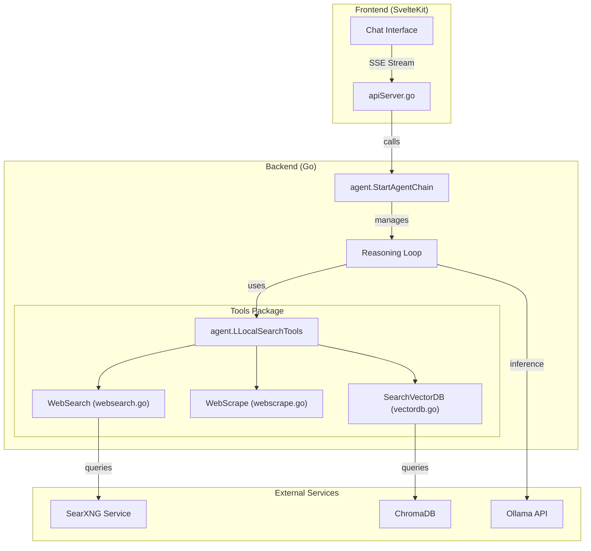
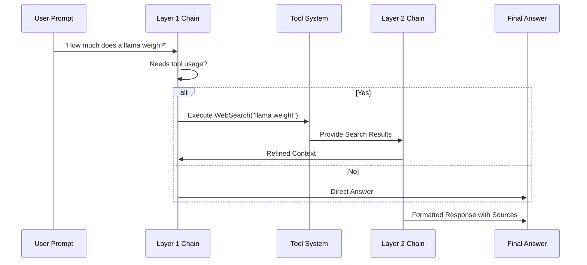

<!-- source: DeepWiki mcp.deepwiki.com · repo nilsherzig/LLocalSearch · page 1 LLocalSearch Overview · fetched 2026-10-26 -->

# LLocalSearch Overview

Relevant source files

The following files were used as context for generating this wiki page:

- [LICENSE](LICENSE)
- [OLLAMA_GUIDE.md](OLLAMA_GUIDE.md)
- [README.md](README.md)
- [infra.drawio](infra.drawio)

## Purpose and Scope

LLocalSearch is a technical framework designed to wrap locally running Large Language Models (LLMs) and provide them with a suite of tools for internet search and information retrieval. This document introduces the repository's purpose, the agentic reasoning loop, and the system's privacy-first design. It serves as the entry point for understanding the codebase architecture, hardware requirements, and the interaction between the Go backend and SvelteKit frontend.

## What is LLocalSearch?

LLocalSearch functions as an agentic orchestration layer. It allows "small" local models (which may lack extensive internal knowledge) to act as agents that can choose from a set of tools to gather real-time information. This process is recursive: the LLM can use tools multiple times, refining its search based on previous results before providing a final answer.

### Core Philosophy
- **Privacy-First**: Operates entirely locally with no requirement for external API keys (except for the optional search engine if hosted elsewhere) [README.md:22-22]().
- **Unbiased Retrieval**: Designed as an alternative to commercial engines that may prioritize content based on business partnerships [README.md:12-18]().
- **Agentic Reasoning**: Uses a reasoning loop where the LLM determines if it needs more information to answer a prompt [infra.drawio:42-43]().

## System Architecture & Data Flow

The system is composed of a Go backend that manages the `agentchain` and a SvelteKit frontend. It integrates with **Ollama** for LLM inference, **ChromaDB** for vector storage, and **SearXNG** for privacy-respecting web searches.

### High-Level Entity Mapping
The following diagram bridges the natural language concepts to specific code entities and services used in the repository.

**Diagram: Natural Language to Code Entity Space**

Sources: [README.md:8-8](), [infra.drawio:21-23](), [infra.drawio:66-67]()

## Agentic Reasoning Loop

The core logic follows an iterative "Chain of Thought" pattern. When a user submits a prompt, the system enters a multi-layered reasoning process.

1.  **Layer 1 Chain**: Analyzes the user prompt to decide if tool usage is required [infra.drawio:21-23]().
2.  **Tool Execution**: If required, it triggers tools like `WebSearch`. The results are then processed and stored or fed back into the model [infra.drawio:34-40]().
3.  **Layer 2 Chain**: Processes the results of the tool calls to refine the answer or decide on further tool usage [infra.drawio:66-67]().
4.  **Final Response**: Once the agent determines it has sufficient information, it generates the final answer for the user [infra.drawio:81-82]().

**Diagram: Detailed Agent Logic Flow**

Sources: [infra.drawio:7-83]()

## Key Features

| Feature | Technical Implementation |
| :--- | :--- |
| **Local LLM** | Integrated via `Ollama` [OLLAMA_GUIDE.md:1-2]() |
| **Privacy** | No external tracking; search via `SearXNG` [README.md:22-22]() |
| **Hardware** | Optimized for consumer GPUs (e.g., 300€ GPU) [README.md:23-23]() |
| **Transparency** | Live logs and source links provided in the UI [README.md:24-24]() |
| **Persistence** | Follow-up questions and session management [README.md:25-25]() |

Sources: [README.md:20-28](), [OLLAMA_GUIDE.md:1-10]()

## Hardware and Environment Requirements

The system is containerized using Docker to manage its multiple microservices.

- **Ollama**: Must be reachable by the backend. Configuration is handled via `OLLAMA_HOST` in the `.env` file [OLLAMA_GUIDE.md:20-20]().
- **Docker**: Requires `docker-compose` to orchestrate the backend, frontend, ChromaDB, and SearXNG [README.md:80-81]().
- **Network**: Services communicate over a bridge network; `host.docker.internal` is commonly used to link the containers to an Ollama instance running on the host OS [OLLAMA_GUIDE.md:36-36]().

Sources: [README.md:58-81](), [OLLAMA_GUIDE.md:12-47]()

## Project Roadmap

The project is currently undergoing significant updates, including:
- **Llama 3 Support**: Addressing stop-word issues in the `langchaingo` library [README.md:34-37]().
- **Interface Overhaul**: Moving towards a panel-based UI inspired by Obsidian [README.md:38-41]().
- **Advanced RAG**: Future support for private document uploads and long-term user memory [README.md:50-56]().

Sources: [README.md:30-57]()

---

