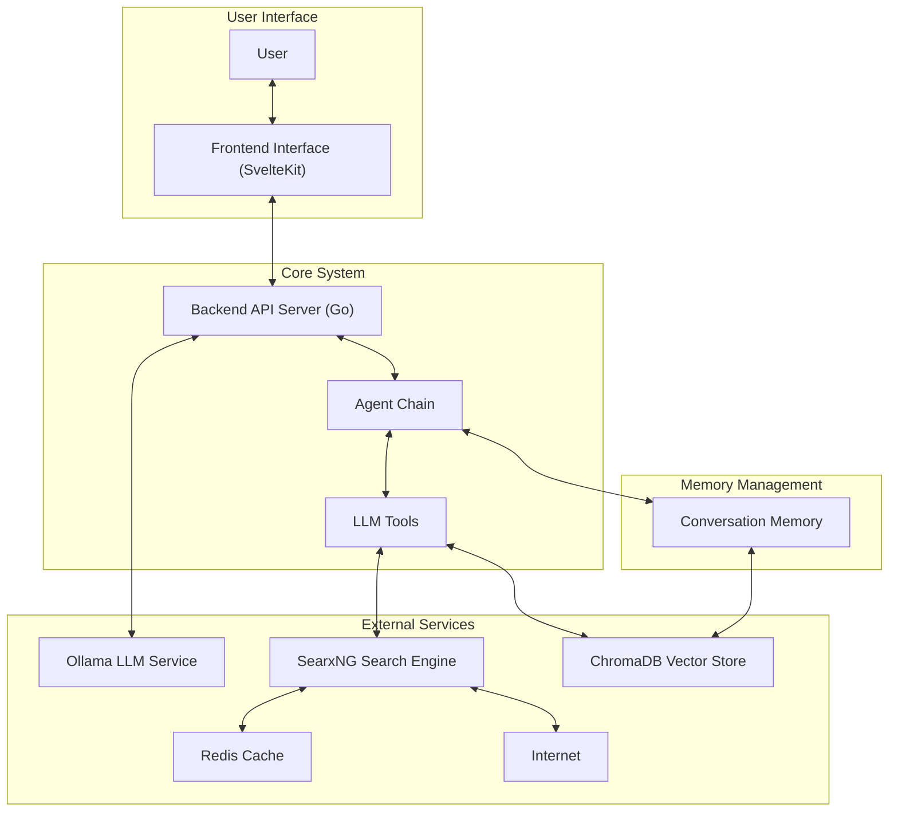
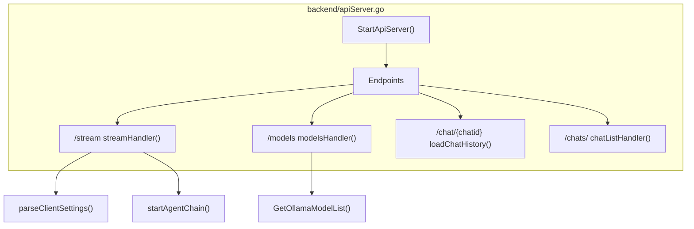
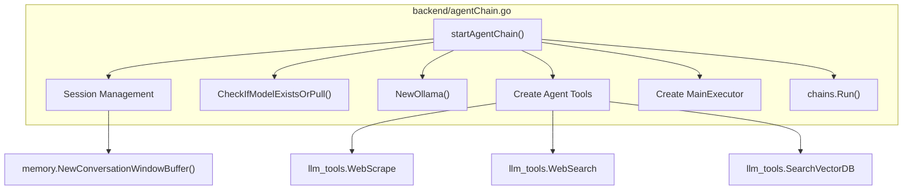
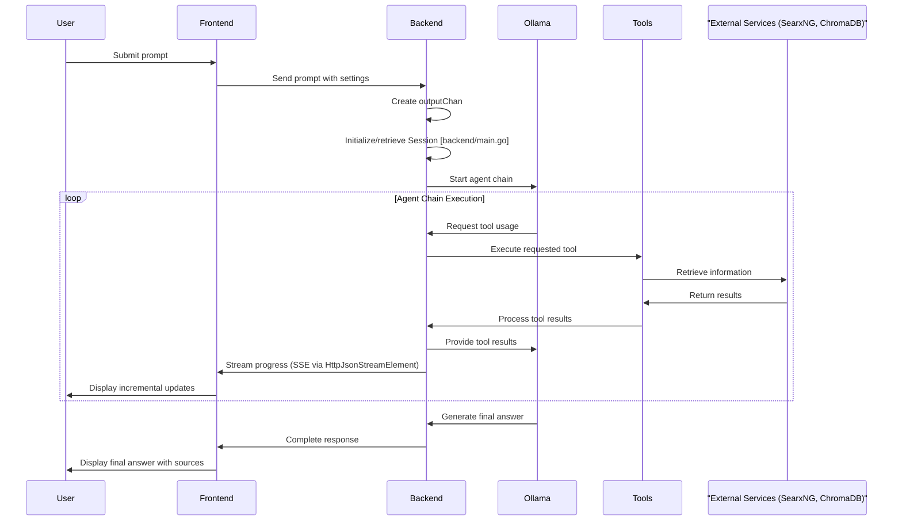
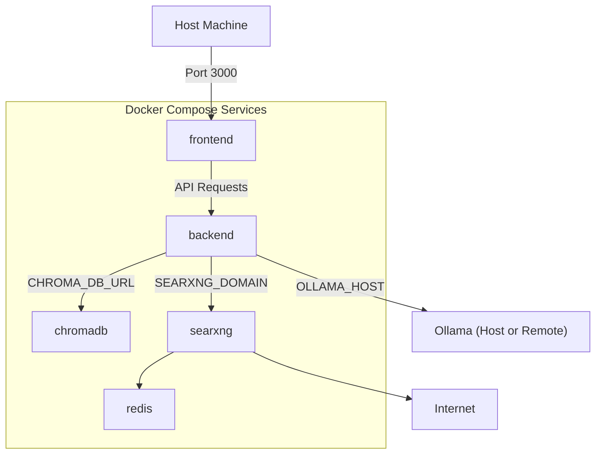

<!-- source: DeepWiki mcp.deepwiki.com · repo nilsherzig/LLocalSearch · page 2 System Architecture · fetched 2026-10-26 -->

# System Architecture

Relevant source files

The following files were used as context for generating this wiki page:

- [backend/main.go](backend/main.go)
- [docker-compose.dev.yaml](docker-compose.dev.yaml)
- [docker-compose.yaml](docker-compose.yaml)
- [go.work](go.work)
- [go.work.sum](go.work.sum)

## Purpose and Scope

This document provides a high-level overview of the LLocalSearch system architecture, explaining the relationships between its core components and how they function together to provide a locally-running LLM experience with internet search capabilities. It focuses on the microservices topology, structural aspects of the system, and the primary data flow throughout the application.

LLocalSearch is composed of a SvelteKit frontend, a Go backend, and several supporting services (ChromaDB, SearXNG, Redis) orchestrated via Docker Compose [docker-compose.yaml:1-73]().

For more detailed information about specific subsystems, see:
- [Agent Chain](#2.1) — Details on the reasoning loop and session orchestration.
- [Tool System](#2.2) — Details on web search, scraping, and vector database integration.
- [LLM Integration](#2.3) — Details on Ollama integration and embeddings.

## System Overview

LLocalSearch is designed as a wrapper around locally running Large Language Models that provides them with tools to access current information from the internet. The system enables an iterative process where the LLM can choose from several tools based on user input and previous tool outputs.

### High-Level Architecture Diagram

Sources: [docker-compose.yaml:1-73](), [backend/main.go:23-38]()

## Core Components

### Backend Server

The backend is a Go-based API server that serves as the central coordinator. It handles requests from the frontend, manages agent chains, and maintains session state using a `Sessions` map [backend/main.go:19-21](). Each `Session` contains a `ConversationWindowBuffer` for context management and a slice of `HttpJsonStreamElement` to track the interaction history [backend/main.go:13-17]().

Sources: [backend/main.go:13-21](), [backend/apiServer.go:1-250]()

### Agent Chain System

The Agent Chain is the core orchestration mechanism. It initializes the LLM connection via Ollama and sets up the reasoning loop. For details, see [Agent Chain](#2.1).

Sources: [backend/agentChain.go:1-182](), [backend/main.go:41-44]()

### Tools System

The LLM uses specific tools to bridge the gap between "Natural Language Space" and "Action Space". These tools include `WebSearch` (via SearXNG), `WebScrape`, and `SearchVectorDB` (via ChromaDB). For details, see [Tool System](#2.2).

## Data Flow

The following diagram illustrates the flow of data through the system when a user submits a query, showing how the `startAgentChain` orchestrates the `Ollama` service and `Tools`.

Sources: [backend/agentChain.go:21-182](), [backend/apiServer.go:20-88](), [backend/main.go:13-17]()

## Deployment Architecture

LLocalSearch is deployed using Docker Compose, which manages the microservices topology and internal networking (`llm_network`) [docker-compose.yaml:65-66]().

### Environment Configuration

The system is configured via environment variables defined in the compose files:

| Environment Variable | Default Value | Purpose |
|----------------------|---------------|---------|
| `OLLAMA_HOST` | `host.docker.internal:11434` | Connection to Ollama LLM service [docker-compose.yaml:6]() |
| `CHROMA_DB_URL` | `http://chromadb:8000` | Connection to ChromaDB vector store [docker-compose.yaml:7]() |
| `SEARXNG_DOMAIN` | `http://searxng:8080` | Connection to SearxNG search engine [docker-compose.yaml:8]() |
| `EMBEDDINGS_MODEL_NAME` | `nomic-embed-text:v1.5` | Model for generating embeddings [docker-compose.yaml:9]() |

Sources: [docker-compose.yaml:1-73](), [docker-compose.dev.yaml:1-88]()

## Communication Patterns

1. **HTTP/SSE**: The frontend communicates with the backend via standard HTTP for configuration and Server-Sent Events (SSE) for streaming the `HttpJsonStreamElement` updates [backend/apiServer.go:20-88]().
2. **Internal Channels**: The backend uses Go channels (`outputChan`) to bridge the asynchronous agent chain execution with the synchronous HTTP handlers [backend/apiServer.go:50-52]().
3. **Service APIs**: The backend communicates with Ollama, ChromaDB, and SearXNG via their respective REST/gRPC APIs [docker-compose.yaml:5-13]().

Sources: [backend/apiServer.go:20-88](), [backend/agentChain.go:21-182](), [backend/main.go:61-74]()

---

