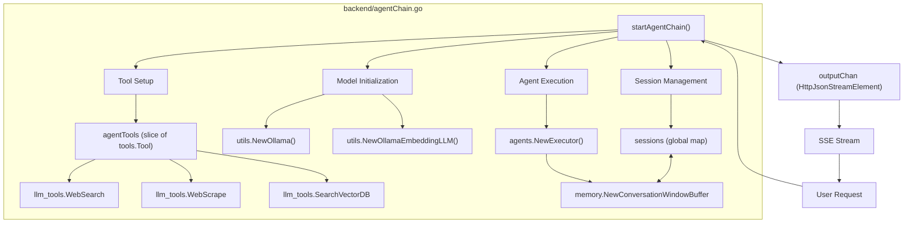
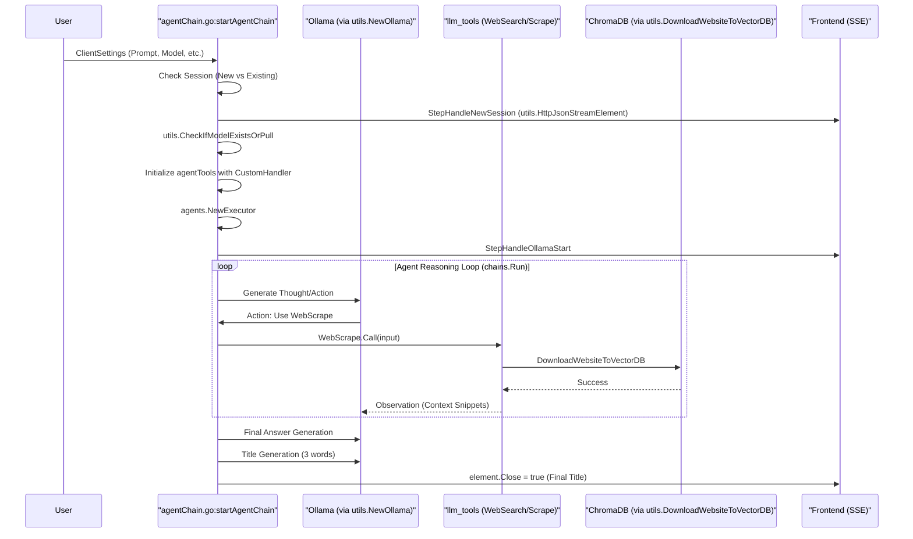

<!-- source: DeepWiki mcp.deepwiki.com · repo nilsherzig/LLocalSearch · page 2.1 Agent Chain · fetched 2026-10-26 -->

# Agent Chain

Relevant source files

The following files were used as context for generating this wiki page:

- [README.md.old](README.md.old)
- [backend/agentChain.go](backend/agentChain.go)
- [backend/go.mod](backend/go.mod)
- [backend/go.sum](backend/go.sum)
- [backend/llm_tools/tool_webscrape.go](backend/llm_tools/tool_webscrape.go)
- [backend/lschains/custom_structured_parser.go](backend/lschains/custom_structured_parser.go)
- [backend/utils/customHandler.go](backend/utils/customHandler.go)
- [backend/utils/prompts.go](backend/utils/prompts.go)
- [backend/utils/types.go](backend/utils/types.go)
- [src/lib/types/types.ts](src/lib/types/types.ts)

The Agent Chain is the core orchestration system in LLocalSearch that enables the local Large Language Model (LLM) to execute a series of reasoning steps and tool interactions to answer user queries. It manages the flow of information between the user, the LLM, and various tools like web search, web scraping, and vector database retrieval.

## Architecture Overview

The Agent Chain connects several key components in the LLocalSearch system, bridging the "Natural Language Space" of user prompts to the "Code Entity Space" of the LangChainGo framework.

### Component Relationship Diagram

Sources: [backend/agentChain.go:21-182](), [backend/utils/types.go:26-41]()

## Core Components

The Agent Chain system comprises several key components that work together:

| Component | Description | Code Reference |
|-----------|-------------|---------------|
| `startAgentChain` | Main function that orchestrates the agent chain process, including session init and tool binding. | [backend/agentChain.go:21-182]() |
| `sessions` | A global map (defined in `main.go`) that maintains `Session` structs containing history and titles. | [backend/agentChain.go:35-39]() |
| `ConversationWindowBuffer` | A `langchaingo` memory component that manages chat history with a context window. | [backend/agentChain.go:38-44]() |
| `agentTools` | A slice of `tools.Tool` including search, scraping, and vector DB retrieval. | [backend/agentChain.go:106-128]() |
| `mainExecutor` | An `agents.Executor` that manages the iterative ReAct loop. | [backend/agentChain.go:130-144]() |
| `outputChan` | A Go channel used to stream `HttpJsonStreamElement` back to the SSE endpoint. | [backend/agentChain.go:21]() |

Sources: [backend/agentChain.go:21-182](), [backend/utils/types.go:16-24]()

## Execution Flow

### Sequence of Operations

Sources: [backend/agentChain.go:21-182](), [backend/llm_tools/tool_webscrape.go:41-139]()

## Implementation Details

### Session Management and Vector DB Namespacing

The Agent Chain manages sessions to maintain conversation history and isolate data. A critical step during initialization is setting up a unique namespace in ChromaDB for the session. This prevents cross-talk between different user chats.

1. **Session Check**: If `clientSettings.Session` is "new", a unique string is generated [backend/agentChain.go:28-31]().
2. **Memory Init**: A `memory.NewConversationWindowBuffer` is created using the user's `ContextSize` [backend/agentChain.go:38]().
3. **Vector DB Namespace**: The system initializes a ChromaDB namespace matching the session ID. This is done early to prevent race conditions during parallel tool execution [backend/agentChain.go:64-74]().

Sources: [backend/agentChain.go:28-75]()

### Iterative Reasoning Loop

The system uses `agents.NewExecutor` to wrap a `ConversationalAgent`. 

*   **Max Iterations**: Controlled by `clientSettings.MaxIterations` to prevent infinite loops [backend/agentChain.go:142]().
*   **Memory**: The `ConversationWindowBuffer` is injected into the executor to provide the LLM with previous turns [backend/agentChain.go:143]().
*   **Custom Handler**: A `utils.CustomHandler` is attached to both the agent and the individual tools. This handler intercepts LangChainGo events (like `HandleToolStart` or `HandleAgentAction`) and pushes them into the `outputChan` as JSON elements [backend/agentChain.go:131](), [backend/utils/customHandler.go:15-17]().

Sources: [backend/agentChain.go:130-144](), [backend/utils/customHandler.go:133-168]()

### Streaming Protocol

The communication between the backend and frontend relies on the `HttpJsonStreamElement` struct and the `StepType` enum.

| StepType | Usage |
|---|---|
| `StepHandleStreaming` | Used for token-by-token streaming of the final answer [backend/utils/customHandler.go:68](). |
| `StepHandleAgentAction` | Signals that the LLM has decided to use a specific tool [backend/utils/customHandler.go:166](). |
| `StepHandleSourceAdded` | Sent when a new URL is successfully scraped and added to the context [backend/utils/customHandler.go:208](). |
| `StepHandleParseError` | Triggered when the LLM output doesn't conform to the expected ReAct format [backend/agentChain.go:136](). |

Sources: [backend/utils/types.go:45-70](), [src/lib/types/types.ts:45-68]()

## Error Recovery and Post-Processing

### Parser Error Handling
LLMs occasionally fail to output the correct JSON or ReAct format. The Agent Chain uses `agents.WithParserErrorHandler` to catch these failures. Instead of crashing, it sends a `StepHandleParseError` to the frontend and provides the LLM with a `ParsingErrorPrompt()` to encourage it to correct its formatting [backend/agentChain.go:133-141]().

### Title Generation
Once the `chains.Run` call completes and a final answer is produced, the Agent Chain performs a post-processing step to generate a human-readable title:
1. It retrieves all messages from `mem.ChatHistory` [backend/agentChain.go:162]().
2. It makes a direct `llm.Call` with a specific prompt: `"Please create a three (3) word title..."` [backend/agentChain.go:167]().
3. The resulting title is saved to the session and sent with the `Close: true` flag to the frontend [backend/agentChain.go:174-180]().

Sources: [backend/agentChain.go:133-141](), [backend/agentChain.go:162-180](), [backend/utils/prompts.go:3-5]()

---

