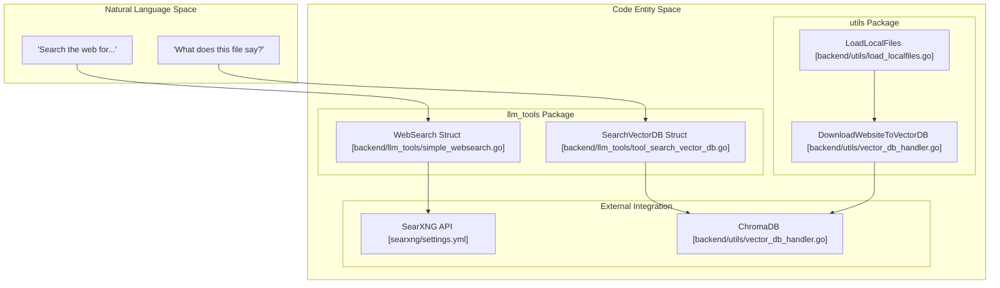
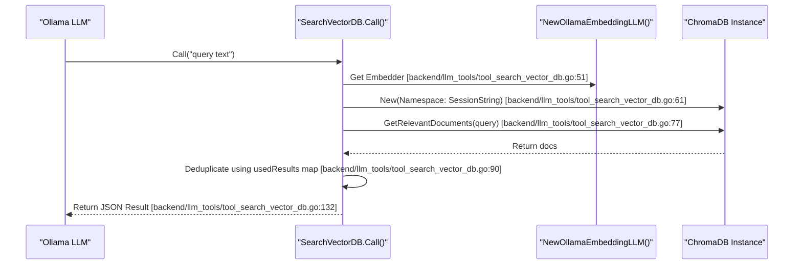

<!-- source: DeepWiki mcp.deepwiki.com · repo nilsherzig/LLocalSearch · page 2.2 Tool System · fetched 2026-10-26 -->

# Tool System

Relevant source files

The following files were used as context for generating this wiki page:

- [backend/llm_tools/simple_websearch.go](backend/llm_tools/simple_websearch.go)
- [backend/llm_tools/tool_search_vector_db.go](backend/llm_tools/tool_search_vector_db.go)
- [backend/utils/llm_backends.go](backend/utils/llm_backends.go)
- [backend/utils/load_localfiles.go](backend/utils/load_localfiles.go)
- [backend/utils/vector_db_handler.go](backend/utils/vector_db_handler.go)
- [searxng/limiter.toml](searxng/limiter.toml)
- [searxng/settings.yml](searxng/settings.yml)
- [searxng/uwsgi.ini](searxng/uwsgi.ini)
- [src/lib/show_logs_button.svelte](src/lib/show_logs_button.svelte)

The Tool System in LLocalSearch enables the Large Language Model (LLM) to access external information sources and services, extending its capabilities beyond the knowledge in its training data. This page documents the available tools, their implementation structure, and how they integrate with the larger system architecture.

## Tool System Overview

LLocalSearch implements primary tools that provide the LLM with capabilities to:
1. Search the web for current information via SearXNG.
2. Scrape and extract content from specific web pages.
3. Search vector embeddings of previously accessed information in ChromaDB.

These tools follow a standardized structure and are provided to the LLM via the agent chain orchestration system, allowing the model to reason about which tool to use and how to interpret their results.

### Natural Language to Code Entity Mapping
The following diagram bridges the gap between the conceptual "Natural Language" tool requests and the specific "Code Entity" implementations.

Sources: [backend/llm_tools/simple_websearch.go:19-23](), [backend/llm_tools/tool_search_vector_db.go:21-25](), [backend/utils/vector_db_handler.go:85-120](), [backend/utils/load_localfiles.go:44-49]()

## Tool Interface Structure

All tools in the system implement the `tools.Tool` interface from the LangChain Go library. This ensures a consistent contract for the LLM to interact with.

### Implementation Details
- **`Name()`**: Returns the identifier used by the LLM to call the tool (e.g., `websearch`, `database_search`). [backend/llm_tools/simple_websearch.go:33-35](), [backend/llm_tools/tool_search_vector_db.go:40-42]()
- **`Description()`**: Provides the prompt-level instructions for the LLM explaining when and how to use the tool. [backend/llm_tools/simple_websearch.go:29-31](), [backend/llm_tools/tool_search_vector_db.go:36-38]()
- **`Call()`**: The execution logic that takes a string input and returns a string response (usually JSON-formatted). [backend/llm_tools/simple_websearch.go:37-129](), [backend/llm_tools/tool_search_vector_db.go:44-133]()

### Data Flow for SearchVectorDB
The `SearchVectorDB` tool specifically manages semantic retrieval from the local knowledge base.

Sources: [backend/llm_tools/tool_search_vector_db.go:44-133](), [backend/utils/llm_backends.go:17-20]()

## Available Tools

### WebSearch Tool
The `WebSearch` tool integrates with SearXNG to fetch live internet data. 
- **Implementation**: It constructs a GET request to the domain specified in the `SEARXNG_DOMAIN` environment variable. [backend/llm_tools/simple_websearch.go:45-47]()
- **Deduplication**: It maintains a `simpleUsedLinks` map indexed by `SessionString` to ensure the same link isn't processed twice in one session. [backend/llm_tools/simple_websearch.go:25-75]()
- **Parallelism**: It uses a `sync.WaitGroup` to concurrently process results and update the UI via the `CustomHandler`. [backend/llm_tools/simple_websearch.go:61-112]()

### SearchVectorDB Tool
The `SearchVectorDB` tool provides RAG (Retrieval-Augmented Generation) capabilities.
- **Distance Function**: Uses "cosine" similarity for vector comparisons. [backend/llm_tools/tool_search_vector_db.go:64]()
- **Namespace Isolation**: Uses `SessionString` as the ChromaDB namespace, ensuring data privacy between different chat sessions. [backend/llm_tools/tool_search_vector_db.go:65]()
- **Thresholding**: Filters results based on `Settings.MinResultScore`. [backend/llm_tools/tool_search_vector_db.go:73]()

## Data Ingestion Pipeline

Data enters the vector database through three main paths:
1. **Web Scraping**: `DownloadWebsiteToVectorDB` fetches HTML, sanitizes it using `bluemonday`, and splits it into chunks. [backend/utils/vector_db_handler.go:85-120]()
2. **Local Files**: `LoadLocalFiles` scans the `/localfiles` directory for `.md` files and ingests them. [backend/utils/load_localfiles.go:15-49]()
3. **Manual Markdown**: `LoadMarkdownToVectorDB` handles direct string ingestion. [backend/utils/vector_db_handler.go:63-83]()

### Text Processing Logic
Content is prepared for the vector store using the following steps:
- **Sanitization**: `stripHtml` removes tags and normalizes whitespace. [backend/utils/vector_db_handler.go:122-130]()
- **Chunking**: `textsplitter.NewTokenSplitter` breaks text into segments based on `ChunkSize` and `ChunkOverlap`. [backend/utils/vector_db_handler.go:99-103]()
- **Metadata**: Every chunk is tagged with a `URL` or file path for attribution. [backend/utils/vector_db_handler.go:108]()

## CustomHandler Callback Bridge

The `CustomHandler` is an extension of the LangChain callback system that bridges the backend tool execution with the frontend SSE (Server-Sent Events) stream.

- **`HandleSourceAdded`**: When a tool finds a relevant document or link, it calls this method to push a `Source` object to the UI. [backend/llm_tools/simple_websearch.go:107](), [backend/llm_tools/tool_search_vector_db.go:105]()
- **Attribution**: Sources include the Engine (e.g., "SimpleWebSearch"), Title, Link, and a Summary. [backend/llm_tools/simple_websearch.go:99-105]()

Sources: [backend/llm_tools/simple_websearch.go:97-108](), [backend/llm_tools/tool_search_vector_db.go:102-112]()

## Configuration Parameters

Tools are governed by `utils.ClientSettings`, allowing users to tune performance vs. accuracy.

| Setting | Code Reference | Tool Affected |
| :--- | :--- | :--- |
| `AmountOfWebsites` | [backend/llm_tools/simple_websearch.go:77]() | WebSearch |
| `AmountOfResults` | [backend/llm_tools/tool_search_vector_db.go:76]() | SearchVectorDB |
| `MinResultScore` | [backend/llm_tools/tool_search_vector_db.go:73]() | SearchVectorDB |
| `ChunkSize` | [backend/utils/vector_db_handler.go:102]() | Ingestion Pipeline |
| `ChunkOverlap` | [backend/utils/vector_db_handler.go:103]() | Ingestion Pipeline |

Sources: [backend/llm_tools/tool_search_vector_db.go:24](), [backend/llm_tools/simple_websearch.go:22]()

---

