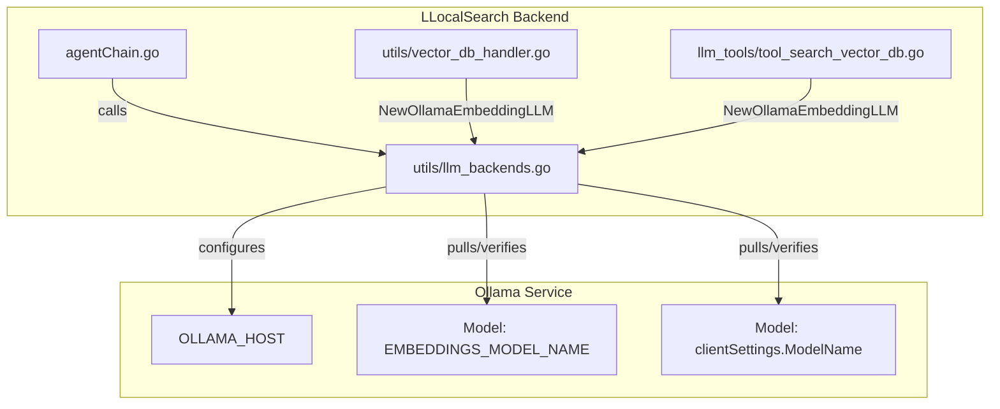
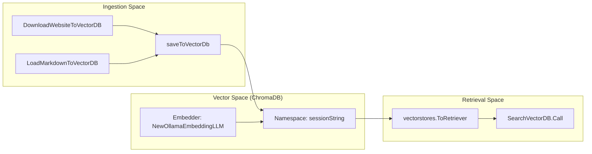

<!-- source: DeepWiki mcp.deepwiki.com · repo nilsherzig/LLocalSearch · page 2.3 LLM Integration · fetched 2026-10-26 -->

# LLM Integration

Relevant source files

The following files were used as context for generating this wiki page:

- [backend/agentChain.go](backend/agentChain.go)
- [backend/llm_tools/tool_search_vector_db.go](backend/llm_tools/tool_search_vector_db.go)
- [backend/lschains/format_sources_chain.go](backend/lschains/format_sources_chain.go)
- [backend/lschains/ollama_functioncall.go](backend/lschains/ollama_functioncall.go)
- [backend/utils/llm_backends.go](backend/utils/llm_backends.go)
- [backend/utils/vector_db_handler.go](backend/utils/vector_db_handler.go)

This page documents how LLocalSearch integrates with local Large Language Models (LLMs) through Ollama to provide the core intelligence for the system. This integration enables the system to process user queries, reason through complex problems, and utilize various tools to retrieve information.

## Overview

LLocalSearch uses Ollama as its LLM backend, allowing the system to run models locally. The integration is primarily managed through the `langchaingo` framework, which provides an abstraction layer for LLM interactions, embeddings, and vector store management.

Sources: [backend/utils/llm_backends.go:1-28](), [backend/agentChain.go:56-69](), [backend/agentChain.go:84-95]()

## Core Components

### Ollama Client Initialization
The system implements a centralized factory for creating Ollama instances. The `NewOllama` function in `backend/utils/llm_backends.go` configures the client using the `OLLAMA_HOST` environment variable and sets the `WithRunnerNumCtx` option to match the requested context size [backend/utils/llm_backends.go:22-28]().

### Embeddings Pipeline
The system utilizes a dedicated model for generating vector embeddings, defined by the `EMBEDDINGS_MODEL_NAME` environment variable [backend/utils/llm_backends.go:15]().

- **`NewOllamaEmbeddingLLM`**: A wrapper that initializes an Ollama client specifically for embeddings with a fixed context size of 8192 tokens [backend/utils/llm_backends.go:17-20]().
- **Embedder Integration**: The `embeddings.NewEmbedder` function from `langchaingo` wraps this LLM instance to provide the standard embedding interface used by ChromaDB [backend/agentChain.go:60-63]().

### Model Management
Before the agent chain starts, the system ensures all necessary models are present on the Ollama host using `CheckIfModelExistsOrPull` [backend/utils/llm_backends.go:34-42]().

- **`GetOllamaModelList`**: Queries the Ollama API directly using `api.ClientFromEnvironment()` to list available models [backend/utils/llm_backends.go:44-58]().
- **`OllamaPullModel`**: Triggers a pull request to the Ollama server if a model is missing, providing real-time progress logging through `pullProgressHandler` [backend/utils/llm_backends.go:73-95]().

## Vector Store Integration (ChromaDB)

The system integrates LLM embeddings with ChromaDB to facilitate Retrieval-Augmented Generation (RAG). The `CHROMA_DB_URL` environment variable is required for this connection [backend/agentChain.go:65]().

### Data Flow: Ingestion to Retrieval
The following diagram maps the code entities involved in moving data from natural language (websites/markdown) into the vector space and back.

Sources: [backend/utils/vector_db_handler.go:22-38](), [backend/utils/vector_db_handler.go:63-83](), [backend/llm_tools/tool_search_vector_db.go:51-76]()

### Namespace Management
Each chat session is assigned a unique UUID via `GetSessionString` [backend/utils/llm_backends.go:30-32](). This UUID is used as the `NameSpace` in ChromaDB, ensuring that search results are isolated to the specific context of a single conversation [backend/agentChain.go:68](), [backend/llm_tools/tool_search_vector_db.go:65]().

## Implementation in Agent Chain

The `startAgentChain` function orchestrates the LLM lifecycle:

1. **Model Verification**: It checks for both the user-selected model and the embeddings model [backend/agentChain.go:84-95]().
2. **Initialization**: It creates the main LLM instance for reasoning and the embedding-backed vector store for tool usage [backend/agentChain.go:97-101]().
3. **Execution**: It runs the `mainExecutor` (a `langchaingo` agent) which uses the LLM to decide when to call tools like `database_search` [backend/agentChain.go:130-144]().
4. **Post-Processing**: After the main answer is generated, it performs a secondary LLM call to generate a 3-word title for the conversation based on the message history [backend/agentChain.go:167-175]().

## Constraints and Known Issues

- **Stop Words**: There are known constraints with LLama3 models regarding stop word handling, which can occasionally cause the model to continue generating past its intended stopping point [README.md:27-43]().
- **Parsing Errors**: If the LLM fails to output valid JSON for tool calls, the system catches this via `WithParserErrorHandler` and prompts the model to try again using `utils.ParsingErrorPrompt()` [backend/agentChain.go:133-141]().
- **Vector DB Initialization**: A "hack" is currently implemented to initialize the vector DB namespace early in the chain to prevent race conditions during concurrent tool execution [backend/agentChain.go:52-75]().

## Configuration Summary

| Dependency | Env Variable | Code Reference |
| :--- | :--- | :--- |
| Ollama API URL | `OLLAMA_HOST` | [backend/utils/llm_backends.go:24]() |
| Embedding Model | `EMBEDDINGS_MODEL_NAME` | [backend/utils/llm_backends.go:15]() |
| Vector Store URL | `CHROMA_DB_URL` | [backend/agentChain.go:65]() |

Sources: [backend/agentChain.go:1-182](), [backend/utils/llm_backends.go:1-100](), [backend/llm_tools/tool_search_vector_db.go:1-133]()

---

