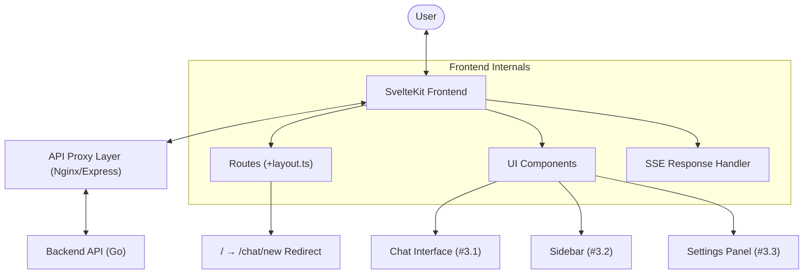
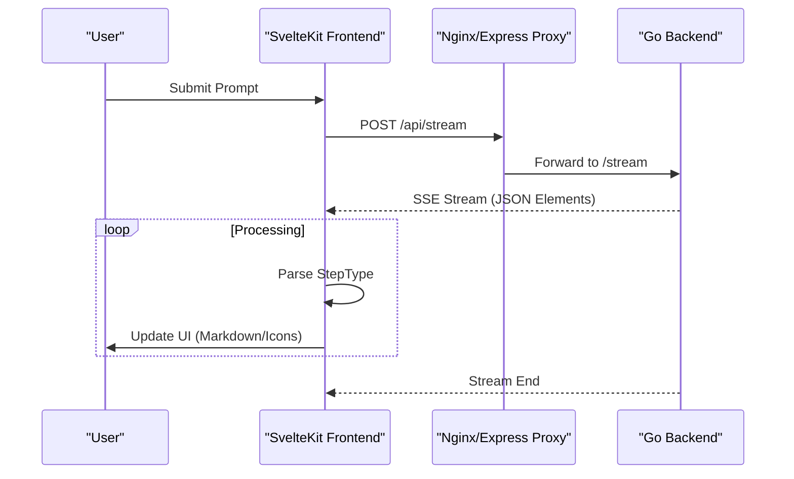

<!-- source: DeepWiki mcp.deepwiki.com · repo nilsherzig/LLocalSearch · page 3 Frontend Application · fetched 2026-10-26 -->

# Frontend Application

Relevant source files

The following files were used as context for generating this wiki page:

- [Dockerfile](Dockerfile)
- [custom-server.js](custom-server.js)
- [nginx.conf](nginx.conf)
- [package-lock.json](package-lock.json)
- [package.json](package.json)
- [src/app.css](src/app.css)
- [src/app.d.ts](src/app.d.ts)
- [src/app.html](src/app.html)
- [src/routes/+layout.ts](src/routes/+layout.ts)
- [static/favicon.png](static/favicon.png)
- [static/favicon.svg](static/favicon.svg)
- [svelte.config.js](svelte.config.js)
- [tailwind.config.js](tailwind.config.js)

This document provides an overview of the SvelteKit-based frontend application for LLocalSearch. It describes the application's architecture, deployment configurations, and how it interfaces with the backend API to deliver a user-friendly interface for interacting with locally running Large Language Models (LLMs).

For information about the backend services that the frontend communicates with, see [API Server](#4.3).

## Architecture Overview

The LLocalSearch frontend is built with SvelteKit, providing a responsive interface that allows users to engage in conversations with locally running LLMs, configure model and search settings, and view conversation history. The application is designed as a Single Page Application (SPA) that is prerendered into static assets.

Sources: [src/routes/+layout.ts:1-1](), [svelte.config.js:1-26]()

## Routing and Entry Points

The application implements routing through SvelteKit's file-based routing system. The entire site is configured for static prerendering using `@sveltejs/adapter-static` [svelte.config.js:2-23]().

- **Prerendering**: The layout is marked with `export const prerender = true` to ensure the application is generated as a static site [src/routes/+layout.ts:1-1]().
- **Root Entry**: The main entry point is defined in `src/app.html`, which sets the default "dark" class for the theme [src/app.html:1-15]().

For details on specific routes and navigation logic, see [Sidebar and Navigation](#3.2).

## Deployment and Proxying

The frontend application supports two primary deployment methods, both of which involve proxying `/api` requests to the backend service.

### Static Deployment with Nginx
In production, the application is typically served via Nginx. The `Dockerfile` uses a multi-stage build to compile the SvelteKit app and then copies the static files to an Nginx container [Dockerfile:1-14]().

The Nginx configuration handles:
- **Static Files**: Serves assets from `/usr/share/nginx/html` [nginx.conf:7-8]().
- **API Proxy**: Rewrites `/api/` paths and forwards them to `http://backend:8080/` [nginx.conf:11-18]().
- **Streaming Support**: Disables `proxy_buffering` to allow Server-Sent Events (SSE) to reach the client in real-time [nginx.conf:14-14]().

### Node.js Development Proxy
A custom Express server (`custom-server.js`) is provided for local development or Node-based environments. It uses `http-proxy-middleware` to forward `/api` requests to the backend [custom-server.js:1-24]().

Sources: [nginx.conf:1-31](), [custom-server.js:1-24](), [Dockerfile:1-14]()

## Technical Stack

The frontend leverages a modern utility-first and component-based stack:

| Category | Technology | Purpose |
| :--- | :--- | :--- |
| **Framework** | SvelteKit | Core application framework and routing [package.json:18-18]() |
| **Styling** | Tailwind CSS | Utility-first CSS and typography [tailwind.config.js:1-15]() |
| **Rendering** | Marked | Markdown parsing for LLM responses [package.json:42-42]() |
| **Adapter** | Static Adapter | Compiles the app into static HTML/JS/CSS [svelte.config.js:10-19]() |

Sources: [package.json:14-45](), [tailwind.config.js:1-15]()

## Component Modules

The application is divided into three primary functional areas:

### Chat Interface
The core of the application where users interact with the LLM. It handles the streaming of reasoning steps (StepTypes), markdown rendering, and tool action visualization.
For details, see [Chat Interface](#3.1).

### Sidebar and Navigation
Manages the application state related to chat history, source management, and navigation between different chat sessions.
For details, see [Sidebar and Navigation](#3.2).

### Settings and Configuration
Provides the UI for adjusting LLM parameters (e.g., temperature, context size) and search behavior (e.g., chunk size, result scores).
For details, see [Settings and Configuration](#3.3).

## Data Flow with Backend

The frontend specifically configures the proxy to ensure that the `proxy_buffering` is off, which is critical for the iterative reasoning loop where the user sees the agent's "thoughts" as they occur [nginx.conf:14-14]().

Sources: [nginx.conf:11-23](), [custom-server.js:7-16]()

---

