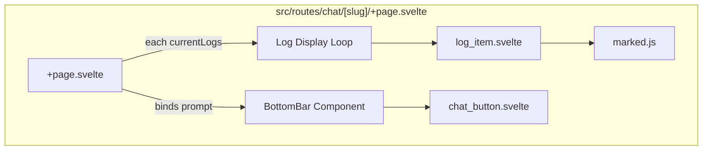
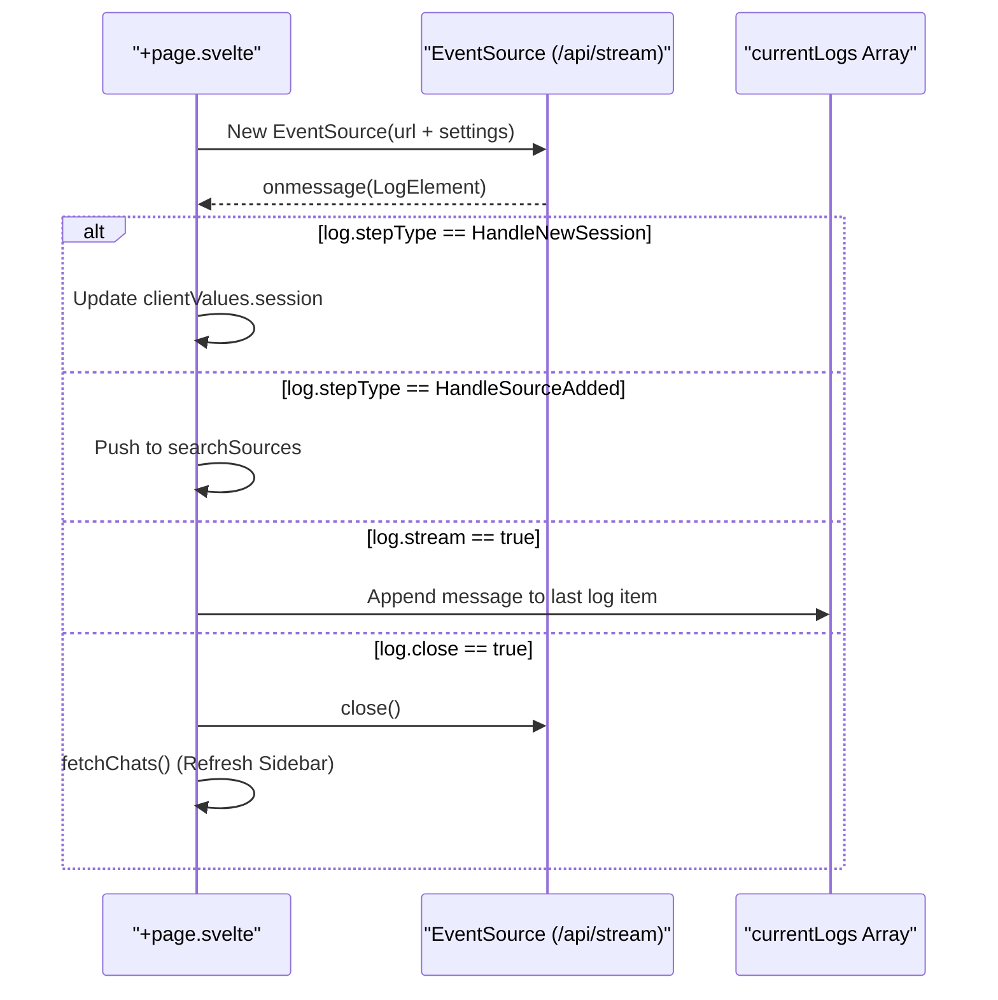

<!-- source: DeepWiki mcp.deepwiki.com · repo nilsherzig/LLocalSearch · page 3.1 Chat Interface · fetched 2026-10-26 -->

# Chat Interface

Relevant source files

The following files were used as context for generating this wiki page:

- [src/lib/bottom_bar.svelte](src/lib/bottom_bar.svelte)
- [src/lib/loading_message.svelte](src/lib/loading_message.svelte)
- [src/lib/log_item.svelte](src/lib/log_item.svelte)
- [src/lib/log_node.svelte](src/lib/log_node.svelte)
- [src/lib/new_chat_button.svelte](src/lib/new_chat_button.svelte)
- [src/lib/sources.svelte](src/lib/sources.svelte)
- [src/routes/chat/[slug]/+page.svelte](src/routes/chat/[slug]/+page.svelte)
- [src/routes/chat/[slug]/handle_darkmode.ts](src/routes/chat/[slug]/handle_darkmode.ts)
- [src/routes/chat/[slug]/load_functions.ts](src/routes/chat/[slug]/load_functions.ts)

The Chat Interface is the primary user-facing component of LLocalSearch where users interact with locally-running Large Language Models (LLMs). This page documents the design, components, and functionality of the chat interface implemented in the SvelteKit frontend, specifically focusing on the message rendering pipeline and input handling.

## Interface Structure

The chat interface is managed primarily by the `+page.svelte` route in `src/routes/chat/[slug]`. It coordinates the flow between the backend streaming API and the various UI components.

Sources: [src/routes/chat/[slug]/+page.svelte:1-30](), [src/lib/log_item.svelte:1-20](), [src/lib/bottom_bar.svelte:1-10]()

## Route and Data Loading

The `/chat/[slug]` route uses the `slug` parameter to identify specific chat sessions. The `load_functions.ts` file provides the logic for retrieving existing conversations and metrics.

### Key Functions
- `fetchHistory(id: string)`: Retrieves the message log for a specific session from `/api/chat/{id}` [src/routes/chat/[slug]/load_functions.ts:36-53]().
- `parseLogArray(history: LogElement[])`: Processes raw history items, removing LLM-specific tokens like `<|im_end|>` and merging sequential stream chunks into single message blocks [src/routes/chat/[slug]/load_functions.ts:56-78]().
- `runMetrics(version, model)`: Reports anonymous usage data to the metrics server to help track version distribution [src/routes/chat/[slug]/load_functions.ts:14-35]().

Sources: [src/routes/chat/[slug]/load_functions.ts:1-78]()

## Rendering Pipeline (`log_item.svelte`)

The `log_item.svelte` component is responsible for transforming raw `LogElement` data into formatted HTML. It uses a dispatch mechanism based on `StepType` to determine the visual style.

### Markdown and Sanitization
The interface uses `marked` for Markdown rendering. A custom renderer is used to ensure all links open in a new tab with `rel='noopener noreferrer'` for security [src/lib/log_item.svelte:8-17](). Before rendering, the component strips internal "Thought" strings and LLM prefixes like `AI:` to provide a clean chat experience [src/lib/log_item.svelte:125-132]().

### Tool Action Icons
When the LLM triggers a tool, `log_item.svelte` detects the action in the message content and renders specific SVG icons:
- **Web Search**: Globe icon [src/lib/log_item.svelte:101-119]().
- **Web Scrape**: Eye icon [src/lib/log_item.svelte:58-81]().
- **Database Search**: Database icon [src/lib/log_item.svelte:82-100]().

### Error Handling
Errors are caught by checking `StepType` constants such as `HandleChainError` or `HandleParseError`. If a parsing error occurs (indicating the LLM failed to output valid JSON for a tool call), a user-friendly message suggests using a model better trained for function calling [src/lib/log_item.svelte:28-42]().

Sources: [src/lib/log_item.svelte:1-172]()

## Input and Controls (`bottom_bar.svelte`)

The `bottom_bar.svelte` component manages user input and session control.

### Implementation Details
- **Auto-Resize**: The `autoResize` function dynamically adjusts the `textarea` height based on the `scrollHeight` as the user types [src/lib/bottom_bar.svelte:12-15]().
- **Keyboard Shortcuts**: Pressing `Enter` without modifiers triggers `sendPrompt()`, while `Shift+Enter` allows for multi-line input [src/lib/bottom_bar.svelte:26-37]().
- **Focus Management**: The input field automatically regains focus when the system returns to "send mode" (i.e., when the LLM finishes responding) [src/lib/bottom_bar.svelte:38-42]().

Sources: [src/lib/bottom_bar.svelte:1-67]()

## Streaming Interaction

The frontend uses the browser's `EventSource` API to handle real-time updates from the backend `/api/stream` endpoint.

Sources: [src/routes/chat/[slug]/+page.svelte:146-187]()

## Visual Components

### Loading States
The `loading_message.svelte` component provides an animated pulse effect using random widths to simulate text lines, giving the user visual feedback while the LLM is initializing or searching [src/lib/loading_message.svelte:1-40]().

### Dark Mode
Dark mode is handled by `handle_darkmode.ts`, which toggles the `dark` class on the `document.documentElement`. It synchronizes the state with `localStorage.theme` and respects the user's system preference via `window.matchMedia` [src/routes/chat/[slug]/handle_darkmode.ts:1-15]().

Sources: [src/lib/loading_message.svelte:1-40](), [src/routes/chat/[slug]/handle_darkmode.ts:1-15]()

---

