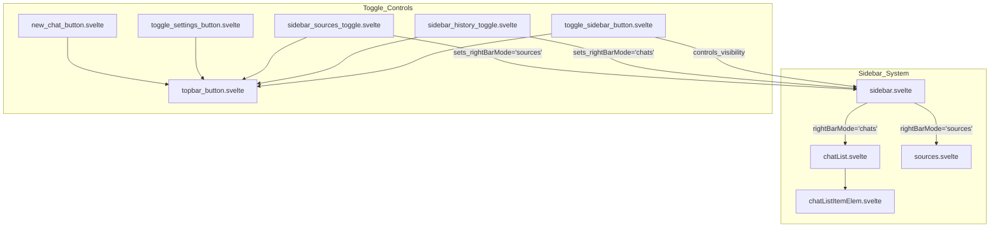
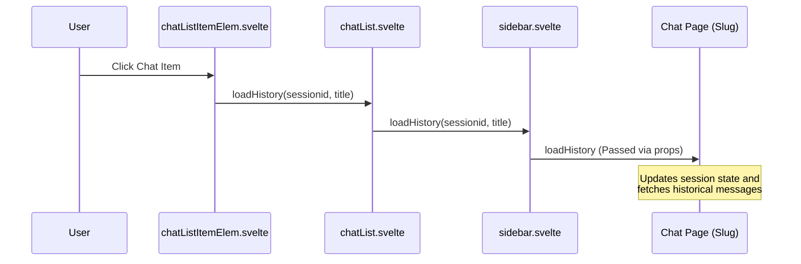

<!-- source: DeepWiki mcp.deepwiki.com · repo nilsherzig/LLocalSearch · page 3.2 Sidebar and Navigation · fetched 2026-10-26 -->

# Sidebar and Navigation

Relevant source files

The following files were used as context for generating this wiki page:

- [src/lib/chatHistory.svelte](src/lib/chatHistory.svelte)
- [src/lib/chatList.svelte](src/lib/chatList.svelte)
- [src/lib/chatListItemElem.svelte](src/lib/chatListItemElem.svelte)
- [src/lib/chat_button.svelte](src/lib/chat_button.svelte)
- [src/lib/loading_message.svelte](src/lib/loading_message.svelte)
- [src/lib/new_chat_button.svelte](src/lib/new_chat_button.svelte)
- [src/lib/sidebar.svelte](src/lib/sidebar.svelte)
- [src/lib/sidebar_history_toggle.svelte](src/lib/sidebar_history_toggle.svelte)
- [src/lib/sidebar_sources_toggle.svelte](src/lib/sidebar_sources_toggle.svelte)
- [src/lib/toggle_darkmode_button.svelte](src/lib/toggle_darkmode_button.svelte)
- [src/lib/toggle_settings_button.svelte](src/lib/toggle_settings_button.svelte)
- [src/lib/toggle_sidebar_button.svelte](src/lib/toggle_sidebar_button.svelte)
- [src/lib/topbar_button.svelte](src/lib/topbar_button.svelte)
- [src/routes/+page.svelte](src/routes/+page.svelte)

## Purpose and Scope

This document details the sidebar and navigation components of the LLocalSearch frontend interface. The sidebar provides access to chat history and reference sources, enabling users to navigate between past conversations and view sources used in agent responses. It also covers the top-level routing logic and specialized navigation buttons for chat management, settings, and theme control.

## Sidebar Components Overview

The sidebar in LLocalSearch serves two primary functions through its different modes:
1. Displaying chat history (`chats` mode)
2. Showing reference sources (`sources` mode)

Sources: [src/lib/sidebar.svelte:1-12](), [src/lib/chatListItemElem.svelte:1-5](), [src/lib/toggle_sidebar_button.svelte:1-6](), [src/lib/sidebar_history_toggle.svelte:1-4](), [src/lib/sidebar_sources_toggle.svelte:1-5](), [src/lib/topbar_button.svelte:1-6]()

## Root Navigation and Redirects

The application implements a root redirect to ensure users always land on a valid chat state. The root route `/` immediately redirects to `/chat/new` using a 307 Temporary Redirect.

Sources: [src/routes/+page.svelte:1-7]()

## Sidebar Container Implementation

The main sidebar container is implemented in `sidebar.svelte`. It uses Svelte transitions (`slide` on the x-axis) for smooth animations when showing or hiding the sidebar [src/lib/sidebar.svelte:15-16]().

The sidebar conditionally renders content based on the `rightBarMode` prop:
- **Chats Mode**: Displays the chat history. It handles the asynchronous nature of fetching history using an `{#await chatlistItems}` block [src/lib/sidebar.svelte:40-52]().
- **Sources Mode**: Displays the reference sources used by the agent in the current session via the `Sources` component [src/lib/sidebar.svelte:54-58]().

Sources: [src/lib/sidebar.svelte:14-60]()

## Navigation Controls

The sidebar's visibility and mode are controlled by a set of specialized toggle buttons, most of which wrap `topbar_button.svelte` to provide consistent styling, hover effects, and active state shadows [src/lib/topbar_button.svelte:10-34]().

### Chat and Session Management
- **New Chat Button** (`new_chat_button.svelte`): Triggers the provided `action` to reset the interface for a new session [src/lib/new_chat_button.svelte:1-24]().
- **Chat Action Button** (`chat_button.svelte`): A multi-state button used in the input bar. It switches between "send message", "stop chat" (if an `eventSource` is active), and "new chat" based on the `sendMode` and `prompt` state [src/lib/chat_button.svelte:15-107]().

### Interface Toggles
- **Sidebar Toggle** (`toggle_sidebar_button.svelte`): Toggles the `showSidebar` boolean, changing the SVG icon to indicate the "push" or "pull" action [src/lib/toggle_sidebar_button.svelte:8-44]().
- **History Toggle** (`sidebar_history_toggle.svelte`): Sets `rightBarMode` to `chats` [src/lib/sidebar_history_toggle.svelte:6-25]().
- **Sources Toggle** (`sidebar_sources_toggle.svelte`): Sets `rightBarMode` to `sources` [src/lib/sidebar_sources_toggle.svelte:7-26]().
- **Dark Mode Toggle** (`toggle_darkmode_button.svelte`): Toggles the `isDarkMode` boolean and switches between sun and moon icons [src/lib/toggle_darkmode_button.svelte:7-43]().
- **Settings Toggle** (`toggle_settings_button.svelte`): Opens the settings modal by setting `showSettings` to true [src/lib/toggle_settings_button.svelte:7-23]().

Sources: [src/lib/chat_button.svelte:1-108](), [src/lib/toggle_sidebar_button.svelte:1-45](), [src/lib/sidebar_history_toggle.svelte:1-26](), [src/lib/sidebar_sources_toggle.svelte:1-27](), [src/lib/new_chat_button.svelte:1-24]()

## Chat History Mode

When in `chats` mode, `sidebar.svelte` renders the `ChatList` component. This component iterates through `chatListItems` and renders individual `chatListItemElem.svelte` instances.

### Chat List Items
Each item represents a past session. The component `chatListItemElem.svelte` cleans the title by removing the "title: " prefix often generated by the LLM [src/lib/chatListItemElem.svelte:6-10]().
- **Active State**: If `item.sessionid === session`, the item is highlighted with `bg-neutral-200` (light) or `bg-neutral-800` (dark) [src/lib/chatListItemElem.svelte:15-20]().
- **Selection**: Clicking an item calls the `loadHistory` function with the session ID and title [src/lib/chatListItemElem.svelte:13]().

Sources: [src/lib/chatListItemElem.svelte:1-30](), [src/lib/sidebar.svelte:40-52]()

## Loading States

The interface uses `loading_message.svelte` to provide visual feedback during asynchronous operations (like loading chat content). It generates a skeleton UI with randomized widths for "blocks" of text to simulate content, wrapped in an `animate-pulse` container [src/lib/loading_message.svelte:1-39]().

Sources: [src/lib/loading_message.svelte:1-40]()

## Technical Implementation Details

### Data Flow for History Selection

### Component Property Reference

| Component | Prop | Description |
|-----------|------|-------------|
| `sidebar.svelte` | `rightBarMode` | String: `'chats'` or `'sources'`. |
| `sidebar.svelte` | `chatlistItems` | Promise: Resolves to `ChatListItem[]`. |
| `chatListItemElem.svelte` | `item` | `ChatListItem`: Contains `sessionid` and `title`. |
| `chat_button.svelte` | `sendMode` | Boolean: Toggles between send and new/stop states. |
| `topbar_button.svelte` | `active` | Boolean: Applies "pressed" styling if true. |

Sources: [src/lib/sidebar.svelte:1-12](), [src/lib/chatListItemElem.svelte:1-5](), [src/lib/topbar_button.svelte:1-6](), [src/lib/chat_button.svelte:1-9]()

---

