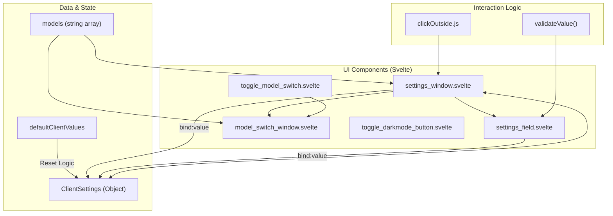
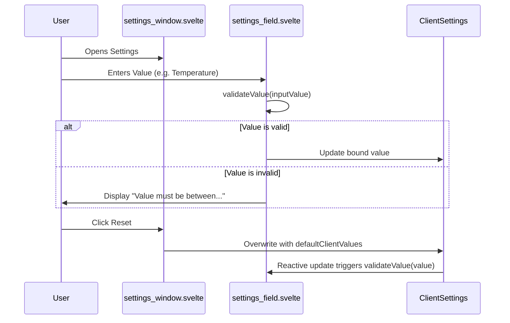

<!-- source: DeepWiki mcp.deepwiki.com · repo nilsherzig/LLocalSearch · page 3.3 Settings and Configuration · fetched 2026-10-26 -->

# Settings and Configuration

Relevant source files

The following files were used as context for generating this wiki page:

- [src/lib/clickOutside.js](src/lib/clickOutside.js)
- [src/lib/model_switch_window.svelte](src/lib/model_switch_window.svelte)
- [src/lib/settings_field.svelte](src/lib/settings_field.svelte)
- [src/lib/settings_window.svelte](src/lib/settings_window.svelte)
- [src/lib/toggle_darkmode_button.svelte](src/lib/toggle_darkmode_button.svelte)
- [src/lib/toggle_model_switch.svelte](src/lib/toggle_model_switch.svelte)
- [src/routes/+page.svelte](src/routes/+page.svelte)

This document details the settings and configuration system in LLocalSearch. It covers the user interface for modifying settings, the validation pipeline for configuration parameters, and the specialized components for model switching and theme management.

## Settings Interface Overview

The settings interface is implemented primarily through `settings_window.svelte`, a modal UI that binds to the `ClientSettings` object. This modal allows granular control over the agent's reasoning parameters, vector database thresholds, and scraping behavior.

### Settings Component Architecture

Sources: [src/lib/settings_window.svelte:1-10](), [src/lib/settings_field.svelte:1-9](), [src/lib/model_switch_window.svelte:1-6](), [src/lib/clickOutside.js:1-16]()

## Configurable Parameters

The settings are categorized into functional blocks within the `settings_window.svelte` modal.

### LLM Configuration
These parameters control the core behavior of the Ollama-powered agent.

| Parameter | UI Element | Logic / Range |
|-----------|------------|---------------|
| `modelName` | `<select>` | Populated via `models` array [src/lib/settings_window.svelte:88-101]() |
| `systemMessage` | `<textarea>` | Sets the agent's base personality [src/lib/settings_window.svelte:107-111]() |
| `temperature` | `SettingsField` | Range: 0.0 - 10.0, Step: 0.1 [src/lib/settings_window.svelte:113-120]() |
| `contextSize` | `SettingsField` | Range: 1 - 128,000 tokens, Step: 1024 [src/lib/settings_window.svelte:121-128]() |
| `maxIterations` | `SettingsField` | Max actions/evaluations per query. Range: 1 - 50 [src/lib/settings_window.svelte:129-136]() |

### Vector DB & Scraper Settings
These settings tune the RAG (Retrieval-Augmented Generation) pipeline.

| Parameter | Category | Logic / Range |
|-----------|----------|---------------|
| `minResultScore` | Vector DB | Minimum similarity score (0.0 - 1.0) [src/lib/settings_window.svelte:138-145]() |
| `amountOfResults` | Vector DB | Max results per query (1 - 30) [src/lib/settings_window.svelte:146-153]() |
| `amountOfWebsites` | Webscraper | Max sites scraped per query (1 - 30) [src/lib/settings_window.svelte:155-162]() |
| `chunkSize` | Text Chunks | Max chars per split (10 - 1000) [src/lib/settings_window.svelte:164-171]() |
| `chunkOverlap` | Text Chunks | Chars overlapped between splits (1 - 500) [src/lib/settings_window.svelte:172-179]() |

Sources: [src/lib/settings_window.svelte:83-180]()

## Implementation Details

### Validation Pipeline (`settings_field.svelte`)
The `settings_field.svelte` component implements a reactive validation pipeline. It ensures that user input via the `number` input type remains within the defined `minValue` and `maxValue`.

*   **Reactive Validation**: Uses Svelte reactive statements `$: validateValue(value)` and `$: validateValue(inputValue)` to synchronize the internal state with external changes (like resets) and user input [src/lib/settings_field.svelte:30-35]().
*   **Error Handling**: If a value is `NaN`, `null`, `Infinity`, or out of bounds, `showRange` is set to `true`, triggering a red validation message [src/lib/settings_field.svelte:11-28]().

### Model Switching Logic
Model selection is handled in two places:
1.  **Settings Modal**: A standard HTML `<select>` dropdown [src/lib/settings_window.svelte:88-101]().
2.  **Quick Switcher**: `toggle_model_switch.svelte` triggers `model_switch_window.svelte`, which displays a list of available models as buttons [src/lib/model_switch_window.svelte:14-32]().
    *   The `cleanName` function in `toggle_model_switch.svelte` strips model tags (e.g., removing `:latest`) for a cleaner UI display [src/lib/toggle_model_switch.svelte:6-14]().

### Reset and Persistence
The system allows users to revert to defaults using a reset button in the header of the settings window. It performs a deep copy of `defaultClientValues` using `JSON.parse(JSON.stringify())` to break object references [src/lib/settings_window.svelte:35-37]().

### Theme Management
`toggle_darkmode_button.svelte` provides a UI toggle for the `isDarkMode` boolean. It uses Svelte's `draw` transition for the SVG icons (Sun/Moon) to provide visual feedback during theme transitions [src/lib/toggle_darkmode_button.svelte:7-43]().

## UI Interaction Diagram

Sources: [src/lib/settings_window.svelte:35-37](), [src/lib/settings_field.svelte:11-35](), [src/lib/toggle_darkmode_button.svelte:8-26]()

---

