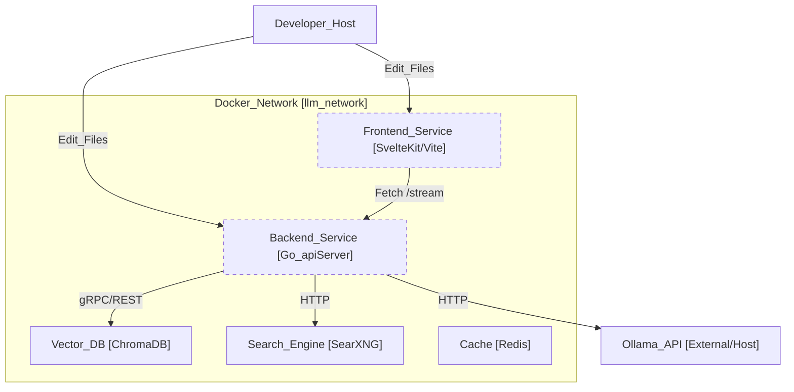
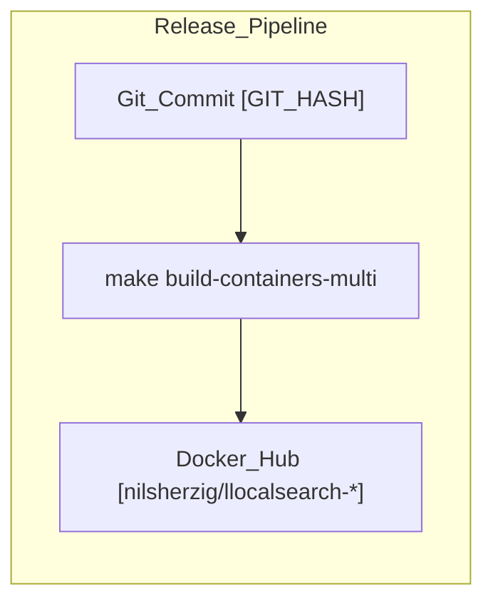

<!-- source: DeepWiki mcp.deepwiki.com · repo nilsherzig/LLocalSearch · page 4 Developer Guide · fetched 2026-10-26 -->

# Developer Guide

<details>
<summary>Relevant source files</summary>

The following files were used as context for generating this wiki page:

- [Makefile](Makefile)
- [OLLAMA_GUIDE.md](OLLAMA_GUIDE.md)
- [README.md](README.md)
- [env-example](env-example)
- [go.work](go.work)
- [go.work.sum](go.work.sum)

</details>


This guide provides comprehensive instructions for developers who want to set up, modify, or extend the LLocalSearch system. It covers the development workflow, project architecture, and links to specialized child pages for deeper technical dives.

## Development Workflow Overview

The LLocalSearch development environment is designed for rapid iteration using containerized services. The workflow utilizes `docker-compose.dev.yaml` to orchestrate services with live-reloading enabled for both the Go backend and SvelteKit frontend.

### Core Development Components

- **Go Workspace**: The project uses a Go workspace (`go.work`) to manage the `backend` and `metrics` modules simultaneously [go.work:1-5]().
- **Hot Reloading**: 
    - **Backend**: Uses `air` (configured via `backend/.air.toml`) to watch for Go file changes and recompile the binary inside the container.
    - **Frontend**: Uses Vite's HMR (Hot Module Replacement) to reflect UI changes instantly.
- **Task Automation**: A `Makefile` centralizes common commands for building, running, and testing the system [Makefile:1-41]().

## System Architecture for Developers

The development environment consists of five primary services interacting over a bridge network.

### Service Topology


**Sources:** [docker-compose.dev.yaml:3-78](), [go.work:1-5]()

## Detailed Developer Documentation

For specific implementation details, refer to the following child pages:

### [Development Environment](#4.1)
Detailed instructions for setting up the local toolchain. Covers:
- Using the `Makefile` targets like `make dev` and `make build-dev` [Makefile:30-41]().
- Configuring the `.env` file for local overrides like `OLLAMA_HOST` and `CHROMA_DB_URL` [env-example:1-8]().
- Frontend toolchain details (Vite, SvelteKit, and Nginx configuration).

### [Containerization and Deployment](#4.2)
Deep dive into the Docker infrastructure. Covers:
- Differences between production `docker-compose.yaml` and development `docker-compose.dev.yaml`.
- Multi-stage Docker builds for the frontend and backend [Makefile:8-20]().
- Networking configuration and the `llm_network` bridge.

### [API Server](#4.3)
Technical documentation of the Go backend. Covers:
- The `apiServer.go` implementation and its REST/SSE endpoints.
- Session management using the in-memory `sessions` map.
- The `parseClientSettings` logic for handling user-defined LLM parameters.

### [Monitoring and Metrics](#4.4)
Explains the standalone metrics service. Covers:
- The `metrics/main.go` service used for version checking and anonymous usage tracking [Makefile:10-10]().
- How the frontend reports model information to detect outdated deployments.

## Testing and Quality Assurance

### Backend Testing
LLocalSearch uses the Ginkgo testing framework for end-to-end (e2e) backend tests. Developers can trigger the test suite via the Makefile:

```bash
make e2e-backend
```
**Sources:** [Makefile:25-27]()

### Versioning and Releases
The project tracks versions using Git hashes and tags. Multi-architecture builds (linux/amd64, linux/arm64) are supported for Docker deployments [Makefile:1-19]().


**Sources:** [Makefile:1-23]()

## Troubleshooting the Development Setup

| Issue | Likely Cause | Resolution |
| :--- | :--- | :--- |
| Backend cannot reach Ollama | Incorrect `OLLAMA_HOST` | Check `OLLAMA_HOST` in `.env`. Use `host.docker.internal` for local Ollama [OLLAMA_GUIDE.md:16-20](). |
| Changes not reflecting | Volume Mount Failure | Ensure the project root is correctly mapped in `docker-compose.dev.yaml` [docker-compose.dev.yaml:4-6](). |
| Database connection errors | Service Startup Order | Ensure ChromaDB and SearXNG are healthy before the backend starts [env-example:5-6](). |

**Sources:** [OLLAMA_GUIDE.md:1-47](), [env-example:1-8]()

---

