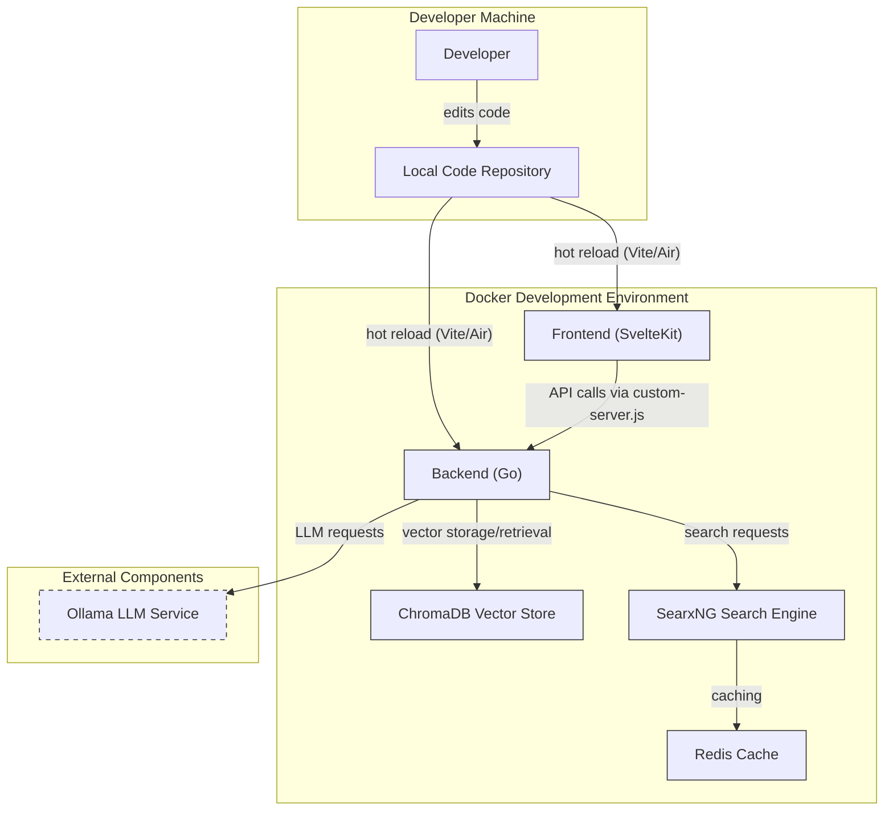
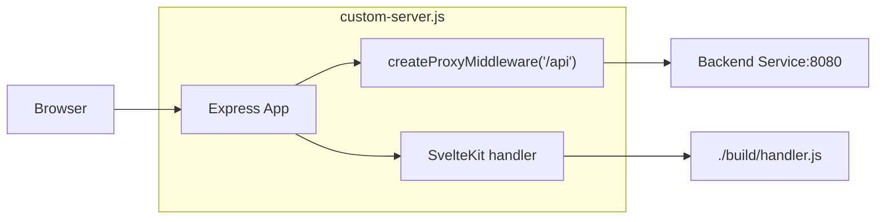
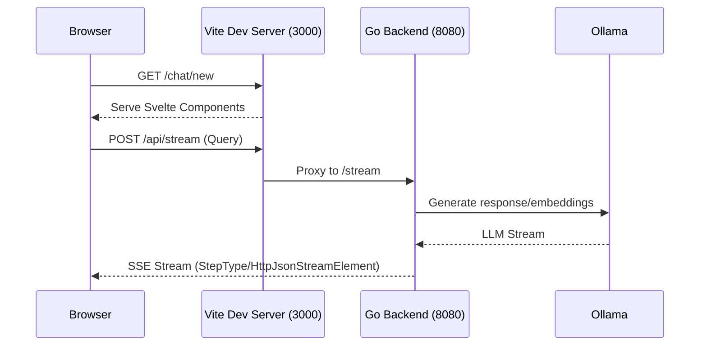

<!-- source: DeepWiki mcp.deepwiki.com · repo nilsherzig/LLocalSearch · page 4.1 Development Environment · fetched 2026-10-26 -->

# Development Environment

Relevant source files

The following files were used as context for generating this wiki page:

- [.eslintrc.cjs](.eslintrc.cjs)
- [.prettierrc](.prettierrc)
- [Makefile](Makefile)
- [backend/.air.toml](backend/.air.toml)
- [backend/Dockerfile](backend/Dockerfile)
- [custom-server.js](custom-server.js)
- [env-example](env-example)
- [go.work](go.work)
- [go.work.sum](go.work.sum)
- [package-lock.json](package-lock.json)
- [package.json](package.json)
- [svelte.config.js](svelte.config.js)
- [vite.config.ts](vite.config.ts)

This document describes how to set up and work with the LLocalSearch development environment. It covers the local development setup, required components, and development workflows for contributing to the project.

For information about deploying the system to production, see [4.2 Containerization and Deployment]().

## Overview

The LLocalSearch development environment uses Docker Compose to orchestrate multiple services. This approach ensures consistent development environments across different machines and simplifies the process of running the full system locally.

Sources: [Makefile:30-41](), [custom-server.js:7-16]()

## Toolchain and Configuration

### Backend: Go Workspace and Hot-Reload
The backend uses a Go workspace `go.work` to manage multiple modules (backend and metrics) simultaneously [go.work:1-5](). For local development, the backend is typically configured with `air` (via `backend/.air.toml`) to provide live-reloading of the Go binary upon file changes.

### Frontend: SvelteKit and Vite
The frontend is built with Svelte 4 and SvelteKit [package.json:31-33](). 
- **Vite**: Acts as the build tool and dev server [vite.config.ts:1-5]().
- **Adapter-Static**: Configured in `svelte.config.js` to produce a prerendered static site with an `index.html` fallback [svelte.config.js:2-18]().
- **Proxying**: During development, Vite proxies requests from `/api` to the Go backend at `http://backend:8080` [vite.config.ts:6-14]().

### Custom Server for Local Dev
For environments where a simple static server isn't enough (e.g., needing specific proxy logic), `custom-server.js` uses `express` and `http-proxy-middleware` to serve the SvelteKit build while routing API calls [custom-server.js:1-23]().

Sources: [custom-server.js:1-23](), [package.json:40-41]()

## Prerequisites

Before setting up the development environment, ensure you have the following installed:

1. **Docker** and **Docker Compose** (v2)
2. **Go 1.22+** (for local testing/linting)
3. **Node.js** (for frontend development)
4. **Ollama** - for running local LLMs

## Development Environment Setup

### 1. Configure Environment Variables
Copy `env-example` to `.env`. The system relies on several key variables:
- `OLLAMA_HOST`: The URL of your Ollama instance [env-example:3]().
- `CHROMA_DB_URL`: The URL for the vector database [env-example:5]().
- `SEARXNG_DOMAIN`: The URL for the search engine [env-example:6]().

### 2. Makefile Targets
The `Makefile` provides the primary interface for development tasks:

| Target | Description |
| :--- | :--- |
| `make build-dev` | Builds the dev containers using `docker-compose.dev.yaml` [Makefile:31-32]() |
| `make dev` | Starts the dev environment in the foreground [Makefile:34-36]() |
| `make dev-bg` | Starts the dev environment in the background [Makefile:38-40]() |
| `make e2e-backend` | Runs backend tests using `ginkgo` [Makefile:25-27]() |
| `make build-containers` | Builds production-ready Docker images for all services [Makefile:8-12]() |

Sources: [Makefile:1-41]()

## Code Quality and Formatting

The project enforces code style using ESLint and Prettier.

- **Linting**: Run `npm run lint` to check for issues [package.json:11](). The configuration uses `@typescript-eslint/parser` and `eslint-plugin-svelte` [.eslintrc.cjs:10-27]().
- **Formatting**: Run `npm run format` to automatically fix style issues [package.json:12](). Prettier is configured to use tabs and single quotes [.prettierrc:2-3]().
- **Type Checking**: Run `npm run check` to perform Svelte-check and TypeScript validation [package.json:9]().

Sources: [package.json:5-13](), [.eslintrc.cjs:1-31](), [.prettierrc:1-9]()

## Development Workflow

1. **Initialize**: Run `make build-dev`.
2. **Start**: Run `make dev`.
3. **Frontend Changes**: Edit files in the root directory. Vite's HMR will update the browser.
4. **Backend Changes**: Edit files in `/backend`. If using the `air` configuration, the backend will rebuild and restart inside the container.
5. **Testing**: Before submitting changes, run `make e2e-backend` to ensure no regressions in the agent chain or tool logic [Makefile:27]().

### Data Flow: Local Development

Sources: [vite.config.ts:7-13](), [custom-server.js:7-16]()

---

