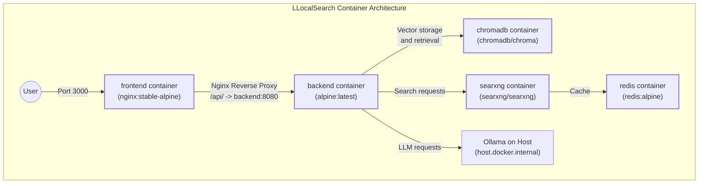
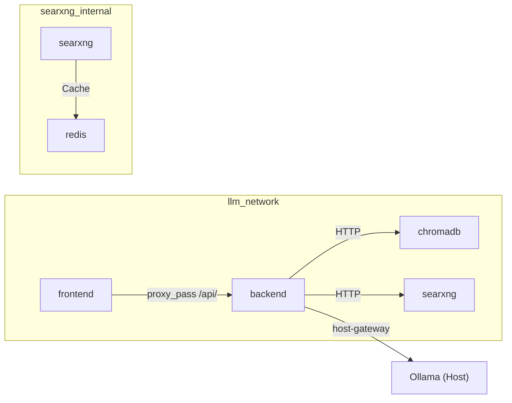

<!-- source: DeepWiki mcp.deepwiki.com · repo nilsherzig/LLocalSearch · page 4.2 Containerization and Deployment · fetched 2026-10-26 -->

# Containerization and Deployment

Relevant source files

The following files were used as context for generating this wiki page:

- [Dockerfile](Dockerfile)
- [Dockerfile.dev](Dockerfile.dev)
- [backend/Dockerfile](backend/Dockerfile)
- [backend/Dockerfile.dev](backend/Dockerfile.dev)
- [docker-compose.dev.yaml](docker-compose.dev.yaml)
- [docker-compose.yaml](docker-compose.yaml)
- [nginx.conf](nginx.conf)
- [src/routes/+layout.ts](src/routes/+layout.ts)
- [vite.config.ts](vite.config.ts)

This page documents the containerization infrastructure and deployment process for LLocalSearch, focusing on Docker-based deployment methods, container architecture, and related configuration options.

## Container Architecture Overview

LLocalSearch is containerized using Docker and orchestrated with Docker Compose. The system consists of five main services that communicate through defined bridge networks.

### Container Architecture Diagram

Sources: [docker-compose.yaml:1-73](), [nginx.conf:1-23]()

## Service Components

### Backend Container
The backend is a Go application built using a multi-stage process. The production image is based on `alpine:latest` to minimize footprint [backend/Dockerfile:20-20](). It exposes port `8080` [backend/Dockerfile:30-30]().

**Key Environment Variables:**
- `OLLAMA_HOST`: Connection to the Ollama LLM service (default: `host.docker.internal:11434`) [docker-compose.yaml:6-6]().
- `CHROMA_DB_URL`: Connection to ChromaDB (default: `http://chromadb:8000`) [docker-compose.yaml:7-7]().
- `SEARXNG_DOMAIN`: Connection to SearxNG (default: `http://searxng:8080`) [docker-compose.yaml:8-8]().
- `EMBEDDINGS_MODEL_NAME`: Model for embeddings (default: `nomic-embed-text:v1.5`) [docker-compose.yaml:9-9]().

Sources: [backend/Dockerfile:1-34](), [docker-compose.yaml:3-13]()

### Frontend Container
The frontend is a SvelteKit application served by Nginx. It is built using a multi-stage Dockerfile [Dockerfile:1-14]().
- **Stage 1 (Build)**: Uses `node:alpine` to run `npm run build` [Dockerfile:1-9](). Since `prerender = true` is set in `+layout.ts`, it generates a static site [src/routes/+layout.ts:1-1]().
- **Stage 2 (Production)**: Uses `nginx:stable-alpine` [Dockerfile:11-11](). It copies the built static files to `/usr/share/nginx/html` [Dockerfile:13-13]() and applies a custom `nginx.conf` [Dockerfile:12-12]().

Sources: [Dockerfile:1-14](), [src/routes/+layout.ts:1-1]()

### Nginx Configuration (`nginx.conf`)
The frontend container acts as a reverse proxy:
- **Static Content**: Serves the SvelteKit build from the root directory [nginx.conf:6-9]().
- **API Proxy**: Proxies requests starting with `/api/` to `http://backend:8080/` [nginx.conf:11-18]().
- **Streaming Support**: Disables `proxy_buffering` and `proxy_request_buffering` to support Server-Sent Events (SSE) from the backend [nginx.conf:14-17]().

Sources: [nginx.conf:1-23]()

### Infrastructure Services
- **ChromaDB**: The vector database for semantic search [docker-compose.yaml:24-27]().
- **SearxNG**: A privacy-respecting metasearch engine [docker-compose.yaml:43-63]().
- **Redis**: Used by SearxNG for caching [docker-compose.yaml:29-41]().

Sources: [docker-compose.yaml:24-63]()

## Development vs. Production Configuration

The system provides two distinct Docker Compose configurations to facilitate different workflows.

### Configuration Comparison

| Feature | Production (`docker-compose.yaml`) | Development (`docker-compose.dev.yaml`) |
| :--- | :--- | :--- |
| **Backend Build** | Pre-built image `nilsherzig/llocalsearch-backend` [docker-compose.yaml:4-4]() | Local build using `Dockerfile.dev` with `air` hot-reload [docker-compose.dev.yaml:7-9]() |
| **Frontend Build** | Pre-built image `nilsherzig/llocalsearch-frontend` [docker-compose.yaml:18-18]() | Local build using `Dockerfile.dev` with `vite` dev server [docker-compose.dev.yaml:24-26]() |
| **Volumes** | Only `redis-data` and `searxng` config [docker-compose.yaml:49-72]() | Mounts `./backend/` and root `./` for live code updates [docker-compose.dev.yaml:4-30]() |
| **Ports** | `3000:80` (Nginx) [docker-compose.yaml:20-20]() | `3000:5173` (Vite Dev Server) [docker-compose.dev.yaml:32-32]() |
| **Network** | `llm_network` [docker-compose.yaml:65-66]() | `llm_network_dev` [docker-compose.dev.yaml:80-81]() |

Sources: [docker-compose.yaml:1-73](), [docker-compose.dev.yaml:1-88](), [backend/Dockerfile.dev:1-8](), [Dockerfile.dev:1-6]()

## Network Topology

The system uses bridge networks to isolate traffic.

Sources: [docker-compose.yaml:64-70](), [nginx.conf:18-18](), [vite.config.ts:7-13]()

## Deployment Flow

The deployment relies on the interaction between the frontend's Nginx proxy and the backend's API.

1.  **Frontend Request**: The user's browser requests `/api/stream` [nginx.conf:11-11]().
2.  **Reverse Proxy**: Nginx rewrites the path and forwards it to `http://backend:8080/` [nginx.conf:12-18]().
3.  **Backend Processing**: The backend communicates with `chromadb:8000` and `searxng:8080` within the bridge network [docker-compose.yaml:7-8]().
4.  **LLM Communication**: The backend reaches out to the host machine via `host.docker.internal` [docker-compose.yaml:13-13]().

### Data Flow Entities

| Code Entity | Docker Service | Port | Role |
| :--- | :--- | :--- | :--- |
| `vite.config.ts` | `frontend` (dev) | `5173` | Proxies `/api` to backend during development [vite.config.ts:7-13]() |
| `nginx.conf` | `frontend` (prod) | `80` | Proxies `/api` to backend in production [nginx.conf:11-23]() |
| `backend/main.go` | `backend` | `8080` | Entry point for the Go API server [backend/Dockerfile:33-33]() |
| `searxng/settings.yml` | `searxng` | `8080` | Configuration for the search engine [docker-compose.yaml:49-49]() |

Sources: [docker-compose.yaml:1-73](), [nginx.conf:1-30](), [vite.config.ts:1-15]()

---

