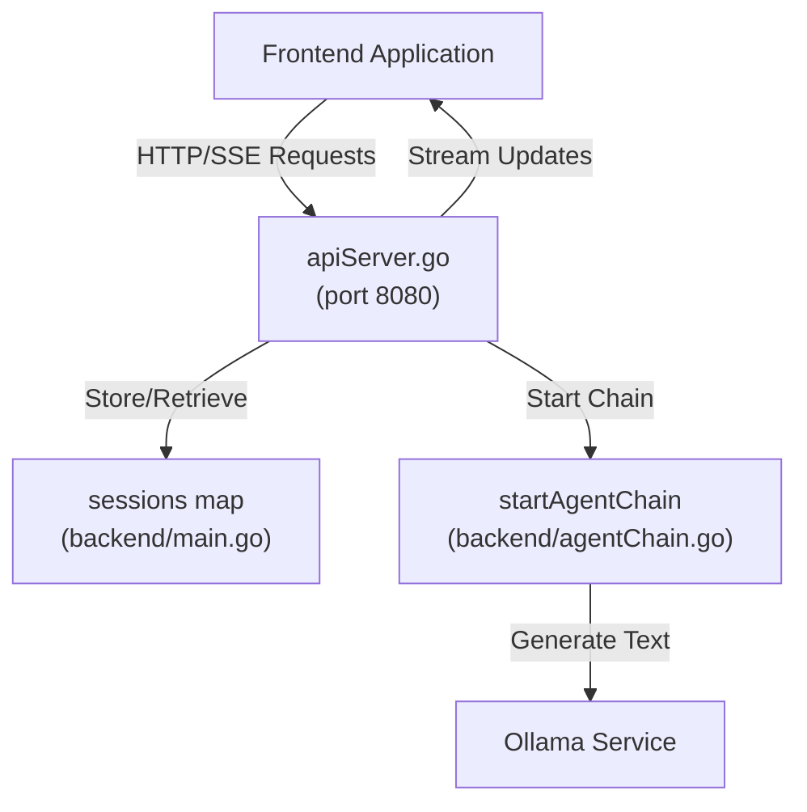
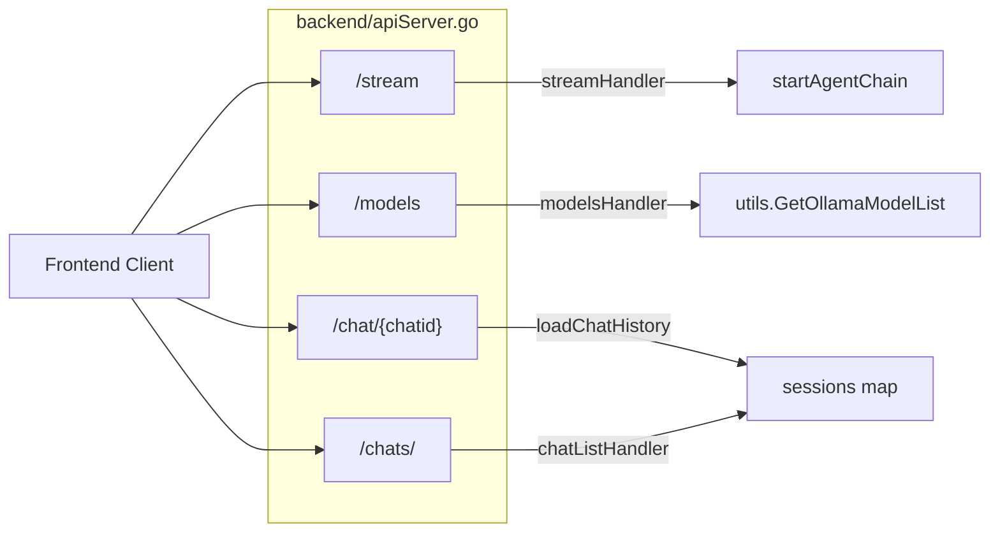
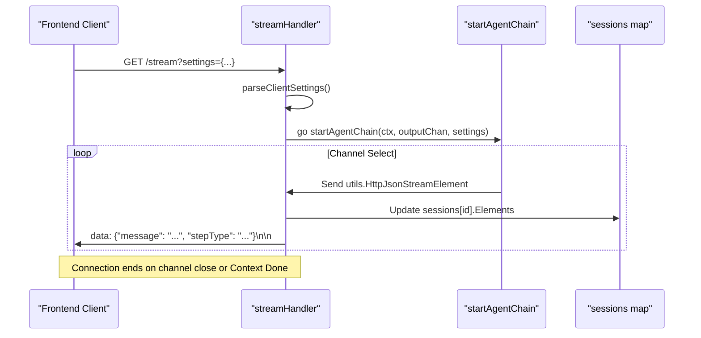
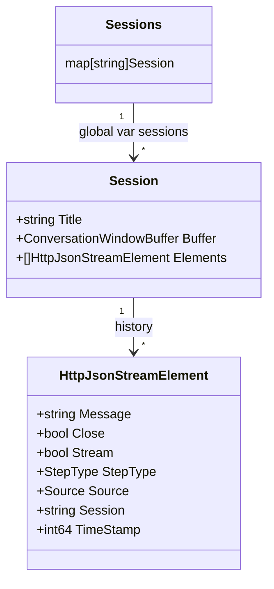

<!-- source: DeepWiki mcp.deepwiki.com · repo nilsherzig/LLocalSearch · page 4.3 API Server · fetched 2026-10-26 -->

# API Server

Relevant source files

The following files were used as context for generating this wiki page:

- [backend/apiServer.go](backend/apiServer.go)
- [backend/e2e/e2e_suite_test.go](backend/e2e/e2e_suite_test.go)
- [backend/e2e/simple_question_test.go](backend/e2e/simple_question_test.go)
- [backend/main.go](backend/main.go)
- [backend/utils/helper.go](backend/utils/helper.go)
- [backend/utils/prompts.go](backend/utils/prompts.go)
- [backend/utils/types.go](backend/utils/types.go)
- [src/lib/types/types.ts](src/lib/types/types.ts)

The API Server is the core backend component of LLocalSearch that handles HTTP requests from the frontend, manages user sessions, and coordinates the execution of agent chains. This page documents the API server's endpoints, request/response flows, and session management capabilities.

## API Server Architecture

The API Server is a Go-based HTTP server that exposes several endpoints for the frontend to interact with. It uses the standard Go `net/http` package to handle requests and manages streaming responses using Server-Sent Events (SSE).

Title: API Server Component Interaction

Sources: [backend/apiServer.go:216-226](), [backend/main.go:21-22](), [backend/apiServer.go:47-47]()

## API Endpoints

The API Server exposes four main endpoints in `StartApiServer`:

| Endpoint | Method | Description |
|----------|--------|-------------|
| `/stream` | GET | Initiates an agent chain and streams back results as SSE |
| `/models` | GET | Returns a list of available LLM models from Ollama |
| `/chat/{chatid}` | GET | Retrieves the conversation history for a specific chat |
| `/chats/` | GET | Returns a list of all available chat sessions |

Title: Endpoint to Function Mapping

Sources: [backend/apiServer.go:216-226](), [backend/apiServer.go:102-102]()

### Stream Endpoint

The `/stream` endpoint (`streamHandler`) is the primary interface for initiating a conversation. It:

1.  **Parses Settings**: Uses `parseClientSettings` to extract JSON from the `settings` query parameter [backend/apiServer.go:34-38]().
2.  **Initializes Channel**: Creates an `outputChan` (buffer size 100) of type `utils.HttpJsonStreamElement` [backend/apiServer.go:43-44]().
3.  **Starts Agent**: Launches `startAgentChain` in a new goroutine [backend/apiServer.go:47-47]().
4.  **SSE Loop**: Listens on the channel, marshals data to JSON, and flushes it to the client with the `data: ` prefix [backend/apiServer.go:50-87]().

Title: Streaming Sequence

Sources: [backend/apiServer.go:20-88]()

### Models Endpoint

The `modelsHandler` provides a list of available LLM models. It calls `utils.GetOllamaModelList()` and filters out the model currently assigned to `utils.EmbeddingsModel` to prevent the UI from selecting an embedding-only model for chat [backend/apiServer.go:112-116]().

Sources: [backend/apiServer.go:90-127]()

### Chat History and List

*   **`loadChatHistory`**: Retrieves the `Elements` slice from the `sessions` map for a specific `chatid` provided in the path [backend/apiServer.go:144-160]().
*   **`chatListHandler`**: Iterates through the `sessions` map and returns an array of `utils.ChatListItem`. The list is sorted by the timestamp of the last element in each session's history [backend/apiServer.go:188-201]().

Sources: [backend/apiServer.go:131-173](), [backend/apiServer.go:175-214]()

## Session Management

LLocalSearch uses an in-memory session store defined in `backend/main.go`. There is no persistent database; sessions are lost if the backend restarts.

Title: Session Data Structures

Sources: [backend/main.go:13-21](), [backend/utils/types.go:16-24]()

### Client Settings Parsing
The `parseClientSettings` function is critical for translating frontend configuration into backend logic. It unmarshals the `settings` query parameter into a `utils.ClientSettings` struct, which includes parameters like `contextSize`, `temperature`, and `toolNames` [backend/apiServer.go:234-250]().

## Initialization and Tutorial

On startup, `main.go` calls `SetupTutorialChatHistory()`. This populates the `sessions` map with a hardcoded "tutorial" session, allowing new users to see a pre-existing conversation explaining how LLocalSearch works [backend/main.go:32-33](), [backend/main.go:40-76]().

Sources: [backend/main.go:23-38](), [backend/main.go:40-76]()

## CORS and Headers

The server implements a `setCorsHeaders` helper used by all handlers to allow cross-origin requests, specifically setting:
- `Access-Control-Allow-Origin: *`
- `Access-Control-Allow-Methods: GET, OPTIONS`
- `Access-Control-Allow-Headers: Content-Type`

Sources: [backend/apiServer.go:228-232]()

---

