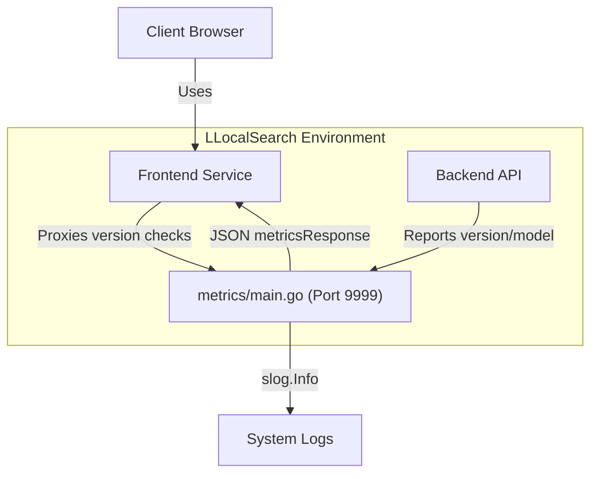
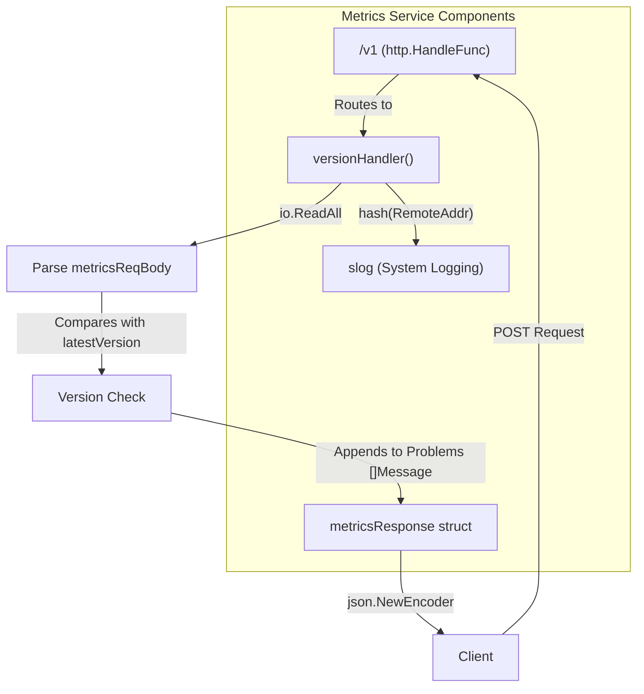
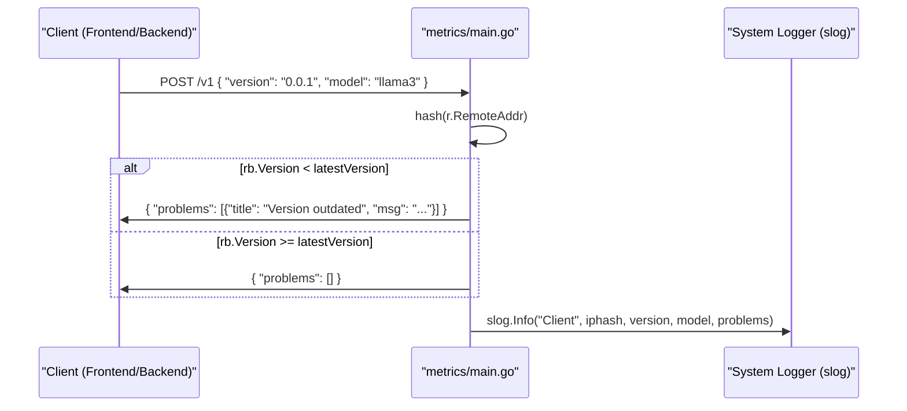

<!-- source: DeepWiki mcp.deepwiki.com · repo nilsherzig/LLocalSearch · page 4.4 Monitoring and Metrics · fetched 2026-10-26 -->

# Monitoring and Metrics

Relevant source files

The following files were used as context for generating this wiki page:

- [metrics/Dockerfile](metrics/Dockerfile)
- [metrics/go.mod](metrics/go.mod)
- [metrics/main.go](metrics/main.go)
- [metrics/tmp/build-errors.log](metrics/tmp/build-errors.log)
- [metrics/tmp/main](metrics/tmp/main)

This document outlines the monitoring and metrics capabilities of LLocalSearch, focusing on the version checking system and basic usage statistics collection. The metrics system is designed to provide minimal but useful information about client usage while maintaining user privacy.

## Overview

LLocalSearch includes a lightweight metrics service that serves two primary purposes:

1.  **Version checking**: Notifies users when they are running outdated versions of the system [metrics/main.go:62-65]().
2.  **Basic usage tracking**: Collects anonymous usage statistics to understand deployment patterns [metrics/main.go:69]().

The metrics system is implemented as a separate Go-based microservice located in the `/metrics` directory that runs alongside the main LLocalSearch components [metrics/main.go:1-12]().

Sources: [metrics/main.go:73-80](), [metrics/main.go:87-94]()

## Metrics Service Architecture

The metrics service is a standalone HTTP server written in Go that exposes a single endpoint (`/v1`) for collecting version information and returning status messages to clients [metrics/main.go:74]().

Sources: [metrics/main.go:34-71](), [metrics/main.go:73-80]()

## Data Collection and Privacy

The metrics service collects minimal information to respect user privacy while providing useful insights about system usage:

| Data Point | Description | Code Entity |
| :--- | :--- | :--- |
| **IP Hash** | A 32-bit hash of the client's IP address (not the actual IP) | `hash()` [metrics/main.go:28-32]() |
| **Version** | The client's reported LLocalSearch version | `metricsReqBody.Version` [metrics/main.go:24]() |
| **Model** | The LLM model being used by the client | `metricsReqBody.Model` [metrics/main.go:25]() |

### Implementation Details
*   **IP Hashing**: The service uses the `hash/fnv` package to implement `fnv.New32a()` for hashing the remote address [metrics/main.go:28-32](). This ensures that while individual deployments can be distinguished in logs, the actual source IP is not stored [metrics/main.go:55]().
*   **Logging**: Data is output via `slog.Info`, including the `iphash`, `version`, `model`, and any detected `problems` [metrics/main.go:69]().

Sources: [metrics/main.go:28-32](), [metrics/main.go:55](), [metrics/main.go:69]()

## Version Checking Logic

The primary function of the metrics service is to check if clients are running the latest version of LLocalSearch. 

1.  **Initialization**: On startup, the service reads the `VERSION` environment variable and stores it in the global `latestVersion` variable [metrics/main.go:88-92]().
2.  **Comparison**: When a request arrives, the `versionHandler` compares the incoming `rb.Version` against `latestVersion` [metrics/main.go:62]().
3.  **Reporting**: If the client version is lexicographically "less than" the latest version, a `Message` is appended to the `problems` slice [metrics/main.go:63-64]().

Sources: [metrics/main.go:59-70](), [metrics/main.go:88]()

## API Definition

### Request Body (`metricsReqBody`)
The service expects a JSON POST body:
*   `version`: string [metrics/main.go:24]()
*   `model`: string [metrics/main.go:25]()

### Response Body (`metricsResponse`)
The service returns a JSON object:
*   `problems`: An array of `Message` objects, each containing a `title` and `msg` [metrics/main.go:14-21]().

### CORS Handling
The service includes a `setCorsHeaders` helper that allows:
*   `Access-Control-Allow-Origin: *` [metrics/main.go:97]()
*   `Access-Control-Allow-Methods: GET, OPTIONS` [metrics/main.go:98]()
*   `Access-Control-Allow-Headers: Content-Type` [metrics/main.go:99]()

Sources: [metrics/main.go:14-26](), [metrics/main.go:96-100]()

## Containerization

The metrics service is containerized using a multi-stage `Dockerfile`.

1.  **Stage 1 (Build)**: Uses `golang:1.22` as the base, copies `go.mod`, and builds the binary named `main` using `CGO_ENABLED=0` for a static binary [metrics/Dockerfile:2-18]().
2.  **Stage 2 (Run)**: Uses `alpine:latest`, sets a default `VERSION` build argument, and exposes port `9999` [metrics/Dockerfile:21-33]().

The final command executed is `./main` [metrics/Dockerfile:36]().

Sources: [metrics/Dockerfile:1-37]()

---

