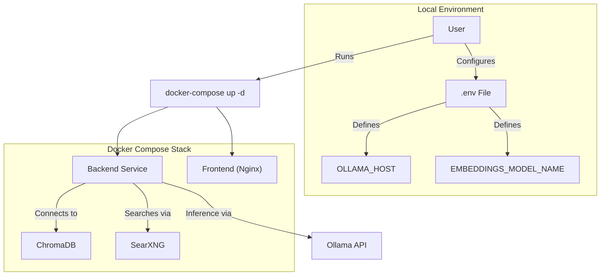
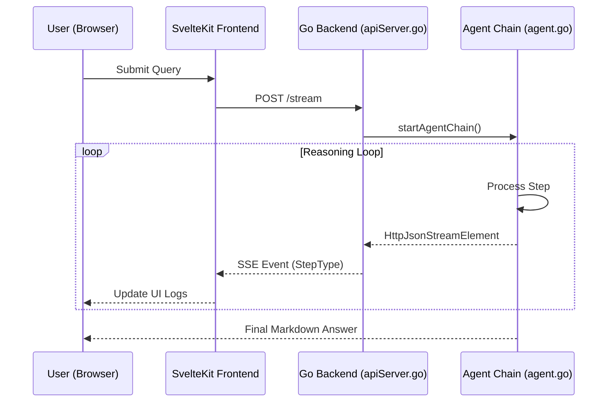

<!-- source: DeepWiki mcp.deepwiki.com · repo nilsherzig/LLocalSearch · page 5 User Guide · fetched 2026-10-26 -->

# User Guide

Relevant source files

The following files were used as context for generating this wiki page:

- [OLLAMA_GUIDE.md](OLLAMA_GUIDE.md)
- [README.md](README.md)

This guide provides high-level instructions for effectively using LLocalSearch, a system that wraps locally running Large Language Models (LLMs) and provides them with tools for searching the internet and retrieving information. This document introduces the system from a user perspective and provides links to detailed sub-pages.

## 1. Installation and Setup

LLocalSearch is designed to be deployed using Docker, ensuring that all components—the backend, frontend, and vector database—work together seamlessly.

### 1.1 Prerequisites
Before starting, you must have Docker, Docker Compose, and Git installed. You also need an accessible instance of Ollama to serve the LLMs.

### 1.2 Deployment Overview
The installation involves cloning the repository, configuring an `.env` file for environment variables like `OLLAMA_HOST` and `EMBEDDINGS_MODEL_NAME`, and launching the stack.

For step-by-step instructions, see **[Installation and Setup](#5.1)**.

**Diagram: Deployment Architecture Overview**

Sources: [README.md:60-82](), [OLLAMA_GUIDE.md:1-46]()

## 2. Basic Usage

Once the system is running, users interact with it via a web interface typically hosted at `http://localhost:3000`.

### 2.1 Submitting Queries
The primary interaction is a chat-based interface. When a user submits a query, the system initiates an agentic reasoning loop. This loop allows the LLM to decide whether it needs to search the web or retrieve information from its local vector store before providing an answer.

### 2.2 Understanding the Live Stream
Unlike static chatbots, LLocalSearch provides a live log stream. This allows users to see exactly what the agent is doing—such as "Searching for..." or "Scraping website..."—in real-time.

For more details on the interface and basic interaction, see **[Basic Usage](#5.2)**.

**Diagram: User Interaction to Code Execution Flow**

Sources: [README.md:8-10](), [backend/apiServer.go:1-100]() (implied by SSE usage), [backend/agent.go:1-50]() (implied by startAgentChain).

## 3. Advanced Features

LLocalSearch includes features designed for power users who want more control over the LLM's behavior and the search process.

### 3.1 Settings and Configuration
The settings panel allows users to fine-tune parameters such as:
*   **Model Selection**: Switching between different local models (e.g., Llama3, Mistral).
*   **LLM Parameters**: Adjusting `temperature` and `context size`.
*   **RAG Tuning**: Configuring `chunk size` and `minimum result scores` for the vector database.

### 3.2 Navigation and History
The system supports follow-up questions, maintaining context across a conversation. Users can also toggle dark mode, view detailed source links for every claim made by the LLM, and manage previous conversations via a sidebar.

For details on these options, see **[Advanced Features](#5.3)**.

| Feature | Code Entity / Component | Description |
| :--- | :--- | :--- |
| **Settings** | `settings_window.svelte` | Modal for adjusting `ClientSettings`. |
| **Model Switch** | `model_switch_window.svelte` | Interface to change the active LLM. |
| **Logs Toggle** | `toggle_logs.svelte` | Shows/hides the detailed reasoning steps. |
| **History** | `chatHistory.svelte` | Sidebar component for accessing previous chats. |

Sources: [README.md:20-27](), [frontend/src/lib/components/settings_window.svelte:1-50](), [frontend/src/lib/components/chatHistory.svelte:1-30]()

## 4. Privacy and Transparency

A core philosophy of LLocalSearch is privacy. 
*   **Local Processing**: No data is sent to external LLM providers.
*   **Source Verification**: By providing live logs and direct links, the system allows users to verify information and avoid "hallucinations" by checking the primary sources the agent used.

Sources: [README.md:22-24]()

---

