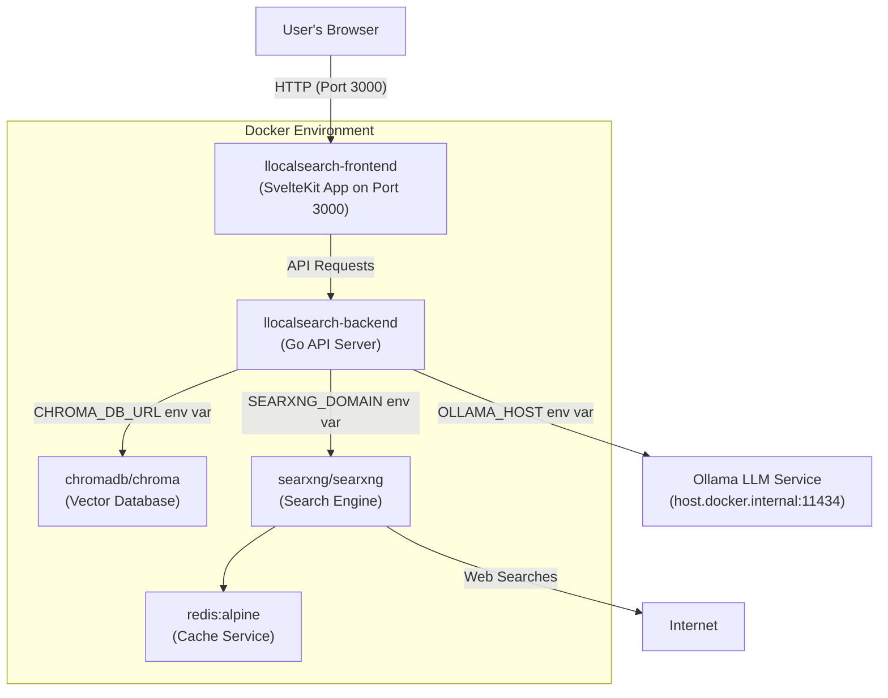
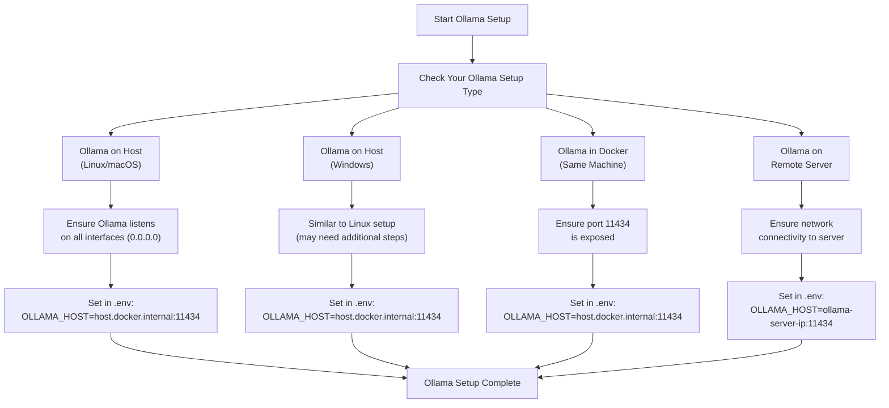
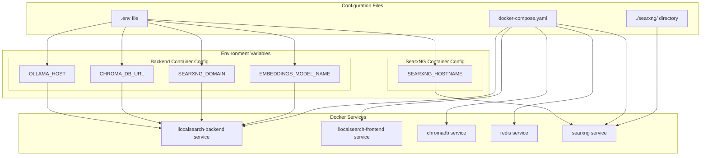
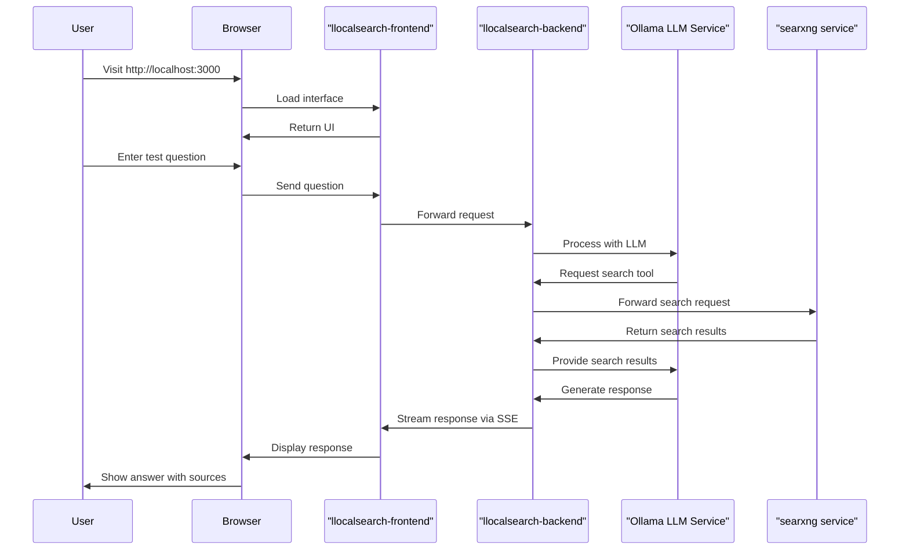

<!-- source: DeepWiki mcp.deepwiki.com · repo nilsherzig/LLocalSearch · page 5.1 Installation and Setup · fetched 2026-10-26 -->

# Installation and Setup

<details>
<summary>Relevant source files</summary>

The following files were used as context for generating this wiki page:

- [OLLAMA_GUIDE.md](OLLAMA_GUIDE.md)
- [README.md](README.md)
- [docker-compose.yaml](docker-compose.yaml)
- [env-example](env-example)

</details>


This page provides detailed instructions for installing and configuring LLocalSearch on your system. It covers prerequisites, environment setup, Docker-based deployment, and configuration options. For information about using LLocalSearch after installation, see [Basic Usage](#5.2).

## Prerequisites

Before installing LLocalSearch, ensure you have the following:

- Docker and Docker Compose
- A machine capable of running LLMs (preferably with GPU support) [README.md:23-24]()
- At least 8GB RAM (more recommended for larger models)
- Ollama installed and configured for running LLMs locally [OLLAMA_GUIDE.md:1-47]()

## System Architecture Overview

Title: LLocalSearch Deployment Architecture



Sources: [docker-compose.yaml:1-73]()

## Installation Steps

### 1. Clone the Repository

```bash
git clone git@github.com:nilsherzig/LLocalSearch.git
cd LLocalSearch
```

Sources: [README.md:61-67]()

### 2. Ollama Setup

LLocalSearch requires Ollama for LLM functionality. The system supports several Ollama configurations, typically defined by the `OLLAMA_HOST` variable.

Title: Ollama Configuration Options



Sources: [OLLAMA_GUIDE.md:1-47]()

### 3. Environment Configuration

Create and configure a `.env` file in the project root to customize your installation. Sensible defaults are provided in the `docker-compose.yaml` if these are not set.

```bash
touch .env
```

The following environment variables can be configured:

| Variable | Description | Default |
|----------|-------------|---------|
| `OLLAMA_HOST` | URL of your Ollama instance | `host.docker.internal:11434` |
| `CHROMA_DB_URL` | URL of the ChromaDB service | `http://chromadb:8000` |
| `SEARXNG_DOMAIN` | URL of the SearxNG service | `http://searxng:8080` |
| `EMBEDDINGS_MODEL_NAME` | Model for generating embeddings | `nomic-embed-text:v1.5` |
| `SEARXNG_HOSTNAME` | Hostname for SearxNG | `localhost` |

Sources: [docker-compose.yaml:5-9](), [docker-compose.yaml:51](), [env-example:1-8](), [README.md:69-75]()

### 4. Start the Docker Services

Run the following command to deploy all required containers:

```bash
docker-compose up -d
```

This launches the frontend, backend, ChromaDB, SearxNG, and Redis containers in detached mode.

Sources: [README.md:77-81](), [docker-compose.yaml:1-73]()

## Service Configuration Details

Title: LLocalSearch Service Configuration



Sources: [docker-compose.yaml:1-73](), [README.md:69-75]()

## Verifying Installation

Once all services are running, you can access the LLocalSearch interface by opening a web browser and navigating to:

```
http://localhost:3000
```

You should see the LLocalSearch chat interface. Test the installation by asking a question that requires web search capabilities.

Title: LLocalSearch Verification Process



Sources: [README.md:4-10](), [README.md:20-27]()

## Troubleshooting

### Common Issues

| Issue | Possible Solution |
|-------|-------------------|
| Cannot connect to Ollama | Verify the `OLLAMA_HOST` environment variable in your `.env` file. Ensure Ollama is running and accessible. See [OLLAMA_GUIDE.md]() for detailed instructions. |
| Web UI not accessible | Check that the frontend container is running with `docker-compose ps`. Ensure port 3000 is not being used by another application. |
| Search functionality not working | Verify the SearxNG container is running properly with `docker-compose logs searxng`. Check the `SEARXNG_DOMAIN` setting. |
| Slow responses | LLMs can be computationally intensive. Consider using a smaller model or upgrading your hardware. |

### Checking Service Status

To verify all services are running correctly:

```bash
docker-compose ps
```

To view logs for a specific service:

```bash
docker-compose logs [service-name]
```

Where `[service-name]` is one of: `backend`, `frontend`, `chromadb`, `redis`, or `searxng`.

Sources: [README.md:77-81](), [OLLAMA_GUIDE.md:1-47]()

## Next Steps

After successfully installing LLocalSearch, you may want to:

1. Learn how to use the system effectively - See [Basic Usage](#5.2)
2. Explore advanced features - See [Advanced Features](#5.3)
3. Configure different LLM models in Ollama to optimize for your specific needs

Sources: [README.md:20-27]()

---

