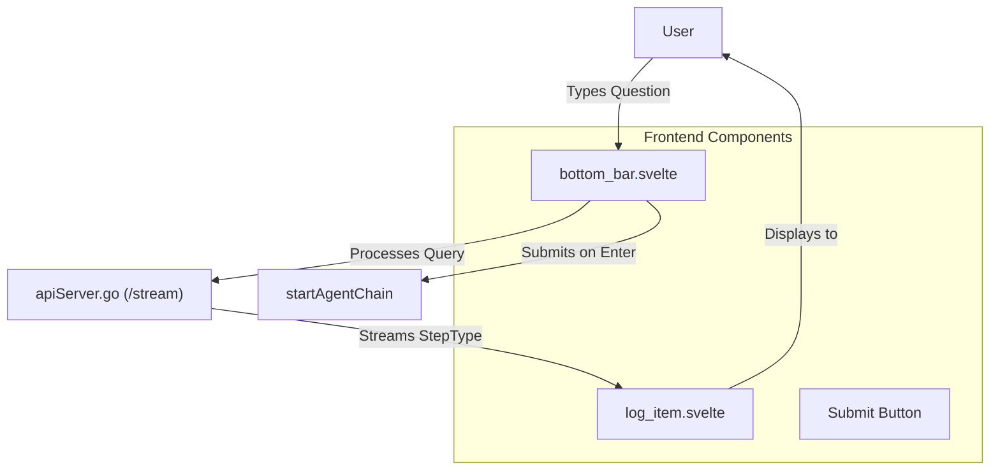
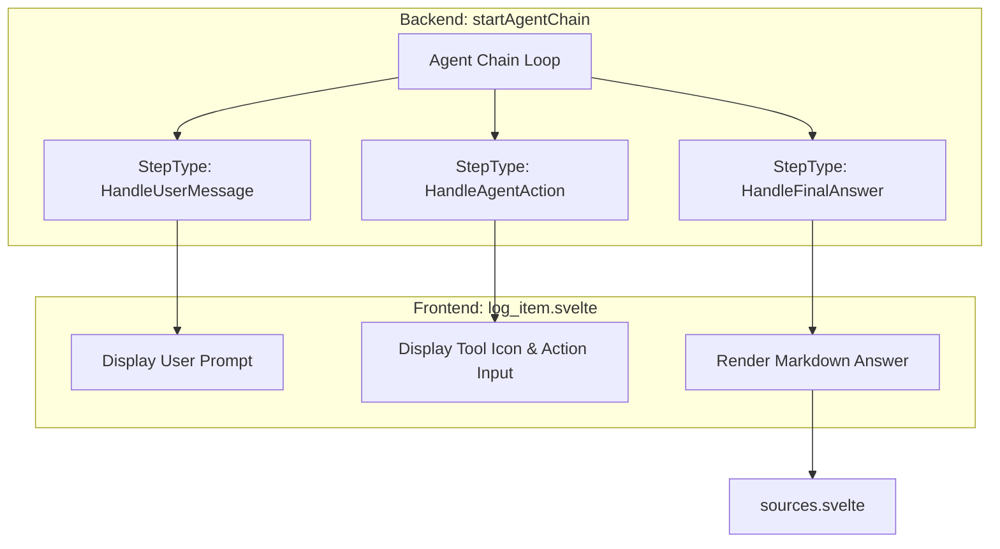

<!-- source: DeepWiki mcp.deepwiki.com · repo nilsherzig/LLocalSearch · page 5.2 Basic Usage · fetched 2026-10-26 -->

# Basic Usage

Relevant source files

The following files were used as context for generating this wiki page:

- [OLLAMA_GUIDE.md](OLLAMA_GUIDE.md)
- [README.md](README.md)
- [src/lib/log_item.svelte](src/lib/log_item.svelte)
- [src/lib/sources.svelte](src/lib/sources.svelte)

This document provides instructions for the fundamental operations of LLocalSearch after installation. It covers how to ask questions, interpret responses, and interact with the system for effective results. For installation instructions, see [Installation and Setup](#5.1), and for more advanced functionality, refer to [Advanced Features](#5.3).

## Starting a Conversation

LLocalSearch provides a straightforward chat interface for interacting with locally running Large Language Models (LLMs) enhanced with search capabilities.

### Chat Interface Overview

To start a conversation:

1. Open LLocalSearch in your web browser (typically at `http://localhost:3000`).
2. Type your question in the input field at the bottom of the screen.
3. Press Enter or click the send button to submit your query.
4. The system will process your question and begin generating a response.

Sources: [README.md:80-82](), [src/lib/log_item.svelte:49-55]()

## Understanding Responses

LLocalSearch provides transparent responses with visible reasoning and source attribution. The interface uses a dispatch system based on `StepType` to render different stages of the agent's work.

### Response Components and Data Flow

When you submit a question, `log_item.svelte` renders the stream:

1. **User Message**: Displays the initial prompt with a separator [src/lib/log_item.svelte:49-55]().
2. **Agent Reasoning**: If "Show Logs" is enabled, you see internal chain starts and agent actions [src/lib/log_item.svelte:139-169]().
3. **Tool Usage**: Visual indicators for active information gathering.
4. **Final Answer**: The synthesized response rendered via `marked` with sanitized links [src/lib/log_item.svelte:8-17](), [src/lib/log_item.svelte:57-137]().

### Visual Tool Indicators

The system uses specific SVG icons to show different types of operations within `log_item.svelte`:

| Icon | Action Trigger | Tool Description | Code Reference |
|------|----------------|------------------|----------------|
| 🌐 | `Action: websearch` | Searches the internet via SearXNG | [src/lib/log_item.svelte:101-119]() |
| 👁️ | `Action: webscrape` | Extracts content from specific URLs | [src/lib/log_item.svelte:58-81]() |
| 🗃️ | `Action: database_search` | Queries the local ChromaDB vector store | [src/lib/log_item.svelte:82-99]() |

Sources: [src/lib/log_item.svelte:58-119]()

## Viewing Sources

LLocalSearch emphasizes transparency by providing direct links to the information sources used by the agent.

1. **Inline Links**: The final answer often contains Markdown links. The frontend uses a custom `marked` renderer to ensure all links open in new tabs with `target='_blank'` and `rel='noopener noreferrer'` for security [src/lib/log_item.svelte:8-13]().
2. **Source Panel**: The `sources.svelte` component displays a list of `Source` objects. Each source includes:
    - A summary of the content [src/lib/sources.svelte:16]().
    - The search engine used (e.g., SearXNG) [src/lib/sources.svelte:23]().
    - A favicon retrieved via Google's favicon service [src/lib/sources.svelte:18-22]().

Sources: [src/lib/sources.svelte:8-29](), [src/lib/log_item.svelte:8-17]()

## Interpreting Live Logs

The "Live Log Stream" provides a window into the LLM's "Chain of Thought".

- **Model Loading**: Shows messages when Ollama is pulling or loading a model into VRAM (`StepType.HandleOllamaModelLoadMessage`) [src/lib/log_item.svelte:44-47]().
- **Error Handling**: If the LLM produces a malformed response, the UI displays a specific parsing error message, explaining that the system will retry [src/lib/log_item.svelte:28-42]().
- **Thought Filtering**: The UI automatically strips common LLM prefixes like "Thought: Do I need to use a tool? No" to keep the final answer clean [src/lib/log_item.svelte:127-132]().

Sources: [src/lib/log_item.svelte:28-47](), [src/lib/log_item.svelte:121-136]()

## Troubleshooting Connection Issues

The most common usage hurdle is the connection between the LLocalSearch containers and the Ollama service.

- **Local Host**: If Ollama is on the same machine (not in Docker), use `OLLAMA_HOST=host.docker.internal:11434` [OLLAMA_GUIDE.md:12-21]().
- **Linux Users**: Note that `host.docker.internal` may require Docker Desktop or specific network configurations [OLLAMA_GUIDE.md:23-24]().
- **Remote Server**: Use the specific IP address of the server running Ollama [OLLAMA_GUIDE.md:39-47]().

Sources: [OLLAMA_GUIDE.md:1-47]()

---

