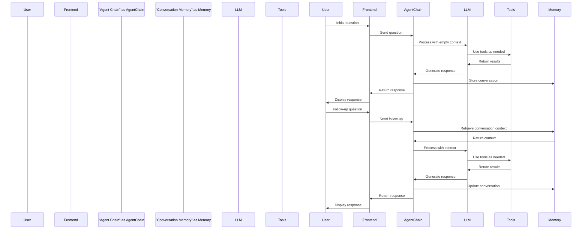
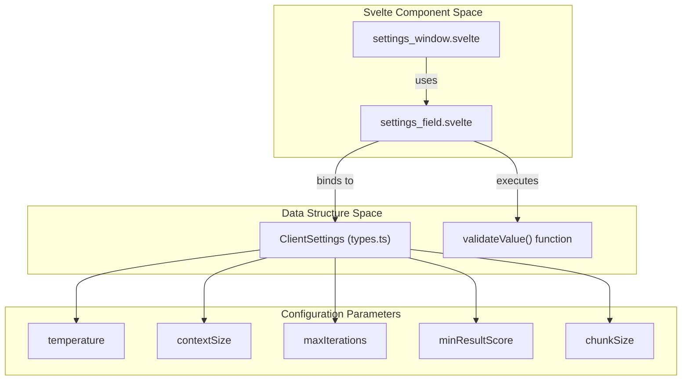
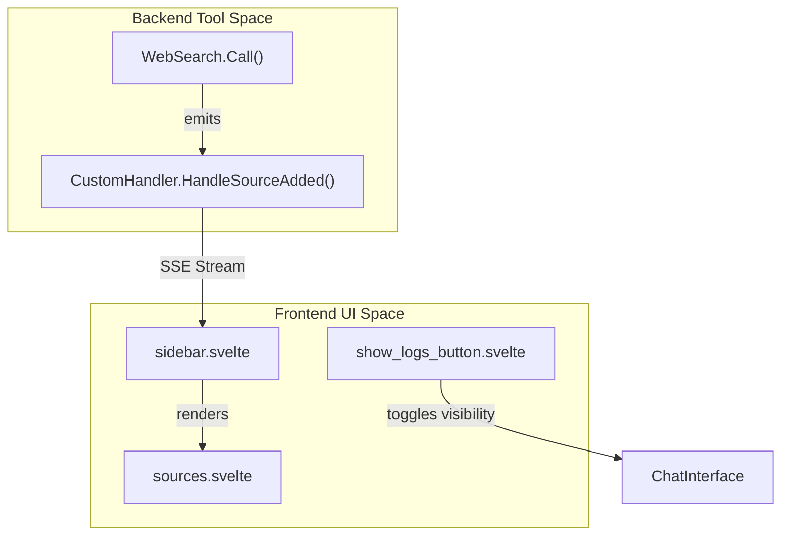

<!-- source: DeepWiki mcp.deepwiki.com · repo nilsherzig/LLocalSearch · page 5.3 Advanced Features · fetched 2026-10-26 -->

# Advanced Features

Relevant source files

The following files were used as context for generating this wiki page:

- [backend/llm_tools/simple_websearch.go](backend/llm_tools/simple_websearch.go)
- [src/lib/chatList.svelte](src/lib/chatList.svelte)
- [src/lib/settings_field.svelte](src/lib/settings_field.svelte)
- [src/lib/settings_window.svelte](src/lib/settings_window.svelte)
- [src/lib/show_logs_button.svelte](src/lib/show_logs_button.svelte)
- [src/lib/sidebar.svelte](src/lib/sidebar.svelte)

This page documents the advanced features of LLocalSearch that allow users to leverage the system's full capabilities. These features go beyond basic question-answering and enable more sophisticated use cases, customization options, and power-user workflows.

## Follow-up Question Support

LLocalSearch supports contextual follow-up questions, allowing users to continue a conversation thread without explicitly repeating context from earlier exchanges. The system maintains conversation context through a combination of conversation memory mechanisms.

Sources: [README.md:22-22]()

## Configuration Options

LLocalSearch provides extensive configuration options that can be accessed through the settings interface. These settings allow users to fine-tune the behavior of the LLM, search capabilities, and text processing features. The frontend uses `settings_window.svelte` to bind these values to a `ClientSettings` object.

Sources: [src/lib/settings_window.svelte:1-189](), [src/lib/settings_field.svelte:1-70](), [src/lib/types/types.ts:1-20]()

### LLM Settings

These settings control the behavior of the Large Language Model that powers the agent chain:

| Setting | Description | Default | Range |
|---------|-------------|---------|-------|
| Model Name | The Ollama model to use | Varies | Available models in Ollama |
| System Message | The system prompt that instructs the LLM | Custom text | User-defined text |
| Temperature | Controls randomness of the model output | 0.7 | 0-10 |
| Context Size | Maximum tokens in context window | 8192 | 1-128000 |
| Max Iterations | Maximum number of tool usage iterations | 10 | 1-50 |

The model selection dropdown `clientSettings.modelName` [src/lib/settings_window.svelte:90-91]() shows all models available from your connected Ollama instance. The system message `clientSettings.systemMessage` [src/lib/settings_window.svelte:110-111]() can be customized to change the personality or behavior of the assistant.

Sources: [src/lib/settings_window.svelte:84-136]()

### Vector DB Settings

These settings control how the system interacts with the vector database for semantic search:

| Setting | Description | Default | Range |
|---------|-------------|---------|-------|
| Min Result Score | Minimum similarity score threshold | 0.5 | 0-1 |
| Amount of Results | Maximum number of results returned | 10 | 1-30 |

The minimum result score `clientSettings.minResultScore` [src/lib/settings_window.svelte:139-145]() filters out less relevant results, while the amount of results `clientSettings.amountOfResults` [src/lib/settings_window.svelte:147-153]() controls how many matching documents are retrieved from the vector database.

Sources: [src/lib/settings_window.svelte:137-153]()

### Webscraper Settings

These settings control how web content is retrieved:

| Setting | Description | Default | Range |
|---------|-------------|---------|-------|
| Amount of Websites | Maximum websites to scrape per query | 5 | 1-30 |

This setting `clientSettings.amountOfWebsites` [src/lib/settings_window.svelte:156-162]() limits how many websites the system will scrape for information when searching the web. This parameter is passed to tools like `WebSearch` in the backend [backend/llm_tools/simple_websearch.go:77-79]().

Sources: [src/lib/settings_window.svelte:154-162](), [backend/llm_tools/simple_websearch.go:19-23]()

### Text Processing Settings

These settings control how text is processed and chunked for embedding and retrieval:

| Setting | Description | Default | Range |
|---------|-------------|---------|-------|
| Chunk Size | Maximum characters per text chunk | 500 | 10-1000 |
| Chunk Overlap | Character overlap between chunks | 100 | 1-500 |

Text chunking is important for processing large documents. The `chunkSize` [src/lib/settings_window.svelte:165-171]() and `chunkOverlap` [src/lib/settings_window.svelte:173-179]() ensure context is maintained between segments during the ingestion pipeline.

Sources: [src/lib/settings_window.svelte:163-179]()

## Log and Source Management

LLocalSearch provides transparency by tracking the sources used and allowing users to view the internal reasoning logs.

### Show/Hide Logs
Users can toggle the visibility of the internal agent reasoning process using the `show_logs_button.svelte` component [src/lib/show_logs_button.svelte:1-49](). This toggles a boolean `showLogs` which determines if the step-by-step tool executions are rendered in the chat interface.

### Source Tracking
The system tracks sources used to generate responses. These are displayed in the `sidebar.svelte` when `rightBarMode` is set to `'sources'` [src/lib/sidebar.svelte:54-58](). The `WebSearch` tool in the backend adds these sources via the `HandleSourceAdded` callback [backend/llm_tools/simple_websearch.go:97-108]().

Sources: [src/lib/sidebar.svelte:1-60](), [src/lib/show_logs_button.svelte:1-49](), [backend/llm_tools/simple_websearch.go:97-108]()

## Chat History Management

LLocalSearch maintains a history of conversations, allowing users to revisit previous interactions and continue conversations from where they left off.

The chat history feature maintains a list of previous conversations in the `sidebar.svelte` [src/lib/sidebar.svelte:19-53](). It uses `chatList.svelte` [src/lib/chatList.svelte:1-17]() and `chatListItemElem.svelte` to render individual sessions. When a user selects a historical chat, the `loadHistory` function is triggered to fetch and display that session's data.

Sources: [src/lib/sidebar.svelte:1-60](), [src/lib/chatList.svelte:1-17]()

## User Interface Customization

LLocalSearch provides a responsive design with support for dark and light modes.

*   **Dark Mode**: The interface uses Tailwind CSS dark mode classes (e.g., `dark:bg-neutral-900`, `dark:border-neutral-800`) [src/lib/settings_window.svelte:23-26](), [src/lib/sidebar.svelte:17-17]().
*   **Settings Reset**: Users can reset all settings to their default values using a button in the `settings_window.svelte` which performs a deep copy of `defaultClientValues` [src/lib/settings_window.svelte:32-38]().

Sources: [src/lib/settings_window.svelte:16-38](), [src/lib/sidebar.svelte:14-18]()

---

