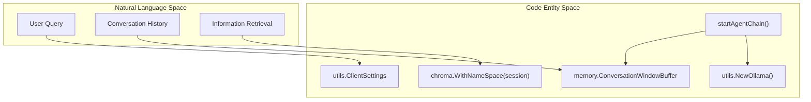
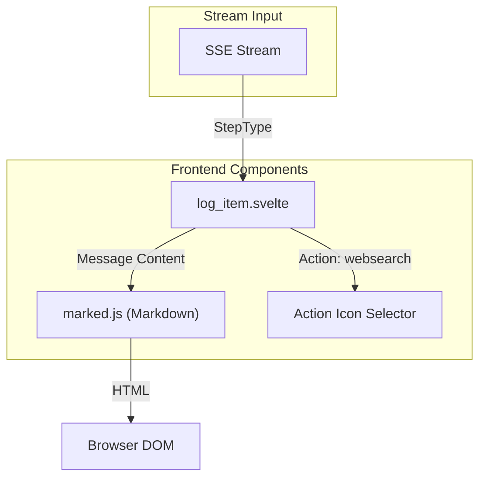

<!-- source: DeepWiki mcp.deepwiki.com · repo nilsherzig/LLocalSearch · page 6 Glossary · fetched 2026-10-26 -->

# Glossary

Relevant source files

The following files were used as context for generating this wiki page:

- [OLLAMA_GUIDE.md](OLLAMA_GUIDE.md)
- [README.md](README.md)
- [backend/agentChain.go](backend/agentChain.go)
- [backend/llm_tools/tool_search_vector_db.go](backend/llm_tools/tool_search_vector_db.go)
- [backend/utils/llm_backends.go](backend/utils/llm_backends.go)
- [backend/utils/prompts.go](backend/utils/prompts.go)
- [backend/utils/types.go](backend/utils/types.go)
- [backend/utils/vector_db_handler.go](backend/utils/vector_db_handler.go)
- [docker-compose.yaml](docker-compose.yaml)
- [src/lib/log_item.svelte](src/lib/log_item.svelte)
- [src/lib/types/types.ts](src/lib/types/types.ts)

This page provides definitions for codebase-specific terminology, architectural concepts, and technical jargon used within the LLocalSearch project. It serves as a reference for onboarding engineers to understand how high-level LLM concepts map to specific code entities and implementation details.

## Core Architectural Concepts

The system operates as an agentic RAG (Retrieval-Augmented Generation) loop, where a local LLM is empowered to use tools to fulfill user queries.

### Agent Chain
The primary orchestration logic that manages the lifecycle of a user request. It coordinates the LLM, memory buffers, and tool execution.
*   **Implementation**: Defined in `startAgentChain` [backend/agentChain.go:21-182]().
*   **Data Flow**: It receives `utils.ClientSettings` [backend/utils/types.go:26-41](), initializes a session, and enters an iterative loop using `agents.NewExecutor` [backend/agentChain.go:130-144]().

### Session Management
Every interaction is scoped to a unique session ID. This ID is used to partition memory and vector database namespaces.
*   **Session String**: Generated using `uuid.New().String()` in `GetSessionString` [backend/utils/llm_backends.go:30-32]().
*   **Persistence**: Sessions are stored in a global `sessions` map, where each entry contains a `Title` and a `memory.ConversationWindowBuffer` [backend/agentChain.go:35-39]().

### LLM/RAG Space to Code Entity Mapping

The following diagram illustrates how abstract RAG concepts are represented by specific Go structs and functions in the backend.

**RAG to Code Mapping**

Sources: [backend/agentChain.go:21-75](), [backend/utils/types.go:26-41](), [backend/utils/llm_backends.go:22-28]()

---

## Technical Terms & Abbreviations

| Term | Definition | Code Pointer |
| :--- | :--- | :--- |
| **SSE** | Server-Sent Events. Used to stream JSON updates from the backend to the frontend. | `utils.HttpJsonStreamElement` [backend/utils/types.go:16-24]() |
| **StepType** | An enum identifying the current stage of the agent's reasoning (e.g., Tool Start, Final Answer). | `utils.StepType` [backend/utils/types.go:43-70]() |
| **ChromaDB** | The vector database used for storing and retrieving document embeddings. | `chroma.New` [backend/utils/vector_db_handler.go:33-38]() |
| **Embeddings** | Numerical representations of text. LLocalSearch uses a specific model for this. | `utils.EmbeddingsModel` [backend/utils/llm_backends.go:15]() |
| **SearXNG** | A privacy-respecting metasearch engine used as the primary source for web searches. | `SEARXNG_DOMAIN` [docker-compose.yaml:8]() |

---

## Internal Tool Definitions

The LLM can choose from several predefined tools to gather information. Each tool is a Go struct implementing the `tools.Tool` interface.

### WebSearch
Invokes the SearXNG instance to find relevant URLs based on a search query.
*   **Implementation**: `llm_tools.WebSearch` [backend/agentChain.go:115-121]().

### WebScrape
Downloads the content of a specific URL, sanitizes the HTML, and ingests it into the vector database.
*   **Function**: `DownloadWebsiteToVectorDB` [backend/utils/vector_db_handler.go:85-120]().
*   **Sanitization**: Uses `bluemonday.StrictPolicy()` to strip HTML tags in `stripHtml` [backend/utils/vector_db_handler.go:122-130]().

### SearchVectorDB
Performs a similarity search against the current session's namespace in ChromaDB.
*   **Implementation**: `llm_tools.SearchVectorDB` [backend/llm_tools/tool_search_vector_db.go:21-25]().
*   **Logic**: Uses a `ScoreThreshold` defined in client settings to filter results [backend/llm_tools/tool_search_vector_db.go:72-74]().

---

## Frontend Component Glossary

The frontend uses Svelte components to render the agent's internal state and logs.

### Log Rendering Pipeline
The system transforms `StepType` messages into visual feedback.

**Log Item Dispatch Diagram**

Sources: [src/lib/log_item.svelte:3-137](), [src/lib/types/types.ts:45-68]()

*   **`log_item.svelte`**: The primary component for rendering a single step in the agent's chain. It handles different `StepType` values to show errors, user messages, or tool actions [src/lib/log_item.svelte:28-170]().
*   **`LogElement`**: The TypeScript interface representing the data structure for a single log entry [src/lib/types/types.ts:1-12]().

---

## Environment & Configuration

*   **`OLLAMA_HOST`**: The network address where the Ollama service is reachable [OLLAMA_GUIDE.md:20]().
*   **`EMBEDDINGS_MODEL_NAME`**: The specific model used to generate vectors (defaults to `nomic-embed-text:v1.5`) [docker-compose.yaml:9]().
*   **`CHROMA_DB_URL`**: The endpoint for the Chroma vector database [docker-compose.yaml:7]().
*   **`ContextSize`**: The maximum number of tokens the LLM can process in one turn, configured per request [backend/utils/types.go:27]().

Sources: [backend/agentChain.go:1-182](), [backend/llm_tools/tool_search_vector_db.go:1-133](), [backend/utils/llm_backends.go:1-100](), [backend/utils/types.go:1-103](), [backend/utils/vector_db_handler.go:1-131](), [src/lib/log_item.svelte:1-173](), [src/lib/types/types.ts:1-78](), [docker-compose.yaml:1-73](), [OLLAMA_GUIDE.md:1-47]()