# Page: LLocalSearch Overview

# LLocalSearch Overview

<details>
<summary>Relevant source files</summary>

The following files were used as context for generating this wiki page:

- [LICENSE](LICENSE)
- [OLLAMA_GUIDE.md](OLLAMA_GUIDE.md)
- [README.md](README.md)
- [infra.drawio](infra.drawio)

</details>


## Purpose and Scope

LLocalSearch is a technical framework designed to wrap locally running Large Language Models (LLMs) and provide them with a suite of tools for internet search and information retrieval. This document introduces the repository's purpose, the agentic reasoning loop, and the system's privacy-first design. It serves as the entry point for understanding the codebase architecture, hardware requirements, and the interaction between the Go backend and SvelteKit frontend.

## What is LLocalSearch?

LLocalSearch functions as an agentic orchestration layer. It allows "small" local models (which may lack extensive internal knowledge) to act as agents that can choose from a set of tools to gather real-time information. This process is recursive: the LLM can use tools multiple times, refining its search based on previous results before providing a final answer.

### Core Philosophy
- **Privacy-First**: Operates entirely locally with no requirement for external API keys (except for the optional search engine if hosted elsewhere) [README.md:22-22]().
- **Unbiased Retrieval**: Designed as an alternative to commercial engines that may prioritize content based on business partnerships [README.md:12-18]().
- **Agentic Reasoning**: Uses a reasoning loop where the LLM determines if it needs more information to answer a prompt [infra.drawio:42-43]().

## System Architecture & Data Flow

The system is composed of a Go backend that manages the `agentchain` and a SvelteKit frontend. It integrates with **Ollama** for LLM inference, **ChromaDB** for vector storage, and **SearXNG** for privacy-respecting web searches.

### High-Level Entity Mapping
The following diagram bridges the natural language concepts to specific code entities and services used in the repository.

**Diagram: Natural Language to Code Entity Space**
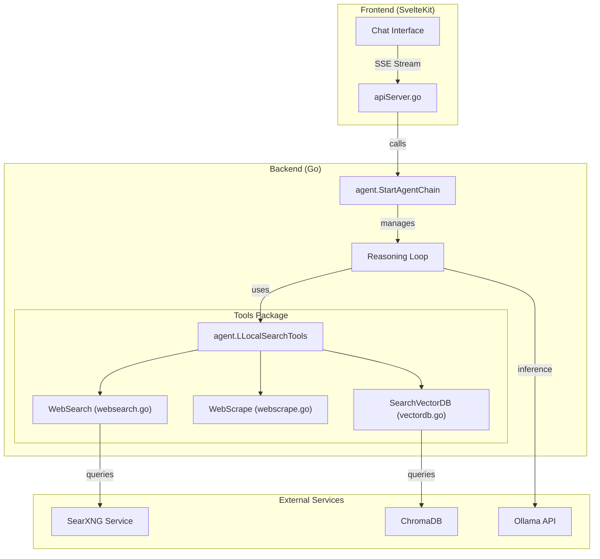
Sources: [README.md:8-8](), [infra.drawio:21-23](), [infra.drawio:66-67]()

## Agentic Reasoning Loop

The core logic follows an iterative "Chain of Thought" pattern. When a user submits a prompt, the system enters a multi-layered reasoning process.

1.  **Layer 1 Chain**: Analyzes the user prompt to decide if tool usage is required [infra.drawio:21-23]().
2.  **Tool Execution**: If required, it triggers tools like `WebSearch`. The results are then processed and stored or fed back into the model [infra.drawio:34-40]().
3.  **Layer 2 Chain**: Processes the results of the tool calls to refine the answer or decide on further tool usage [infra.drawio:66-67]().
4.  **Final Response**: Once the agent determines it has sufficient information, it generates the final answer for the user [infra.drawio:81-82]().

**Diagram: Detailed Agent Logic Flow**
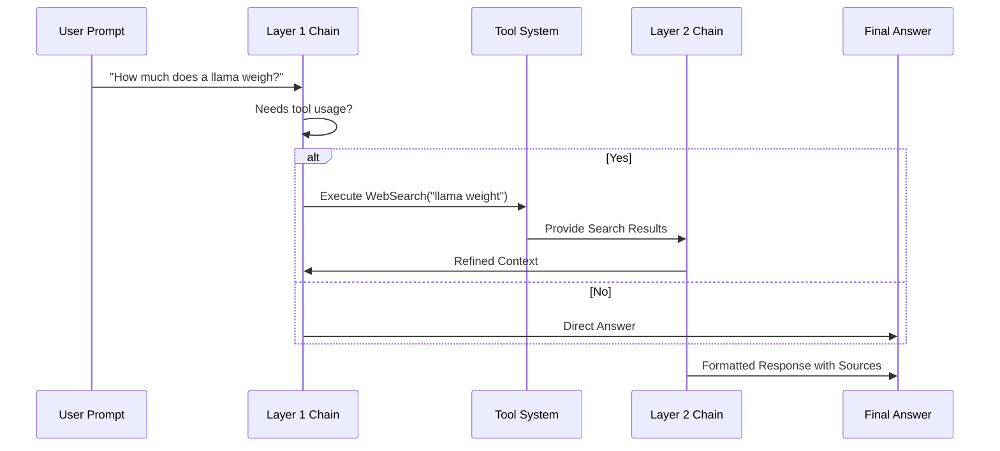
Sources: [infra.drawio:7-83]()

## Key Features

| Feature | Technical Implementation |
| :--- | :--- |
| **Local LLM** | Integrated via `Ollama` [OLLAMA_GUIDE.md:1-2]() |
| **Privacy** | No external tracking; search via `SearXNG` [README.md:22-22]() |
| **Hardware** | Optimized for consumer GPUs (e.g., 300€ GPU) [README.md:23-23]() |
| **Transparency** | Live logs and source links provided in the UI [README.md:24-24]() |
| **Persistence** | Follow-up questions and session management [README.md:25-25]() |

Sources: [README.md:20-28](), [OLLAMA_GUIDE.md:1-10]()

## Hardware and Environment Requirements

The system is containerized using Docker to manage its multiple microservices.

- **Ollama**: Must be reachable by the backend. Configuration is handled via `OLLAMA_HOST` in the `.env` file [OLLAMA_GUIDE.md:20-20]().
- **Docker**: Requires `docker-compose` to orchestrate the backend, frontend, ChromaDB, and SearXNG [README.md:80-81]().
- **Network**: Services communicate over a bridge network; `host.docker.internal` is commonly used to link the containers to an Ollama instance running on the host OS [OLLAMA_GUIDE.md:36-36]().

Sources: [README.md:58-81](), [OLLAMA_GUIDE.md:12-47]()

## Project Roadmap

The project is currently undergoing significant updates, including:
- **Llama 3 Support**: Addressing stop-word issues in the `langchaingo` library [README.md:34-37]().
- **Interface Overhaul**: Moving towards a panel-based UI inspired by Obsidian [README.md:38-41]().
- **Advanced RAG**: Future support for private document uploads and long-term user memory [README.md:50-56]().

Sources: [README.md:30-57]()

---

# Page: System Architecture

# System Architecture

<details>
<summary>Relevant source files</summary>

The following files were used as context for generating this wiki page:

- [backend/main.go](backend/main.go)
- [docker-compose.dev.yaml](docker-compose.dev.yaml)
- [docker-compose.yaml](docker-compose.yaml)
- [go.work](go.work)
- [go.work.sum](go.work.sum)

</details>


## Purpose and Scope

This document provides a high-level overview of the LLocalSearch system architecture, explaining the relationships between its core components and how they function together to provide a locally-running LLM experience with internet search capabilities. It focuses on the microservices topology, structural aspects of the system, and the primary data flow throughout the application.

LLocalSearch is composed of a SvelteKit frontend, a Go backend, and several supporting services (ChromaDB, SearXNG, Redis) orchestrated via Docker Compose [docker-compose.yaml:1-73]().

For more detailed information about specific subsystems, see:
- [Agent Chain](#2.1) — Details on the reasoning loop and session orchestration.
- [Tool System](#2.2) — Details on web search, scraping, and vector database integration.
- [LLM Integration](#2.3) — Details on Ollama integration and embeddings.

## System Overview

LLocalSearch is designed as a wrapper around locally running Large Language Models that provides them with tools to access current information from the internet. The system enables an iterative process where the LLM can choose from several tools based on user input and previous tool outputs.

### High-Level Architecture Diagram

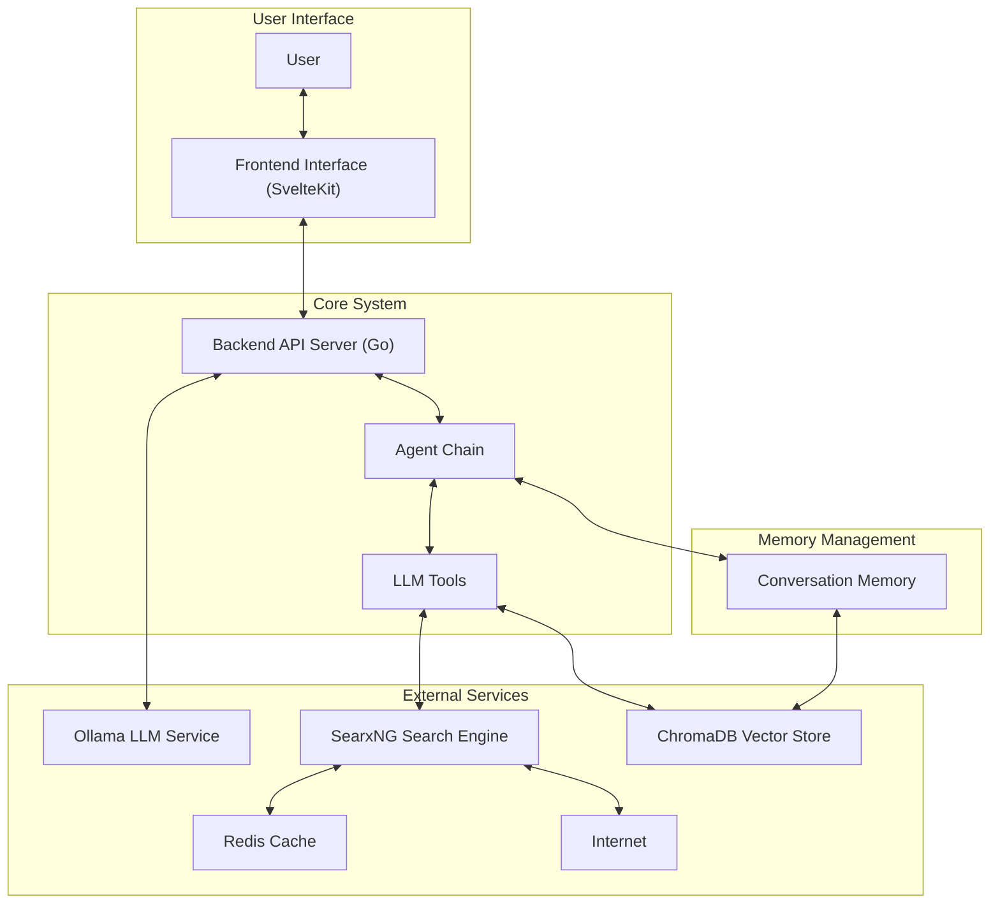

Sources: [docker-compose.yaml:1-73](), [backend/main.go:23-38]()

## Core Components

### Backend Server

The backend is a Go-based API server that serves as the central coordinator. It handles requests from the frontend, manages agent chains, and maintains session state using a `Sessions` map [backend/main.go:19-21](). Each `Session` contains a `ConversationWindowBuffer` for context management and a slice of `HttpJsonStreamElement` to track the interaction history [backend/main.go:13-17]().

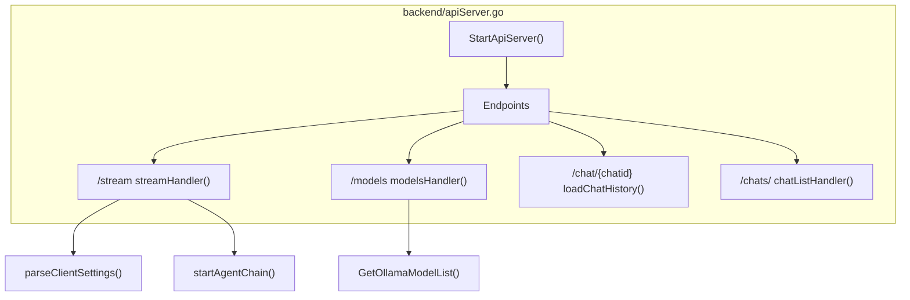

Sources: [backend/main.go:13-21](), [backend/apiServer.go:1-250]()

### Agent Chain System

The Agent Chain is the core orchestration mechanism. It initializes the LLM connection via Ollama and sets up the reasoning loop. For details, see [Agent Chain](#2.1).

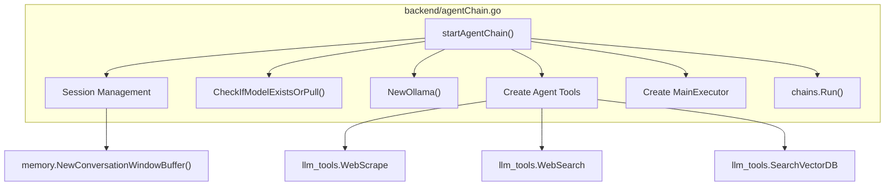

Sources: [backend/agentChain.go:1-182](), [backend/main.go:41-44]()

### Tools System

The LLM uses specific tools to bridge the gap between "Natural Language Space" and "Action Space". These tools include `WebSearch` (via SearXNG), `WebScrape`, and `SearchVectorDB` (via ChromaDB). For details, see [Tool System](#2.2).

## Data Flow

The following diagram illustrates the flow of data through the system when a user submits a query, showing how the `startAgentChain` orchestrates the `Ollama` service and `Tools`.

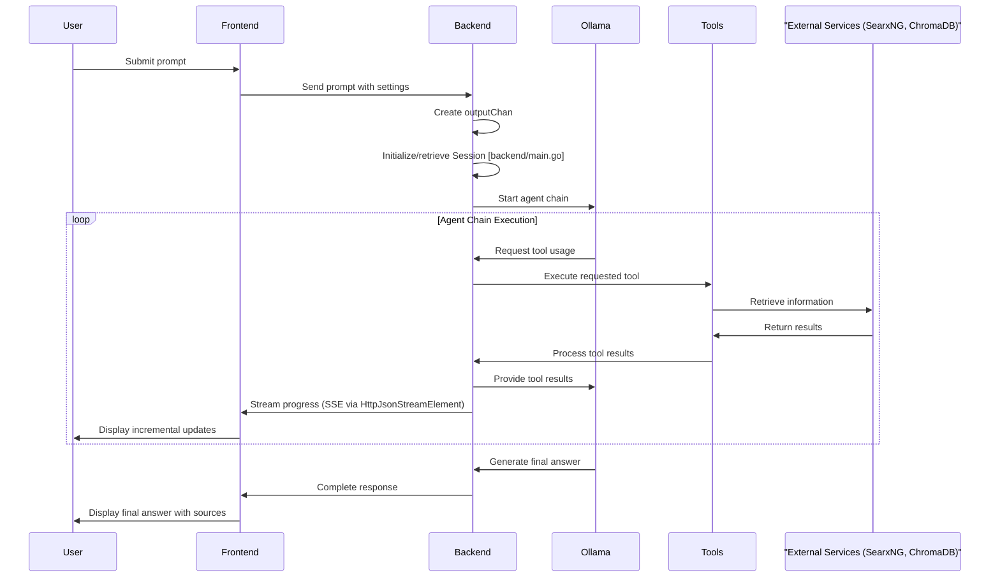

Sources: [backend/agentChain.go:21-182](), [backend/apiServer.go:20-88](), [backend/main.go:13-17]()

## Deployment Architecture

LLocalSearch is deployed using Docker Compose, which manages the microservices topology and internal networking (`llm_network`) [docker-compose.yaml:65-66]().

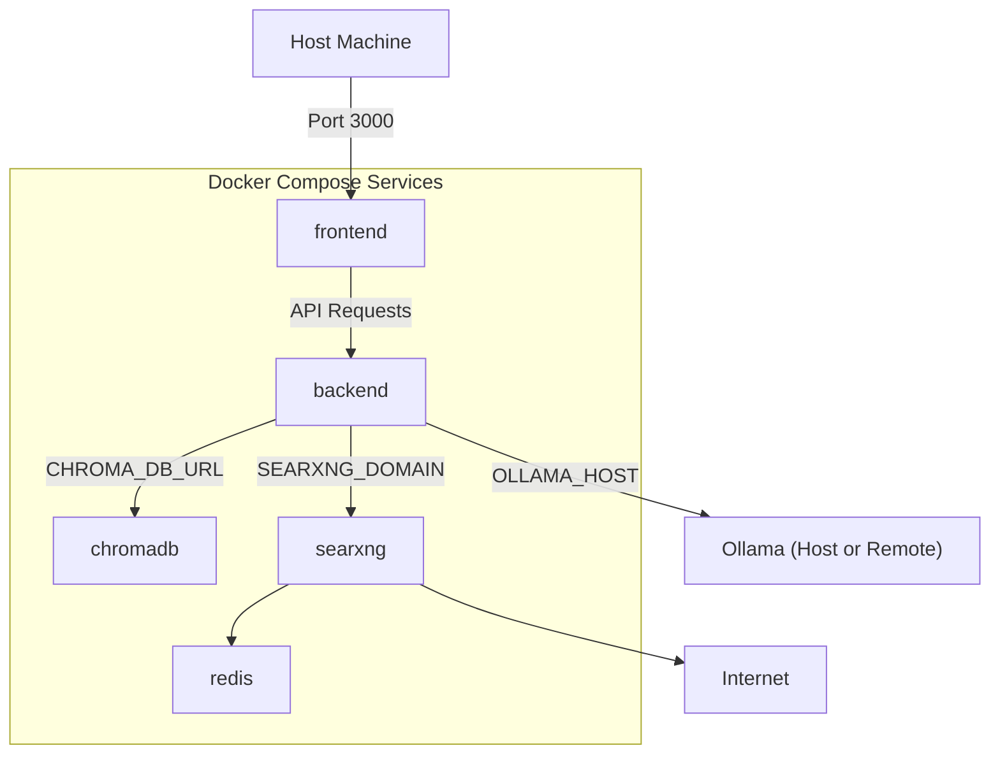

### Environment Configuration

The system is configured via environment variables defined in the compose files:

| Environment Variable | Default Value | Purpose |
|----------------------|---------------|---------|
| `OLLAMA_HOST` | `host.docker.internal:11434` | Connection to Ollama LLM service [docker-compose.yaml:6]() |
| `CHROMA_DB_URL` | `http://chromadb:8000` | Connection to ChromaDB vector store [docker-compose.yaml:7]() |
| `SEARXNG_DOMAIN` | `http://searxng:8080` | Connection to SearxNG search engine [docker-compose.yaml:8]() |
| `EMBEDDINGS_MODEL_NAME` | `nomic-embed-text:v1.5` | Model for generating embeddings [docker-compose.yaml:9]() |

Sources: [docker-compose.yaml:1-73](), [docker-compose.dev.yaml:1-88]()

## Communication Patterns

1. **HTTP/SSE**: The frontend communicates with the backend via standard HTTP for configuration and Server-Sent Events (SSE) for streaming the `HttpJsonStreamElement` updates [backend/apiServer.go:20-88]().
2. **Internal Channels**: The backend uses Go channels (`outputChan`) to bridge the asynchronous agent chain execution with the synchronous HTTP handlers [backend/apiServer.go:50-52]().
3. **Service APIs**: The backend communicates with Ollama, ChromaDB, and SearXNG via their respective REST/gRPC APIs [docker-compose.yaml:5-13]().

Sources: [backend/apiServer.go:20-88](), [backend/agentChain.go:21-182](), [backend/main.go:61-74]()

---

# Page: Agent Chain

# Agent Chain

<details>
<summary>Relevant source files</summary>

The following files were used as context for generating this wiki page:

- [README.md.old](README.md.old)
- [backend/agentChain.go](backend/agentChain.go)
- [backend/go.mod](backend/go.mod)
- [backend/go.sum](backend/go.sum)
- [backend/llm_tools/tool_webscrape.go](backend/llm_tools/tool_webscrape.go)
- [backend/lschains/custom_structured_parser.go](backend/lschains/custom_structured_parser.go)
- [backend/utils/customHandler.go](backend/utils/customHandler.go)
- [backend/utils/prompts.go](backend/utils/prompts.go)
- [backend/utils/types.go](backend/utils/types.go)
- [src/lib/types/types.ts](src/lib/types/types.ts)

</details>


The Agent Chain is the core orchestration system in LLocalSearch that enables the local Large Language Model (LLM) to execute a series of reasoning steps and tool interactions to answer user queries. It manages the flow of information between the user, the LLM, and various tools like web search, web scraping, and vector database retrieval.

## Architecture Overview

The Agent Chain connects several key components in the LLocalSearch system, bridging the "Natural Language Space" of user prompts to the "Code Entity Space" of the LangChainGo framework.

### Component Relationship Diagram

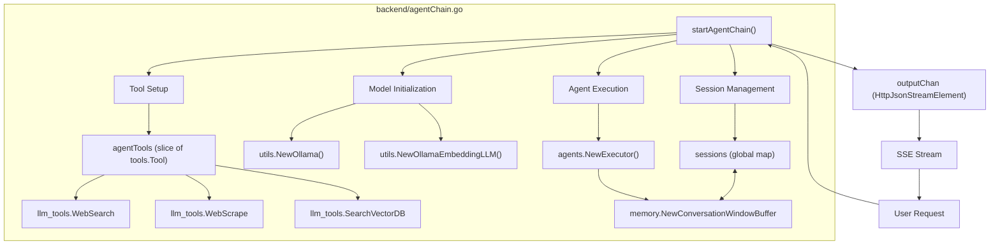

Sources: [backend/agentChain.go:21-182](), [backend/utils/types.go:26-41]()

## Core Components

The Agent Chain system comprises several key components that work together:

| Component | Description | Code Reference |
|-----------|-------------|---------------|
| `startAgentChain` | Main function that orchestrates the agent chain process, including session init and tool binding. | [backend/agentChain.go:21-182]() |
| `sessions` | A global map (defined in `main.go`) that maintains `Session` structs containing history and titles. | [backend/agentChain.go:35-39]() |
| `ConversationWindowBuffer` | A `langchaingo` memory component that manages chat history with a context window. | [backend/agentChain.go:38-44]() |
| `agentTools` | A slice of `tools.Tool` including search, scraping, and vector DB retrieval. | [backend/agentChain.go:106-128]() |
| `mainExecutor` | An `agents.Executor` that manages the iterative ReAct loop. | [backend/agentChain.go:130-144]() |
| `outputChan` | A Go channel used to stream `HttpJsonStreamElement` back to the SSE endpoint. | [backend/agentChain.go:21]() |

Sources: [backend/agentChain.go:21-182](), [backend/utils/types.go:16-24]()

## Execution Flow

### Sequence of Operations

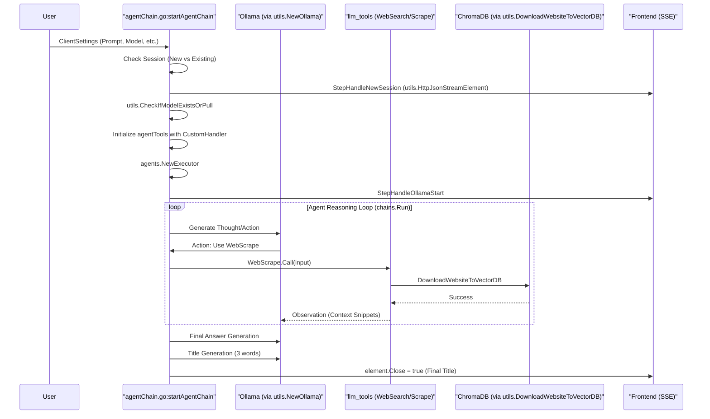

Sources: [backend/agentChain.go:21-182](), [backend/llm_tools/tool_webscrape.go:41-139]()

## Implementation Details

### Session Management and Vector DB Namespacing

The Agent Chain manages sessions to maintain conversation history and isolate data. A critical step during initialization is setting up a unique namespace in ChromaDB for the session. This prevents cross-talk between different user chats.

1. **Session Check**: If `clientSettings.Session` is "new", a unique string is generated [backend/agentChain.go:28-31]().
2. **Memory Init**: A `memory.NewConversationWindowBuffer` is created using the user's `ContextSize` [backend/agentChain.go:38]().
3. **Vector DB Namespace**: The system initializes a ChromaDB namespace matching the session ID. This is done early to prevent race conditions during parallel tool execution [backend/agentChain.go:64-74]().

Sources: [backend/agentChain.go:28-75]()

### Iterative Reasoning Loop

The system uses `agents.NewExecutor` to wrap a `ConversationalAgent`. 

*   **Max Iterations**: Controlled by `clientSettings.MaxIterations` to prevent infinite loops [backend/agentChain.go:142]().
*   **Memory**: The `ConversationWindowBuffer` is injected into the executor to provide the LLM with previous turns [backend/agentChain.go:143]().
*   **Custom Handler**: A `utils.CustomHandler` is attached to both the agent and the individual tools. This handler intercepts LangChainGo events (like `HandleToolStart` or `HandleAgentAction`) and pushes them into the `outputChan` as JSON elements [backend/agentChain.go:131](), [backend/utils/customHandler.go:15-17]().

Sources: [backend/agentChain.go:130-144](), [backend/utils/customHandler.go:133-168]()

### Streaming Protocol

The communication between the backend and frontend relies on the `HttpJsonStreamElement` struct and the `StepType` enum.

| StepType | Usage |
|---|---|
| `StepHandleStreaming` | Used for token-by-token streaming of the final answer [backend/utils/customHandler.go:68](). |
| `StepHandleAgentAction` | Signals that the LLM has decided to use a specific tool [backend/utils/customHandler.go:166](). |
| `StepHandleSourceAdded` | Sent when a new URL is successfully scraped and added to the context [backend/utils/customHandler.go:208](). |
| `StepHandleParseError` | Triggered when the LLM output doesn't conform to the expected ReAct format [backend/agentChain.go:136](). |

Sources: [backend/utils/types.go:45-70](), [src/lib/types/types.ts:45-68]()

## Error Recovery and Post-Processing

### Parser Error Handling
LLMs occasionally fail to output the correct JSON or ReAct format. The Agent Chain uses `agents.WithParserErrorHandler` to catch these failures. Instead of crashing, it sends a `StepHandleParseError` to the frontend and provides the LLM with a `ParsingErrorPrompt()` to encourage it to correct its formatting [backend/agentChain.go:133-141]().

### Title Generation
Once the `chains.Run` call completes and a final answer is produced, the Agent Chain performs a post-processing step to generate a human-readable title:
1. It retrieves all messages from `mem.ChatHistory` [backend/agentChain.go:162]().
2. It makes a direct `llm.Call` with a specific prompt: `"Please create a three (3) word title..."` [backend/agentChain.go:167]().
3. The resulting title is saved to the session and sent with the `Close: true` flag to the frontend [backend/agentChain.go:174-180]().

Sources: [backend/agentChain.go:133-141](), [backend/agentChain.go:162-180](), [backend/utils/prompts.go:3-5]()

---

# Page: Tool System

# Tool System

<details>
<summary>Relevant source files</summary>

The following files were used as context for generating this wiki page:

- [backend/llm_tools/simple_websearch.go](backend/llm_tools/simple_websearch.go)
- [backend/llm_tools/tool_search_vector_db.go](backend/llm_tools/tool_search_vector_db.go)
- [backend/utils/llm_backends.go](backend/utils/llm_backends.go)
- [backend/utils/load_localfiles.go](backend/utils/load_localfiles.go)
- [backend/utils/vector_db_handler.go](backend/utils/vector_db_handler.go)
- [searxng/limiter.toml](searxng/limiter.toml)
- [searxng/settings.yml](searxng/settings.yml)
- [searxng/uwsgi.ini](searxng/uwsgi.ini)
- [src/lib/show_logs_button.svelte](src/lib/show_logs_button.svelte)

</details>


The Tool System in LLocalSearch enables the Large Language Model (LLM) to access external information sources and services, extending its capabilities beyond the knowledge in its training data. This page documents the available tools, their implementation structure, and how they integrate with the larger system architecture.

## Tool System Overview

LLocalSearch implements primary tools that provide the LLM with capabilities to:
1. Search the web for current information via SearXNG.
2. Scrape and extract content from specific web pages.
3. Search vector embeddings of previously accessed information in ChromaDB.

These tools follow a standardized structure and are provided to the LLM via the agent chain orchestration system, allowing the model to reason about which tool to use and how to interpret their results.

### Natural Language to Code Entity Mapping
The following diagram bridges the gap between the conceptual "Natural Language" tool requests and the specific "Code Entity" implementations.

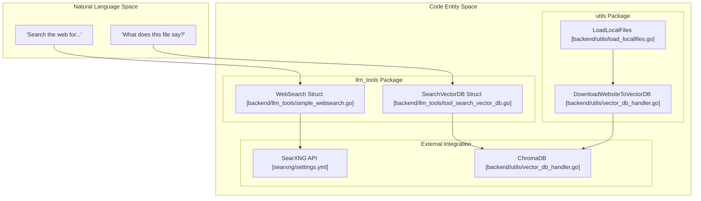
Sources: [backend/llm_tools/simple_websearch.go:19-23](), [backend/llm_tools/tool_search_vector_db.go:21-25](), [backend/utils/vector_db_handler.go:85-120](), [backend/utils/load_localfiles.go:44-49]()

## Tool Interface Structure

All tools in the system implement the `tools.Tool` interface from the LangChain Go library. This ensures a consistent contract for the LLM to interact with.

### Implementation Details
- **`Name()`**: Returns the identifier used by the LLM to call the tool (e.g., `websearch`, `database_search`). [backend/llm_tools/simple_websearch.go:33-35](), [backend/llm_tools/tool_search_vector_db.go:40-42]()
- **`Description()`**: Provides the prompt-level instructions for the LLM explaining when and how to use the tool. [backend/llm_tools/simple_websearch.go:29-31](), [backend/llm_tools/tool_search_vector_db.go:36-38]()
- **`Call()`**: The execution logic that takes a string input and returns a string response (usually JSON-formatted). [backend/llm_tools/simple_websearch.go:37-129](), [backend/llm_tools/tool_search_vector_db.go:44-133]()

### Data Flow for SearchVectorDB
The `SearchVectorDB` tool specifically manages semantic retrieval from the local knowledge base.

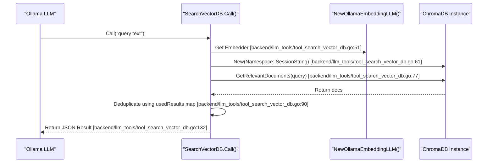
Sources: [backend/llm_tools/tool_search_vector_db.go:44-133](), [backend/utils/llm_backends.go:17-20]()

## Available Tools

### WebSearch Tool
The `WebSearch` tool integrates with SearXNG to fetch live internet data. 
- **Implementation**: It constructs a GET request to the domain specified in the `SEARXNG_DOMAIN` environment variable. [backend/llm_tools/simple_websearch.go:45-47]()
- **Deduplication**: It maintains a `simpleUsedLinks` map indexed by `SessionString` to ensure the same link isn't processed twice in one session. [backend/llm_tools/simple_websearch.go:25-75]()
- **Parallelism**: It uses a `sync.WaitGroup` to concurrently process results and update the UI via the `CustomHandler`. [backend/llm_tools/simple_websearch.go:61-112]()

### SearchVectorDB Tool
The `SearchVectorDB` tool provides RAG (Retrieval-Augmented Generation) capabilities.
- **Distance Function**: Uses "cosine" similarity for vector comparisons. [backend/llm_tools/tool_search_vector_db.go:64]()
- **Namespace Isolation**: Uses `SessionString` as the ChromaDB namespace, ensuring data privacy between different chat sessions. [backend/llm_tools/tool_search_vector_db.go:65]()
- **Thresholding**: Filters results based on `Settings.MinResultScore`. [backend/llm_tools/tool_search_vector_db.go:73]()

## Data Ingestion Pipeline

Data enters the vector database through three main paths:
1. **Web Scraping**: `DownloadWebsiteToVectorDB` fetches HTML, sanitizes it using `bluemonday`, and splits it into chunks. [backend/utils/vector_db_handler.go:85-120]()
2. **Local Files**: `LoadLocalFiles` scans the `/localfiles` directory for `.md` files and ingests them. [backend/utils/load_localfiles.go:15-49]()
3. **Manual Markdown**: `LoadMarkdownToVectorDB` handles direct string ingestion. [backend/utils/vector_db_handler.go:63-83]()

### Text Processing Logic
Content is prepared for the vector store using the following steps:
- **Sanitization**: `stripHtml` removes tags and normalizes whitespace. [backend/utils/vector_db_handler.go:122-130]()
- **Chunking**: `textsplitter.NewTokenSplitter` breaks text into segments based on `ChunkSize` and `ChunkOverlap`. [backend/utils/vector_db_handler.go:99-103]()
- **Metadata**: Every chunk is tagged with a `URL` or file path for attribution. [backend/utils/vector_db_handler.go:108]()

## CustomHandler Callback Bridge

The `CustomHandler` is an extension of the LangChain callback system that bridges the backend tool execution with the frontend SSE (Server-Sent Events) stream.

- **`HandleSourceAdded`**: When a tool finds a relevant document or link, it calls this method to push a `Source` object to the UI. [backend/llm_tools/simple_websearch.go:107](), [backend/llm_tools/tool_search_vector_db.go:105]()
- **Attribution**: Sources include the Engine (e.g., "SimpleWebSearch"), Title, Link, and a Summary. [backend/llm_tools/simple_websearch.go:99-105]()

Sources: [backend/llm_tools/simple_websearch.go:97-108](), [backend/llm_tools/tool_search_vector_db.go:102-112]()

## Configuration Parameters

Tools are governed by `utils.ClientSettings`, allowing users to tune performance vs. accuracy.

| Setting | Code Reference | Tool Affected |
| :--- | :--- | :--- |
| `AmountOfWebsites` | [backend/llm_tools/simple_websearch.go:77]() | WebSearch |
| `AmountOfResults` | [backend/llm_tools/tool_search_vector_db.go:76]() | SearchVectorDB |
| `MinResultScore` | [backend/llm_tools/tool_search_vector_db.go:73]() | SearchVectorDB |
| `ChunkSize` | [backend/utils/vector_db_handler.go:102]() | Ingestion Pipeline |
| `ChunkOverlap` | [backend/utils/vector_db_handler.go:103]() | Ingestion Pipeline |

Sources: [backend/llm_tools/tool_search_vector_db.go:24](), [backend/llm_tools/simple_websearch.go:22]()

---

# Page: LLM Integration

# LLM Integration

<details>
<summary>Relevant source files</summary>

The following files were used as context for generating this wiki page:

- [backend/agentChain.go](backend/agentChain.go)
- [backend/llm_tools/tool_search_vector_db.go](backend/llm_tools/tool_search_vector_db.go)
- [backend/lschains/format_sources_chain.go](backend/lschains/format_sources_chain.go)
- [backend/lschains/ollama_functioncall.go](backend/lschains/ollama_functioncall.go)
- [backend/utils/llm_backends.go](backend/utils/llm_backends.go)
- [backend/utils/vector_db_handler.go](backend/utils/vector_db_handler.go)

</details>


This page documents how LLocalSearch integrates with local Large Language Models (LLMs) through Ollama to provide the core intelligence for the system. This integration enables the system to process user queries, reason through complex problems, and utilize various tools to retrieve information.

## Overview

LLocalSearch uses Ollama as its LLM backend, allowing the system to run models locally. The integration is primarily managed through the `langchaingo` framework, which provides an abstraction layer for LLM interactions, embeddings, and vector store management.

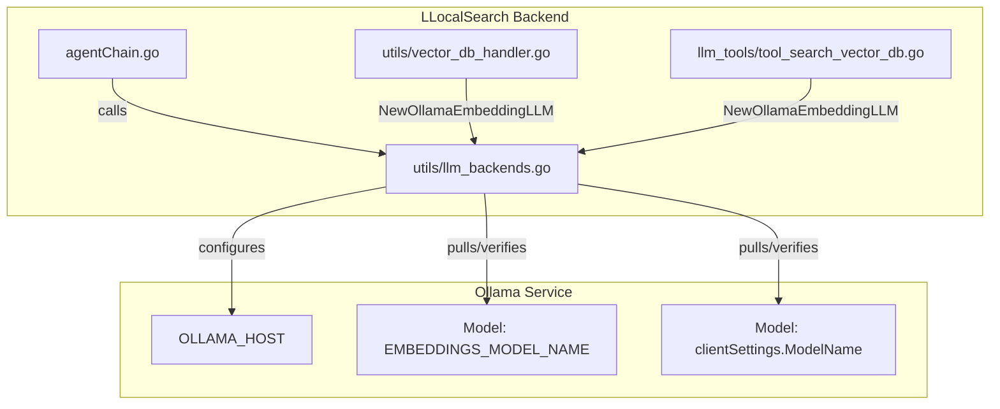

Sources: [backend/utils/llm_backends.go:1-28](), [backend/agentChain.go:56-69](), [backend/agentChain.go:84-95]()

## Core Components

### Ollama Client Initialization
The system implements a centralized factory for creating Ollama instances. The `NewOllama` function in `backend/utils/llm_backends.go` configures the client using the `OLLAMA_HOST` environment variable and sets the `WithRunnerNumCtx` option to match the requested context size [backend/utils/llm_backends.go:22-28]().

### Embeddings Pipeline
The system utilizes a dedicated model for generating vector embeddings, defined by the `EMBEDDINGS_MODEL_NAME` environment variable [backend/utils/llm_backends.go:15]().

- **`NewOllamaEmbeddingLLM`**: A wrapper that initializes an Ollama client specifically for embeddings with a fixed context size of 8192 tokens [backend/utils/llm_backends.go:17-20]().
- **Embedder Integration**: The `embeddings.NewEmbedder` function from `langchaingo` wraps this LLM instance to provide the standard embedding interface used by ChromaDB [backend/agentChain.go:60-63]().

### Model Management
Before the agent chain starts, the system ensures all necessary models are present on the Ollama host using `CheckIfModelExistsOrPull` [backend/utils/llm_backends.go:34-42]().

- **`GetOllamaModelList`**: Queries the Ollama API directly using `api.ClientFromEnvironment()` to list available models [backend/utils/llm_backends.go:44-58]().
- **`OllamaPullModel`**: Triggers a pull request to the Ollama server if a model is missing, providing real-time progress logging through `pullProgressHandler` [backend/utils/llm_backends.go:73-95]().

## Vector Store Integration (ChromaDB)

The system integrates LLM embeddings with ChromaDB to facilitate Retrieval-Augmented Generation (RAG). The `CHROMA_DB_URL` environment variable is required for this connection [backend/agentChain.go:65]().

### Data Flow: Ingestion to Retrieval
The following diagram maps the code entities involved in moving data from natural language (websites/markdown) into the vector space and back.

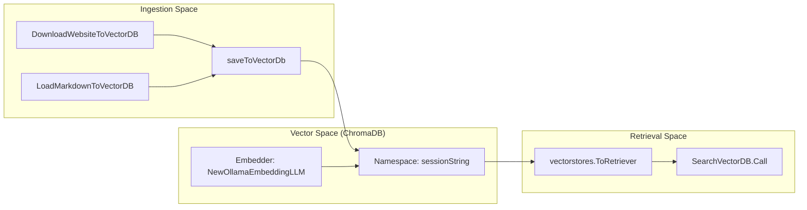

Sources: [backend/utils/vector_db_handler.go:22-38](), [backend/utils/vector_db_handler.go:63-83](), [backend/llm_tools/tool_search_vector_db.go:51-76]()

### Namespace Management
Each chat session is assigned a unique UUID via `GetSessionString` [backend/utils/llm_backends.go:30-32](). This UUID is used as the `NameSpace` in ChromaDB, ensuring that search results are isolated to the specific context of a single conversation [backend/agentChain.go:68](), [backend/llm_tools/tool_search_vector_db.go:65]().

## Implementation in Agent Chain

The `startAgentChain` function orchestrates the LLM lifecycle:

1. **Model Verification**: It checks for both the user-selected model and the embeddings model [backend/agentChain.go:84-95]().
2. **Initialization**: It creates the main LLM instance for reasoning and the embedding-backed vector store for tool usage [backend/agentChain.go:97-101]().
3. **Execution**: It runs the `mainExecutor` (a `langchaingo` agent) which uses the LLM to decide when to call tools like `database_search` [backend/agentChain.go:130-144]().
4. **Post-Processing**: After the main answer is generated, it performs a secondary LLM call to generate a 3-word title for the conversation based on the message history [backend/agentChain.go:167-175]().

## Constraints and Known Issues

- **Stop Words**: There are known constraints with LLama3 models regarding stop word handling, which can occasionally cause the model to continue generating past its intended stopping point [README.md:27-43]().
- **Parsing Errors**: If the LLM fails to output valid JSON for tool calls, the system catches this via `WithParserErrorHandler` and prompts the model to try again using `utils.ParsingErrorPrompt()` [backend/agentChain.go:133-141]().
- **Vector DB Initialization**: A "hack" is currently implemented to initialize the vector DB namespace early in the chain to prevent race conditions during concurrent tool execution [backend/agentChain.go:52-75]().

## Configuration Summary

| Dependency | Env Variable | Code Reference |
| :--- | :--- | :--- |
| Ollama API URL | `OLLAMA_HOST` | [backend/utils/llm_backends.go:24]() |
| Embedding Model | `EMBEDDINGS_MODEL_NAME` | [backend/utils/llm_backends.go:15]() |
| Vector Store URL | `CHROMA_DB_URL` | [backend/agentChain.go:65]() |

Sources: [backend/agentChain.go:1-182](), [backend/utils/llm_backends.go:1-100](), [backend/llm_tools/tool_search_vector_db.go:1-133]()

---

# Page: Frontend Application

# Frontend Application

<details>
<summary>Relevant source files</summary>

The following files were used as context for generating this wiki page:

- [Dockerfile](Dockerfile)
- [custom-server.js](custom-server.js)
- [nginx.conf](nginx.conf)
- [package-lock.json](package-lock.json)
- [package.json](package.json)
- [src/app.css](src/app.css)
- [src/app.d.ts](src/app.d.ts)
- [src/app.html](src/app.html)
- [src/routes/+layout.ts](src/routes/+layout.ts)
- [static/favicon.png](static/favicon.png)
- [static/favicon.svg](static/favicon.svg)
- [svelte.config.js](svelte.config.js)
- [tailwind.config.js](tailwind.config.js)

</details>


This document provides an overview of the SvelteKit-based frontend application for LLocalSearch. It describes the application's architecture, deployment configurations, and how it interfaces with the backend API to deliver a user-friendly interface for interacting with locally running Large Language Models (LLMs).

For information about the backend services that the frontend communicates with, see [API Server](#4.3).

## Architecture Overview

The LLocalSearch frontend is built with SvelteKit, providing a responsive interface that allows users to engage in conversations with locally running LLMs, configure model and search settings, and view conversation history. The application is designed as a Single Page Application (SPA) that is prerendered into static assets.

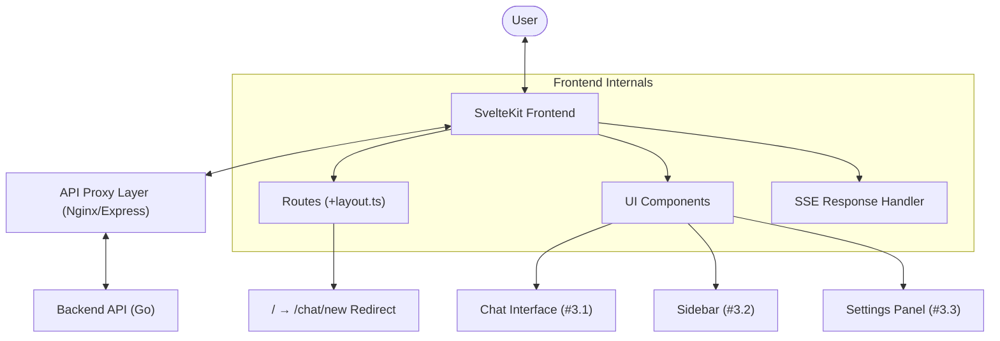

Sources: [src/routes/+layout.ts:1-1](), [svelte.config.js:1-26]()

## Routing and Entry Points

The application implements routing through SvelteKit's file-based routing system. The entire site is configured for static prerendering using `@sveltejs/adapter-static` [svelte.config.js:2-23]().

- **Prerendering**: The layout is marked with `export const prerender = true` to ensure the application is generated as a static site [src/routes/+layout.ts:1-1]().
- **Root Entry**: The main entry point is defined in `src/app.html`, which sets the default "dark" class for the theme [src/app.html:1-15]().

For details on specific routes and navigation logic, see [Sidebar and Navigation](#3.2).

## Deployment and Proxying

The frontend application supports two primary deployment methods, both of which involve proxying `/api` requests to the backend service.

### Static Deployment with Nginx
In production, the application is typically served via Nginx. The `Dockerfile` uses a multi-stage build to compile the SvelteKit app and then copies the static files to an Nginx container [Dockerfile:1-14]().

The Nginx configuration handles:
- **Static Files**: Serves assets from `/usr/share/nginx/html` [nginx.conf:7-8]().
- **API Proxy**: Rewrites `/api/` paths and forwards them to `http://backend:8080/` [nginx.conf:11-18]().
- **Streaming Support**: Disables `proxy_buffering` to allow Server-Sent Events (SSE) to reach the client in real-time [nginx.conf:14-14]().

### Node.js Development Proxy
A custom Express server (`custom-server.js`) is provided for local development or Node-based environments. It uses `http-proxy-middleware` to forward `/api` requests to the backend [custom-server.js:1-24]().

Sources: [nginx.conf:1-31](), [custom-server.js:1-24](), [Dockerfile:1-14]()

## Technical Stack

The frontend leverages a modern utility-first and component-based stack:

| Category | Technology | Purpose |
| :--- | :--- | :--- |
| **Framework** | SvelteKit | Core application framework and routing [package.json:18-18]() |
| **Styling** | Tailwind CSS | Utility-first CSS and typography [tailwind.config.js:1-15]() |
| **Rendering** | Marked | Markdown parsing for LLM responses [package.json:42-42]() |
| **Adapter** | Static Adapter | Compiles the app into static HTML/JS/CSS [svelte.config.js:10-19]() |

Sources: [package.json:14-45](), [tailwind.config.js:1-15]()

## Component Modules

The application is divided into three primary functional areas:

### Chat Interface
The core of the application where users interact with the LLM. It handles the streaming of reasoning steps (StepTypes), markdown rendering, and tool action visualization.
For details, see [Chat Interface](#3.1).

### Sidebar and Navigation
Manages the application state related to chat history, source management, and navigation between different chat sessions.
For details, see [Sidebar and Navigation](#3.2).

### Settings and Configuration
Provides the UI for adjusting LLM parameters (e.g., temperature, context size) and search behavior (e.g., chunk size, result scores).
For details, see [Settings and Configuration](#3.3).

## Data Flow with Backend

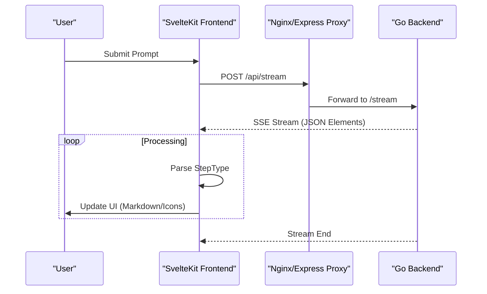

The frontend specifically configures the proxy to ensure that the `proxy_buffering` is off, which is critical for the iterative reasoning loop where the user sees the agent's "thoughts" as they occur [nginx.conf:14-14]().

Sources: [nginx.conf:11-23](), [custom-server.js:7-16]()

---

# Page: Chat Interface

# Chat Interface

<details>
<summary>Relevant source files</summary>

The following files were used as context for generating this wiki page:

- [src/lib/bottom_bar.svelte](src/lib/bottom_bar.svelte)
- [src/lib/loading_message.svelte](src/lib/loading_message.svelte)
- [src/lib/log_item.svelte](src/lib/log_item.svelte)
- [src/lib/log_node.svelte](src/lib/log_node.svelte)
- [src/lib/new_chat_button.svelte](src/lib/new_chat_button.svelte)
- [src/lib/sources.svelte](src/lib/sources.svelte)
- [src/routes/chat/[slug]/+page.svelte](src/routes/chat/[slug]/+page.svelte)
- [src/routes/chat/[slug]/handle_darkmode.ts](src/routes/chat/[slug]/handle_darkmode.ts)
- [src/routes/chat/[slug]/load_functions.ts](src/routes/chat/[slug]/load_functions.ts)

</details>


The Chat Interface is the primary user-facing component of LLocalSearch where users interact with locally-running Large Language Models (LLMs). This page documents the design, components, and functionality of the chat interface implemented in the SvelteKit frontend, specifically focusing on the message rendering pipeline and input handling.

## Interface Structure

The chat interface is managed primarily by the `+page.svelte` route in `src/routes/chat/[slug]`. It coordinates the flow between the backend streaming API and the various UI components.

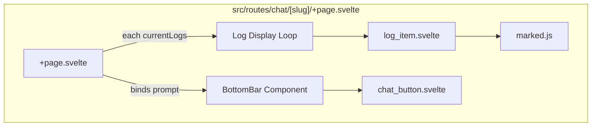

Sources: [src/routes/chat/[slug]/+page.svelte:1-30](), [src/lib/log_item.svelte:1-20](), [src/lib/bottom_bar.svelte:1-10]()

## Route and Data Loading

The `/chat/[slug]` route uses the `slug` parameter to identify specific chat sessions. The `load_functions.ts` file provides the logic for retrieving existing conversations and metrics.

### Key Functions
- `fetchHistory(id: string)`: Retrieves the message log for a specific session from `/api/chat/{id}` [src/routes/chat/[slug]/load_functions.ts:36-53]().
- `parseLogArray(history: LogElement[])`: Processes raw history items, removing LLM-specific tokens like `<|im_end|>` and merging sequential stream chunks into single message blocks [src/routes/chat/[slug]/load_functions.ts:56-78]().
- `runMetrics(version, model)`: Reports anonymous usage data to the metrics server to help track version distribution [src/routes/chat/[slug]/load_functions.ts:14-35]().

Sources: [src/routes/chat/[slug]/load_functions.ts:1-78]()

## Rendering Pipeline (`log_item.svelte`)

The `log_item.svelte` component is responsible for transforming raw `LogElement` data into formatted HTML. It uses a dispatch mechanism based on `StepType` to determine the visual style.

### Markdown and Sanitization
The interface uses `marked` for Markdown rendering. A custom renderer is used to ensure all links open in a new tab with `rel='noopener noreferrer'` for security [src/lib/log_item.svelte:8-17](). Before rendering, the component strips internal "Thought" strings and LLM prefixes like `AI:` to provide a clean chat experience [src/lib/log_item.svelte:125-132]().

### Tool Action Icons
When the LLM triggers a tool, `log_item.svelte` detects the action in the message content and renders specific SVG icons:
- **Web Search**: Globe icon [src/lib/log_item.svelte:101-119]().
- **Web Scrape**: Eye icon [src/lib/log_item.svelte:58-81]().
- **Database Search**: Database icon [src/lib/log_item.svelte:82-100]().

### Error Handling
Errors are caught by checking `StepType` constants such as `HandleChainError` or `HandleParseError`. If a parsing error occurs (indicating the LLM failed to output valid JSON for a tool call), a user-friendly message suggests using a model better trained for function calling [src/lib/log_item.svelte:28-42]().

Sources: [src/lib/log_item.svelte:1-172]()

## Input and Controls (`bottom_bar.svelte`)

The `bottom_bar.svelte` component manages user input and session control.

### Implementation Details
- **Auto-Resize**: The `autoResize` function dynamically adjusts the `textarea` height based on the `scrollHeight` as the user types [src/lib/bottom_bar.svelte:12-15]().
- **Keyboard Shortcuts**: Pressing `Enter` without modifiers triggers `sendPrompt()`, while `Shift+Enter` allows for multi-line input [src/lib/bottom_bar.svelte:26-37]().
- **Focus Management**: The input field automatically regains focus when the system returns to "send mode" (i.e., when the LLM finishes responding) [src/lib/bottom_bar.svelte:38-42]().

Sources: [src/lib/bottom_bar.svelte:1-67]()

## Streaming Interaction

The frontend uses the browser's `EventSource` API to handle real-time updates from the backend `/api/stream` endpoint.

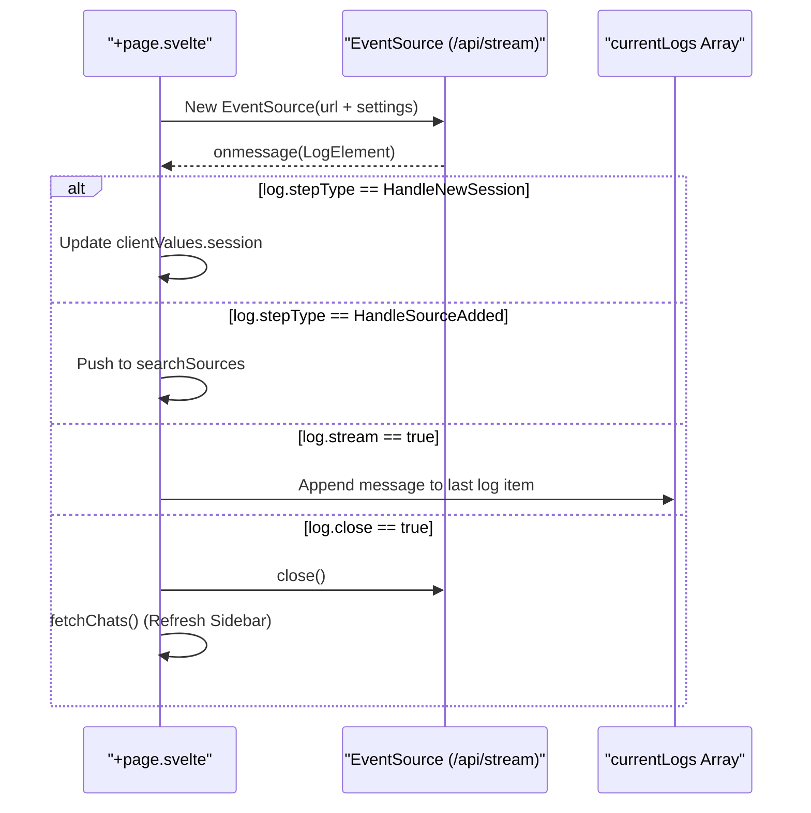

Sources: [src/routes/chat/[slug]/+page.svelte:146-187]()

## Visual Components

### Loading States
The `loading_message.svelte` component provides an animated pulse effect using random widths to simulate text lines, giving the user visual feedback while the LLM is initializing or searching [src/lib/loading_message.svelte:1-40]().

### Dark Mode
Dark mode is handled by `handle_darkmode.ts`, which toggles the `dark` class on the `document.documentElement`. It synchronizes the state with `localStorage.theme` and respects the user's system preference via `window.matchMedia` [src/routes/chat/[slug]/handle_darkmode.ts:1-15]().

Sources: [src/lib/loading_message.svelte:1-40](), [src/routes/chat/[slug]/handle_darkmode.ts:1-15]()

---

# Page: Sidebar and Navigation

# Sidebar and Navigation

<details>
<summary>Relevant source files</summary>

The following files were used as context for generating this wiki page:

- [src/lib/chatHistory.svelte](src/lib/chatHistory.svelte)
- [src/lib/chatList.svelte](src/lib/chatList.svelte)
- [src/lib/chatListItemElem.svelte](src/lib/chatListItemElem.svelte)
- [src/lib/chat_button.svelte](src/lib/chat_button.svelte)
- [src/lib/loading_message.svelte](src/lib/loading_message.svelte)
- [src/lib/new_chat_button.svelte](src/lib/new_chat_button.svelte)
- [src/lib/sidebar.svelte](src/lib/sidebar.svelte)
- [src/lib/sidebar_history_toggle.svelte](src/lib/sidebar_history_toggle.svelte)
- [src/lib/sidebar_sources_toggle.svelte](src/lib/sidebar_sources_toggle.svelte)
- [src/lib/toggle_darkmode_button.svelte](src/lib/toggle_darkmode_button.svelte)
- [src/lib/toggle_settings_button.svelte](src/lib/toggle_settings_button.svelte)
- [src/lib/toggle_sidebar_button.svelte](src/lib/toggle_sidebar_button.svelte)
- [src/lib/topbar_button.svelte](src/lib/topbar_button.svelte)
- [src/routes/+page.svelte](src/routes/+page.svelte)

</details>


## Purpose and Scope

This document details the sidebar and navigation components of the LLocalSearch frontend interface. The sidebar provides access to chat history and reference sources, enabling users to navigate between past conversations and view sources used in agent responses. It also covers the top-level routing logic and specialized navigation buttons for chat management, settings, and theme control.

## Sidebar Components Overview

The sidebar in LLocalSearch serves two primary functions through its different modes:
1. Displaying chat history (`chats` mode)
2. Showing reference sources (`sources` mode)

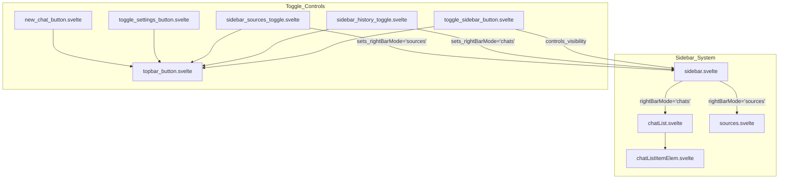

Sources: [src/lib/sidebar.svelte:1-12](), [src/lib/chatListItemElem.svelte:1-5](), [src/lib/toggle_sidebar_button.svelte:1-6](), [src/lib/sidebar_history_toggle.svelte:1-4](), [src/lib/sidebar_sources_toggle.svelte:1-5](), [src/lib/topbar_button.svelte:1-6]()

## Root Navigation and Redirects

The application implements a root redirect to ensure users always land on a valid chat state. The root route `/` immediately redirects to `/chat/new` using a 307 Temporary Redirect.

Sources: [src/routes/+page.svelte:1-7]()

## Sidebar Container Implementation

The main sidebar container is implemented in `sidebar.svelte`. It uses Svelte transitions (`slide` on the x-axis) for smooth animations when showing or hiding the sidebar [src/lib/sidebar.svelte:15-16]().

The sidebar conditionally renders content based on the `rightBarMode` prop:
- **Chats Mode**: Displays the chat history. It handles the asynchronous nature of fetching history using an `{#await chatlistItems}` block [src/lib/sidebar.svelte:40-52]().
- **Sources Mode**: Displays the reference sources used by the agent in the current session via the `Sources` component [src/lib/sidebar.svelte:54-58]().

Sources: [src/lib/sidebar.svelte:14-60]()

## Navigation Controls

The sidebar's visibility and mode are controlled by a set of specialized toggle buttons, most of which wrap `topbar_button.svelte` to provide consistent styling, hover effects, and active state shadows [src/lib/topbar_button.svelte:10-34]().

### Chat and Session Management
- **New Chat Button** (`new_chat_button.svelte`): Triggers the provided `action` to reset the interface for a new session [src/lib/new_chat_button.svelte:1-24]().
- **Chat Action Button** (`chat_button.svelte`): A multi-state button used in the input bar. It switches between "send message", "stop chat" (if an `eventSource` is active), and "new chat" based on the `sendMode` and `prompt` state [src/lib/chat_button.svelte:15-107]().

### Interface Toggles
- **Sidebar Toggle** (`toggle_sidebar_button.svelte`): Toggles the `showSidebar` boolean, changing the SVG icon to indicate the "push" or "pull" action [src/lib/toggle_sidebar_button.svelte:8-44]().
- **History Toggle** (`sidebar_history_toggle.svelte`): Sets `rightBarMode` to `chats` [src/lib/sidebar_history_toggle.svelte:6-25]().
- **Sources Toggle** (`sidebar_sources_toggle.svelte`): Sets `rightBarMode` to `sources` [src/lib/sidebar_sources_toggle.svelte:7-26]().
- **Dark Mode Toggle** (`toggle_darkmode_button.svelte`): Toggles the `isDarkMode` boolean and switches between sun and moon icons [src/lib/toggle_darkmode_button.svelte:7-43]().
- **Settings Toggle** (`toggle_settings_button.svelte`): Opens the settings modal by setting `showSettings` to true [src/lib/toggle_settings_button.svelte:7-23]().

Sources: [src/lib/chat_button.svelte:1-108](), [src/lib/toggle_sidebar_button.svelte:1-45](), [src/lib/sidebar_history_toggle.svelte:1-26](), [src/lib/sidebar_sources_toggle.svelte:1-27](), [src/lib/new_chat_button.svelte:1-24]()

## Chat History Mode

When in `chats` mode, `sidebar.svelte` renders the `ChatList` component. This component iterates through `chatListItems` and renders individual `chatListItemElem.svelte` instances.

### Chat List Items
Each item represents a past session. The component `chatListItemElem.svelte` cleans the title by removing the "title: " prefix often generated by the LLM [src/lib/chatListItemElem.svelte:6-10]().
- **Active State**: If `item.sessionid === session`, the item is highlighted with `bg-neutral-200` (light) or `bg-neutral-800` (dark) [src/lib/chatListItemElem.svelte:15-20]().
- **Selection**: Clicking an item calls the `loadHistory` function with the session ID and title [src/lib/chatListItemElem.svelte:13]().

Sources: [src/lib/chatListItemElem.svelte:1-30](), [src/lib/sidebar.svelte:40-52]()

## Loading States

The interface uses `loading_message.svelte` to provide visual feedback during asynchronous operations (like loading chat content). It generates a skeleton UI with randomized widths for "blocks" of text to simulate content, wrapped in an `animate-pulse` container [src/lib/loading_message.svelte:1-39]().

Sources: [src/lib/loading_message.svelte:1-40]()

## Technical Implementation Details

### Data Flow for History Selection

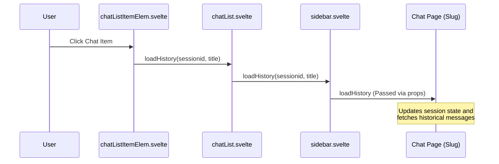

### Component Property Reference

| Component | Prop | Description |
|-----------|------|-------------|
| `sidebar.svelte` | `rightBarMode` | String: `'chats'` or `'sources'`. |
| `sidebar.svelte` | `chatlistItems` | Promise: Resolves to `ChatListItem[]`. |
| `chatListItemElem.svelte` | `item` | `ChatListItem`: Contains `sessionid` and `title`. |
| `chat_button.svelte` | `sendMode` | Boolean: Toggles between send and new/stop states. |
| `topbar_button.svelte` | `active` | Boolean: Applies "pressed" styling if true. |

Sources: [src/lib/sidebar.svelte:1-12](), [src/lib/chatListItemElem.svelte:1-5](), [src/lib/topbar_button.svelte:1-6](), [src/lib/chat_button.svelte:1-9]()

---

# Page: Settings and Configuration

# Settings and Configuration

<details>
<summary>Relevant source files</summary>

The following files were used as context for generating this wiki page:

- [src/lib/clickOutside.js](src/lib/clickOutside.js)
- [src/lib/model_switch_window.svelte](src/lib/model_switch_window.svelte)
- [src/lib/settings_field.svelte](src/lib/settings_field.svelte)
- [src/lib/settings_window.svelte](src/lib/settings_window.svelte)
- [src/lib/toggle_darkmode_button.svelte](src/lib/toggle_darkmode_button.svelte)
- [src/lib/toggle_model_switch.svelte](src/lib/toggle_model_switch.svelte)
- [src/routes/+page.svelte](src/routes/+page.svelte)

</details>


This document details the settings and configuration system in LLocalSearch. It covers the user interface for modifying settings, the validation pipeline for configuration parameters, and the specialized components for model switching and theme management.

## Settings Interface Overview

The settings interface is implemented primarily through `settings_window.svelte`, a modal UI that binds to the `ClientSettings` object. This modal allows granular control over the agent's reasoning parameters, vector database thresholds, and scraping behavior.

### Settings Component Architecture

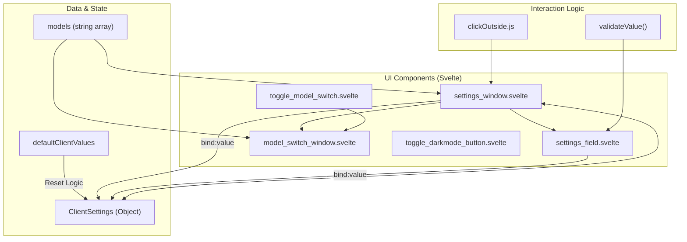

Sources: [src/lib/settings_window.svelte:1-10](), [src/lib/settings_field.svelte:1-9](), [src/lib/model_switch_window.svelte:1-6](), [src/lib/clickOutside.js:1-16]()

## Configurable Parameters

The settings are categorized into functional blocks within the `settings_window.svelte` modal.

### LLM Configuration
These parameters control the core behavior of the Ollama-powered agent.

| Parameter | UI Element | Logic / Range |
|-----------|------------|---------------|
| `modelName` | `<select>` | Populated via `models` array [src/lib/settings_window.svelte:88-101]() |
| `systemMessage` | `<textarea>` | Sets the agent's base personality [src/lib/settings_window.svelte:107-111]() |
| `temperature` | `SettingsField` | Range: 0.0 - 10.0, Step: 0.1 [src/lib/settings_window.svelte:113-120]() |
| `contextSize` | `SettingsField` | Range: 1 - 128,000 tokens, Step: 1024 [src/lib/settings_window.svelte:121-128]() |
| `maxIterations` | `SettingsField` | Max actions/evaluations per query. Range: 1 - 50 [src/lib/settings_window.svelte:129-136]() |

### Vector DB & Scraper Settings
These settings tune the RAG (Retrieval-Augmented Generation) pipeline.

| Parameter | Category | Logic / Range |
|-----------|----------|---------------|
| `minResultScore` | Vector DB | Minimum similarity score (0.0 - 1.0) [src/lib/settings_window.svelte:138-145]() |
| `amountOfResults` | Vector DB | Max results per query (1 - 30) [src/lib/settings_window.svelte:146-153]() |
| `amountOfWebsites` | Webscraper | Max sites scraped per query (1 - 30) [src/lib/settings_window.svelte:155-162]() |
| `chunkSize` | Text Chunks | Max chars per split (10 - 1000) [src/lib/settings_window.svelte:164-171]() |
| `chunkOverlap` | Text Chunks | Chars overlapped between splits (1 - 500) [src/lib/settings_window.svelte:172-179]() |

Sources: [src/lib/settings_window.svelte:83-180]()

## Implementation Details

### Validation Pipeline (`settings_field.svelte`)
The `settings_field.svelte` component implements a reactive validation pipeline. It ensures that user input via the `number` input type remains within the defined `minValue` and `maxValue`.

*   **Reactive Validation**: Uses Svelte reactive statements `$: validateValue(value)` and `$: validateValue(inputValue)` to synchronize the internal state with external changes (like resets) and user input [src/lib/settings_field.svelte:30-35]().
*   **Error Handling**: If a value is `NaN`, `null`, `Infinity`, or out of bounds, `showRange` is set to `true`, triggering a red validation message [src/lib/settings_field.svelte:11-28]().

### Model Switching Logic
Model selection is handled in two places:
1.  **Settings Modal**: A standard HTML `<select>` dropdown [src/lib/settings_window.svelte:88-101]().
2.  **Quick Switcher**: `toggle_model_switch.svelte` triggers `model_switch_window.svelte`, which displays a list of available models as buttons [src/lib/model_switch_window.svelte:14-32]().
    *   The `cleanName` function in `toggle_model_switch.svelte` strips model tags (e.g., removing `:latest`) for a cleaner UI display [src/lib/toggle_model_switch.svelte:6-14]().

### Reset and Persistence
The system allows users to revert to defaults using a reset button in the header of the settings window. It performs a deep copy of `defaultClientValues` using `JSON.parse(JSON.stringify())` to break object references [src/lib/settings_window.svelte:35-37]().

### Theme Management
`toggle_darkmode_button.svelte` provides a UI toggle for the `isDarkMode` boolean. It uses Svelte's `draw` transition for the SVG icons (Sun/Moon) to provide visual feedback during theme transitions [src/lib/toggle_darkmode_button.svelte:7-43]().

## UI Interaction Diagram

```mermaid
sequenceDiagram
    participant User
    participant SW as settings_window.svelte
    participant SF as settings_field.svelte
    participant CS as ClientSettings

    User->>SW: Opens Settings
    User->>SF: Enters Value (e.g. Temperature)
    SF->>SF: validateValue(inputValue)
    alt Value is valid
        SF->>CS: Update bound value
    else Value is invalid
        SF->>User: Display "Value must be between..."
    end
    User->>SW: Click Reset
    SW->>CS: Overwrite with defaultClientValues
    CS->>SF: Reactive update triggers validateValue(value)
```

Sources: [src/lib/settings_window.svelte:35-37](), [src/lib/settings_field.svelte:11-35](), [src/lib/toggle_darkmode_button.svelte:8-26]()

---

# Page: Developer Guide

# Developer Guide

<details>
<summary>Relevant source files</summary>

The following files were used as context for generating this wiki page:

- [Makefile](Makefile)
- [OLLAMA_GUIDE.md](OLLAMA_GUIDE.md)
- [README.md](README.md)
- [env-example](env-example)
- [go.work](go.work)
- [go.work.sum](go.work.sum)

</details>


This guide provides comprehensive instructions for developers who want to set up, modify, or extend the LLocalSearch system. It covers the development workflow, project architecture, and links to specialized child pages for deeper technical dives.

## Development Workflow Overview

The LLocalSearch development environment is designed for rapid iteration using containerized services. The workflow utilizes `docker-compose.dev.yaml` to orchestrate services with live-reloading enabled for both the Go backend and SvelteKit frontend.

### Core Development Components

- **Go Workspace**: The project uses a Go workspace (`go.work`) to manage the `backend` and `metrics` modules simultaneously [go.work:1-5]().
- **Hot Reloading**: 
    - **Backend**: Uses `air` (configured via `backend/.air.toml`) to watch for Go file changes and recompile the binary inside the container.
    - **Frontend**: Uses Vite's HMR (Hot Module Replacement) to reflect UI changes instantly.
- **Task Automation**: A `Makefile` centralizes common commands for building, running, and testing the system [Makefile:1-41]().

## System Architecture for Developers

The development environment consists of five primary services interacting over a bridge network.

### Service Topology

```mermaid
graph TD
    subgraph "Docker_Network [llm_network]"
        Frontend["Frontend_Service [SvelteKit/Vite]"]
        Backend["Backend_Service [Go_apiServer]"]
        ChromaDB["Vector_DB [ChromaDB]"]
        SearxNG["Search_Engine [SearXNG]"]
        Redis["Cache [Redis]"]
    end
    
    Developer["Developer_Host"] -- "Edit_Files" --> Frontend
    Developer -- "Edit_Files" --> Backend
    
    Frontend -- "Fetch /stream" --> Backend
    Backend -- "gRPC/REST" --> ChromaDB
    Backend -- "HTTP" --> SearxNG
    Backend -- "HTTP" --> Ollama["Ollama_API [External/Host]"]
    
    style Frontend stroke-dasharray: 5 5
    style Backend stroke-dasharray: 5 5
```
**Sources:** [docker-compose.dev.yaml:3-78](), [go.work:1-5]()

## Detailed Developer Documentation

For specific implementation details, refer to the following child pages:

### [Development Environment](#4.1)
Detailed instructions for setting up the local toolchain. Covers:
- Using the `Makefile` targets like `make dev` and `make build-dev` [Makefile:30-41]().
- Configuring the `.env` file for local overrides like `OLLAMA_HOST` and `CHROMA_DB_URL` [env-example:1-8]().
- Frontend toolchain details (Vite, SvelteKit, and Nginx configuration).

### [Containerization and Deployment](#4.2)
Deep dive into the Docker infrastructure. Covers:
- Differences between production `docker-compose.yaml` and development `docker-compose.dev.yaml`.
- Multi-stage Docker builds for the frontend and backend [Makefile:8-20]().
- Networking configuration and the `llm_network` bridge.

### [API Server](#4.3)
Technical documentation of the Go backend. Covers:
- The `apiServer.go` implementation and its REST/SSE endpoints.
- Session management using the in-memory `sessions` map.
- The `parseClientSettings` logic for handling user-defined LLM parameters.

### [Monitoring and Metrics](#4.4)
Explains the standalone metrics service. Covers:
- The `metrics/main.go` service used for version checking and anonymous usage tracking [Makefile:10-10]().
- How the frontend reports model information to detect outdated deployments.

## Testing and Quality Assurance

### Backend Testing
LLocalSearch uses the Ginkgo testing framework for end-to-end (e2e) backend tests. Developers can trigger the test suite via the Makefile:

```bash
make e2e-backend
```
**Sources:** [Makefile:25-27]()

### Versioning and Releases
The project tracks versions using Git hashes and tags. Multi-architecture builds (linux/amd64, linux/arm64) are supported for Docker deployments [Makefile:1-19]().

```mermaid
graph LR
    subgraph "Release_Pipeline"
        Git["Git_Commit [GIT_HASH]"] --> Build["make build-containers-multi"]
        Build --> DockerHub["Docker_Hub [nilsherzig/llocalsearch-*]"]
    end
```
**Sources:** [Makefile:1-23]()

## Troubleshooting the Development Setup

| Issue | Likely Cause | Resolution |
| :--- | :--- | :--- |
| Backend cannot reach Ollama | Incorrect `OLLAMA_HOST` | Check `OLLAMA_HOST` in `.env`. Use `host.docker.internal` for local Ollama [OLLAMA_GUIDE.md:16-20](). |
| Changes not reflecting | Volume Mount Failure | Ensure the project root is correctly mapped in `docker-compose.dev.yaml` [docker-compose.dev.yaml:4-6](). |
| Database connection errors | Service Startup Order | Ensure ChromaDB and SearXNG are healthy before the backend starts [env-example:5-6](). |

**Sources:** [OLLAMA_GUIDE.md:1-47](), [env-example:1-8]()

---

# Page: Development Environment

# Development Environment

<details>
<summary>Relevant source files</summary>

The following files were used as context for generating this wiki page:

- [.eslintrc.cjs](.eslintrc.cjs)
- [.prettierrc](.prettierrc)
- [Makefile](Makefile)
- [backend/.air.toml](backend/.air.toml)
- [backend/Dockerfile](backend/Dockerfile)
- [custom-server.js](custom-server.js)
- [env-example](env-example)
- [go.work](go.work)
- [go.work.sum](go.work.sum)
- [package-lock.json](package-lock.json)
- [package.json](package.json)
- [svelte.config.js](svelte.config.js)
- [vite.config.ts](vite.config.ts)

</details>


This document describes how to set up and work with the LLocalSearch development environment. It covers the local development setup, required components, and development workflows for contributing to the project.

For information about deploying the system to production, see [4.2 Containerization and Deployment]().

## Overview

The LLocalSearch development environment uses Docker Compose to orchestrate multiple services. This approach ensures consistent development environments across different machines and simplifies the process of running the full system locally.

```mermaid
graph TD
    subgraph "Developer Machine"
        Dev["Developer"]
        Code["Local Code Repository"]
    end

    subgraph "Docker Development Environment"
        Frontend["Frontend (SvelteKit)"]
        Backend["Backend (Go)"]
        ChromaDB["ChromaDB Vector Store"]
        SearxNG["SearxNG Search Engine"]
        Redis["Redis Cache"]
    end

    subgraph "External Components"
        Ollama["Ollama LLM Service"]
    end

    Dev -- "edits code" --> Code
    Code -- "hot reload (Vite/Air)" --> Frontend
    Code -- "hot reload (Vite/Air)" --> Backend
    
    Frontend -- "API calls via custom-server.js" --> Backend
    Backend -- "vector storage/retrieval" --> ChromaDB
    Backend -- "search requests" --> SearxNG
    SearxNG -- "caching" --> Redis
    Backend -- "LLM requests" --> Ollama

    classDef system stroke:#333,stroke-width:1px
    classDef external stroke:#333,stroke-width:1px,stroke-dasharray: 5 5
    
    class Frontend,Backend,ChromaDB,SearxNG,Redis system
    class Ollama external
```

Sources: [Makefile:30-41](), [custom-server.js:7-16]()

## Toolchain and Configuration

### Backend: Go Workspace and Hot-Reload
The backend uses a Go workspace `go.work` to manage multiple modules (backend and metrics) simultaneously [go.work:1-5](). For local development, the backend is typically configured with `air` (via `backend/.air.toml`) to provide live-reloading of the Go binary upon file changes.

### Frontend: SvelteKit and Vite
The frontend is built with Svelte 4 and SvelteKit [package.json:31-33](). 
- **Vite**: Acts as the build tool and dev server [vite.config.ts:1-5]().
- **Adapter-Static**: Configured in `svelte.config.js` to produce a prerendered static site with an `index.html` fallback [svelte.config.js:2-18]().
- **Proxying**: During development, Vite proxies requests from `/api` to the Go backend at `http://backend:8080` [vite.config.ts:6-14]().

### Custom Server for Local Dev
For environments where a simple static server isn't enough (e.g., needing specific proxy logic), `custom-server.js` uses `express` and `http-proxy-middleware` to serve the SvelteKit build while routing API calls [custom-server.js:1-23]().

```mermaid
graph LR
    subgraph "custom-server.js"
        Express["Express App"]
        Proxy["createProxyMiddleware('/api')"]
        SvelteHandler["SvelteKit handler"]
    end

    Client["Browser"] --> Express
    Express --> Proxy --> Backend["Backend Service:8080"]
    Express --> SvelteHandler --> Build["./build/handler.js"]
```

Sources: [custom-server.js:1-23](), [package.json:40-41]()

## Prerequisites

Before setting up the development environment, ensure you have the following installed:

1. **Docker** and **Docker Compose** (v2)
2. **Go 1.22+** (for local testing/linting)
3. **Node.js** (for frontend development)
4. **Ollama** - for running local LLMs

## Development Environment Setup

### 1. Configure Environment Variables
Copy `env-example` to `.env`. The system relies on several key variables:
- `OLLAMA_HOST`: The URL of your Ollama instance [env-example:3]().
- `CHROMA_DB_URL`: The URL for the vector database [env-example:5]().
- `SEARXNG_DOMAIN`: The URL for the search engine [env-example:6]().

### 2. Makefile Targets
The `Makefile` provides the primary interface for development tasks:

| Target | Description |
| :--- | :--- |
| `make build-dev` | Builds the dev containers using `docker-compose.dev.yaml` [Makefile:31-32]() |
| `make dev` | Starts the dev environment in the foreground [Makefile:34-36]() |
| `make dev-bg` | Starts the dev environment in the background [Makefile:38-40]() |
| `make e2e-backend` | Runs backend tests using `ginkgo` [Makefile:25-27]() |
| `make build-containers` | Builds production-ready Docker images for all services [Makefile:8-12]() |

Sources: [Makefile:1-41]()

## Code Quality and Formatting

The project enforces code style using ESLint and Prettier.

- **Linting**: Run `npm run lint` to check for issues [package.json:11](). The configuration uses `@typescript-eslint/parser` and `eslint-plugin-svelte` [.eslintrc.cjs:10-27]().
- **Formatting**: Run `npm run format` to automatically fix style issues [package.json:12](). Prettier is configured to use tabs and single quotes [.prettierrc:2-3]().
- **Type Checking**: Run `npm run check` to perform Svelte-check and TypeScript validation [package.json:9]().

Sources: [package.json:5-13](), [.eslintrc.cjs:1-31](), [.prettierrc:1-9]()

## Development Workflow

1. **Initialize**: Run `make build-dev`.
2. **Start**: Run `make dev`.
3. **Frontend Changes**: Edit files in the root directory. Vite's HMR will update the browser.
4. **Backend Changes**: Edit files in `/backend`. If using the `air` configuration, the backend will rebuild and restart inside the container.
5. **Testing**: Before submitting changes, run `make e2e-backend` to ensure no regressions in the agent chain or tool logic [Makefile:27]().

### Data Flow: Local Development

```mermaid
sequenceDiagram
    participant B as Browser
    participant V as Vite Dev Server (3000)
    participant G as Go Backend (8080)
    participant O as Ollama
    
    B->>V: GET /chat/new
    V-->>B: Serve Svelte Components
    B->>V: POST /api/stream (Query)
    V->>G: Proxy to /stream
    G->>O: Generate response/embeddings
    O-->>G: LLM Stream
    G-->>B: SSE Stream (StepType/HttpJsonStreamElement)
```

Sources: [vite.config.ts:7-13](), [custom-server.js:7-16]()

---

# Page: Containerization and Deployment

# Containerization and Deployment

<details>
<summary>Relevant source files</summary>

The following files were used as context for generating this wiki page:

- [Dockerfile](Dockerfile)
- [Dockerfile.dev](Dockerfile.dev)
- [backend/Dockerfile](backend/Dockerfile)
- [backend/Dockerfile.dev](backend/Dockerfile.dev)
- [docker-compose.dev.yaml](docker-compose.dev.yaml)
- [docker-compose.yaml](docker-compose.yaml)
- [nginx.conf](nginx.conf)
- [src/routes/+layout.ts](src/routes/+layout.ts)
- [vite.config.ts](vite.config.ts)

</details>


This page documents the containerization infrastructure and deployment process for LLocalSearch, focusing on Docker-based deployment methods, container architecture, and related configuration options.

## Container Architecture Overview

LLocalSearch is containerized using Docker and orchestrated with Docker Compose. The system consists of five main services that communicate through defined bridge networks.

### Container Architecture Diagram

```mermaid
graph TD
    subgraph "LLocalSearch Container Architecture"
        Frontend["frontend container<br>(nginx:stable-alpine)"]
        Backend["backend container<br>(alpine:latest)"]
        ChromaDB["chromadb container<br>(chromadb/chroma)"]
        SearxNG["searxng container<br>(searxng/searxng)"]
        Redis["redis container<br>(redis:alpine)"]
        
        User(("User")) --"Port 3000"--> Frontend
        Frontend --"Nginx Reverse Proxy<br>/api/ -> backend:8080"--> Backend
        Backend --"Vector storage<br>and retrieval"--> ChromaDB
        Backend --"Search requests"--> SearxNG
        SearxNG --"Cache"--> Redis
        Backend --"LLM requests"--> OllamaHost["Ollama on Host<br>(host.docker.internal)"]
    end
    
    classDef container stroke-width:2px
    class Frontend,Backend,ChromaDB,SearxNG,Redis container
```

Sources: [docker-compose.yaml:1-73](), [nginx.conf:1-23]()

## Service Components

### Backend Container
The backend is a Go application built using a multi-stage process. The production image is based on `alpine:latest` to minimize footprint [backend/Dockerfile:20-20](). It exposes port `8080` [backend/Dockerfile:30-30]().

**Key Environment Variables:**
- `OLLAMA_HOST`: Connection to the Ollama LLM service (default: `host.docker.internal:11434`) [docker-compose.yaml:6-6]().
- `CHROMA_DB_URL`: Connection to ChromaDB (default: `http://chromadb:8000`) [docker-compose.yaml:7-7]().
- `SEARXNG_DOMAIN`: Connection to SearxNG (default: `http://searxng:8080`) [docker-compose.yaml:8-8]().
- `EMBEDDINGS_MODEL_NAME`: Model for embeddings (default: `nomic-embed-text:v1.5`) [docker-compose.yaml:9-9]().

Sources: [backend/Dockerfile:1-34](), [docker-compose.yaml:3-13]()

### Frontend Container
The frontend is a SvelteKit application served by Nginx. It is built using a multi-stage Dockerfile [Dockerfile:1-14]().
- **Stage 1 (Build)**: Uses `node:alpine` to run `npm run build` [Dockerfile:1-9](). Since `prerender = true` is set in `+layout.ts`, it generates a static site [src/routes/+layout.ts:1-1]().
- **Stage 2 (Production)**: Uses `nginx:stable-alpine` [Dockerfile:11-11](). It copies the built static files to `/usr/share/nginx/html` [Dockerfile:13-13]() and applies a custom `nginx.conf` [Dockerfile:12-12]().

Sources: [Dockerfile:1-14](), [src/routes/+layout.ts:1-1]()

### Nginx Configuration (`nginx.conf`)
The frontend container acts as a reverse proxy:
- **Static Content**: Serves the SvelteKit build from the root directory [nginx.conf:6-9]().
- **API Proxy**: Proxies requests starting with `/api/` to `http://backend:8080/` [nginx.conf:11-18]().
- **Streaming Support**: Disables `proxy_buffering` and `proxy_request_buffering` to support Server-Sent Events (SSE) from the backend [nginx.conf:14-17]().

Sources: [nginx.conf:1-23]()

### Infrastructure Services
- **ChromaDB**: The vector database for semantic search [docker-compose.yaml:24-27]().
- **SearxNG**: A privacy-respecting metasearch engine [docker-compose.yaml:43-63]().
- **Redis**: Used by SearxNG for caching [docker-compose.yaml:29-41]().

Sources: [docker-compose.yaml:24-63]()

## Development vs. Production Configuration

The system provides two distinct Docker Compose configurations to facilitate different workflows.

### Configuration Comparison

| Feature | Production (`docker-compose.yaml`) | Development (`docker-compose.dev.yaml`) |
| :--- | :--- | :--- |
| **Backend Build** | Pre-built image `nilsherzig/llocalsearch-backend` [docker-compose.yaml:4-4]() | Local build using `Dockerfile.dev` with `air` hot-reload [docker-compose.dev.yaml:7-9]() |
| **Frontend Build** | Pre-built image `nilsherzig/llocalsearch-frontend` [docker-compose.yaml:18-18]() | Local build using `Dockerfile.dev` with `vite` dev server [docker-compose.dev.yaml:24-26]() |
| **Volumes** | Only `redis-data` and `searxng` config [docker-compose.yaml:49-72]() | Mounts `./backend/` and root `./` for live code updates [docker-compose.dev.yaml:4-30]() |
| **Ports** | `3000:80` (Nginx) [docker-compose.yaml:20-20]() | `3000:5173` (Vite Dev Server) [docker-compose.dev.yaml:32-32]() |
| **Network** | `llm_network` [docker-compose.yaml:65-66]() | `llm_network_dev` [docker-compose.dev.yaml:80-81]() |

Sources: [docker-compose.yaml:1-73](), [docker-compose.dev.yaml:1-88](), [backend/Dockerfile.dev:1-8](), [Dockerfile.dev:1-6]()

## Network Topology

The system uses bridge networks to isolate traffic.

```mermaid
graph LR
    subgraph "llm_network"
        Frontend["frontend"]
        Backend["backend"]
        ChromaDB["chromadb"]
        SearxNG_LLM["searxng"]
    end

    subgraph "searxng_internal"
        SearxNG_INT["searxng"]
        Redis["redis"]
    end

    Frontend -- "proxy_pass /api/" --> Backend
    Backend -- "HTTP" --> ChromaDB
    Backend -- "HTTP" --> SearxNG_LLM
    SearxNG_INT -- "Cache" --> Redis
    Backend -- "host-gateway" --> Ollama["Ollama (Host)"]
```

Sources: [docker-compose.yaml:64-70](), [nginx.conf:18-18](), [vite.config.ts:7-13]()

## Deployment Flow

The deployment relies on the interaction between the frontend's Nginx proxy and the backend's API.

1.  **Frontend Request**: The user's browser requests `/api/stream` [nginx.conf:11-11]().
2.  **Reverse Proxy**: Nginx rewrites the path and forwards it to `http://backend:8080/` [nginx.conf:12-18]().
3.  **Backend Processing**: The backend communicates with `chromadb:8000` and `searxng:8080` within the bridge network [docker-compose.yaml:7-8]().
4.  **LLM Communication**: The backend reaches out to the host machine via `host.docker.internal` [docker-compose.yaml:13-13]().

### Data Flow Entities

| Code Entity | Docker Service | Port | Role |
| :--- | :--- | :--- | :--- |
| `vite.config.ts` | `frontend` (dev) | `5173` | Proxies `/api` to backend during development [vite.config.ts:7-13]() |
| `nginx.conf` | `frontend` (prod) | `80` | Proxies `/api` to backend in production [nginx.conf:11-23]() |
| `backend/main.go` | `backend` | `8080` | Entry point for the Go API server [backend/Dockerfile:33-33]() |
| `searxng/settings.yml` | `searxng` | `8080` | Configuration for the search engine [docker-compose.yaml:49-49]() |

Sources: [docker-compose.yaml:1-73](), [nginx.conf:1-30](), [vite.config.ts:1-15]()

---

# Page: API Server

# API Server

<details>
<summary>Relevant source files</summary>

The following files were used as context for generating this wiki page:

- [backend/apiServer.go](backend/apiServer.go)
- [backend/e2e/e2e_suite_test.go](backend/e2e/e2e_suite_test.go)
- [backend/e2e/simple_question_test.go](backend/e2e/simple_question_test.go)
- [backend/main.go](backend/main.go)
- [backend/utils/helper.go](backend/utils/helper.go)
- [backend/utils/prompts.go](backend/utils/prompts.go)
- [backend/utils/types.go](backend/utils/types.go)
- [src/lib/types/types.ts](src/lib/types/types.ts)

</details>


The API Server is the core backend component of LLocalSearch that handles HTTP requests from the frontend, manages user sessions, and coordinates the execution of agent chains. This page documents the API server's endpoints, request/response flows, and session management capabilities.

## API Server Architecture

The API Server is a Go-based HTTP server that exposes several endpoints for the frontend to interact with. It uses the standard Go `net/http` package to handle requests and manages streaming responses using Server-Sent Events (SSE).

Title: API Server Component Interaction
```mermaid
graph TD
    Frontend["Frontend Application"]
    API["apiServer.go
    (port 8080)"]
    Sessions["sessions map
    (backend/main.go)"]
    AgentChain["startAgentChain
    (backend/agentChain.go)"]
    Ollama["Ollama Service"]
    
    Frontend --> |"HTTP/SSE Requests"| API
    API --> |"Stream Updates"| Frontend
    API --> |"Store/Retrieve"| Sessions
    API --> |"Start Chain"| AgentChain
    AgentChain --> |"Generate Text"| Ollama
```

Sources: [backend/apiServer.go:216-226](), [backend/main.go:21-22](), [backend/apiServer.go:47-47]()

## API Endpoints

The API Server exposes four main endpoints in `StartApiServer`:

| Endpoint | Method | Description |
|----------|--------|-------------|
| `/stream` | GET | Initiates an agent chain and streams back results as SSE |
| `/models` | GET | Returns a list of available LLM models from Ollama |
| `/chat/{chatid}` | GET | Retrieves the conversation history for a specific chat |
| `/chats/` | GET | Returns a list of all available chat sessions |

Title: Endpoint to Function Mapping
```mermaid
graph LR
    Client["Frontend Client"]
    
    subgraph "backend/apiServer.go"
        StreamEndpoint["/stream"]
        ModelsEndpoint["/models"]
        ChatHistoryEndpoint["/chat/{chatid}"]
        ChatListEndpoint["/chats/"]
    end
    
    Client --> StreamEndpoint
    Client --> ModelsEndpoint
    Client --> ChatHistoryEndpoint
    Client --> ChatListEndpoint
    
    StreamEndpoint --> |"streamHandler"| AgentChain["startAgentChain"]
    ModelsEndpoint --> |"modelsHandler"| Ollama["utils.GetOllamaModelList"]
    ChatHistoryEndpoint --> |"loadChatHistory"| SessionStorage["sessions map"]
    ChatListEndpoint --> |"chatListHandler"| SessionStorage
```

Sources: [backend/apiServer.go:216-226](), [backend/apiServer.go:102-102]()

### Stream Endpoint

The `/stream` endpoint (`streamHandler`) is the primary interface for initiating a conversation. It:

1.  **Parses Settings**: Uses `parseClientSettings` to extract JSON from the `settings` query parameter [backend/apiServer.go:34-38]().
2.  **Initializes Channel**: Creates an `outputChan` (buffer size 100) of type `utils.HttpJsonStreamElement` [backend/apiServer.go:43-44]().
3.  **Starts Agent**: Launches `startAgentChain` in a new goroutine [backend/apiServer.go:47-47]().
4.  **SSE Loop**: Listens on the channel, marshals data to JSON, and flushes it to the client with the `data: ` prefix [backend/apiServer.go:50-87]().

Title: Streaming Sequence
```mermaid
sequenceDiagram
    participant Client as "Frontend Client"
    participant API as "streamHandler"
    participant AgentChain as "startAgentChain"
    participant Sessions as "sessions map"
    
    Client->>API: GET /stream?settings={...}
    API->>API: parseClientSettings()
    API->>AgentChain: go startAgentChain(ctx, outputChan, settings)
    
    loop Channel Select
        AgentChain->>API: Send utils.HttpJsonStreamElement
        API->>Sessions: Update sessions[id].Elements
        API->>Client: data: {"message": "...", "stepType": "..."}\n\n
    end
    
    Note over Client,API: Connection ends on channel close or Context Done
```

Sources: [backend/apiServer.go:20-88]()

### Models Endpoint

The `modelsHandler` provides a list of available LLM models. It calls `utils.GetOllamaModelList()` and filters out the model currently assigned to `utils.EmbeddingsModel` to prevent the UI from selecting an embedding-only model for chat [backend/apiServer.go:112-116]().

Sources: [backend/apiServer.go:90-127]()

### Chat History and List

*   **`loadChatHistory`**: Retrieves the `Elements` slice from the `sessions` map for a specific `chatid` provided in the path [backend/apiServer.go:144-160]().
*   **`chatListHandler`**: Iterates through the `sessions` map and returns an array of `utils.ChatListItem`. The list is sorted by the timestamp of the last element in each session's history [backend/apiServer.go:188-201]().

Sources: [backend/apiServer.go:131-173](), [backend/apiServer.go:175-214]()

## Session Management

LLocalSearch uses an in-memory session store defined in `backend/main.go`. There is no persistent database; sessions are lost if the backend restarts.

Title: Session Data Structures
```mermaid
classDiagram
    class Sessions {
        map[string]Session
    }
    
    class Session {
        +string Title
        +ConversationWindowBuffer Buffer
        +[]HttpJsonStreamElement Elements
    }
    
    class HttpJsonStreamElement {
        +string Message
        +bool Close
        +bool Stream
        +StepType StepType
        +Source Source
        +string Session
        +int64 TimeStamp
    }
    
    Sessions "1" --> "*" Session: global var sessions
    Session "1" --> "*" HttpJsonStreamElement: history
```

Sources: [backend/main.go:13-21](), [backend/utils/types.go:16-24]()

### Client Settings Parsing
The `parseClientSettings` function is critical for translating frontend configuration into backend logic. It unmarshals the `settings` query parameter into a `utils.ClientSettings` struct, which includes parameters like `contextSize`, `temperature`, and `toolNames` [backend/apiServer.go:234-250]().

## Initialization and Tutorial

On startup, `main.go` calls `SetupTutorialChatHistory()`. This populates the `sessions` map with a hardcoded "tutorial" session, allowing new users to see a pre-existing conversation explaining how LLocalSearch works [backend/main.go:32-33](), [backend/main.go:40-76]().

Sources: [backend/main.go:23-38](), [backend/main.go:40-76]()

## CORS and Headers

The server implements a `setCorsHeaders` helper used by all handlers to allow cross-origin requests, specifically setting:
- `Access-Control-Allow-Origin: *`
- `Access-Control-Allow-Methods: GET, OPTIONS`
- `Access-Control-Allow-Headers: Content-Type`

Sources: [backend/apiServer.go:228-232]()

---

# Page: Monitoring and Metrics

# Monitoring and Metrics

<details>
<summary>Relevant source files</summary>

The following files were used as context for generating this wiki page:

- [metrics/Dockerfile](metrics/Dockerfile)
- [metrics/go.mod](metrics/go.mod)
- [metrics/main.go](metrics/main.go)
- [metrics/tmp/build-errors.log](metrics/tmp/build-errors.log)
- [metrics/tmp/main](metrics/tmp/main)

</details>


This document outlines the monitoring and metrics capabilities of LLocalSearch, focusing on the version checking system and basic usage statistics collection. The metrics system is designed to provide minimal but useful information about client usage while maintaining user privacy.

## Overview

LLocalSearch includes a lightweight metrics service that serves two primary purposes:

1.  **Version checking**: Notifies users when they are running outdated versions of the system [metrics/main.go:62-65]().
2.  **Basic usage tracking**: Collects anonymous usage statistics to understand deployment patterns [metrics/main.go:69]().

The metrics system is implemented as a separate Go-based microservice located in the `/metrics` directory that runs alongside the main LLocalSearch components [metrics/main.go:1-12]().

```mermaid
graph TD
    subgraph "LLocalSearch Environment"
        Frontend["Frontend Service"]
        Backend["Backend API"]
        MetricsService["metrics/main.go (Port 9999)"]
    end

    Client["Client Browser"] -->|"Uses"| Frontend
    Frontend -->|"Proxies version checks"| MetricsService
    Backend -->|"Reports version/model"| MetricsService
    
    MetricsService -->|"slog.Info"| LogSystem["System Logs"]
    MetricsService -->|"JSON metricsResponse"| Frontend
```

Sources: [metrics/main.go:73-80](), [metrics/main.go:87-94]()

## Metrics Service Architecture

The metrics service is a standalone HTTP server written in Go that exposes a single endpoint (`/v1`) for collecting version information and returning status messages to clients [metrics/main.go:74]().

```mermaid
flowchart TD
    subgraph "Metrics Service Components"
        Endpoint["/v1 (http.HandleFunc)"]
        VersionHandler["versionHandler()"]
        ResponseBuilder["metricsResponse struct"]
        Logger["slog (System Logging)"]
    end

    Client["Client"] -->|"POST Request"| Endpoint
    Endpoint -->|"Routes to"| VersionHandler
    VersionHandler -->|"io.ReadAll"| RequestParser["Parse metricsReqBody"]
    RequestParser -->|"Compares with latestVersion"| VersionChecker["Version Check"]
    VersionChecker -->|"Appends to Problems []Message"| ResponseBuilder
    ResponseBuilder -->|"json.NewEncoder"| Client
    VersionHandler -->|"hash(RemoteAddr)"| Logger
```

Sources: [metrics/main.go:34-71](), [metrics/main.go:73-80]()

## Data Collection and Privacy

The metrics service collects minimal information to respect user privacy while providing useful insights about system usage:

| Data Point | Description | Code Entity |
| :--- | :--- | :--- |
| **IP Hash** | A 32-bit hash of the client's IP address (not the actual IP) | `hash()` [metrics/main.go:28-32]() |
| **Version** | The client's reported LLocalSearch version | `metricsReqBody.Version` [metrics/main.go:24]() |
| **Model** | The LLM model being used by the client | `metricsReqBody.Model` [metrics/main.go:25]() |

### Implementation Details
*   **IP Hashing**: The service uses the `hash/fnv` package to implement `fnv.New32a()` for hashing the remote address [metrics/main.go:28-32](). This ensures that while individual deployments can be distinguished in logs, the actual source IP is not stored [metrics/main.go:55]().
*   **Logging**: Data is output via `slog.Info`, including the `iphash`, `version`, `model`, and any detected `problems` [metrics/main.go:69]().

Sources: [metrics/main.go:28-32](), [metrics/main.go:55](), [metrics/main.go:69]()

## Version Checking Logic

The primary function of the metrics service is to check if clients are running the latest version of LLocalSearch. 

1.  **Initialization**: On startup, the service reads the `VERSION` environment variable and stores it in the global `latestVersion` variable [metrics/main.go:88-92]().
2.  **Comparison**: When a request arrives, the `versionHandler` compares the incoming `rb.Version` against `latestVersion` [metrics/main.go:62]().
3.  **Reporting**: If the client version is lexicographically "less than" the latest version, a `Message` is appended to the `problems` slice [metrics/main.go:63-64]().

```mermaid
sequenceDiagram
    participant C as "Client (Frontend/Backend)"
    participant M as "metrics/main.go"
    participant L as "System Logger (slog)"
    
    C->>M: POST /v1 { "version": "0.0.1", "model": "llama3" }
    M->>M: hash(r.RemoteAddr)
    
    alt rb.Version < latestVersion
        M->>C: { "problems": [{"title": "Version outdated", "msg": "..."}] }
    else rb.Version >= latestVersion
        M->>C: { "problems": [] }
    end
    
    M->>L: slog.Info("Client", iphash, version, model, problems)
```

Sources: [metrics/main.go:59-70](), [metrics/main.go:88]()

## API Definition

### Request Body (`metricsReqBody`)
The service expects a JSON POST body:
*   `version`: string [metrics/main.go:24]()
*   `model`: string [metrics/main.go:25]()

### Response Body (`metricsResponse`)
The service returns a JSON object:
*   `problems`: An array of `Message` objects, each containing a `title` and `msg` [metrics/main.go:14-21]().

### CORS Handling
The service includes a `setCorsHeaders` helper that allows:
*   `Access-Control-Allow-Origin: *` [metrics/main.go:97]()
*   `Access-Control-Allow-Methods: GET, OPTIONS` [metrics/main.go:98]()
*   `Access-Control-Allow-Headers: Content-Type` [metrics/main.go:99]()

Sources: [metrics/main.go:14-26](), [metrics/main.go:96-100]()

## Containerization

The metrics service is containerized using a multi-stage `Dockerfile`.

1.  **Stage 1 (Build)**: Uses `golang:1.22` as the base, copies `go.mod`, and builds the binary named `main` using `CGO_ENABLED=0` for a static binary [metrics/Dockerfile:2-18]().
2.  **Stage 2 (Run)**: Uses `alpine:latest`, sets a default `VERSION` build argument, and exposes port `9999` [metrics/Dockerfile:21-33]().

The final command executed is `./main` [metrics/Dockerfile:36]().

Sources: [metrics/Dockerfile:1-37]()

---

# Page: User Guide

# User Guide

<details>
<summary>Relevant source files</summary>

The following files were used as context for generating this wiki page:

- [OLLAMA_GUIDE.md](OLLAMA_GUIDE.md)
- [README.md](README.md)

</details>


This guide provides high-level instructions for effectively using LLocalSearch, a system that wraps locally running Large Language Models (LLMs) and provides them with tools for searching the internet and retrieving information. This document introduces the system from a user perspective and provides links to detailed sub-pages.

## 1. Installation and Setup

LLocalSearch is designed to be deployed using Docker, ensuring that all components—the backend, frontend, and vector database—work together seamlessly.

### 1.1 Prerequisites
Before starting, you must have Docker, Docker Compose, and Git installed. You also need an accessible instance of Ollama to serve the LLMs.

### 1.2 Deployment Overview
The installation involves cloning the repository, configuring an `.env` file for environment variables like `OLLAMA_HOST` and `EMBEDDINGS_MODEL_NAME`, and launching the stack.

For step-by-step instructions, see **[Installation and Setup](#5.1)**.

```mermaid
graph TD
    subgraph "Local Environment"
        USER["User"] -- "Configures" --> ENV[".env File"]
        ENV -- "Defines" --> HOST["OLLAMA_HOST"]
        ENV -- "Defines" --> EMB["EMBEDDINGS_MODEL_NAME"]
    end

    subgraph "Docker Compose Stack"
        BACKEND["Backend Service"]
        FRONTEND["Frontend (Nginx)"]
        CHROMA["ChromaDB"]
        SEARX["SearXNG"]
    end

    USER -- "Runs" --> DC["docker-compose up -d"]
    DC --> BACKEND
    DC --> FRONTEND
    BACKEND -- "Connects to" --> CHROMA
    BACKEND -- "Searches via" --> SEARX
    BACKEND -- "Inference via" --> OLLAMA["Ollama API"]
```
**Diagram: Deployment Architecture Overview**

Sources: [README.md:60-82](), [OLLAMA_GUIDE.md:1-46]()

## 2. Basic Usage

Once the system is running, users interact with it via a web interface typically hosted at `http://localhost:3000`.

### 2.1 Submitting Queries
The primary interaction is a chat-based interface. When a user submits a query, the system initiates an agentic reasoning loop. This loop allows the LLM to decide whether it needs to search the web or retrieve information from its local vector store before providing an answer.

### 2.2 Understanding the Live Stream
Unlike static chatbots, LLocalSearch provides a live log stream. This allows users to see exactly what the agent is doing—such as "Searching for..." or "Scraping website..."—in real-time.

For more details on the interface and basic interaction, see **[Basic Usage](#5.2)**.

```mermaid
sequenceDiagram
    participant U as User (Browser)
    participant F as SvelteKit Frontend
    participant B as Go Backend (apiServer.go)
    participant A as Agent Chain (agent.go)

    U->>F: Submit Query
    F->>B: POST /stream
    B->>A: startAgentChain()
    loop Reasoning Loop
        A->>A: Process Step
        A-->>B: HttpJsonStreamElement
        B-->>F: SSE Event (StepType)
        F-->>U: Update UI Logs
    end
    A-->>U: Final Markdown Answer
```
**Diagram: User Interaction to Code Execution Flow**

Sources: [README.md:8-10](), [backend/apiServer.go:1-100]() (implied by SSE usage), [backend/agent.go:1-50]() (implied by startAgentChain).

## 3. Advanced Features

LLocalSearch includes features designed for power users who want more control over the LLM's behavior and the search process.

### 3.1 Settings and Configuration
The settings panel allows users to fine-tune parameters such as:
*   **Model Selection**: Switching between different local models (e.g., Llama3, Mistral).
*   **LLM Parameters**: Adjusting `temperature` and `context size`.
*   **RAG Tuning**: Configuring `chunk size` and `minimum result scores` for the vector database.

### 3.2 Navigation and History
The system supports follow-up questions, maintaining context across a conversation. Users can also toggle dark mode, view detailed source links for every claim made by the LLM, and manage previous conversations via a sidebar.

For details on these options, see **[Advanced Features](#5.3)**.

| Feature | Code Entity / Component | Description |
| :--- | :--- | :--- |
| **Settings** | `settings_window.svelte` | Modal for adjusting `ClientSettings`. |
| **Model Switch** | `model_switch_window.svelte` | Interface to change the active LLM. |
| **Logs Toggle** | `toggle_logs.svelte` | Shows/hides the detailed reasoning steps. |
| **History** | `chatHistory.svelte` | Sidebar component for accessing previous chats. |

Sources: [README.md:20-27](), [frontend/src/lib/components/settings_window.svelte:1-50](), [frontend/src/lib/components/chatHistory.svelte:1-30]()

## 4. Privacy and Transparency

A core philosophy of LLocalSearch is privacy. 
*   **Local Processing**: No data is sent to external LLM providers.
*   **Source Verification**: By providing live logs and direct links, the system allows users to verify information and avoid "hallucinations" by checking the primary sources the agent used.

Sources: [README.md:22-24]()

---

# Page: Installation and Setup

# Installation and Setup

<details>
<summary>Relevant source files</summary>

The following files were used as context for generating this wiki page:

- [OLLAMA_GUIDE.md](OLLAMA_GUIDE.md)
- [README.md](README.md)
- [docker-compose.yaml](docker-compose.yaml)
- [env-example](env-example)

</details>


This page provides detailed instructions for installing and configuring LLocalSearch on your system. It covers prerequisites, environment setup, Docker-based deployment, and configuration options. For information about using LLocalSearch after installation, see [Basic Usage](#5.2).

## Prerequisites

Before installing LLocalSearch, ensure you have the following:

- Docker and Docker Compose
- A machine capable of running LLMs (preferably with GPU support) [README.md:23-24]()
- At least 8GB RAM (more recommended for larger models)
- Ollama installed and configured for running LLMs locally [OLLAMA_GUIDE.md:1-47]()

## System Architecture Overview

Title: LLocalSearch Deployment Architecture

```mermaid
graph TD
    subgraph "Docker Environment"
        FrontendContainer["llocalsearch-frontend\n(SvelteKit App on Port 3000)"]
        BackendContainer["llocalsearch-backend\n(Go API Server)"]
        ChromaDBContainer["chromadb/chroma\n(Vector Database)"]
        SearxNGContainer["searxng/searxng\n(Search Engine)"]
        RedisContainer["redis:alpine\n(Cache Service)"]
    end
    
    User["User's Browser"] -- "HTTP (Port 3000)" --> FrontendContainer
    FrontendContainer -- "API Requests" --> BackendContainer
    BackendContainer -- "OLLAMA_HOST env var" --> OllamaService["Ollama LLM Service\n(host.docker.internal:11434)"]
    BackendContainer -- "CHROMA_DB_URL env var" --> ChromaDBContainer
    BackendContainer -- "SEARXNG_DOMAIN env var" --> SearxNGContainer
    SearxNGContainer --> RedisContainer
    SearxNGContainer -- "Web Searches" --> Internet["Internet"]
```

Sources: [docker-compose.yaml:1-73]()

## Installation Steps

### 1. Clone the Repository

```bash
git clone git@github.com:nilsherzig/LLocalSearch.git
cd LLocalSearch
```

Sources: [README.md:61-67]()

### 2. Ollama Setup

LLocalSearch requires Ollama for LLM functionality. The system supports several Ollama configurations, typically defined by the `OLLAMA_HOST` variable.

Title: Ollama Configuration Options

```mermaid
flowchart TD
    Start["Start Ollama Setup"] --> CheckType["Check Your Ollama Setup Type"]
    
    CheckType --> HostLinux["Ollama on Host\n(Linux/macOS)"]
    CheckType --> HostWindows["Ollama on Host\n(Windows)"]
    CheckType --> DockerOllama["Ollama in Docker\n(Same Machine)"]
    CheckType --> RemoteOllama["Ollama on\nRemote Server"]
    
    HostLinux --> LinuxConfig["Ensure Ollama listens\non all interfaces (0.0.0.0)"]
    HostWindows --> WindowsConfig["Similar to Linux setup\n(may need additional steps)"]
    DockerOllama --> DockerConfig["Ensure port 11434\nis exposed"]
    RemoteOllama --> RemoteConfig["Ensure network\nconnectivity to server"]
    
    LinuxConfig --> LinuxEnv["Set in .env:\nOLLAMA_HOST=host.docker.internal:11434"]
    WindowsConfig --> WindowsEnv["Set in .env:\nOLLAMA_HOST=host.docker.internal:11434"]
    DockerConfig --> DockerEnv["Set in .env:\nOLLAMA_HOST=host.docker.internal:11434"]
    RemoteConfig --> RemoteEnv["Set in .env:\nOLLAMA_HOST=ollama-server-ip:11434"]
    
    LinuxEnv --> Complete["Ollama Setup Complete"]
    WindowsEnv --> Complete
    DockerEnv --> Complete
    RemoteEnv --> Complete
```

Sources: [OLLAMA_GUIDE.md:1-47]()

### 3. Environment Configuration

Create and configure a `.env` file in the project root to customize your installation. Sensible defaults are provided in the `docker-compose.yaml` if these are not set.

```bash
touch .env
```

The following environment variables can be configured:

| Variable | Description | Default |
|----------|-------------|---------|
| `OLLAMA_HOST` | URL of your Ollama instance | `host.docker.internal:11434` |
| `CHROMA_DB_URL` | URL of the ChromaDB service | `http://chromadb:8000` |
| `SEARXNG_DOMAIN` | URL of the SearxNG service | `http://searxng:8080` |
| `EMBEDDINGS_MODEL_NAME` | Model for generating embeddings | `nomic-embed-text:v1.5` |
| `SEARXNG_HOSTNAME` | Hostname for SearxNG | `localhost` |

Sources: [docker-compose.yaml:5-9](), [docker-compose.yaml:51](), [env-example:1-8](), [README.md:69-75]()

### 4. Start the Docker Services

Run the following command to deploy all required containers:

```bash
docker-compose up -d
```

This launches the frontend, backend, ChromaDB, SearxNG, and Redis containers in detached mode.

Sources: [README.md:77-81](), [docker-compose.yaml:1-73]()

## Service Configuration Details

Title: LLocalSearch Service Configuration

```mermaid
graph TD
    subgraph "Configuration Files"
        envFile[".env file"]
        dockerComposeFile["docker-compose.yaml"]
        searxngDir["./searxng/ directory"]
    end
    
    subgraph "Environment Variables"
        subgraph "Backend Container Config"
            ollamaHostVar["OLLAMA_HOST"]
            chromaDbUrlVar["CHROMA_DB_URL"]
            searxngDomainVar["SEARXNG_DOMAIN"]
            embeddingsModelVar["EMBEDDINGS_MODEL_NAME"]
        end
        
        subgraph "SearxNG Container Config"
            searxngHostnameVar["SEARXNG_HOSTNAME"]
        end
    end
    
    subgraph "Docker Services"
        backendService["llocalsearch-backend service"]
        frontendService["llocalsearch-frontend service"]
        chromadbService["chromadb service"]
        redisService["redis service"]
        searxngService["searxng service"]
    end
    
    envFile --> ollamaHostVar
    envFile --> chromaDbUrlVar
    envFile --> searxngDomainVar
    envFile --> embeddingsModelVar
    envFile --> searxngHostnameVar
    
    ollamaHostVar --> backendService
    chromaDbUrlVar --> backendService
    searxngDomainVar --> backendService
    embeddingsModelVar --> backendService
    searxngHostnameVar --> searxngService
    
    dockerComposeFile --> frontendService
    dockerComposeFile --> backendService
    dockerComposeFile --> chromadbService
    dockerComposeFile --> redisService
    dockerComposeFile --> searxngService
    
    searxngDir --> searxngService
```

Sources: [docker-compose.yaml:1-73](), [README.md:69-75]()

## Verifying Installation

Once all services are running, you can access the LLocalSearch interface by opening a web browser and navigating to:

```
http://localhost:3000
```

You should see the LLocalSearch chat interface. Test the installation by asking a question that requires web search capabilities.

Title: LLocalSearch Verification Process

```mermaid
sequenceDiagram
    participant User
    participant Browser
    participant Frontend as "llocalsearch-frontend"
    participant Backend as "llocalsearch-backend"
    participant Ollama as "Ollama LLM Service"
    participant Search as "searxng service"
    
    User->>Browser: Visit http://localhost:3000
    Browser->>Frontend: Load interface
    Frontend->>Browser: Return UI
    
    User->>Browser: Enter test question
    Browser->>Frontend: Send question
    Frontend->>Backend: Forward request
    Backend->>Ollama: Process with LLM
    
    Ollama->>Backend: Request search tool
    Backend->>Search: Forward search request
    Search->>Backend: Return search results
    Backend->>Ollama: Provide search results
    
    Ollama->>Backend: Generate response
    Backend->>Frontend: Stream response via SSE
    Frontend->>Browser: Display response
    Browser->>User: Show answer with sources
```

Sources: [README.md:4-10](), [README.md:20-27]()

## Troubleshooting

### Common Issues

| Issue | Possible Solution |
|-------|-------------------|
| Cannot connect to Ollama | Verify the `OLLAMA_HOST` environment variable in your `.env` file. Ensure Ollama is running and accessible. See [OLLAMA_GUIDE.md]() for detailed instructions. |
| Web UI not accessible | Check that the frontend container is running with `docker-compose ps`. Ensure port 3000 is not being used by another application. |
| Search functionality not working | Verify the SearxNG container is running properly with `docker-compose logs searxng`. Check the `SEARXNG_DOMAIN` setting. |
| Slow responses | LLMs can be computationally intensive. Consider using a smaller model or upgrading your hardware. |

### Checking Service Status

To verify all services are running correctly:

```bash
docker-compose ps
```

To view logs for a specific service:

```bash
docker-compose logs [service-name]
```

Where `[service-name]` is one of: `backend`, `frontend`, `chromadb`, `redis`, or `searxng`.

Sources: [README.md:77-81](), [OLLAMA_GUIDE.md:1-47]()

## Next Steps

After successfully installing LLocalSearch, you may want to:

1. Learn how to use the system effectively - See [Basic Usage](#5.2)
2. Explore advanced features - See [Advanced Features](#5.3)
3. Configure different LLM models in Ollama to optimize for your specific needs

Sources: [README.md:20-27]()

---

# Page: Basic Usage

# Basic Usage

<details>
<summary>Relevant source files</summary>

The following files were used as context for generating this wiki page:

- [OLLAMA_GUIDE.md](OLLAMA_GUIDE.md)
- [README.md](README.md)
- [src/lib/log_item.svelte](src/lib/log_item.svelte)
- [src/lib/sources.svelte](src/lib/sources.svelte)

</details>


This document provides instructions for the fundamental operations of LLocalSearch after installation. It covers how to ask questions, interpret responses, and interact with the system for effective results. For installation instructions, see [Installation and Setup](#5.1), and for more advanced functionality, refer to [Advanced Features](#5.3).

## Starting a Conversation

LLocalSearch provides a straightforward chat interface for interacting with locally running Large Language Models (LLMs) enhanced with search capabilities.

### Chat Interface Overview

```mermaid
graph TB
    User["User"] -- "Types Question" --> ChatInput["bottom_bar.svelte"]
    ChatInput -- "Processes Query" --> Backend["apiServer.go (/stream)"]
    Backend -- "Streams StepType" --> ResponseArea["log_item.svelte"]
    ResponseArea -- "Displays to" --> User
    
    subgraph "Frontend Components"
        ChatInput
        ResponseArea
        SendButton["Submit Button"]
    end
    
    ChatInput -- "Submits on Enter" --> QueryProcessing["startAgentChain"]
```

To start a conversation:

1. Open LLocalSearch in your web browser (typically at `http://localhost:3000`).
2. Type your question in the input field at the bottom of the screen.
3. Press Enter or click the send button to submit your query.
4. The system will process your question and begin generating a response.

Sources: [README.md:80-82](), [src/lib/log_item.svelte:49-55]()

## Understanding Responses

LLocalSearch provides transparent responses with visible reasoning and source attribution. The interface uses a dispatch system based on `StepType` to render different stages of the agent's work.

### Response Components and Data Flow

```mermaid
graph TD
    subgraph "Backend: startAgentChain"
        AC["Agent Chain Loop"] --> ST1["StepType: HandleUserMessage"]
        AC --> ST2["StepType: HandleAgentAction"]
        AC --> ST3["StepType: HandleFinalAnswer"]
    end

    subgraph "Frontend: log_item.svelte"
        ST1 --> UI_User["Display User Prompt"]
        ST2 --> UI_Tool["Display Tool Icon & Action Input"]
        ST3 --> UI_Final["Render Markdown Answer"]
    end

    UI_Final --> Sources["sources.svelte"]
```

When you submit a question, `log_item.svelte` renders the stream:

1. **User Message**: Displays the initial prompt with a separator [src/lib/log_item.svelte:49-55]().
2. **Agent Reasoning**: If "Show Logs" is enabled, you see internal chain starts and agent actions [src/lib/log_item.svelte:139-169]().
3. **Tool Usage**: Visual indicators for active information gathering.
4. **Final Answer**: The synthesized response rendered via `marked` with sanitized links [src/lib/log_item.svelte:8-17](), [src/lib/log_item.svelte:57-137]().

### Visual Tool Indicators

The system uses specific SVG icons to show different types of operations within `log_item.svelte`:

| Icon | Action Trigger | Tool Description | Code Reference |
|------|----------------|------------------|----------------|
| 🌐 | `Action: websearch` | Searches the internet via SearXNG | [src/lib/log_item.svelte:101-119]() |
| 👁️ | `Action: webscrape` | Extracts content from specific URLs | [src/lib/log_item.svelte:58-81]() |
| 🗃️ | `Action: database_search` | Queries the local ChromaDB vector store | [src/lib/log_item.svelte:82-99]() |

Sources: [src/lib/log_item.svelte:58-119]()

## Viewing Sources

LLocalSearch emphasizes transparency by providing direct links to the information sources used by the agent.

1. **Inline Links**: The final answer often contains Markdown links. The frontend uses a custom `marked` renderer to ensure all links open in new tabs with `target='_blank'` and `rel='noopener noreferrer'` for security [src/lib/log_item.svelte:8-13]().
2. **Source Panel**: The `sources.svelte` component displays a list of `Source` objects. Each source includes:
    - A summary of the content [src/lib/sources.svelte:16]().
    - The search engine used (e.g., SearXNG) [src/lib/sources.svelte:23]().
    - A favicon retrieved via Google's favicon service [src/lib/sources.svelte:18-22]().

Sources: [src/lib/sources.svelte:8-29](), [src/lib/log_item.svelte:8-17]()

## Interpreting Live Logs

The "Live Log Stream" provides a window into the LLM's "Chain of Thought".

- **Model Loading**: Shows messages when Ollama is pulling or loading a model into VRAM (`StepType.HandleOllamaModelLoadMessage`) [src/lib/log_item.svelte:44-47]().
- **Error Handling**: If the LLM produces a malformed response, the UI displays a specific parsing error message, explaining that the system will retry [src/lib/log_item.svelte:28-42]().
- **Thought Filtering**: The UI automatically strips common LLM prefixes like "Thought: Do I need to use a tool? No" to keep the final answer clean [src/lib/log_item.svelte:127-132]().

Sources: [src/lib/log_item.svelte:28-47](), [src/lib/log_item.svelte:121-136]()

## Troubleshooting Connection Issues

The most common usage hurdle is the connection between the LLocalSearch containers and the Ollama service.

- **Local Host**: If Ollama is on the same machine (not in Docker), use `OLLAMA_HOST=host.docker.internal:11434` [OLLAMA_GUIDE.md:12-21]().
- **Linux Users**: Note that `host.docker.internal` may require Docker Desktop or specific network configurations [OLLAMA_GUIDE.md:23-24]().
- **Remote Server**: Use the specific IP address of the server running Ollama [OLLAMA_GUIDE.md:39-47]().

Sources: [OLLAMA_GUIDE.md:1-47]()

---

# Page: Advanced Features

# Advanced Features

<details>
<summary>Relevant source files</summary>

The following files were used as context for generating this wiki page:

- [backend/llm_tools/simple_websearch.go](backend/llm_tools/simple_websearch.go)
- [src/lib/chatList.svelte](src/lib/chatList.svelte)
- [src/lib/settings_field.svelte](src/lib/settings_field.svelte)
- [src/lib/settings_window.svelte](src/lib/settings_window.svelte)
- [src/lib/show_logs_button.svelte](src/lib/show_logs_button.svelte)
- [src/lib/sidebar.svelte](src/lib/sidebar.svelte)

</details>


This page documents the advanced features of LLocalSearch that allow users to leverage the system's full capabilities. These features go beyond basic question-answering and enable more sophisticated use cases, customization options, and power-user workflows.

## Follow-up Question Support

LLocalSearch supports contextual follow-up questions, allowing users to continue a conversation thread without explicitly repeating context from earlier exchanges. The system maintains conversation context through a combination of conversation memory mechanisms.

```mermaid
sequenceDiagram
    participant "User" as User
    participant "Frontend" as Frontend
    participant "Agent Chain" as AgentChain
    participant "Conversation Memory" as Memory
    participant "LLM" as LLM
    participant "Tools" as Tools

    User->>Frontend: Initial question
    Frontend->>AgentChain: Send question
    AgentChain->>LLM: Process with empty context
    LLM->>Tools: Use tools as needed
    Tools->>LLM: Return results
    LLM->>AgentChain: Generate response
    AgentChain->>Memory: Store conversation
    AgentChain->>Frontend: Return response
    Frontend->>User: Display response

    User->>Frontend: Follow-up question
    Frontend->>AgentChain: Send follow-up
    AgentChain->>Memory: Retrieve conversation context
    Memory->>AgentChain: Return context
    AgentChain->>LLM: Process with context
    LLM->>Tools: Use tools as needed
    Tools->>LLM: Return results
    LLM->>AgentChain: Generate response
    AgentChain->>Memory: Update conversation
    AgentChain->>Frontend: Return response
    Frontend->>User: Display response
```

Sources: [README.md:22-22]()

## Configuration Options

LLocalSearch provides extensive configuration options that can be accessed through the settings interface. These settings allow users to fine-tune the behavior of the LLM, search capabilities, and text processing features. The frontend uses `settings_window.svelte` to bind these values to a `ClientSettings` object.

```mermaid
graph TD
    subgraph "Svelte Component Space"
        Settings["settings_window.svelte"]
        Field["settings_field.svelte"]
    end

    subgraph "Data Structure Space"
        ClientSettings["ClientSettings (types.ts)"]
        Validation["validateValue() function"]
    end

    subgraph "Configuration Parameters"
        Temp["temperature"]
        Ctx["contextSize"]
        MaxI["maxIterations"]
        MinS["minResultScore"]
        ChunkS["chunkSize"]
    end

    Settings -->|uses| Field
    Field -->|binds to| ClientSettings
    Field -->|executes| Validation
    ClientSettings --> Temp
    ClientSettings --> Ctx
    ClientSettings --> MaxI
    ClientSettings --> MinS
    ClientSettings --> ChunkS
```

Sources: [src/lib/settings_window.svelte:1-189](), [src/lib/settings_field.svelte:1-70](), [src/lib/types/types.ts:1-20]()

### LLM Settings

These settings control the behavior of the Large Language Model that powers the agent chain:

| Setting | Description | Default | Range |
|---------|-------------|---------|-------|
| Model Name | The Ollama model to use | Varies | Available models in Ollama |
| System Message | The system prompt that instructs the LLM | Custom text | User-defined text |
| Temperature | Controls randomness of the model output | 0.7 | 0-10 |
| Context Size | Maximum tokens in context window | 8192 | 1-128000 |
| Max Iterations | Maximum number of tool usage iterations | 10 | 1-50 |

The model selection dropdown `clientSettings.modelName` [src/lib/settings_window.svelte:90-91]() shows all models available from your connected Ollama instance. The system message `clientSettings.systemMessage` [src/lib/settings_window.svelte:110-111]() can be customized to change the personality or behavior of the assistant.

Sources: [src/lib/settings_window.svelte:84-136]()

### Vector DB Settings

These settings control how the system interacts with the vector database for semantic search:

| Setting | Description | Default | Range |
|---------|-------------|---------|-------|
| Min Result Score | Minimum similarity score threshold | 0.5 | 0-1 |
| Amount of Results | Maximum number of results returned | 10 | 1-30 |

The minimum result score `clientSettings.minResultScore` [src/lib/settings_window.svelte:139-145]() filters out less relevant results, while the amount of results `clientSettings.amountOfResults` [src/lib/settings_window.svelte:147-153]() controls how many matching documents are retrieved from the vector database.

Sources: [src/lib/settings_window.svelte:137-153]()

### Webscraper Settings

These settings control how web content is retrieved:

| Setting | Description | Default | Range |
|---------|-------------|---------|-------|
| Amount of Websites | Maximum websites to scrape per query | 5 | 1-30 |

This setting `clientSettings.amountOfWebsites` [src/lib/settings_window.svelte:156-162]() limits how many websites the system will scrape for information when searching the web. This parameter is passed to tools like `WebSearch` in the backend [backend/llm_tools/simple_websearch.go:77-79]().

Sources: [src/lib/settings_window.svelte:154-162](), [backend/llm_tools/simple_websearch.go:19-23]()

### Text Processing Settings

These settings control how text is processed and chunked for embedding and retrieval:

| Setting | Description | Default | Range |
|---------|-------------|---------|-------|
| Chunk Size | Maximum characters per text chunk | 500 | 10-1000 |
| Chunk Overlap | Character overlap between chunks | 100 | 1-500 |

Text chunking is important for processing large documents. The `chunkSize` [src/lib/settings_window.svelte:165-171]() and `chunkOverlap` [src/lib/settings_window.svelte:173-179]() ensure context is maintained between segments during the ingestion pipeline.

Sources: [src/lib/settings_window.svelte:163-179]()

## Log and Source Management

LLocalSearch provides transparency by tracking the sources used and allowing users to view the internal reasoning logs.

### Show/Hide Logs
Users can toggle the visibility of the internal agent reasoning process using the `show_logs_button.svelte` component [src/lib/show_logs_button.svelte:1-49](). This toggles a boolean `showLogs` which determines if the step-by-step tool executions are rendered in the chat interface.

### Source Tracking
The system tracks sources used to generate responses. These are displayed in the `sidebar.svelte` when `rightBarMode` is set to `'sources'` [src/lib/sidebar.svelte:54-58](). The `WebSearch` tool in the backend adds these sources via the `HandleSourceAdded` callback [backend/llm_tools/simple_websearch.go:97-108]().

```mermaid
graph TD
    subgraph "Backend Tool Space"
        WebSearch["WebSearch.Call()"]
        CustomHandler["CustomHandler.HandleSourceAdded()"]
    end

    subgraph "Frontend UI Space"
        Sidebar["sidebar.svelte"]
        SourcesComp["sources.svelte"]
        LogButton["show_logs_button.svelte"]
    end

    WebSearch -->|emits| CustomHandler
    CustomHandler -->|SSE Stream| Sidebar
    Sidebar -->|renders| SourcesComp
    LogButton -->|toggles visibility| ChatInterface
```

Sources: [src/lib/sidebar.svelte:1-60](), [src/lib/show_logs_button.svelte:1-49](), [backend/llm_tools/simple_websearch.go:97-108]()

## Chat History Management

LLocalSearch maintains a history of conversations, allowing users to revisit previous interactions and continue conversations from where they left off.

The chat history feature maintains a list of previous conversations in the `sidebar.svelte` [src/lib/sidebar.svelte:19-53](). It uses `chatList.svelte` [src/lib/chatList.svelte:1-17]() and `chatListItemElem.svelte` to render individual sessions. When a user selects a historical chat, the `loadHistory` function is triggered to fetch and display that session's data.

Sources: [src/lib/sidebar.svelte:1-60](), [src/lib/chatList.svelte:1-17]()

## User Interface Customization

LLocalSearch provides a responsive design with support for dark and light modes.

*   **Dark Mode**: The interface uses Tailwind CSS dark mode classes (e.g., `dark:bg-neutral-900`, `dark:border-neutral-800`) [src/lib/settings_window.svelte:23-26](), [src/lib/sidebar.svelte:17-17]().
*   **Settings Reset**: Users can reset all settings to their default values using a button in the `settings_window.svelte` which performs a deep copy of `defaultClientValues` [src/lib/settings_window.svelte:32-38]().

Sources: [src/lib/settings_window.svelte:16-38](), [src/lib/sidebar.svelte:14-18]()

---

# Page: Glossary

# Glossary

<details>
<summary>Relevant source files</summary>

The following files were used as context for generating this wiki page:

- [OLLAMA_GUIDE.md](OLLAMA_GUIDE.md)
- [README.md](README.md)
- [backend/agentChain.go](backend/agentChain.go)
- [backend/llm_tools/tool_search_vector_db.go](backend/llm_tools/tool_search_vector_db.go)
- [backend/utils/llm_backends.go](backend/utils/llm_backends.go)
- [backend/utils/prompts.go](backend/utils/prompts.go)
- [backend/utils/types.go](backend/utils/types.go)
- [backend/utils/vector_db_handler.go](backend/utils/vector_db_handler.go)
- [docker-compose.yaml](docker-compose.yaml)
- [src/lib/log_item.svelte](src/lib/log_item.svelte)
- [src/lib/types/types.ts](src/lib/types/types.ts)

</details>


This page provides definitions for codebase-specific terminology, architectural concepts, and technical jargon used within the LLocalSearch project. It serves as a reference for onboarding engineers to understand how high-level LLM concepts map to specific code entities and implementation details.

## Core Architectural Concepts

The system operates as an agentic RAG (Retrieval-Augmented Generation) loop, where a local LLM is empowered to use tools to fulfill user queries.

### Agent Chain
The primary orchestration logic that manages the lifecycle of a user request. It coordinates the LLM, memory buffers, and tool execution.
*   **Implementation**: Defined in `startAgentChain` [backend/agentChain.go:21-182]().
*   **Data Flow**: It receives `utils.ClientSettings` [backend/utils/types.go:26-41](), initializes a session, and enters an iterative loop using `agents.NewExecutor` [backend/agentChain.go:130-144]().

### Session Management
Every interaction is scoped to a unique session ID. This ID is used to partition memory and vector database namespaces.
*   **Session String**: Generated using `uuid.New().String()` in `GetSessionString` [backend/utils/llm_backends.go:30-32]().
*   **Persistence**: Sessions are stored in a global `sessions` map, where each entry contains a `Title` and a `memory.ConversationWindowBuffer` [backend/agentChain.go:35-39]().

### LLM/RAG Space to Code Entity Mapping

The following diagram illustrates how abstract RAG concepts are represented by specific Go structs and functions in the backend.

**RAG to Code Mapping**
```mermaid
graph TD
    subgraph "Natural Language Space"
        UserQuery["User Query"]
        Context["Conversation History"]
        Retrieval["Information Retrieval"]
    end

    subgraph "Code Entity Space"
        ClientSettings["utils.ClientSettings"]
        ConvBuffer["memory.ConversationWindowBuffer"]
        AgentChain["startAgentChain()"]
        OllamaLLM["utils.NewOllama()"]
        ChromaNS["chroma.WithNameSpace(session)"]
    end

    UserQuery --> ClientSettings
    Context --> ConvBuffer
    Retrieval --> ChromaNS
    AgentChain --> OllamaLLM
    AgentChain --> ConvBuffer
```
Sources: [backend/agentChain.go:21-75](), [backend/utils/types.go:26-41](), [backend/utils/llm_backends.go:22-28]()

---

## Technical Terms & Abbreviations

| Term | Definition | Code Pointer |
| :--- | :--- | :--- |
| **SSE** | Server-Sent Events. Used to stream JSON updates from the backend to the frontend. | `utils.HttpJsonStreamElement` [backend/utils/types.go:16-24]() |
| **StepType** | An enum identifying the current stage of the agent's reasoning (e.g., Tool Start, Final Answer). | `utils.StepType` [backend/utils/types.go:43-70]() |
| **ChromaDB** | The vector database used for storing and retrieving document embeddings. | `chroma.New` [backend/utils/vector_db_handler.go:33-38]() |
| **Embeddings** | Numerical representations of text. LLocalSearch uses a specific model for this. | `utils.EmbeddingsModel` [backend/utils/llm_backends.go:15]() |
| **SearXNG** | A privacy-respecting metasearch engine used as the primary source for web searches. | `SEARXNG_DOMAIN` [docker-compose.yaml:8]() |

---

## Internal Tool Definitions

The LLM can choose from several predefined tools to gather information. Each tool is a Go struct implementing the `tools.Tool` interface.

### WebSearch
Invokes the SearXNG instance to find relevant URLs based on a search query.
*   **Implementation**: `llm_tools.WebSearch` [backend/agentChain.go:115-121]().

### WebScrape
Downloads the content of a specific URL, sanitizes the HTML, and ingests it into the vector database.
*   **Function**: `DownloadWebsiteToVectorDB` [backend/utils/vector_db_handler.go:85-120]().
*   **Sanitization**: Uses `bluemonday.StrictPolicy()` to strip HTML tags in `stripHtml` [backend/utils/vector_db_handler.go:122-130]().

### SearchVectorDB
Performs a similarity search against the current session's namespace in ChromaDB.
*   **Implementation**: `llm_tools.SearchVectorDB` [backend/llm_tools/tool_search_vector_db.go:21-25]().
*   **Logic**: Uses a `ScoreThreshold` defined in client settings to filter results [backend/llm_tools/tool_search_vector_db.go:72-74]().

---

## Frontend Component Glossary

The frontend uses Svelte components to render the agent's internal state and logs.

### Log Rendering Pipeline
The system transforms `StepType` messages into visual feedback.

**Log Item Dispatch Diagram**
```mermaid
graph TD
    subgraph "Stream Input"
        SSE["SSE Stream"]
    end

    subgraph "Frontend Components"
        LogItem["log_item.svelte"]
        Marked["marked.js (Markdown)"]
        IconMap["Action Icon Selector"]
    end

    SSE -->|StepType| LogItem
    LogItem -->|Action: websearch| IconMap
    LogItem -->|Message Content| Marked
    Marked -->|HTML| UI["Browser DOM"]
```
Sources: [src/lib/log_item.svelte:3-137](), [src/lib/types/types.ts:45-68]()

*   **`log_item.svelte`**: The primary component for rendering a single step in the agent's chain. It handles different `StepType` values to show errors, user messages, or tool actions [src/lib/log_item.svelte:28-170]().
*   **`LogElement`**: The TypeScript interface representing the data structure for a single log entry [src/lib/types/types.ts:1-12]().

---

## Environment & Configuration

*   **`OLLAMA_HOST`**: The network address where the Ollama service is reachable [OLLAMA_GUIDE.md:20]().
*   **`EMBEDDINGS_MODEL_NAME`**: The specific model used to generate vectors (defaults to `nomic-embed-text:v1.5`) [docker-compose.yaml:9]().
*   **`CHROMA_DB_URL`**: The endpoint for the Chroma vector database [docker-compose.yaml:7]().
*   **`ContextSize`**: The maximum number of tokens the LLM can process in one turn, configured per request [backend/utils/types.go:27]().

Sources: [backend/agentChain.go:1-182](), [backend/llm_tools/tool_search_vector_db.go:1-133](), [backend/utils/llm_backends.go:1-100](), [backend/utils/types.go:1-103](), [backend/utils/vector_db_handler.go:1-131](), [src/lib/log_item.svelte:1-173](), [src/lib/types/types.ts:1-78](), [docker-compose.yaml:1-73](), [OLLAMA_GUIDE.md:1-47]()