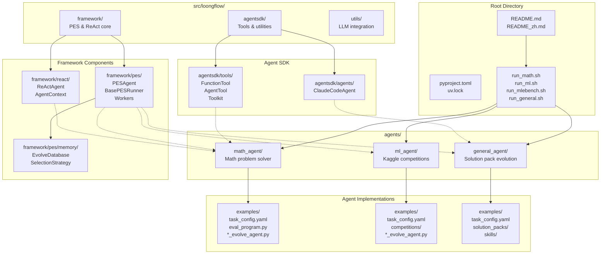
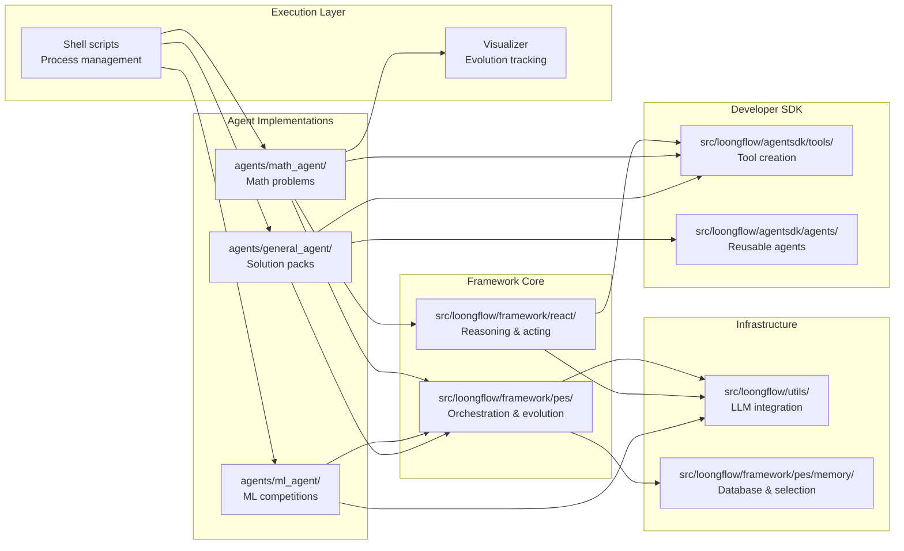

<!-- source: DeepWiki mcp.deepwiki.com · repo baidu-baige/LoongFlow · page 10 Reference · fetched 2026-10-26 -->

# Reference

<details>
<summary>Relevant source files</summary>

The following files were used as context for generating this wiki page:

- [pyproject.toml](pyproject.toml)
- [src/loongflow/agentsdk/models/formatter/litellm_formatter.py](src/loongflow/agentsdk/models/formatter/litellm_formatter.py)
- [uv.lock](uv.lock)

</details>


This section provides comprehensive technical reference documentation for the LoongFlow framework. It covers repository structure, configuration formats, shell script interfaces, and Python API specifications.

For getting started guides and tutorials, see [Getting Started](#2). For architecture and design explanations, see [Core Framework](#3). For domain-specific agent documentation, see [General Agent](#4), [Math Agent](#5), and [ML Agent](#6).

## Reference Documentation Overview

The reference documentation is organized into four main subsections:

| Section | Title | Purpose |
|---------|-------|---------|
| [10.1](#10.1) | Project Structure | Directory layout, file organization, and module hierarchy |
| [10.2](#10.2) | Configuration Reference | Complete specification for `task_config.yaml`, `llm_config`, and other configuration options |
| [10.3](#10.3) | Shell Script Reference | Command-line interface for `run_math.sh`, `run_ml.sh`, `run_mlebench.sh`, and `run_general.sh` |
| [10.4](#10.4) | API Reference | Python class and function signatures for `PESAgent`, `ReActAgent`, workers, and tools |

**Sources:** [README.md:1-495]()

## Repository Structure Overview

The LoongFlow repository is organized into framework core components, agent implementations, and supporting infrastructure:



**Sources:** [README.md:1-495]()

## Core Framework Code Entities

This diagram maps the major LoongFlow abstractions to their concrete implementations in the codebase:

```mermaid
graph TB
    subgraph "Entry Points"
        MathScript["run_math.sh"]
        MLScript["run_ml.sh<br/>run_mlebench.sh"]
        GenScript["run_general.sh"]
        MathEvolve["agents/math_agent/examples/*/math_evolve_agent.py"]
        MLEvolve["agents/ml_agent/examples/*/ml_evolve_agent.py"]
        GenEvolve["agents/general_agent/examples/*/general_evolve_agent.py"]
    end
    
    subgraph "PES Framework - src/loongflow/framework/pes/"
        BasePESRunner["base.py::BasePESRunner"]
        PESAgent["agent.py::PESAgent"]
        WorkerInterface["worker.py::Worker<br/>PlannerWorker<br/>ExecutorWorker<br/>SummaryWorker"]
    end
    
    subgraph "Memory System - src/loongflow/framework/pes/memory/"
        EvolveDB["evolve_database.py::EvolveDatabase"]
        SelectStrategy["selection_strategy.py::SelectionStrategy<br/>AdaptiveBoltzmann"]
        TreeMemory["tree_memory.py::GlobalTreeMemory"]
    end
    
    subgraph "ReAct Framework - src/loongflow/framework/react/"
        ReActAgent["agent.py::ReActAgent"]
        AgentContext["context.py::AgentContext<br/>Toolkit"]
        MessageTypes["types.py::Message<br/>ContentElement<br/>ToolCallElement"]
    end
    
    subgraph "LLM Integration - src/loongflow/utils/"
        LiteLLMFormatter["litellm_formatter.py::LiteLLMFormatter"]
    end
    
    subgraph "Agent SDK - src/loongflow/agentsdk/"
        FunctionTool["tools/function_tool.py::FunctionTool"]
        AgentTool["tools/agent_tool.py::AgentTool"]
        ClaudeCode["agents/claude_code_agent.py::ClaudeCodeAgent"]
        ToolBuilders["tools/tool_builders.py::build_*_tool"]
    end
    
    subgraph "Math Agent - agents/math_agent/"
        MathPlanner["math_planner.py::PlanAgent"]
        MathExecutor["math_executor.py::ExecuteAgent"]
        MathSummary["math_summary.py::SummaryAgent"]
        MathEval["examples/*/eval_program.py::evaluate"]
    end
    
    subgraph "ML Agent - agents/ml_agent/"
        MLPlanner["ml_planner.py::PlanAgent"]
        MLExecutor["ml_executor.py::ExecuteAgent"]
        MLSummary["ml_summary.py::SummaryAgent"]
    end
    
    subgraph "General Agent - agents/general_agent/"
        GenPlanner["general_planner.py::GeneralPlanAgent"]
        GenExecutor["general_executor.py::GeneralExecuteAgent"]
        GenSummary["general_summary.py::GeneralSummaryAgent"]
        GenUtils["utils.py::load_skills<br/>copy_solution_files<br/>ensure_manifest"]
    end
    
    MathScript --> MathEvolve
    MLScript --> MLEvolve
    GenScript --> GenEvolve
    
    MathEvolve --> BasePESRunner
    MLEvolve --> BasePESRunner
    GenEvolve --> BasePESRunner
    
    BasePESRunner --> PESAgent
    PESAgent --> WorkerInterface
    PESAgent --> EvolveDB
    PESAgent --> TreeMemory
    
    EvolveDB --> SelectStrategy
    
    WorkerInterface --> MathPlanner
    WorkerInterface --> MathExecutor
    WorkerInterface --> MathSummary
    
    WorkerInterface --> MLPlanner
    WorkerInterface --> MLExecutor
    WorkerInterface --> MLSummary
    
    WorkerInterface --> GenPlanner
    WorkerInterface --> GenExecutor
    WorkerInterface --> GenSummary
    
    MathExecutor --> ReActAgent
    MathExecutor --> ToolBuilders
    
    GenPlanner --> ClaudeCode
    GenExecutor --> ClaudeCode
    GenExecutor --> GenUtils
    
    ReActAgent --> AgentContext
    ReActAgent --> MessageTypes
    
    AgentContext --> FunctionTool
    AgentContext --> AgentTool
    
    ToolBuilders --> FunctionTool
    
    PESAgent --> LiteLLMFormatter
    ReActAgent --> LiteLLMFormatter
    ClaudeCode --> LiteLLMFormatter
    
    MathExecutor --> MathEval
```



**Sources:** [README.md:1-495]()

## Configuration Files Quick Reference

LoongFlow uses YAML configuration files to specify agent behavior, LLM settings, and task parameters:

| Configuration File | Location Pattern | Primary Purpose | Subsection |
|-------------------|------------------|-----------------|------------|
| `task_config.yaml` | `agents/*/examples/*/task_config.yaml` | Task-specific settings, LLM config, evolution parameters | [10.2](#10.2) |
| `llm_config` | Within `task_config.yaml` | LLM API endpoint, model selection, provider configuration | [10.2](#10.2) |
| `environment_gpu.yaml` | `agents/ml_agent/environment_gpu.yaml` | Conda environment specification for GPU systems | [10.3](#10.3) |
| `environment_cpu.yaml` | `agents/ml_agent/environment_cpu.yaml` | Conda environment specification for CPU-only systems | [10.3](#10.3) |
| `pyproject.toml` | Root directory | Python package metadata and dependencies | [10.1](#10.1) |

**Configuration Structure Example:**

```yaml
# task_config.yaml structure
llm_config:
  url: "https://api.openai.com/v1"
  api_key: "sk-..."
  model: "openai/gemini-3-pro-preview"
  
config:
  max_iterations: 100
  checkpoint_interval: 10
  num_islands: 5
  # ... additional parameters
```

**Sources:** [README.md:160-204]()

## Shell Script Command Reference

LoongFlow provides four shell scripts as the primary user interface:

| Script | Operations | Agent Type | Documentation |
|--------|-----------|------------|---------------|
| `run_math.sh` | `<task_name> [--background]`, `stop <task_name>` | Math Agent | [10.3](#10.3) |
| `run_ml.sh` | `init`, `run <task_name> [--background]`, `stop <task_name>` | ML Agent (general) | [10.3](#10.3) |
| `run_mlebench.sh` | `init`, `prepare <competition>`, `run <competition> [--background]`, `stop <competition>` | ML Agent (MLE-bench) | [10.3](#10.3) |
| `run_general.sh` | `<task_name> [--background]`, `stop <task_name>` | General Agent | [10.3](#10.3) |

**Common Operations:**

```bash
# Foreground execution (blocks terminal)
./run_math.sh packing_circle_in_unit_square

# Background execution (returns to prompt)
./run_ml.sh run ml_example --background

# Stop running task
./run_math.sh stop packing_circle_in_unit_square

# Monitor logs
tail -f ./agents/math_agent/examples/packing_circle_in_unit_square/run.log
```

**Sources:** [README.md:156-204]()

## Python API Entry Points

The primary Python APIs for working with LoongFlow programmatically:

| API | Module Path | Primary Classes/Functions | Usage |
|-----|-------------|---------------------------|-------|
| PES Framework | `loongflow.framework.pes` | `PESAgent`, `BasePESRunner`, `Worker` interfaces | Building evolutionary agents | 
| ReAct Framework | `loongflow.framework.react` | `ReActAgent`, `AgentContext`, `Toolkit` | Building reasoning agents |
| Memory System | `loongflow.framework.pes.memory` | `EvolveDatabase`, `SelectionStrategy` | Managing evolutionary memory |
| Tool System | `loongflow.agentsdk.tools` | `FunctionTool`, `AgentTool`, tool builders | Creating custom tools |
| ClaudeCodeAgent | `loongflow.agentsdk.agents` | `ClaudeCodeAgent` | Anthropic API integration |
| LLM Formatter | `loongflow.utils` | `LiteLLMFormatter` | LLM message formatting |

**Basic Usage Patterns:**

```python
# PESAgent initialization
from loongflow.framework.pes import PESAgent, BasePESRunner

agent = PESAgent(config=config, checkpoint_path=checkpoint_path)
agent.register_planner_worker("planner", PlanAgent)
agent.register_executor_worker("executor", ExecuteAgent)
agent.register_summary_worker("summary", SummaryAgent)
result = await agent()

# ReActAgent initialization
from loongflow.framework.react import ReActAgent, AgentContext
from loongflow.agentsdk.tools import Toolkit

toolkit = Toolkit()
toolkit.register_tool(custom_tool)
agent = ReActAgent.create_default(model=model, sys_prompt=prompt, toolkit=toolkit)
result = await agent(message)
```

**Sources:** [README.md:347-387]()

## File Organization by Concern

LoongFlow separates concerns across distinct modules:



**Sources:** [README.md:1-495]()

## Navigating the Reference Documentation

To efficiently use the reference documentation:

1. **For Repository Layout:** Start with [Project Structure](#10.1) to understand where files are located
2. **For Configuration:** See [Configuration Reference](#10.2) for complete YAML schema and options
3. **For Command-Line Usage:** Consult [Shell Script Reference](#10.3) for script operations and flags
4. **For Programmatic Usage:** Review [API Reference](#10.4) for Python class signatures and interfaces

Each subsection provides:
- Complete specifications and schemas
- File path citations for relevant source code
- Usage examples and patterns
- Cross-references to related documentation

**Key Files for Reference:**

| Purpose | File Path | Section |
|---------|-----------|---------|
| Package dependencies | `pyproject.toml` | [10.1](#10.1) |
| PES agent orchestration | `src/loongflow/framework/pes/agent.py` | [10.4](#10.4) |
| Configuration loading | `src/loongflow/framework/pes/base.py` | [10.2](#10.2) |
| Math agent runner | `agents/math_agent/examples/*/math_evolve_agent.py` | [10.3](#10.3) |
| Tool builders | `src/loongflow/agentsdk/tools/tool_builders.py` | [10.4](#10.4) |

**Sources:** [README.md:1-495]()

## Version and Compatibility Information

LoongFlow requires specific versions for optimal operation:

| Component | Requirement | Notes |
|-----------|-------------|-------|
| Python | 3.12+ | Required for modern async and type hints |
| Package Manager | uv or conda/mamba | uv recommended for faster installs |
| LLM API | OpenAI-compatible | Supports OpenAI, Google, Anthropic, DeepSeek, local vLLM/sglang |
| GPU | Optional | ML-Agent benefits from GPU acceleration |

**Installation Paths:**

```bash
# Using uv (recommended)
uv venv .venv --python 3.12
source .venv/bin/activate
uv pip install -e .

# Using conda
conda create -n loongflow python=3.12
conda activate loongflow
pip install -e .
```

**Sources:** [README.md:133-153]()

---

For detailed specifications of each reference subsection, proceed to:
- [Project Structure](#10.1)
- [Configuration Reference](#10.2)
- [Shell Script Reference](#10.3)
- [API Reference](#10.4)

---

