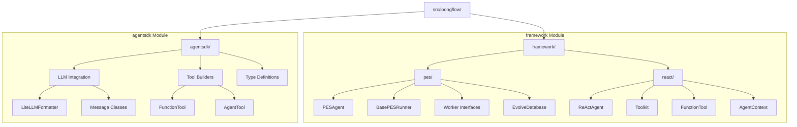
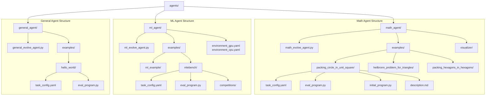
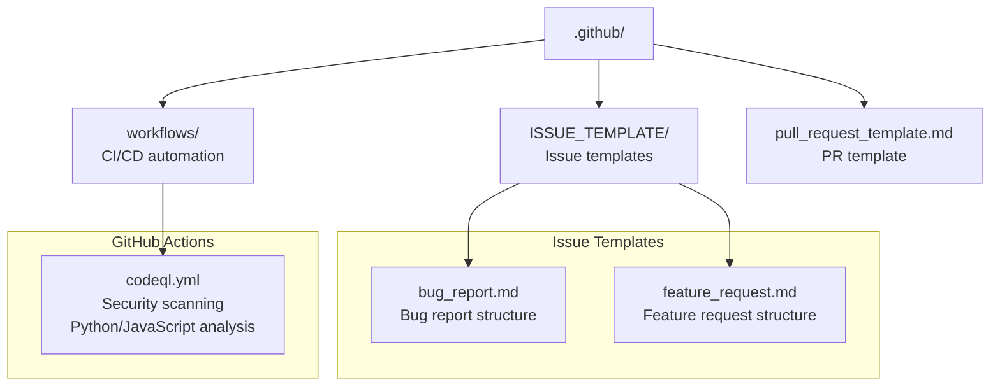
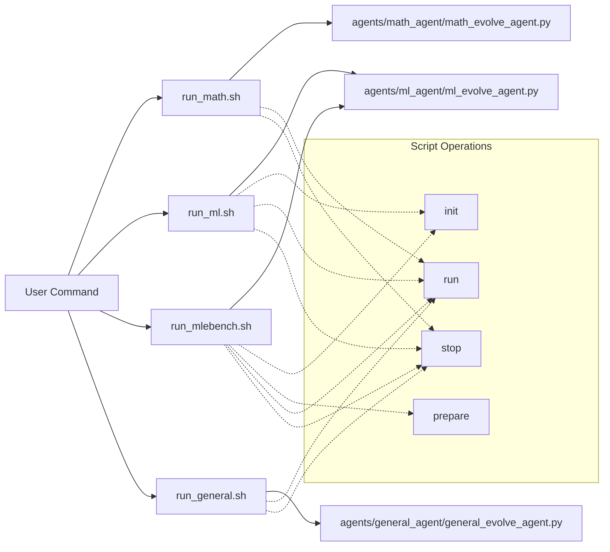
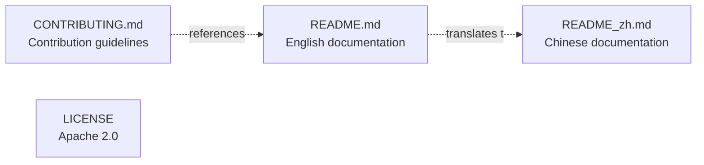
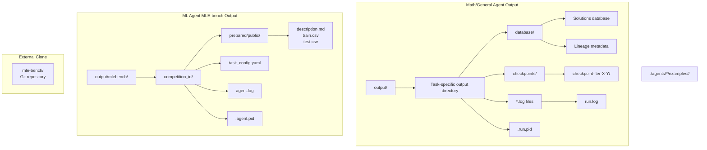
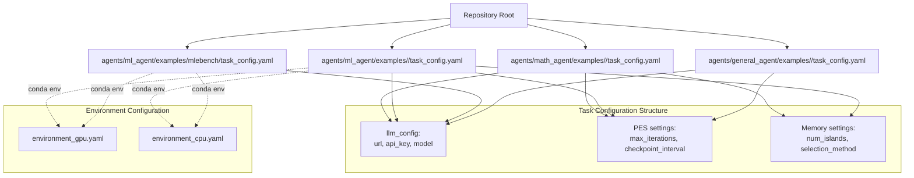

<!-- source: DeepWiki mcp.deepwiki.com · repo baidu-baige/LoongFlow · page 10.1 Project Structure · fetched 2026-10-26 -->

# Project Structure

<details>
<summary>Relevant source files</summary>

The following files were used as context for generating this wiki page:

- [pyproject.toml](pyproject.toml)
- [src/loongflow/agentsdk/models/formatter/litellm_formatter.py](src/loongflow/agentsdk/models/formatter/litellm_formatter.py)
- [uv.lock](uv.lock)

</details>


This document provides a comprehensive map of the LoongFlow repository layout, detailing the purpose of each directory and file. It serves as a reference for navigating the codebase and understanding the organizational principles behind the framework's architecture.

For information about contributing to the repository structure, see [Contribution Workflow](#5.1). For details about specific utilities and functions within the codebase, see [Utility Functions](#6.1).

---

## Repository Overview

The LoongFlow repository follows a modular architecture that separates core framework components, pre-built agents, documentation, and infrastructure concerns. The structure is designed to support extensibility while maintaining clear boundaries between reusable abstractions and domain-specific implementations.

### Root Directory Layout

```
LoongFlow/
├── .github/                  # GitHub infrastructure and automation
├── .gitignore               # Version control exclusions
├── LICENSE                  # Apache 2.0 license
├── README.md               # Primary documentation (English)
├── README_zh.md            # Primary documentation (Chinese)
├── CONTRIBUTING.md         # Contribution guidelines
├── src/                    # Core framework source code
│   └── loongflow/          # Main framework package
├── agents/                 # Pre-built agent implementations
│   ├── math_agent/         # Mathematical optimization agent
│   ├── ml_agent/           # Machine learning agent
│   └── general_agent/      # General-purpose agent
├── run_math.sh            # CLI runner for math tasks
├── run_ml.sh              # CLI runner for ML tasks
├── run_mlebench.sh        # CLI runner for MLE-bench competitions
├── run_general.sh         # CLI runner for general tasks
├── output/                # Runtime output directory (not in VCS)
└── mle-bench/             # MLE-bench repository clone (not in VCS)
```

**Sources:** [README.md:1-495](), [run_math.sh:1-191](), [run_ml.sh:1-421](), [run_mlebench.sh:1-463](), [run_general.sh:1-185]()

---

## Directory Structure Diagram

### Top-Level Organization

```mermaid
graph TB
    ROOT["LoongFlow Repository"]
    
    GITHUB[".github/"]
    SRC["src/loongflow/"]
    AGENTS["agents/"]
    DOCS["Documentation"]
    SCRIPTS["Shell Scripts"]
    OUTPUT["output/"]
    MLEBENCH["mle-bench/"]
    
    ROOT --> GITHUB
    ROOT --> SRC
    ROOT --> AGENTS
    ROOT --> DOCS
    ROOT --> SCRIPTS
    ROOT --> OUTPUT
    ROOT --> MLEBENCH
    
    subgraph "GitHub Infrastructure"
        GH_ISSUE["ISSUE_TEMPLATE/"]
        GH_WF["workflows/"]
    end
    
    GITHUB --> GH_ISSUE
    GITHUB --> GH_WF
    
    subgraph "Core Framework"
        FRAMEWORK["framework/"]
        AGENTSDK["agentsdk/"]
    end
    
    SRC --> FRAMEWORK
    SRC --> AGENTSDK
    
    FRAMEWORK --> PES["pes/"]
    FRAMEWORK --> REACT["react/"]
    
    subgraph "Pre-built Agents"
        MATH["math_agent/"]
        ML["ml_agent/"]
        GENERAL["general_agent/"]
    end
    
    AGENTS --> MATH
    AGENTS --> ML
    AGENTS --> GENERAL
    
    MATH --> MATH_EXAMPLES["examples/"]
    MATH --> MATH_VIZ["visualizer/"]
    ML --> ML_EXAMPLES["examples/"]
    GENERAL --> GENERAL_EXAMPLES["examples/"]
    
    subgraph "CLI Runner Scripts"
        RUN_MATH["run_math.sh"]
        RUN_ML["run_ml.sh"]
        RUN_MLB["run_mlebench.sh"]
        RUN_GEN["run_general.sh"]
    end
    
    SCRIPTS --> RUN_MATH
    SCRIPTS --> RUN_ML
    SCRIPTS --> RUN_MLB
    SCRIPTS --> RUN_GEN
    
    subgraph "Runtime Directories"
        OUT_DB["database/"]
        OUT_CKPT["checkpoints/"]
    end
    
    OUTPUT --> OUT_DB
    OUTPUT --> OUT_CKPT
```



**Sources:** [README.md:35-205](), [run_math.sh:20-33](), [run_ml.sh:18-21](), [run_mlebench.sh:18-23](), [run_general.sh:20-32]()

---

## Core Framework Structure (`src/loongflow/`)

The `src/loongflow/` directory contains the reusable framework components that provide the foundation for building expert-grade agents. It is organized into two main modules: `framework` (agent implementations) and `agentsdk` (shared development kit).

### Framework Module Hierarchy



### Core Framework Modules

| Module | Purpose | Key Components |
|--------|---------|----------------|
| `src/loongflow/framework/pes/` | PES paradigm implementation for evolutionary agents | `PESAgent`, `BasePESRunner`, `EvolveDatabase`, worker interfaces |
| `src/loongflow/framework/react/` | ReAct paradigm for tool-based reasoning | `ReActAgent`, `Toolkit`, `FunctionTool`, `AgentContext` |
| `src/loongflow/agentsdk/` | Shared infrastructure and utilities | LLM integration, tool builders, type definitions |

**Sources:** [README.md:347-387](), High-level system architecture diagrams (Diagram 1, 2, 5)

---

## Pre-built Agents Structure (`agents/`)

The `agents/` directory contains three domain-specific implementations of evolutionary agents. Each agent is a self-contained module with its own configuration, worker definitions, examples, and utilities.

### Agent Types and Organization



### Agent Module Overview

| Agent Type | Main Script | Purpose | Example Tasks |
|------------|-------------|---------|---------------|
| **Math Agent** | `math_agent/math_evolve_agent.py` | Mathematical optimization and algorithm design | Circle packing, Heilbronn triangles, hexagon packing |
| **ML Agent** | `ml_agent/ml_evolve_agent.py` | Machine learning model development and competition | MLE-bench competitions, Kaggle challenges |
| **General Agent** | `general_agent/general_evolve_agent.py` | General-purpose solution evolution | Algorithm design, coding tasks |

### Common Agent Directory Structure

Each agent follows a consistent directory structure:

| Directory/File | Purpose |
|----------------|---------|
| `*_evolve_agent.py` | Main entry point that instantiates `PESAgent` and registers workers |
| `examples/` | Task-specific example directories |
| `examples/<task_name>/task_config.yaml` | LLM configuration and evolution parameters for the task |
| `examples/<task_name>/eval_program.py` | Evaluator implementation for scoring solutions |
| `examples/<task_name>/description.md` | Human-readable task description |
| `examples/<task_name>/initial_program.py` | Starting solution (Math Agent only) |
| `visualizer/` | Web dashboard for monitoring evolution (Math Agent only) |

**Sources:** [README.md:157-204](), [run_math.sh:20-33](), [run_ml.sh:18-21](), [run_general.sh:20-32]()

---

## GitHub Infrastructure (`.github/`)

The `.github/` directory contains GitHub-specific configuration files for issue management, pull request templates, and automated workflows.

### GitHub Directory Structure



### GitHub Infrastructure Files

| File | Purpose |
|------|---------|
| `.github/ISSUE_TEMPLATE/bug_report.md` | Structured template for bug reports with system environment and reproduction steps |
| `.github/ISSUE_TEMPLATE/feature_request.md` | Structured template for feature requests with problem statements and alternatives |
| `.github/pull_request_template.md` | PR template with checklist for code quality, tests, and Code of Conduct compliance |
| `.github/workflows/codeql.yml` | CodeQL workflow for automated security scanning on push, PR, and scheduled runs |

**Sources:** Diagram 6 (GitHub Workflow and Contribution Pipeline)

---

## CLI Scripts

Shell scripts at the repository root provide command-line interfaces for running pre-built agents with task-specific configurations. Each script handles environment setup, process management, and lifecycle control.

### CLI Script Overview



### Script Functionality Table

| Script | Commands | Purpose | Target Directory |
|--------|----------|---------|------------------|
| `run_math.sh` | `run`, `stop` | Execute mathematical optimization tasks | `agents/math_agent/examples/<task_name>/` |
| `run_ml.sh` | `init`, `run`, `stop` | Execute ML tasks with conda environment management | `agents/ml_agent/examples/<task_name>/` |
| `run_mlebench.sh` | `init`, `prepare`, `run`, `stop` | Execute MLE-bench competitions with data preparation | `output/mlebench/<competition_id>/` |
| `run_general.sh` | `run`, `stop` | Execute general-purpose tasks | `agents/general_agent/examples/<task_name>/` |

### Script Operations Detail

| Operation | Description | Available In |
|-----------|-------------|--------------|
| `init` | Create conda environment, install dependencies | `run_ml.sh`, `run_mlebench.sh` |
| `prepare` | Download competition data using `mlebench prepare` | `run_mlebench.sh` |
| `run` | Execute agent in foreground or background mode | All scripts |
| `stop` | Terminate running agent and child processes | All scripts |

**Key Features:**
- **Environment Detection**: [run_ml.sh:124-132](), [run_mlebench.sh:124-134]() detect GPU availability and select appropriate environment
- **Process Management**: [run_math.sh:35-51](), [run_ml.sh:92-107]() recursively track and terminate child processes
- **Background Execution**: [run_math.sh:175-179](), [run_general.sh:170-181]() support `--background` flag with PID file tracking
- **Conda Integration**: [run_ml.sh:40-70](), [run_mlebench.sh:42-72]() initialize conda/mamba for environment activation

**Sources:** [run_math.sh:1-191](), [run_ml.sh:1-421](), [run_mlebench.sh:1-463](), [run_general.sh:1-185]()

---

## Documentation Files

Root-level documentation files provide essential information for users and contributors.

### Documentation File Mapping



### Documentation Files

| File | Purpose |
|------|---------|
| `README.md` | Primary documentation in English covering framework overview, installation, and quick start |
| `README_zh.md` | Chinese translation of primary documentation |
| `CONTRIBUTING.md` | Contribution guidelines including workflow, code quality standards, and review process |
| `LICENSE` | Apache 2.0 license terms defining usage rights and redistribution conditions |

**Sources:** Repository root structure

---

## Version Control Configuration (`.gitignore`)

The `.gitignore` file defines patterns for excluding files and directories from version control. It follows Python ecosystem conventions and includes LoongFlow-specific exclusions.

### Excluded Categories

| Category | Examples | Purpose |
|----------|----------|---------|
| **Python Build Artifacts** | `__pycache__/`, `*.pyc`, `*.egg-info/`, `build/`, `dist/` | Prevent build outputs from being committed |
| **Virtual Environments** | `.venv/`, `venv/`, `ENV/`, `.pixi/` | Exclude environment directories |
| **IDE Configurations** | `.vscode/`, `.idea/`, `.DS_Store` | Exclude editor-specific settings |
| **Test Coverage** | `.coverage`, `.pytest_cache/`, `htmlcov/` | Exclude test result artifacts |
| **Environment Variables** | `.env`, `.envrc` | Exclude sensitive configuration |
| **Agent Outputs** | `output/`, `logs/` | Exclude runtime-generated data |
| **Package Caches** | `.ruff_cache/`, `.mypy_cache/` | Exclude linter and type checker caches |

**Key LoongFlow-Specific Exclusions:**
- **[.gitignore:210]()**: `output/` - Excludes agent execution outputs including solutions, evaluations, and checkpoints
- **[.gitignore:211]()**: `logs/` - Excludes runtime logs and debugging information
- **[.gitignore:209-213]()**: IDE configurations (VSCode, IntelliJ IDEA) and macOS system files

**Sources:** [.gitignore:1-213]()

---

## Data Flow and Output Structure

While not tracked in version control, the `output/` directory structure is critical for understanding agent execution. It is generated at runtime and organized by execution session.

### Runtime Output Organization



### Output Directory Structure by Agent Type

| Agent Type | Output Location | Key Contents |
|------------|----------------|--------------|
| **Math Agent** | `./output/` or configurable via `--output-dir` | `database/`, `checkpoints/`, `run.log`, `.run.pid` |
| **ML Agent (Standard)** | `agents/ml_agent/examples/<task_name>/` | Task-specific outputs, `agent.log`, `.agent.pid` |
| **ML Agent (MLE-bench)** | `output/mlebench/<competition_id>/` | `prepared/public/`, `task_config.yaml`, `agent.log`, `.agent.pid` |
| **General Agent** | `agents/general_agent/examples/<task_name>/` | Task-specific outputs, `run.log`, `.run.pid` |

### Output Components

| Component | Purpose | Format |
|-----------|---------|--------|
| `database/` | Stores evolved solutions, lineage tree, and metadata | Directory with serialized data |
| `checkpoints/` | Periodic agent state snapshots for resumption | `checkpoint-iter-X-Y/` subdirectories |
| `*.log` | Execution logs for debugging and monitoring | Text log files (`run.log`, `agent.log`) |
| `.*.pid` | Process ID files for background task management | Single-line text file with PID |
| `prepared/public/` | MLE-bench competition data after preparation | CSV files, description, sample submission |

**Sources:** [run_math.sh:20-33](), [run_ml.sh:213-218](), [run_mlebench.sh:242-253](), [run_general.sh:20-32](), [README.md:395-409]()

---

## Package Initialization Structure

Python packages in LoongFlow use `__init__.py` files for module initialization. Most are currently empty, following a minimal initialization pattern that defers imports to explicit usage.

### Initialization File Locations


All initialization files are currently empty, following the pattern shown in [agents/general_evolve/__init__.py:1]() and [agents/general_evolve/evolve_executor/__init__.py:1](). This design allows for explicit imports and avoids circular dependencies.

**Sources:** [agents/general_evolve/__init__.py:1](), [agents/general_evolve/evolve_executor/__init__.py:1]()

---

## Module Import Patterns

The LoongFlow codebase follows explicit import patterns where consumers import specific classes or functions directly from their defining modules.

### Example Import Patterns

**Framework Components:**
```python
from loongflow.framework.pes import PESAgent, BasePESRunner
from loongflow.framework.react import ReActAgent, AgentContext
from loongflow.agentsdk.tools import Toolkit, FunctionTool, AgentTool
```

**Pre-built Agent Usage:**
```python
# Typical agent instantiation pattern from shell scripts
# run_math.sh executes:
python agents/math_agent/math_evolve_agent.py \
    --config task_config.yaml \
    --eval-file eval_program.py \
    --initial-file initial_program.py

# run_ml.sh executes:
python agents/ml_agent/ml_evolve_agent.py \
    --config task_config.yaml \
    --task-data-path public/ \
    --task-file description.md \
    --eval-file eval_program.py
```

**Environment Setup:**
```bash
# PYTHONPATH configuration from run_general.sh
export PYTHONPATH=$PYTHONPATH:./src

# Conda environment activation from run_ml.sh
mamba activate loongflow_ml
export LD_LIBRARY_PATH="${CONDA_PREFIX}/lib:$LD_LIBRARY_PATH"
```

**Sources:** [README.md:349-387](), [run_math.sh:158-173](), [run_ml.sh:245-263](), [run_general.sh:168]()

---

## Configuration File Locations

Configuration files are distributed throughout the repository based on their scope and purpose. Each agent type uses task-specific configuration in YAML format.

### Configuration File Mapping



### Configuration Files by Purpose

| File Type | Location Example | Purpose | Format |
|-----------|------------------|---------|--------|
| `task_config.yaml` | `agents/math_agent/examples/packing_circle_in_unit_square/` | LLM settings, evolution parameters, worker definitions | YAML |
| `environment_gpu.yaml` | `agents/ml_agent/examples/` | Conda environment with GPU dependencies | YAML |
| `environment_cpu.yaml` | `agents/ml_agent/examples/` | Conda environment with CPU-only dependencies | YAML |
| `requirements_*.txt` | `agents/ml_agent/examples/` | Python package dependencies | Plain text |
| `.gitignore` | Repository root | Version control exclusions | Plain text |

### Task Configuration Structure

Common fields in `task_config.yaml`:

```yaml
llm_config:
  url: "https://api.example.com/v1"
  api_key: "your-api-key"
  model: "openai/gemini-3-pro-preview"

max_iterations: 100
checkpoint_interval: 10
num_islands: 5
selection_method: "adaptive_boltzmann"
```

**Sources:** [README.md:160-167](), [README.md:183-189](), [run_ml.sh:123-132](), [run_mlebench.sh:123-134]()

---

## Summary: Architectural Principles

The LoongFlow project structure embodies the following organizational principles:

1. **Separation of Concerns**: Core framework (`src/`) is independent of pre-built agents (`agents/`)
2. **Domain-Specific Organization**: Each agent type has its own self-contained module with configuration, workers, and utilities
3. **Explicit Dependencies**: Empty `__init__.py` files enforce explicit imports, improving code clarity
4. **Security-First Exclusions**: `.gitignore` prevents sensitive data and runtime outputs from entering version control
5. **Modular Subsystems**: Planner, executor, and prompt subsystems are separately organized for maintainability
6. **Infrastructure as Code**: GitHub templates and workflows are version-controlled alongside source code

This structure supports the framework's extensibility goals while maintaining clear boundaries between reusable abstractions and domain-specific implementations.

**Sources:** All architectural diagrams and repository structure analysis

---

