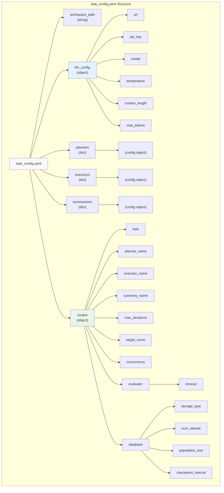
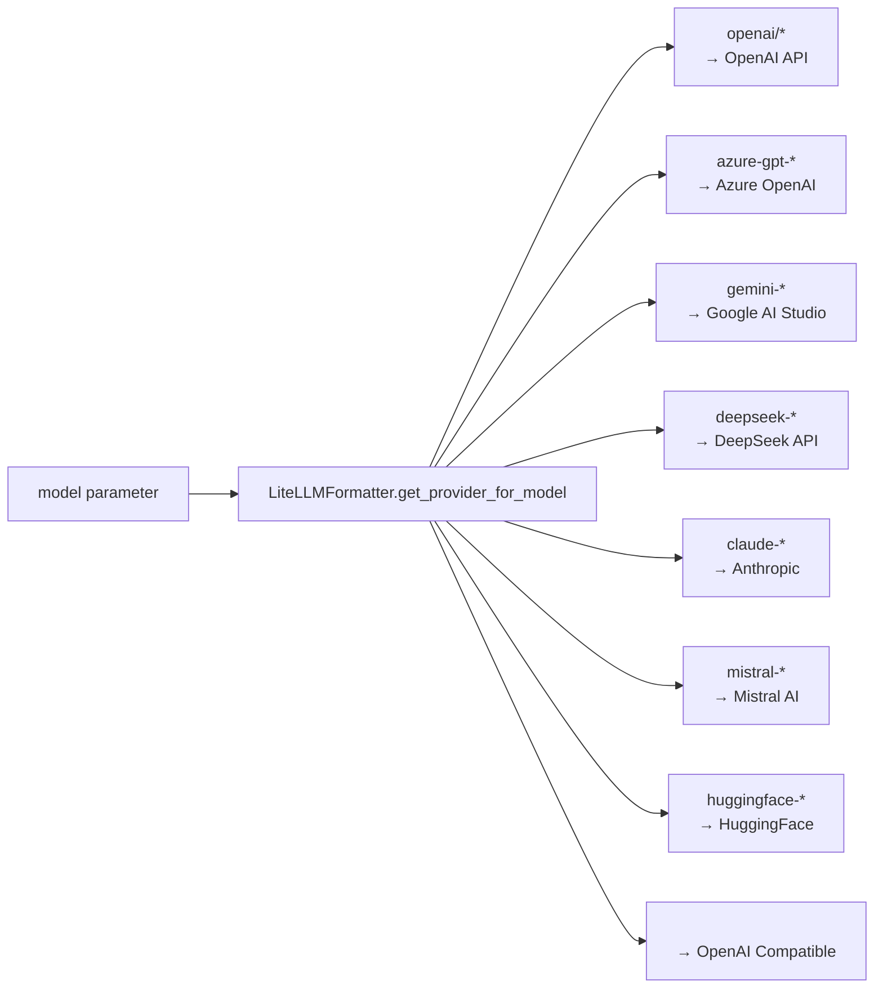
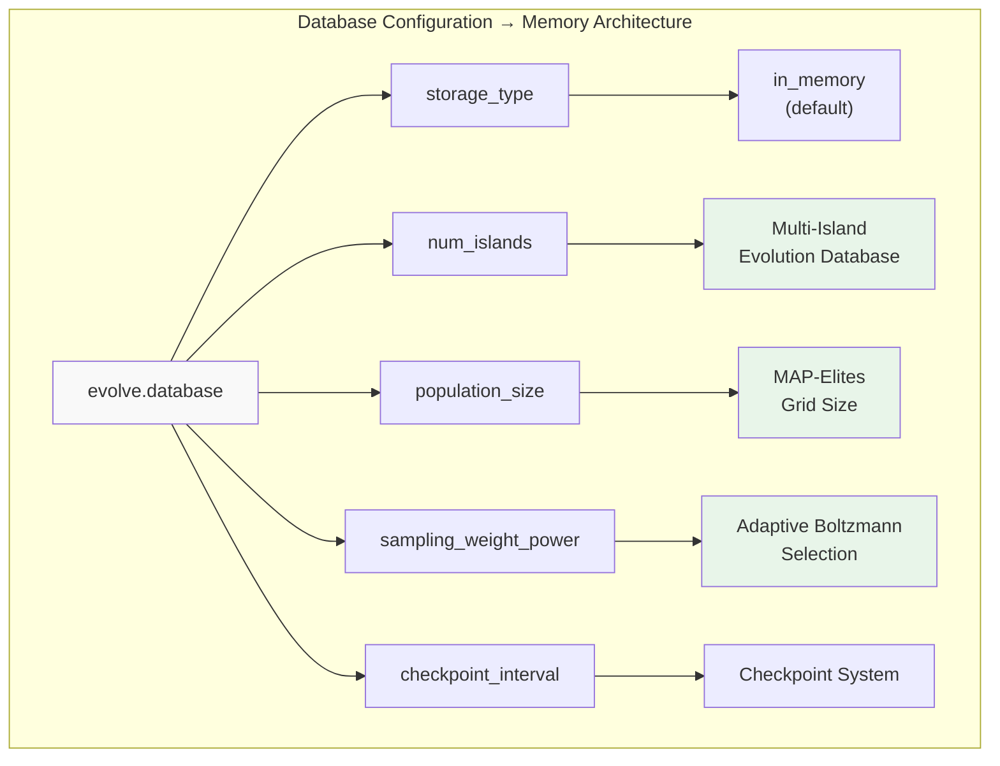
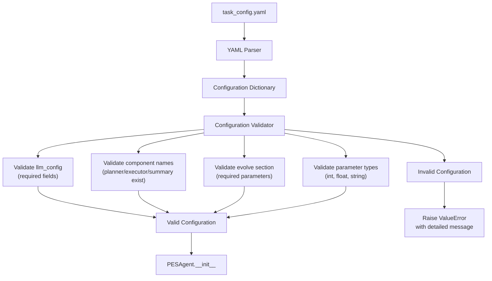

<!-- source: DeepWiki mcp.deepwiki.com · repo baidu-baige/LoongFlow · page 10.2 Configuration Reference · fetched 2026-10-26 -->

# Configuration Reference

<details>
<summary>Relevant source files</summary>

The following files were used as context for generating this wiki page:

- [agents/general_agent/examples/03_bug_hunter/task_config.yaml](agents/general_agent/examples/03_bug_hunter/task_config.yaml)
- [agents/general_agent/examples/04_circle_packing/task_config.yaml](agents/general_agent/examples/04_circle_packing/task_config.yaml)

</details>


This document provides a complete technical reference for all configuration parameters used in LoongFlow tasks. Configuration is primarily defined through YAML files named `task_config.yaml` located in task directories.

For information about setting up and running tasks, see [Quick Start - Math Agent](#2.2) and [Quick Start - ML Agent](#2.3). For shell script usage patterns, see [Shell Script Reference](#9.3).

---

## Configuration File Structure

All LoongFlow tasks are configured through a YAML file that defines the workspace, LLM integration, component behaviors, and evolutionary parameters. The configuration is hierarchical and type-validated at runtime.



**Sources:** [README.md:160-167](), [docs/en/agents/general_evolve.md:29-77](), [docs/en/agents/ml_evolve.md:45-92]()

---

## Global Configuration Parameters

### `workspace_path`

Defines the root output directory for all task artifacts, checkpoints, and logs.

| Parameter | Type | Default | Description |
|-----------|------|---------|-------------|
| `workspace_path` | `string` | `"./output"` | Root directory for all task outputs. Subdirectories created: `database/`, `<iteration_number>/`, `evaluator/` |

**Example:**
```yaml
workspace_path: "./output"
```

**Output Structure:**
```
{workspace_path}/
├── database/checkpoints/        # Evolutionary checkpoints
├── {iteration_number}/          # Per-iteration outputs
│   ├── planner/
│   ├── executor/
│   └── summarizer/
└── evaluator/                   # Evaluation artifacts
```

**Sources:** [docs/en/agents/general_evolve.md:31](), [docs/en/agents/ml_evolve.md:47]()

---

## LLM Configuration (`llm_config`)

The `llm_config` section defines how agents communicate with Large Language Model providers. LoongFlow uses the LiteLLM library for multi-provider support.

### LLM Parameters Reference

| Parameter | Type | Required | Default | Description |
|-----------|------|----------|---------|-------------|
| `url` | `string` | Yes | - | API endpoint URL. Must be OpenAI-compatible format ending in `/v1` |
| `api_key` | `string` | Yes | - | Authentication key for the LLM provider |
| `model` | `string` | Yes | - | Model identifier with optional provider prefix (e.g., `openai/gpt-4`, `gemini-3-pro-preview`) |
| `temperature` | `float` | No | `0.8` | Sampling temperature (0.0-2.0). Higher values increase randomness |
| `context_length` | `integer` | No | `128000` | Maximum context window size in tokens |
| `max_tokens` | `integer` | No | `32768` | Maximum tokens to generate in a single response |
| `top_p` | `float` | No | `1.0` | Nucleus sampling parameter (0.0-1.0) |

### Model Naming Convention

The `model` parameter follows LiteLLM's provider prefix convention:



**Examples:**

```yaml
# OpenAI GPT-4
llm_config:
  url: "https://api.openai.com/v1"
  api_key: "sk-..."
  model: "gpt-4"
  temperature: 0.7

# Google Gemini with explicit provider
llm_config:
  url: "https://generativelanguage.googleapis.com/v1"
  api_key: "AIza..."
  model: "openai/gemini-3-pro-preview"
  temperature: 0.8
  context_length: 128000

# DeepSeek
llm_config:
  url: "https://api.deepseek.com/v1"
  api_key: "sk-..."
  model: "deepseek-r1-250528"
  temperature: 0.8
```

**Sources:** [README.md:163-167](), [README.md:183-189](), [docs/en/agents/general_evolve.md:34-40](), [docs/en/agents/ml_evolve.md:49-57]()

---

## Component Configurations

LoongFlow uses three types of components in the PES paradigm: Planners, Executors, and Summarizers. Each component type has its own configuration section with named instances.

### Configuration Structure

Components are configured as dictionaries where keys are component names and values are configuration objects:

```yaml
planners:
  <planner_name>:
    <planner_config>

executors:
  <executor_name>:
    <executor_config>

summarizers:
  <summary_name>:
    <summary_config>
```

### Planner Configuration

Planners are responsible for the Plan phase of the PES cycle.

#### Math Agent Planner (`evolve_planner`)

| Parameter | Type | Default | Description |
|-----------|------|---------|-------------|
| `react_max_steps` | `integer` | `10` | Maximum ReAct reasoning steps for planning |

**Example:**
```yaml
planners:
  evolve_planner:
    react_max_steps: 10
```

#### ML Agent Planner (`ml_planner`)

| Parameter | Type | Default | Description |
|-----------|------|---------|-------------|
| `react_max_steps` | `integer` | `10` | Maximum ReAct reasoning steps |
| `evo_coder_timeout` | `integer` | `3600` | Timeout in seconds for code generation |

**Example:**
```yaml
planners:
  ml_planner:
    react_max_steps: 10
    evo_coder_timeout: 3600
```

**Sources:** [docs/en/agents/general_evolve.md:43-45](), [docs/en/agents/ml_evolve.md:61-64]()

---

### Executor Configuration

Executors implement the Execute phase, running experiments and generating solutions.

#### Math Agent Executor (`evolve_executor_fuse`)

| Parameter | Type | Default | Description |
|-----------|------|---------|-------------|
| `max_rounds` | `integer` | `3` | Maximum execution rounds per iteration |
| `react_max_steps` | `integer` | `15` | Maximum ReAct reasoning steps |
| `score_threshold` | `float` | `0.95` | Early stopping threshold (0.0-1.0) |

**Example:**
```yaml
executors:
  evolve_executor_fuse:
    max_rounds: 3
    react_max_steps: 15
    score_threshold: 0.95
```

#### ML Agent Executor (`ml_executor`)

| Parameter | Type | Default | Description |
|-----------|------|---------|-------------|
| `react_max_steps` | `integer` | `10` | Maximum ReAct reasoning steps |
| `evo_coder_timeout` | `integer` | `86400` | Timeout in seconds for ML code generation (24 hours) |

**Example:**
```yaml
executors:
  ml_executor:
    react_max_steps: 10
    evo_coder_timeout: 86400
```

**Sources:** [docs/en/agents/general_evolve.md:47-51](), [docs/en/agents/ml_evolve.md:66-69]()

---

### Summarizer Configuration

Summarizers implement the Summary phase, reflecting on results and extracting insights.

#### Math/ML Agent Summarizer (`evolve_summary` / `ml_summary`)

| Parameter | Type | Default | Description |
|-----------|------|---------|-------------|
| `react_max_steps` | `integer` | `6` (Math) / `10` (ML) | Maximum ReAct reasoning steps for summarization |

**Example:**
```yaml
summarizers:
  evolve_summary:
    react_max_steps: 6
```

**Sources:** [docs/en/agents/general_evolve.md:53-55](), [docs/en/agents/ml_evolve.md:71-73]()

---

## Evolution Configuration (`evolve`)

The `evolve` section orchestrates the entire PES evolutionary process.

### Core Evolution Parameters

| Parameter | Type | Required | Default | Description |
|-----------|------|----------|---------|-------------|
| `task` | `string` | No* | - | Task description. Can be in config or separate file |
| `planner_name` | `string` | Yes | - | Name of planner component to use (must match key in `planners`) |
| `executor_name` | `string` | Yes | - | Name of executor component to use (must match key in `executors`) |
| `summary_name` | `string` | Yes | - | Name of summarizer component to use (must match key in `summarizers`) |
| `max_iterations` | `integer` | Yes | - | Maximum evolutionary iterations before stopping |
| `target_score` | `float` | Yes | - | Target score for early stopping (0.0-1.0) |
| `concurrency` | `integer` | No | `3` | Number of parallel solution evaluations |

\* `task` can be defined inline or loaded from a separate description file.

**Example:**
```yaml
evolve:
  task: "Optimize circle packing in a unit square"
  planner_name: "evolve_planner"
  executor_name: "evolve_executor_fuse"
  summary_name: "evolve_summary"
  max_iterations: 200
  target_score: 1.0
  concurrency: 3
```

**Sources:** [docs/en/agents/general_evolve.md:58-66](), [docs/en/agents/ml_evolve.md:75-82]()

---

### Evaluator Configuration (`evolve.evaluator`)

Defines parameters for solution evaluation.

| Parameter | Type | Default | Description |
|-----------|------|---------|-------------|
| `timeout` | `integer` | `1200` | Maximum execution time in seconds for evaluation |

**Example:**
```yaml
evolve:
  evaluator:
    timeout: 1200
```

**Sources:** [docs/en/agents/general_evolve.md:68-69](), [docs/en/agents/ml_evolve.md:84-85]()

---

### Database Configuration (`evolve.database`)

Controls the evolutionary memory system, including Multi-Island architecture and MAP-Elites.



#### Database Parameters

| Parameter | Type | Default | Description |
|-----------|------|---------|-------------|
| `storage_type` | `string` | `"in_memory"` | Storage backend. Currently only `"in_memory"` supported |
| `num_islands` | `integer` | `3` | Number of evolutionary islands for diversity preservation |
| `population_size` | `integer` | `90` (Math) / `30` (ML) | Total population across all islands |
| `checkpoint_interval` | `integer` | `1` | Save checkpoint every N iterations |
| `sampling_weight_power` | `float` | `1.0` | Exponent for Boltzmann selection weighting |

**Example:**
```yaml
evolve:
  database:
    storage_type: "in_memory"
    num_islands: 3
    population_size: 90
    checkpoint_interval: 1
    sampling_weight_power: 1.0
```

#### Island and Population Sizing

The relationship between `num_islands` and `population_size`:

- Total population is divided among islands
- Per-island population = `population_size / num_islands`
- Recommended minimum per-island: 10 solutions
- Math Agent default: 3 islands × 30 solutions/island = 90 total
- ML Agent default: 3 islands × 10 solutions/island = 30 total

**Sources:** [docs/en/agents/general_evolve.md:71-76](), [docs/en/agents/ml_evolve.md:87-92]()

---

## Complete Configuration Examples

### Math Agent Configuration

```yaml
workspace_path: "./output"

llm_config:
  url: "https://api.openai.com/v1"
  api_key: "sk-..."
  model: "openai/gemini-3-pro-preview"
  temperature: 0.8
  context_length: 128000
  max_tokens: 32768

planners:
  evolve_planner:
    react_max_steps: 10

executors:
  evolve_executor_fuse:
    max_rounds: 3
    react_max_steps: 15
    score_threshold: 0.95

summarizers:
  evolve_summary:
    react_max_steps: 6

evolve:
  task: "Pack circles in a unit square to maximize density"
  planner_name: "evolve_planner"
  executor_name: "evolve_executor_fuse"
  summary_name: "evolve_summary"
  max_iterations: 200
  target_score: 1.0
  concurrency: 3
  
  evaluator:
    timeout: 1200
    
  database:
    storage_type: "in_memory"
    num_islands: 3
    population_size: 90
    checkpoint_interval: 1
```

**Sources:** [docs/en/agents/general_evolve.md:29-77]()

---

### ML Agent Configuration

```yaml
workspace_path: "./output"

llm_config:
  url: "https://api.openai.com/v1"
  api_key: "sk-..."
  model: "openai/gemini-3-flash-preview"
  temperature: 0.8
  context_length: 128000
  max_tokens: 32768
  top_p: 1.0

planners:
  ml_planner:
    react_max_steps: 10
    evo_coder_timeout: 3600

executors:
  ml_executor:
    react_max_steps: 10
    evo_coder_timeout: 86400

summarizers:
  ml_summary:
    react_max_steps: 10

evolve:
  planner_name: "ml_planner"
  executor_name: "ml_executor"
  summary_name: "ml_summary"
  max_iterations: 100
  target_score: 1.0
  concurrency: 1
  
  evaluator:
    timeout: 1800
    
  database:
    storage_type: "in_memory"
    num_islands: 3
    population_size: 30
    checkpoint_interval: 5
    sampling_weight_power: 1.0
```

**Sources:** [docs/en/agents/ml_evolve.md:45-92]()

---

## Configuration Loading and Validation

The configuration is loaded and validated by the agent initialization system:



**Key Validation Rules:**

1. **Required Sections**: `llm_config` and `evolve` must be present
2. **Component References**: Component names in `evolve` must match keys in `planners`, `executors`, `summarizers`
3. **Type Validation**: Numeric parameters must be valid integers/floats
4. **Range Validation**: `temperature` (0.0-2.0), `target_score` (0.0-1.0), `concurrency` (≥1)
5. **LLM Validation**: `url`, `api_key`, and `model` are required in `llm_config`

**Sources:** [README.md:160-167](), [docs/en/agents/general_evolve.md:29-77]()

---

## Configuration Hierarchy

Configuration parameters can be overridden at multiple levels:

| Level | Priority | Usage |
|-------|----------|-------|
| Command-line arguments | Highest | `--max-iterations 500` overrides YAML |
| `task_config.yaml` | Medium | Standard configuration file |
| Component defaults | Lowest | Hardcoded in component classes |

**Example Override:**
```bash
# YAML specifies max_iterations: 200
python agents/math_agent/general_evolve_agent.py \
  --config task_config.yaml \
  --max-iterations 500  # This takes precedence
```

**Sources:** [docs/en/agents/general_evolve.md:154-160]()

---

## Environment Variables

Some configuration can be provided via environment variables:

| Environment Variable | Configuration Equivalent | Description |
|---------------------|-------------------------|-------------|
| `OPENAI_API_KEY` | `llm_config.api_key` | Default API key if not in config |
| `OPENAI_API_BASE` | `llm_config.url` | Default API endpoint |
| `PYTHONPATH` | - | Must include project root for module imports |

**Sources:** [docs/en/agents/general_evolve.md:251-255]()

---

## Configuration Best Practices

### Task Complexity Guidelines

| Task Complexity | `max_iterations` | `population_size` | `num_islands` | `concurrency` |
|----------------|------------------|-------------------|---------------|---------------|
| Simple (proof-of-concept) | 50-100 | 30 | 2-3 | 1-2 |
| Medium (research problems) | 100-200 | 60-90 | 3 | 2-3 |
| Complex (SOTA challenges) | 200-500 | 90-120 | 3-5 | 3-5 |
| ML competitions | 50-100 | 30-60 | 3 | 1-2 |

### LLM Selection Guidelines

| Model Type | Recommended Use | Temperature | Context Length |
|-----------|-----------------|-------------|----------------|
| GPT-4 / GPT-4o | Complex reasoning, code generation | 0.7-0.8 | 128K |
| Gemini 3 Pro | Cost-effective, good balance | 0.8 | 128K-1M |
| DeepSeek R1 | Deep reasoning, math problems | 0.8 | 128K |
| Claude 3.5 Sonnet | Code quality, safety | 0.7 | 200K |

### Timeout Configuration

| Component | Recommended Timeout | Rationale |
|-----------|---------------------|-----------|
| `evaluator.timeout` | 1200-3600s | Allow complex evaluations |
| `evo_coder_timeout` (planning) | 3600s | Planning is typically fast |
| `evo_coder_timeout` (execution) | 86400s | ML training can be slow |

**Sources:** [docs/en/agents/general_evolve.md:272-287](), [docs/en/agents/ml_evolve.md:354-364]()

---

