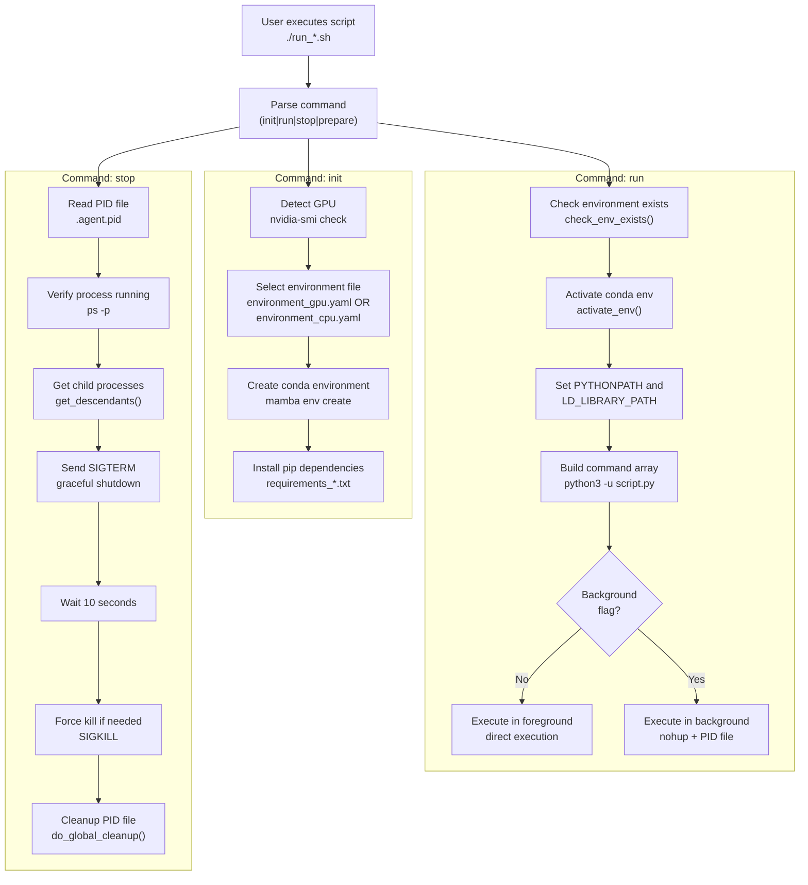
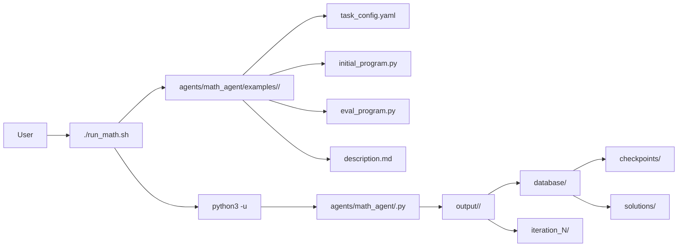
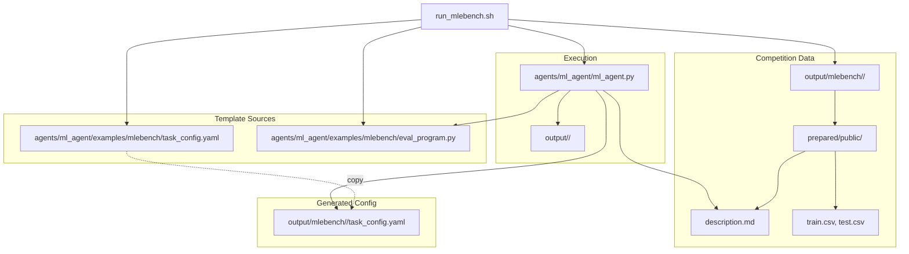
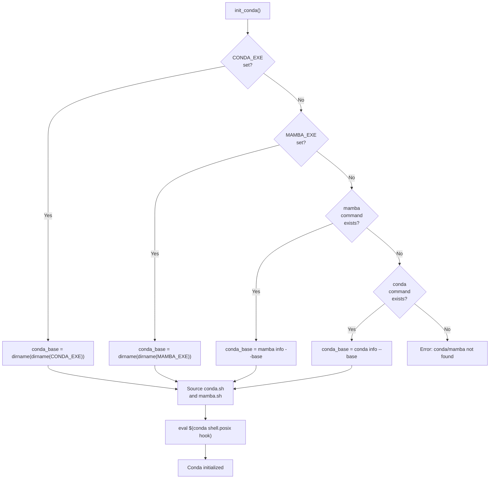
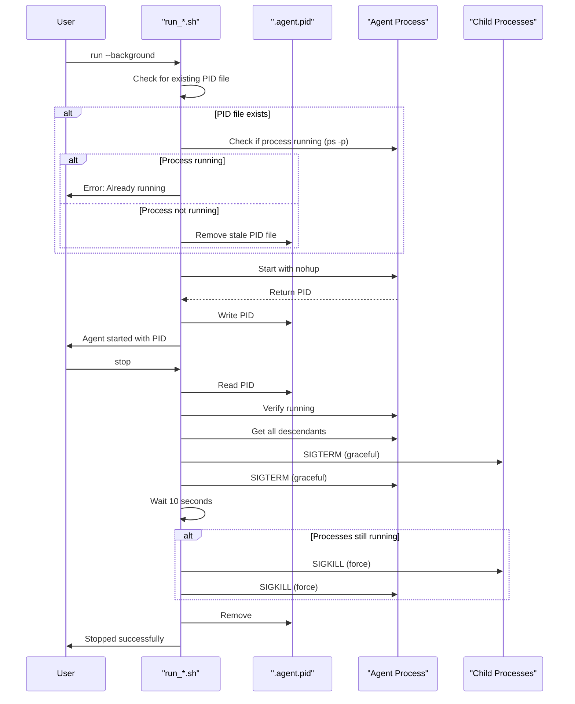

<!-- source: DeepWiki mcp.deepwiki.com · repo baidu-baige/LoongFlow · page 10.3 Shell Script Reference · fetched 2026-10-26 -->

# Shell Script Reference

<details>
<summary>Relevant source files</summary>

The following files were used as context for generating this wiki page:

- [run_general.sh](run_general.sh)
- [run_math.sh](run_math.sh)
- [run_ml.sh](run_ml.sh)
- [run_mlebench.sh](run_mlebench.sh)

</details>


This document provides complete reference documentation for the three shell scripts used to execute LoongFlow agents: `run_math.sh`, `run_ml.sh`, and `run_mlebench.sh`. These scripts manage environment setup, task execution, and process lifecycle for Math Agent, ML Agent, and MLE-Bench integration respectively.

For configuration file parameters, see [Configuration Reference](#9.2). For agent-specific execution guides, see [Running Math Tasks](#4.4), [Running ML Tasks](#5.3), and [MLE-Bench Integration](#5.4).

---

## Overview

All three scripts follow a consistent command structure and share common patterns for environment management, process control, and logging. They are designed to:

- Initialize conda/mamba environments with GPU or CPU support
- Execute agents in foreground or background mode
- Manage process lifecycle with PID files
- Handle graceful shutdown of parent and child processes
- Set up Python paths and library dependencies

| Script | Primary Use Case | Target Directory | Environment |
|--------|-----------------|------------------|-------------|
| `run_math.sh` | Math optimization tasks | `agents/math_agent/examples/` | Default Python env |
| `run_ml.sh` | Custom ML tasks | `agents/ml_agent/examples/` | `loongflow_ml` |
| `run_mlebench.sh` | Kaggle competition tasks | `output/mlebench/` | `loongflow_ml` |

**Sources:** [README.md:128-206](), [run_ml.sh:1-421](), [run_mlebench.sh:1-463]()

---

## Common Architecture

### Shell Script Execution Flow



**Sources:** [run_ml.sh:117-421](), [run_mlebench.sh:120-463]()

### Shared Functions

All scripts implement these common functions:

| Function | Purpose | Implementation |
|----------|---------|----------------|
| `info()` | Print informational message in blue | [run_ml.sh:23-25]() |
| `success()` | Print success message in green | [run_ml.sh:27-29]() |
| `warning()` | Print warning message in yellow | [run_ml.sh:31-33]() |
| `error()` | Print error and exit with code 1 | [run_ml.sh:35-38]() |
| `init_conda()` | Initialize conda/mamba shell integration | [run_ml.sh:41-70]() |
| `activate_env()` | Activate conda environment and set `LD_LIBRARY_PATH` | [run_ml.sh:73-90]() |
| `get_descendants()` | Recursively find all child processes | [run_ml.sh:93-107]() |
| `check_env_exists()` | Verify conda environment exists | [run_ml.sh:110-114]() |
| `do_global_cleanup()` | Kill any remaining agent processes | [run_ml.sh:368-375]() |

**Sources:** [run_ml.sh:22-114](), [run_mlebench.sh:24-116]()

---

## run_math.sh

### Overview

Executes mathematical optimization tasks from `agents/math_agent/examples/`. This script does not create a separate conda environment; it uses the currently active Python environment.

### Commands

```bash
./run_math.sh <task_name> [--background]
./run_math.sh stop <task_name>
```

### Directory Structure

```
agents/math_agent/examples/<task_name>/
├── task_config.yaml           # LLM and evolution config
├── initial_program.py         # Starting solution
├── eval_program.py            # Evaluation function
├── description.md             # Task description
├── requirements.txt           # Task-specific dependencies
├── run.log                    # Execution log (--background)
└── .agent.pid                 # Process ID (--background)
```

### Execution Pattern



### Usage Examples

From [README.md:158-178]():

```bash
# Install task dependencies
uv pip install -r ./agents/math_agent/examples/packing_circle_in_unit_square/requirements.txt

# Run in background
./run_math.sh packing_circle_in_unit_square --background

# Monitor logs
tail -f ./agents/math_agent/examples/packing_circle_in_unit_square/run.log

# Stop task
./run_math.sh stop packing_circle_in_unit_square
```

**Sources:** [README.md:158-178]()

---

## run_ml.sh

### Overview

Manages custom machine learning task execution. Creates and uses the `loongflow_ml` conda environment with GPU or CPU support.

### Commands

```bash
./run_ml.sh init
./run_ml.sh run <task_name> [--background] [python_args...]
./run_ml.sh stop <task_name>
```

### Command Details

#### init

Initializes the ML environment by:
1. Detecting GPU availability via `nvidia-smi`
2. Selecting appropriate environment file:
   - GPU: `agents/ml_agent/examples/environment_gpu.yaml`
   - CPU: `agents/ml_agent/examples/environment_cpu.yaml`
3. Creating `loongflow_ml` conda environment
4. Installing dependencies from `requirements_gpu.txt` or `requirements_cpu.txt`

**Implementation:** [run_ml.sh:118-170]()

#### run

Executes ML Agent for a specified task:

**Arguments:**
- `<task_name>` (required): Task directory name under `agents/ml_agent/examples/`
- `--background`: Run in background mode with nohup
- `[python_args...]`: Additional arguments passed to Python script

**Process:**
1. Validates task directory and required files exist
2. Activates `loongflow_ml` environment
3. Sets `PYTHONPATH` to include `src/` directory
4. Sets `LD_LIBRARY_PATH` to conda lib directory
5. Builds command array with paths to:
   - `--config`: `task_config.yaml`
   - `--task-data-path`: `public/`
   - `--task-file`: `public/description.md`
   - `--eval-file`: `eval_program.py`
6. Executes `agents/ml_agent/ml_evolve_agent.py`

**Implementation:** [run_ml.sh:172-293]()

#### stop

Stops a running ML Agent:

**Process:**
1. Reads PID from `.agent.pid` file
2. Recursively finds all child processes using `get_descendants()`
3. Sends SIGTERM to all processes
4. Waits 10 seconds for graceful shutdown
5. Force kills with SIGKILL if processes remain
6. Removes PID file
7. Cleans up any orphaned `ml_agent.py` processes

**Implementation:** [run_ml.sh:295-366]()

### Directory Structure

```
agents/ml_agent/examples/<task_name>/
├── task_config.yaml           # LLM and evolution config
├── eval_program.py            # Evaluation function
├── public/
│   ├── description.md         # Task description
│   ├── train.csv              # Training data
│   └── test.csv               # Test data
├── agent.log                  # Execution log (--background)
└── .agent.pid                 # Process ID (--background)
```

### Environment Variables

When executing, the script sets:

```bash
export PYTHONPATH="${PYTHONPATH:+$PYTHONPATH:}$SCRIPT_DIR:$SCRIPT_DIR/src"
export LD_LIBRARY_PATH="${CONDA_PREFIX}/lib${LD_LIBRARY_PATH:+:$LD_LIBRARY_PATH}"
```

**Sources:** [run_ml.sh:249](), [run_ml.sh:85]()

### Usage Examples

From [README.md:182-204]():

```bash
# Initialize environment
./run_ml.sh init

# Run task in background
./run_ml.sh run ml_example --background

# Monitor logs
tail -f ./agents/ml_agent/examples/ml_example/agent.log

# Stop task
./run_ml.sh stop ml_example

# Run with additional Python arguments
./run_ml.sh run my_task --some-python-arg value
```

**Sources:** [README.md:182-204](), [run_ml.sh:396-400]()

---

## run_mlebench.sh

### Overview

Manages MLE-Bench Kaggle competition tasks. Uses the same `loongflow_ml` environment as `run_ml.sh` but includes additional setup for the MLE-Bench library.

### Commands

```bash
./run_mlebench.sh init
./run_mlebench.sh prepare <competition_id>
./run_mlebench.sh run <competition_id> [--background] [python_args...]
./run_mlebench.sh stop <competition_id>
```

### Command Details

#### init

Initializes MLE-Bench environment:

1. Performs standard ML environment setup (same as `run_ml.sh init`)
2. Clones MLE-Bench repository from `https://github.com/openai/mle-bench`
3. Fetches Git LFS files for competition data
4. Modifies TensorFlow version requirement: `tensorflow>=2.16` → `tensorflow>=2.15`
5. Installs MLE-Bench with `pip install -e`

**Implementation:** [run_mlebench.sh:120-207]()

**Key Paths:**
- Clone target: `$SCRIPT_DIR/mle-bench`
- Modified file: `mle-bench/pyproject.toml`

#### prepare

Downloads and prepares competition data:

**Arguments:**
- `<competition_id>` (required): Kaggle competition identifier

**Process:**
1. Activates `loongflow_ml` environment
2. Executes `mlebench prepare --competition-id <id> --data-dir output/mlebench`
3. Downloads data to `output/mlebench/<competition_id>/prepared/`

**Implementation:** [run_mlebench.sh:209-231]()

#### run

Executes ML Agent for MLE-Bench competition:

**Arguments:**
- `<competition_id>` (required): Competition ID (must be prepared first)
- `--background`: Run in background mode
- `[python_args...]`: Additional Python arguments

**Process:**
1. Validates competition data exists in `output/mlebench/<competition_id>/prepared/public/`
2. Copies `task_config.yaml` template if not present
3. Activates environment and sets paths
4. Executes `agents/ml_agent/ml_agent.py` with:
   - `--config`: Competition-specific `task_config.yaml`
   - `--task-data-path`: `prepared/public/`
   - `--task-file`: `prepared/public/description.md`
   - `--eval-file`: `agents/ml_agent/examples/mlebench/eval_program.py`

**Implementation:** [run_mlebench.sh:233-338]()

#### stop

Identical to `run_ml.sh stop` but operates on MLE-Bench PID files.

**Implementation:** [run_mlebench.sh:340-408]()

### Directory Structure

```
output/mlebench/<competition_id>/
├── prepared/
│   ├── public/
│   │   ├── description.md     # Competition description
│   │   ├── train.csv          # Training data
│   │   └── test.csv           # Test data
│   └── private/               # Private test data (if available)
├── task_config.yaml           # Agent configuration (copied from template)
├── agent.log                  # Execution log (--background)
└── .agent.pid                 # Process ID (--background)
```

### File Path Resolution



**Sources:** [run_mlebench.sh:242-260]()

### Usage Examples

From [README.md:432-436]():

```bash
# Initialize MLE-Bench environment
./run_mlebench.sh init

# Download competition data
./run_mlebench.sh prepare spooky-author-identification

# Run in background
./run_mlebench.sh run spooky-author-identification --background

# Monitor logs
tail -f ./output/mlebench/spooky-author-identification/agent.log

# Stop task
./run_mlebench.sh stop spooky-author-identification
```

**Sources:** [run_mlebench.sh:432-437]()

---

## Environment Management

### Conda Environment Detection

All scripts use a consistent pattern to find and initialize conda/mamba:



**Sources:** [run_ml.sh:41-70](), [run_mlebench.sh:43-72]()

### GPU vs CPU Detection

The `init` command automatically detects GPU availability:

```bash
if command -v nvidia-smi >/dev/null 2>&1 && nvidia-smi >/dev/null 2>&1; then
    info "Detected NVIDIA GPU, using GPU environment"
    env_file="$SCRIPT_DIR/agents/ml_agent/examples/environment_gpu.yaml"
    pip_file="$SCRIPT_DIR/agents/ml_agent/examples/requirements_gpu.txt"
else
    info "No GPU detected, using CPU environment"
    env_file="$SCRIPT_DIR/agents/ml_agent/examples/environment_cpu.yaml"
    pip_file="$SCRIPT_DIR/agents/ml_agent/examples/requirements_cpu.txt"
fi
```

**Sources:** [run_ml.sh:124-132](), [run_mlebench.sh:126-134]()

### Environment Activation

The `activate_env()` function:

1. Calls `init_conda()` to initialize shell
2. Activates the target environment: `mamba activate $ENV_NAME`
3. Verifies activation: `$CONDA_DEFAULT_ENV == $ENV_NAME`
4. Sets `LD_LIBRARY_PATH` to include conda lib directory

```bash
export LD_LIBRARY_PATH="${CONDA_PREFIX}/lib${LD_LIBRARY_PATH:+:$LD_LIBRARY_PATH}"
```

This ensures compiled libraries (PyTorch, TensorFlow) can find dependencies.

**Sources:** [run_ml.sh:73-90](), [run_mlebench.sh:75-92]()

---

## Process Management

### PID File Lifecycle



**Sources:** [run_ml.sh:235-243](), [run_ml.sh:295-366]()

### Background vs Foreground Execution

| Mode | Flag | Process | Output | PID File | Resumable |
|------|------|---------|--------|----------|-----------|
| **Foreground** | (none) | Blocks terminal | stdout/stderr | No | No |
| **Background** | `--background` | Returns immediately | `*.log` file | Yes | Via stop/start |

**Background execution:**
```bash
nohup "${command_array[@]}" > "$log_file" 2>&1 &
local pid=$!
echo "$pid" > "$pid_file"
```

**Sources:** [run_ml.sh:278-287](), [run_mlebench.sh:323-332]()

### Graceful Shutdown Process

The `stop` command implements a two-phase shutdown:

**Phase 1: Graceful (SIGTERM)**
1. Read PID from `.agent.pid`
2. Recursively collect all child processes via `get_descendants()`
3. Send SIGTERM to children first, then parent
4. Wait 10 seconds for processes to exit

**Phase 2: Force Kill (SIGKILL)**
1. Check which processes are still running
2. Send SIGKILL to remaining processes
3. Remove PID file and perform global cleanup

**Sources:** [run_ml.sh:326-362](), [run_mlebench.sh:367-407]()

### Global Cleanup

Both scripts perform global cleanup to catch orphaned processes:

```bash
do_global_cleanup() {
    info "Performing global cleanup..."
    pkill -f "agents/ml_agent/ml_agent.py" 2>/dev/null || true
    success "Cleanup complete."
}
```

This uses pattern matching on the full command line to kill any remaining agent processes.

**Sources:** [run_ml.sh:368-375](), [run_mlebench.sh:410-417]()

---

## Common Patterns

### Command Array Construction

All scripts build Python execution commands as arrays to handle arguments safely:

```bash
local command_array=(
    "python3" "-u" "$evolve_script"
    "--config" "$task_config"
    "--task-data-path" "$task_data_path"
    "--task-file" "$description_file"
    "--eval-file" "$eval_program"
)

if [ ${#python_args[@]} -gt 0 ]; then
    command_array+=("${python_args[@]}")
fi

"${command_array[@]}"
```

The `-u` flag enables unbuffered output for real-time logging.

**Sources:** [run_ml.sh:252-262](), [run_mlebench.sh:300-310]()

### Error Handling

Scripts use `set -e` and `set -o pipefail` for strict error handling:
- `set -e`: Exit on any command failure
- `set -o pipefail`: Exit if any command in a pipeline fails

**Sources:** [run_ml.sh:3-4](), [run_mlebench.sh:3-4]()

### Path Resolution

All paths are resolved relative to script directory:

```bash
SCRIPT_DIR=$( cd -- "$( dirname -- "${BASH_SOURCE[0]}" )" &> /dev/null && pwd )
DEFAULT_TASK_BASE="$SCRIPT_DIR/agents/ml_agent/examples"
OUTPUT_DIR="$SCRIPT_DIR/output"
```

This ensures scripts work regardless of where they're invoked from.

**Sources:** [run_ml.sh:18-20](), [run_mlebench.sh:19-22]()

---

## Troubleshooting

### Common Issues

| Issue | Symptom | Solution |
|-------|---------|----------|
| **Environment not found** | `Environment 'loongflow_ml' not found` | Run `./run_ml.sh init` or `./run_mlebench.sh init` |
| **Stale PID file** | `Found stale PID file` warning | Script auto-removes; no action needed |
| **Process won't stop** | Agent continues running after stop | Check for orphaned processes: `ps aux \| grep ml_agent` |
| **CUDA library errors** | `libcudart.so.X not found` | Ensure GPU environment used: check `LD_LIBRARY_PATH` |
| **Permission denied** | Cannot execute script | Run `chmod +x run_*.sh` |
| **Task not found** | `Task directory not found` | Verify path: `ls agents/ml_agent/examples/<task_name>` |

### Debug Logging

To see detailed execution:

```bash
# Add -x flag for shell debug tracing
bash -x ./run_ml.sh run ml_example

# Or modify script header
set -x  # Add after set -e
```

### Checking Environment Status

```bash
# List conda environments
mamba env list

# Check active environment
echo $CONDA_DEFAULT_ENV

# Verify library path
echo $LD_LIBRARY_PATH

# Check running processes
ps aux | grep "ml_agent.py\|ml_evolve_agent.py"
```

**Sources:** [run_ml.sh:73-90](), [run_ml.sh:368-375]()

---

