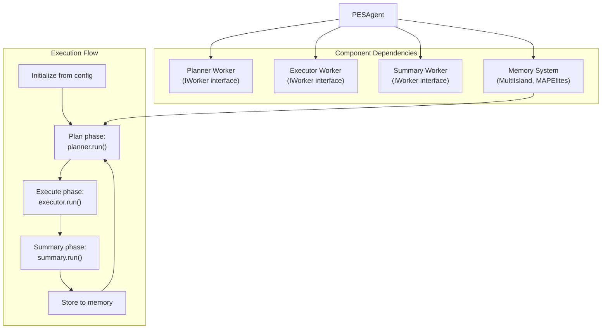
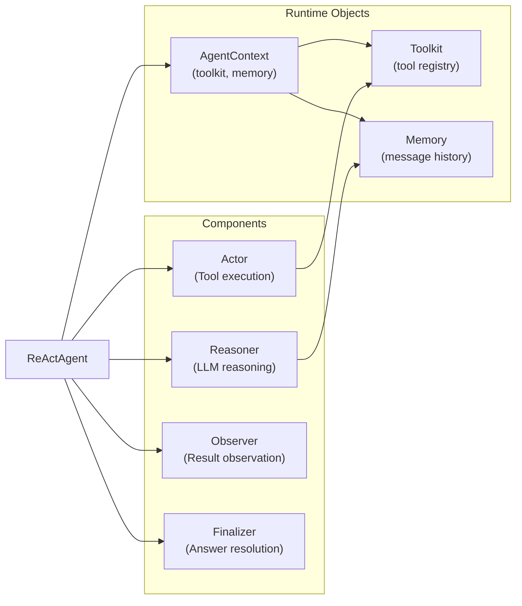
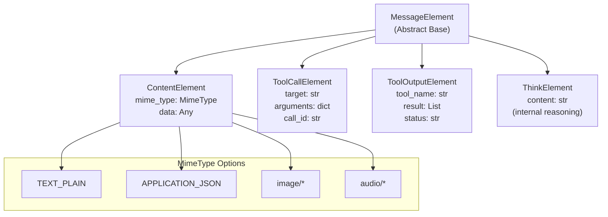
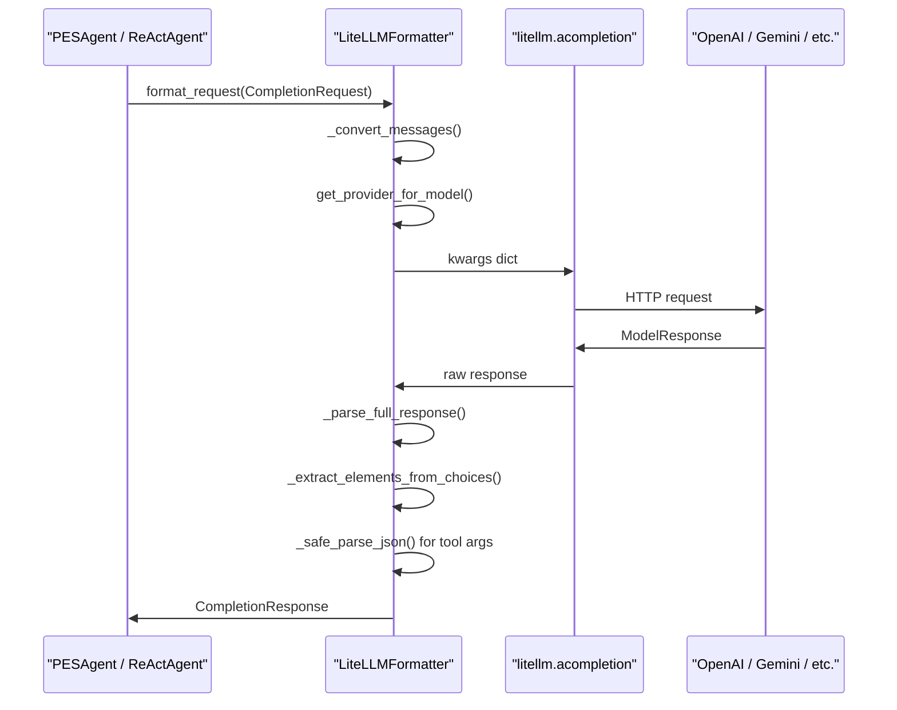
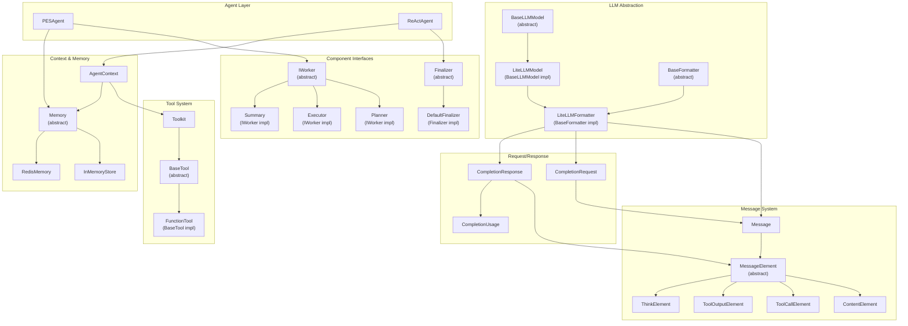

<!-- source: DeepWiki mcp.deepwiki.com · repo baidu-baige/LoongFlow · page 10.4 API Reference · fetched 2026-10-26 -->

# API Reference

<details>
<summary>Relevant source files</summary>

The following files were used as context for generating this wiki page:

- [agents/general_agent/evaluator.py](agents/general_agent/evaluator.py)
- [agents/general_agent/executor.py](agents/general_agent/executor.py)
- [src/loongflow/framework/claude_code/claude_code_agent.py](src/loongflow/framework/claude_code/claude_code_agent.py)
- [src/loongflow/framework/pes/base_runner.py](src/loongflow/framework/pes/base_runner.py)
- [src/loongflow/framework/pes/pes_agent.py](src/loongflow/framework/pes/pes_agent.py)

</details>


This document provides a comprehensive reference for the key classes, interfaces, and abstractions in the LoongFlow framework. It covers the core SDK components located in `src/loongflow/agentsdk/` and the framework implementations in `src/loongflow/framework/`.

For configuration details, see [Configuration Reference](#9.2). For higher-level architectural concepts, see [Core Framework](#3).

---

## Agent Architectures

### PESAgent

The `PESAgent` implements the Plan-Execute-Summary evolutionary paradigm for complex problem solving with long-term learning.

**Location:** `src/loongflow/framework/evolve/pes_agent.py`

**Key Characteristics:**
- Structured evolutionary loop with three phases
- Integration with multi-strategy memory system (Multi-Island, MAP-Elites, Boltzmann Selection)
- Checkpoint and resume support
- Concurrent execution of evolutionary candidates

**Primary Methods:**

| Method | Description | Returns |
|--------|-------------|---------|
| `__init__(config, planner, executor, summary, memory, ...)` | Initialize agent with components | `None` |
| `async run(task_description, initial_code, eval_code, ...)` | Execute evolutionary process | `Dict[str, Any]` |
| `async _iteration_loop()` | Single PES iteration cycle | `None` |
| `async save_checkpoint(iteration, ...)` | Save current state to disk | `None` |
| `async load_checkpoint(checkpoint_dir)` | Resume from saved checkpoint | `Dict[str, Any]` |

**Diagram: PESAgent Structure**



**Sources:** Architecture diagrams, AGENTS.md:13-14, default_finalizer.py (component patterns)

---

### ReActAgent

The `ReActAgent` implements the Reasoning-Action-Observation loop for reactive task solving with tool integration.

**Location:** `src/loongflow/framework/react/react_agent.py`

**Key Characteristics:**
- Thought-action-observation cycles
- Dynamic tool invocation via function calling
- Configurable stopping conditions via Finalizer
- Memory-based context management

**Primary Methods:**

| Method | Description | Returns |
|--------|-------------|---------|
| `__init__(context, reasoner, actor, observer, finalizer, ...)` | Initialize with components | `None` |
| `async run(user_query, max_steps, ...)` | Execute ReAct loop | `Message` |
| `async _react_step()` | Single reasoning cycle | `Message \| None` |
| `async _handle_tool_calls(message)` | Execute tool calls and observe results | `None` |

**Diagram: ReActAgent Component Graph**



**Sources:** AGENTS.md:15, default_finalizer.py:21-23

---

## Component Interfaces

### Worker (IWorker)

Abstract interface for PESAgent components (Planner, Executor, Summary).

**Location:** `src/loongflow/framework/evolve/base/worker.py`

**Interface Definition:**

```python
class IWorker(ABC):
    @abstractmethod
    async def run(self, context: WorkerContext, **kwargs) -> Any:
        """Execute worker logic with provided context."""
        pass
```

**Implementations:**
- **Planner**: Generates execution strategies by querying memory and designing approaches
- **Executor**: Implements plans by generating and testing code solutions
- **Summary**: Evaluates results, extracts insights, and updates memory

**Sources:** AGENTS.md:13-14, Architecture diagrams

---

### Finalizer

Component responsible for detecting task completion and generating final answers in ReActAgent.

**Location:** `src/loongflow/framework/react/components/finalizer.py`

**Key Methods:**

| Method | Signature | Purpose |
|--------|-----------|---------|
| `answer_schema` | `@property -> FunctionTool` | Provides tool definition for final answer |
| `async resolve_answer` | `(tool_call, tool_output) -> Message \| None` | Checks if tool call represents final answer |
| `async summarize_on_exceed` | `(context, **kwargs) -> Message \| None` | Generates summary when max_steps exceeded |

**Example Implementation (DefaultFinalizer):**

[src/loongflow/framework/react/components/default_finalizer.py:38-168]()

The `DefaultFinalizer` provides a `generate_final_answer` tool that accepts structured output according to a Pydantic schema. When the agent calls this tool successfully, the Finalizer extracts the response and terminates the ReAct loop.

**Sources:** default_finalizer.py:25-168

---

## Message & Communication

### Message

Core abstraction for agent communication, supporting multi-modal content and tool interactions.

**Location:** `src/loongflow/agentsdk/message/message.py`

**Structure:**

```python
@dataclass
class Message:
    sender: str                          # Component identifier
    role: Role                          # SYSTEM, USER, ASSISTANT, TOOL
    content: List[MessageElement]       # Mixed content elements
    metadata: Dict[str, Any]           # Usage stats, timestamps, etc.
```

**Content Elements:**



**Factory Methods:**

| Method | Purpose | Example |
|--------|---------|---------|
| `Message.from_text(sender, role, data, ...)` | Create text message | System prompts, user queries |
| `Message.from_elements(sender, role, elements, ...)` | Create from multiple elements | Mixed tool calls + content |

**Sources:** litellm_formatter.py:14-21, default_finalizer.py:11-18

---

### ContentElement, ToolCallElement, ToolOutputElement

**ContentElement** - Represents data with MIME type:

```python
@dataclass
class ContentElement:
    mime_type: MimeType  # TEXT_PLAIN, APPLICATION_JSON, image/*, audio/*
    data: Any           # String for text, dict for JSON, base64 for media
```

**ToolCallElement** - Represents LLM tool invocation:

```python
@dataclass
class ToolCallElement:
    target: str              # Function name to call
    arguments: Dict[str, Any]  # Function parameters
    call_id: str            # Unique identifier for correlation
    metadata: Dict[str, Any]  # Error info, parsing details
```

**ToolOutputElement** - Represents tool execution result:

```python
@dataclass
class ToolOutputElement:
    tool_name: str           # Function that was executed
    call_id: str            # Matches ToolCallElement.call_id
    result: List[Any]       # Output data (can be multiple elements)
    status: str            # "success" or "error"
```

**Conversion Flow:**

[src/loongflow/agentsdk/models/formatter/litellm_formatter.py:240-285]() - Shows how these elements convert to/from LLM API format.

**Sources:** litellm_formatter.py:14-21, 240-410, default_finalizer.py:11-18, 99-113

---

## LLM Integration

### LiteLLMFormatter

Adapter that bridges LoongFlow message abstractions with the LiteLLM client interface, enabling multi-provider LLM support.

**Location:** `src/loongflow/agentsdk/models/formatter/litellm_formatter.py`

**Class Definition:**

```python
class LiteLLMFormatter(BaseFormatter):
    """
    Formatter bridging LoongFlow schemas with LiteLLM API.
    
    - Request direction: LoongFlow → LiteLLM
    - Response direction: LiteLLM → LoongFlow
    """
```

**Provider Routing:**

[src/loongflow/agentsdk/models/formatter/litellm_formatter.py:91-99]()

The formatter automatically detects provider from model name prefix:

| Prefix | Provider | Example |
|--------|----------|---------|
| `gpt-*` | `openai` | `gpt-4o-mini` |
| `azure-gpt-*` | `azure_openai` | `azure-gpt-4` |
| `claude-*` | `anthropic` | `claude-3-opus` |
| `gemini-*` | `google_ai_studio` | `gemini-pro` |
| `deepseek-*` | `deepseek` | `deepseek-r1` |
| `mistral-*` | `mistral_ai` | `mistral-large` |
| `huggingface-*` | `huggingface` | `huggingface-llama` |
| (default) | `openai` | Custom OpenAI-compatible APIs |

**Primary Methods:**

**`format_request`** - Convert LoongFlow request to LiteLLM kwargs

[src/loongflow/agentsdk/models/formatter/litellm_formatter.py:101-189]()

```python
def format_request(
    self,
    request: CompletionRequest,
    model_name: str,
    stream: bool = False,
    timeout: int = 600,
    base_url: Optional[str] = None,
    api_key: Optional[str] = None,
    model_provider: Optional[str] = None,
    **params,
) -> Dict[str, Any]:
    """
    Returns: Dict ready for litellm.acompletion(**kwargs)
    
    Includes:
    - model, messages, temperature, top_p, max_tokens
    - tools, tool_choice (for function calling)
    - response_format (for JSON mode)
    - custom_llm_provider (auto-detected or explicit)
    """
```

**`parse_response`** - Convert LiteLLM response to LoongFlow format

[src/loongflow/agentsdk/models/formatter/litellm_formatter.py:191-222]()

```python
def parse_response(
    self,
    raw: ModelResponse | Dict[str, Any],
) -> CompletionResponse:
    """
    Handles:
    - Full ModelResponse (non-streaming)
    - ModelResponseStream (streaming chunks)
    - Dict-like deltas
    
    Returns: CompletionResponse with content elements
    """
```

**Message Conversion Logic:**

[src/loongflow/agentsdk/models/formatter/litellm_formatter.py:240-410]()

The `_convert_messages` method transforms LoongFlow `Message` objects into OpenAI/LiteLLM-compatible format:

1. **Tool Outputs** → Separate `{"role": "tool", ...}` messages
2. **Tool Calls** → Assistant message with `tool_calls` array
3. **Standard Content** → Text or structured (image, audio) content
4. **ThinkElement** → Prefixed with `[think]` marker

**Tool Call Argument Parsing:**

[src/loongflow/agentsdk/models/formatter/litellm_formatter.py:544-591]()

Implements robust JSON parsing with fallback strategies:
1. Standard `json.loads`
2. Fallback to `ast.literal_eval` for Python-style dicts
3. Returns error metadata in `ToolCallElement.metadata["tool_arguments_err"]`

**Diagram: LiteLLMFormatter Data Flow**



**Sources:** litellm_formatter.py:1-591

---

### CompletionRequest

Request abstraction for LLM completion calls.

**Location:** `src/loongflow/agentsdk/models/llm_request.py`

**Fields:**

```python
@dataclass
class CompletionRequest:
    messages: List[Message]              # Conversation history
    temperature: Optional[float]         # Sampling temperature
    top_p: Optional[float]              # Nucleus sampling
    max_tokens: Optional[int]           # Generation limit
    stop: Optional[List[str]]           # Stop sequences
    tools: Optional[List[Dict]]         # Function calling tools
    tool_choice: Optional[str | Dict]   # "auto", "none", or specific tool
    response_format: Optional[Dict]     # JSON mode config
    extra_headers: Optional[Dict]       # Provider-specific headers
```

**Sources:** litellm_formatter.py:23, default_finalizer.py:146-149

---

### CompletionResponse

Response abstraction from LLM completion calls.

**Location:** `src/loongflow/agentsdk/models/llm_response.py`

**Fields:**

```python
@dataclass
class CompletionResponse:
    id: str                              # Response identifier
    content: List[MessageElement]        # Response elements (text, tool calls)
    finish_reason: Optional[str]         # "stop", "length", "tool_calls"
    usage: Optional[CompletionUsage]     # Token consumption stats
    error_code: Optional[str]           # Error identifier if failed
    error_message: Optional[str]        # Error description
```

**CompletionUsage:**

```python
@dataclass
class CompletionUsage:
    prompt_tokens: int
    completion_tokens: int
    total_tokens: int
```

**Sources:** litellm_formatter.py:24, 419-435, default_finalizer.py:154-157

---

### BaseLLMModel

Abstract interface for LLM model wrappers.

**Location:** `src/loongflow/agentsdk/models/base_llm_model.py`

**Interface:**

```python
class BaseLLMModel(ABC):
    @abstractmethod
    async def generate(
        self, 
        request: CompletionRequest
    ) -> AsyncGenerator[CompletionResponse, None]:
        """
        Async generator yielding completion response(s).
        
        - Non-streaming: Yields single CompletionResponse
        - Streaming: Yields multiple delta responses
        """
        pass
```

**Concrete Implementation:**

The framework provides `LiteLLMModel` which uses `LiteLLMFormatter` internally to communicate with the LiteLLM library.

**Sources:** default_finalizer.py:19, 146-160

---

## Tools

### BaseTool

Abstract base for agent tools.

**Location:** `src/loongflow/agentsdk/tools/base_tool.py`

**Interface:**

```python
class BaseTool(ABC):
    @abstractmethod
    def get_name(self) -> str:
        """Unique tool identifier."""
        pass
    
    @abstractmethod
    def get_description(self) -> str:
        """Human-readable description for LLM."""
        pass
    
    @abstractmethod
    def get_declaration(self) -> Dict[str, Any]:
        """
        OpenAI function calling schema.
        
        Returns:
            {
                "type": "function",
                "function": {
                    "name": "tool_name",
                    "description": "...",
                    "parameters": {...}  # JSON Schema
                }
            }
        """
        pass
    
    @abstractmethod
    async def execute(self, **kwargs) -> Any:
        """Execute tool with validated parameters."""
        pass
```

**Sources:** default_finalizer.py:20, Architecture diagrams

---

### FunctionTool

Concrete implementation wrapping Python functions as tools.

**Location:** `src/loongflow/agentsdk/tools/function_tool.py`

**Constructor:**

```python
class FunctionTool(BaseTool):
    def __init__(
        self,
        name: str,
        func: Callable,
        args_schema: Type[BaseModel],
        description: str = "",
    ):
        """
        Create tool from function + Pydantic schema.
        
        Args:
            name: Tool identifier
            func: Async or sync callable to execute
            args_schema: Pydantic model defining parameters
            description: LLM-facing description
        """
```

**Example Usage:**

[src/loongflow/framework/react/components/default_finalizer.py:78-95]()

The `DefaultFinalizer.answer_schema` property demonstrates creating a `FunctionTool`:

```python
def final_answer_implementation(**kwargs: Any) -> Dict[str, Any]:
    validated_model = self._output_schema.model_validate(kwargs)
    return {"output_schema": validated_model.model_dump()}

return FunctionTool(
    name="generate_final_answer",
    func=final_answer_implementation,
    args_schema=DefaultOutputSchema,  # Pydantic model
    description="Final step: Call this to summarize...",
)
```

**Sources:** default_finalizer.py:20, 78-95

---

### Toolkit

Registry for managing multiple tools.

**Location:** `src/loongflow/agentsdk/tools/toolkit.py`

**Methods:**

```python
class Toolkit:
    def add_tool(self, tool: BaseTool) -> None:
        """Register a tool by name."""
    
    def get_tool(self, name: str) -> BaseTool:
        """Retrieve tool by identifier."""
    
    def get_declarations(self) -> List[Dict[str, Any]]:
        """
        Get all tool schemas for LLM function calling.
        
        Returns: List of OpenAI function declarations
        """
    
    async def execute_tool(self, name: str, **kwargs) -> Any:
        """Execute tool by name with parameters."""
```

**Sources:** default_finalizer.py:148, Architecture diagrams

---

## Context & Memory

### AgentContext

Runtime context object passed to ReActAgent components.

**Location:** `src/loongflow/framework/react/agent_context.py`

**Structure:**

```python
@dataclass
class AgentContext:
    toolkit: Toolkit          # Available tools
    memory: Memory           # Message history
    metadata: Dict[str, Any] # Custom agent state
```

**Usage Pattern:**

[src/loongflow/framework/react/components/default_finalizer.py:131-149]()

Components access context to:
- Query message history: `context.memory.get_memory()`
- Get tool declarations: `context.toolkit.get_declarations()`
- Store custom state: `context.metadata["key"] = value`

**Sources:** default_finalizer.py:21, 132, 142, 148

---

### Memory

Abstract interface for agent memory management.

**Location:** `src/loongflow/agentsdk/memory/base_memory.py`

**Interface:**

```python
class Memory(ABC):
    @abstractmethod
    async def add_message(self, message: Message) -> None:
        """Append message to history."""
    
    @abstractmethod
    async def get_memory(self, limit: Optional[int] = None) -> List[Message]:
        """
        Retrieve message history.
        
        Args:
            limit: Maximum messages to return (recent-first)
        """
    
    @abstractmethod
    async def clear(self) -> None:
        """Reset memory state."""
```

**Implementations:**

- **InMemoryStore**: Simple list-based storage for single sessions
- **RedisMemory**: Persistent storage with Redis backend (for distributed systems)
- **MultiIslandMemory**: PESAgent-specific memory with evolutionary diversity

**Sources:** default_finalizer.py:142, Architecture diagrams

---

## Class Hierarchy Diagram



**Sources:** All referenced source files, Architecture diagrams

---

## Usage Examples

### Creating a Custom Tool

```python
from pydantic import BaseModel, Field
from loongflow.agentsdk.tools import FunctionTool

class CalculatorArgs(BaseModel):
    expression: str = Field(description="Mathematical expression to evaluate")

def calculate(expression: str) -> dict:
    result = eval(expression)  # In production, use safe eval
    return {"result": result}

calculator_tool = FunctionTool(
    name="calculator",
    func=calculate,
    args_schema=CalculatorArgs,
    description="Evaluate mathematical expressions"
)
```

### Initializing a ReActAgent

```python
from loongflow.framework.react import ReActAgent, AgentContext
from loongflow.framework.react.components import DefaultFinalizer
from loongflow.agentsdk.tools import Toolkit
from loongflow.agentsdk.memory import InMemoryStore
from loongflow.agentsdk.models import LiteLLMModel

# Setup components
toolkit = Toolkit()
toolkit.add_tool(calculator_tool)

memory = InMemoryStore()
context = AgentContext(toolkit=toolkit, memory=memory, metadata={})

model = LiteLLMModel(
    model_name="gpt-4o-mini",
    api_key="...",
    temperature=0.7
)

finalizer = DefaultFinalizer(
    model=model,
    summarize_prompt="Provide a helpful summary..."
)

# Create agent
agent = ReActAgent(
    context=context,
    reasoner=model,
    actor=toolkit,
    observer=memory,
    finalizer=finalizer
)

# Run task
result = await agent.run("What is 25 * 4?", max_steps=10)
```

**Sources:** default_finalizer.py:38-168, Architecture patterns

---

## Configuration Integration

All classes can be instantiated from YAML configuration. See [Configuration Reference](#9.2) for complete schema.

**Example LLM Configuration:**

```yaml
llm_config:
  url: "https://api.openai.com/v1"
  api_key: "${OPENAI_API_KEY}"
  model: "gpt-4o-mini"
  temperature: 0.7
  max_tokens: 4096
```

This maps to:

```python
LiteLLMModel(
    model_name=config["llm_config"]["model"],
    base_url=config["llm_config"]["url"],
    api_key=os.environ.get("OPENAI_API_KEY"),
    temperature=config["llm_config"]["temperature"],
    max_tokens=config["llm_config"]["max_tokens"]
)
```

**Sources:** pyproject.toml:18-36, AGENTS.md:78-82