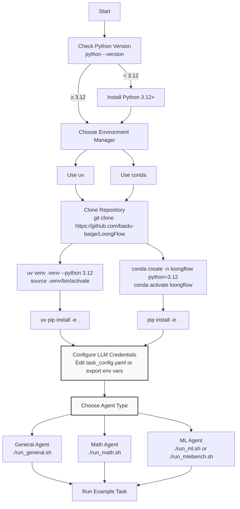
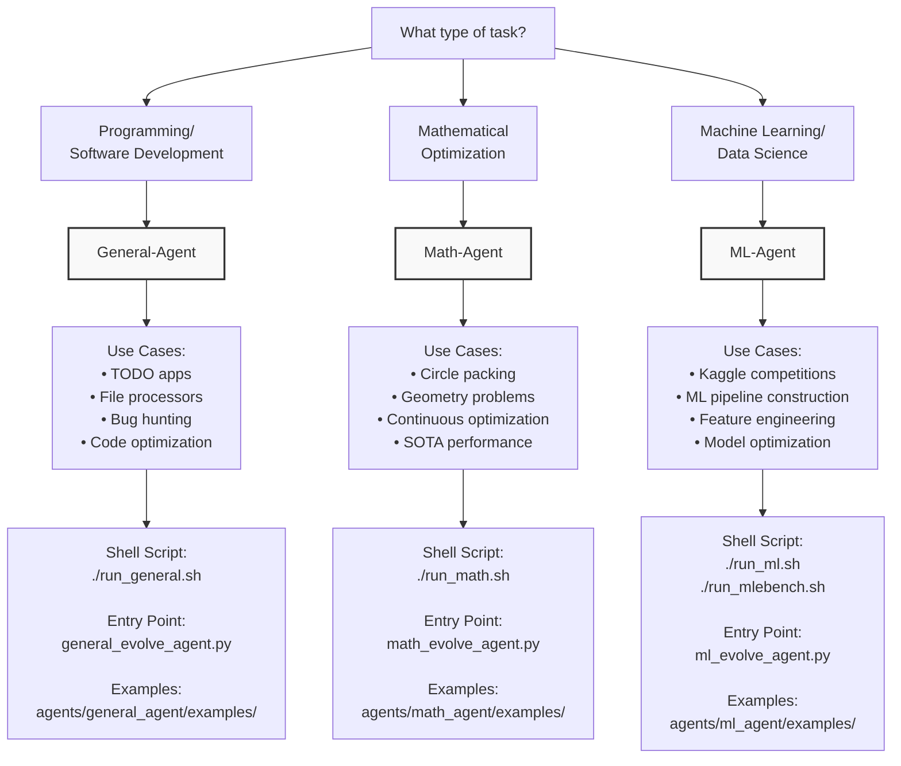
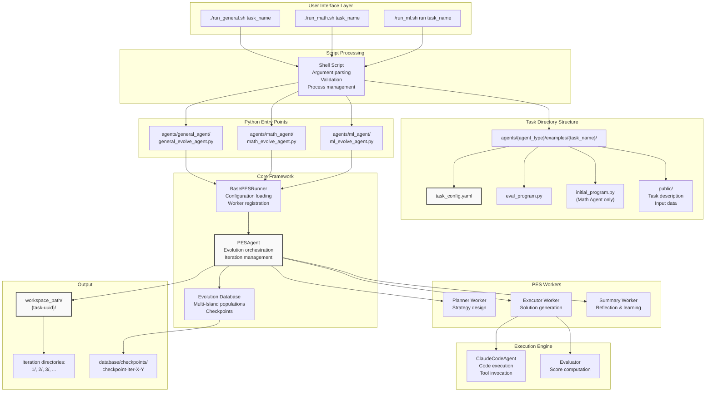
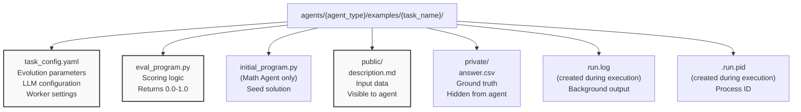

<!-- source: DeepWiki mcp.deepwiki.com · repo baidu-baige/LoongFlow · page 2 Getting Started · fetched 2026-10-26 -->

# Getting Started

<details>
<summary>Relevant source files</summary>

The following files were used as context for generating this wiki page:

- [README.md](README.md)
- [agents/ml_agent/README.md](agents/ml_agent/README.md)

</details>


This page provides an overview of the steps required to install LoongFlow, configure your environment, and run your first evolution task. For detailed installation instructions, see [Installation & Setup](#2.1). For agent-specific quick start guides, see [Quick Start - General Agent](#2.2), [Quick Start - Math Agent](#2.3), or [Quick Start - ML Agent](#2.4).

---

## Overview

Getting started with LoongFlow involves four main steps:

1. **Environment Setup**: Install Python 3.12+ and create a virtual environment
2. **Package Installation**: Install LoongFlow and its dependencies
3. **LLM Configuration**: Configure API credentials for your chosen LLM provider
4. **Run Your First Task**: Execute one of the example tasks using the appropriate shell script

The entire process takes approximately 10-15 minutes for initial setup, with individual example tasks running in 5-30 minutes depending on complexity.

---

## Prerequisites

LoongFlow requires the following system prerequisites:

| Requirement | Version | Purpose |
|------------|---------|---------|
| Python | 3.12+ | Core runtime environment |
| uv or conda | Latest | Package and environment management |
| Git | Any | Repository cloning |
| Git LFS | Any (ML Agent only) | Large file handling for MLE-Bench |

**Operating System**: Linux/macOS recommended. Windows users should use WSL2.

**Hardware**: No GPU required for framework operation. LLM inference happens via API calls.

**Sources**: [README.md:163-182]()

---

## Installation Flow

The following diagram shows the installation and setup process, mapping to the actual commands and files you'll interact with:

**Diagram: Installation and Setup Process**



**Sources**: [README.md:161-182](), [README.md:186-262]()

---

## LLM Configuration

LoongFlow requires an LLM API for agent operation. The framework uses `LiteLLMFormatter` to support multiple providers through a unified interface.

### Supported Providers

| Provider | Model Examples | Configuration |
|----------|---------------|---------------|
| OpenAI | `gpt-4`, `gpt-3.5-turbo` | Default provider |
| Anthropic | `claude-3-opus`, `claude-3-sonnet` | Use `anthropic/` prefix |
| Google | `gemini-3-pro-preview` | Use `openai/` prefix |
| DeepSeek | `deepseek-r1-250528` | Supports reasoning content |
| Azure OpenAI | `azure-gpt-4` | Use `azure/` prefix |

### Configuration Methods

**Method 1: Environment Variables** (Quick Start)

```bash
export ANTHROPIC_API_KEY="your-api-key"
export ANTHROPIC_BASE_URL="https://api.anthropic.com"
```

**Method 2: task_config.yaml** (Recommended for Tasks)

```yaml
llm_config:
  url: "https://your-endpoint/v1"
  api_key: "your-api-key"
  model: "openai/gemini-3-pro-preview"
  temperature: 0.8
  context_length: 128000
  max_tokens: 32768
```

The `LiteLLMFormatter` class handles format translation between LoongFlow's internal `CompletionRequest` format and provider-specific APIs.

**Sources**: [README.md:189-193](), [README.md:219-247](), [agents/ml_agent/README.md:94-102]()

---

## Agent Type Selection

LoongFlow provides three specialized agents, each optimized for different problem domains:

**Diagram: Agent Selection Decision Tree**



### General-Agent

**Purpose**: Flexible, skill-driven coding tasks from simple applications to complex bug hunting.

**Key Components**:
- `GeneralPlanner`: Strategy design using code analysis skills
- `GeneralExecuteAgent`: Solution generation via `ClaudeCodeAgent`
- `GeneralEvaluator`: Active verification with custom `eval_program.py`

**Typical Workflow**: Plan → Generate Code → Execute → Evaluate → Reflect

**Sources**: [README.md:45-58](), [README.md:359-376]()

### Math-Agent

**Purpose**: Efficient, stable mathematical algorithm design with continuous evolution toward SOTA results.

**Key Components**:
- Requires `initial_program.py` for seeding solutions
- Custom `eval_program.py` for mathematical objective functions
- Optimized for continuous optimization problems

**Typical Workflow**: Plan → Modify Initial Program → Evaluate Score → Reflect

**Sources**: [README.md:60-73](), [README.md:378-393]()

### ML-Agent

**Purpose**: Full-process, autonomous ML pipeline construction with competitive performance.

**Key Components**:
- MLE-Bench integration for Kaggle-style competitions
- Extended evaluation timeouts for training-heavy tasks
- Multi-stage workflow: data exploration → feature engineering → model training

**Typical Workflow**: Plan → Build Pipeline → Train Model → Evaluate → Reflect

**Sources**: [README.md:75-88](), [README.md:395-427](), [agents/ml_agent/README.md:1-189]()

---

## Task Execution Flow

The following diagram maps the execution flow to actual code entities in the LoongFlow codebase:

**Diagram: Task Execution Architecture**



**Sources**: [README.md:186-262](), [agents/ml_agent/README.md:28-68]()

---

## Running Your First Task

### Quick Start Sequence

1. **Navigate to LoongFlow directory**
   ```bash
   cd LoongFlow
   ```

2. **Activate environment**
   ```bash
   # For uv
   source .venv/bin/activate
   
   # For conda
   conda activate loongflow
   ```

3. **Configure LLM** (if not using environment variables)
   ```bash
   # Edit the task's configuration file
   vim agents/general_agent/examples/01_todo_list/task_config.yaml
   ```

4. **Run example task**
   ```bash
   # General Agent - TODO list app (5-10 minutes)
   ./run_general.sh 01_todo_list
   
   # Math Agent - Circle packing (20-30 minutes, run in background)
   ./run_math.sh packing_circle_in_unit_square --background
   
   # ML Agent - MLE-Bench competition (varies by competition)
   ./run_mlebench.sh init
   ./run_mlebench.sh prepare detecting-insults-in-social-commentary
   ./run_mlebench.sh run detecting-insults-in-social-commentary --background
   ```

5. **Monitor progress**
   ```bash
   # For background tasks, check the log
   tail -f agents/general_agent/examples/04_circle_packing/run.log
   tail -f agents/math_agent/examples/packing_circle_in_unit_square/run.log
   tail -f output/logs/evolux.log  # ML Agent
   ```

6. **Stop background task** (if needed)
   ```bash
   ./run_general.sh stop 04_circle_packing
   ./run_math.sh stop packing_circle_in_unit_square
   ./run_mlebench.sh stop detecting-insults-in-social-commentary
   ```

**Sources**: [README.md:186-262](), [agents/ml_agent/README.md:28-68]()

---

## Execution Modes

LoongFlow shell scripts support two execution modes:

| Mode | Usage | Output | Process Management | Use Case |
|------|-------|--------|-------------------|----------|
| **Foreground** | `./run_*.sh task_name` | Direct to console | Blocking, Ctrl+C to stop | Quick tests, debugging |
| **Background** | `./run_*.sh task_name --background` | Logged to `run.log` | Detached, PID in `.run.pid` | Long-running tasks |

**Background Mode Details**:
- Process runs via `nohup`
- Output redirected to `run.log` in task directory
- PID stored in `.run.pid` for process tracking
- Use `./run_*.sh stop task_name` to terminate

**Sources**: [README.md:204-210](), [README.md:228-234](), [agents/ml_agent/README.md:42-48]()

---

## Understanding Task Structure

Each task follows a standardized directory structure:

**Diagram: Task Directory Structure**



### Required Files

| File | Required For | Purpose |
|------|-------------|---------|
| `task_config.yaml` | All agents | Defines evolution parameters, LLM settings, worker configurations |
| `eval_program.py` | All agents | Implements scoring logic, returns dict with `score` field (0.0-1.0) |
| `initial_program.py` | Math Agent only | Provides seed solution for evolution |
| `public/description.md` | ML Agent | Task description visible to agent |
| `private/answer.csv` | ML Agent | Ground truth for evaluation (hidden) |

**Sources**: [agents/ml_agent/README.md:146-167]()

---

## Output and Workspace

After execution, results are organized in the workspace:

```
workspace_path/{task-uuid}/
├── 1/                          # Iteration 1
│   ├── planner/
│   │   └── best_plan.md        # Strategy document
│   ├── executor/
│   │   ├── work_dir/           # Generated code
│   │   └── evaluator_dir/      # Evaluation artifacts
│   └── summary/
│       └── summary.md          # Reflection insights
├── 2/                          # Iteration 2
├── 3/                          # Iteration 3
└── database/
    └── checkpoints/
        ├── checkpoint-iter-0-0
        ├── checkpoint-iter-0-5
        └── checkpoint-iter-0-10
```

**Key Output Directories**:
- **planner/**: Contains strategy design and analysis from `Planner` worker
- **executor/**: Contains generated code and execution artifacts from `Executor` worker
- **summary/**: Contains reflections and insights from `Summary` worker
- **database/checkpoints/**: Periodic snapshots of evolution state for resumption

**Sources**: [agents/ml_agent/README.md:72-85]()

---

## Next Steps

After completing your first task execution:

1. **Explore Agent-Specific Quick Starts**:
   - [Quick Start - General Agent](#2.2): Step-by-step tutorial for TODO list app
   - [Quick Start - Math Agent](#2.3): Circle packing optimization walkthrough
   - [Quick Start - ML Agent](#2.4): MLE-Bench competition setup

2. **Understand Core Concepts**:
   - [PES Paradigm](#3.1): Learn the Plan-Execute-Summary thinking framework
   - [Evolutionary Memory System](#3.4): Understand how agents learn and improve
   - [LLM Integration](#3.5): Configure different LLM providers

3. **Dive into Agent Details**:
   - [General Agent](#4): Programming tasks and skill-driven evolution
   - [Math Agent](#5): Mathematical optimization techniques
   - [ML Agent](#6): Machine learning pipeline construction

4. **Advanced Topics**:
   - [Visualization & Monitoring](#8): Track evolution in real-time
   - [Building Custom Agents](#7): Create your own specialized agents
   - [Configuration Reference](#10.2): Complete configuration options

**Sources**: [README.md:157-262]()

---

