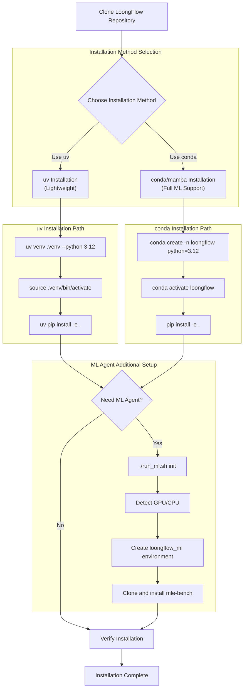
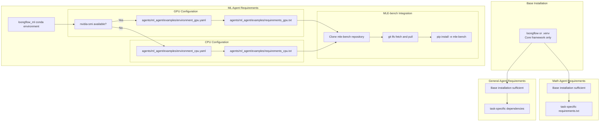
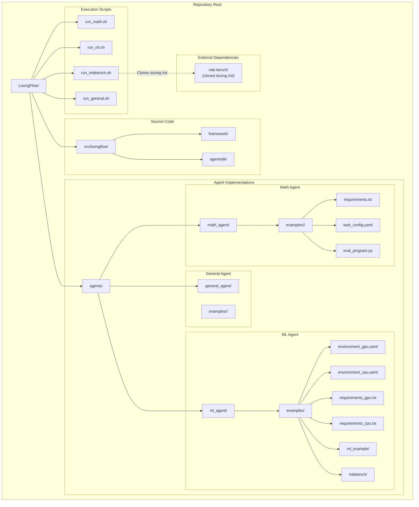

<!-- source: DeepWiki mcp.deepwiki.com · repo baidu-baige/LoongFlow · page 2.1 Installation & Setup · fetched 2026-10-26 -->

# Installation & Setup

<details>
<summary>Relevant source files</summary>

The following files were used as context for generating this wiki page:

- [README.md](README.md)
- [agents/ml_agent/README.md](agents/ml_agent/README.md)
- [pyproject.toml](pyproject.toml)
- [src/loongflow/agentsdk/models/formatter/litellm_formatter.py](src/loongflow/agentsdk/models/formatter/litellm_formatter.py)
- [uv.lock](uv.lock)

</details>


This page covers the installation and initial configuration of LoongFlow, including environment setup, dependency management, and preparation for running agents. For running specific agent tasks, see Quick Start guides for [Math Agent](#2.2), [ML Agent](#2.3), and [General Agent](#2.4). For detailed configuration options, see [Configuration Reference](#10.2).

## Prerequisites

LoongFlow requires the following prerequisites before installation:

| Requirement | Version/Details | Purpose |
|------------|----------------|---------|
| **Python** | 3.12 or higher | Core runtime requirement |
| **Package Manager** | `uv` OR `conda`/`mamba` | Dependency management |
| **Git** | Any recent version | Repository cloning |
| **Git LFS** | For ML Agent with MLE-bench | Large file support |
| **NVIDIA GPU** | Optional | Accelerated ML training (CPU fallback available) |

**Note:** `mamba` is required for ML Agent initialization. For Math Agent and General Agent, either `uv` or `conda` can be used.

**Sources:** [README.md:134-153]()

## Installation Overview



**Sources:** [README.md:136-153](), [run_ml.sh:118-170](), [run_mlebench.sh:120-207]()

## Base Installation

### Method 1: Using uv (Recommended for Math/General Agents)

The `uv` package manager provides fast, lightweight environment management suitable for Math Agent and General Agent tasks.

```bash
# Install uv (if not already installed)
# See: https://docs.astral.sh/uv/getting-started/installation/

# Clone the repository
git clone https://github.com/baidu-baige/LoongFlow.git
cd LoongFlow

# Create virtual environment with Python 3.12
uv venv .venv --python 3.12

# Activate the environment
source .venv/bin/activate

# Install LoongFlow in editable mode
uv pip install -e .
```

This installs the core LoongFlow framework from [src/loongflow/]() including:
- PES framework components ([src/loongflow/framework/pes/]())
- ReAct agent framework ([src/loongflow/framework/react/]())
- LLM integration layer ([src/loongflow/agentsdk/llm/]())
- Tool system ([src/loongflow/agentsdk/tools/]())

**Sources:** [README.md:136-146]()

### Method 2: Using conda/mamba (Required for ML Agent)

Conda/mamba installation is required if you plan to use ML Agent, as it needs specialized ML dependencies and environment isolation.

```bash
# Install Miniforge (includes conda and mamba)
# See: https://conda-forge.org/download/

# Clone the repository
git clone https://github.com/baidu-baige/LoongFlow.git
cd LoongFlow

# Create conda environment with Python 3.12
conda create -n loongflow python=3.12

# Activate the environment
conda activate loongflow

# Install LoongFlow in editable mode
pip install -e .
```

**Sources:** [README.md:147-152]()

## Agent-Specific Environment Setup

LoongFlow agents have different environment requirements based on their execution needs:



**Sources:** [run_ml.sh:118-170](), [run_mlebench.sh:120-207]()

### ML Agent Environment Initialization

ML Agent requires a separate conda environment with comprehensive ML libraries. The initialization is automated via the `run_ml.sh` or `run_mlebench.sh` scripts:

```bash
# Initialize ML Agent environment (auto-detects GPU/CPU)
./run_ml.sh init

# Or for MLE-bench integration
./run_mlebench.sh init
```

#### Initialization Process Flow

The `do_init()` function in both scripts performs the following steps:

1. **GPU Detection** ([run_ml.sh:124-134](), [run_mlebench.sh:123-134]()):
   - Checks for `nvidia-smi` command availability
   - Selects appropriate environment file based on hardware

2. **Environment File Selection**:
   - GPU detected: `agents/ml_agent/examples/environment_gpu.yaml`
   - CPU only: `agents/ml_agent/examples/environment_cpu.yaml`

3. **Conda Environment Creation** ([run_ml.sh:146-154](), [run_mlebench.sh:148-156]()):
   - Creates environment named `loongflow_ml`
   - Installs conda packages from selected YAML file
   - Skips if environment already exists

4. **Pip Dependencies Installation** ([run_ml.sh:159-160](), [run_mlebench.sh:161-162]()):
   - Installs from `requirements_gpu.txt` or `requirements_cpu.txt`
   - Uses `--no-build-isolation` flag for compatibility

5. **MLE-bench Setup** (only for `run_mlebench.sh`, [run_mlebench.sh:165-198]()):
   - Clones `mle-bench` repository from OpenAI
   - Fetches Git LFS files
   - Modifies TensorFlow version requirement (2.16 → 2.15)
   - Installs mle-bench in editable mode

**Sources:** [run_ml.sh:118-170](), [run_mlebench.sh:120-207]()

### Math Agent Environment Setup

Math Agent uses the base installation plus task-specific dependencies:

```bash
# After base installation, install task-specific requirements
uv pip install -r ./agents/math_agent/examples/<task_name>/requirements.txt

# Example for circle packing task
uv pip install -r ./agents/math_agent/examples/packing_circle_in_unit_square/requirements.txt
```

**Sources:** [README.md:169]()

### General Agent Environment Setup

General Agent uses the base installation and requires no additional environment setup. Task-specific dependencies (if any) are documented in individual task directories.

**Sources:** [README.md:136-152]()

## Environment Structure and Key Files

The following diagram maps LoongFlow's directory structure to environment configuration files:



**Sources:** [run_ml.sh:126-132](), [run_mlebench.sh:165-174](), [README.md:35]()

## Environment Activation and Management

### Activation Commands

Different environments require different activation commands:

| Environment | Activation Command | Deactivation |
|------------|-------------------|--------------|
| **uv (.venv)** | `source .venv/bin/activate` | `deactivate` |
| **conda (loongflow)** | `conda activate loongflow` | `conda deactivate` |
| **conda (loongflow_ml)** | `conda activate loongflow_ml` | `conda deactivate` |

### Conda/Mamba Initialization

The execution scripts automatically handle conda initialization and activation through helper functions:

**`init_conda()` function** ([run_ml.sh:41-72](), [run_mlebench.sh:42-72]()):
- Detects conda/mamba installation via `CONDA_EXE`, `MAMBA_EXE`, or `command -v`
- Sources `conda.sh` and `mamba.sh` from conda base directory
- Enables `conda activate` command in shell

**`activate_env()` function** ([run_ml.sh:73-92](), [run_mlebench.sh:75-92]()):
- Calls `init_conda()` to prepare shell environment
- Activates target environment (`loongflow_ml`)
- Sets `LD_LIBRARY_PATH` to include conda lib directory
- Verifies successful activation via `CONDA_DEFAULT_ENV`

**Sources:** [run_ml.sh:41-92](), [run_mlebench.sh:42-92]()

## LLM Configuration

After installation, you must configure LLM credentials before running agents. This is done via `task_config.yaml` files in each task directory.

### Configuration Structure

```yaml
llm_config:
  url: "https://api.openai.com/v1"  # API endpoint
  api_key: "your-api-key-here"      # API key
  model: "openai/gpt-4"              # Model identifier with provider prefix
```

### Supported Providers

LoongFlow uses LiteLLM ([src/loongflow/agentsdk/llm/litellm_formatter.py]()) for multi-provider support:

| Provider | Model Prefix | Example |
|----------|-------------|---------|
| **OpenAI** | `openai/` | `openai/gpt-4` |
| **Anthropic** | (default) | `claude-3-opus-20240229` |
| **Google** | `google/` | `google/gemini-pro` |
| **DeepSeek** | `deepseek/` | `deepseek/deepseek-chat` |
| **Custom OpenAI-compatible** | `openai/` | `openai/custom-model` |

### Recommended Models

For optimal results, the documentation recommends ([README.md:161-166](), [README.md:183-189]()):
- `openai/gemini-3-pro-preview` (Google Gemini)
- `deepseek-r1-250528` (DeepSeek R1)

**Sources:** [README.md:160-190](), [README.md:432-442]()

## Verification Steps

After installation, verify your setup with these checks:

### 1. Import Core Framework

```bash
# Activate your environment first
source .venv/bin/activate  # or: conda activate loongflow

# Test Python imports
python -c "from loongflow.framework.pes import PESAgent; print('PES framework OK')"
python -c "from loongflow.framework.react import ReActAgent; print('ReAct framework OK')"
```

### 2. Verify Script Executability

```bash
# Check script permissions
ls -l run_math.sh run_ml.sh run_mlebench.sh run_general.sh

# Make executable if needed
chmod +x run_*.sh
```

### 3. Verify ML Environment (if installed)

```bash
# Check environment exists
conda env list | grep loongflow_ml

# Verify activation
conda activate loongflow_ml
python -c "import torch; print(f'PyTorch: {torch.__version__}')"
python -c "import tensorflow; print(f'TensorFlow: {tensorflow.__version__}')"
```

### 4. Check MLE-bench Installation (if needed)

```bash
conda activate loongflow_ml
python -c "import mlebench; print('MLE-bench installed')"
mlebench --version
```

**Sources:** [run_ml.sh:111-114](), [run_mlebench.sh:112-116]()

## Troubleshooting

### Common Installation Issues

| Issue | Solution |
|-------|----------|
| **`mamba not found`** | Install mambaforge from https://conda-forge.org/download/ |
| **`uv not found`** | Install uv from https://docs.astral.sh/uv/getting-started/installation/ |
| **Environment activation fails** | Source conda.sh manually: `source ~/mambaforge/etc/profile.d/conda.sh` |
| **Git LFS files missing** | Run `git lfs install && git lfs pull` in mle-bench directory |
| **TensorFlow version conflict** | The init script automatically patches this ([run_mlebench.sh:182-194]()) |

### Environment Detection Issues

If GPU detection fails incorrectly:

```bash
# Manually specify environment file
mamba env create -n loongflow_ml -f agents/ml_agent/examples/environment_gpu.yaml
pip install -r agents/ml_agent/examples/requirements_gpu.txt
```

**Sources:** [run_ml.sh:124-134](), [run_mlebench.sh:123-134](), [run_mlebench.sh:182-194]()

## Next Steps

After successful installation:

1. **Configure LLM credentials** in task config files (see [Configuration Reference](#10.2))
2. **Try a quick start guide**:
   - [Math Agent Quick Start](#2.2) - Run mathematical optimization tasks
   - [ML Agent Quick Start](#2.3) - Run machine learning competitions
   - [General Agent Quick Start](#2.4) - Run general problem-solving tasks
3. **Explore examples** in respective `agents/*/examples/` directories
4. **Learn about the PES paradigm** - [PES Paradigm](#3.1) for understanding the core framework

**Sources:** [README.md:128-206]()

---

