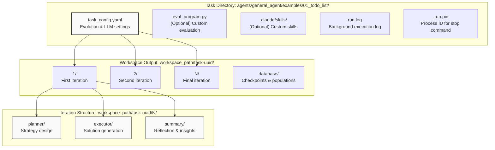
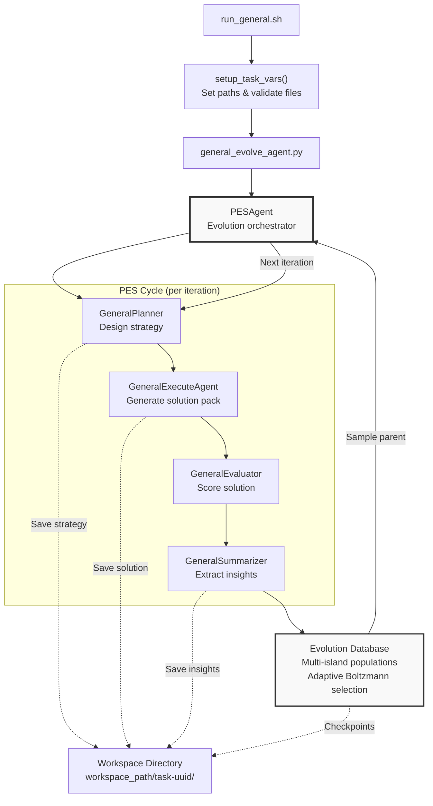

<!-- source: DeepWiki mcp.deepwiki.com · repo baidu-baige/LoongFlow · page 2.2 Quick Start - General Agent · fetched 2026-10-26 -->

# Quick Start - General Agent

<details>
<summary>Relevant source files</summary>

The following files were used as context for generating this wiki page:

- [README.md](README.md)
- [agents/ml_agent/README.md](agents/ml_agent/README.md)
- [run_general.sh](run_general.sh)
- [run_math.sh](run_math.sh)

</details>


This guide walks you through running your first General Agent task: a simple TODO list application. The example demonstrates LoongFlow's PES paradigm (Plan-Execute-Summary) and evolutionary improvement cycle in approximately 5-10 minutes.

**Prerequisites**: Complete installation and LLM configuration as described in [Installation & Setup](#2.1). For deeper understanding of General Agent capabilities and architecture, see [General Agent Overview](#4.1).

---

## Overview of General Agent Examples

The General Agent includes four progressively complex examples that demonstrate different capabilities:

| Example | Difficulty | Duration | Description | Key Features |
|---------|-----------|----------|-------------|--------------|
| **01_todo_list** | ⭐ Beginner | 5-10 min | Command-line TODO app with persistent storage | Basic file I/O, data structures |
| **02_file_processor** | ⭐⭐ Intermediate | 10-15 min | CSV/JSON processor with custom skills | Skills system, data transformation |
| **03_bug_hunter** | ⭐⭐⭐ Advanced | 15-20 min | Production bug detection with OWASP/CWE analysis | Security scanning, complex analysis |
| **04_circle_packing** | ⭐⭐⭐⭐ Expert | 20-30 min | Geometric optimization problem | Custom evaluation, mathematical optimization |

This quick start focuses on **01_todo_list**, the foundational example. For a comprehensive tutorial covering all examples, see the [Complete Tutorial](https://github.com/baidu-baige/LoongFlow/blob/main/agents/general_agent/TUTORIAL.md).

**Sources**: [README.md:363-369](), [README.md:186-213]()

---

## Task Directory Structure

Each General Agent task follows a consistent directory structure:



**Required Files**:
- `task_config.yaml`: Controls evolution parameters, LLM configuration, and worker settings

**Optional Files**:
- `eval_program.py`: Custom evaluation logic (if not provided, uses simple score-based evaluation)
- `.claude/skills/`: Domain-specific knowledge packages

**Generated Files**:
- `run.log`: Background execution output
- `.run.pid`: Process ID for background task management

**Sources**: [run_general.sh:19-32](), [agents/ml_agent/README.md:70-85]()

---

## Running Your First Task

### Step 1: Configure LLM Credentials

Before running any task, ensure your LLM credentials are configured. You can either:

**Option A: Environment Variables**
```bash
export ANTHROPIC_API_KEY="your-api-key"
export ANTHROPIC_BASE_URL="your-endpoint"  # Optional
```

**Option B: Edit task_config.yaml**
```yaml
llm_config:
  url: "https://api.anthropic.com/v1"
  api_key: "your-api-key"
  model: "anthropic/claude-3-5-sonnet-20241022"
```

**Sources**: [README.md:188-192]()

### Step 2: Execute the Task

The [run_general.sh:1-191]() script provides two execution modes:

**Foreground Execution** (blocks terminal, shows real-time output):
```bash
./run_general.sh 01_todo_list
```

**Background Execution** (runs in background, logs to file):
```bash
./run_general.sh 01_todo_list --background

# Monitor progress
tail -f ./agents/general_agent/examples/01_todo_list/run.log
```

**Sources**: [README.md:194-195](), [run_general.sh:7-15]()

### Step 3: Understanding the Execution Flow



**Key Components**:
- **run_general.sh**: Shell script that validates task directory and launches Python entrypoint
- **general_evolve_agent.py**: Python entrypoint that instantiates `PESAgent` and registers workers
- **PESAgent**: Core evolution orchestrator that manages PES cycles
- **GeneralPlanner**: Analyzes task and designs execution strategy
- **GeneralExecuteAgent**: Generates solution code using `ClaudeCodeAgent`
- **GeneralEvaluator**: Evaluates solution quality (simple or tool-based)
- **GeneralSummarizer**: Reflects on outcomes and extracts reusable insights
- **Evolution Database**: Maintains populations across islands with adaptive selection

**Sources**: [run_general.sh:129-191](), [README.md:439-455]()

---

## Execution Sequence

When you run `./run_general.sh 01_todo_list`, the following sequence occurs:

1. **Script Validation** [run_general.sh:130-139]()
   - Validates task directory exists at `agents/general_agent/examples/01_todo_list/`
   - Checks required file: `task_config.yaml`
   - Constructs command array with configuration path

2. **Python Entrypoint Launch** [run_general.sh:156-166]()
   - Executes `python agents/general_agent/general_evolve_agent.py --config <path>`
   - Sets `PYTHONPATH` to include `./src`

3. **PESAgent Initialization**
   - Loads configuration from `task_config.yaml`
   - Registers worker implementations:
     - Planner: `GeneralPlanner`
     - Executor: `GeneralExecuteAgent`
     - Summary: `GeneralSummarizer`
   - Initializes Evolution Database with configured islands and population size

4. **Evolution Loop** (iterates until convergence)
   - **Plan Phase**: Planner analyzes task requirements and designs strategy
   - **Execute Phase**: Executor generates solution code and creates solution pack
   - **Evaluate Phase**: Evaluator scores the solution (0.0-1.0 scale)
   - **Summary Phase**: Summarizer reflects on results and extracts insights
   - **Database Update**: Stores solution in population and updates evolution tree

5. **Termination**
   - Stops when `target_score` is reached or `max_iterations` is exceeded
   - Saves final checkpoint to `workspace_path/database/checkpoints/`
   - Outputs best solution location

**Sources**: [run_general.sh:156-191]()

---

## Task Configuration

The `task_config.yaml` file controls all aspects of evolution. Here's a minimal example for the TODO list task:

```yaml
# Workspace for outputs
workspace_path: "./output"

# LLM Configuration
llm_config:
  url: "https://api.anthropic.com/v1"
  api_key: "your-api-key"
  model: "anthropic/claude-3-5-sonnet-20241022"
  temperature: 0.8
  max_tokens: 8192

# Planner Configuration
planners:
  general_planner:
    skills: []  # Optional: custom skill packages
    max_turns: 50
    timeout: 1800

# Executor Configuration
executors:
  general_executor:
    skills: []
    max_turns: 50
    timeout: 1800

# Summarizer Configuration
summarizers:
  general_summarizer:
    max_turns: 20
    timeout: 900

# Evolution Configuration
evolve:
  planner_name: "general_planner"
  executor_name: "general_executor"
  summary_name: "general_summarizer"
  
  max_iterations: 30
  target_score: 0.95
  concurrency: 1
  
  # Evaluator settings
  evaluator:
    mode: "simple"  # or "tool" for active verification
    timeout: 600
  
  # Database settings
  database:
    storage_type: "in_memory"
    num_islands: 1
    population_size: 30
    checkpoint_interval: 5
    sampling_weight_power: 2.0
```

**Key Parameters**:

| Section | Parameter | Description | Typical Value |
|---------|-----------|-------------|---------------|
| `llm_config` | `model` | LLM model to use | `anthropic/claude-3-5-sonnet-20241022` |
| `llm_config` | `temperature` | Sampling temperature | `0.8` |
| `evolve` | `max_iterations` | Maximum evolution cycles | `30` |
| `evolve` | `target_score` | Score to achieve for early stopping | `0.95` |
| `evolve.database` | `num_islands` | Number of independent populations | `1-3` |
| `evolve.database` | `population_size` | Solutions per island | `30-90` |
| `evolve.database` | `sampling_weight_power` | Selection bias (higher = more exploitation) | `2.0` |

For complete configuration reference, see [Configuration Reference](#10.2).

**Sources**: [agents/ml_agent/README.md:89-137]()

---

## Monitoring Progress

### Real-time Logs

For foreground execution, output appears directly in the terminal. For background execution:

```bash
tail -f ./agents/general_agent/examples/01_todo_list/run.log
```

**Typical log output**:
```
[INFO] Iteration 1/30 started
[INFO] Planner: Analyzing task requirements...
[INFO] Executor: Generating solution code...
[INFO] Evaluator: Score = 0.65
[INFO] Summary: Extracted 3 insights
[INFO] Database: Stored solution in island 0, population size = 1
[INFO] Iteration 2/30 started
...
```

**Sources**: [README.md:206-207]()

### Workspace Inspection

Each iteration creates a directory under `workspace_path/task-uuid/N/`:

```
workspace_path/task-uuid/
├── 1/                          # First iteration
│   ├── planner/
│   │   └── best_plan.md        # Strategy design
│   ├── executor/
│   │   ├── work_dir/           # Generated code files
│   │   └── evaluator_dir/      # Evaluation artifacts
│   └── summary/
│       └── summary.md          # Reflection and insights
├── 2/                          # Second iteration
├── ...
└── database/
    └── checkpoints/
        ├── checkpoint-iter-1-0
        ├── checkpoint-iter-5-0
        └── ...
```

**Key Files**:
- **planner/best_plan.md**: Contains the strategy designed by `GeneralPlanner`
- **executor/work_dir/**: Contains solution code generated by `GeneralExecuteAgent`
- **summary/summary.md**: Contains insights extracted by `GeneralSummarizer`
- **database/checkpoints/**: Periodic snapshots of evolution state

**Sources**: [README.md:206-207]()

---

## Stopping a Running Task

For background tasks, use the stop command:

```bash
./run_general.sh stop 01_todo_list
```

This command:
1. Reads the PID from `.run.pid` file [run_general.sh:76]()
2. Terminates all child processes [run_general.sh:82-89]()
3. Terminates the parent process [run_general.sh:92]()
4. Force kills any remaining processes after 10 seconds [run_general.sh:94-110]()
5. Removes the PID file [run_general.sh:123]()

**Sources**: [README.md:209-210](), [run_general.sh:61-125]()

---

## Understanding Results

### Solution Pack Structure

The final solution is located in the last iteration's `executor/work_dir/` directory. For the TODO list example, you'll typically find:

```
executor/work_dir/
├── todo_app.py              # Main application code
├── requirements.txt         # Python dependencies
└── MANIFEST.md             # Solution description and usage
```

The **MANIFEST.md** file contains:
- Description of what the solution does
- How to run the solution
- Example usage commands
- Known limitations or considerations

**Sources**: Referenced from typical General Agent output structure

### Evaluation Scores

Each iteration receives a score from the `GeneralEvaluator`:

- **Simple Mode**: Uses LLM-based scoring (0.0-1.0 scale)
- **Tool Mode**: Active verification with custom `eval_program.py`

The evolution converges when:
- Score reaches or exceeds `target_score` in configuration
- `max_iterations` is reached
- Manual termination via stop command

**Sources**: Referenced from PES evaluation process

---

## Next Steps

After completing the TODO list example:

1. **Try More Examples**:
   - Run `./run_general.sh 02_file_processor` for custom skills demonstration
   - Run `./run_general.sh 03_bug_hunter` for production-grade analysis tools
   - Run `./run_general.sh 04_circle_packing --background` for optimization challenges

2. **Customize Configuration**:
   - Modify `task_config.yaml` to experiment with different LLM models
   - Adjust evolution parameters (iterations, population size, islands)
   - Try different evaluator modes (simple vs. tool-based)

3. **Create Custom Tasks**:
   - Follow the directory structure template
   - Define your own `task_config.yaml`
   - Optionally add custom `eval_program.py` for domain-specific scoring
   - See [Skills & Solution Packs](#4.5) for skill creation

4. **Explore Visualization**:
   - Launch the web visualizer to inspect evolution trees
   - See [Visualization Server](#8.1) for setup instructions

5. **Deep Dive into Components**:
   - Understand [Planner Component](#4.2) strategy design
   - Explore [Executor Component](#4.3) solution generation
   - Learn about [Evaluator Component](#4.4) scoring mechanisms

**Sources**: [README.md:198-212](), [README.md:363-376]()

---

## Command Reference

```bash
# Foreground execution
./run_general.sh <task_name> [options]

# Background execution
./run_general.sh <task_name> --background [options]

# Stop background task
./run_general.sh stop <task_name>

# Additional Python options (passed through)
./run_general.sh <task_name> --log-level DEBUG --max-iterations 100
```

**Available Options**:
- `--background`: Run in background mode
- `--log-level`: Set logging verbosity (DEBUG, INFO, WARNING, ERROR)
- `--max-iterations`: Override config max_iterations
- `--target-score`: Override config target_score
- `--checkpoint-path`: Resume from specific checkpoint

For complete script reference, see [Shell Script Reference](#10.3).

**Sources**: [run_general.sh:1-15](), [run_general.sh:146-166]()

---

