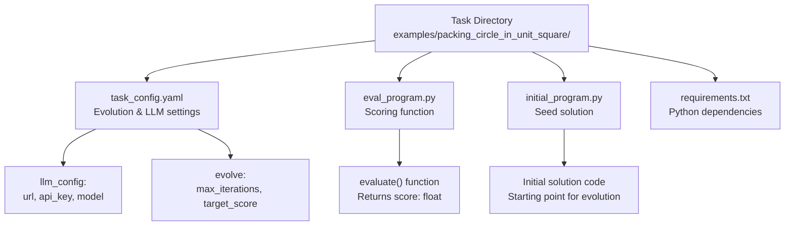
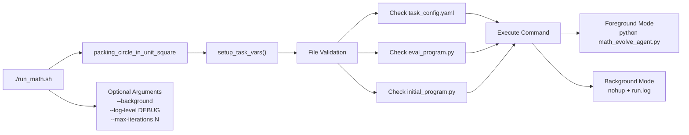
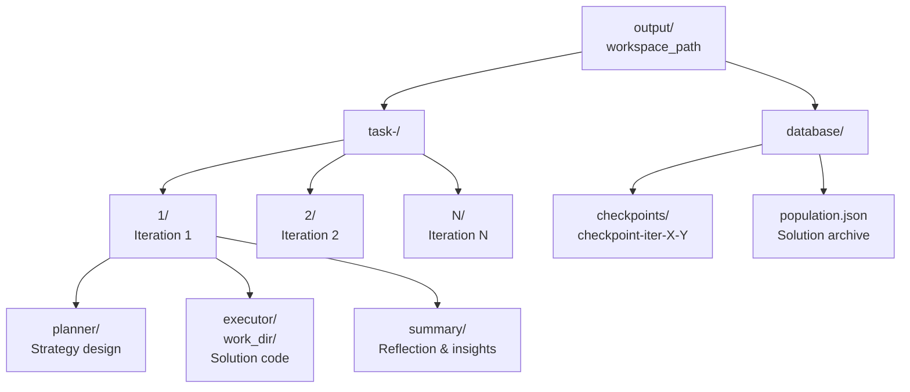
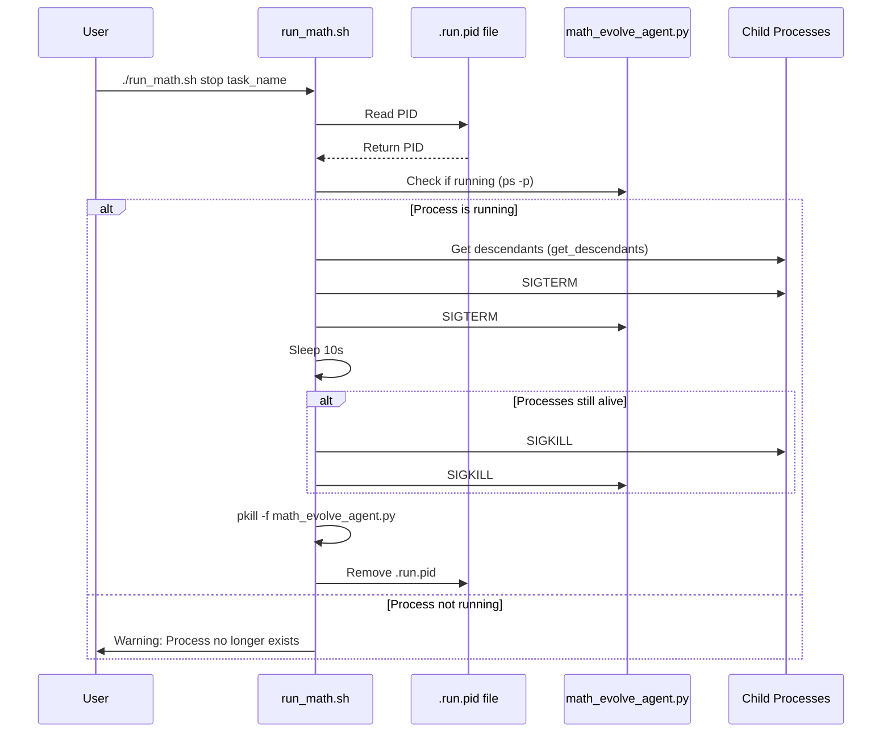
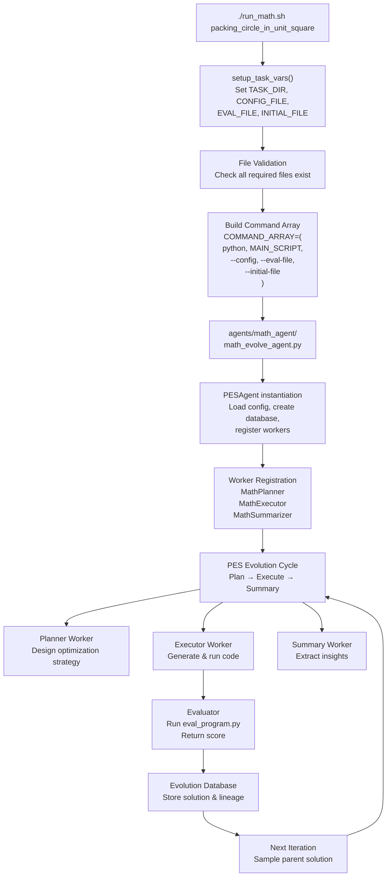

<!-- source: DeepWiki mcp.deepwiki.com · repo baidu-baige/LoongFlow · page 2.3 Quick Start - Math Agent · fetched 2026-10-26 -->

# Quick Start - Math Agent

<details>
<summary>Relevant source files</summary>

The following files were used as context for generating this wiki page:

- [README.md](README.md)
- [agents/ml_agent/README.md](agents/ml_agent/README.md)
- [run_general.sh](run_general.sh)
- [run_math.sh](run_math.sh)

</details>


This page provides a practical walkthrough for running your first Math Agent task. It demonstrates how to configure, execute, and monitor a mathematical optimization problem using the circle packing example.

For a comprehensive overview of Math Agent's architecture and capabilities, see [Math Agent Overview](#5.1). For detailed configuration options, see [Configuration Guide](#5.2). For information about creating custom math tasks, see [Task Structure & Files](#5.3).

## Prerequisites

Before running Math Agent, ensure you have:

- Completed the installation steps from [Installation & Setup](#2.1)
- An active Python 3.12+ environment with LoongFlow installed
- LLM API credentials (OpenAI-compatible endpoint)
- Basic understanding of the PES paradigm (see [PES Paradigm](#3.1))

**Recommended Models**: Math Agent performs best with reasoning-capable models such as `gemini-3-pro-preview` or `deepseek-r1-250528`.

Sources: [README.md:215-235]()

## Task File Structure

Math Agent tasks require three essential files in the task directory:



| File | Purpose | Required |
|------|---------|----------|
| `task_config.yaml` | Configures LLM settings, evolution parameters, and worker configurations | Yes |
| `eval_program.py` | Contains the `evaluate()` function that scores solutions (returns 0.0-1.0+) | Yes |
| `initial_program.py` | Provides the initial seed solution for evolution to start from | Yes |
| `requirements.txt` | Lists Python dependencies needed by the task | No |

Sources: [run_math.sh:27-30](), [README.md:218-228]()

## Step 1: Configure LLM Settings

Navigate to the circle packing example directory and edit the configuration file:

```bash
cd agents/math_agent/examples/packing_circle_in_unit_square
vim task_config.yaml
```

The minimal required configuration involves setting up the LLM connection:

```yaml
llm_config:
  url: "https://your-endpoint/v1"
  api_key: "your-api-key"
  model: "openai/gemini-3-pro-preview"
  temperature: 0.8
  context_length: 128000
  max_tokens: 8192
  top_p: 1.0
```

**Configuration Notes**:
- The `model` field uses provider prefixes (e.g., `openai/`, `anthropic/`)
- Default provider is `openai` if no prefix is specified
- The LiteLLMFormatter handles provider-specific message formatting (see [LLM Integration](#3.5))
- For DeepSeek models, reasoning content is automatically extracted

**Alternative Configuration Methods**:
You can also set LLM credentials via environment variables:

```bash
export ANTHROPIC_API_KEY="your-api-key"
export ANTHROPIC_BASE_URL="your-endpoint"
```

Sources: [README.md:218-224]()

## Step 2: Install Task Dependencies

Most math tasks require specific Python packages for numerical computation:

```bash
# Install task-specific dependencies
uv pip install -r requirements.txt
```

For the circle packing example, this typically includes packages like `numpy`, `scipy`, and `matplotlib` for optimization algorithms and visualization.

Sources: [README.md:227]()

## Step 3: Run the Task

The `run_math.sh` script provides a unified interface for executing Math Agent tasks:



### Foreground Execution

Run the task in the foreground (blocks terminal, shows live output):

```bash
./run_math.sh packing_circle_in_unit_square
```

This executes the following command:

```bash
PYTHONPATH=$PYTHONPATH:./src python agents/math_agent/math_evolve_agent.py \
  --config ./agents/math_agent/examples/packing_circle_in_unit_square/task_config.yaml \
  --eval-file ./agents/math_agent/examples/packing_circle_in_unit_square/eval_program.py \
  --initial-file ./agents/math_agent/examples/packing_circle_in_unit_square/initial_program.py
```

### Background Execution

For long-running evolution tasks, use background mode:

```bash
./run_math.sh packing_circle_in_unit_square --background
```

This command:
1. Starts the task in the background using `nohup`
2. Redirects output to `run.log` in the task directory
3. Stores the process ID in `.run.pid` for later management

Additional Python arguments can be passed after the task name:

```bash
./run_math.sh packing_circle_in_unit_square --background \
  --log-level DEBUG \
  --max-iterations 100
```

Sources: [run_math.sh:1-190](), [README.md:226-229]()

## Step 4: Monitor Progress

### Log File Monitoring

For background tasks, monitor the log file in real-time:

```bash
tail -f ./agents/math_agent/examples/packing_circle_in_unit_square/run.log
```

The log output shows:
- PES cycle progression (Plan → Execute → Summary phases)
- Solution scores for each iteration
- Evolutionary database updates
- Checkpoint creation events

### Workspace Structure

Evolution results are stored in the configured `workspace_path` (typically `./output`):



Each iteration directory contains:

| Subdirectory | Contents |
|--------------|----------|
| `planner/` | Planning phase output: strategy documents, parent solution analysis |
| `executor/` | Execution phase output: `work_dir/` with generated code, `evaluator_dir/` with scores |
| `summary/` | Summary phase output: reflection documents, extracted insights |

Sources: [README.md:226-235]()

## Step 5: Stop the Task

To gracefully stop a background task:

```bash
./run_math.sh stop packing_circle_in_unit_square
```

This command:
1. Reads the PID from `.run.pid` in the task directory
2. Identifies all descendant processes using `get_descendants()`
3. Sends SIGTERM to child processes first
4. Sends SIGTERM to the main process
5. Waits 10 seconds for graceful shutdown
6. Force kills remaining processes with SIGKILL if needed
7. Performs global cleanup to ensure no orphaned processes

The stop process is implemented in [run_math.sh:61-126]():



Sources: [run_math.sh:61-126]()

## Understanding the Execution Flow

When you run a Math Agent task, the following sequence occurs:



The Python entry point at [agents/math_agent/math_evolve_agent.py]() performs these operations:

1. **Configuration Loading**: Parse command-line arguments and load `task_config.yaml`
2. **Database Initialization**: Create Evolution Database with multi-island populations
3. **Worker Registration**: Register domain-specific PES workers (Planner, Executor, Summary)
4. **Seed Population**: Load and evaluate `initial_program.py` to seed the population
5. **Evolution Loop**: Execute PES cycles until `max_iterations` or `target_score` is reached

Sources: [run_math.sh:159-165]()

## Expected Output

For the circle packing problem, a successful run produces:

**Console Output (Foreground Mode)**:
```
✅ Checks passed. Preparing to run task: packing_circle_in_unit_square
------------------------------------------------------------------
🚀 Command to execute:
PYTHONPATH=./src python agents/math_agent/math_evolve_agent.py --config ... --eval-file ... --initial-file ...
------------------------------------------------------------------
[INFO] Iteration 1: Score=2.6234
[INFO] Iteration 2: Score=2.6289
[INFO] Iteration 5: Score=2.6321 (checkpoint created)
[INFO] Iteration 10: Score=2.6342 (checkpoint created)
...
```

**Workspace Files**:
- `output/task-<uuid>/1/executor/work_dir/solution.py`: Generated code for iteration 1
- `output/task-<uuid>/1/planner/plan.md`: Strategy document
- `output/database/checkpoint-iter-5-0/`: Population snapshot at iteration 5

**Final Result**:
The best solution is stored in the Evolution Database and can be accessed through the visualization server (see [Visualization Server](#8.1)) or by inspecting checkpoint files.

Sources: [run_math.sh:167-171]()

## Next Steps

After successfully running your first Math Agent task:

1. **Explore Configuration**: See [Configuration Guide](#5.2) to customize evolution parameters, LLM settings, and worker configurations
2. **Create Custom Tasks**: Follow [Task Structure & Files](#5.3) to build your own mathematical optimization problems
3. **View Results**: Use the visualization server ([Visualization Server](#8.1)) to explore the evolution tree and solution progression
4. **Run Other Examples**: Try additional problems in `agents/math_agent/examples/` such as `packing_circle_in_rectangle` or `max_to_min_ratios`

For understanding how Math Agent achieves SOTA results on mathematical challenges, see [Examples & Results](#5.5).

Sources: [README.md:215-235]()

---

