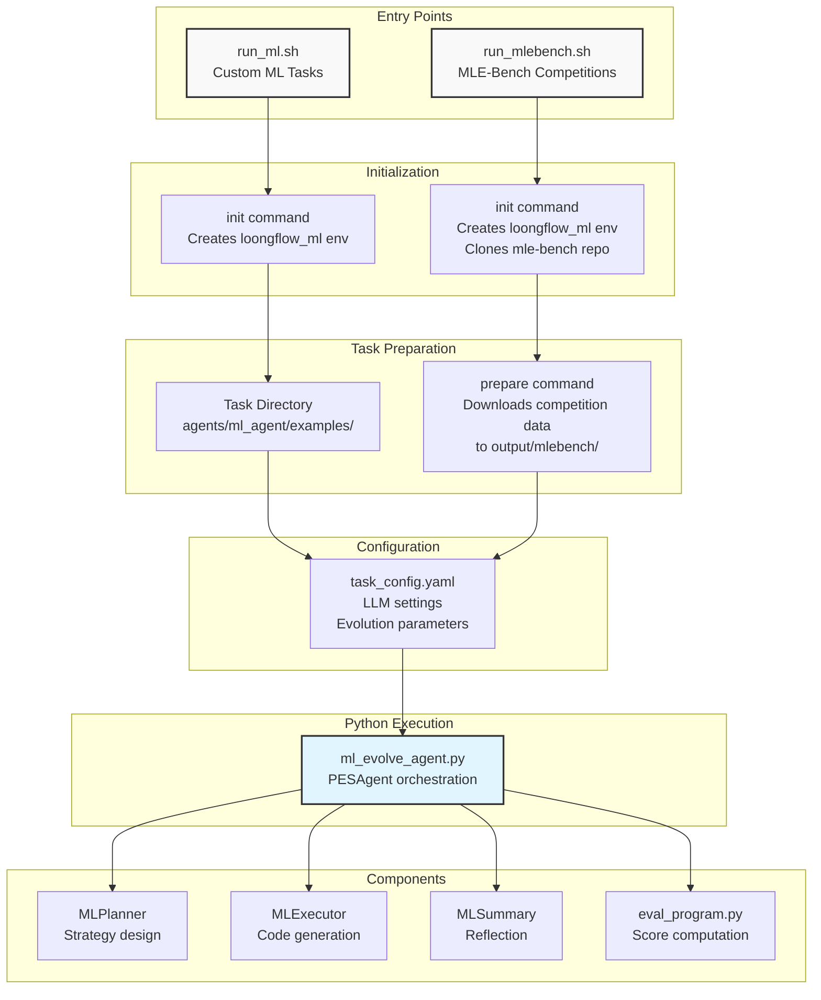
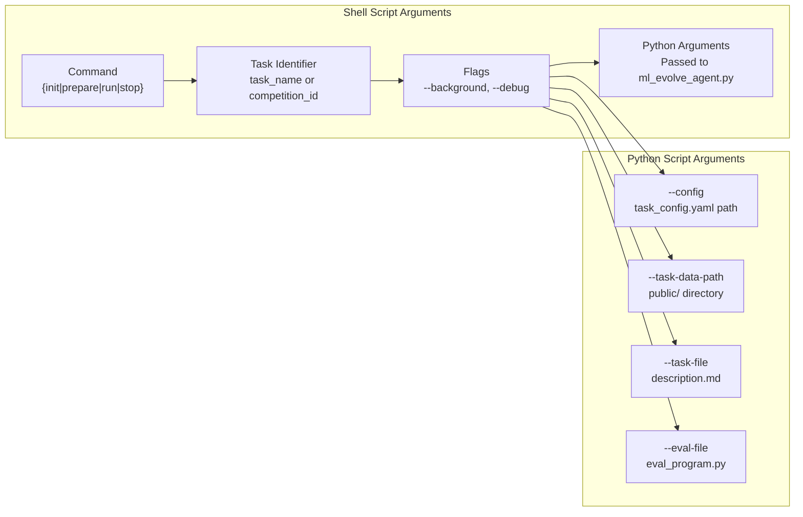
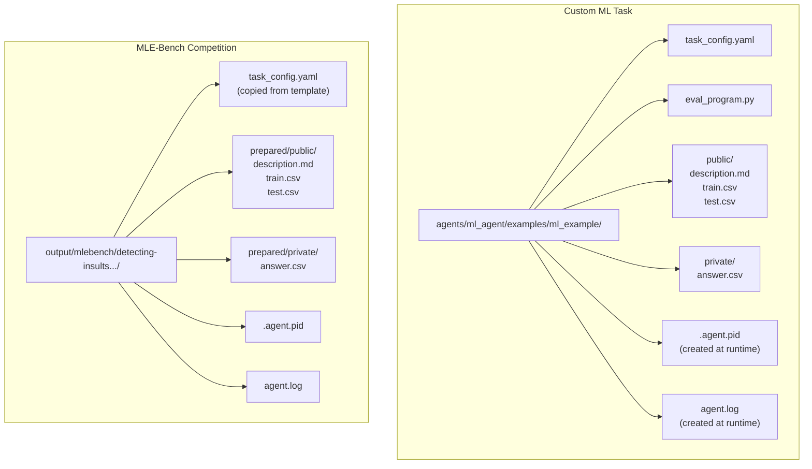

<!-- source: DeepWiki mcp.deepwiki.com · repo baidu-baige/LoongFlow · page 2.4 Quick Start - ML Agent · fetched 2026-10-26 -->

# Quick Start - ML Agent

<details>
<summary>Relevant source files</summary>

The following files were used as context for generating this wiki page:

- [README.md](README.md)
- [agents/ml_agent/README.md](agents/ml_agent/README.md)
- [run_ml.sh](run_ml.sh)
- [run_mlebench.sh](run_mlebench.sh)

</details>


This guide walks you through running your first ML Agent task in under 10 minutes. You will learn how to set up the environment, run both custom ML tasks and MLE-Bench competitions, and monitor the evolution process.

For detailed ML Agent architecture and capabilities, see [ML Agent Overview](#6.1). For configuration options and task creation, see [Configuration Guide](#6.2) and [Running ML Tasks](#6.3).

---

## Prerequisites

Before starting, ensure you have:

| Requirement | Purpose | Installation |
|-------------|---------|--------------|
| **Ubuntu 22.04+** | Operating system (recommended) | - |
| **Python 3.12+** | Runtime environment | Already installed if you completed [Installation & Setup](#2.1) |
| **Mamba/Conda** | Environment manager for ML dependencies | `wget https://github.com/conda-forge/miniforge/releases/latest/download/Mambaforge-Linux-x86_64.sh && bash Mambaforge-Linux-x86_64.sh` |
| **Git LFS** (MLE-Bench only) | Large file storage for competition data | `sudo apt install git-lfs && git lfs install` |
| **Kaggle API** (MLE-Bench only) | Competition data download | Download `kaggle.json` from https://www.kaggle.com/settings/account |

**Kaggle API Setup (MLE-Bench only):**
```bash
mkdir -p ~/.kaggle
mv ~/Downloads/kaggle.json ~/.kaggle/
chmod 600 ~/.kaggle/kaggle.json
```

Sources: [README.md:160-181](), [agents/ml_agent/README.md:16-25]()

---

## ML Agent Execution Paths

The ML Agent provides two execution paths optimized for different use cases:



**Two Shell Script Workflows:**

| Script | Purpose | Task Source | Example |
|--------|---------|-------------|---------|
| `run_ml.sh` | Custom ML tasks | Local task directories in `agents/ml_agent/examples/` | Iris classification, custom datasets |
| `run_mlebench.sh` | MLE-Bench competitions | Downloaded from Kaggle via MLE-Bench library | `detecting-insults-in-social-commentary` |

Both scripts share the same conda environment (`loongflow_ml`) and Python entrypoint ([agents/ml_agent/ml_evolve_agent.py]()), but differ in how tasks are prepared and located.

Sources: [run_ml.sh:1-434](), [run_mlebench.sh:1-579](), [README.md:238-262]()

---

## Quick Start: Custom ML Task

This example uses the pre-configured `ml_example` task (Iris classification) to demonstrate the basic workflow.

### Step 1: Initialize Environment

```bash
# From repository root
cd LoongFlow

# Create conda environment with ML dependencies
./run_ml.sh init
```

The `init` command:
1. Detects GPU availability (lines [run_ml.sh:109-120]())
2. Creates conda environment from [agents/ml_agent/examples/environment_gpu.yaml]() or [environment_cpu.yaml]()
3. Installs Python packages from [requirements_gpu.txt]() or [requirements_cpu.txt]()
4. Environment name: `loongflow_ml` (defined at [run_ml.sh:20]())

**Expected output:**
```
[INFO] Detected NVIDIA GPU, using GPU environment
[INFO] Creating new environment from agents/ml_agent/examples/environment_gpu.yaml...
[SUCCESS] Conda environment 'loongflow_ml' is ready.
```

Sources: [run_ml.sh:131-183]()

### Step 2: Configure LLM Credentials

Edit the task configuration file to add your LLM API credentials:

```bash
vim agents/ml_agent/examples/ml_example/task_config.yaml
```

**Required configuration:**
```yaml
llm_config:
  url: "https://your-llm-endpoint/v1"
  api_key: "your-api-key"
  model: "openai/gemini-3-pro-preview"  # Or deepseek-r1-250528
  temperature: 0.8
  context_length: 128000
  max_tokens: 32768
```

The ML Agent supports any OpenAI-compatible API endpoint. See [LLM Integration](#3.5) for multi-provider support details.

Sources: [agents/ml_agent/README.md:94-102]()

### Step 3: Run the Task

```bash
# Run in foreground (see output immediately)
./run_ml.sh run ml_example

# OR run in background (recommended for long tasks)
./run_ml.sh run ml_example --background
```

**Foreground vs Background Execution:**

| Mode | Command | Output | Use Case |
|------|---------|--------|----------|
| Foreground | `./run_ml.sh run ml_example` | Console output | Testing, debugging |
| Background | `./run_ml.sh run ml_example --background` | Logs to `agent.log` | Production runs, long evolutions |

When running in background, the script:
1. Creates PID file at `agents/ml_agent/examples/ml_example/.agent.pid` ([run_ml.sh:229]())
2. Redirects output to `agents/ml_agent/examples/ml_example/agent.log` ([run_ml.sh:230]())
3. Returns immediately with process ID

Sources: [run_ml.sh:185-306](), [README.md:252-254]()

### Step 4: Monitor Progress

```bash
# View real-time logs
tail -f agents/ml_agent/examples/ml_example/agent.log

# Check evolution database checkpoints
ls -lh output/database/checkpoints/
```

The agent writes structured logs showing:
- Iteration numbers and parent solution IDs
- Planner strategies and execution results
- Evaluation scores and database updates
- Checkpoint creation events

Sources: [run_ml.sh:293-300]()

### Step 5: Stop the Task

```bash
./run_ml.sh stop ml_example
```

The stop command:
1. Reads PID from `.agent.pid` file ([run_ml.sh:328]())
2. Terminates child processes with SIGTERM ([run_ml.sh:346-349]())
3. Force kills with SIGKILL if needed after 10 seconds ([run_ml.sh:369-372]())
4. Cleans up residual processes ([run_ml.sh:381-387]())

Sources: [run_ml.sh:308-379]()

---

## Quick Start: MLE-Bench Competition

MLE-Bench tasks follow a similar workflow but require additional preparation steps to download competition data.

### Step 1: Initialize MLE-Bench Environment

```bash
# From repository root
cd LoongFlow

# Create environment and install mle-bench library
./run_mlebench.sh init
```

The MLE-Bench `init` command additionally:
1. Clones the [mle-bench repository](https://github.com/openai/mle-bench) ([run_mlebench.sh:269]())
2. Fetches Git LFS files for competition data ([run_mlebench.sh:276-278]())
3. Patches TensorFlow version requirement ([run_mlebench.sh:284-289]())
4. Installs `mlebench` library in editable mode ([run_mlebench.sh:295]())

Sources: [run_mlebench.sh:218-305]()

### Step 2: Prepare Competition Data

```bash
# Download and prepare a competition
./run_mlebench.sh prepare detecting-insults-in-social-commentary
```

This command:
1. Downloads competition data from Kaggle via `mlebench prepare` ([run_mlebench.sh:324-326]())
2. Extracts data to `output/mlebench/detecting-insults-in-social-commentary/prepared/public/` ([run_mlebench.sh:342]())
3. Creates `description.md` task file ([run_mlebench.sh:345]())

**Directory structure created:**
```
output/mlebench/detecting-insults-in-social-commentary/
├── prepared/
│   └── public/
│       ├── description.md          # Competition description
│       ├── train.csv               # Training data
│       ├── test.csv                # Test data
│       └── sample_submission.csv   # Submission format
└── private/                        # Ground truth (hidden from agent)
```

Sources: [run_mlebench.sh:307-329]()

### Step 3: Configure LLM (First Run Only)

For the first MLE-Bench run, copy and edit the configuration template:

```bash
# Template is automatically copied on first run
# Edit LLM credentials:
vim output/mlebench/detecting-insults-in-social-commentary/task_config.yaml
```

The script copies [agents/ml_agent/examples/mlebench/task_config.yaml]() to the competition directory if it doesn't exist ([run_mlebench.sh:372-377]()).

Sources: [run_mlebench.sh:371-377]()

### Step 4: Run the Competition

```bash
# Run in background (recommended)
./run_mlebench.sh run detecting-insults-in-social-commentary --background

# Debug mode (computes test scores during evolution)
./run_mlebench.sh run detecting-insults-in-social-commentary --debug
```

**Debug Mode:**
Setting `--debug` flag enables `MLEBENCH_COMPUTE_TEST_SCORE=true` ([run_mlebench.sh:402]()) which makes the evaluator compute scores on test data during evolution. This is useful for debugging but may lead to overfitting.

Sources: [run_mlebench.sh:331-445]()

### Step 5: Monitor and Stop

```bash
# Monitor logs
tail -f output/mlebench/detecting-insults-in-social-commentary/agent.log

# Stop when needed
./run_mlebench.sh stop detecting-insults-in-social-commentary
```

When stopping, the script automatically grades the best submission using `mlebench grade-sample` ([run_mlebench.sh:111-194]()):

```
[INFO] Grading latest best submission from checkpoint:
  checkpoint: output/database/checkpoints/checkpoint-iter-50-0
  submission: output/.../executor/work_dir/submission.csv
[SUCCESS] mlebench grade-sample completed.
Score: 0.85432 (Gold Medal)
```

Sources: [run_mlebench.sh:447-523](), [run_mlebench.sh:111-194]()

---

## Understanding Command Line Arguments

Both shell scripts share a common argument structure:



**Shell script command construction:**

```bash
# run_ml.sh builds this command array (lines 265-275):
python3 -u agents/ml_agent/ml_evolve_agent.py \
  --config agents/ml_agent/examples/ml_example/task_config.yaml \
  --task-data-path agents/ml_agent/examples/ml_example/public \
  --task-file agents/ml_agent/examples/ml_example/public/description.md \
  --eval-file agents/ml_agent/examples/ml_example/eval_program.py \
  [additional_python_args...]
```

The shell scripts handle:
- Environment activation ([run_ml.sh:73-90](), [run_mlebench.sh:75-92]())
- LD_LIBRARY_PATH configuration ([run_ml.sh:84-88]())
- PYTHONPATH setup ([run_ml.sh:262]())
- Process management (background mode, PID tracking, cleanup)

Sources: [run_ml.sh:185-306](), [run_mlebench.sh:331-445]()

---

## Task Directory Structure

Understanding the file layout helps troubleshoot issues and create custom tasks:



**File Requirements:**

| File | Required | Created By | Purpose |
|------|----------|------------|---------|
| `task_config.yaml` | ✅ Yes | User/Template | Evolution and LLM configuration |
| `eval_program.py` | ✅ Yes | User/MLE-Bench | Scoring function implementation |
| `public/description.md` | ✅ Yes | User/MLE-Bench | Task description visible to agent |
| `public/train.csv` | ✅ Yes | User/MLE-Bench | Training data |
| `public/test.csv` | ✅ Yes | User/MLE-Bench | Test features (labels hidden) |
| `private/answer.csv` | ✅ Yes | User/MLE-Bench | Ground truth for evaluation |
| `.agent.pid` | Auto | Shell script | Process ID for background tasks |
| `agent.log` | Auto | Shell script | Execution logs (background mode) |

**Path verification in shell scripts:**

The `run` commands verify all required files exist before launching the Python agent:
- [run_ml.sh:234-245](): Checks `task_config.yaml`, `description.md`, `eval_program.py`, `ml_evolve_agent.py`
- [run_mlebench.sh:354-358](): Checks `task_data_path`, `task_file`, `config_template`, `eval_program`, `evolve_script`

Sources: [run_ml.sh:224-245](), [run_mlebench.sh:340-358](), [agents/ml_agent/README.md:144-167]()

---

## Evolution Output Structure

Both workflows produce identical output structures in the workspace directory:

```
output/
├── <task-uuid>/                    # Unique ID for this evolution run
│   ├── 1/                          # Iteration 1
│   │   ├── planner/
│   │   │   ├── best_plan.md        # Selected strategy
│   │   │   └── trace.json          # Reasoning trace
│   │   ├── executor/
│   │   │   ├── work_dir/           # Generated code and artifacts
│   │   │   │   ├── main.py         # ML pipeline code
│   │   │   │   ├── submission.csv  # Predictions
│   │   │   │   └── ...
│   │   │   └── evaluator_dir/      # Evaluation results
│   │   └── summary/
│   │       └── summary.md          # Insights and learnings
│   ├── 2/                          # Iteration 2
│   ├── 3/                          # Iteration 3
│   └── ...
├── database/
│   └── checkpoints/
│       ├── checkpoint-iter-1-0     # Checkpoint after iteration 1
│       ├── checkpoint-iter-5-0     # Checkpoint after iteration 5
│       └── ...
├── logs/
│   └── evolux.log                  # System logs
└── evaluate/
    └── evaluation_results.json     # Score history
```

**Key artifacts:**
- **best_plan.md**: Strategy selected by the Planner for this iteration
- **work_dir/main.py**: Executable ML pipeline generated by the Executor
- **submission.csv**: Predictions on test data
- **summary.md**: Summary worker's reflection on what worked/failed
- **checkpoint-iter-X-Y**: Database snapshots for resumption

See [Visualization & Monitoring](#8) for tools to explore these artifacts.

Sources: [agents/ml_agent/README.md:70-85]()

---

## Common Tasks

### Resume from Checkpoint

Both agents automatically resume from the latest checkpoint if the database directory exists:

```bash
# First run
./run_ml.sh run ml_example --background

# Stop after some iterations
./run_ml.sh stop ml_example

# Resume automatically picks up from latest checkpoint
./run_ml.sh run ml_example --background
```

The checkpoint detection happens in [agents/ml_agent/ml_evolve_agent.py]() which looks for checkpoint files in `output/database/checkpoints/`.

### Pass Additional Arguments

Any arguments not recognized by the shell script are passed to the Python script:

```bash
# Override max iterations
./run_ml.sh run ml_example --max-iterations 50

# Change output directory
./run_ml.sh run ml_example --workspace-path ./custom_output
```

These are collected in the `python_args` array ([run_ml.sh:189-205]()) and appended to the command array ([run_ml.sh:273-275]()).

### Clean Previous Runs

```bash
# Remove all output artifacts
rm -rf output/

# Remove specific task's output
rm -rf output/database/
rm -rf output/<task-uuid>/
```

Sources: [run_ml.sh:189-275]()

---

## Troubleshooting

### Environment Not Found

**Error:** `Environment 'loongflow_ml' not found`

**Solution:**
```bash
./run_ml.sh init        # or ./run_mlebench.sh init
```

The scripts check environment existence before running ([run_ml.sh:123-127](), [run_mlebench.sh:210-214]()).

### PID File Already Exists

**Error:** `Agent is already running with PID XXXX`

**Solution:**
```bash
# Stop the running agent first
./run_ml.sh stop ml_example

# Or remove stale PID file if process is dead
rm agents/ml_agent/examples/ml_example/.agent.pid
```

The scripts validate PID file status before starting ([run_ml.sh:248-256]()).

### Competition Data Not Found

**Error:** `Task data path '...' not found`

**Solution:**
```bash
# For MLE-Bench, run prepare first
./run_mlebench.sh prepare <competition_id>
```

The `prepare` command must complete successfully before `run` ([run_mlebench.sh:307-329]()).

### GPU Not Detected

If you have a GPU but the script uses CPU environment:

```bash
# Verify nvidia-smi works
nvidia-smi

# If it works, the GPU detection function may need adjustment
# Check run_ml.sh:109-120 or run_mlebench.sh:196-207
```

Sources: [run_ml.sh:109-120](), [run_ml.sh:123-127](), [run_ml.sh:248-256](), [run_mlebench.sh:196-207](), [run_mlebench.sh:210-214]()

---

## Next Steps

After completing this quick start:

- **Explore Results**: See [Examples & Results](#6.5) for MLE-Bench medal analysis
- **Create Custom Tasks**: Follow [MLE-Bench Integration](#6.4) to set up new competitions
- **Understand Architecture**: Read [ML Agent Overview](#6.1) for implementation details
- **Monitor Evolution**: Use [Visualization Server](#8.1) for real-time progress tracking
- **Tune Parameters**: Adjust [Configuration](#6.2) for better performance

Sources: [README.md:238-262](), [agents/ml_agent/README.md:27-68]()

---

