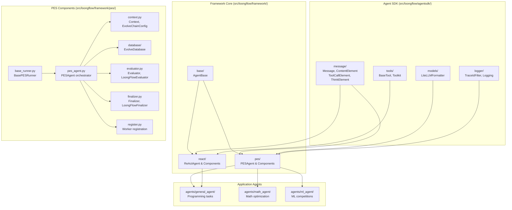
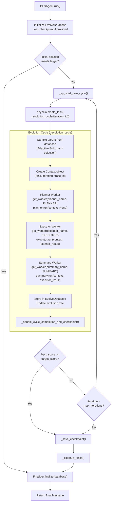
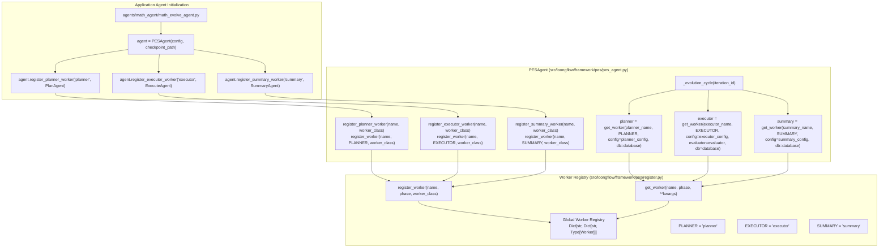
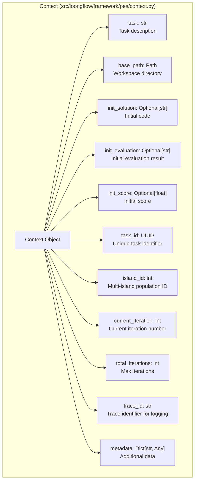
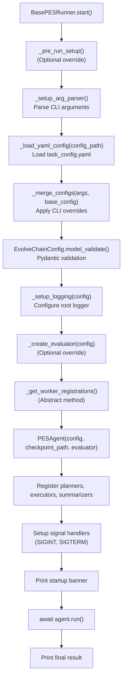
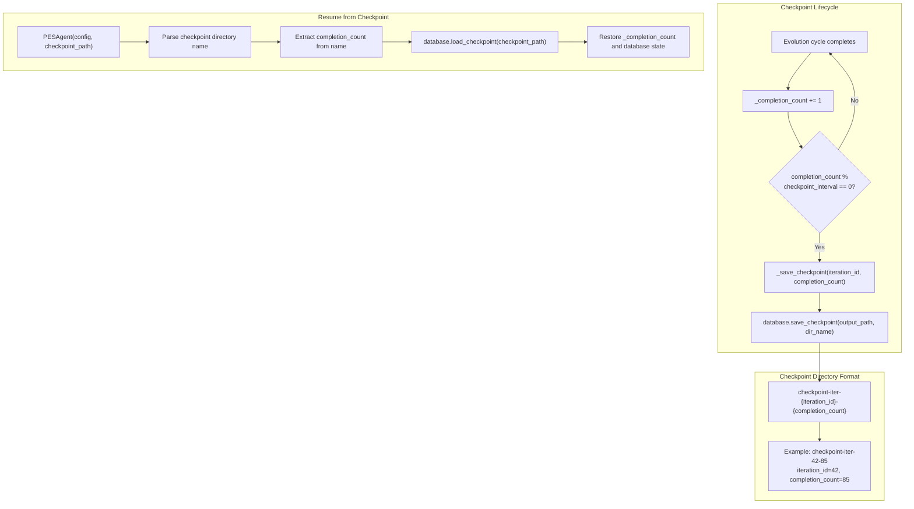
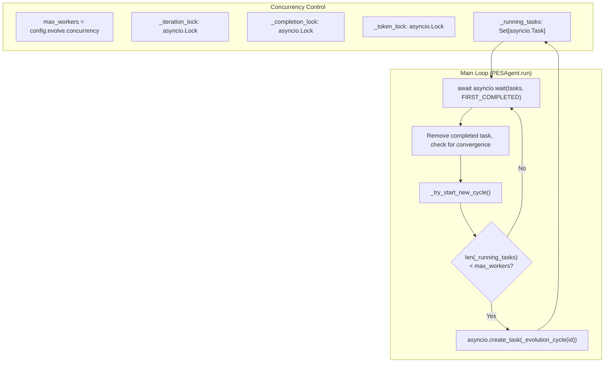
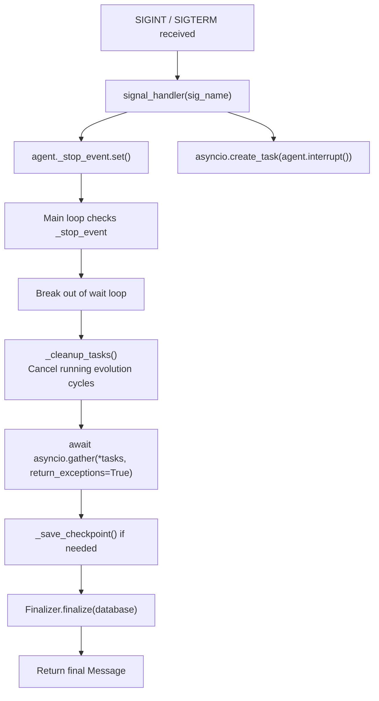
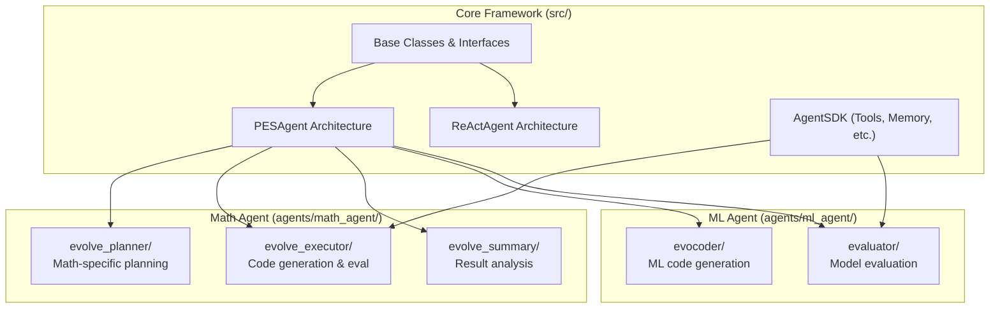

<!-- source: DeepWiki mcp.deepwiki.com · repo baidu-baige/LoongFlow · page 3 Core Framework · fetched 2026-10-26 -->

# Core Framework

<details>
<summary>Relevant source files</summary>

The following files were used as context for generating this wiki page:

- [README.md](README.md)
- [agents/ml_agent/README.md](agents/ml_agent/README.md)
- [src/loongflow/framework/pes/base_runner.py](src/loongflow/framework/pes/base_runner.py)
- [src/loongflow/framework/pes/pes_agent.py](src/loongflow/framework/pes/pes_agent.py)

</details>


The LoongFlow Core Framework provides the foundational architecture for building expert-grade AI agents. It defines two primary agent types (PESAgent and ReActAgent), establishes the worker/component abstraction pattern, and provides integration layers for LLMs, tools, and memory systems.

## Overview

The Core Framework is organized around several key architectural patterns:

1. **Dual Agent Architectures**: PESAgent for evolutionary optimization tasks and ReActAgent for reactive problem-solving
2. **Modular Component System**: Worker and component abstractions enable domain-specific customization
3. **Unified Configuration**: YAML-based configuration with Pydantic validation
4. **Multi-Provider LLM Integration**: Abstract interface supporting multiple LLM providers
5. **Asynchronous Execution**: Built on Python's async/await for concurrent operations

**Detailed Subsystem Documentation:**
- **PES Paradigm** (Page 3.1): The Plan-Execute-Summary thinking paradigm
- **PESAgent Architecture** (Page 3.2): Evolutionary agent implementation details
- **ReActAgent Architecture** (Page 3.3): Reactive agent implementation details
- **Evolutionary Memory System** (Page 3.4): Multi-structure fusion memory mechanics
- **LLM Integration** (Page 3.5): Multi-provider support and message formatting
- **BasePESRunner & Configuration** (Page 3.6): Runner template and configuration loading

## Framework Architecture

### High-Level Component Organization

**Core Framework Structure**



**Sources:** [src/loongflow/framework/pes/pes_agent.py:1-599](), [src/loongflow/framework/pes/base_runner.py:1-505]()

### Directory Structure

| Directory | Purpose | Key Components |
|-----------|---------|----------------|
| `src/loongflow/framework/base/` | Abstract base classes | `AgentBase` |
| `src/loongflow/framework/pes/` | PESAgent implementation | `PESAgent`, `Context`, `EvolveDatabase`, `Evaluator`, `Finalizer` |
| `src/loongflow/framework/pes/database/` | Evolution database | `EvolveDatabase`, checkpoint system |
| `src/loongflow/framework/react/` | ReActAgent implementation | `ReActAgent`, reactive components |
| `src/loongflow/agentsdk/message/` | Message structures | `Message`, `ContentElement`, `ToolCallElement` |
| `src/loongflow/agentsdk/tools/` | Tool system | `BaseTool`, `Toolkit` |
| `src/loongflow/agentsdk/models/` | Data models | `LiteLLMFormatter`, configuration schemas |

**Sources:** [src/loongflow/framework/pes/pes_agent.py:1-30](), [src/loongflow/framework/pes/base_runner.py:1-30]()

## Agent Architectures

LoongFlow provides two agent architectures optimized for different problem domains.

### Architecture Comparison

| Aspect | ReActAgent | PESAgent |
|--------|-----------|----------|
| **Use Case** | Tool orchestration, Q&A, simple automation | Expert problem solving, optimization, evolution |
| **Thinking Model** | Reason-Act-Observe cycle | Plan-Execute-Summary paradigm |
| **Memory** | Stateless | Multi-structure evolutionary memory |
| **Iteration Model** | Single-pass or limited retries | Multi-iteration with convergence criteria |
| **Component Model** | Reasoner → Actor → Observer | Planner → Executor → Summary |
| **Configuration** | Minimal setup | Comprehensive configuration required |
| **Concurrency** | Single execution | Parallel evolution cycles supported |

**Sources:** [README.md:154-156]()

### PESAgent Execution Flow

**PESAgent Evolution Cycle**



**Sources:** [src/loongflow/framework/pes/pes_agent.py:174-328](), [src/loongflow/framework/pes/pes_agent.py:399-572]()

### ReActAgent Execution Flow

ReActAgent implements a simpler Reason-Act-Observe loop for reactive problem-solving. The agent uses a `Toolkit` of registered tools and iterates through reasoning and action steps until a solution is reached or a step limit is hit.

**Typical Usage Pattern:**

```python
# Build toolkit with domain tools
toolkit = Toolkit()
toolkit.register_tool(TodoReadTool())
toolkit.register_tool(TodoWriteTool())

# Create agent with default configuration
agent = ReActAgent.create_default(
    model=model, 
    sys_prompt=sys_prompt, 
    toolkit=toolkit
)

# Execute
result = await agent(message)
```

**Sources:** [README.md:460-476]()

## Worker Registration and Component Model

PESAgent uses a **Worker registration pattern** where domain-specific implementations of Planner, Executor, and Summary phases are registered with the agent at initialization.

### Worker Registration Pattern

**Worker Registration in PESAgent**



**Sources:** [src/loongflow/framework/pes/pes_agent.py:141-172](), [src/loongflow/framework/pes/pes_agent.py:230-289](), [README.md:439-455]()

### Worker Lifecycle in Evolution Cycle

Each worker in the PES cycle follows a standardized execution pattern:

**Worker Execution Sequence:**

1. **Worker Instantiation**: `get_worker()` creates a new worker instance with configuration
2. **Worker Execution**: `worker.run(context, input_message)` executes the worker's logic
3. **Result Return**: Worker returns a `Message` object with execution results
4. **Token Tracking**: Framework extracts token usage from `ContentElement` data

**Worker Interface Contract:**

Each worker class must implement:
- `async def run(self, context: Context, input_message: Optional[Message]) -> Message`
  - `context`: Contains task definition, iteration metadata, workspace paths
  - `input_message`: Output from previous phase (None for Planner)
  - Returns: `Message` with results and metadata

**Token Usage Tracking:**

```python
# From src/loongflow/framework/pes/pes_agent.py:238-246
plan_content = planner_result.get_elements(ContentElement)
if plan_content and len(plan_content) > 0:
    async with self._token_lock:
        self.total_prompt_tokens += plan_content[0].data.get(
            "total_prompt_tokens", 0
        )
        self.total_completion_tokens += plan_content[0].data.get(
            "total_completion_tokens", 0
        )
```

**Sources:** [src/loongflow/framework/pes/pes_agent.py:230-289](), [src/loongflow/framework/pes/pes_agent.py:238-268]()

## Context and Configuration

### Context Object

The `Context` object carries metadata and state information throughout an evolution cycle.

**Context Structure:**



**Context Creation in Evolution Cycle:**

```python
# From src/loongflow/framework/pes/pes_agent.py:214-226
context = Context(
    task=evolve_conf.task,
    base_path=evolve_conf.workspace_path,
    init_solution=evolve_conf.initial_code,
    init_evaluation=evolve_conf.initial_evaluation,
    init_score=evolve_conf.initial_score,
    task_id=self.task_id,
    island_id=current_island_id,
    current_iteration=iteration_id,
    total_iterations=self.max_iterations,
    trace_id=trace_id,
    metadata=evolve_conf.metadata,
)
```

**Sources:** [src/loongflow/framework/pes/pes_agent.py:214-226]()

### EvolveChainConfig

The `EvolveChainConfig` class (Pydantic model) defines the complete configuration schema for a PESAgent run.

**Configuration Hierarchy:**

| Section | Type | Purpose |
|---------|------|---------|
| `llm_config` | `LLMConfig` | LLM provider settings (URL, API key, model, temperature) |
| `evolve` | `EvolveConfig` | Evolution parameters (max_iterations, target_score, concurrency) |
| `evolve.database` | `DatabaseConfig` | Database settings (num_islands, population_size, checkpoint_interval) |
| `evolve.evaluator` | `EvaluatorConfig` | Evaluator settings (timeout, evaluate_code) |
| `planners` | `Dict[str, Any]` | Planner worker configurations |
| `executors` | `Dict[str, Any]` | Executor worker configurations |
| `summarizers` | `Dict[str, Any]` | Summary worker configurations |
| `logger` | `LoggerConfig` | Logging configuration (level, file paths) |

**Sources:** [src/loongflow/framework/pes/pes_agent.py:44-68]()

## BasePESRunner Template

The `BasePESRunner` abstract base class provides a reusable template for building PES agent runners, reducing code duplication across different agent types.

**BasePESRunner Workflow**



**Sources:** [src/loongflow/framework/pes/base_runner.py:29-505]()

### BasePESRunner Abstract Methods

Subclasses must implement these methods:

| Method | Purpose | Return Type |
|--------|---------|-------------|
| `_add_custom_args(parser)` | Add agent-specific CLI arguments | `None` |
| `_merge_custom_configs(args, config)` | Merge custom CLI args into config | `Dict[str, Any]` |
| `_get_process_name()` | Return display name for the process | `str` |
| `_get_worker_registrations()` | Return worker class mappings | `Tuple[List, List, List]` |

Optional overrides:

| Method | Purpose | Default Behavior |
|--------|---------|------------------|
| `_create_evaluator(config)` | Create custom evaluator | Returns `None` (uses default) |
| `_pre_run_setup()` | Execute setup before agent starts | No-op |

**Sources:** [src/loongflow/framework/pes/base_runner.py:161-381]()

### Configuration Loading and Merging

**Configuration Merge Priority (highest to lowest):**

1. **CLI Arguments**: Command-line flags override everything
2. **YAML Configuration**: `task_config.yaml` provides base settings
3. **Default Values**: Pydantic model defaults for unspecified fields

**Common CLI Arguments:**

```bash
# Core arguments
--config PATH               # Required: path to task_config.yaml
--checkpoint-path PATH      # Resume from checkpoint

# Task overrides
--task TEXT                 # Override task description
--task-file PATH            # Load task from file
--eval-file PATH            # Override evaluator code
--workspace-path PATH       # Override workspace directory

# Evolution overrides
--max-iterations N          # Override max iterations
--target-score FLOAT        # Override target score
--planner NAME              # Override planner worker name
--executor NAME             # Override executor worker name
--summary NAME              # Override summary worker name

# Logging overrides
--log-level LEVEL           # DEBUG, INFO, WARNING, ERROR, CRITICAL
--log-path PATH             # Override log directory
```

**Sources:** [src/loongflow/framework/pes/base_runner.py:59-159](), [src/loongflow/framework/pes/base_runner.py:177-254]()

## Checkpoint System

PESAgent implements automatic checkpointing to enable resumption after interruptions.

**Checkpoint Mechanism**



**Sources:** [src/loongflow/framework/pes/pes_agent.py:86-129](), [src/loongflow/framework/pes/pes_agent.py:330-375]()

### Checkpoint Naming Convention

**Format:** `checkpoint-iter-{iteration_id}-{completion_count}`

- `iteration_id`: The iteration ID that just completed
- `completion_count`: Total number of completed evolution cycles (cumulative)

**Example:**
- `checkpoint-iter-12-5`: Iteration 12 completed, 5 total cycles finished
- `checkpoint-iter-37-85`: Iteration 37 completed, 85 total cycles finished

**Checkpoint Interval Configuration:**

```yaml
# In task_config.yaml
evolve:
  database:
    checkpoint_interval: 5  # Save checkpoint every 5 completed cycles
```

Setting `checkpoint_interval: 0` disables automatic checkpointing.

**Sources:** [src/loongflow/framework/pes/pes_agent.py:330-375](), [src/loongflow/framework/pes/pes_agent.py:86-116]()

## Concurrency and Asynchronous Execution

LoongFlow's core framework uses Python's `async/await` for concurrent operations.

### Concurrency Model

**PESAgent Concurrent Evolution:**



**Concurrency Configuration:**

```yaml
# In task_config.yaml
evolve:
  concurrency: 3  # Run up to 3 evolution cycles in parallel
```

**Lock Usage:**

- **`_iteration_lock`**: Protects iteration counter when starting new cycles
- **`_completion_lock`**: Protects completion counter and checkpoint logic
- **`_token_lock`**: Protects token usage counters (thread-safe accumulation)

**Sources:** [src/loongflow/framework/pes/pes_agent.py:74-84](), [src/loongflow/framework/pes/pes_agent.py:377-397](), [src/loongflow/framework/pes/pes_agent.py:445-519]()

### Async Execution Patterns

**Key Async Operations:**

| Component | Async Method | Purpose |
|-----------|-------------|---------|
| `PESAgent` | `async def run()` | Main evolution loop |
| `Worker` | `async def run(context, input_message)` | Worker execution |
| `Evaluator` | `async def evaluate(message)` | Solution evaluation |
| `Database` | `async def save_checkpoint(path, name)` | Checkpoint persistence |
| `Finalizer` | `async def finalize(database, **kwargs)` | Final result generation |

**Sources:** [src/loongflow/framework/pes/pes_agent.py:399-572]()

## Signal Handling and Graceful Shutdown

PESAgent implements graceful shutdown when receiving interrupt signals.

**Signal Handling Flow:**



**Signal Handler Registration:**

```python
# From src/loongflow/framework/pes/base_runner.py:446-459
def signal_handler(sig_name: str) -> None:
    print(f"\n🛑 Received signal {sig_name}. Initiating graceful shutdown...")
    agent._stop_event.set()
    if interrupt_task is None or interrupt_task.done():
        interrupt_task = asyncio.create_task(agent.interrupt())

for sig in (signal.SIGINT, signal.SIGTERM):
    loop.add_signal_handler(sig, lambda s=sig: signal_handler(s.name))
```

**Sources:** [src/loongflow/framework/pes/base_runner.py:446-459](), [src/loongflow/framework/pes/pes_agent.py:574-598]()

## Error Handling and Validation

### Configuration Validation

All configuration is validated using Pydantic models with strict type checking:

```python
# From src/loongflow/framework/pes/base_runner.py:400-413
try:
    config = EvolveChainConfig.model_validate(final_config_dict)
except ValidationError as e:
    print("\n--- Configuration Validation Error ---")
    print(f"Details:\n{e}")
    sys.exit(1)
```

**Validation Features:**
- Type checking for all configuration fields
- Required field enforcement
- Value range validation (e.g., `concurrency >= 1`)
- Nested configuration validation

**Sources:** [src/loongflow/framework/pes/base_runner.py:400-413]()

### Evolution Cycle Error Handling

**Error Recovery in Evolution Cycles:**

```python
# From src/loongflow/framework/pes/pes_agent.py:318-328
except asyncio.CancelledError:
    logger.warning(f"Evolution cycle for iteration {iteration_id} was cancelled.")
    time.sleep(3)
except Exception as e:
    logger.error(
        f"Evolution cycle for iteration {iteration_id} failed: {e}",
        exc_info=True,
    )
    time.sleep(3)
```

Failed evolution cycles log errors but don't crash the entire process. The agent continues with remaining cycles and new iterations.

**Sources:** [src/loongflow/framework/pes/pes_agent.py:318-328]()

---

## Extension Points

The Core Framework provides multiple extension points for custom implementations:

| Extension Point | Interface | Use Case |
|----------------|-----------|----------|
| Custom Workers | `BaseWorker` (in `src/evolux/base/`) | Implement domain-specific Planner/Executor/Summary logic |
| Custom Components | Component interfaces (in `src/evolux/react/`) | Custom Reasoner/Actor/Observer/Finalizer for ReActAgent |
| Custom Tools | `BaseTool` (in `src/agentsdk/tools/`) | Add new tool capabilities to ReActAgent |
| Custom Memory | Memory interfaces (in `src/agentsdk/memory/`) | Alternative memory/retrieval strategies |
| Custom Evaluators | Evaluation functions | Domain-specific scoring and fitness functions |

**Sources:** [AGENTS.md:85-109]()

---

## Framework Dependencies

The Core Framework relies on the following key dependencies:

**Core Libraries:**

| Dependency | Version | Purpose |
|------------|---------|---------|
| Python | 3.12+ | Language runtime (strict requirement) |
| Pydantic | Latest | Data validation and schema definition |
| litellm | ≥1.80.10 | Multi-provider LLM client |
| openai | ≥1.102.0 | OpenAI-compatible API support |

**Package Management:**

- **Primary**: `uv` (recommended for all operations)
- **Alternative**: `conda` (supported but not preferred)
- **Lock file**: `uv.lock` (dependency resolution)
- **Project definition**: `pyproject.toml`

**Sources:** [AGENTS.md:38-42](), [AGENTS.md:46-54](), [README.md:134-153]()

---

## Relationship to Application Agents

The Core Framework provides the foundation for specialized agent implementations:



**Design Principle:** The Core Framework (`src/`) remains domain-agnostic. All domain-specific logic resides in agent implementations (`agents/`).

**Sources:** [AGENTS.md:10-28](), [AGENTS.md:105-109]()

---

