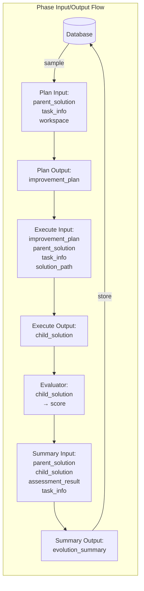
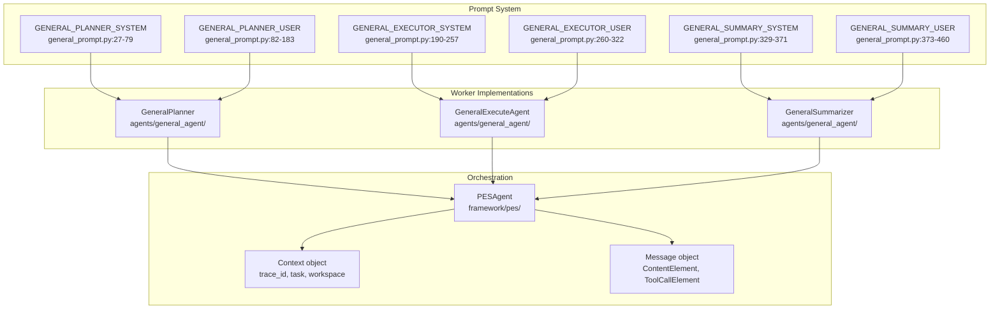

<!-- source: DeepWiki mcp.deepwiki.com · repo baidu-baige/LoongFlow · page 3.1 PES Paradigm (Plan-Execute-Summary) · fetched 2026-10-26 -->

# PES Paradigm (Plan-Execute-Summary)

<details>
<summary>Relevant source files</summary>

The following files were used as context for generating this wiki page:

- [README.md](README.md)
- [agents/general_agent/README.md](agents/general_agent/README.md)
- [agents/general_agent/README_zh.md](agents/general_agent/README_zh.md)
- [agents/ml_agent/README.md](agents/ml_agent/README.md)
- [src/loongflow/framework/claude_code/general_prompt.py](src/loongflow/framework/claude_code/general_prompt.py)

</details>


This document explains the **PES (Plan-Execute-Summary) thinking paradigm**, the core cognitive framework that enables LoongFlow agents to tackle complex, long-horizon reasoning tasks through structured iteration. PES transforms evolution from blind mutation into guided, reasoning-driven improvement.

**Scope**: This page covers the conceptual model, the three phases, prompt engineering strategy, and how PES structures agent behavior. For implementation details of the orchestration layer, see [PESAgent Architecture](#3.2). For component-specific implementations (General Agent's Planner, Executor, etc.), see sections [4.2](#4.2), [4.3](#4.3), and [4.4](#4.4).

---

## Conceptual Overview

The PES paradigm reorganizes agent behavior around how human experts approach complex problems: **plan strategically, execute deliberately, and learn from outcomes**.

### The Core Insight

Traditional evolutionary agents mutate solutions randomly and select survivors based on fitness scores. This works for search-heavy problems but struggles with expert-level tasks requiring deep reasoning because:

- Exploration is blind or weakly guided
- Long-horizon reasoning chains break easily  
- Experience remains task-specific and is not reused
- Agents converge prematurely to local optima

PES addresses these limitations by shifting the abstraction from *evolving outputs* to **standardizing how agents think, act, and learn**. Instead of random mutations, each iteration follows an explicit three-phase cognitive cycle.

### From Evolution to Reasoning

LoongFlow embeds evolutionary mechanisms (population management, selection, memory) **within a structured thinking process**. Each "evolution iteration" is actually a complete reasoning cycle:

```
Traditional Evolution: Mutate → Evaluate → Select
PES Evolution:         Plan → Execute → Summary → Store in Memory → Sample Parent → Repeat
```

This transformation enables agents to:
- **Plan deliberately** rather than mutate randomly
- **Execute with intent** rather than generate blindly
- **Learn systematically** rather than discard failed attempts
- **Accumulate experience** across iterations through structured memory

Sources: [README.md:266-353]()

---

## The Three Phases

### Architectural Diagram

```mermaid
graph TB
    subgraph "PES Cycle - Single Iteration"
        DB[(Evolution Database<br/>Population + Tree Memory)]
        
        Sample[Sample Parent<br/>Boltzmann Selection]
        
        Plan[Plan Phase<br/>Strategy Design]
        Execute[Execute Phase<br/>Implementation]
        Summary[Summary Phase<br/>Reflection]
        
        Evaluate[Evaluator<br/>Score Assignment]
        Store[Store Child<br/>Update Lineage]
    end
    
    DB --> Sample
    Sample -->|Parent Solution<br/>score, plan, summary| Plan
    
    Plan -->|Improvement Plan<br/>strategy, steps| Execute
    Execute -->|Child Solution<br/>generated output| Evaluate
    Evaluate -->|Score + Metrics| Summary
    
    Summary -->|Evolution Insights<br/>what worked, what failed| Store
    Store --> DB
    
    DB -.next iteration.-> Sample
    
    style Plan fill:#e1f5ff
    style Execute fill:#fff4e1
    style Summary fill:#f0e1ff
```



Sources: [README.md:299-336](), Diagram 2 from system overview

---

### Phase 1: Plan

**Role**: Design a clear, actionable strategy for the Execute phase to implement.

The Planner receives:
- **Task objective**: What we're trying to accomplish
- **Parent solution**: Previous attempt (if any) with its score, plan, and summary
- **Evolution memory**: Access to database tools for querying past attempts
- **Skills**: Domain-specific capabilities available in the workspace

The Planner produces:
- **Improvement plan**: A structured markdown document with situation analysis, strategy, action steps, expected deliverables, and success criteria

#### Planning Behaviors by Task Type

The Planner adapts its approach based on task characteristics:

| Task Type | Planning Focus | Example Output |
|-----------|---------------|----------------|
| **Optimization** | Identify bottlenecks, select improvement approach, define expected gains | "Refactor sorting algorithm to use quicksort; expected 2x speedup" |
| **Diagnostic** | Generate hypotheses, design tests, specify validation methods | "Test database connection, check query timeout settings" |
| **Generation** | Define approach, structure, quality criteria, deliverable format | "Create REST API with 3 endpoints; JSON responses; OpenAPI spec" |
| **Analysis** | Specify what to examine, methods to use, patterns to identify | "Analyze sales data by region; use regression; identify seasonality" |

#### Prompt Structure

The Planner's behavior is defined by `GENERAL_PLANNER_SYSTEM` and `GENERAL_PLANNER_USER` prompts. Key prompt elements:

- **System prompt**: Establishes the Planner's role, available resources, and key principles
- **User prompt**: Provides task context, parent solution, and required plan structure
- **Required output format**: Enforces a specific markdown structure (Situation Analysis → Strategy → Action Steps → Expected Deliverables → Success Criteria)

The prompts emphasize:
- **Plan-task alignment**: Every element must serve the task objective
- **Actionability**: The Executor must understand exactly what to do
- **Learning from history**: Use database tools to avoid repeating failures
- **Skill integration**: Leverage Skills when task-relevant to produce professional output

Sources: [src/loongflow/framework/claude_code/general_prompt.py:23-183](), [README.md:305-313]()

---

### Phase 2: Execute

**Role**: Transform strategic plans into concrete solutions.

The Executor receives:
- **Task objective**: Original problem statement
- **Improvement plan**: Strategy from the Plan phase
- **Parent solution**: Cloned into working directory (if exists)
- **Skills**: Domain-specific tools and knowledge

The Executor produces:
- **Child solution**: A Solution Pack (directory with multiple files + manifest)

#### Solution Pack Concept

All solutions in LoongFlow follow the **Solution Pack format** - a directory structure containing:

```
solution_pack/
├── index.json              # Auto-generated manifest (file types, descriptions)
├── src/                    # Core implementation files
├── tests/                  # Test files
├── docs/                   # Documentation (README, architecture notes)
└── config/                 # Configuration files
```

This structure enables:
- **Multi-file solutions**: Complex implementations with proper organization
- **Incremental improvement**: Clone parent, modify specific files
- **Clear navigation**: Manifest provides high-level overview
- **Version tracking**: Full solution state captured in directory

#### Execution Behaviors by Task Type

| Task Type | Executor Deliverables | Organization |
|-----------|----------------------|--------------|
| **Optimization** | Improved code/algorithm + tests | `src/optimized_algo.py`, `tests/test_performance.py` |
| **Diagnostic** | Investigation report + evidence | `docs/diagnosis.md`, `logs/`, `tests/reproduce_issue.py` |
| **Generation** | Generated artifact + documentation | `src/app.py`, `docs/README.md`, `config/settings.yaml` |
| **Analysis** | Analysis results + supporting data | `reports/analysis.md`, `data/processed/`, `notebooks/` |

#### Prompt Structure

The Executor's behavior is defined by `GENERAL_EXECUTOR_SYSTEM` and `GENERAL_EXECUTOR_USER` prompts. Key elements:

- **Working in Solution Packs**: Executor operates inside a directory, creates/modifies files using tools
- **Quality standards**: Complete (no placeholders), verifiable (testable), improvement-oriented
- **Skill-first approach**: Use Skills when task-relevant for professional output
- **Adaptive execution**: Follow the plan but adjust if necessary, documenting changes

Sources: [src/loongflow/framework/claude_code/general_prompt.py:186-322](), [README.md:314-322]()

---

### Phase 3: Summary

**Role**: Evaluate outcomes and extract reusable insights for future iterations.

The Summary phase receives:
- **Task objective**: Original problem statement  
- **Parent solution**: Previous attempt with its score and context
- **Child solution**: New solution produced by Executor
- **Assessment result**: Score from Evaluator, plus metrics and feedback

The Summary phase produces:
- **Evolution summary**: Structured analysis of what happened, what worked, what failed, and recommendations

#### Summary Categories

| Category | Condition | Implication |
|----------|-----------|-------------|
| **IMPROVEMENT** | Child score > Parent score | Strategy was effective; identify successful patterns |
| **REGRESSION** | Child score < Parent score | Strategy failed; analyze root cause |
| **STALE** | Child score ≈ Parent score | No meaningful progress; need different approach |

#### Analysis Framework

The Summarizer follows a structured process:

1. **Assess outcome**: Compare scores and determine category
2. **Analyze changes**: Compare Solution Pack structures (manifests, file diffs)
3. **Identify successes**: What worked and why (causal reasoning)
4. **Identify failures**: What didn't work and why (even for improvements)
5. **Extract patterns**: Generalizable lessons for future iterations
6. **Guide next steps**: Actionable recommendations

#### Prompt Structure

The Summary's behavior is defined by `GENERAL_SUMMARY_SYSTEM` and `GENERAL_SUMMARY_USER` prompts. Key elements:

- **Evidence-based analysis**: Use manifests and selective file reading, not exhaustive inspection
- **Causal over correlational**: Explain *why* something worked or failed
- **Balanced perspective**: Acknowledge both successes and failures
- **Actionable insights**: Provide concrete guidance for next iteration
- **Required structure**: Assessment → What Was Done → What Worked → What Didn't Work → Insights → Recommendations

The insights generated here feed back into the Evolution Database and are retrieved by future Planners through memory tools.

Sources: [src/loongflow/framework/claude_code/general_prompt.py:325-460](), [README.md:323-333]()

---

## Phase Communication and Data Flow

### Message Flow Diagram



### Context Object

Each phase operates within a shared **Context** object that carries iteration metadata:

- `trace_id`: Unique identifier for this iteration
- `iteration`: Current iteration number
- `task`: Task objective string
- `workspace`: Working directory path
- `parent_solution`: Parent solution data (if exists)
- `island_num`: Number of islands in the database
- `parent_island`: Which island the parent came from

This context flows through all three phases, providing consistent state.

### Message Objects

Communication between phases uses **Message** objects with typed elements:

| Element Type | Purpose | Example |
|--------------|---------|---------|
| `ContentElement` | Plain text content | Task descriptions, feedback |
| `ToolCallElement` | Tool invocation records | File reads, database queries |
| `ThinkElement` | Reasoning traces | Analysis steps, decision rationale |

These structured messages enable the framework to:
- Track tool usage across phases
- Preserve reasoning chains for debugging
- Convert between different LLM formats (via `LiteLLMFormatter`)

Sources: Diagram 2 from system overview, [README.md:266-274]()

---

## Prompt Engineering Strategy

### Universal Prompts

LoongFlow uses **task-type agnostic prompts** that adapt based on context rather than requiring different prompts for different domains. This design principle enables:

- **Single prompt set**: All agents share the same Plan/Execute/Summary prompts
- **Skill-driven specialization**: Domain expertise comes from Skills, not hardcoded instructions
- **Iterative improvement**: Prompts support both first attempts and refinement cycles
- **Adaptive behavior**: Agents infer task type from objective and adapt accordingly

### Prompt Parameter System

The prompts use Python's `str.format()` to inject context:

| Phase | Parameters |
|-------|-----------|
| **Planner** | `task_info`, `parent_solution`, `workspace`, `island_num`, `parent_island`, `best_plan_path`, `loaded_skills` |
| **Executor** | `task_info`, `improvement_plan`, `parent_solution`, `solution_path`, `loaded_skills` |
| **Summary** | `task_info`, `parent_solution`, `child_solution`, `assessment_result`, `workspace`, `summary_path`, `loaded_skills` |

### Required Output Structures

All phases enforce structured output via markdown templates:

**Plan Structure**:
```
# Plan
## Situation Analysis
## Strategy  
## Action Steps
## Expected Deliverables
## Success Criteria
```

**Summary Structure**:
```
# Evolution Summary
## Assessment
## What Was Done
## What Worked
## What Didn't Work
## Insights
## Recommendations
```

This standardization ensures:
- **Consistency**: All iterations follow the same cognitive pattern
- **Parseability**: Outputs can be programmatically analyzed
- **Quality control**: Missing sections indicate incomplete reasoning
- **Learning efficiency**: Structured insights are easier to retrieve and apply

Sources: [src/loongflow/framework/claude_code/general_prompt.py:1-21](), [src/loongflow/framework/claude_code/general_prompt.py:139-183](), [src/loongflow/framework/claude_code/general_prompt.py:414-448]()

---

## Evaluation Strategy

### Two Evaluation Modes

LoongFlow supports two evaluation approaches, both defined in the prompt system:

#### 1. Simple Evaluator (Active Verification)

**Principle**: "Verify, Don't Just Read"

The Simple Evaluator actively verifies solutions rather than passively reading them:

| Solution Type | Verification Strategy |
|---------------|----------------------|
| **Code/Algorithm** | Write test cases, execute tests, analyze pass rate |
| **Scripts/Commands** | Execute script, verify output matches expectations |
| **Analysis/Reports** | Verify claims against source data, check logical consistency |
| **Text/Design** | Semantic evaluation (when verification impossible) |

**Scoring Scale**:
- `score >= 1.0`: Task objective achieved (1.0 = met, higher = exceeded)
- `score < 1.0`: Objective not yet achieved (0.8-0.9 nearly complete, 0.6-0.7 partial success, etc.)

**Output Format**:
```
Score: <number, can be >= 1.0>
Feedback: <detailed evaluation with verification results>
```

#### 2. Tool-Based Evaluator (Custom eval_program.py)

For tasks requiring domain-specific evaluation logic, users provide an `eval_program.py` script:

```python
def evaluate(task_data_path, best_code_path, artifacts):
    """
    Returns:
        dict with keys: status, summary, score (0.0-1.0+), metrics, artifacts
    """
```

The Tool-Based Evaluator:
- Calls `evaluate_solution` tool with the solution pack's entrypoint file
- Receives score and detailed results from the custom script
- Analyzes and interprets the results
- Outputs the exact score from the tool (no modification allowed)

**Use cases**: Competition submissions (Kaggle metrics), performance benchmarks, specialized quality criteria.

Sources: [src/loongflow/framework/claude_code/general_prompt.py:462-624](), [src/loongflow/framework/claude_code/general_prompt.py:626-724]()

---

## Implementation Structure

### Code Entity Mapping



### Prompt Formatting Example

When `PESAgent` invokes a worker, it formats the prompts with context:

```python
# Planner invocation (conceptual)
system_prompt = GENERAL_PLANNER_SYSTEM
user_prompt = GENERAL_PLANNER_USER.format(
    task_info=context.task,
    parent_solution=format_solution(parent),
    workspace=context.workspace,
    island_num=db.num_islands,
    parent_island=parent.island_id,
    best_plan_path="/path/to/plan.md",
    loaded_skills=format_skills(skills)
)
```

The formatted prompts are then passed to `ClaudeCodeAgent` which handles LLM communication via `LiteLLMFormatter`.

### Worker Registration Pattern

Domain-specific agents (General, Math, ML) implement workers that use these prompts:

```python
# From general_evolve_agent.py (conceptual)
agent = PESAgent(config=config, checkpoint_path=checkpoint_path)

agent.register_planner_worker("planner", GeneralPlanner)
agent.register_executor_worker("executor", GeneralExecuteAgent)
agent.register_summary_worker("summary", GeneralSummarizer)

result = await agent()
```

Each worker class:
- Receives a formatted prompt from the framework
- Executes using `ClaudeCodeAgent` or `ReActAgent`
- Returns structured output (plan, solution, summary)

Sources: [src/loongflow/framework/claude_code/general_prompt.py:1-733](), [README.md:437-455]()

---

## PES vs Traditional Approaches

### Comparison Table

| Aspect | Prompt/Tool Agents | OpenEvolve-Style | LoongFlow PES |
|--------|-------------------|------------------|---------------|
| **Core Loop** | Generate → Retry | Mutate → Select | Plan → Execute → Summary |
| **Reasoning Depth** | Shallow (single-turn) | Limited (mutation-driven) | Deep (multi-phase structured) |
| **Learning from Failure** | ❌ No | Partial (score-based selection) | ✅ Explicit reflection in Summary phase |
| **Experience Reuse** | ❌ No | ❌ No | ✅ Structured memory via Summary insights |
| **Guidance Mechanism** | Prompt engineering | Random/guided mutation | Strategic planning with memory retrieval |
| **Stability** | Fragile (depends on single prompt quality) | Often unstable (exploration chaos) | Stable (structured convergence) |
| **Long-horizon Tasks** | ❌ Breaks easily | ⚠️ Struggles | ✅ Designed for it |
| **Best Use Case** | Simple automation | Search-heavy optimization | Expert-level problem solving |

### Key Differentiators

**vs Prompt/Tool Agents**:
- PES adds **iterative refinement** instead of single-shot generation
- PES includes **structured learning** instead of discarding failures
- PES provides **memory-guided planning** instead of context-only prompting

**vs OpenEvolve/AlphaEvolve**:
- PES replaces **blind mutation** with **strategic planning**
- PES adds **explicit reflection** instead of just scoring
- PES enables **jump-style reasoning** via global evolution tree memory (see [Evolutionary Memory System](#3.4))
- PES maintains **structured experience** instead of task-specific scores

### When to Use PES

PES excels at:
- **Complex reasoning tasks**: Problems requiring multi-step planning and execution
- **Expert-level domains**: Tasks where domain knowledge must guide exploration
- **Iterative improvement**: Scenarios where learning from past attempts is critical
- **Long-horizon problems**: Tasks too complex for single-pass solutions

PES may be overkill for:
- Simple automation (single prompt often sufficient)
- Pure search problems (traditional evolution may be faster)
- Well-defined APIs with clear patterns (template-based generation works)

Sources: [README.md:153-156](), [README.md:276-296]()

---

## Summary

The PES paradigm is LoongFlow's core innovation, transforming agent evolution from mutation-driven search into structured, reasoning-guided improvement. By organizing each iteration into Plan-Execute-Summary phases:

- **Planning** provides deliberate strategy instead of random exploration
- **Execution** implements plans with skill-driven quality
- **Summary** extracts reusable insights that compound across iterations

This cognitive framework, combined with evolutionary memory (see [Evolutionary Memory System](#3.4)) and implemented by `PESAgent` (see [PESAgent Architecture](#3.2)), enables agents to achieve expert-level performance on tasks requiring deep, long-horizon reasoning.

The universal prompt system in [src/loongflow/framework/claude_code/general_prompt.py]() defines agent behavior through carefully crafted instructions that adapt to any task type, making PES both powerful and flexible.

---

