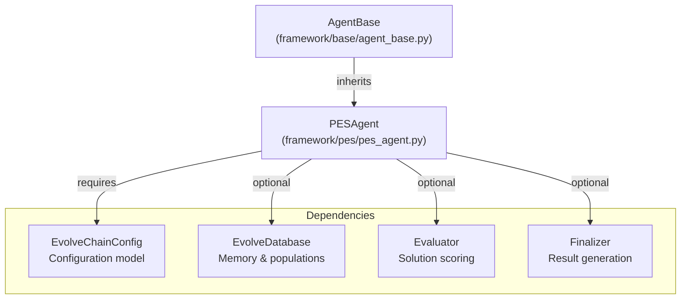
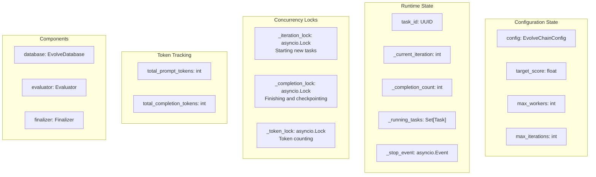
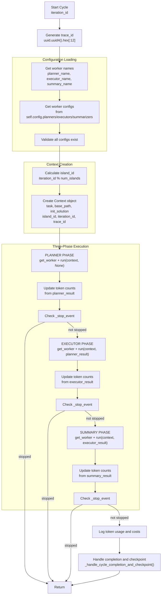
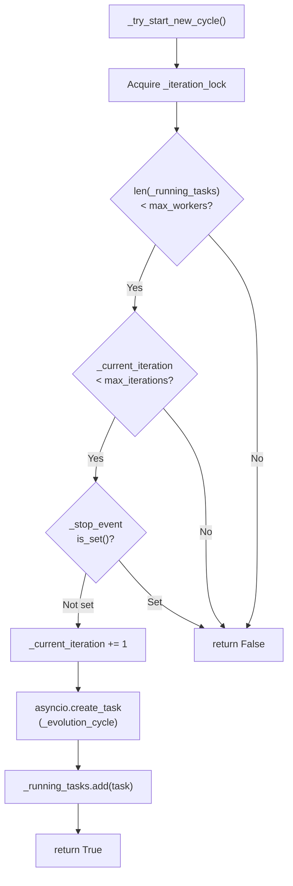
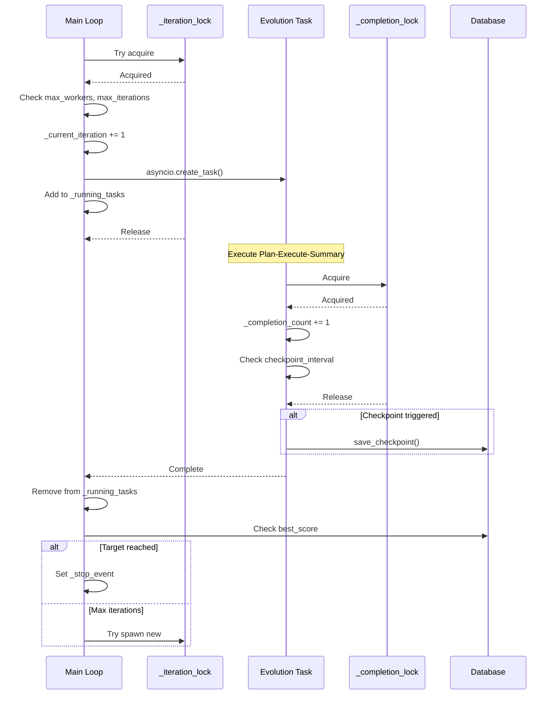
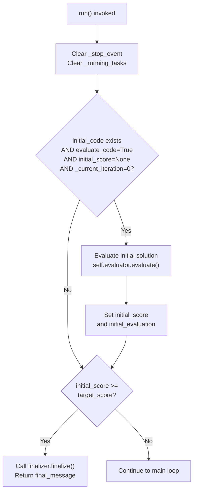
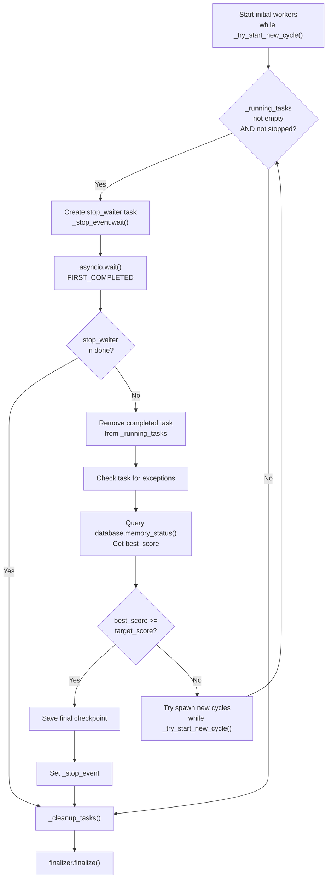
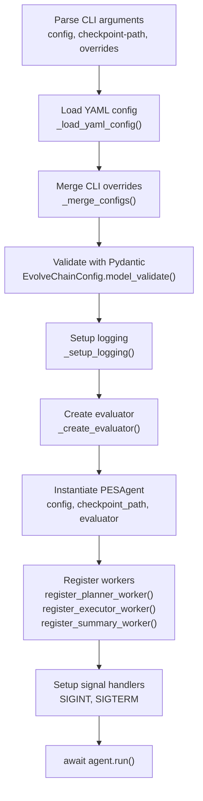

<!-- source: DeepWiki mcp.deepwiki.com · repo baidu-baige/LoongFlow · page 3.2 PESAgent Architecture · fetched 2026-10-26 -->

# PESAgent Architecture

<details>
<summary>Relevant source files</summary>

The following files were used as context for generating this wiki page:

- [src/loongflow/framework/pes/base_runner.py](src/loongflow/framework/pes/base_runner.py)
- [src/loongflow/framework/pes/pes_agent.py](src/loongflow/framework/pes/pes_agent.py)

</details>


This document explains the internal architecture of the `PESAgent` class, which orchestrates concurrent evolution cycles in LoongFlow. It covers initialization, worker registration, evolution cycle execution, concurrency control, checkpointing, and lifecycle management.

For an understanding of the PES paradigm itself (Plan-Execute-Summary thinking pattern), see [PES Paradigm](#3.1). For configuration and launching agents, see [BasePESRunner & Configuration](#3.6). For memory and database architecture, see [Evolutionary Memory System](#3.4).

---

## Overview

The `PESAgent` class is the central orchestrator in LoongFlow's framework. It manages multiple concurrent evolution cycles, each consisting of Plan, Execute, and Summary phases. The agent handles:

- **Concurrent Execution**: Runs multiple evolution cycles in parallel (controlled by `concurrency` setting)
- **Worker Management**: Dynamically loads and invokes registered Planner, Executor, and Summary workers
- **State Persistence**: Periodic checkpointing with resumption support
- **Convergence Control**: Monitors target scores and iteration limits
- **Graceful Shutdown**: Responds to interrupts and cleans up running tasks

Sources: [src/loongflow/framework/pes/pes_agent.py:1-35]()

---

## Class Structure and Initialization

### PESAgent Class Hierarchy



Sources: [src/loongflow/framework/pes/pes_agent.py:35-60]()

### Constructor Parameters

The `PESAgent.__init__()` method accepts the following parameters:

| Parameter | Type | Required | Description |
|-----------|------|----------|-------------|
| `config` | `EvolveChainConfig` | ✓ | Root configuration for evolution chain |
| `database` | `EvolveDatabase` | ✗ | Database instance (created from config if not provided) |
| `evaluator` | `Evaluator` | ✗ | Evaluator component (defaults to `LoongFlowEvaluator`) |
| `finalizer` | `Finalizer` | ✗ | Finalizer component (defaults to `LoongFlowFinalizer`) |
| `checkpoint_path` | `Path` | ✗ | Path to resume from checkpoint |

Sources: [src/loongflow/framework/pes/pes_agent.py:43-59]()

### State Management Variables

The agent maintains extensive state through instance variables:



**Key State Variables:**

- **`task_id`**: Unique UUID for this agent run [src/loongflow/framework/pes/pes_agent.py:75]()
- **`_current_iteration`**: Current iteration counter, independent of completion count [src/loongflow/framework/pes/pes_agent.py:131-135]()
- **`_completion_count`**: Number of successfully completed cycles, used for checkpoint intervals [src/loongflow/framework/pes/pes_agent.py:87-116]()
- **`_running_tasks`**: Set of currently executing asyncio tasks [src/loongflow/framework/pes/pes_agent.py:77]()
- **`_stop_event`**: Asyncio event for signaling shutdown [src/loongflow/framework/pes/pes_agent.py:76]()

Sources: [src/loongflow/framework/pes/pes_agent.py:69-138]()

### Checkpoint Path Parsing

When initializing from a checkpoint, the agent parses the directory name to restore the completion count:

**Expected Format**: `checkpoint-iter-{iteration_id}-{completion_count}`

**Example**: `checkpoint-iter-42-100` means iteration 42 was running when the 100th task completed.

The regex pattern `checkpoint-iter-(\d+)-(\d+)` extracts the completion count (group 2) and restores `_completion_count`. The iteration ID is not used to set completion count; instead, `_current_iteration` is loaded from the database's global status.

Sources: [src/loongflow/framework/pes/pes_agent.py:89-116](), [src/loongflow/framework/pes/pes_agent.py:131-135]()

---

## Worker Registration System

### Registration Interface

The `PESAgent` provides three registration methods that delegate to the global worker registry:

```python
def register_planner_worker(self, name: str, worker_class: type[Worker])
def register_executor_worker(self, name: str, worker_class: type[Worker])
def register_summary_worker(self, name: str, worker_class: type[Worker])
```

**Worker Types:**
- **`PLANNER`**: Strategy design workers
- **`EXECUTOR`**: Solution generation workers  
- **`SUMMARY`**: Reflection and learning workers

These constants are defined in [src/loongflow/framework/pes/register.py]().

Sources: [src/loongflow/framework/pes/pes_agent.py:140-172]()

### Worker Lifecycle

```mermaid
graph LR
    Registration["Worker Registration<br/>register_*_worker()"]
    Registry["Global Registry<br/>register.py"]
    Retrieval["Worker Retrieval<br/>get_worker()"]
    Instantiation["Worker Instance<br/>config + db/evaluator"]
    Execution["Worker Execution<br/>worker.run(context, msg)"]
    
    Registration -->|"register_worker(name, type, class)"| Registry
    Registry -->|"get_worker(name, type, ...)"| Retrieval
    Retrieval -->|"instantiate with args"| Instantiation
    Instantiation -->|"await"| Execution
```



**Registration Flow:**
1. Agent calls `register_planner_worker("general", GeneralPlanner)`
2. Registration adds to global registry map
3. During cycle, `get_worker("general", PLANNER, ...)` retrieves class
4. Worker is instantiated with config, database, and optionally evaluator
5. Worker's `run()` method is invoked with context and previous phase message

Sources: [src/loongflow/framework/pes/pes_agent.py:25-32](), [src/loongflow/framework/pes/pes_agent.py:140-172](), [src/loongflow/framework/pes/pes_agent.py:231-280]()

---

## Evolution Cycle Execution

### Single Cycle Flow

The `_evolution_cycle(iteration_id)` method implements a complete Plan-Execute-Summary cycle:



Sources: [src/loongflow/framework/pes/pes_agent.py:174-328]()

### Context Object Creation

The `Context` object carries metadata through all three phases:

**Key Fields:**
- **`task`**: Task description from config
- **`base_path`**: Workspace path for outputs
- **`init_solution`**: Initial code/solution
- **`task_id`**: Unique UUID for this agent run
- **`island_id`**: Current island for multi-island populations (`iteration_id % num_islands`)
- **`current_iteration`**: Iteration number
- **`trace_id`**: 12-character hex identifier for logging

Sources: [src/loongflow/framework/pes/pes_agent.py:214-226]()

### Token Tracking

Each phase returns a `Message` with `ContentElement` containing token usage data. The agent extracts and accumulates:

```python
async with self._token_lock:
    self.total_prompt_tokens += content[0].data.get("total_prompt_tokens", 0)
    self.total_completion_tokens += content[0].data.get("total_completion_tokens", 0)
```

This happens after each phase (Planner, Executor, Summary). Cost calculations use prices from `self.config.llm_config`.

Sources: [src/loongflow/framework/pes/pes_agent.py:240-289](), [src/loongflow/framework/pes/pes_agent.py:298-312]()

---

## Concurrency Architecture

### Atomic Task Spawning

The `_try_start_new_cycle()` method atomically checks conditions and spawns new evolution cycles:



**Atomicity Guarantees:**
- The `_iteration_lock` ensures only one coroutine can check conditions and increment `_current_iteration` at a time
- This prevents over-spawning tasks beyond `max_workers`
- The iteration counter is incremented **before** creating the task to reserve the ID

Sources: [src/loongflow/framework/pes/pes_agent.py:377-397]()

### Three-Lock Architecture

The agent uses three separate locks to avoid contention:

| Lock | Purpose | Scope |
|------|---------|-------|
| `_iteration_lock` | Starting new tasks | Protects task spawning logic |
| `_completion_lock` | Finishing tasks | Protects completion counter and checkpoint triggering |
| `_token_lock` | Token counting | Protects token accumulation from concurrent phases |

This separation allows tasks to complete and checkpoint while new tasks are being spawned, maximizing concurrency.

Sources: [src/loongflow/framework/pes/pes_agent.py:80-84]()

### Concurrency Control Flow



Sources: [src/loongflow/framework/pes/pes_agent.py:377-397](), [src/loongflow/framework/pes/pes_agent.py:330-346](), [src/loongflow/framework/pes/pes_agent.py:444-519]()

---

## Checkpoint and Resumption System

### Checkpoint Triggering Logic

The `_handle_cycle_completion_and_checkpoint()` method manages checkpoint intervals:

```python
async def _handle_cycle_completion_and_checkpoint(self, iteration_id: int):
    should_save = False
    current_count = 0
    
    async with self._completion_lock:
        self._completion_count += 1
        current_count = self._completion_count
        
        interval = self.config.evolve.database.checkpoint_interval
        if interval > 0 and current_count % interval == 0:
            should_save = True
    
    if should_save:
        await self._save_checkpoint(iteration_id, current_count)
```

**Key Points:**
- Completion count increments **after** each successful cycle
- Checkpoint interval is configurable (e.g., interval=5 means checkpoint every 5 completions)
- Lock protects both counter increment and interval check for atomicity

Sources: [src/loongflow/framework/pes/pes_agent.py:330-346]()

### Checkpoint Naming Convention

Checkpoints use a specific naming format that encodes both iteration ID and completion count:

**Format**: `checkpoint-iter-{iteration_id}-{completion_count}`

**Examples:**
- `checkpoint-iter-42-100`: Iteration 42 was active when the 100th task completed
- `checkpoint-iter-150-150`: Iteration 150 completed and was the 150th completion (no concurrency)

**Why Two Numbers?**
- **`iteration_id`**: The iteration that triggered the checkpoint (may be ahead of completion count with concurrency)
- **`completion_count`**: Total successfully completed cycles (determines next checkpoint)

This dual numbering handles concurrent execution where iteration 50 might complete before iteration 48.

Sources: [src/loongflow/framework/pes/pes_agent.py:348-375]()

### Resumption Process

When resuming from a checkpoint:

1. **Parse checkpoint directory name** using regex `checkpoint-iter-(\d+)-(\d+)` [src/loongflow/framework/pes/pes_agent.py:97-116]()
2. **Restore `_completion_count`** from group 2 (second number)
3. **Load database** from checkpoint path [src/loongflow/framework/pes/pes_agent.py:124-128]()
4. **Restore `_current_iteration`** from database's `global_status.current_iteration` [src/loongflow/framework/pes/pes_agent.py:131-135]()

**Important**: The iteration ID in the checkpoint name is **not** used to set `_completion_count`. Only the second number (completion count) matters for resumption logic.

Sources: [src/loongflow/framework/pes/pes_agent.py:89-135]()

---

## Main Execution Loop

### Initialization and Early Exit

The `run()` method begins by initializing state and checking for early termination:



This early evaluation ensures the initial solution is scored if not already done, and allows immediate exit if it meets the target.

Sources: [src/loongflow/framework/pes/pes_agent.py:399-433]()

### Main Loop Architecture

The main loop implements a work-stealing pattern with graceful shutdown:



**Key Features:**
- Uses `asyncio.wait()` with `FIRST_COMPLETED` to wake on any task completion **or** stop signal
- Creates a stop waiter task to enable waking when `_stop_event` is set
- After each completion, checks for target score achievement
- Attempts to spawn new cycles to maintain `max_workers` concurrency
- Handles exceptions in completed tasks without crashing the loop

Sources: [src/loongflow/framework/pes/pes_agent.py:435-538]()

### Stop Conditions

The evolution process terminates when any of these conditions is met:

1. **Target Score Reached**: `best_score >= target_score` [src/loongflow/framework/pes/pes_agent.py:484-513]()
2. **Max Iterations**: `_current_iteration >= max_iterations` [src/loongflow/framework/pes/pes_agent.py:525-534]()
3. **Interrupt Signal**: `_stop_event.is_set()` via signal handler [src/loongflow/framework/pes/base_runner.py:446-453]()

When the target score is reached, the agent:
- Logs final token usage and costs
- Saves a final checkpoint
- Sets `_stop_event` to signal all running tasks
- Breaks from the main loop

Sources: [src/loongflow/framework/pes/pes_agent.py:484-516](), [src/loongflow/framework/pes/pes_agent.py:525-537]()

---

## Lifecycle Management

### Interruption Handling

The `interrupt_impl()` method provides graceful shutdown:

```python
async def interrupt_impl(self):
    self.logger.info("Interrupt signal received. Setting stop event...")
    if not self._stop_event.is_set():
        self._stop_event.set()
    
    self.evaluator.interrupt()
    self.logger.info("PESAgent interruption process complete.")
```

**Interrupt Flow:**
1. Set `_stop_event` to signal main loop
2. Call `evaluator.interrupt()` to halt any active evaluation
3. Main loop detects stop event and exits
4. `_cleanup_tasks()` cancels all running tasks

Sources: [src/loongflow/framework/pes/pes_agent.py:589-598]()

### Task Cleanup

The `_cleanup_tasks()` method cancels all active evolution cycles:

```python
async def _cleanup_tasks(self):
    if not self._running_tasks:
        return
    
    self.logger.info(f"Cancelling {len(self._running_tasks)} active evolution tasks...")
    for task in self._running_tasks:
        task.cancel()
    
    await asyncio.gather(*self._running_tasks, return_exceptions=True)
    self._running_tasks.clear()
    self.logger.info("All tasks have been cleaned up.")
```

**Cleanup Process:**
1. Iterate over all tasks in `_running_tasks`
2. Call `task.cancel()` on each
3. Use `asyncio.gather()` with `return_exceptions=True` to wait for all cancellations
4. Clear the task set

This ensures no orphaned tasks remain running after agent shutdown.

Sources: [src/loongflow/framework/pes/pes_agent.py:574-587]()

### Finalization

After the main loop exits, regardless of reason, the `Finalizer` generates a final result message:

```python
final_message = await self.finalizer.finalize(
    self.database,
    start_time=start_time,
    was_interrupted=was_interrupted_flag,
    total_tokens=total_tokens,
    total_cost=total_cost,
)
return final_message
```

The finalizer:
- Queries the database for the best solution
- Computes runtime statistics
- Packages results into a `Message` object
- Returns metrics and solution details

Sources: [src/loongflow/framework/pes/pes_agent.py:564-572]()

---

## Integration with BasePESRunner

### Runner Responsibilities

The `BasePESRunner` class (see [BasePESRunner & Configuration](#3.6)) handles the outer lifecycle:



**Division of Labor:**
- **`BasePESRunner`**: Configuration, validation, worker registration, signal handling, logging setup
- **`PESAgent`**: Evolution orchestration, concurrency, checkpointing, worker execution

Sources: [src/loongflow/framework/pes/base_runner.py:387-504]()

### Signal Handling

The runner sets up signal handlers that interact with the agent's `_stop_event`:

```python
def signal_handler(sig_name: str) -> None:
    nonlocal interrupt_task
    print(f"\n🛑 Received signal {sig_name}. Initiating graceful shutdown...")
    # Set the stop event immediately to unblock the main loop
    agent._stop_event.set()
    # Create interrupt task and keep reference
    if interrupt_task is None or interrupt_task.done():
        interrupt_task = asyncio.create_task(agent.interrupt())
```

This allows `Ctrl+C` or `SIGTERM` to trigger graceful shutdown:
1. Signal handler sets `_stop_event`
2. Main loop wakes (from `stop_waiter` task)
3. Loop exits and calls `_cleanup_tasks()`
4. `agent.interrupt()` task runs in parallel

Sources: [src/loongflow/framework/pes/base_runner.py:446-453]()

---

## Key Design Patterns

### Producer-Consumer with Work Stealing

The agent implements a work-stealing pattern:
- **Producer**: `_try_start_new_cycle()` spawns tasks when slots available
- **Consumer**: Main loop waits for any task completion
- **Work Stealing**: After each completion, immediately tries to spawn new work

This maximizes CPU utilization by maintaining `max_workers` concurrent cycles.

### Lock Segregation for Scalability

Three separate locks avoid contention:
- Task spawning (hot path) doesn't block completion handling
- Token counting (frequent, fast) doesn't block checkpointing (infrequent, slow)
- Completion counting and checkpoint logic are atomic but don't block task starts

### Two-Level Iteration Tracking

- **`_current_iteration`**: Monotonic counter for iteration IDs, never decreases
- **`_completion_count`**: Count of finished cycles, used for checkpoint intervals

This separation handles concurrent execution where iteration N+5 might finish before iteration N.

Sources: [src/loongflow/framework/pes/pes_agent.py:80-87](), [src/loongflow/framework/pes/pes_agent.py:131-135]()

---

## Summary

The `PESAgent` architecture provides:

1. **Concurrent Evolution**: Parallel Plan-Execute-Summary cycles with configurable concurrency
2. **Worker Abstraction**: Dynamic loading and execution of registered Planner/Executor/Summary components
3. **Robust Checkpointing**: Dual-number naming convention handles concurrent execution, enabling precise resumption
4. **Graceful Shutdown**: Signal handling, stop events, and task cleanup ensure clean termination
5. **Cost Tracking**: Aggregates token usage and calculates costs across all LLM calls
6. **Convergence Detection**: Monitors best scores and iteration counts to determine when to stop

The agent serves as the runtime engine for all LoongFlow agents (General, Math, ML), with domain-specific behavior implemented through registered workers rather than agent subclassing.

Sources: [src/loongflow/framework/pes/pes_agent.py:1-599]()

---

