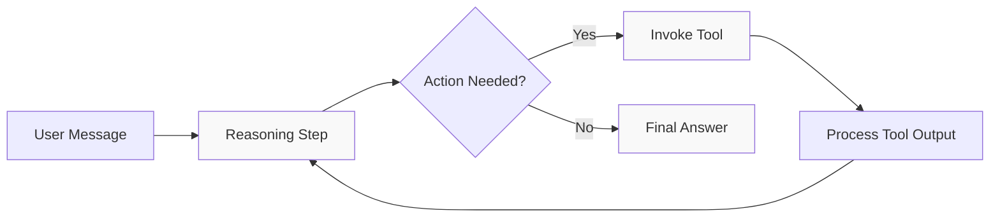
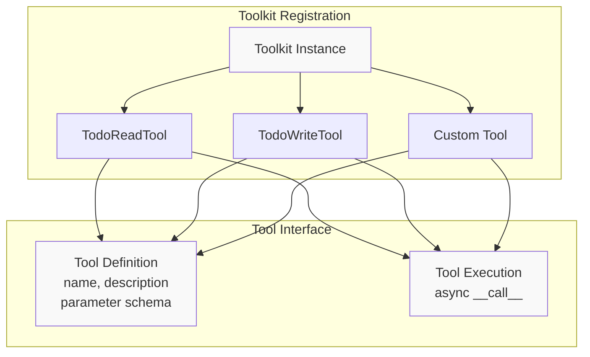
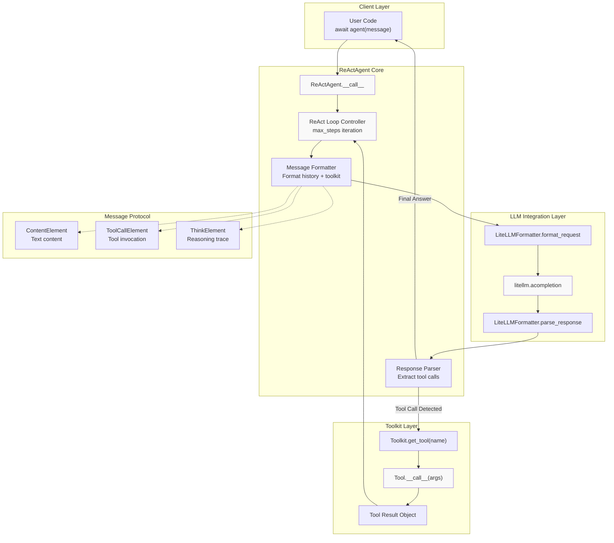
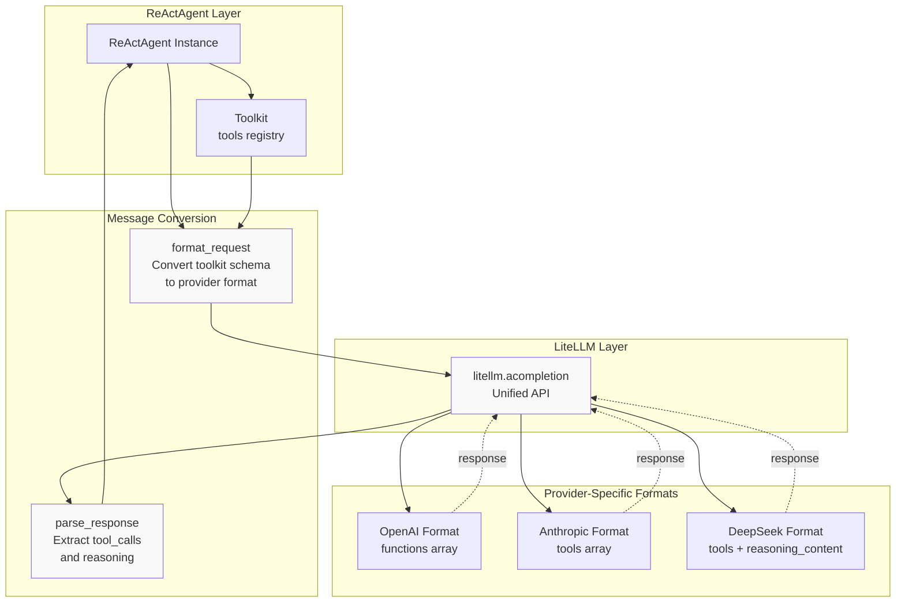
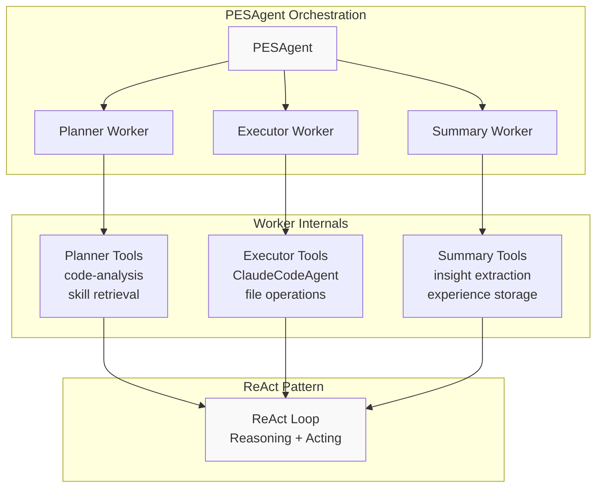
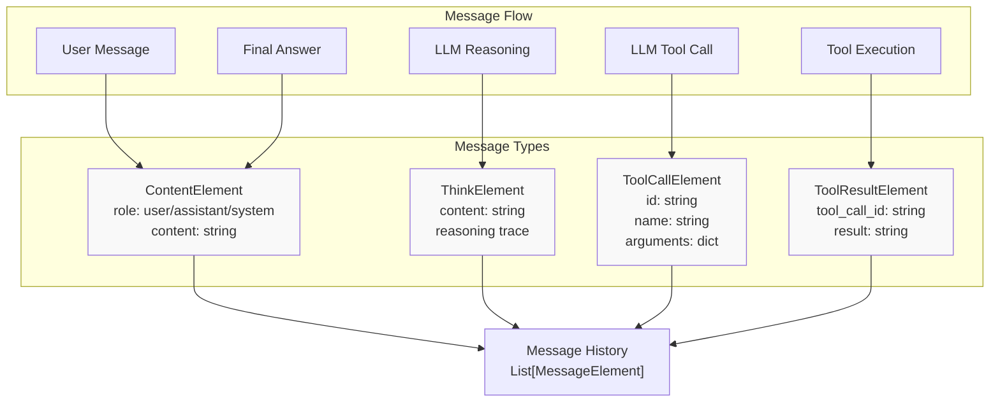

<!-- source: DeepWiki mcp.deepwiki.com · repo baidu-baige/LoongFlow · page 3.3 ReActAgent Architecture · fetched 2026-10-26 -->

# ReActAgent Architecture

<details>
<summary>Relevant source files</summary>

The following files were used as context for generating this wiki page:

- [README.md](README.md)
- [agents/ml_agent/README.md](agents/ml_agent/README.md)

</details>


## Purpose and Scope

The `ReActAgent` class implements the **ReAct (Reasoning and Acting)** framework pattern in LoongFlow. Unlike [`PESAgent`](#3.2), which orchestrates multi-phase evolutionary cycles, `ReActAgent` provides a simpler, single-turn agent pattern optimized for tool-based task execution.

ReActAgent is used when you need:
- Direct tool-based problem solving without evolutionary memory
- Single-task execution with reasoning and action interleaving
- Custom toolkit integration for domain-specific capabilities

For building evolutionary agents with Plan-Execute-Summary cycles, see [`PESAgent Architecture`](#3.2). For creating custom ReAct agents with domain-specific toolkits, see [`Custom ReAct Agents`](#7.1). For tool development details, see [`Tool Development`](#7.3).

**Sources:** [README.md:459-477](), [agents/ml_agent/README.md:1-189]()

---

## ReAct Framework Overview

The ReAct framework combines **Reasoning** (chain-of-thought) and **Acting** (tool invocation) in an interleaved loop. Each step alternates between:

1. **Reasoning**: The agent analyzes the current state and decides what action to take
2. **Acting**: The agent invokes a tool from its toolkit to gather information or modify state
3. **Observation**: The agent receives the tool's output and incorporates it into its reasoning

This cycle continues until the agent produces a final answer or reaches a step limit.



**Diagram: ReAct Loop Execution Pattern**

**Sources:** [README.md:459-477]()

---

## Core Components

### ReActAgent Class

The `ReActAgent` class is the main entry point for creating ReAct-based agents. It manages the reasoning-action loop and coordinates between the LLM, toolkit, and message protocol.

**Key Responsibilities:**
- Execute the ReAct loop with configurable step limits
- Manage toolkit tool invocation and result handling
- Format messages for LLM consumption
- Parse LLM responses for tool calls and reasoning traces
- Provide factory methods for common agent configurations

**Class Location:** [src/loongflow/framework/react/]()

**Sources:** [README.md:459-477]()

---

### Toolkit System

The `Toolkit` class provides a registry for tools that the agent can invoke. Tools are registered by name and can be called during the ReAct loop.



**Diagram: Toolkit and Tool Registration Architecture**

**Tool Registration Example:**
```python
from loongflow.agentsdk.tools import Toolkit, TodoReadTool, TodoWriteTool

toolkit = Toolkit()
toolkit.register_tool(TodoReadTool())
toolkit.register_tool(TodoWriteTool())
```

Each tool provides:
- **Name**: Unique identifier for the tool
- **Description**: Human-readable explanation of tool purpose (used in LLM prompts)
- **Parameter Schema**: JSON schema defining expected inputs
- **Execution Logic**: Async callable that performs the tool's action

**Sources:** [README.md:462-468]()

---

### ReActAgent Creation and Configuration

The `ReActAgent` class provides a factory method `create_default` for instantiating agents with standard configurations:

**Factory Method Signature:**
```python
ReActAgent.create_default(
    model: str,           # LLM model identifier
    sys_prompt: str,      # System prompt defining agent behavior
    toolkit: Toolkit      # Toolkit instance with registered tools
) -> ReActAgent
```

**Usage Pattern:**
```python
from loongflow.framework.react import ReActAgent
from loongflow.agentsdk.tools import Toolkit, TodoReadTool, TodoWriteTool

# Configure toolkit
toolkit = Toolkit()
toolkit.register_tool(TodoReadTool())
toolkit.register_tool(TodoWriteTool())

# Create agent with default configuration
agent = ReActAgent.create_default(
    model="openai/gpt-4",
    sys_prompt="You are a helpful assistant that manages TODO lists.",
    toolkit=toolkit
)

# Execute task
result = await agent("Add 'Review PR' to my TODO list")
```

**Sources:** [README.md:459-477]()

---

## Execution Architecture

The following diagram maps ReActAgent's execution flow from invocation to response, showing how it integrates with the toolkit and LLM layers.



**Diagram: ReActAgent Execution Flow**

**Sources:** [README.md:459-477]()

---

## Step-by-Step Execution Model

The ReActAgent execution follows this sequence for each iteration:

| Step | Component | Action | Message Element |
|------|-----------|--------|-----------------|
| 1 | `MessageFormatter` | Format conversation history with available tools | `ContentElement` |
| 2 | `LiteLLMFormatter` | Convert to provider-specific format | N/A |
| 3 | `litellm.acompletion` | Send request to LLM provider | N/A |
| 4 | `LiteLLMFormatter` | Parse LLM response | `ThinkElement`, `ToolCallElement` |
| 5 | `ResponseParser` | Extract tool calls or final answer | N/A |
| 6a | `ToolRegistry` | If tool call: retrieve tool by name | N/A |
| 6b | `ToolExecution` | Execute tool with parsed arguments | N/A |
| 6c | `ToolResult` | Append tool result to message history | `ContentElement` |
| 6d | Loop | Return to step 1 (unless max_steps reached) | N/A |
| 7 | `UserCode` | If final answer: return result | `ContentElement` |

**Termination Conditions:**
- LLM produces a final answer (no tool call)
- Maximum step limit reached (`max_steps` configuration)
- Error during tool execution

**Sources:** [README.md:459-477]()

---

## Integration with LLM Layer

ReActAgent integrates with LoongFlow's LLM abstraction layer to support multiple providers. The toolkit schema is automatically converted to the appropriate tool format for each provider.



**Diagram: ReActAgent LLM Integration Architecture**

The `LiteLLMFormatter` (see [`LLM Integration`](#3.5)) handles:
- Converting toolkit schemas to provider-specific tool definitions
- Parsing provider-specific tool call responses
- Normalizing reasoning traces across providers (especially for DeepSeek's `reasoning_content`)

**Sources:** [README.md:459-477]()

---

## ReActAgent vs PESAgent Comparison

LoongFlow provides two core agent patterns with distinct use cases:

| Aspect | ReActAgent | PESAgent |
|--------|------------|----------|
| **Pattern** | ReAct (Reasoning + Acting) | PES (Plan-Execute-Summary) |
| **Architecture** | Single-turn loop | Multi-phase evolutionary cycle |
| **Memory** | Conversation history only | Multi-Structure Fusion Memory |
| **Use Case** | Direct tool-based tasks | Long-horizon optimization |
| **Execution** | Immediate tool invocation | Structured planning → execution → reflection |
| **Learning** | No inter-run learning | Experience accumulation across iterations |
| **Concurrency** | Single agent per task | Multiple evolutionary branches |
| **Complexity** | Simple, lightweight | Complex, stateful |
| **Best For** | API integrations, data retrieval, single-step automation | Research tasks, code evolution, optimization problems |
| **Example Agents** | TODO manager, data processor | General-Agent, Math-Agent, ML-Agent |

**When to Choose ReActAgent:**
- Task requires tool invocation without evolutionary improvement
- Single-shot problem solving is sufficient
- Lightweight execution with minimal state management
- Building custom agents with domain-specific toolkits

**When to Choose PESAgent:**
- Task benefits from iterative refinement
- Need to learn from failures and accumulate experience
- Problem requires long-horizon reasoning
- Want to leverage evolutionary memory (Multi-Island, MAP-Elites)

See [`PESAgent Architecture`](#3.2) for details on the evolutionary agent pattern.

**Sources:** [README.md:125-156](), [README.md:437-477]()

---

## Usage in LoongFlow Codebase

ReActAgent is used as a foundational building block within larger agent systems. While PESAgent is the primary agent type for the specialized agents (General, Math, ML), ReActAgent components may be used internally for:

### Internal Tool-Based Workers

The PES workers (Planner, Executor, Summary) may use ReActAgent-style tool invocation patterns for specific subtasks:



**Diagram: ReActAgent Usage Within PES Workers**

### Standalone Tool-Based Agents

ReActAgent can be used directly for simpler tasks that don't require evolutionary improvement:

**Example Use Cases:**
- **Data retrieval agents**: Fetch information from APIs using tool calls
- **File processing agents**: Read, transform, and write files
- **Validation agents**: Check code quality or data integrity using analysis tools
- **Interactive assistants**: Multi-turn conversations with tool access

**Sources:** [README.md:459-477]()

---

## Configuration and Customization

ReActAgent behavior is controlled through:

### Agent Configuration Parameters

| Parameter | Type | Purpose | Default |
|-----------|------|---------|---------|
| `model` | str | LLM model identifier | Required |
| `sys_prompt` | str | System prompt defining agent role | Required |
| `toolkit` | Toolkit | Registered tools available to agent | Required |
| `max_steps` | int | Maximum ReAct loop iterations | 10 |
| `temperature` | float | LLM sampling temperature | 0.8 |
| `max_tokens` | int | Maximum tokens in LLM response | 4096 |

### System Prompt Structure

The system prompt should define:
1. **Agent role and persona**: What the agent is and its expertise
2. **Task description**: What the agent should accomplish
3. **Tool usage guidelines**: When and how to use available tools
4. **Output format**: Expected structure of final answer

**Example System Prompt:**
```python
sys_prompt = """You are a helpful assistant that manages TODO lists.

You have access to the following tools:
- todo_read: Read the current TODO list
- todo_write: Add, update, or delete TODO items

Always check the current state before making changes.
Provide clear confirmation messages after successful operations."""
```

### Toolkit Customization

Custom tools can be registered to extend agent capabilities. See [`Tool Development`](#7.3) for creating custom tools and [`Custom ReAct Agents`](#7.1) for building domain-specific agents.

**Sources:** [README.md:459-477]()

---

## Message Protocol and Data Structures

ReActAgent uses a structured message protocol for communication between components:



**Diagram: ReActAgent Message Protocol**

### Message Element Types

Each message element type serves a specific purpose in the ReAct loop:

1. **ContentElement**: Plain text messages from user or assistant
2. **ThinkElement**: LLM's internal reasoning (chain-of-thought)
3. **ToolCallElement**: Request to invoke a specific tool
4. **ToolResultElement**: Result returned from tool execution

These elements are serialized and deserialized by `LiteLLMFormatter` for provider-specific formats.

**Sources:** [README.md:459-477]()

---

## Summary

The `ReActAgent` class provides a flexible, tool-based agent implementation using the ReAct (Reasoning and Acting) framework. Key characteristics:

- **Simple Execution Model**: Single-turn loop alternating between reasoning and tool invocation
- **Toolkit Integration**: Extensible tool registry for domain-specific capabilities
- **LLM Provider Agnostic**: Works with any OpenAI-compatible API via `LiteLLMFormatter`
- **Message Protocol**: Structured message types for reasoning traces and tool interactions
- **Complementary to PESAgent**: Lightweight alternative for non-evolutionary tasks

ReActAgent serves as a foundational pattern in LoongFlow, used both as a standalone agent for tool-based tasks and as a component within more complex evolutionary agents.

For evolutionary task solving with iterative improvement, see [`PESAgent Architecture`](#3.2). For creating custom ReAct agents, see [`Custom ReAct Agents`](#7.1).

**Sources:** [README.md:1-585](), [agents/ml_agent/README.md:1-189]()

---

