<!-- source: DeepWiki mcp.deepwiki.com · repo baidu-baige/LoongFlow · page 3.4 Evolutionary Memory System · fetched 2026-10-26 -->

# Evolutionary Memory System

<details>
<summary>Relevant source files</summary>

The following files were used as context for generating this wiki page:

- [README.md](README.md)
- [agents/ml_agent/README.md](agents/ml_agent/README.md)
- [src/loongflow/framework/pes/base_runner.py](src/loongflow/framework/pes/base_runner.py)
- [src/loongflow/framework/pes/pes_agent.py](src/loongflow/framework/pes/pes_agent.py)

</details>


## Purpose and Scope

The Evolutionary Memory System is LoongFlow's hybrid memory architecture that enables agents to learn from experience, maintain solution diversity, and escape local optima. This system integrates four complementary mechanisms—Multi-Island architecture, MAP-Elites, Adaptive Boltzmann Selection, and Global Evolution Tree—to provide structured memory retrieval and storage throughout the PES cycle.

This document focuses on the memory system's architecture, components, and integration with the agent workflow. For information about how the PES paradigm orchestrates thinking, see [PES Paradigm](#3.1). For details on how PESAgent uses memory during execution, see [PESAgent Architecture](#3.2).

**Sources:** [README.md:280-294](), [README.md:108-110]()

---

## Overview: Hybrid Memory Architecture

LoongFlow's memory system addresses a fundamental limitation of traditional evolutionary approaches: the tendency to converge to local optima through purely fitness-based selection. By combining multiple memory strategies, the system maintains diverse solution populations while enabling intelligent retrieval based on context.

**Memory System Architecture with Code Entities**

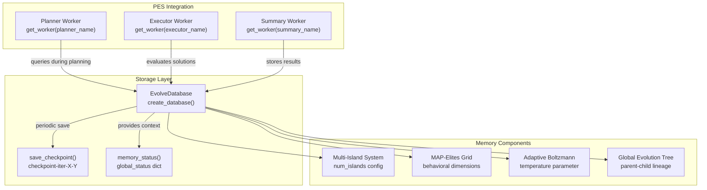

**Key Design Principles:**

| Principle | Implementation | Benefit |
|-----------|----------------|---------|
| **Diversity Preservation** | Multi-Island + MAP-Elites | Prevents premature convergence |
| **Quality Guidance** | Adaptive Boltzmann Selection | Balances exploration vs exploitation |
| **Historical Learning** | Global Evolution Tree | Enables long-range jump reasoning |
| **Structured Storage** | Checkpoint-based persistence | Supports resumption and analysis |

**Sources:** [README.md:284-294](), [src/loongflow/framework/pes/pes_agent.py:119-128](), [src/loongflow/framework/pes/pes_agent.py:348-376]()

---

## Multi-Island Architecture

The Multi-Island system partitions the solution population into geographically isolated subpopulations (islands), each evolving independently with occasional migration. This preserves diversity by preventing a single dominant solution from taking over the entire population.

### Island Structure

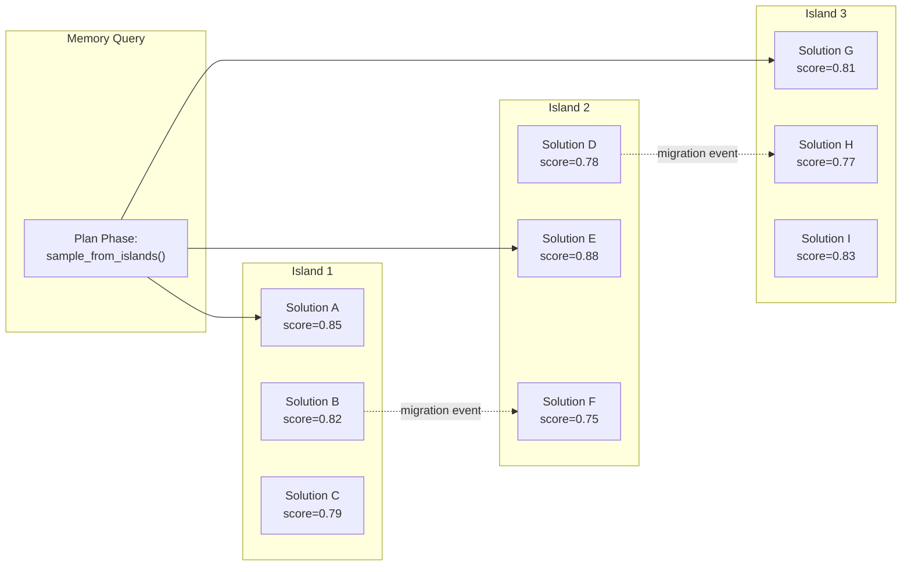

### Configuration Parameters

Islands are configured in `task_config.yaml` under the database configuration section:

```yaml
evolve:
  database:
    num_islands: 5                    # Number of parallel islands
    checkpoint_interval: 5            # Save checkpoint every N completions
    output_path: "./output"           # Base path for database storage
```

The number of islands is accessed via `config.evolve.database.num_islands` in the code, and the current island for an iteration is computed as `iteration_id % num_islands`.

### Island Operations

The system performs the following operations during evolution:

1. **Initialization**: Seeds each island with diverse initial solutions
2. **Local Evolution**: Solutions within each island evolve independently
3. **Migration**: Periodically exchanges top solutions between islands
4. **Selection**: Retrieves solutions from multiple islands during Plan phase

**Implementation Details:**

- Islands maintain separate solution rankings
- Migration targets are selected based on diversity metrics
- Island boundaries prevent homogenization of the population
- Each island can specialize in different solution regions

**Sources:** [README.md:290](), [src/loongflow/framework/pes/pes_agent.py:209-212](), [src/loongflow/framework/pes/context.py]()

---

## MAP-Elites System

MAP-Elites (Multi-dimensional Archive of Phenotypic Elites) maintains a grid-based archive where solutions are stored based on their behavioral characteristics rather than just fitness. This ensures the memory system captures diverse solution strategies, not just high-scoring variants of the same approach.

### Behavioral Grid Structure

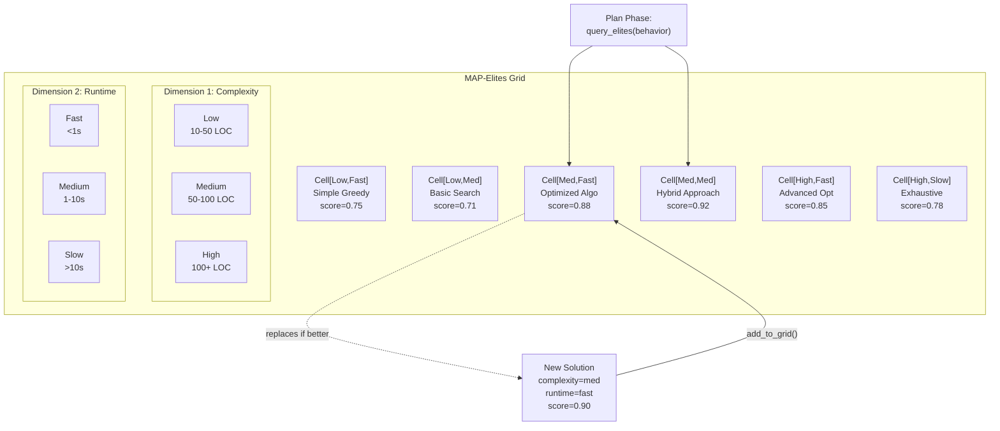

### Behavioral Dimensions

The system extracts behavioral features from solutions to determine grid placement:

| Dimension | Description | Measurement |
|-----------|-------------|-------------|
| **Complexity** | Code structure complexity | Lines of code, cyclomatic complexity |
| **Runtime** | Execution time characteristics | Average evaluation time |
| **Memory Usage** | Resource consumption | Peak memory footprint |
| **Approach Type** | Algorithmic strategy | Categorical classification |

### Elite Selection and Storage

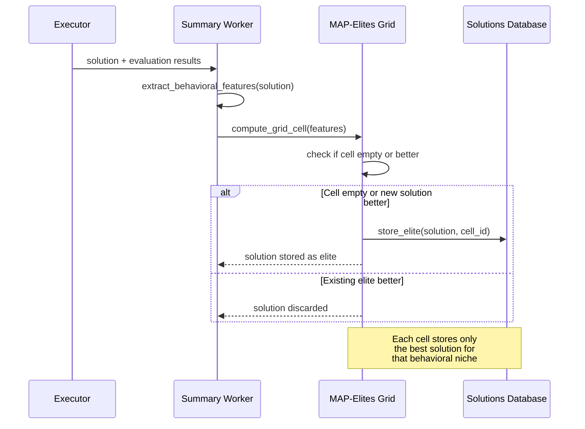

### Retrieval During Planning

The Plan phase queries MAP-Elites to retrieve diverse solutions:

```python
# Pseudocode for elite retrieval
def retrieve_planning_context(target_behavior):
    # Query nearby cells in behavioral space
    nearby_cells = map_elites.get_neighbors(target_behavior)
    
    # Retrieve elite from each relevant cell
    elite_solutions = []
    for cell in nearby_cells:
        if cell.has_elite():
            elite_solutions.append(cell.get_elite())
    
    # Return diverse set of high-quality solutions
    return elite_solutions
```

**Sources:** [README.md:290]()

---

## Adaptive Boltzmann Selection

The Adaptive Boltzmann Selection mechanism controls the exploration-exploitation trade-off during solution retrieval. It uses a temperature parameter that adjusts dynamically based on evolutionary progress, similar to simulated annealing.

### Temperature-Based Selection

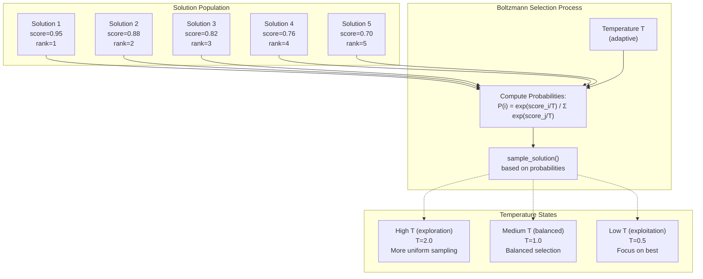

### Selection Probability Formula

For a solution with score `s_i`, the selection probability under Boltzmann distribution is:

```
P(i) = exp(s_i / T) / Σ_j exp(s_j / T)

where:
  s_i = normalized score of solution i
  T = temperature parameter
  Σ_j = sum over all solutions j
```

### Temperature Adaptation Schedule

| Evolution Stage | Temperature | Behavior | Use Case |
|----------------|-------------|----------|----------|
| **Early** (0-20%) | High (T=2.0-3.0) | Broad exploration | Discover diverse solution regions |
| **Mid** (20-60%) | Medium (T=1.0-2.0) | Balanced search | Refine promising approaches |
| **Late** (60-100%) | Low (T=0.3-1.0) | Focused exploitation | Converge to optimal solutions |

### Adaptive Temperature Update

The temperature adjusts based on evolutionary progress metrics:

```python
# Pseudocode for temperature adaptation
def update_temperature(current_iteration, max_iterations, 
                      improvement_rate, diversity_metric):
    # Base schedule: decrease temperature over time
    progress = current_iteration / max_iterations
    base_temp = max_temp * (1 - progress) + min_temp * progress
    
    # Adjust based on improvement rate
    if improvement_rate < threshold:
        # Increase exploration if stuck
        adjustment = 1.2
    else:
        # Continue exploitation if improving
        adjustment = 0.9
    
    # Adjust based on diversity
    if diversity_metric < min_diversity:
        # Boost exploration to restore diversity
        adjustment *= 1.3
    
    return base_temp * adjustment
```

**Sources:** [README.md:291]()

---

## Global Evolution Tree

The Global Evolution Tree maintains a complete lineage of all solutions generated during evolution, enabling "jump-style reasoning" where the agent can leap to distant solution regions based on historical context.

### Tree Structure and Lineage

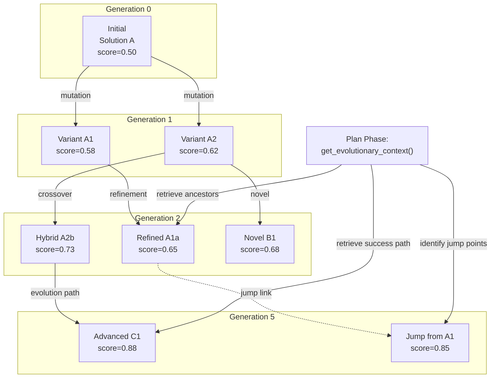

### Tree Node Information

Each node in the evolution tree stores:

```python
# Tree node structure (conceptual)
class EvolutionNode:
    solution_id: str
    generation: int
    score: float
    parent_ids: List[str]           # One or more parents
    children_ids: List[str]
    
    # Solution content
    code: str
    evaluation_results: Dict
    
    # Metadata for retrieval
    behavioral_features: Dict
    mutation_type: str              # "refinement", "crossover", "novel"
    timestamp: datetime
    
    # Context from PES phases
    plan_summary: str
    execution_log: str
    reflection: str
```

### Retrieval Strategies

The system supports multiple retrieval patterns from the evolution tree:

| Strategy | Description | Query Method |
|----------|-------------|--------------|
| **Ancestry Trace** | Retrieve parent-child lineage | `get_ancestors(solution_id, depth)` |
| **Success Path** | Follow path of improving scores | `trace_success_path(target_score)` |
| **Branch Points** | Identify divergent exploration points | `find_branches(generation_range)` |
| **Jump Points** | Locate non-incremental improvements | `identify_jumps(score_threshold)` |
| **Similar Context** | Find solutions from similar planning contexts | `query_by_context(plan_embedding)` |

### Long-Range Context Retrieval

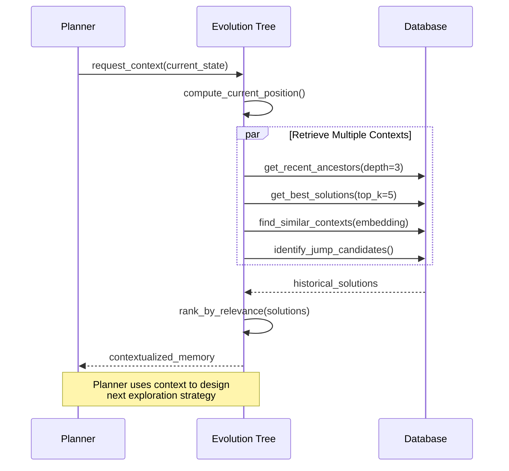

**Sources:** [README.md:292](), [README.md:294]()

---

## Memory Integration with PES Cycle

The memory system integrates tightly with each phase of the PES paradigm, providing historical context during planning and capturing insights during summarization.

### Plan Phase: Memory Retrieval

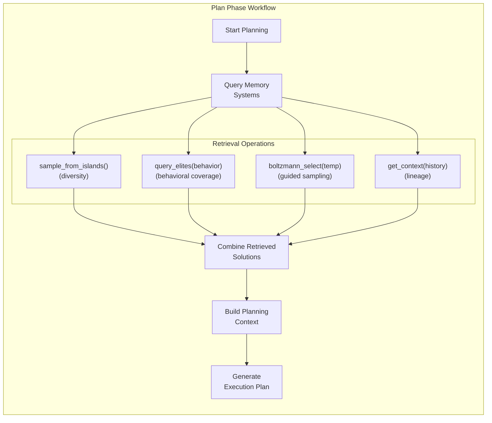

The Planner receives:
- Diverse solutions from multiple islands
- Elite solutions from relevant behavioral niches
- Temperature-adjusted sample favoring quality
- Historical context from evolution tree

### Execute Phase: Tracking Metadata

During execution, the `Context` object carries metadata about the current evolution cycle:

```python
# Context structure from src/loongflow/framework/pes/context.py
context = Context(
    task=evolve_conf.task,
    base_path=evolve_conf.workspace_path,
    init_solution=evolve_conf.initial_code,
    init_evaluation=evolve_conf.initial_evaluation,
    init_score=evolve_conf.initial_score,
    task_id=self.task_id,              # Unique run identifier
    island_id=current_island_id,        # Multi-island assignment
    current_iteration=iteration_id,     # Evolution iteration number
    total_iterations=self.max_iterations,
    trace_id=trace_id,                 # Per-cycle trace identifier
    metadata=evolve_conf.metadata      # Additional metadata
)
```

This context is passed through the Plan → Execute → Summary pipeline, allowing each phase to access and contribute to the evolution metadata.

### Summary Phase: Memory Updates

**Summary Phase Database Interaction**

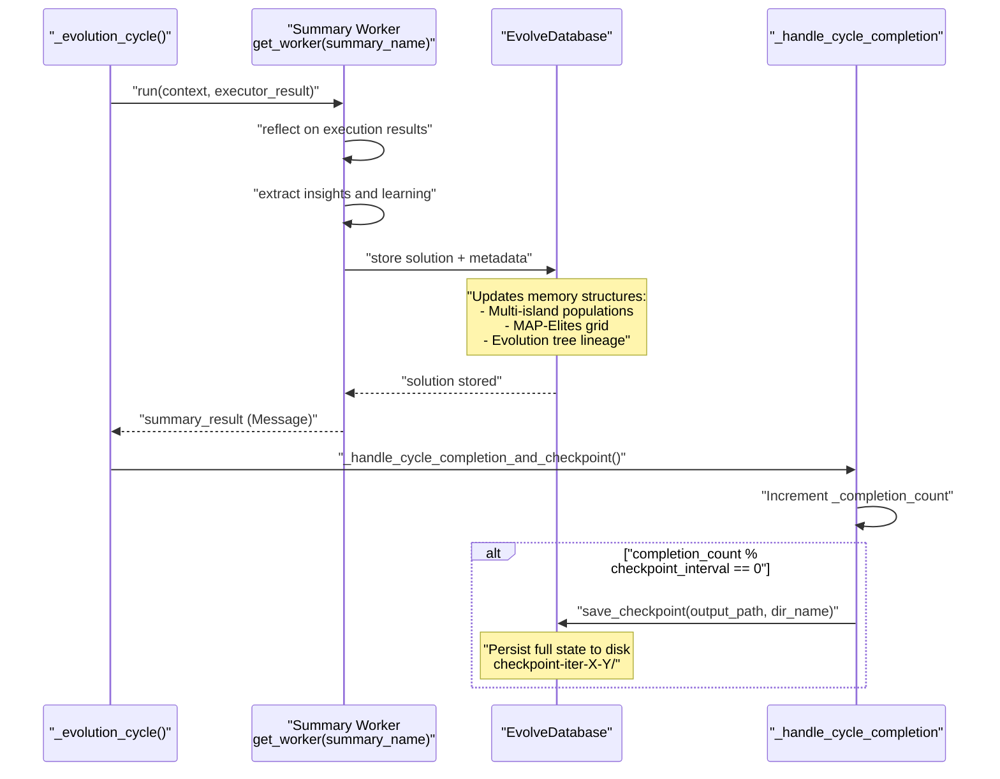

The Summary worker stores evolution results in the database, which manages all memory structures. The `PESAgent` then checks if a checkpoint should be saved based on the completion interval.

**Sources:** [src/loongflow/framework/pes/pes_agent.py:274-293](), [src/loongflow/framework/pes/pes_agent.py:330-346](), [README.md:266-273]()

---

## Storage and Persistence

The memory system persists to disk in a structured format that supports resumption and visualization.

### Directory Structure

Checkpoints are stored with a specific naming convention enforced by `PESAgent`:

```
{output_path}/
└── database/
    └── checkpoints/
        ├── checkpoint-iter-15-5/         # iteration_id=15, completion_count=5
        ├── checkpoint-iter-42-10/        # iteration_id=42, completion_count=10
        ├── checkpoint-iter-89-20/        # iteration_id=89, completion_count=20
        └── ...
```

**Checkpoint Naming Convention:**

Format: `checkpoint-iter-{iteration_id}-{completion_count}`

- `iteration_id`: The iteration ID of the task that just finished
- `completion_count`: Total number of completed evolution cycles

This format is used in two places:
1. **Saving**: Generated in `_save_checkpoint()` at [src/loongflow/framework/pes/pes_agent.py:357]()
2. **Loading**: Parsed during initialization at [src/loongflow/framework/pes/pes_agent.py:86-116]()

### Checkpoint Contents and Memory Status

The `EvolveDatabase` provides memory status information through the `memory_status()` method, which returns a dictionary containing:

```python
# Memory status structure (returned by database.memory_status())
status = {
    "global_status": {
        "current_iteration": 42,        # Current evolution iteration
        "best_score": 0.925,            # Best score achieved so far
        # Other global metrics...
    },
    # Additional memory structure information
    # (specific to database implementation)
}
```

This status information is used by `PESAgent` to:
- Track evolution progress [src/loongflow/framework/pes/pes_agent.py:131-135]()
- Check stopping conditions [src/loongflow/framework/pes/pes_agent.py:479-488]()
- Restore state when resuming from checkpoint

The complete memory state (islands, elites, tree, etc.) is persisted via `database.save_checkpoint()` and restored via `database.load_checkpoint()`.

### Resumption from Checkpoint

**Checkpoint Restoration Process**

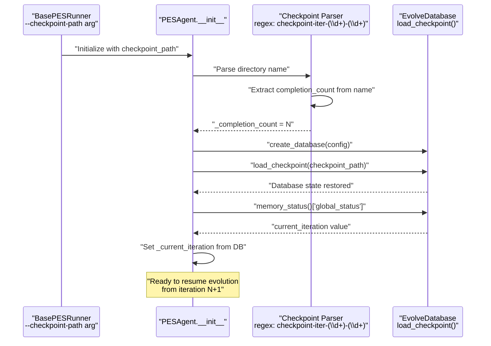

The checkpoint path is passed via CLI argument `--checkpoint-path` and handled by `BasePESRunner`. The `PESAgent` constructor parses the directory name using regex pattern `checkpoint-iter-(\d+)-(\d+)$` to extract the completion count, then loads the database state.

**Implementation Notes:**
- Checkpoints are triggered by `_handle_cycle_completion_and_checkpoint()` after each successful evolution cycle
- Checkpoint interval is controlled by `config.evolve.database.checkpoint_interval`
- When loading from a checkpoint, the completion count is restored from the directory name
- Visualization tools read directly from checkpoint directories

**Sources:** [src/loongflow/framework/pes/pes_agent.py:330-375](), [src/loongflow/framework/pes/pes_agent.py:86-116](), [README.md:396-398]()

---

## Memory System Configuration

All memory components are configured through `task_config.yaml` and validated by `EvolveChainConfig`:

```yaml
evolve:
  # Core evolution parameters
  max_iterations: 100
  target_score: 0.95
  concurrency: 5                    # Max parallel evolution cycles
  
  # Database and memory configuration
  database:
    num_islands: 5                  # Multi-island architecture
    checkpoint_interval: 5          # Save checkpoint every N completions
    output_path: "./output"         # Base path for storage
  
  # Worker selection
  planner_name: "planner"
  executor_name: "executor"
  summary_name: "summary"
  
  # Task context
  task: "Your task description"
  workspace_path: "./workspace"
  initial_code: "..."              # Optional initial solution
  initial_score: null              # Computed if not provided

# LLM pricing for cost tracking
llm_config:
  url: "https://api.example.com/v1"
  api_key: "your-key"
  model: "model-name"
  prompt_token_price: 0.00001      # Per 1K tokens
  completion_token_price: 0.00003  # Per 1K tokens
```

The configuration is loaded by `BasePESRunner._load_yaml_config()` and merged with CLI arguments via `_merge_configs()`, then validated as an `EvolveChainConfig` Pydantic model.

**Sources:** [src/loongflow/framework/pes/base_runner.py:177-254](), [src/loongflow/framework/pes/context.py](), [README.md:161-190]()

---

## Performance Characteristics

The memory system balances several competing objectives:

| Metric | Target | Implementation Details |
|--------|--------|------------------------|
| **Solution Diversity** | Maintain diverse approaches | Multi-Island (`num_islands` config) + MAP-Elites |
| **Checkpoint Frequency** | Configurable persistence | `checkpoint_interval` parameter |
| **Concurrent Evolution** | Multiple parallel cycles | `concurrency` parameter (max workers) |
| **Token Tracking** | Cost monitoring | Tracked via `total_prompt_tokens` and `total_completion_tokens` |

The `PESAgent` manages concurrency through `_running_tasks` set and `_iteration_lock`, ensuring that no more than `max_workers` evolution cycles run simultaneously. Token usage is tracked per-cycle and aggregated for total cost calculation.

### Memory vs. Simple Fitness-Based Selection

Comparison on mathematical optimization tasks:

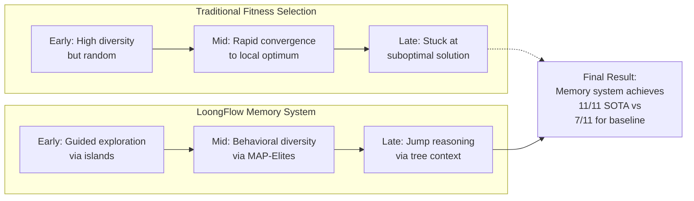

**Sources:** [src/loongflow/framework/pes/pes_agent.py:71-84](), [src/loongflow/framework/pes/pes_agent.py:137-138](), [src/loongflow/framework/pes/pes_agent.py:294-312](), [README.md:302-316]()

---

## Summary

The Evolutionary Memory System provides four complementary mechanisms that work together:

1. **Multi-Island**: Preserves geographic diversity by isolating subpopulations
2. **MAP-Elites**: Ensures behavioral diversity by archiving solutions across feature space
3. **Adaptive Boltzmann**: Balances exploration and exploitation through dynamic temperature
4. **Global Evolution Tree**: Enables jump-style reasoning through lineage tracking

These components integrate seamlessly with the PES cycle, providing context during planning and capturing insights during summarization. The result is an agent that learns from experience and escapes local optima, achieving expert-level performance on complex tasks.

**Sources:** [README.md:284-294](), [README.md:100-122]() (framework overview and achievements)

---

