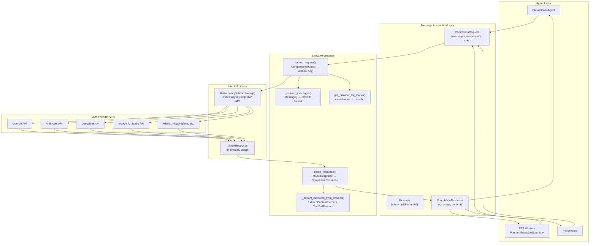
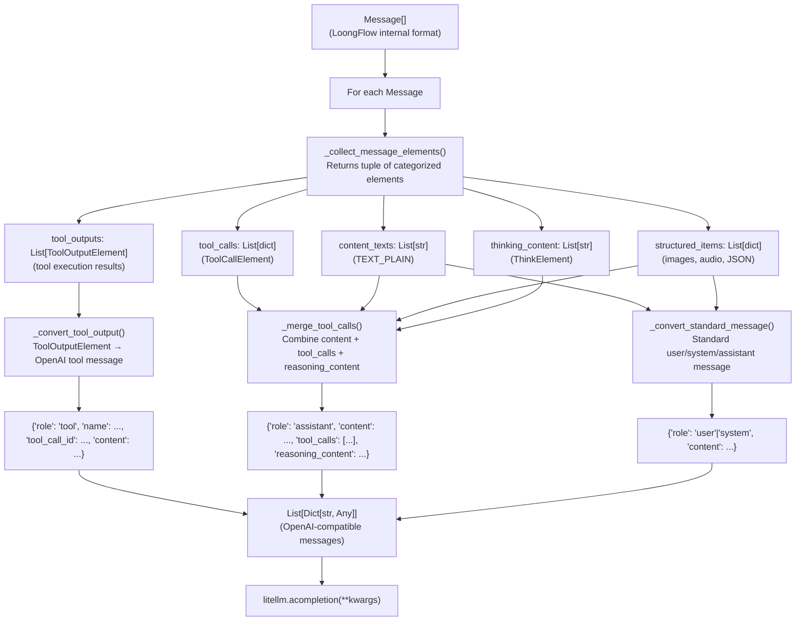
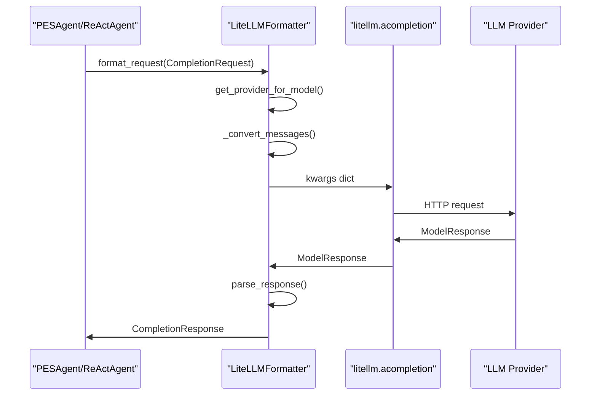
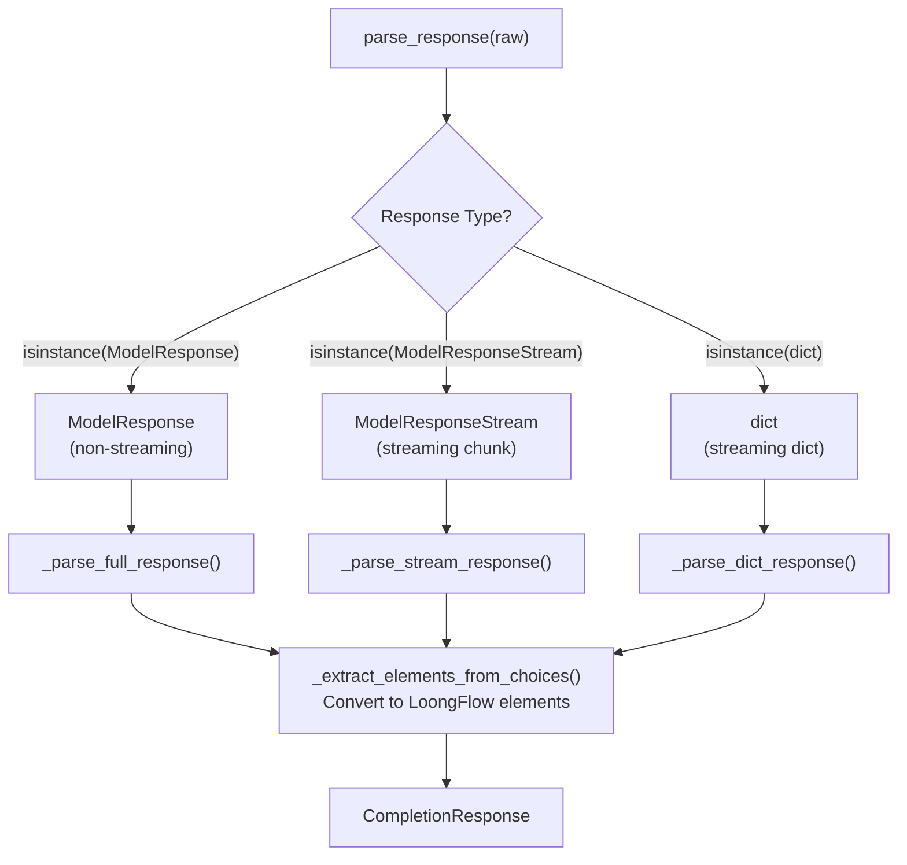
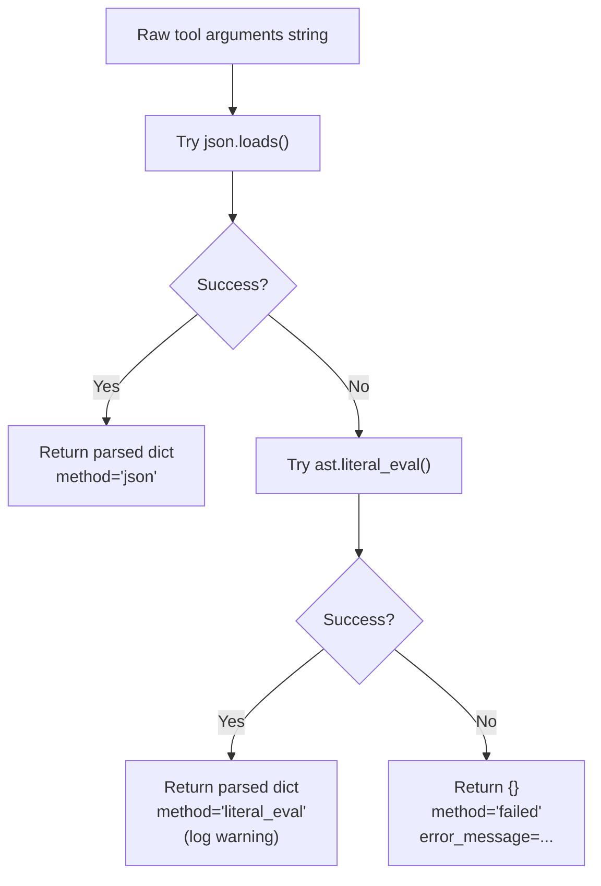
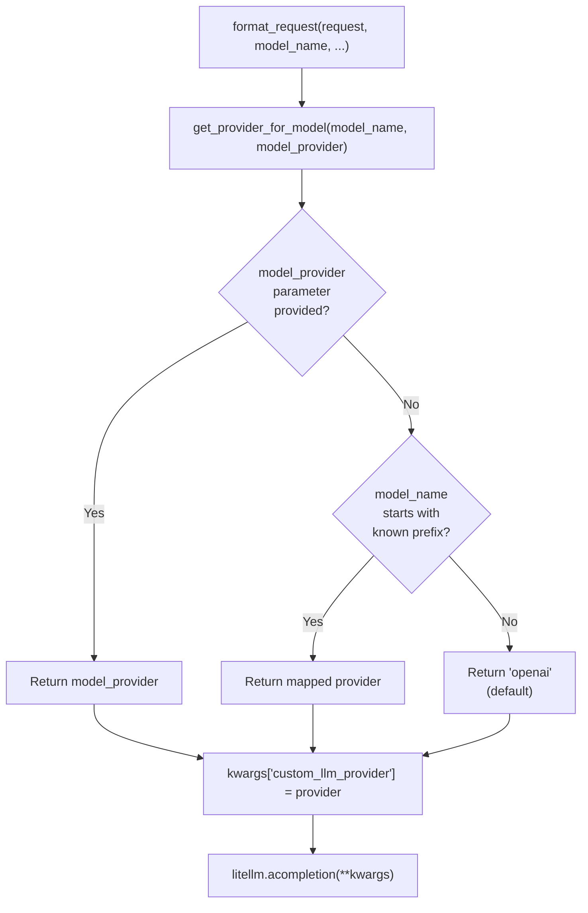
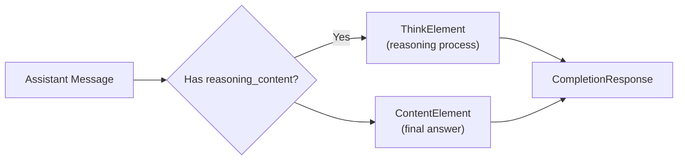
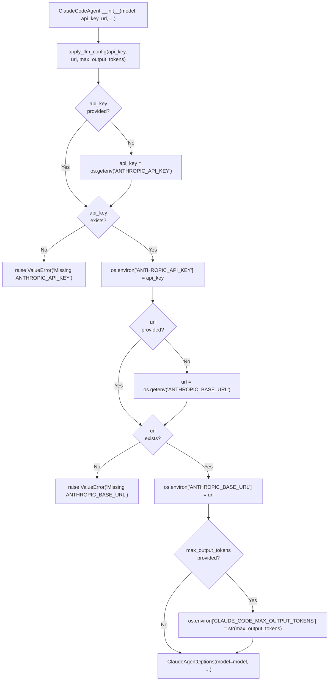
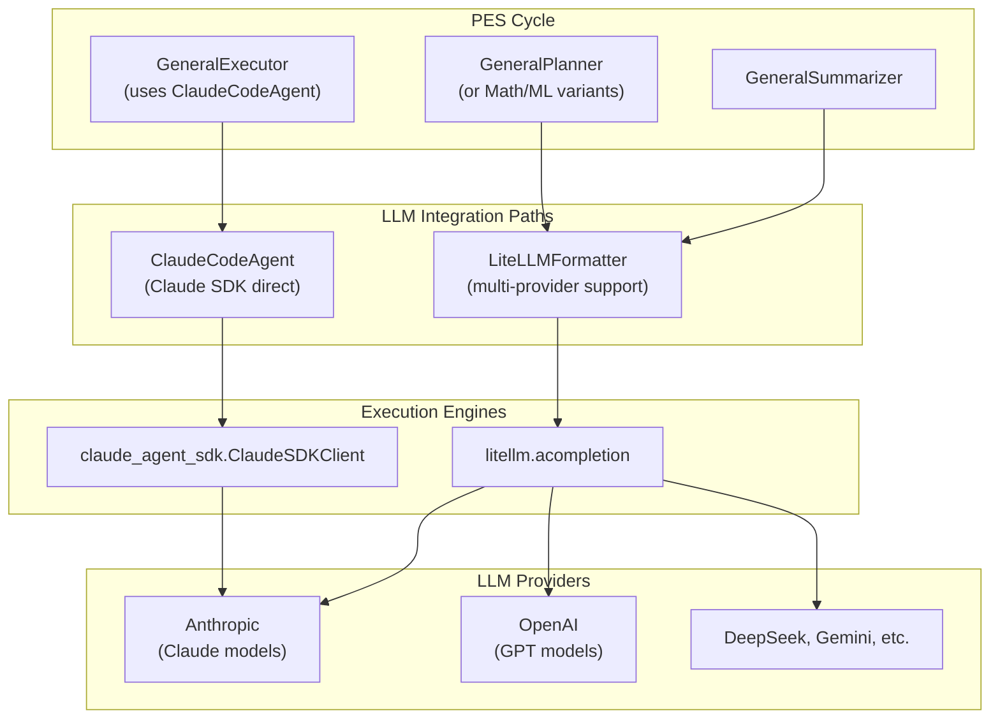

<!-- source: DeepWiki mcp.deepwiki.com · repo baidu-baige/LoongFlow · page 3.5 LLM Integration · fetched 2026-10-26 -->

# LLM Integration

<details>
<summary>Relevant source files</summary>

The following files were used as context for generating this wiki page:

- [pyproject.toml](pyproject.toml)
- [src/loongflow/agentsdk/models/formatter/litellm_formatter.py](src/loongflow/agentsdk/models/formatter/litellm_formatter.py)
- [src/loongflow/framework/claude_code/claude_code_agent.py](src/loongflow/framework/claude_code/claude_code_agent.py)
- [uv.lock](uv.lock)

</details>


## Purpose and Scope

This document explains how LoongFlow integrates with Large Language Models (LLMs) through a unified abstraction layer. It covers the message formatting system, provider support, request/response handling, and how LoongFlow translates its internal message representations to and from various LLM APIs.

For information about how LLMs are used within the PES paradigm, see [PES Paradigm](#3.1). For configuration of LLM parameters, see [BasePESRunner & Configuration](#3.6).

---

## Architecture Overview

LoongFlow uses **LiteLLM** as its universal LLM integration layer, enabling support for multiple providers through a single interface. The `LiteLLMFormatter` class bridges LoongFlow's internal message abstractions (`Message`, `CompletionRequest`, `CompletionResponse`) with LiteLLM's standardized API, which in turn routes to various LLM providers.

**LiteLLMFormatter Request/Response Flow**



**Sources:** [src/loongflow/agentsdk/models/formatter/litellm_formatter.py:1-583](), [src/loongflow/framework/claude_code/claude_code_agent.py:1-620]()

---

## LiteLLMFormatter: The Core Adapter

The `LiteLLMFormatter` class (defined in [src/loongflow/agentsdk/models/formatter/litellm_formatter.py:29-583]()) implements the `BaseFormatter` interface and handles bidirectional conversion between LoongFlow's message schema and LiteLLM's API format.

### Key Responsibilities

| Responsibility | Primary Methods | Supporting Methods | Description |
|----------------|-----------------|-------------------|-------------|
| **Request Formatting** | `format_request()` | `get_provider_for_model()`, `_convert_messages()` | Converts `CompletionRequest` to LiteLLM `acompletion` kwargs |
| **Message Conversion** | `_convert_messages()` | `_collect_message_elements()`, `_append_content_element()`, `_convert_tool_output()`, `_merge_tool_calls()`, `_convert_standard_message()` | Translates LoongFlow `Message` objects (with multiple element types) to OpenAI-compatible message dicts |
| **Response Parsing** | `parse_response()` | `_parse_full_response()`, `_parse_stream_response()`, `_parse_dict_response()`, `_extract_elements_from_choices()` | Converts LiteLLM `ModelResponse` back to `CompletionResponse` with typed elements |
| **Provider Detection** | `get_provider_for_model()` | `MODEL_PROVIDER_PREFIX_MAP` | Maps model names to LiteLLM provider identifiers |
| **Special Model Handling** | `_is_deepseek_reasoner()` | - | Detects DeepSeek-Reasoner models for `reasoning_content` field handling |
| **Safe Parsing** | `_safe_parse_json()` | - | Parses tool arguments with fallback strategies (json.loads → ast.literal_eval) |

**Sources:** [src/loongflow/agentsdk/models/formatter/litellm_formatter.py:29-583]()

---

## Message Conversion Flow

LoongFlow uses a rich message element system (`ContentElement`, `ToolCallElement`, `ToolOutputElement`, `ThinkElement`) that must be converted to the simpler OpenAI/LiteLLM message format. The `_convert_messages()` method handles multiple element types within a single `Message` object.

**_convert_messages() Processing Pipeline**



### Element Collection Logic

The `_collect_message_elements()` method ([src/loongflow/agentsdk/models/formatter/litellm_formatter.py:234-266]()) iterates through `msg.content` and categorizes elements:

```python
# Pseudocode from _collect_message_elements
for elem in msg.content:
    if isinstance(elem, ContentElement):
        _append_content_element(elem, content_texts, structured_items)
    elif isinstance(elem, ToolCallElement):
        tool_calls.append({
            "id": str(elem.call_id),
            "type": "function",
            "function": {
                "name": elem.target,
                "arguments": json.dumps(elem.arguments)
            }
        })
    elif isinstance(elem, ToolOutputElement):
        tool_outputs.append(elem)
    elif isinstance(elem, ThinkElement):
        thinking_content.append(elem.content)
```

**Sources:** [src/loongflow/agentsdk/models/formatter/litellm_formatter.py:187-366]()

---

## Message Element Types

LoongFlow supports four primary message element types, each serving a specific purpose in agent communication:

### ContentElement

Represents textual, visual, or audio content.

```python
# Text content
ContentElement(mime_type=MimeType.TEXT_PLAIN, data="Hello, world")

# Image content (converted to image_url format)
ContentElement(mime_type="image/jpeg", data="https://...")

# Audio content (converted to input_audio format)
ContentElement(mime_type="audio/mp3", data="base64_encoded_data")
```

**Conversion:** Text becomes message `content` field, images/audio become structured content items.

**Sources:** [src/loongflow/agentsdk/models/formatter/litellm_formatter.py:268-297]()

### ToolCallElement

Represents a tool invocation request from the assistant.

```python
ToolCallElement(
    call_id="call_abc123",
    target="evaluate_solution",
    arguments={"code": "...", "test_cases": [...]}
)
```

**Conversion:** Becomes OpenAI-style `tool_calls` array in assistant message.

**Sources:** [src/loongflow/agentsdk/models/formatter/litellm_formatter.py:248-258](), [src/loongflow/agentsdk/models/formatter/litellm_formatter.py:325-353]()

### ToolOutputElement

Represents the result of a tool execution.

```python
ToolOutputElement(
    call_id="call_abc123",
    tool_name="evaluate_solution",
    result=[ContentElement(mime_type=MimeType.TEXT_PLAIN, data="Score: 0.95")]
)
```

**Conversion:** Becomes a separate message with `role="tool"` and `tool_call_id`.

**Sources:** [src/loongflow/agentsdk/models/formatter/litellm_formatter.py:298-323]()

### ThinkElement

Represents internal reasoning or thought process (used by models like DeepSeek-Reasoner).

```python
ThinkElement(content="Let me break down this problem step by step...")
```

**Conversion:** For DeepSeek-Reasoner models, becomes `reasoning_content` field. Otherwise, prefixed with `[think]` marker in content.

**Sources:** [src/loongflow/agentsdk/models/formatter/litellm_formatter.py:262-263](), [src/loongflow/agentsdk/models/formatter/litellm_formatter.py:346-350]()

---

## Request Formatting

The `format_request()` method converts a LoongFlow `CompletionRequest` into kwargs suitable for `litellm.acompletion()`.

### Request Parameters

| Parameter | Source | Description |
|-----------|--------|-------------|
| `model` | `model_name` arg | Model identifier (with optional provider prefix) |
| `messages` | `request.messages` | Converted message list |
| `temperature` | `request.temperature` | Sampling temperature (0.0-1.0) |
| `top_p` | `request.top_p` | Nucleus sampling parameter |
| `max_tokens` | `request.max_tokens` | Maximum tokens to generate |
| `stop` | `request.stop` | Stop sequences |
| `tools` | `request.tools` | Tool/function definitions |
| `tool_choice` | `request.tool_choice` | Tool selection strategy (`auto`, `required`, etc.) |
| `base_url` | `base_url` arg | Custom API endpoint |
| `api_key` | `api_key` arg | Authentication key |
| `custom_llm_provider` | Auto-detected | Provider name for LiteLLM |

### Example Flow



**Sources:** [src/loongflow/agentsdk/models/formatter/litellm_formatter.py:52-128]()

---

## Response Parsing

The `parse_response()` method handles three types of LiteLLM responses:

### Response Types



### Parsing Logic

The response parser extracts:

1. **Text content** → `ContentElement(mime_type=TEXT_PLAIN, data=...)`
2. **Tool calls** → `ToolCallElement(target=..., arguments=...)`
3. **Reasoning content** (DeepSeek) → `ThinkElement(content=...)`
4. **Token usage** → `CompletionUsage(completion_tokens=..., prompt_tokens=..., total_tokens=...)`
5. **Finish reason** → `"stop"`, `"tool_calls"`, `"length"`, etc.

**Sources:** [src/loongflow/agentsdk/models/formatter/litellm_formatter.py:130-162](), [src/loongflow/agentsdk/models/formatter/litellm_formatter.py:367-467]()

---

## Tool Arguments Parsing

Tool calls from LLMs often contain malformed JSON. The formatter implements a robust parsing strategy with multiple fallbacks.

### Safe JSON Parsing Strategy



The error message is stored in `ToolCallElement.metadata["tool_arguments_err"]` for debugging.

**Sources:** [src/loongflow/agentsdk/models/formatter/litellm_formatter.py:536-582](), [src/loongflow/agentsdk/models/formatter/litellm_formatter.py:513-532]()

---

## Provider Support

LoongFlow supports multiple LLM providers through LiteLLM's unified interface. The provider is auto-detected from the model name prefix using `MODEL_PROVIDER_PREFIX_MAP` or can be explicitly specified.

### Supported Providers

The `MODEL_PROVIDER_PREFIX_MAP` constant ([src/loongflow/agentsdk/models/formatter/litellm_formatter.py:38-46]()) defines the prefix-to-provider mapping:

| Prefix | LiteLLM Provider | Example Model Names | Notes |
|--------|------------------|---------------------|-------|
| `gpt` | `openai` | `gpt-4o`, `gpt-4-turbo`, `gpt-3.5-turbo` | Standard OpenAI models |
| `azure-gpt` | `azure_openai` | `azure-gpt-4` | Azure OpenAI deployments |
| `claude` | `anthropic` | `claude-3-opus`, `claude-3-sonnet` | Anthropic models |
| `gemini` | `google_ai_studio` | `gemini-2.0-flash-thinking-exp`, `gemini-pro` | Google AI Studio models |
| `deepseek` | `deepseek` | `deepseek-reasoner`, `deepseek-chat` | DeepSeek models (special reasoning handling) |
| `mistral` | `mistral_ai` | `mistral-large`, `mistral-medium` | Mistral AI models |
| `huggingface` | `huggingface` | `huggingface/...` | Huggingface Inference API |
| *(no prefix)* | `openai` | Custom/vLLM/sglang endpoints | Defaults to OpenAI-compatible API |

### Provider Detection Logic

The `get_provider_for_model()` method ([src/loongflow/agentsdk/models/formatter/litellm_formatter.py:163-177]()) determines the provider:

```python
def get_provider_for_model(
    self, model_name: str, model_provider: Optional[str] = None
) -> str:
    """
    Determine the LLM provider for a given model.
    """
    # 1. Explicit override
    if model_provider:
        return model_provider

    # 2. Prefix-based detection
    for prefix, provider in self.MODEL_PROVIDER_PREFIX_MAP.items():
        if model_name.startswith(prefix):
            return provider

    # 3. Default to OpenAI-compatible
    return "openai"
```

**Provider Selection in format_request()**



**Sources:** [src/loongflow/agentsdk/models/formatter/litellm_formatter.py:38-46](), [src/loongflow/agentsdk/models/formatter/litellm_formatter.py:163-177](), [src/loongflow/agentsdk/models/formatter/litellm_formatter.py:52-128]()

---

## Special Model Handling

### DeepSeek-Reasoner

DeepSeek-Reasoner models expose their reasoning process through a `reasoning_content` field. LoongFlow captures this as `ThinkElement` objects.



Detection logic: `"deepseek-reasoner" in model_name.lower()`

**Sources:** [src/loongflow/agentsdk/models/formatter/litellm_formatter.py:179-185](), [src/loongflow/agentsdk/models/formatter/litellm_formatter.py:346-350](), [src/loongflow/agentsdk/models/formatter/litellm_formatter.py:485-490]()

---

## Configuration

LLM integration is configured through the `llm_config` section of `task_config.yaml` and component-specific configuration.

### task_config.yaml LLM Configuration

```yaml
llm_config:
  url: "https://api.openai.com/v1"          # Base URL for API endpoint
  api_key: "sk-..."                          # Authentication key
  model: "gpt-4o"                            # Model identifier
  temperature: 0.7                           # Optional: sampling temperature
  top_p: 0.9                                 # Optional: nucleus sampling
  max_tokens: 4096                           # Optional: max generation length
  timeout: 600                               # Optional: request timeout (seconds)

# Component-specific LLM settings
planners:
  llm_config:
    model: "gpt-4o"
    temperature: 0.8
    max_tokens: 4096

executors:
  llm_config:
    model: "claude-3-opus"  # Can use different model for execution
    temperature: 0.0
    max_tokens: 8192

summarizers:
  llm_config:
    model: "gpt-4o"
    temperature: 0.5
```

### Model Name Formats

**With Provider Prefix (Explicit):**
```yaml
model: "openai/gpt-4o"
model: "anthropic/claude-3-opus"
model: "google/gemini-2.0-flash-thinking-exp"
model: "deepseek/deepseek-reasoner"
```

**Without Provider Prefix (Auto-detected):**
```yaml
model: "gpt-4o"                    # → openai provider
model: "claude-3-sonnet"           # → anthropic provider
model: "gemini-pro"                # → google_ai_studio provider
model: "deepseek-reasoner"         # → deepseek provider
```

**Custom Endpoints (vLLM, sglang, etc.):**
```yaml
llm_config:
  url: "http://localhost:8000/v1"
  model: "my-custom-model"          # Defaults to openai-compatible
  # OR explicitly set provider:
  # model_provider: "openai"
```

### Environment Variables

For `ClaudeCodeAgent` configuration:
```bash
export ANTHROPIC_API_KEY="sk-ant-..."
export ANTHROPIC_BASE_URL="https://api.anthropic.com"
export CLAUDE_CODE_MAX_OUTPUT_TOKENS="8192"  # Optional
```

For general LiteLLM usage, standard provider environment variables work:
```bash
export OPENAI_API_KEY="sk-..."
export ANTHROPIC_API_KEY="sk-ant-..."
export GOOGLE_AI_STUDIO_API_KEY="..."
```

**Sources:** [src/loongflow/agentsdk/models/formatter/litellm_formatter.py:52-128](), [src/loongflow/framework/claude_code/claude_code_agent.py:25-58]()

---

## Usage Examples

### Basic Request Flow

```python
from loongflow.agentsdk.models.formatter.litellm_formatter import LiteLLMFormatter
from loongflow.agentsdk.models.llm_request import CompletionRequest
from loongflow.agentsdk.message import Message, ContentElement, MimeType

# Create formatter
formatter = LiteLLMFormatter()

# Build request
request = CompletionRequest(
    messages=[
        Message(role="user", content=[
            ContentElement(mime_type=MimeType.TEXT_PLAIN, data="Solve this problem...")
        ])
    ],
    temperature=0.7,
    max_tokens=2048
)

# Format for LiteLLM
kwargs = formatter.format_request(
    request=request,
    model_name="gpt-4o",
    base_url="https://api.openai.com/v1",
    api_key="sk-..."
)

# Call LiteLLM
import litellm
response = await litellm.acompletion(**kwargs)

# Parse response
completion = formatter.parse_response(response)
```

### Tool Call Handling

```python
# Request with tools
request = CompletionRequest(
    messages=[...],
    tools=[
        {
            "type": "function",
            "function": {
                "name": "evaluate_solution",
                "description": "Evaluate code against test cases",
                "parameters": {...}
            }
        }
    ],
    tool_choice="auto"
)

# Format and call
kwargs = formatter.format_request(request, model_name="gpt-4o", ...)
response = await litellm.acompletion(**kwargs)

# Parse response - will contain ToolCallElement if model chose to call a tool
completion = formatter.parse_response(response)
for elem in completion.content:
    if isinstance(elem, ToolCallElement):
        print(f"Tool: {elem.target}, Args: {elem.arguments}")
```

**Sources:** [src/loongflow/agentsdk/models/formatter/litellm_formatter.py:52-128]()

---

## Integration with ClaudeCodeAgent

While `LiteLLMFormatter` provides multi-provider support, `ClaudeCodeAgent` uses the Claude Agent SDK directly for code execution capabilities. The SDK configuration is handled by the `apply_llm_config()` function.

### ClaudeCodeAgent LLM Configuration

**apply_llm_config() Environment Setup**



The `ClaudeCodeAgent` ([src/loongflow/framework/claude_code/claude_code_agent.py:60-620]()) wraps the Claude Agent SDK (`claude_agent_sdk`) and uses environment variables for configuration:

- `ANTHROPIC_API_KEY`: Authentication key
- `ANTHROPIC_BASE_URL`: API endpoint (can point to proxies or custom deployments)
- `CLAUDE_CODE_MAX_OUTPUT_TOKENS`: Optional token limit

**Sources:** [src/loongflow/framework/claude_code/claude_code_agent.py:25-58](), [src/loongflow/framework/claude_code/claude_code_agent.py:103-234]()

### Integration Points in Agent Architecture

The `LiteLLMFormatter` is used in different contexts depending on the agent type:

**PESAgent Workers and LLM Calls**



**Key Difference:**
- **ClaudeCodeAgent** uses the Claude Agent SDK directly via `ClaudeSDKClient` for code execution features (terminal, file operations)
- **Other agents/workers** (Planner, Summarizer, ReActAgent) use `LiteLLMFormatter` for flexible multi-provider support

**Sources:** [src/loongflow/framework/claude_code/claude_code_agent.py:60-620](), [src/loongflow/agentsdk/models/formatter/litellm_formatter.py:29-583]()

---

## Dependencies

The LLM integration layer depends on:

| Package | Version | Purpose |
|---------|---------|---------|
| `litellm` | >=1.80.10 | Universal LLM API adapter |
| `openai` | >=1.102.0 | OpenAI client (used by LiteLLM) |

**Sources:** [pyproject.toml:31-34]()

---

