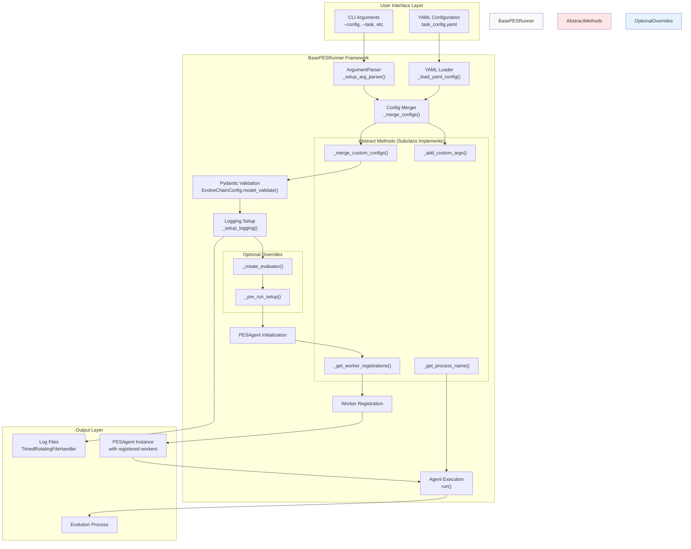
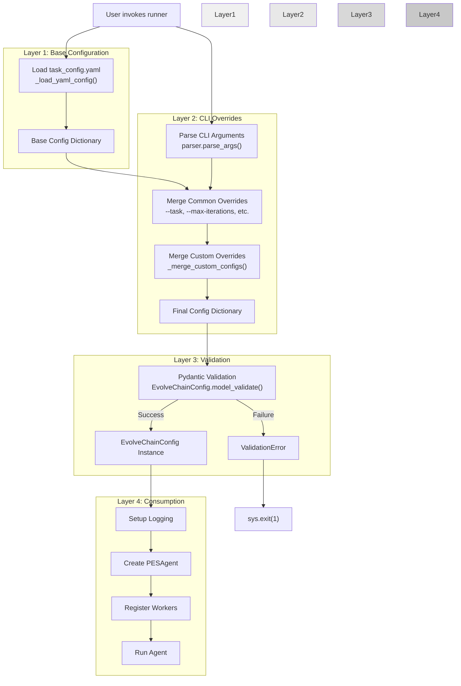
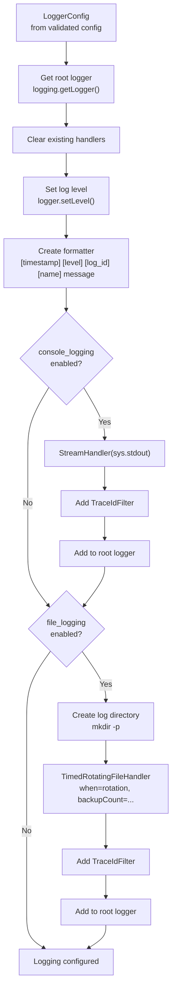
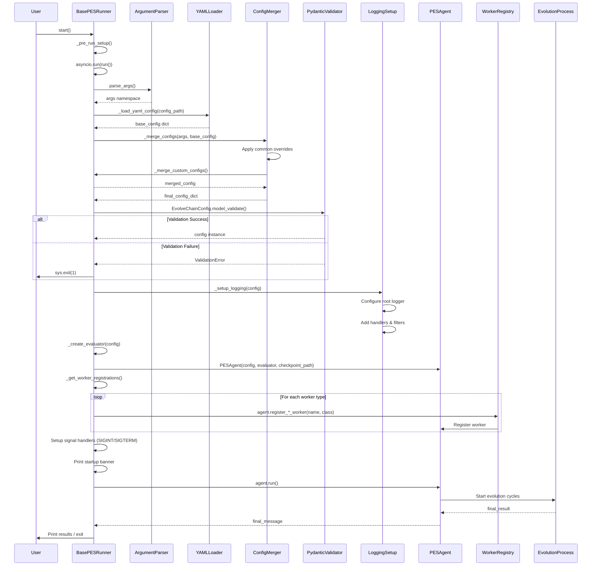
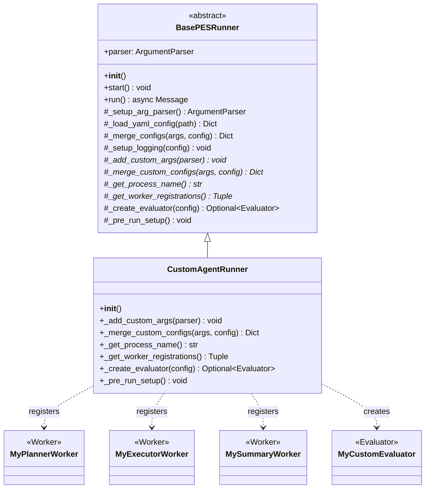
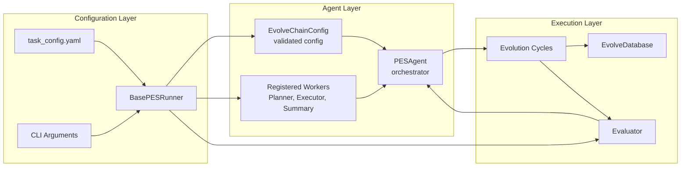

<!-- source: DeepWiki mcp.deepwiki.com · repo baidu-baige/LoongFlow · page 3.6 BasePESRunner & Configuration · fetched 2026-10-26 -->

# BasePESRunner & Configuration

<details>
<summary>Relevant source files</summary>

The following files were used as context for generating this wiki page:

- [src/loongflow/framework/pes/base_runner.py](src/loongflow/framework/pes/base_runner.py)
- [src/loongflow/framework/pes/pes_agent.py](src/loongflow/framework/pes/pes_agent.py)

</details>


This document explains the `BasePESRunner` class, which provides a reusable foundation for building PES agent runners. It handles configuration loading from YAML files, merging CLI overrides, validation, logging setup, and agent initialization. This is the base class that all agent type runners (Math, ML, General) extend.

For information about the PESAgent itself and how it orchestrates evolution cycles, see [PESAgent Architecture](#3.2). For details on specific configuration options and their meanings, see [Configuration Reference](#10.2).

## Overview

`BasePESRunner` is an abstract base class that standardizes the workflow for launching PES agents across different domains. It implements the common pattern of:

1. Parsing command-line arguments
2. Loading YAML configuration files
3. Merging CLI overrides into configuration
4. Validating configuration with Pydantic
5. Setting up logging infrastructure
6. Instantiating `PESAgent` with worker registrations
7. Running the evolution process with signal handling

By inheriting from `BasePESRunner`, agent implementations only need to define their domain-specific workers and configuration extensions, while the framework handles all boilerplate.

**Sources:** [src/loongflow/framework/pes/base_runner.py:1-505]()

## Architecture Diagram



**Sources:** [src/loongflow/framework/pes/base_runner.py:29-505]()

## Configuration System Architecture

The configuration system follows a layered approach where CLI arguments can override YAML values:



**Sources:** [src/loongflow/framework/pes/base_runner.py:177-254](), [src/loongflow/framework/pes/base_runner.py:387-413]()

## CLI Argument Parsing

### Standard Arguments

`BasePESRunner` provides a comprehensive set of standard CLI arguments that apply to all agent types:

| Argument | Type | Purpose | Config Override |
|----------|------|---------|-----------------|
| `--config` / `-c` | `str` | **Required.** Path to YAML configuration file | - |
| `--checkpoint-path` | `str` | Path to checkpoint directory for resumption | - |
| `--task` | `str` | Override task description | `evolve.task` |
| `--task-file` | `str` | Load task from file (takes precedence) | `evolve.task` |
| `--eval-file` | `str` | Override evaluation code from file | `evolve.evaluator.evaluate_code` |
| `--workspace-path` | `str` | Override workspace directory | `evolve.evaluator.workspace_path` |
| `--max-iterations` | `int` | Override maximum iterations | `evolve.max_iterations` |
| `--target-score` | `float` | Override target score | `evolve.target_score` |
| `--planner` | `str` | Override planner worker name | `evolve.planner_name` |
| `--executor` | `str` | Override executor worker name | `evolve.executor_name` |
| `--summary` | `str` | Override summary worker name | `evolve.summary_name` |
| `--log-level` | `str` | Override logging level (DEBUG/INFO/etc.) | `logger.level` |
| `--log-path` | `str` | Override log file directory | `logger.log_path` |

The argument parser is set up in `_setup_arg_parser()`:

**Sources:** [src/loongflow/framework/pes/base_runner.py:59-159]()

### Custom Arguments

Subclasses must implement `_add_custom_args()` to add domain-specific arguments:

```python
@abstractmethod
def _add_custom_args(self, parser: argparse.ArgumentParser) -> None:
    """Add agent-specific command-line arguments."""
    pass
```

For example, a Math agent might add:
```python
parser.add_argument("--optimization-method", type=str, help="...")
```

**Sources:** [src/loongflow/framework/pes/base_runner.py:161-171]()

## Configuration Loading and Merging

### YAML Loading

The `_load_yaml_config()` method loads the base configuration from a YAML file:

```python
def _load_yaml_config(self, config_path: str) -> Dict[str, Any]:
    """Loads the base configuration from a YAML file."""
    try:
        with open(config_path, "r", encoding="utf-8") as f:
            return yaml.safe_load(f)
    except FileNotFoundError:
        print(f"Error: Configuration file not found at '{config_path}'",
              file=sys.stderr)
        sys.exit(1)
    except yaml.YAMLError as e:
        print(f"Error parsing YAML file '{config_path}':\n{e}", 
              file=sys.stderr)
        sys.exit(1)
```

**Sources:** [src/loongflow/framework/pes/base_runner.py:177-190]()

### Configuration Merging Strategy

The `_merge_configs()` method applies CLI overrides to the base configuration:

```mermaid
graph TB
    BaseConfig["Base Config Dictionary<br/>from YAML"]
    
    subgraph "Ensure Structure"
        EnsureEvolve["Ensure 'evolve' key exists"]
        EnsureEvaluator["Ensure 'evolve.evaluator' exists"]
        EnsureLogger["Ensure 'logger' exists"]
    end
    
    subgraph "Apply Task Overrides"
        CheckTask["args.task?"]
        CheckTaskFile["args.task_file?"]
        SetTask["Set evolve.task"]
        ReadFile["Read file content"]
    end
    
    subgraph "Apply Evaluator Overrides"
        CheckEval["args.eval_file?"]
        SetEval["Set evolve.evaluator.evaluate_code"]
        CheckWorkspace["args.workspace_path?"]
        SetWorkspace["Set evolve.evaluator.workspace_path"]
    end
    
    subgraph "Apply Evolution Overrides"
        CheckMaxIter["args.max_iterations?"]
        SetMaxIter["Set evolve.max_iterations"]
        CheckTarget["args.target_score?"]
        SetTarget["Set evolve.target_score"]
        CheckPlanner["args.planner?"]
        SetPlanner["Set evolve.planner_name"]
        CheckExecutor["args.executor?"]
        SetExecutor["Set evolve.executor_name"]
        CheckSummary["args.summary?"]
        SetSummary["Set evolve.summary_name"]
    end
    
    subgraph "Apply Logging Overrides"
        CheckLogLevel["args.log_level?"]
        SetLogLevel["Set logger.level"]
        CheckLogPath["args.log_path?"]
        SetLogPath["Set logger.log_path"]
    end
    
    CustomMerge["_merge_custom_configs()<br/>Subclass-specific merging"]
    
    FinalConfig["Final Merged Config"]
    
    BaseConfig --> EnsureEvolve
    EnsureEvolve --> EnsureEvaluator
    EnsureEvaluator --> EnsureLogger
    
    EnsureLogger --> CheckTask
    CheckTask -->|Yes| SetTask
    CheckTask -->|No| CheckTaskFile
    CheckTaskFile -->|Yes| ReadFile
    ReadFile --> SetTask
    CheckTaskFile -->|No| CheckEval
    
    SetTask --> CheckEval
    CheckEval -->|Yes| SetEval
    CheckEval -->|No| CheckWorkspace
    
    SetEval --> CheckWorkspace
    CheckWorkspace -->|Yes| SetWorkspace
    CheckWorkspace -->|No| CheckMaxIter
    
    SetWorkspace --> CheckMaxIter
    CheckMaxIter -->|Yes| SetMaxIter
    CheckMaxIter -->|No| CheckTarget
    
    SetMaxIter --> CheckTarget
    CheckTarget -->|Yes| SetTarget
    CheckTarget -->|No| CheckPlanner
    
    SetTarget --> CheckPlanner
    CheckPlanner -->|Yes| SetPlanner
    CheckPlanner -->|No| CheckExecutor
    
    SetPlanner --> CheckExecutor
    CheckExecutor -->|Yes| SetExecutor
    CheckExecutor -->|No| CheckSummary
    
    SetExecutor --> CheckSummary
    CheckSummary -->|Yes| SetSummary
    CheckSummary -->|No| CheckLogLevel
    
    SetSummary --> CheckLogLevel
    CheckLogLevel -->|Yes| SetLogLevel
    CheckLogLevel -->|No| CheckLogPath
    
    SetLogLevel --> CheckLogPath
    CheckLogPath -->|Yes| SetLogPath
    CheckLogPath -->|No| CustomMerge
    
    SetLogPath --> CustomMerge
    CustomMerge --> FinalConfig
```



**Note:** If `--task-file` is provided, it takes precedence over `--task`.

**Sources:** [src/loongflow/framework/pes/base_runner.py:192-254]()

### Custom Configuration Merging

Subclasses must implement `_merge_custom_configs()` to handle domain-specific configuration:

```python
@abstractmethod
def _merge_custom_configs(
    self, args: argparse.Namespace, config: Dict[str, Any]
) -> Dict[str, Any]:
    """Merge agent-specific configurations."""
    pass
```

This allows each agent type to handle its own custom CLI arguments and inject them into the appropriate configuration locations.

**Sources:** [src/loongflow/framework/pes/base_runner.py:256-272]()

### Configuration Validation

After merging, the final configuration dictionary is validated using Pydantic:

```python
try:
    print("3. Validating final configuration...")
    config = EvolveChainConfig.model_validate(final_config_dict)
    print("   - Configuration is valid.")
except ValidationError as e:
    print("\n--- Configuration Validation Error ---", file=sys.stderr)
    print(f"There are issues with your merged configuration "
          f"(from {args.config} and CLI args).", file=sys.stderr)
    print(f"Details:\n{e}", file=sys.stderr)
    print("--------------------------------------", file=sys.stderr)
    sys.exit(1)
```

The `EvolveChainConfig` Pydantic model enforces type safety and required fields. If validation fails, the error is printed to stderr and the process exits with code 1.

**Sources:** [src/loongflow/framework/pes/base_runner.py:400-413]()

## Logging Setup

The `_setup_logging()` method configures Python's root logger based on the validated `LoggerConfig`:



### Logging Features

1. **Dual Output**: Supports both console and file logging simultaneously
2. **Structured Format**: Includes timestamp, level, trace ID, logger name, and message
3. **Trace ID Filter**: Adds `TraceIdFilter` to inject correlation IDs into logs
4. **Log Rotation**: Uses `TimedRotatingFileHandler` with configurable rotation interval and backup count
5. **UTF-8 Encoding**: Ensures proper handling of international characters

**Sources:** [src/loongflow/framework/pes/base_runner.py:278-326]()

## Abstract Methods for Subclassing

### Required Implementations

Subclasses must implement these four abstract methods:

#### 1. `_get_process_name()`

Returns a display name for the process (shown in startup banner):

```python
@abstractmethod
def _get_process_name(self) -> str:
    """Return the display name for this process.
    
    Examples: "Math Evolve", "ML-Evolve"
    """
    pass
```

**Sources:** [src/loongflow/framework/pes/base_runner.py:331-338]()

#### 2. `_get_worker_registrations()`

Returns worker class registrations:

```python
@abstractmethod
def _get_worker_registrations(
    self,
) -> Tuple[
    List[Tuple[str, Type[Worker]]],  # planners
    List[Tuple[str, Type[Worker]]],  # executors
    List[Tuple[str, Type[Worker]]],  # summarizers
]:
    """Return worker class registrations for the agent.
    
    Returns:
        A tuple of three lists:
        - planners: List of (name, PlannerClass) tuples
        - executors: List of (name, ExecutorClass) tuples
        - summarizers: List of (name, SummaryClass) tuples
    """
    pass
```

Example return value:
```python
return (
    [("default_planner", MyPlannerClass)],
    [("default_executor", MyExecutorClass)],
    [("default_summary", MySummaryClass)]
)
```

**Sources:** [src/loongflow/framework/pes/base_runner.py:340-357]()

#### 3. `_add_custom_args()`

Adds agent-specific CLI arguments (already discussed above).

**Sources:** [src/loongflow/framework/pes/base_runner.py:161-171]()

#### 4. `_merge_custom_configs()`

Merges agent-specific configuration (already discussed above).

**Sources:** [src/loongflow/framework/pes/base_runner.py:256-272]()

### Optional Overrides

#### 1. `_create_evaluator()`

Create a custom evaluator instance:

```python
def _create_evaluator(self, config: EvolveChainConfig) -> Optional[Evaluator]:
    """Create and return a custom evaluator instance.
    
    Override this method if your agent needs a custom evaluator.
    Default returns None (uses framework default evaluator).
    """
    return None
```

If this returns `None`, `PESAgent` will use the default `LoongFlowEvaluator`.

**Sources:** [src/loongflow/framework/pes/base_runner.py:359-372]()

#### 2. `_pre_run_setup()`

Execute setup code before agent starts:

```python
def _pre_run_setup(self) -> None:
    """Execute any setup code before the agent starts.
    
    Override this method for agent-specific initialization
    (e.g., multiprocessing settings, environment setup).
    """
    pass
```

Common uses include:
- Setting multiprocessing start method
- Environment variable configuration
- Third-party library initialization

**Sources:** [src/loongflow/framework/pes/base_runner.py:374-381]()

## Agent Initialization and Execution

### Initialization Sequence

The `run()` method orchestrates the complete initialization and execution sequence:



**Sources:** [src/loongflow/framework/pes/base_runner.py:387-495]()

### Worker Registration

After creating the `PESAgent`, workers are registered:

```python
# Register workers
planners, executors, summarizers = self._get_worker_registrations()
for name, worker_cls in planners:
    agent.register_planner_worker(name, worker_cls)
for name, worker_cls in executors:
    agent.register_executor_worker(name, worker_cls)
for name, worker_cls in summarizers:
    agent.register_summary_worker(name, worker_cls)
```

This registration allows `PESAgent` to dynamically instantiate the appropriate worker classes during evolution cycles.

**Sources:** [src/loongflow/framework/pes/base_runner.py:434-440]()

### Signal Handling

Graceful shutdown on SIGINT/SIGTERM:

```python
def signal_handler(sig_name: str) -> None:
    nonlocal interrupt_task
    print(f"\n🛑 Received signal {sig_name}. Initiating graceful shutdown...")
    # Set the stop event immediately to unblock the main loop
    agent._stop_event.set()
    # Create interrupt task and keep reference
    if interrupt_task is None or interrupt_task.done():
        interrupt_task = asyncio.create_task(agent.interrupt())

for sig in (signal.SIGINT, signal.SIGTERM):
    try:
        loop.add_signal_handler(sig, lambda s=sig: signal_handler(s.name))
    except NotImplementedError:
        pass  # Windows doesn't support add_signal_handler
```

This ensures that evolution cycles complete their current work and checkpoints are saved before the process terminates.

**Sources:** [src/loongflow/framework/pes/base_runner.py:443-459]()

### Startup Banner

The runner prints an informative startup banner:

```python
process_name = self._get_process_name()
print("\n======================================")
print(f"🚀 Starting {process_name} Process 🚀")
print(f"🎯 Task: {(config.evolve.task or '')[:80]}...")
print(f"📈 Target Score: {config.evolve.target_score}")
print(f"🔄 Max Iterations: {config.evolve.max_iterations}")
print(f"- Planner: {config.evolve.planner_name}")
print(f"- Executor: {config.evolve.executor_name}")
print(f"- Summarizer: {config.evolve.summary_name}")
if checkpoint_path:
    print(f"↩️ Resuming from checkpoint: {checkpoint_path}")
print("======================================\n")
```

**Sources:** [src/loongflow/framework/pes/base_runner.py:462-473]()

## Entry Point

The `start()` method is the public entry point:

```python
def start(self) -> None:
    """Entry point to start the agent.
    
    Calls _pre_run_setup() then runs the async run() method.
    """
    self._pre_run_setup()
    asyncio.run(self.run())
```

Agent implementations typically expose this in their main block:

```python
if __name__ == "__main__":
    runner = MyCustomRunner()
    runner.start()
```

**Sources:** [src/loongflow/framework/pes/base_runner.py:497-504]()

## Implementation Example Pattern

Here's the typical pattern for implementing a custom runner:



**Sources:** [src/loongflow/framework/pes/base_runner.py:29-505]()

## Relationship to PESAgent

`BasePESRunner` serves as the initialization and configuration layer for `PESAgent`:



The runner is responsible for:
- **Configuration**: Loading, merging, and validating configuration
- **Dependency Injection**: Creating and providing evaluator, database path, checkpoint path
- **Worker Registration**: Registering domain-specific worker implementations
- **Process Management**: Signal handling, logging, startup/shutdown

The agent is responsible for:
- **Orchestration**: Managing concurrent evolution cycles
- **Worker Lifecycle**: Instantiating and running workers
- **State Management**: Interacting with the database and checkpoints
- **Termination Logic**: Deciding when to stop based on target score or max iterations

**Sources:** [src/loongflow/framework/pes/base_runner.py:1-505](), [src/loongflow/framework/pes/pes_agent.py:35-599]()

---

