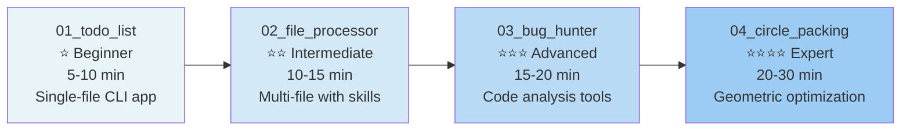
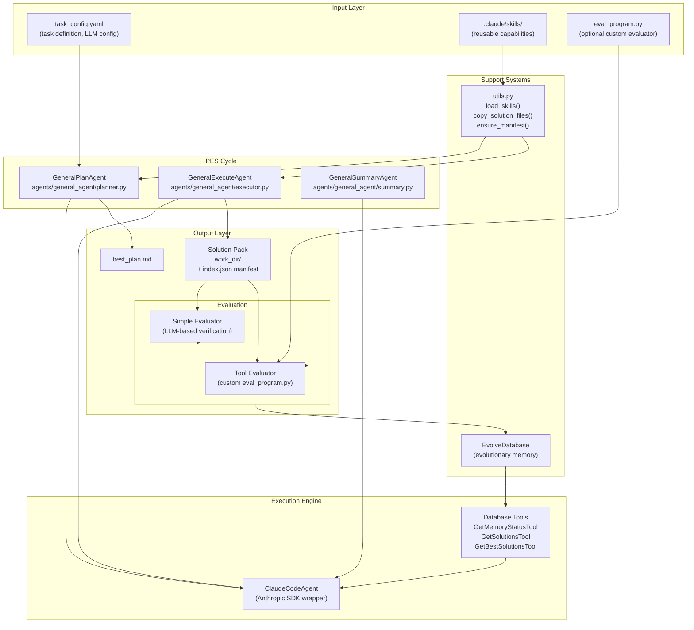
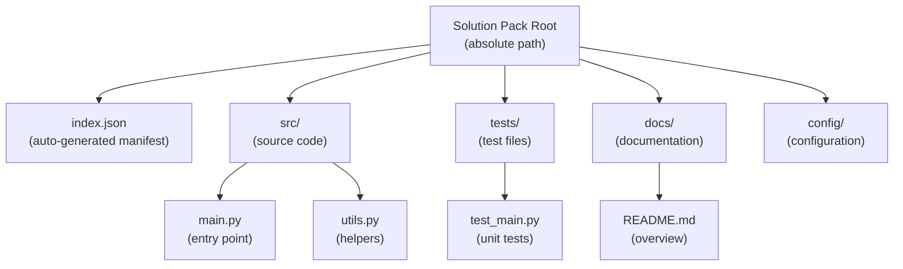
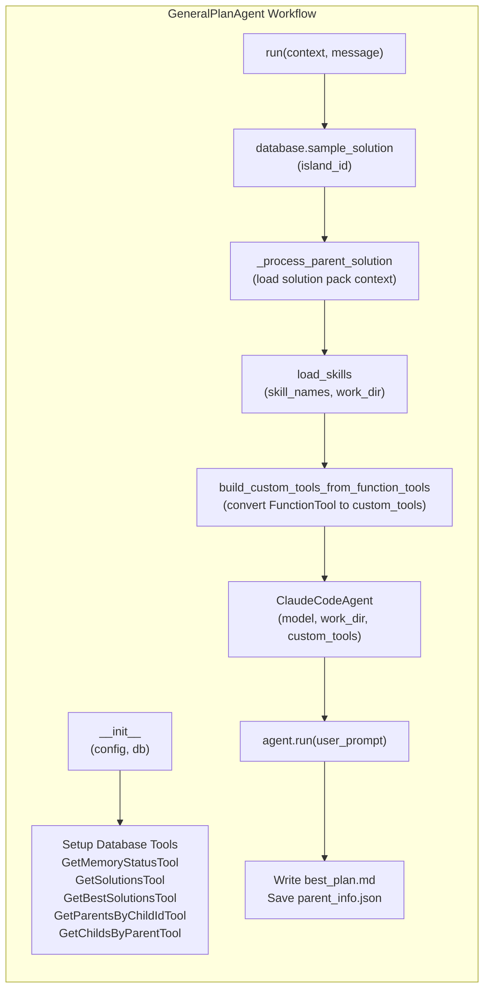
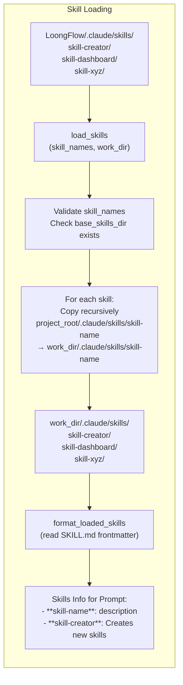
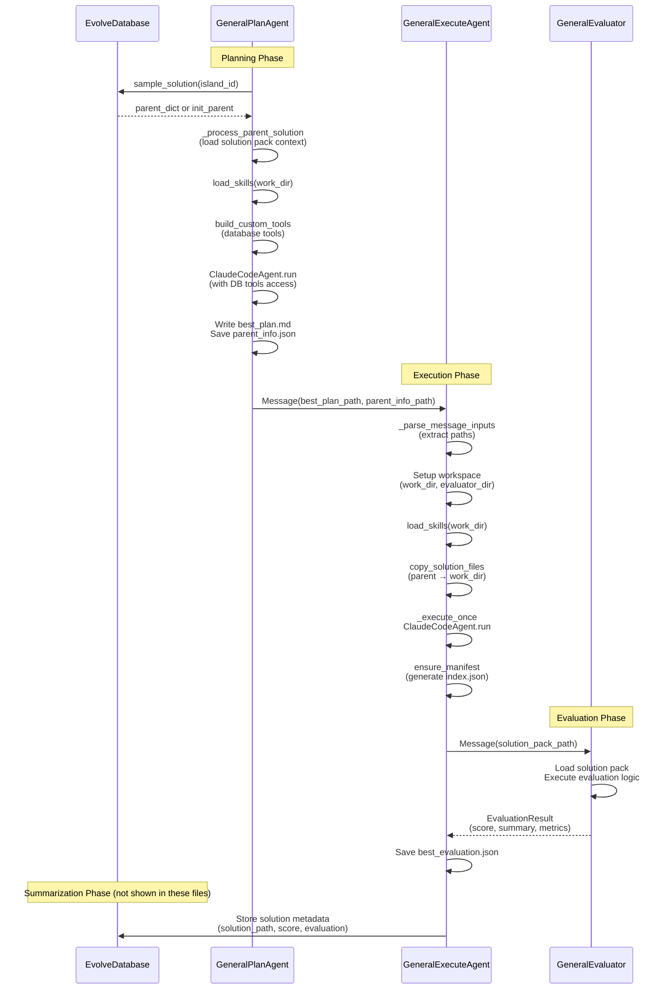
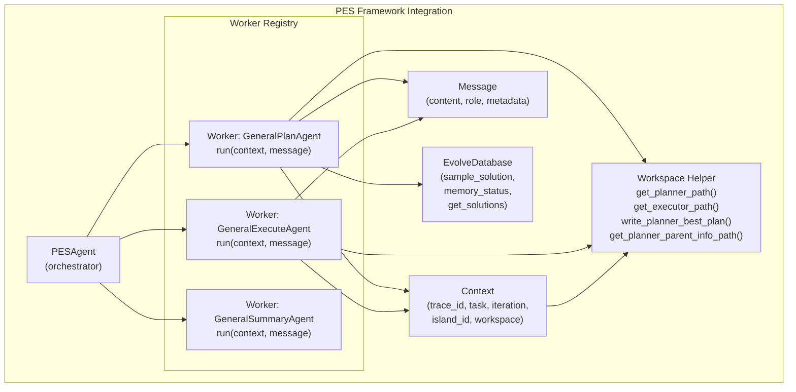

<!-- source: DeepWiki mcp.deepwiki.com · repo baidu-baige/LoongFlow · page 4 General Agent · fetched 2026-10-26 -->

# General Agent

<details>
<summary>Relevant source files</summary>

The following files were used as context for generating this wiki page:

- [README.md](README.md)
- [agents/general_agent/README.md](agents/general_agent/README.md)
- [agents/general_agent/README_zh.md](agents/general_agent/README_zh.md)
- [agents/ml_agent/README.md](agents/ml_agent/README.md)
- [src/loongflow/framework/claude_code/general_prompt.py](src/loongflow/framework/claude_code/general_prompt.py)

</details>


General Agent is a flexible, skill-driven implementation of the PES paradigm designed for general-purpose programming tasks. Unlike Math Agent ([5](#5)) which specializes in mathematical optimization, or ML Agent ([6](#6)) which targets machine learning competitions, General Agent handles diverse software development challenges ranging from simple scripts to complex multi-file applications.

## Purpose and Capabilities

General Agent excels at iteratively evolving software solutions through structured thinking and active verification. It operates on **Solution Packs** - multi-file directories that represent complete, organized solutions rather than single-file programs.

**Primary Use Cases:**

| Task Category | Examples | Difficulty Range |
|--------------|----------|------------------|
| **Application Development** | CLI tools, data processors, web utilities | ⭐ to ⭐⭐⭐ |
| **Code Quality** | Bug detection, security scanning, refactoring | ⭐⭐⭐ |
| **Algorithm Optimization** | Performance tuning, geometric solvers | ⭐⭐⭐⭐ |
| **System Integration** | File format converters, API clients | ⭐⭐ |

**Key Capabilities:**

- **Multi-file Solutions**: Creates organized projects with source code, tests, documentation, and configuration files
- **Skill-Driven Evolution**: Leverages reusable skills (SOPs) to guide high-quality solution generation
- **Active Verification**: Evaluates solutions by running tests and executing code, not just reading it
- **Evolutionary Memory**: Accesses historical solutions through database tools during planning
- **Anthropic Integration**: Uses Claude models exclusively via `ClaudeCodeAgent` for code execution capabilities

Sources: [README.md:45-88](), [agents/general_agent/README.md:1-98]()

## When to Use General Agent

**Choose General Agent when:**
- The solution requires multiple related files (code, tests, docs, config)
- You want skill-based guidance for domain-specific best practices
- Active code execution and testing is important for validation
- The task involves software development or code analysis
- You need iterative refinement of a codebase

**Consider alternatives when:**
- The task is purely mathematical optimization → Use Math Agent ([5](#5))
- The task is a machine learning competition → Use ML Agent ([6](#6))
- Single-file solutions are sufficient → Math Agent may be simpler
- Non-Anthropic models are required → General Agent requires Anthropic Claude

Sources: [README.md:359-376](), [agents/general_agent/README.md:75-98]()

## Example Progression

General Agent includes four progressive examples demonstrating increasing complexity:



**Learning Path:**

1. **Level 1 (01_todo_list)**: Learn basic PES workflow with a simple TODO list application
2. **Level 2 (02_file_processor)**: Introduce custom skills and CSV/JSON processing
3. **Level 3 (03_bug_hunter)**: Apply code analysis with security scanning (OWASP/CWE)
4. **Level 4 (04_circle_packing)**: Tackle complex optimization with geometric constraints

For hands-on tutorials, see the [General Agent Tutorial](agents/general_agent/TUTORIAL.md) or dive into [General Agent Overview](#4.1).

Sources: [README.md:359-376](), [agents/general_agent/README.md:75-98]()

## High-Level Architecture

General Agent implements the PES paradigm through specialized components that work with multi-file Solution Packs:

**System Architecture Diagram**



**Component Roles:**

| Component | Implementation | Primary Function |
|-----------|---------------|------------------|
| **Planner** | `GeneralPlanAgent` | Analyzes parent solutions, queries evolutionary memory via database tools, designs improvement strategies |
| **Executor** | `GeneralExecuteAgent` | Implements plans by creating/modifying multi-file Solution Packs using ClaudeCodeAgent |
| **Summary** | `GeneralSummaryAgent` | Reflects on execution outcomes, extracts insights for future iterations |
| **Evaluator** | `GeneralEvaluator` | Actively verifies solutions through code execution and testing |
| **Utils** | `utils.py` | Loads skills, manages solution packs, converts tools for ClaudeCodeAgent |

All components use `ClaudeCodeAgent` as the execution engine, which wraps Anthropic's Claude SDK to provide file system access, bash execution, and tool integration.

Sources: [agents/general_agent/planner.py:37-72](), [agents/general_agent/executor.py:40-67](), [agents/general_agent/evaluator.py:1-100](), [agents/general_agent/utils.py:22-93]()

## Solution Pack Concept

A defining characteristic of General Agent is its use of **Solution Packs** - organized multi-file directories that represent complete solutions rather than single scripts. This enables evolution of complex software projects with proper structure, tests, and documentation.

**Solution Pack Structure Example**



**Manifest (`index.json`) Structure:**

Every solution pack includes an auto-generated manifest describing its contents:

```json
{
  "description": "CLI TODO list manager with persistent storage",
  "entry_point": "src/main.py",
  "files": [
    {
      "path": "src/main.py",
      "type": "code",
      "description": "Main CLI entry point"
    },
    {
      "path": "tests/test_main.py",
      "type": "test",
      "description": "Unit tests for TODO operations"
    },
    {
      "path": "README.md",
      "type": "doc",
      "description": "Usage instructions"
    }
  ],
  "dependencies": ["argparse", "json"],
  "metadata": {}
}
```

The manifest serves two purposes:
1. **During Evolution**: Helps the LLM understand solution structure without reading every file
2. **During Evaluation**: Identifies the entry point for execution and testing

For detailed information on solution pack operations and the skills system, see [Skills & Solution Packs](#4.5).

Sources: [agents/general_agent/utils.py:435-522](), [agents/general_agent/README.md:100-110]()

---

## Core Components

### GeneralPlanAgent

The planner component uses ClaudeCodeAgent with database tools to analyze evolutionary history and generate improvement plans.



**Key Methods:**

- **`__init__(config, db)`** [agents/general_agent/planner.py:40-71](): Initializes planner with configuration and creates five database tool instances
- **`run(context, message)`** [agents/general_agent/planner.py:140-296](): Orchestrates planning phase
- **`_process_parent_solution(parent_dict, context)`** [agents/general_agent/planner.py:73-138](): Loads solution pack context for parent solution using `_prepare_solution_pack_context()`

**Database Tools Integration:**

The planner provides database tools to ClaudeCodeAgent as custom tools, enabling the LLM to query evolutionary memory:

```python
self.custom_tools = [
    GetMemoryStatusTool(self.database.memory_status),
    GetSolutionsTool(self.database.get_solutions),
    GetBestSolutionsTool(self.database.get_best_solutions),
    GetParentsByChildIdTool(self.database.get_parents_by_child_id),
    GetChildsByParentTool(self.database.get_childs_by_parent_id),
]
```

These `FunctionTool` instances are converted to ClaudeCodeAgent's custom tool format via `build_custom_tools_from_function_tools()`.

**Prompt Structure:**

The planner constructs prompts using `GENERAL_PLANNER_USER` and `GENERAL_PLANNER_SYSTEM` templates, injecting:
- Task information from `context.task`
- Parent solution pack (tree + manifest)
- Workspace path (absolute)
- Island information
- Loaded skills information
- Output path for `best_plan.md`

Sources: [agents/general_agent/planner.py:37-296](), [agents/general_agent/utils.py:95-174](), [agents/general_agent/utils.py:176-194]()

---

### GeneralExecuteAgent

The executor component implements solution pack creation and evolution using ClaudeCodeAgent.

```mermaid
graph TB
    subgraph "GeneralExecuteAgent Workflow"
        Init["__init__<br/>(config, evaluator)"]
        
        Run["run(context, message)"]
        Parse["_parse_message_inputs<br/>(extract plan, parent_info)"]
        
        Setup["Setup Workspace<br/>executor_dir/work_dir/<br/>executor_dir/evaluator_dir/"]
        LoadSkillsE["load_skills<br/>(if configured)"]
        
        Clone["copy_solution_files<br/>(parent → work_dir)"]
        Execute["_execute_once<br/>(context, parent_ctx, candidate_dir)"]
        
        subgraph "Agent Execution"
            BuildPrompt["Format GENERAL_EXECUTOR_USER<br/>task_info, improvement_plan<br/>parent_solution, solution_path"]
            CreateAgentE["ClaudeCodeAgent<br/>(work_dir=candidate_dir)"]
            RunAgent["agent.run(user_prompt)"]
        end
        
        EnsureManifest["ensure_manifest<br/>(candidate_dir, llm_config)"]
        Evaluate["evaluator.evaluate<br/>(solution_message, context)"]
        SaveResults["Save best_evaluation.json<br/>Return solution_path"]
    end
    
    Run --> Parse
    Parse --> Setup
    Setup --> LoadSkillsE
    LoadSkillsE --> Clone
    Clone --> Execute
    
    Execute --> BuildPrompt
    BuildPrompt --> CreateAgentE
    CreateAgentE --> RunAgent
    
    RunAgent --> EnsureManifest
    EnsureManifest --> Evaluate
    Evaluate --> SaveResults
```



**Key Methods:**

- **`__init__(config, evaluator)`** [agents/general_agent/executor.py:43-66](): Validates Anthropic model requirement and stores evaluator
- **`run(context, message)`** [agents/general_agent/executor.py:68-219](): Orchestrates execution workflow
- **`_parse_message_inputs(message)`** [agents/general_agent/executor.py:221-253](): Extracts plan path, parent info, and parent solution path from planner message
- **`_execute_once(context, parent_ctx, candidate_dir)`** [agents/general_agent/executor.py:255-324](): Creates ClaudeCodeAgent and executes plan once

**Workspace Structure:**

```
executor_dir/
├── work_dir/              # Solution pack being developed
│   ├── .claude/
│   │   └── skills/        # Loaded skills
│   ├── src/
│   ├── tests/
│   └── index.json         # Generated manifest
└── evaluator_dir/
    └── best_evaluation.json
```

**Execution Context:**

The `ExecutionContext` dataclass [agents/general_agent/executor.py:28-37]() holds:
- `parent_info_file_path`: Path to parent_info.json
- `parent_core`: Parent's score (typo for "score" in original code)
- `parent_solution`: JSON string of parent metadata
- `parent_solution_path`: Absolute path to parent solution directory
- `stage1_plan`: Plan content from best_plan.md
- `stage1_plan_file_path`: Path to plan file

Sources: [agents/general_agent/executor.py:40-324](), [agents/general_agent/utils.py:435-473]()

---

### Tool Conversion System

General Agent uses a specialized tool conversion system to bridge `FunctionTool` instances (used by the framework) and ClaudeCodeAgent's custom tool format.

```mermaid
graph TB
    subgraph "Tool Conversion Flow"
        FT["FunctionTool<br/>(func, args_schema, name, description)"]
        Decl["get_declaration()<br/>(name, description, parameters)"]
        
        Convert["convert_function_tool_to_custom_tool<br/>(tool)"]
        
        subgraph "Conversion Process"
            ExtractParams["Extract parameters schema<br/>(JSON → Python types)"]
            CreateWrapper["Create async wrapper<br/>calls tool.arun(args)"]
            FormatResponse["Format ToolResponse<br/>→ Claude format"]
        end
        
        CustomTool["Custom Tool Dict<br/>{function: async_func<br/>description: str<br/>parameters: dict}"]
        
        ClaudeAgent["ClaudeCodeAgent<br/>(custom_tools={name: tool_dict})"]
    end
    
    FT --> Decl
    Decl --> Convert
    Convert --> ExtractParams
    ExtractParams --> CreateWrapper
    CreateWrapper --> FormatResponse
    FormatResponse --> CustomTool
    CustomTool --> ClaudeAgent
```



**Conversion Mapping:**

| FunctionTool Type | ClaudeCodeAgent Type |
|-------------------|---------------------|
| JSON Schema ("string", "integer", etc.) | Python types (str, int, float, bool, list, dict) |
| `tool.arun(args)` call | Async wrapper function |
| `ToolResponse.content[0].data` | `{"content": [{"type": "text", "text": str}]}` |

**Key Function:**

`convert_function_tool_to_custom_tool(tool)` [agents/general_agent/utils.py:95-173]():
1. Extracts declaration from `FunctionTool`
2. Maps JSON schema types to Python types
3. Creates async wrapper that:
   - Calls `tool.arun(args)` 
   - Falls back to direct `tool.func(**args)` if `arun` fails
   - Converts `ToolResponse` to Claude format
4. Returns dict with `function`, `description`, `parameters`

Sources: [agents/general_agent/utils.py:95-194]()

---

## Skills System

Skills are reusable code templates, examples, or instructions stored in `.claude/skills` at the project root. They are loaded into the agent's workspace to provide context and capabilities.

### Skill Loading Process



**Skill Structure:**

Each skill is a directory containing:
- `SKILL.md` - Main skill documentation with YAML frontmatter
- Supporting files (examples, templates, code snippets)

**SKILL.md Frontmatter:**
```yaml
---
name: "Skill Creator"
description: "Creates new skills from examples and descriptions"
---

# Skill Usage Instructions
...
```

**Key Functions:**

| Function | Purpose | File Location |
|----------|---------|---------------|
| `load_skills(skill_names, work_dir)` | Copy skills from project root to workspace | [agents/general_agent/utils.py:22-93]() |
| `format_loaded_skills(skill_names, work_dir)` | Extract skill metadata for prompt injection | [agents/general_agent/utils.py:197-261]() |

**Configuration:**

Skills are specified in `ClaudeAgentConfig`:
```python
config = ClaudeAgentConfig(
    skills=["skill-creator", "skill-dashboard"],
    ...
)
```

Both planner and executor load skills if configured [agents/general_agent/planner.py:156-172](), [agents/general_agent/executor.py:105-120]().

Sources: [agents/general_agent/utils.py:22-93](), [agents/general_agent/utils.py:197-261]()

---

## Data Flow Through PES Cycle

The following diagram shows how data flows through a complete PES iteration in General Agent:



**Message Data Structure:**

1. **Planner → Executor:**
```json
{
  "parent_info_file_path": "/abs/path/to/parent_info.json",
  "best_plan_file_path": "/abs/path/to/best_plan.md",
  "total_prompt_tokens": 1500,
  "total_completion_tokens": 800
}
```

2. **Executor → Summary:**
```json
{
  "best_plan_file_path": "/abs/path/to/best_plan.md",
  "best_solution_path": "/abs/path/to/work_dir",
  "best_evaluation_path": "/abs/path/to/best_evaluation.json",
  "parent_info_file_path": "/abs/path/to/parent_info.json",
  "total_prompt_tokens": 3200,
  "total_completion_tokens": 1500
}
```

**Path Handling:**

All paths are converted to absolute paths using `os.path.abspath()` to avoid confusion across different working directories [agents/general_agent/planner.py:93-98](), [agents/general_agent/executor.py:98-99](), [agents/general_agent/executor.py:243-244]().

Sources: [agents/general_agent/planner.py:140-296](), [agents/general_agent/executor.py:68-219](), [agents/general_agent/utils.py:524-570]()

---

## Configuration

General Agent uses `ClaudeAgentConfig` dataclass for configuration:

**ClaudeAgentConfig Structure:**
```python
@dataclass
class ClaudeAgentConfig:
    llm_config: LLMConfig                # Required: Anthropic model config
    skills: Optional[List[str]]          # Skill names to load
    build_in_tools: List[str]            # Built-in tool names for ClaudeCodeAgent
    system_prompt: Optional[str]         # Override default system prompt
    permission_mode: Optional[str]       # "acceptEdits" or other modes
    max_turns: int                       # Max conversation turns
    max_thinking_tokens: Optional[int]   # Max tokens for extended thinking
```

**Model Requirements:**

Both planner and executor validate that the model starts with `"anthropic/"` and extract the model name:
```python
if not llm_config.model.startswith("anthropic/"):
    raise ValueError("Only support Anthropic model, please use model name like anthropic/xxx.")
llm_config.model = llm_config.model.split("/")[-1]
```

This converts `"anthropic/claude-3-5-sonnet-20241022"` to `"claude-3-5-sonnet-20241022"` for ClaudeCodeAgent.

**Built-in Tools:**

ClaudeCodeAgent supports these built-in tools (configurable via `build_in_tools` list):
- `write` - Write files
- `read` - Read files  
- `list_dir` - List directory contents
- `search` - Search in files
- `bash` - Execute bash commands
- `str_replace` - String replacement in files

For full configuration details, see [Configuration & Running](#4.5).

Sources: [agents/general_agent/planner.py:52-59](), [agents/general_agent/executor.py:51-62](), [agents/general_agent/common.py]()

---

## Integration with PES Framework

General Agent integrates with the PES framework through the `Worker` interface:



**Worker Interface Implementation:**

Both `GeneralPlanAgent` and `GeneralExecuteAgent` inherit from `Worker` and implement:
- `async def run(self, context: Context, message: Message) -> Message`

**Workspace Utilities:**

The `Workspace` class provides path management:
- `Workspace.get_planner_path(context, create=True)` - Returns planner workspace directory
- `Workspace.get_executor_path(context, create=True)` - Returns executor workspace directory
- `Workspace.write_planner_best_plan(context, content, filename)` - Writes plan file
- `Workspace.get_planner_parent_info_path(context)` - Returns parent_info.json path
- `Workspace.get_planner_best_plan_path(context, filename)` - Returns plan file path

These utilities ensure consistent path handling across iterations and checkpoints.

Sources: [agents/general_agent/planner.py:37-41](), [agents/general_agent/executor.py:40-44](), [agents/general_agent/planner.py:148-218](), [agents/general_agent/executor.py:86-96]()

---

## Summary

General Agent provides a flexible, multi-file solution evolution system with the following key features:

1. **Solution Pack Protocol**: All solutions are multi-file directories with manifests
2. **ClaudeCodeAgent Integration**: Uses Anthropic's Claude for both planning and execution
3. **Database Tool Access**: Planner queries evolutionary memory via custom tools
4. **Skills System**: Reusable capabilities loaded from project-level `.claude/skills`
5. **Copy-on-Write Evolution**: Parent solutions are cloned and modified iteratively
6. **Automatic Manifest Generation**: Ensures all solution packs have structured metadata

For implementing custom General Agent tasks, see [Configuration & Running](#4.5). For extending the system with custom skills, see [Skills & Solution Packs](#4.4).

Sources: [agents/general_agent/planner.py:1-297](), [agents/general_agent/executor.py:1-325](), [agents/general_agent/utils.py:1-570]()

---

