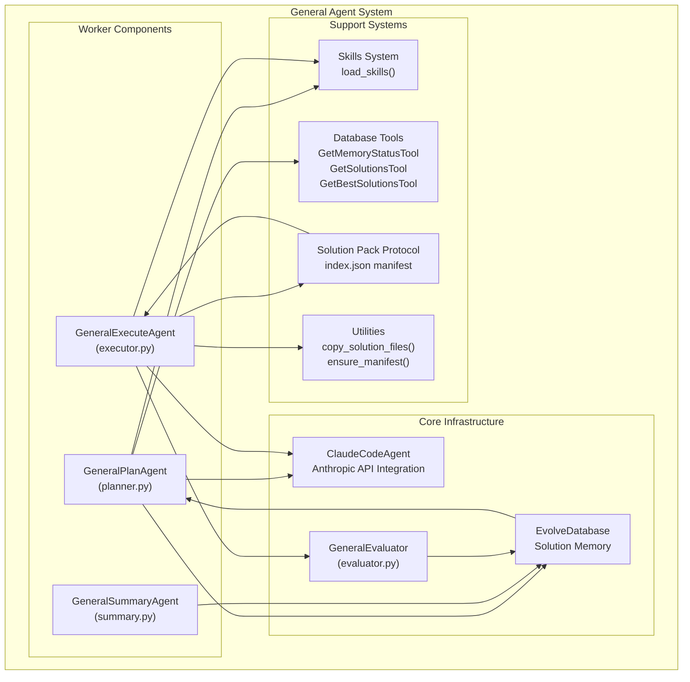
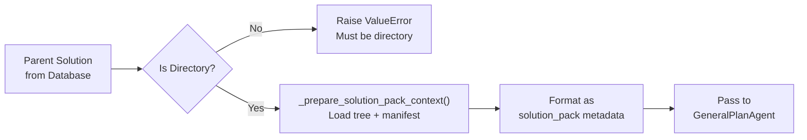
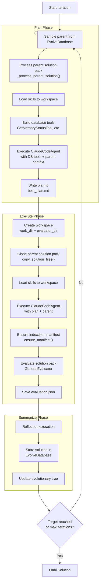
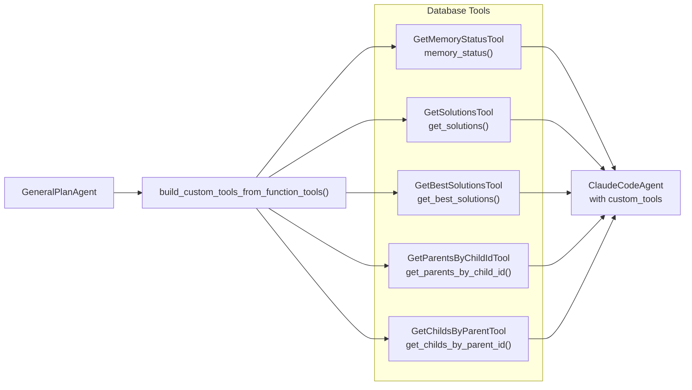
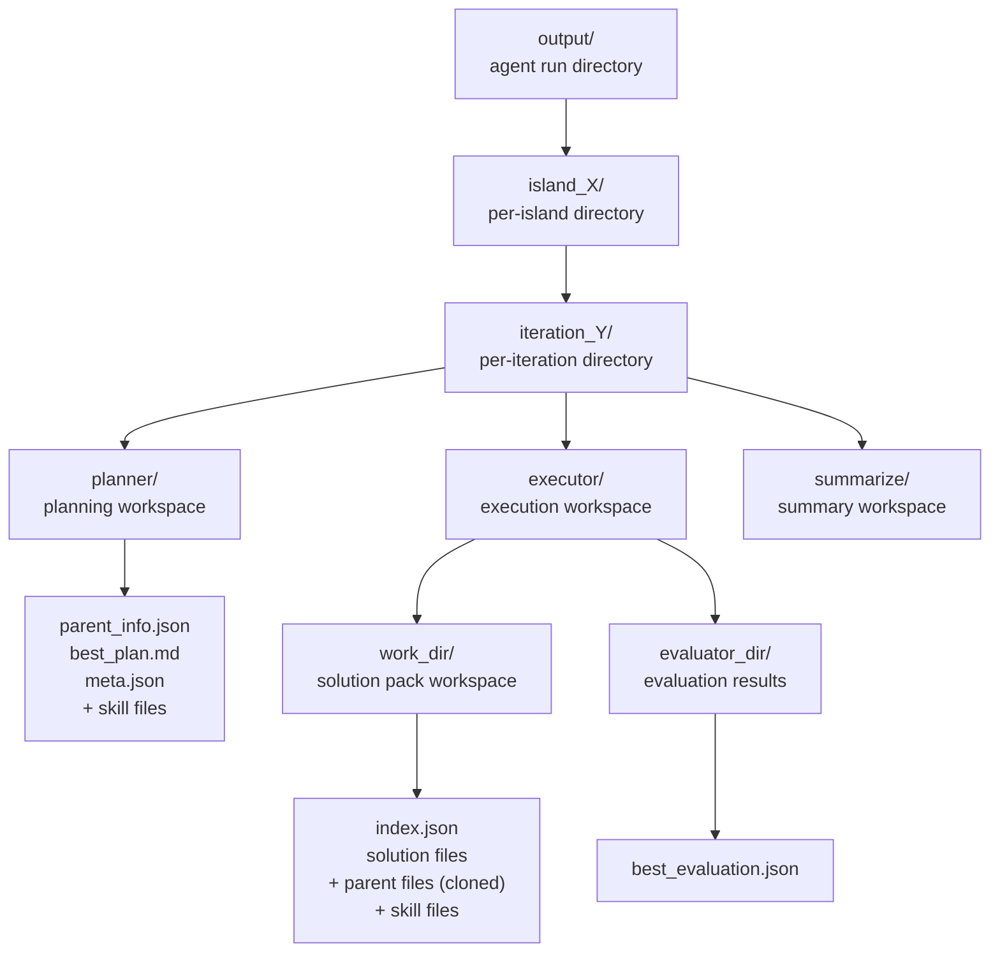
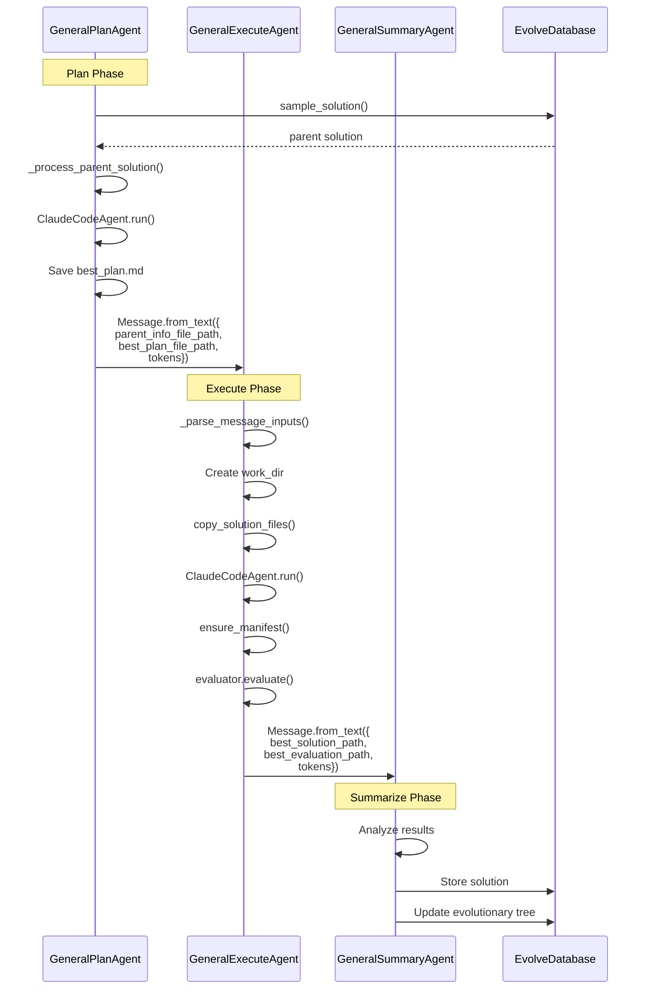

<!-- source: DeepWiki mcp.deepwiki.com · repo baidu-baige/LoongFlow · page 4.1 General Agent Overview · fetched 2026-10-26 -->

# General Agent Overview

<details>
<summary>Relevant source files</summary>

The following files were used as context for generating this wiki page:

- [agents/general_agent/README.md](agents/general_agent/README.md)
- [agents/general_agent/README_zh.md](agents/general_agent/README_zh.md)
- [src/loongflow/framework/claude_code/general_prompt.py](src/loongflow/framework/claude_code/general_prompt.py)

</details>


## Purpose and Scope

The **General Agent** is a specialized implementation of LoongFlow's PES paradigm designed for general-purpose task solving through iterative evolution of **solution packs**. Unlike the Math Agent (see [Math Agent Overview](#5.1)) and ML Agent (see [ML Agent Overview](#6.1)), which target domain-specific problems, General Agent provides a flexible framework for evolving solutions to arbitrary tasks where the solution can be represented as a directory structure with multiple files and resources.

This document introduces General Agent's architecture, solution pack protocol, and integration with ClaudeCodeAgent. For details on specific components, see [Planner Component](#4.2) and [Executor Component](#4.3). For information about configuring and running General Agent tasks, see [Configuration & Running](#4.5).

## Architecture Overview

General Agent implements the PES paradigm using `ClaudeCodeAgent` as the underlying LLM-powered execution engine. The architecture consists of three primary worker components that orchestrate solution pack evolution through database-backed memory management.



**Sources:** [agents/general_agent/planner.py:1-297](), [agents/general_agent/executor.py:1-325]()

## Key Components

### GeneralPlanAgent

The `GeneralPlanAgent` class [agents/general_agent/planner.py:37-297]() manages the planning phase of each PES iteration. It samples parent solutions from the `EvolveDatabase`, loads solution pack context, and uses `ClaudeCodeAgent` to generate improvement plans.

**Key responsibilities:**
- Sample parent solution from evolutionary memory
- Process solution packs to extract directory structure and manifest
- Provide database query tools to the LLM (`GetMemoryStatusTool`, `GetSolutionsTool`, etc.)
- Generate plans written to `best_plan.md` using ClaudeCodeAgent
- Save parent metadata to `parent_info.json`

**Configuration:** Requires `anthropic/` model prefix [agents/general_agent/planner.py:54-59]()

### GeneralExecuteAgent

The `GeneralExecuteAgent` class [agents/general_agent/executor.py:40-325]() executes improvement plans by creating candidate solution packs, optionally cloning parent solutions, and running ClaudeCodeAgent to implement the plan.

**Key responsibilities:**
- Create workspace directory structure (`work_dir`, `evaluator_dir`)
- Clone parent solution pack if available [agents/general_agent/executor.py:129-142]()
- Load skills into workspace [agents/general_agent/executor.py:105-121]()
- Execute ClaudeCodeAgent with plan and parent context
- Ensure `index.json` manifest generation [agents/general_agent/executor.py:147-158]()
- Evaluate solution pack and return results

**Workflow:** Linear execution (one agent run per iteration) rather than multi-attempt optimization [agents/general_agent/executor.py:68-78]()

### GeneralEvaluator

The `GeneralEvaluator` provides task-specific evaluation logic to score solution packs. It receives the solution directory path and returns structured evaluation results with score, summary, status, and metrics.

**Integration:** Called by executor after agent execution completes [agents/general_agent/executor.py:159-196]()

## Solution Pack Protocol

General Agent enforces a **Solution Pack Protocol** where all solutions must be directories containing multiple files and a manifest. This differs from single-file solutions used by other agents.

### Directory Structure

A solution pack is a directory with the following structure:

```
solution_pack_dir/
├── index.json          # Required manifest file
├── main.py             # Example entry point
├── utils.py            # Example utility module
├── data/               # Optional data directory
│   └── config.json
└── docs/               # Optional documentation
    └── README.md
```

### Manifest File (index.json)

The `index.json` manifest [agents/general_agent/executor.py:147-158]() describes the solution pack's structure and metadata. It is automatically generated via `ensure_manifest()` if missing.

**Key Properties:**
- **solution_pack:** Directory tree structure
- **main_file:** Entry point for execution
- **dependencies:** Required packages/skills
- **metadata:** Task-specific information

### Solution Pack Context Loading

The planner uses lazy loading to provide solution pack context to the LLM [agents/general_agent/planner.py:115-136](). The `_prepare_solution_pack_context()` function loads only the directory tree and manifest, avoiding excessive token usage from reading all file contents.



**Sources:** [agents/general_agent/planner.py:73-138](), [agents/general_agent/utils.py:1-500]()

## Skills System

Skills are reusable code modules that can be loaded into the agent's workspace to provide common functionality. They accelerate development by providing pre-built utilities.

### Loading Skills

Skills are loaded via the `load_skills()` function [agents/general_agent/executor.py:106-120]() and [agents/general_agent/planner.py:157-172](), which copies skill files from a skill repository into the workspace directory.

**Configuration:** Specified in `ClaudeAgentConfig.skills` list [agents/general_agent/common.py:1-100]()

### Skill Information Formatting

The `format_loaded_skills()` function [agents/general_agent/utils.py:1-500]() generates a formatted string describing which skills are available, which is included in the LLM prompt [agents/general_agent/executor.py:270]() and [agents/general_agent/planner.py:223]().

**Example prompt section:**
```
Loaded Skills:
- skill_name_1: Description of skill functionality
- skill_name_2: Description of skill functionality
```

## PES Workflow in General Agent

The General Agent follows the standard PES paradigm with solution pack-specific operations at each phase.



**Sources:** [agents/general_agent/planner.py:140-296](), [agents/general_agent/executor.py:68-219]()

## Integration with ClaudeCodeAgent

General Agent leverages `ClaudeCodeAgent` [loongflow/framework/claude_code/claude_code_agent.py:1-500]() for both planning and execution phases. This provides access to Anthropic's Claude models with built-in tool use capabilities.

### ClaudeCodeAgent Configuration

Both planner and executor instantiate `ClaudeCodeAgent` with similar configurations:

| Parameter | Planner Value | Executor Value | Purpose |
|-----------|---------------|----------------|---------|
| `model` | From `llm_config.model` | From `llm_config.model` | Claude model name (e.g., `claude-3-5-sonnet-20241022`) |
| `api_key` | From `llm_config.api_key` | From `llm_config.api_key` | Anthropic API authentication |
| `url` | From `llm_config.url` | From `llm_config.url` | Optional custom endpoint |
| `work_dir` | Planner workspace path | Executor workspace path | Directory for file operations |
| `tool_list` | `build_in_tools` | `build_in_tools` | Built-in tools (Bash, Write, etc.) |
| `custom_tools` | Database query tools | Empty dict `{}` | Custom tool set |
| `system_prompt` | `GENERAL_PLANNER_SYSTEM` | `GENERAL_EXECUTOR_SYSTEM` | Role-specific instructions |
| `permission_mode` | `acceptEdits` | `acceptEdits` | Auto-accept file edits |
| `max_turns` | Configurable | Configurable | Maximum interaction turns |

**Sources:** [agents/general_agent/planner.py:177-189](), [agents/general_agent/executor.py:282-294]()

### Database Tools for Planner

The planner provides database query tools to ClaudeCodeAgent, enabling the LLM to explore the evolutionary memory [agents/general_agent/planner.py:63-69]():



**Sources:** [agents/general_agent/planner.py:63-69](), [agents/general_agent/utils.py:1-500](), [loongflow/framework/pes/database/database_tool.py:1-500]()

### System Prompts

General Agent uses specialized system prompts defined in [loongflow/framework/claude_code/prompts.py:1-500]():

- **GENERAL_PLANNER_SYSTEM:** Instructions for generating improvement plans with database queries
- **GENERAL_EXECUTOR_SYSTEM:** Instructions for implementing plans and managing solution packs

These prompts are combined with user prompts that include task information, parent context, and loaded skills [agents/general_agent/planner.py:225-233]() and [agents/general_agent/executor.py:273-279]().

## Workspace Management

General Agent creates a structured workspace for each PES iteration using the `Workspace` API [loongflow/framework/pes/context.py:1-500]().

### Directory Structure



**Key Paths:**
- **Planner workspace:** `Workspace.get_planner_path(context, True)` [agents/general_agent/planner.py:148]()
- **Executor workspace:** `Workspace.get_executor_path(context, True)` [agents/general_agent/executor.py:86]()
- **Work directory:** `executor_dir / "work_dir"` [agents/general_agent/executor.py:88-90]()
- **Evaluator directory:** `executor_dir / "evaluator_dir"` [agents/general_agent/executor.py:93-95]()

**Sources:** [agents/general_agent/executor.py:86-102](), [agents/general_agent/planner.py:148-154]()

## ExecutionContext Data Structure

The `ExecutionContext` dataclass [agents/general_agent/executor.py:28-38]() encapsulates information passed between planning and execution phases:

| Field | Type | Description |
|-------|------|-------------|
| `parent_info_file_path` | `str` | Path to `parent_info.json` |
| `parent_core` | `float` | Parent solution score |
| `parent_solution` | `str` | JSON-serialized parent metadata |
| `parent_solution_path` | `str` | Absolute path to parent solution directory |
| `stage1_plan` | `str` | Content of improvement plan |
| `stage1_plan_file_path` | `str` | Path to `best_plan.md` |

This context is extracted from the planner's message output [agents/general_agent/executor.py:221-253]() and used to guide executor operations.

**Sources:** [agents/general_agent/executor.py:28-38](), [agents/general_agent/executor.py:221-253]()

## Message Flow

General Agent uses the LoongFlow message system to pass structured data between PES phases:



**Key message fields:**
- **Planner → Executor:** `parent_info_file_path`, `best_plan_file_path`, token counts [agents/general_agent/planner.py:288-296]()
- **Executor → Summarizer:** `best_solution_path`, `best_evaluation_path`, token counts [agents/general_agent/executor.py:207-219]()

**Sources:** [agents/general_agent/planner.py:288-296](), [agents/general_agent/executor.py:207-219]()

---

