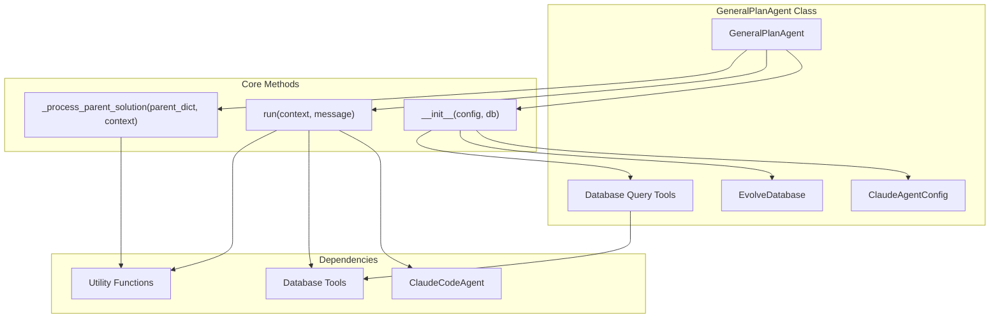
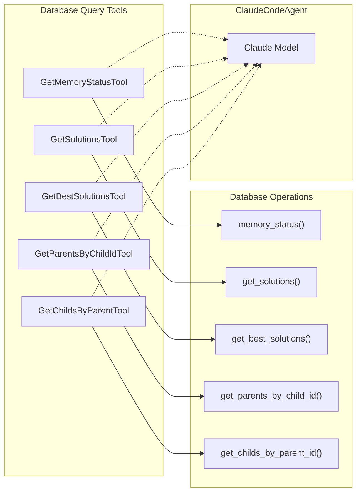
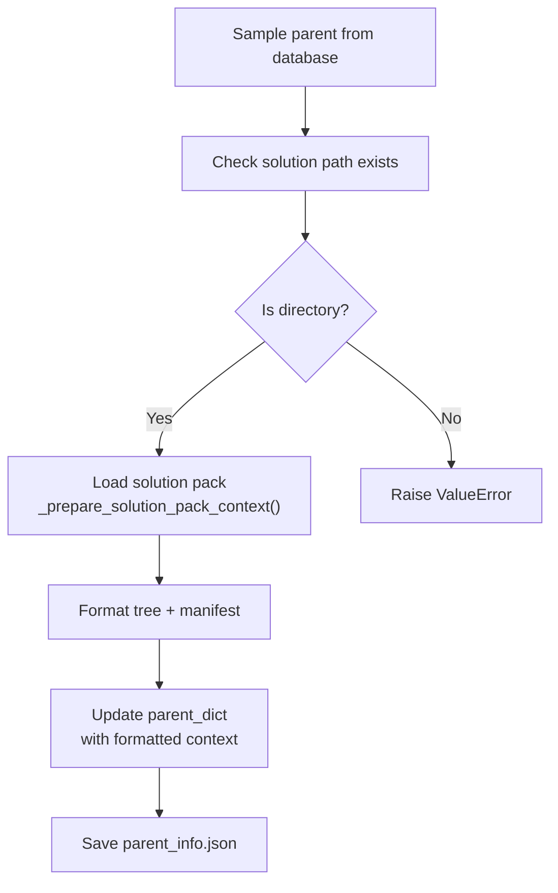
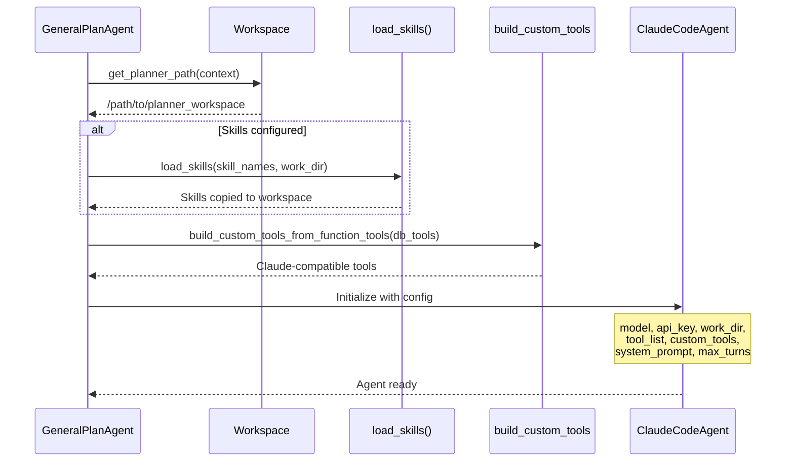
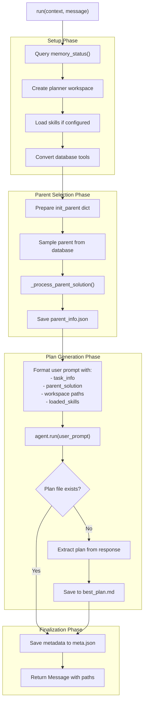
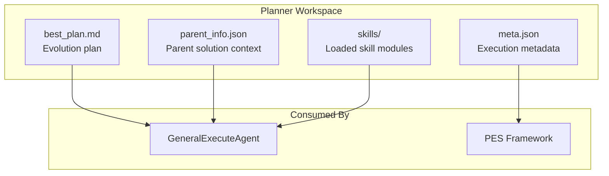
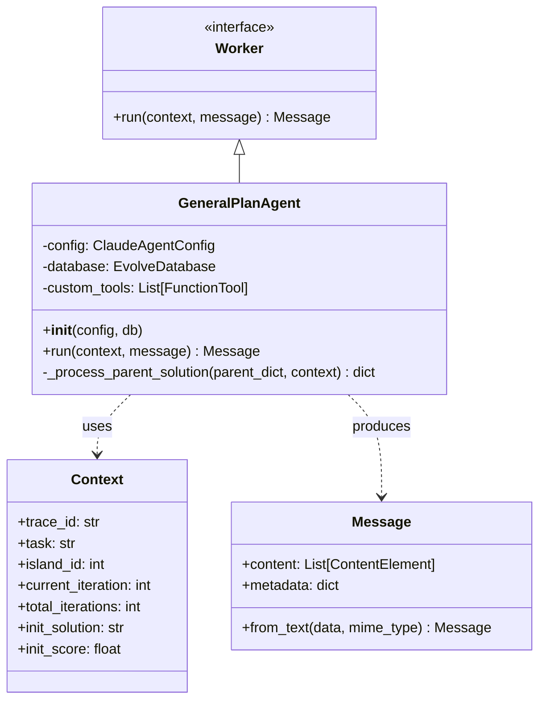

<!-- source: DeepWiki mcp.deepwiki.com · repo baidu-baige/LoongFlow · page 4.2 Planner Component · fetched 2026-10-26 -->

# Planner Component

<details>
<summary>Relevant source files</summary>

The following files were used as context for generating this wiki page:

- [agents/general_agent/README.md](agents/general_agent/README.md)
- [agents/general_agent/README_zh.md](agents/general_agent/README_zh.md)
- [agents/general_agent/executor.py](agents/general_agent/executor.py)
- [src/loongflow/framework/claude_code/general_prompt.py](src/loongflow/framework/claude_code/general_prompt.py)

</details>


## Purpose and Scope

The Planner Component is the first phase of the PES (Plan-Execute-Summarize) cycle in General Agent. It is responsible for generating an evolution plan by analyzing the task, querying the evolutionary memory database, and sampling parent solutions to guide the next iteration. The planner uses Anthropic's Claude model through `ClaudeCodeAgent` to produce a structured plan file that the Executor Component will implement.

This document covers the `GeneralPlanAgent` class, database tool integration, solution pack processing, and the planning workflow. For information about the execution phase that follows planning, see [Executor Component](#4.3). For the overall PES paradigm, see [PES Paradigm](#3.1). For solution pack structure and utilities, see [Skills & Solution Packs](#4.4).

## Architecture Overview

The Planner Component is implemented by the `GeneralPlanAgent` class, which extends the `Worker` interface from the PES framework. It orchestrates the planning phase by instantiating a `ClaudeCodeAgent` with specialized database query tools, loading solution pack context from parent solutions, and prompting Claude to generate an evolution plan.

### GeneralPlanAgent Class Structure



**Sources:** [agents/general_agent/planner.py:37-71]()

### Key Components

| Component | Type | Purpose |
|-----------|------|---------|
| `GeneralPlanAgent` | Worker | Main planner implementation that extends PES Worker interface |
| `ClaudeAgentConfig` | Configuration | Contains LLM config, skills, tools, and prompts |
| `EvolveDatabase` | Database | Provides access to evolutionary memory and solution sampling |
| Database Tools | FunctionTool[] | Custom tools for querying memory status and solutions |
| `ClaudeCodeAgent` | Agent | Anthropic Claude agent that generates the plan |

**Sources:** [agents/general_agent/planner.py:37-71]()

## Database Tool Integration

The Planner Component provides Claude with specialized tools to query the evolutionary memory system. These tools enable the planner to make informed decisions about evolution strategies by examining past solutions, their relationships, and performance metrics.

### Available Database Tools



**Sources:** [agents/general_agent/planner.py:63-69]()

### Tool Descriptions

| Tool Class | Database Method | Purpose |
|-----------|----------------|---------|
| `GetMemoryStatusTool` | `memory_status()` | Returns statistics about solutions stored across all islands |
| `GetSolutionsTool` | `get_solutions()` | Retrieves solutions matching specified criteria |
| `GetBestSolutionsTool` | `get_best_solutions()` | Fetches top-performing solutions from the database |
| `GetParentsByChildIdTool` | `get_parents_by_child_id()` | Queries parent solutions for a given child solution ID |
| `GetChildsByParentTool` | `get_childs_by_parent_id()` | Retrieves all children evolved from a specific parent |

These tools are converted to Claude-compatible custom tools using `build_custom_tools_from_function_tools()` before being passed to `ClaudeCodeAgent`.

**Sources:** [agents/general_agent/planner.py:63-69](), [agents/general_agent/planner.py:175]()

## Solution Pack Processing

The Planner Component handles solution packs—multi-file solution directories with standardized structure. When sampling a parent solution from the database, the planner must load and format the solution pack context for Claude to understand.

### Solution Pack Loading Workflow



**Sources:** [agents/general_agent/planner.py:73-138]()

### _process_parent_solution Method

The `_process_parent_solution()` method is responsible for preparing parent solution context:

1. **Path Validation**: Ensures the solution path is absolute and exists
2. **Directory Check**: Verifies the solution is a directory (solution pack protocol requirement)
3. **Lazy Loading**: Uses `_prepare_solution_pack_context()` to load only the file tree and manifest (not full file contents)
4. **Metadata Update**: Stores formatted solution pack information in `parent_dict["metadata"]["solution_pack"]`
5. **Error Handling**: Raises detailed errors if solution pack is invalid

**Sources:** [agents/general_agent/planner.py:73-138]()

### Solution Pack Metadata Structure

```python
parent_dict = {
    "solution": "/absolute/path/to/solution_pack",  # Absolute path
    "score": 0.85,
    "evaluation": {"metrics": {...}},
    "summary": "Summary from previous iteration",
    "metadata": {
        "solution_pack": {
            "tree": "Directory structure...",
            "manifest": {...}  # index.json contents
        }
    }
}
```

**Sources:** [agents/general_agent/planner.py:88-126]()

## ClaudeCodeAgent Integration

The Planner instantiates a `ClaudeCodeAgent` to perform the actual plan generation. This integration involves configuring Claude with the appropriate workspace, tools, prompts, and execution parameters.

### Agent Initialization Flow



**Sources:** [agents/general_agent/planner.py:148-189]()

### Configuration Parameters

| Parameter | Source | Description |
|-----------|--------|-------------|
| `model` | `config.llm_config.model` | Anthropic model name (must start with `anthropic/`) |
| `api_key` | `config.llm_config.api_key` | Anthropic API key |
| `url` | `config.llm_config.url` | Optional custom API endpoint |
| `work_dir` | `Workspace.get_planner_path()` | Planner-specific workspace directory |
| `tool_list` | `config.build_in_tools` | Built-in Claude tools to enable |
| `custom_tools` | Database tools | Converted FunctionTools for database queries |
| `system_prompt` | `config.system_prompt` or `GENERAL_PLANNER_SYSTEM` | System instructions for planning |
| `permission_mode` | `config.permission_mode` | Defaults to `"acceptEdits"` |
| `max_turns` | `config.max_turns` | Maximum conversation turns |
| `max_thinking_tokens` | `config.max_thinking_tokens` | Extended thinking token limit |

**Sources:** [agents/general_agent/planner.py:177-189]()

### Model Validation

The planner enforces that only Anthropic models are used, as it relies on Claude-specific features through `ClaudeCodeAgent`. The model name must be prefixed with `anthropic/` in the configuration, which is then stripped before passing to the agent.

**Sources:** [agents/general_agent/planner.py:54-59]()

## Planning Workflow

The planning workflow orchestrates all components to produce a structured plan file that guides the next evolution iteration.

### Complete Planning Data Flow



**Sources:** [agents/general_agent/planner.py:140-296]()

### Execution Steps

#### 1. Workspace Setup

The planner creates an isolated workspace directory for its operation:

```python
work_dir = Workspace.get_planner_path(context, create=True)
# Ensures absolute path
work_dir = os.path.abspath(work_dir)
```

This workspace is where Claude will execute operations and where artifacts (plan file, parent info, metadata) are stored.

**Sources:** [agents/general_agent/planner.py:148-154]()

#### 2. Skills Loading

If skills are configured in `ClaudeAgentConfig.skills`, they are copied into the workspace:

```python
if self.config.skills:
    load_skills(
        skill_names=self.config.skills,
        work_dir=work_dir,
    )
```

Skills are reusable code modules or solution components that Claude can reference when planning.

**Sources:** [agents/general_agent/planner.py:157-172]()

#### 3. Parent Solution Sampling

The planner samples a parent solution from the database using the evolutionary memory system:

```python
parent = self.database.sample_solution(context.island_id)
parent_dict = parent if parent else init_parent
parent_dict = self._process_parent_solution(parent_dict, context)
```

If no parent exists (first iteration), it uses `init_parent` with the initial solution context.

**Sources:** [agents/general_agent/planner.py:199-204]()

#### 4. Prompt Construction

The user prompt is formatted with all necessary context:

```python
user_prompt = GENERAL_PLANNER_USER.format(
    task_info=context.task,
    parent_solution=parent_json,
    workspace=f"{work_dir} (absolute path)",
    island_num=self.database.config.num_islands,
    parent_island=parent.get("island_id") if parent else 0,
    best_plan_path=f"{best_plan_path_for_claude} (absolute path)",
    loaded_skills=loaded_skills_info,
)
```

This provides Claude with task requirements, parent solution context, workspace information, and expected output location.

**Sources:** [agents/general_agent/planner.py:225-233]()

#### 5. Plan Generation

Claude is invoked to generate the plan:

```python
result = await agent.run(user_prompt)
```

Claude uses database query tools to explore the solution space and generates a structured plan, which it should write to `best_plan_path` using the Write tool.

**Sources:** [agents/general_agent/planner.py:236]()

#### 6. Plan File Verification

The planner verifies that Claude wrote the plan file. If not found, it extracts the plan from Claude's response and saves it manually:

```python
if os.path.exists(best_plan_full_path):
    logger.info("Plan generated successfully")
else:
    # Fallback: extract from response
    plan_content = result.content[0].data
    Workspace.write_planner_best_plan(context, plan_content, BEST_PLAN_FILE)
```

**Sources:** [agents/general_agent/planner.py:239-262]()

## Output Artifacts

The Planner Component produces several artifacts that are used by downstream components in the PES cycle.

### Artifact Structure



**Sources:** [agents/general_agent/planner.py:207-296]()

### best_plan.md

The primary output containing the evolution plan written by Claude. This markdown file includes:

- Analysis of the parent solution's strengths and weaknesses
- Proposed improvements or new approaches
- Step-by-step implementation instructions
- Expected outcomes and success criteria

The file path is determined by `Workspace.get_planner_best_plan_path(context, BEST_PLAN_FILE)`.

**Sources:** [agents/general_agent/planner.py:214-262]()

### parent_info.json

JSON file containing the sampled parent solution information:

```json
{
  "solution": "/absolute/path/to/parent/solution_pack",
  "score": 0.85,
  "evaluation": {...},
  "summary": "Summary from parent's summarize phase",
  "metadata": {
    "solution_pack": {
      "tree": "...",
      "manifest": {...}
    }
  }
}
```

Saved via `Workspace.write_planner_parent_info(context, parent_json)`.

**Sources:** [agents/general_agent/planner.py:207-212]()

### meta.json

Execution metadata for tracking and monitoring:

```json
{
  "trace_id": "...",
  "status": "success",
  "tools_used": ["GetMemoryStatusTool", "GetSolutionsTool", ...],
  "input_tokens": 1500,
  "output_tokens": 800,
  "duration_ms": 5200
}
```

**Sources:** [agents/general_agent/planner.py:265-277]()

### Return Message

The planner returns a `Message` object containing file paths and token usage:

```python
Message.from_text(
    data={
        "parent_info_file_path": parent_info_path,
        "best_plan_file_path": best_plan_full_path,
        "total_prompt_tokens": input_tokens,
        "total_completion_tokens": output_tokens,
    },
    mime_type=MimeType.APPLICATION_JSON,
)
```

This message is passed to the Executor Component to continue the PES cycle.

**Sources:** [agents/general_agent/planner.py:288-296]()

## Configuration

The Planner Component is configured through `ClaudeAgentConfig`, which is typically loaded from `task_config.yaml`.

### ClaudeAgentConfig Schema

| Field | Type | Required | Description |
|-------|------|----------|-------------|
| `llm_config` | LLMConfig | Yes | LLM configuration including model, API key, URL |
| `skills` | List[str] | No | List of skill names to load into workspace |
| `build_in_tools` | List[str] | No | Built-in Claude tools to enable |
| `system_prompt` | str | No | Custom system prompt (defaults to `GENERAL_PLANNER_SYSTEM`) |
| `permission_mode` | str | No | Claude permission mode (default: `"acceptEdits"`) |
| `max_turns` | int | No | Maximum conversation turns |
| `max_thinking_tokens` | int | No | Extended thinking token limit |

**Sources:** [agents/general_agent/planner.py:40-46]()

### LLM Configuration Requirements

The `llm_config` must specify an Anthropic model:

```yaml
llm_config:
  model: "anthropic/claude-3-5-sonnet-20241022"
  api_key: "${ANTHROPIC_API_KEY}"
  url: "https://api.anthropic.com"  # Optional
```

The planner validates that the model starts with `anthropic/` and strips this prefix before instantiating `ClaudeCodeAgent`.

**Sources:** [agents/general_agent/planner.py:48-59]()

## Error Handling

The Planner Component implements robust error handling for common failure scenarios:

### Validation Errors

| Condition | Error Type | Message |
|-----------|-----------|---------|
| No LLMConfig | `ValueError` | "No LLMConfig found in config" |
| Non-Anthropic model | `ValueError` | "Only support Anthropic model" |
| Solution path is file | `ValueError` | "Solution path must be a directory (solution pack)" |
| Invalid solution pack | `ValueError` | "Failed to load solution pack from {path}" |

**Sources:** [agents/general_agent/planner.py:48-136]()

### Skill Loading Errors

If skill loading fails, the error is logged and re-raised to prevent the planner from continuing with incomplete context:

```python
try:
    load_skills(skill_names=self.config.skills, work_dir=work_dir)
except Exception as e:
    logger.error(f"Failed to load skills - {str(e)}")
    raise
```

**Sources:** [agents/general_agent/planner.py:160-172]()

### Plan File Recovery

If Claude fails to write the plan file using the Write tool, the planner extracts the plan from Claude's response content and saves it manually, ensuring the workflow can continue.

**Sources:** [agents/general_agent/planner.py:244-262]()

## Integration with PES Framework

The Planner Component integrates seamlessly with the PES framework through the `Worker` interface.

### Worker Interface Implementation



**Sources:** [agents/general_agent/planner.py:37-41](), [agents/general_agent/planner.py:140-296]()

### Context Usage

The `Context` object provides essential information for planning:

- **trace_id**: Unique identifier for logging and tracking
- **task**: Task description and requirements
- **island_id**: Current evolution island for parent sampling
- **current_iteration**: Progress tracking
- **init_solution**: Initial solution for first iteration
- **init_score**: Initial score baseline

**Sources:** [agents/general_agent/planner.py:140-233]()

### Workspace Integration

The planner uses `Workspace` utility methods to manage file paths consistently:

```python
# Get planner workspace directory
work_dir = Workspace.get_planner_path(context, create=True)

# Get parent info path
parent_info_path = Workspace.get_planner_parent_info_path(context)

# Get plan file path
plan_path = Workspace.get_planner_best_plan_path(context, BEST_PLAN_FILE)

# Write operations
Workspace.write_planner_parent_info(context, content)
Workspace.write_planner_best_plan(context, content, filename)
```

This abstraction ensures consistent file organization across all PES components.

**Sources:** [agents/general_agent/planner.py:148-218]()

## Logging and Monitoring

The Planner Component provides comprehensive logging for debugging and monitoring evolution progress.

### Log Levels

| Level | Usage |
|-------|-------|
| INFO | Iteration start, plan generation success, solution pack loading |
| DEBUG | Configuration details, file paths, parent info, metadata |
| WARNING | Plan file not found (fallback triggered), invalid solution paths |
| ERROR | Skill loading failures, solution pack loading errors |

**Sources:** [agents/general_agent/planner.py:143-286]()

### Structured Logging

The planner includes trace_id in log messages for correlation:

```python
logger.info(
    f"[{context.trace_id}] Planner: Starting iteration {context.current_iteration}"
)
```

Token usage is logged as structured data:

```python
logger.debug(
    "Planner: metadata saved",
    extra={
        "trace_id": context.trace_id,
        "input_tokens": result.metadata.get("input_tokens"),
        "output_tokens": result.metadata.get("output_tokens"),
    },
)
```

**Sources:** [agents/general_agent/planner.py:279-286]()

---

**Sources:** [agents/general_agent/planner.py]()

---

