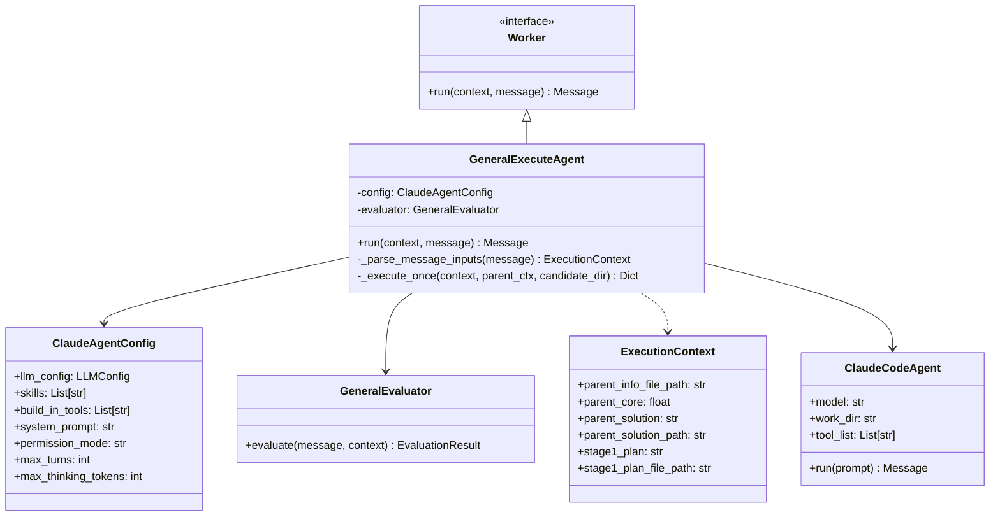
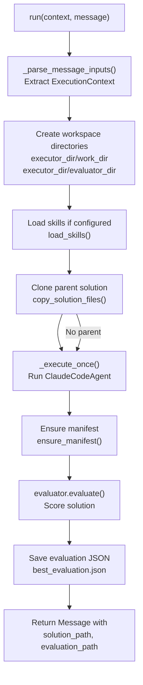
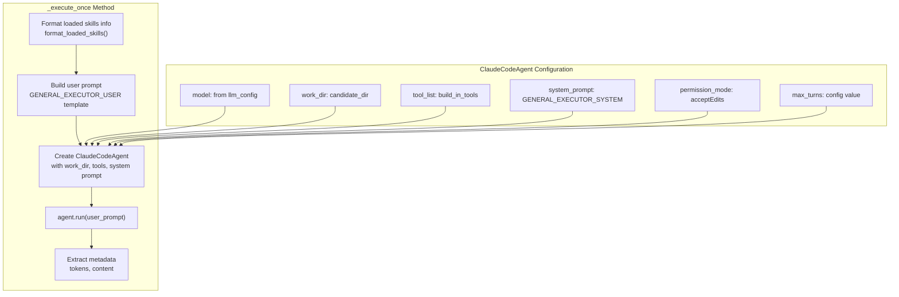
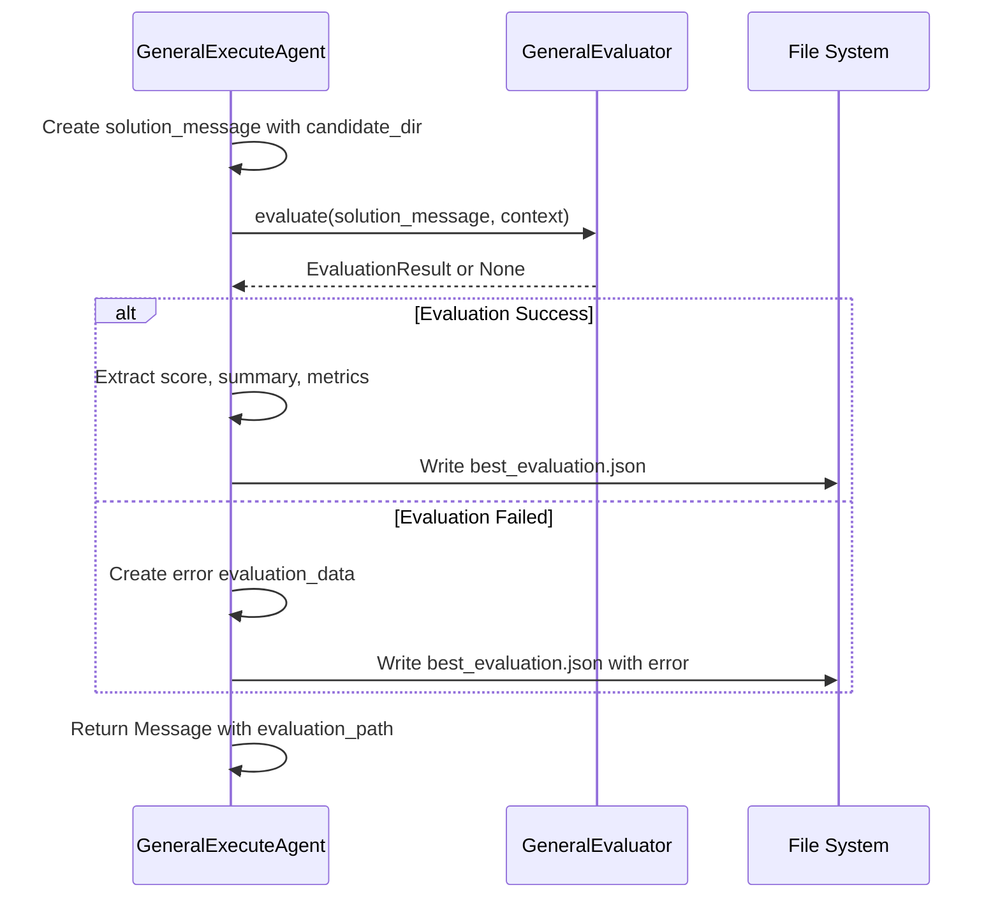

<!-- source: DeepWiki mcp.deepwiki.com · repo baidu-baige/LoongFlow · page 4.3 Executor Component · fetched 2026-10-26 -->

# Executor Component

<details>
<summary>Relevant source files</summary>

The following files were used as context for generating this wiki page:

- [agents/general_agent/executor.py](agents/general_agent/executor.py)
- [src/loongflow/framework/claude_code/claude_code_agent.py](src/loongflow/framework/claude_code/claude_code_agent.py)

</details>


The Executor Component is the second phase of the General Agent's PES (Plan-Execute-Summarize) workflow. It receives a plan from the Planner, sets up a workspace (Solution Pack), optionally clones a parent solution, executes the plan using ClaudeCodeAgent, and evaluates the resulting solution. This component is responsible for the actual code generation and solution evolution.

For information about the planning phase, see [Planner Component](#4.2). For details on skills and solution pack structure, see [Skills & Solution Packs](#4.4).

## Overview

The `GeneralExecuteAgent` class implements the `Worker` interface from the PES framework and orchestrates the execution phase. It manages workspace creation, solution inheritance, ClaudeCodeAgent execution, manifest generation, and evaluation in a linear workflow.

**Key Responsibilities:**
- Create and manage execution workspace directories
- Load skills into the workspace
- Clone parent solution files when evolving existing solutions
- Execute ClaudeCodeAgent to generate/modify solution code
- Ensure proper Solution Pack structure with manifest
- Evaluate the solution and return results

Sources: [agents/general_agent/executor.py:1-325]()

## Architecture

### Class Structure



Sources: [agents/general_agent/executor.py:28-65]()

### Execution Context

The `ExecutionContext` dataclass encapsulates information passed from the Planner to the Executor:

| Field | Type | Description |
|-------|------|-------------|
| `parent_info_file_path` | `str` | Path to `parent_info.json` containing parent solution metadata |
| `parent_core` | `float` | Score of the parent solution |
| `parent_solution` | `str` | JSON-serialized parent solution information |
| `parent_solution_path` | `str` | Absolute path to parent Solution Pack directory |
| `stage1_plan` | `str` | Plan text generated by the Planner |
| `stage1_plan_file_path` | `str` | Path to `best_plan.md` file |

Sources: [agents/general_agent/executor.py:28-38]()

## Execution Workflow

### Complete Execution Flow



Sources: [agents/general_agent/executor.py:68-219]()

### Detailed Workflow Steps

#### 1. Workspace Setup

The Executor creates a structured workspace within the executor directory:

```
executor_dir/
├── work_dir/          # Main workspace where ClaudeCodeAgent operates
│   ├── index.json     # Solution Pack manifest
│   └── [solution files]
└── evaluator_dir/     # Evaluation results directory
    └── best_evaluation.json
```

The workspace paths are obtained through `Workspace.get_executor_path()` and are absolute paths to ensure consistency across the execution lifecycle.

Sources: [agents/general_agent/executor.py:86-102]()

#### 2. Skills Loading

If skills are specified in the configuration, they are loaded into the `work_dir` before execution begins. Skills provide reusable code utilities that the agent can leverage:

```python
if self.config.skills:
    load_skills(
        skill_names=self.config.skills,
        work_dir=work_dir,
    )
```

Skills are copied as Python files into the workspace, making them immediately available for import by the agent.

Sources: [agents/general_agent/executor.py:105-120]()

#### 3. Parent Solution Cloning

When evolving an existing solution (non-initial iteration), the Executor clones the parent Solution Pack into the workspace:

```python
if parent_solution_path and os.path.isdir(parent_solution_path):
    copy_solution_files(parent_solution_path, candidate_dir)
```

This provides the agent with the starting codebase to modify and improve. If cloning fails or no parent exists, the agent starts with a fresh workspace.

Sources: [agents/general_agent/executor.py:129-141]()

## ClaudeCodeAgent Integration

### Agent Instantiation and Execution

The `_execute_once()` method creates and runs a `ClaudeCodeAgent` instance configured for the specific execution context:



Sources: [agents/general_agent/executor.py:255-324]()

### Prompt Construction

The executor constructs a comprehensive prompt for ClaudeCodeAgent using the `GENERAL_EXECUTOR_USER` template:

| Template Variable | Content Source | Description |
|------------------|----------------|-------------|
| `task_info` | `context.task` | Original task description |
| `improvement_plan` | `parent_ctx.stage1_plan` | Plan from Planner phase |
| `parent_solution` | `parent_ctx.parent_solution` | Serialized parent solution metadata |
| `solution_path` | `candidate_dir` | Absolute path to workspace |
| `loaded_skills` | `format_loaded_skills()` | Available skill descriptions |

The system prompt is either custom-provided via configuration or defaults to `GENERAL_EXECUTOR_SYSTEM`.

Sources: [agents/general_agent/executor.py:269-289]()

### Agent Configuration

The ClaudeCodeAgent is configured with specific parameters:

- **model**: Extracted from `llm_config.model` (must be Anthropic model)
- **work_dir**: Set to `candidate_dir` so all file operations are workspace-relative
- **tool_list**: Built-in Claude tools specified in `config.build_in_tools`
- **custom_tools**: Currently empty dictionary (extensible for future tools)
- **permission_mode**: Controls edit confirmation behavior (default: `"acceptEdits"`)
- **setting_sources**: Set to `["project"]` for project-level settings
- **max_turns**: Maximum conversation turns before termination
- **max_thinking_tokens**: Token limit for extended thinking mode

Sources: [agents/general_agent/executor.py:282-294]()

## Manifest Generation

After ClaudeCodeAgent execution, the Executor ensures the Solution Pack has a valid `index.json` manifest:

```python
await ensure_manifest(candidate_dir, self.config.llm_config.model_dump())
```

The manifest describes the Solution Pack structure and is required for proper solution tracking and evolution. The `ensure_manifest()` utility function:
1. Checks if `index.json` exists
2. If missing, generates it using LLM analysis of the workspace
3. Validates the manifest structure

Sources: [agents/general_agent/executor.py:148-157]()

## Evaluation Integration

### Evaluation Workflow



Sources: [agents/general_agent/executor.py:160-196]()

### Evaluation Data Structure

The evaluation results are saved to `evaluator_dir/best_evaluation.json` with the following structure:

```json
{
  "score": 0.0-1.0,
  "summary": "Human-readable evaluation summary",
  "status": "success|failure|no_evaluation|framework_error",
  "metrics": {
    "metric1": value,
    "metric2": value
  }
}
```

If evaluation fails or returns `None`, the Executor creates a fallback evaluation with score 0.0 and appropriate error information.

Sources: [agents/general_agent/executor.py:168-195](), [agents/general_agent/executor.py:203-205]()

## Message Interface

### Input Message Structure

The Executor receives a `Message` from the Planner containing:

```json
{
  "best_plan_file_path": "/path/to/best_plan.md",
  "parent_info_file_path": "/path/to/parent_info.json"
}
```

The `parent_info.json` contains:
- `score`: Parent solution score
- `solution`: Path to parent Solution Pack directory
- Additional metadata about the parent

Sources: [agents/general_agent/executor.py:221-253]()

### Output Message Structure

The Executor returns a `Message` with execution results:

| Field | Type | Description |
|-------|------|-------------|
| `best_plan_file_path` | `str` | Path to plan file (pass-through) |
| `best_solution_path` | `str` | Absolute path to Solution Pack (`work_dir`) |
| `best_evaluation_path` | `str` | Path to `best_evaluation.json` |
| `parent_info_file_path` | `str` | Path to parent info (pass-through) |
| `total_prompt_tokens` | `int` | Input tokens consumed |
| `total_completion_tokens` | `int` | Output tokens generated |

This message is passed to the Summary phase of the PES workflow.

Sources: [agents/general_agent/executor.py:207-219]()

## Configuration

### ClaudeAgentConfig Requirements

The `GeneralExecuteAgent` requires a `ClaudeAgentConfig` instance with the following mandatory fields:

- **llm_config**: Must be non-None and contain Anthropic model configuration
  - Model name must start with `"anthropic/"` prefix
  - API key and URL for Anthropic API access

### Model Validation

The Executor enforces Anthropic model usage:

```python
if not llm_config.model.startswith("anthropic/"):
    raise ValueError(
        "Executor: Only support Anthropic model, please use model name like anthropic/xxx."
    )
llm_config.model = llm_config.model.split("/")[-1]  # Extract model name after prefix
```

Sources: [agents/general_agent/executor.py:51-62]()

### Optional Configuration

| Parameter | Default | Description |
|-----------|---------|-------------|
| `skills` | `[]` | List of skill names to load into workspace |
| `build_in_tools` | `[]` | Built-in Claude tools to enable |
| `system_prompt` | `GENERAL_EXECUTOR_SYSTEM` | Custom system prompt for agent |
| `permission_mode` | `"acceptEdits"` | Edit confirmation mode |
| `max_turns` | Config-dependent | Maximum agent conversation turns |
| `max_thinking_tokens` | Config-dependent | Token limit for extended thinking |

Sources: [agents/general_agent/executor.py:43-64]()

## Error Handling

The Executor implements robust error handling at multiple levels:

1. **Skills Loading Failure**: Logs error and raises exception, preventing execution with incomplete environment
2. **Parent Cloning Failure**: Logs warning and continues with fresh workspace
3. **Manifest Generation Failure**: Logs error but continues (non-fatal)
4. **Evaluation Failure**: Creates fallback evaluation with score 0.0 and error details
5. **Missing Input Files**: Raises `FileNotFoundError` with descriptive message

All errors are logged with the `trace_id` for debugging and tracking through the evolution process.

Sources: [agents/general_agent/executor.py:117-120](), [agents/general_agent/executor.py:138-141](), [agents/general_agent/executor.py:154-157](), [agents/general_agent/executor.py:188-195](), [agents/general_agent/executor.py:231-232]()

## Integration with PES Framework

### Worker Registration

The `GeneralExecuteAgent` is registered with `PESAgent` as the executor worker:

```python
class GeneralExecuteAgent(Worker):
    """Execute Agent - Linear execution with Solution Pack generation"""
```

The PES framework calls the `run()` method with a `Context` and `Message`, expecting a `Message` response that can be passed to the Summary phase.

Sources: [agents/general_agent/executor.py:40-41]()

### Context Usage

The Executor leverages the `Context` object for:
- `trace_id`: Request tracking in logs
- `current_iteration` / `total_iterations`: Progress tracking
- `task`: Original task description for prompt construction
- Workspace path calculation via `Workspace.get_executor_path()`

Sources: [agents/general_agent/executor.py:68-102]()

---

