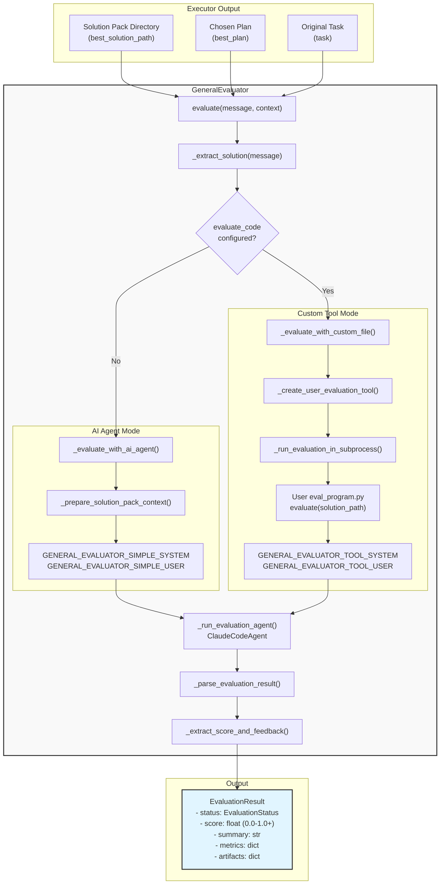
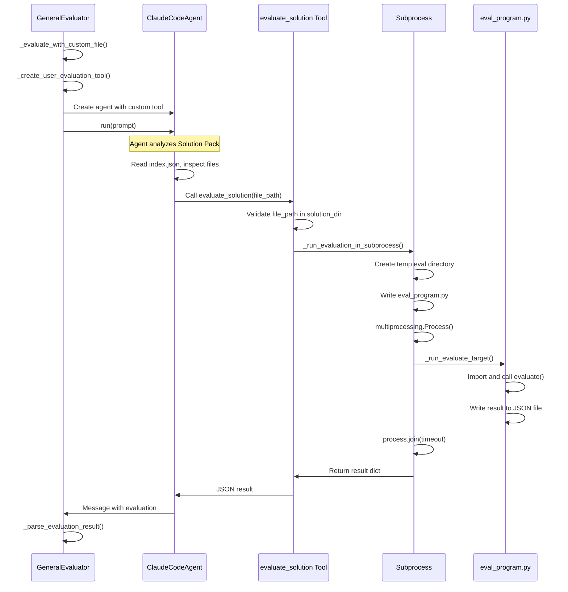
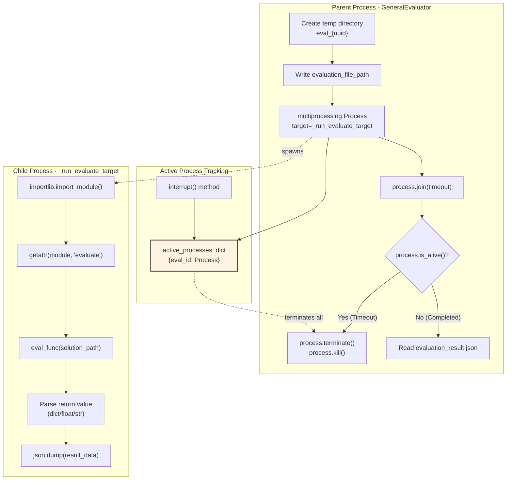
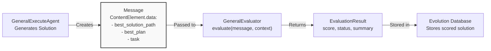

<!-- source: DeepWiki mcp.deepwiki.com · repo baidu-baige/LoongFlow · page 4.4 Evaluator Component · fetched 2026-10-26 -->

# Evaluator Component

<details>
<summary>Relevant source files</summary>

The following files were used as context for generating this wiki page:

- [agents/general_agent/evaluator.py](agents/general_agent/evaluator.py)

</details>


The `GeneralEvaluator` is the evaluation component of the General Agent, responsible for assessing the quality of generated solutions and assigning scores. It supports two evaluation modes: AI Agent self-evaluation and custom tool-based evaluation using user-provided scripts. The evaluator uses multiprocessing for isolation and precise timeout control to ensure robust execution.

For information about how the Evaluator fits into the overall PES cycle, see [PESAgent Architecture](#3.2). For details on the Executor that generates solutions for evaluation, see [Executor Component](#4.3). For configuration details, see [Configuration & Running](#4.6).

---

## Overview

The `GeneralEvaluator` class inherits from the framework's `Evaluator` base class and is called by the Executor after solution generation. It operates in one of two modes:

| Mode | Description | Use Case |
|------|-------------|----------|
| **AI Agent Mode** | LLM evaluates solution via system prompt | Subjective quality assessment, code review, architectural evaluation |
| **Custom Tool Mode** | User-provided `eval_program.py` runs in subprocess | Objective testing, test suite execution, benchmark scoring |

Both modes receive Solution Pack directories as input and return an `EvaluationResult` with a score (0.0-1.0+), status, summary, and optional metrics.

**Sources:** [agents/general_agent/evaluator.py:1-53]()

---

## Evaluation Architecture



**Evaluation Flow Diagram**: Shows how the evaluator processes Solution Pack input through either AI Agent or Custom Tool mode, ultimately producing an `EvaluationResult`.

**Sources:** [agents/general_agent/evaluator.py:45-144](), [agents/general_agent/evaluator.py:328-469]()

---

## AI Agent Evaluation Mode

In AI Agent mode, the evaluator uses a `ClaudeCodeAgent` to assess the solution based on a system prompt. This mode is suitable for subjective quality assessments where LLM judgment is appropriate.

### Workflow

1. **Solution Pack Context Preparation**: The evaluator calls `_prepare_solution_pack_context()` to read the Solution Pack structure (manifest, files, metadata) into a formatted string representation.

2. **Prompt Construction**: The system prompt `GENERAL_EVALUATOR_SIMPLE_SYSTEM` instructs the agent on evaluation criteria, while `GENERAL_EVALUATOR_SIMPLE_USER` provides the template for presenting the solution, plan, and task.

3. **Agent Execution**: A `ClaudeCodeAgent` is instantiated with the evaluator's workspace directory and configured skills. The agent has access to file system tools and can inspect the solution.

4. **Result Parsing**: The agent's response is expected to contain a score and feedback in this format:
   ```
   Score: 0.85
   Feedback: Your detailed feedback here
   ```

The `_extract_score_and_feedback()` method uses regex to parse these fields from the agent's response.

**Key Code Entities:**
- `_evaluate_with_ai_agent(solution_dir, plan, task)` - [agents/general_agent/evaluator.py:446-469]()
- `_prepare_solution_pack_context(solution_dir)` - referenced in [agents/general_agent/evaluator.py:461]()
- `GENERAL_EVALUATOR_SIMPLE_SYSTEM` and `GENERAL_EVALUATOR_SIMPLE_USER` - imported from [agents/general_agent/evaluator.py:29-30]()
- `_extract_score_and_feedback(content)` - [agents/general_agent/evaluator.py:295-326]()

**Sources:** [agents/general_agent/evaluator.py:446-469](), [agents/general_agent/evaluator.py:295-326]()

---

## Custom Tool Evaluation Mode

Custom Tool mode provides objective, deterministic evaluation by running user-provided Python scripts. This mode is essential for tasks requiring test execution, correctness verification, or benchmark scoring.

### User Evaluation Script Interface

Users provide an `eval_program.py` file in their task directory with an `evaluate()` function:

```python
def evaluate(solution_path: str) -> dict | float | str:
    """
    Evaluate the solution at the given path.
    
    Args:
        solution_path: Path to solution file (chosen by AI agent from Solution Pack)
    
    Returns:
        - dict: {"status": str, "score": float, "summary": str, "metrics": dict, "artifacts": dict}
        - float/int: Direct score value (0.0-1.0+)
        - str: Score as string or summary text
    """
    # User implementation
    pass
```

### Tool-Based Evaluation Flow



**Custom Tool Evaluation Sequence**: Shows the flow from evaluator through ClaudeCodeAgent to subprocess execution of user script.

**Sources:** [agents/general_agent/evaluator.py:409-444](), [agents/general_agent/evaluator.py:472-601](), [agents/general_agent/evaluator.py:603-732]()

### Two-Stage Agent Involvment

The Custom Tool mode involves the AI agent in two ways:

1. **File Selection**: The agent analyzes the Solution Pack structure (reads `index.json`, inspects files) and decides which file to evaluate. This is necessary because the Executor may generate multi-file solutions.

2. **Result Interpretation**: After the subprocess completes, the agent receives the raw evaluation result (score, summary, metrics) and can provide additional context or interpretation.

The `evaluate_solution` tool is defined with clear parameter specifications:

**Sources:** [agents/general_agent/evaluator.py:591-600]()

---

## Subprocess Isolation and Timeout Control

The evaluator uses Python's `multiprocessing` module to run user evaluation scripts in isolated subprocesses, providing robust timeout control and preventing evaluation failures from crashing the main process.

### Subprocess Execution Architecture



**Subprocess Isolation Architecture**: Demonstrates multiprocessing-based isolation with timeout control and interrupt handling.

**Sources:** [agents/general_agent/evaluator.py:603-732](), [agents/general_agent/evaluator.py:734-840]()

### Process Lifecycle

1. **Process Creation**: A temporary directory `eval_{uuid}` is created in the evaluator's workspace. The evaluation code is written to `evaluator_code.py`.

2. **Process Start**: `multiprocessing.Process` is spawned with `_run_evaluate_target` as the target function. The process is registered in `self._active_processes` for interrupt handling.

3. **Timeout Enforcement**: `process.join(timeout)` blocks for the configured timeout period. If the process is still alive after timeout, it is terminated with `terminate()`, then `kill()` if necessary.

4. **Result Retrieval**: The child process writes results to `evaluation_result.json`. The parent reads this file after completion.

5. **Error Handling**: Exceptions in the child process are caught and written to the result file with traceback information in the `artifacts` field.

**Key Parameters:**
- Timeout configured via `EvaluatorConfig.timeout` (default 300s)
- Result file path: `{work_dir}/eval_{uuid}/evaluation_result.json`
- Evaluation script path: `{work_dir}/eval_{uuid}/evaluator_code.py`

**Sources:** [agents/general_agent/evaluator.py:603-732](), [agents/general_agent/evaluator.py:734-840]()

---

## EvaluationResult Structure

Both evaluation modes return an `EvaluationResult` object with the following structure:

| Field | Type | Description |
|-------|------|-------------|
| `status` | `EvaluationStatus` | Enum: `SUCCESS`, `VALIDATION_FAILED`, `EXECUTION_FAILED`, `FRAMEWORK_ERROR` |
| `score` | `float` | Numeric score, typically 0.0-1.0, but can exceed 1.0 for exceptional solutions |
| `summary` | `str` | Human-readable evaluation summary or feedback |
| `metrics` | `dict` | Optional metrics dictionary (e.g., test pass rate, benchmark times) |
| `artifacts` | `dict` | Optional artifacts (e.g., error traces, logs) |

### Score Interpretation

The evaluator normalizes scores to be non-negative: `score = max(0.0, float(score))`. Scores above 1.0 are permitted to represent solutions exceeding expectations.

- **0.0**: Complete failure or invalid solution
- **0.1-0.5**: Partial solution with significant issues
- **0.5-0.8**: Functional solution with minor issues
- **0.8-1.0**: High-quality solution meeting requirements
- **> 1.0**: Exceptional solution exceeding requirements

### Status Mapping

```python
if score > 0.0:
    status = EvaluationStatus.SUCCESS
else:
    status = EvaluationStatus.VALIDATION_FAILED
```

**Sources:** [agents/general_agent/evaluator.py:238-293](), [loongflow/framework/pes/evaluator/evaluator.py]() (referenced in imports)

---

## Configuration

The `GeneralEvaluator` is configured via `EvaluatorConfig` which includes:

### Configuration Fields

```yaml
evaluators:
  llm_config:
    model: "anthropic/claude-3-5-sonnet-20241022"  # Must be Anthropic model
    api_key: "${ANTHROPIC_API_KEY}"
    url: null
  
  agent:
    skills: ["code-analysis"]                      # Optional skills to load
    disallowed_tools: []                           # Tools to disable
    build_in_tools: null                           # Override default tool list
    system_prompt: null                            # Custom system prompt
    permission_mode: "acceptEdits"                 # File edit permission mode
    max_turns: 50                                  # Max conversation turns
    max_thinking_tokens: null                      # Extended thinking limit
    max_output_tokens: null                        # Response token limit
  
  timeout: 300                                     # Evaluation timeout in seconds
  evaluate_code: null                              # Path to custom eval_program.py (optional)
```

### Model Restrictions

The evaluator requires Anthropic models and enforces this at initialization:

```python
if not llm_config.model.startswith("anthropic/"):
    raise ValueError("Evaluator: Only support Anthropic model...")
```

This restriction exists because the evaluator uses `ClaudeCodeAgent` which is built on Anthropic's Agent SDK.

**Sources:** [agents/general_agent/evaluator.py:55-78]()

---

## Workspace Organization

The evaluator creates a dedicated workspace within the iteration directory:

```
workspace_path/task-{uuid}/
└── {iteration}/
    └── evaluator/                    # Created by Workspace.get_evaluator_path()
        ├── eval_{uuid1}/             # Subprocess temp directory (Custom Tool mode)
        │   ├── evaluator_code.py     # User's eval_program.py
        │   └── evaluation_result.json
        ├── eval_{uuid2}/
        └── ...
```

The workspace path is determined by the `Context` object and accessed via:

```python
work_dir = str(Workspace.get_evaluator_path(context, create=True))
```

**Sources:** [agents/general_agent/evaluator.py:104-112]()

---

## Integration with PES Cycle

The evaluator is invoked by the Executor after solution generation:



**PES Integration Flow**: Shows how the evaluator receives executor output and feeds into the evolution database.

### Message Protocol

The Executor passes a `Message` with a `ContentElement` containing:

```python
{
    "best_solution_path": "/path/to/solution_pack",  # Absolute path to Solution Pack
    "best_plan": "Plan content...",                  # Planner's chosen plan
    "task": "Original task description..."           # User's task specification
}
```

The evaluator extracts this data in `_extract_solution()` and validates that:
1. `best_solution_path` is an absolute directory path
2. The directory exists and is a valid Solution Pack
3. Plan and task are non-empty strings

**Sources:** [agents/general_agent/evaluator.py:168-213]()

---

## Interrupt Handling

The evaluator supports graceful interruption via the `interrupt()` method:

```python
def interrupt(self) -> None:
    """Interrupt the current evaluation process."""
    self._is_interrupted = True
    
    # Terminate all active subprocess evaluations
    for eval_id, process in list(self._active_processes.items()):
        if process.is_alive():
            process.terminate()
            process.join(timeout=5)
            if process.is_alive():
                process.kill()
    
    self._active_processes.clear()
```

This method is called by the framework when:
- User requests task termination (e.g., `./run_general.sh stop task_name`)
- Iteration timeout is reached
- System shutdown is initiated

The interrupt mechanism ensures that:
1. All subprocess evaluations are terminated
2. Process resources are cleaned up
3. No zombie processes remain

**Sources:** [agents/general_agent/evaluator.py:145-167]()

---

## Factory Function

The module provides a factory function for creating evaluators:

```python
def create_evaluator(config: EvaluatorConfig) -> GeneralEvaluator:
    """Factory function to create a GeneralEvaluator."""
    return GeneralEvaluator(config)
```

This function is used by the General Agent's worker registration:

```python
# In general_evolve_agent.py
evaluator_factory = lambda config: create_evaluator(config)
runner.register_evaluator(evaluator_factory)
```

**Sources:** [agents/general_agent/evaluator.py:842-864]()

---

## Error Handling and Recovery

The evaluator implements comprehensive error handling at multiple levels:

### Framework-Level Errors

Exceptions during evaluation setup or execution result in `EvaluationStatus.FRAMEWORK_ERROR`:

```python
return EvaluationResult(
    status=EvaluationStatus.FRAMEWORK_ERROR,
    score=0.0,
    summary=f"Evaluation failed: {str(e)}",
    metrics={"error": str(e)},
)
```

### Subprocess Errors

Errors in the user's evaluation script are caught in `_run_evaluate_target()` and returned as:

```python
result_data = {
    "status": "execution_failed",
    "summary": f"Evaluation failed: {str(e)}",
    "artifacts": {
        "stderr": f"{traceback.format_exc()}",
        "exception": str(e),
    }
}
```

### Timeout Errors

Subprocess timeouts are detected via `process.is_alive()` after `process.join(timeout)`:

```python
if process.is_alive():
    process.terminate()
    return {
        "status": "framework_error",
        "score": 0.0,
        "summary": f"Evaluation timed out after {timeout}s",
        "metrics": {"timeout": timeout},
    }
```

**Sources:** [agents/general_agent/evaluator.py:135-143](), [agents/general_agent/evaluator.py:663-677](), [agents/general_agent/evaluator.py:826-832]()

---

